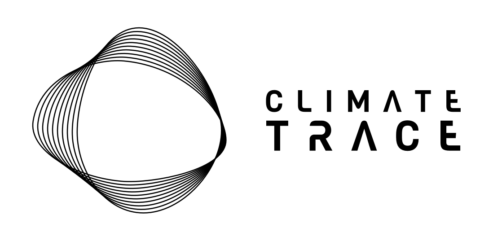

## This document provides references and links to publications, peer-reviewed articles, and mentions of the Climate TRACE sector leads and members.
### Refer to our most [up-to-date methodologies](../Sector-Methodologies/) for specific sector approaches to estimate emissions. 
### To view and download Climate TRACE emissions data, visit the [Climate TRACE website](https://climatetrace.org/).

_**<h6>Last updated: November 9, 2026</h6>**_
---

## 1. Articles Authored or Co-Authored by Climate TRACE Coalition Members

### Agriculture

#### Cattle Emissions (Remote Sensing Lab at Saint Louis University)

- Pawar, A., Sagan, V., Tesser, D., Farbo, A., Boyda, E. and Davitt, A., 2026.  
  **The Bovine Slurry Index (BSI): An integrated framework for manure pond mapping using GeoFM-derived cattle-operation detection and Sentinel-2 spectral formulation.**  
  *International Journal of Applied Earth Observation and Geoinformation*, 154, p.105656.  
  https://doi.org/10.1016/j.jag.2026.105656

#### Cattle Emissions (Harvard University)

- Hancock, S.E., Jacob, D.J., Chen, Z., Nesser, H., Davitt, A., Varon, D.J., Sulprizio, M.P., Balasus, N., Estrada, L.A., Cazorla, M. and Dawidowski, L., 2025.  
  **Satellite quantification of methane emissions from South American countries: a high-resolution inversion of TROPOMI and GOSAT observations.**  
  *Atmospheric Chemistry and Physics*, 25(2), pp.797–817.  
  https://acp.copernicus.org/articles/25/797/2025/

#### Rice Emissions (Paddy Watch/Universiti Malaysia Terengganu)

- Fatchurrachman, Rudiyanto, Ginting, F.I., Soh, N.C., Shah, R.M., Giap, S.G.E., Setiawan, B.I., Powell, V., Hsu, M., Schiller, S., Davitt, A., Setia, R. and Minasny, B., 2026.  
  **SARice: A 10 m rice extent and cropping-frequency dataset for South Asia derived from Sentinel-1 and Sentinel-2 time series.**  
  *Scientific Data*.  
  https://doi.org/10.1038/s41597-026-08416-4

- Ginting, F.I., Shah, R.M., Soh, N.C., Giap, S.G.E., Fiantis, D., Setiawan, B.I., Powell, V., Hsu, M., Schiller, S., Davitt, A. and Minasny, B., 2026.  
  **High-resolution mapping of rice cropping pattern, intensity, calendar, and ecosystem type across Southeast Asia.**  
  *Remote Sensing Applications: Society and Environment*, p.102143.  
  https://doi.org/10.1016/j.rsase.2026.102143

- Ginting, F.I., Rudiyanto, R., Fatchurrachman et al., 2025.  
  **High-resolution maps of rice cropping intensity across Southeast Asia.**  
  *Scientific Data*, 12, 1408.  
  https://doi.org/10.1038/s41597-025-05722-1

- Fatchurrachman, Rudiyanto, Soh, N.C., Shah, R.M., Giap, S.G.E., Setiawan, B.I. and Minasny, B., 2022.  
  **High-Resolution Mapping of Paddy Rice Extent and Growth Stages across Peninsular Malaysia Using a Fusion of Sentinel-1 and 2 Time Series Data in Google Earth Engine.**  
  *Remote Sensing*, 14(8), p.1875.  
  https://doi.org/10.3390/rs14081875

- Rudiyanto, Minasny, B., Shah, R.M., Che Soh, N., Arif, C. and Indra Setiawan, B., 2019.  
  **Automated near-real-time mapping and monitoring of rice extent, cropping patterns, and growth stages in Southeast Asia using Sentinel-1 time series on a Google Earth Engine platform.**  
  *Remote Sensing*, 11(14), p.1666.  
  https://doi.org/10.3390/rs11141666

#### Soil and Fertilizer Emissions (Michigan State University)

- Northrup, D.L., Basso, B., Wang, M.Q., Morgan, C.L. and Benfey, P.N., 2021.  
  **Novel technologies for emission reduction complement conservation agriculture to achieve negative emissions from row-crop production.**  
  *Proceedings of the National Academy of Sciences*, 118(28), p.e2022666118.  
  https://www.pnas.org/doi/10.1073/pnas.2022666118

- Saha, D., Basso, B. and Robertson, G.P., 2021.  
  **Machine learning improves predictions of agricultural nitrous oxide (N₂O) emissions from intensively managed cropping systems.**  
  *Environmental Research Letters*, 16(2), p.024004.  
  https://iopscience.iop.org/article/10.1088/1748-9326/abd2f3/meta

### Buildings

#### Onsite Building Emissions (Duke University)

- Markakis, P.J., Gowdy, T.M., Malof, J.M., Sheng, Z., Lancellotti, B., Collins, L., Davitt, A. and Bradbury, K., 2026.  
  **Estimating global, high-resolution onsite building greenhouse gas emissions.**  
  *npj Urban Sustainability*.  
  https://doi.org/10.1038/s42949-026-00433-x

### Forestry and Land Use

#### Ecosystem Impact on GHG Emissions (São Paulo State University – UNESP)

- da Costa, L.M., Davitt, A., Volpato, G., de Mendonça, G.C., Panosso, A.R. and La Scala Jr, N., 2025.  
  **A comparative analysis of GHG inventories and ecosystems carbon absorption in Brazil.**  
  *Science of the Total Environment*, 958, p.177932.  
  https://www.sciencedirect.com/science/article/abs/pii/S0048969724080896

#### Forestry Emissions (CTrees)

- Xu, L., Saatchi, S.S., Yang, Y., Yu, Y., Pongratz, J., Bloom, A.A., Bowman, K., Worden, J., Liu, J., Yin, Y. and Domke, G., 2021.  
  **Changes in global terrestrial live biomass over the 21st century.**  
  *Science Advances*, 7(27), p.eabe9829.  
  https://www.science.org/doi/10.1126/sciadv.abe9829

### Power

#### Electricity Emissions (WattTime)

- Couture, H.D., Alvara, M., Freeman, J., Davitt, A., Koenig, H., Kargar, A.R., O'Connor, J., Söldner-Rembold, I., Ferreira, A., Jeyaratnam, J. and Lewis, J., 2024.  
  **Estimating Carbon Dioxide Emissions from Power Plant Water Vapor Plumes Using Satellite Imagery and Machine Learning.**  
  *Remote Sensing*, 16(7), p.1290.  
  https://doi.org/10.3390/rs16071290

- Hobbs, M., Kargar, A.R., Couture, H., Freeman, J., Söldner-Rembold, I., Ferreira, A., Jeyaratnam, J., O'Connor, J., Lewis, J., Koenig, H. and McCormick, C., 2023.  
  **Inferring Carbon Dioxide Emissions From Power Plants Using Satellite Imagery and Machine Learning.**  
  IGARSS 2023 – IEEE International Geoscience and Remote Sensing Symposium.  
  https://ieeexplore.ieee.org/abstract/document/10283046

- Couture, H.D., O'Connor, J., Mitchell, G., Söldner-Rembold, I., D'souza, D., Karra, K., Zhang, K., Kargar, A.R., Kassel, T., Goldman, B., Tyrrell, D., Czerwinski, W., Talekar, A. and McCormick, C., 2020.  
  **Towards Tracking the Emissions of Every Power Plant on the Planet.**  
  NeurIPS 2020 Workshop on Tackling Climate Change with Machine Learning.  
  https://www.climatechange.ai/papers/neurips2020/11

- Couture, H., 2020.  
  **How to track the emissions of every power plant on the planet from space.**  
  *IEEE Spectrum*.  
  https://spectrum.ieee.org/how-to-track-the-emissions-of-every-power-plant-on-the-planet-from-space

### Fossil Fuel Operations

#### Oil & Gas Emissions (RMI)

- Marcel, V., Gordon, D., Ogeer, N. and Omonbude, E.J., 2023.  
  **Left behind: emerging oil and gas producers in a warming world.**  
  *Climate Policy*, 23(9), pp.1151–1166.  
  https://doi.org/10.1080/14693062.2023.2231398

- Lu, X., Jacob, D.J., Wang, H., Maasakkers, J.D., Zhang, Y., Scarpelli, T.R., Shen, L., Qu, Z., Sulprizio, M.P., Nesser, H., Bloom, A.A., Ma, S., Worden, J.R., Fan, S., Parker, R.J., Boesch, H., Gautam, R., Gordon, D., Moran, M.D., Reuland, F., Villasana, C.A.O. and Andrews, A., 2022.  
  **Methane emissions in the United States, Canada, and Mexico: evaluation of national methane emission inventories and 2010–2017 sectoral trends by inverse analysis of in situ (GLOBALVIEWplus CH₄ ObsPack) and satellite (GOSAT) atmospheric observations.**  
  *Atmospheric Chemistry and Physics*, 22, pp.395–418.  
  https://acp.copernicus.org/articles/22/395/2022/

- Scarpelli, T.R., Jacob, D.J., Grossman, S., Lu, X., Qu, Z., Sulprizio, M.P., Zhang, Y., Reuland, F., Gordon, D. and Worden, J.R., 2022.  
  **Updated Global Fuel Exploitation Inventory (GFEI) for methane emissions from the oil, gas, and coal sectors: evaluation with inversions of atmospheric methane observations.**  
  *Atmospheric Chemistry and Physics*, 22(5), pp.3235–3249.  
  https://doi.org/10.5194/acp-22-3235-2022

### Transportation

#### Road Emissions (Johns Hopkins University Applied Physics Laboratory)

- Rollend, D., Foster, K., Kott, T.M., Mocharla, R., Muñoz, R., Fendley, N., Ashcraft, C., Willard, F., Reilly, E.P. and Hughes, M., 2023.  
  **Machine learning for activity-based road transportation emissions estimation.**  
  *Environmental Data Science*, 2.  
  https://doi.org/10.1017/eds.2023.32

- Mukherjee, R., Rollend, D., Christie, G.A., Hadžić, A., Matson, S., Saksena, A. and Hughes, M., 2021.  
  **Towards Indirect Top-Down Road Transport Emissions Estimation.**  
  *IEEE/CVF Conference on Computer Vision and Pattern Recognition Workshops (CVPRW)*, pp.1092–1101.  
  https://doi.org/10.1109/cvprw53098.2021.00120

---

## 2. Preprints Authored or Co-Authored by Climate TRACE Coalition Members

Articles posted to preprint servers (arXiv, ESS Open Archive) that have not yet been peer reviewed or published in a journal.

- Doctor, Z., Lewis, C., Moore, D.P., Raniga, K. and Davitt, A., 2026.  
  **Comment on 'Assessing the accuracy of the Climate TRACE global vehicular CO₂ emissions'.**  
  *ESS Open Archive* [preprint].  
  https://doi.org/10.22541/essoar.15005898/v1

- Lancellotti, B.V., Malof, J.M., Davitt, A., McCormick, G., Anderson, S., Carbó-Mestre, P., Collins, G., Crane, V., Doctor, Z., Ebri, G., Foster, K., Gowdy, T.M., Guzzardi, M., Heal, J., Hunter, H., Kroodsma, D., Galib, K.M., Markakis, P.J., McDonald, G., Moore, D.P., Nguyen, E.D., Parvu, S., Pekala, M., Piatko, C.D., Piscopo, A., Powell, M., Raniga, K., Reilly, E.P., Robinette, M., Saraswat, I., Sicurello, P., Söldner-Rembold, I., Song, R., Underwood, C. and Bradbury, K., 2025.  
  **Closing Gaps in Emissions Monitoring with Climate TRACE.**  
  *arXiv* [preprint].  
  https://doi.org/10.48550/arXiv.2511.19277

---

## 3. Articles That Employ Climate TRACE Data into Their Work

### Country Inventories

- Liu, Y., Han, Y., Ren, K., Shen, Q., Gao, Y., Li, Z., Wang, Z., Jing, K., Mao, Y., Yu, M., et al., 2026.  
  **基于多源数据的全球含氟气体排放时空演变及驱动机制分析 (Spatiotemporal Evolution and Driving Mechanism Analysis of Global Fluorinated Gas Emissions Based on Multi-Source Data.)**  
  *Journal of Energy and Climate Change*, 2(4), pp.578–592.  
  https://doi.org/10.3724/j.issn.2097-4981.jecc-2026-0028

- Kunimitsu, T. and Andrew, R.M., 2026.  
  **Monthly-updated territorial fossil CO₂ emissions estimates for Japan.**  
  *Earth System Science Data*, 18(11), pp.8003–8035.  
  https://doi.org/10.5194/essd-18-8003-2026

- Tsagatakis, I., Richardson, J., Evangelides, C., Hows, S-M., Hamilton, N., Richmond, B., Pearson, B., Passant, N., Wakeling, D., Pommier, M., Bost, J., Morrison, E., Brookes, D. and Vaughan, A., 2026.  
  **UK Spatial Emissions Methodology: National Atmospheric Emissions Inventory 2024.**  
  *Ricardo (WSP) for the Department for Energy Security and Net Zero and Defra*, Ref. ED18140155, Issue 1.  
  https://naei.energysecurity.gov.uk/sites/default/files/2026-10/UK_Spatial_Emissions_Methodology_for_NAEI_2024_v1.pdf

- Aytaç, E., 2023.  
  **The Distribution and Trends of Greenhouse Gas Emissions in Türkiye.**  
  *International Conference on Innovative Academic Studies (ICIAS)*.  
  https://doi.org/10.59287/icias.1562

### Economics

- Shah, A., Bastidas, D., Vernon-Lin, N. and Zhunussova, K., 2026.  
  **The Impact of the EU CBAM and Carbon Pricing in Bosnia and Herzegovina.**  
  *International Monetary Fund*  
  https://www.elibrary.imf.org/view/journals/018/2026/078/018.2026.issue-078-en.xml?Tabs=contentSummary-111696

- Vriz, G.L., Cojoianu, T., Fischer, C. and Taschini, L., 2026.  
  **Early signs that the EU carbon border adjustment mechanism is reshaping EU–India steel trade.**  
  *Nature Climate Change*, 16(6), pp.737–741.  
  https://doi.org/10.1038/s41558-026-02607-y

- Zhang, S. and Almond, D., 2026.  
  **Too little too late? Nationwide carbon trading in China.**  
  *Journal of Public Economics*, 263, p.105798.  
  https://doi.org/10.1016/j.jpubeco.2026.105798

- Nicolle, A., Lowing, D. and Cebreros-Saettone, D.M., 2026.  
  **Kickstarting Carbon Capture and Storage adoption: Tailoring subsidies to emitters' needs.**  
  *Energy Economics*, 157, p.109246.  
  https://doi.org/10.1016/j.eneco.2026.109246

- Atalar, D., Demir, B. and Dhingra, S., 2026.  
  **Plastic Dumping Grounds: The International Incidence of Environmental Regulation.**  
  *CESifo Working Paper*.  
  https://doi.org/10.65864/db2kbop0n4

- OECD, 2026.  
  **Advancing the Implementation of the EU Carbon Border Adjustment Mechanism.**  
  *OECD Publishing*.  
  https://doi.org/10.1787/3ff6655c-en

- Clausing, K.A., Colmer, J., Hsiao, A.J. and Wolfram, C., 2025.  
  **The Global Effects of Carbon Border Adjustment Mechanisms.**  
  *National Bureau of Economic Research*, Working Paper 33723.  
  https://doi.org/10.3386/w33723

- OECD, 2025.  
  **Towards interoperable carbon intensity metrics.**  
  *Inclusive Forum on Carbon Mitigation Approaches Working Papers*.  
  https://doi.org/10.1787/a9cdb1ba-en

- OECD and Climate Club, 2025.  
  **Carbon intensity metrics in the steel and cement sectors of Climate Club members.**  
  *OECD Publishing*.  
  https://doi.org/10.1787/56681870-en

- Zhang, B., Kang, J. and Feng, T., 2024.  
  **Global disparities in CO₂ emissions from mobility sectors of diverse economies: A macroscopic exploration across 188 countries/regions.**  
  *Environmental and Sustainability Indicators*, 23, p.100455.  
  https://doi.org/10.1016/j.indic.2024.100455

- Kadach, I., Koo, M., Martin, X. and Zhao, M., 2024.  
  **Decipher Market Responses to Climate TRACE Emission Data Release.**  
  *SSRN* [preprint].  
  https://papers.ssrn.com/sol3/papers.cfm?abstract_id=4961358

### Government and Policy

- Phuong, L.V.U. and Hoang, A., 2026.  
  **From signals to discipline: Benchmarking Vietnam's transport decarbonization against the Norwegian experience.**  
  *Energy Policy*, 217, p.115464.  
  https://doi.org/10.1016/j.enpol.2026.115464

- Hayes, D., Wu, V.Y., Athar, A., Auraghi, A., Brumberg, H., Cruz, M., Carter, K., Chadwick, A., Edelson, O., Rivera-Korver, S. and Ruiz, R., 2025.  
  **Increasing accessibility to trusted climate performance data.**  
  *Stanford Law School Law and Policy Lab, 2025*.  
  https://papers.ssrn.com/sol3/papers.cfm?abstract_id=6863883

- Shukla, S., Horowitz, C., Reuland, F., Damon, G. and Escudero, J.P., 2025.  
  **Hunting methane using satellites: A guide for policymakers.**  
  *Los Angeles, CA: UCLA Law Emmett Institute on Climate Change and the Environment and UC Berkeley Law Center for Law, Energy & the Environment.*  
  https://law.ucla.edu/sites/default/files/PDFs/Publications/Hunting%20Methane%20Using%20Satellites_CLEE_Apr2025final.pdf

- Scientific and Technical Advisory Panel (STAP) and United Nations Environment Programme, 2025.  
  **Artificial Intelligence and the GEF: STAP's Early Thoughts – A STAP Information Note.**  
  *Global Environment Facility*.  
  https://doi.org/10.59117/20.500.11822/49231

- Hsu, A. and Schletz, M., 2024.  
  **Digital technologies–the missing link between climate action transparency and accountability?.**  
  *Climate Policy*, 24(2), pp.193-210.,  
  https://doi.org/10.1080/14693062.2023.2237937

- Herman, K.S., 2024.  
  **Doomed to fail? A call to reform global climate governance and greenhouse gas inventories.**  
  *International Environmental Agreements: Politics, Law and Economics*, 24(2-3), pp.257–288.  
  https://doi.org/10.1007/s10784-024-09637-x

- Gupta, A., 2023.  
  **The advent of 'radical' transparency: Transforming multilateral climate politics?**  
  *PLOS Climate*, 2(1), e0000117.  
  https://doi.org/10.1371/journal.pclm.0000117

- Voosen, P., 2023.  
  **Al Gore's climate watchdog spots emission gaps.**  
  *Science*, 382(6675), pp.1096–1097.  
  https://doi.org/10.1126/science.adn3524

- Haines, A., Whitmee, S. and Anton, B., 2023.  
  **Accountability for carbon emissions and health equity.**  
  *Bulletin of the World Health Organization*, 101(2), pp.83–83A.  
  https://doi.org/10.2471/blt.22.289452

- United Nations Environment Programme, 2023.  
  **Strengthening transparency of non-state actors: How national experiences and new digital technologies can strengthen the Transparency efforts of non-state actors.**  
  *UNEP*.  
  https://doi.org/10.59117/20.500.11822/43573

- Gore, A., 2022.  
  **Measure emissions to manage emissions.**  
  *Science*, 378(6619), pp.455–455.  
  https://doi.org/10.1126/science.adf5788

- Schletz, M., Hsu, A., Mapes, B.R. and Wainstein, M.E., 2022.  
  **Nested Climate Accounting for Our Atmospheric Commons–-Digital Technologies for Trusted Interoperability Across Fragmented Systems.**  
  *Frontiers in Blockchain*, 4.  
  https://doi.org/10.3389/fbloc.2021.789953

### Remote Sensing and Emissions Monitoring

- Kania, F.M., 2026.  
  **Toward Reliable Emission Reporting: A Comparative Study of GHGRP Self-Reports and Climate TRACE Satellite Data.**  
  *Junior Management Science*, 11(3), pp.561–597.  
  https://doi.org/10.5282/jums/v11i3pp561-597

- Carvalho, S.A., Souza, D.M.D., Almeida, R.M.D., Cacheffo, A., Moreira, G.D.A., Andújar-Maqueda, J., Ortiz-Amezcua, P., Lopes, F., Alados-Arboledas, L. and Guerrero-Rascado, J.L., 2026.  
  **Industrial Dominance of Urban NO2 and Associated Health Risks: A Multi-Source Analysis in the Southern Region of Rio de Janeiro State.**  
  *Remote Sensing*, 18(15), p.2581.  
  https://doi.org/10.3390/rs18152581

- Zhang, Y., Han, G., Huang, Y., Wang, H., Zhang, H., Pei, Z., Pu, Y., Luo, H., Yi, J., Shi, T., et al., 2026.  
  **Attributing GHG emissions to individual facilities using multi-temporal hyperspectral images: Methodology and applications.**  
  *ISPRS Journal of Photogrammetry and Remote Sensing*, 232, pp.937–956.  
  https://doi.org/10.1016/j.isprsjprs.2026.01.014

- Leguijt, G., Maasakkers, J.D., van der Gon, H.D., Segers, A.J., Nesser, H.O. and Aben, I., 2026.  
  **Characterizing Point-Source Carbon Emissions by Combining TROPOMI CO and OCO CO₂ Data.**  
  *Journal of Geophysical Research: Atmospheres*, 131(7).  
  https://doi.org/10.1029/2025jd044636

- Enders, V., Müller, A., Frey, M., Hase, F., Kleinschek, R., Knapp, M., Löw, B.A., Morino, I., Nakaoka, S., Nara, H., et al., 2026.  
  **Towards routine shipborne measurements of columnar CO₂, CH₄, CO, and NO₂: a case study for tracking regional-scale emission patterns.**  
  *Atmospheric Measurement Techniques*, 19(7), pp.2633–2655.  
  https://doi.org/10.5194/amt-19-2633-2026

- Wang, H., Han, G. and Pei, Z., 2026.  
  **Global Point Source CO₂ Emissions Monitoring Based on Hyperspectral Remote Sensing Imagery.**  
  *International Archives of the Photogrammetry, Remote Sensing and Spatial Information Sciences*, XLIX-B3-2026, pp.1471–1476.  
  https://doi.org/10.5194/isprs-archives-xlix-b3-2026-1471-2026

- Zhang, X., Yang, H., Bu, L., Fan, Z., Xiao, W., Chen, B., Zhang, L., Liu, S., Wang, Z., Liu, J., et al., 2025.  
  **Estimation of diurnal emissions of CO₂ from thermal power plants using spaceborne integrated path differential absorption (IPDA) lidar.**  
  *Atmospheric Chemistry and Physics*, 25(13), pp.6725–6740.  
  https://doi.org/10.5194/acp-25-6725-2025

- Gasbarra, D. and Malina, E., 2025.  
  **ATMOS 2024 Conference Report and User Recommendations.**  
  *European Space Agency (ESA-ESRIN)*.  
  https://eo4society.esa.int/wp-content/uploads/2025/02/ATMOS24finalreport_250205.pdf

### Transportation

- Baker, S., Mittal, R., Kovacs, S. and Newman, P.W.G., 2026.  
  **A Simple Tool to Estimate Transport GHGs Mitigated from Compact Urban Form.**  
  *Applied Sciences*, 16(12), p.5828.  
  https://doi.org/10.3390/app16125828

- Shi, Q., Ciais, P., Megel, N., Bonnemaizon, X., Mittakola, R.T., Engelen, R.J. and Zhou, C., 2026.  
  **High spatiotemporal resolution traffic CO₂ emission maps derived from Floating Car Data (FCD) for 20 European cities (2023).**  
  *Earth System Science Data*, 18(2), pp.927–944.  
  https://doi.org/10.5194/essd-18-927-2026

- Creutzig, F., Javaid, A., Mastrucci, A., Kılkış, Ş., Nachtigall, F., Zhao, B., Martínez, L. and Napiontek, J., 2026.  
  **Scenario modelling shows urban planning can reduce city-scale GHG emissions in transport and buildings by 14% in 2050.**  
  *Environmental Research Letters*, 21(14), p.144005.  
  https://doi.org/10.1088/1748-9326/ae83d1

- Xu, X., Kamboj, P., Almutairi, S., Gertin, T., Arora, A. and Hejazi, M.I., 2025.  
  **Decarbonizing Road Freight Transportation in Saudi Arabia.**  
  *KAPSARC Discussion Paper*.  
  https://doi.org/10.30573/ks–2025-dp10

---

## 4. Articles That Reference Climate TRACE

### Agriculture

- Smale, P., Geddes, A., Mikaloff-Fletcher, S., Zhang, Z., Chulakadabba, A., Sargent, M., Miller, C.C., Roche, S., Rudek, J., Franklin, J., Warren, J. and Wofsy, S., 2026.  
  **Detection and quantification of agricultural methane plumes using MethaneAIR through targeted scene selection, wavelet denoising, and divergence-integral analysis.**  
  *Atmospheric Chemistry and Physics*, 26, pp.10661–10677.  
  https://doi.org/10.5194/acp-26-10661-2026

- Chamanara, S., Gounaridis, D., Goldstein, B.P. and Newell, J.P., 2025.  
  **Geography of animal feeding operations and their contribution to fine particulate matter pollution in vulnerable communities in the United States.**  
  *Communications Earth & Environment*, 6(1).  
  https://doi.org/10.1038/s43247-025-02520-w

### Artificial Intelligence and Technology

- Ojha, A., 2026.  
  **AI in the Age of Net-Zero Governance: Building Climate-Intelligent Public Systems.**  
  *Synthesis Lectures on Computer Science* (Springer), pp.99–125.  
  https://doi.org/10.1007/978-3-032-18322-4_5

- Todorović, B., 2026.  
  **The Contribution of AI Systems to the Development of Climate Resilience and the Formulation of Climate-Resilient Policies.**  
  *World Sustainability Series* (Springer), pp.205–223.  
  https://doi.org/10.1007/978-3-032-13412-7_13

- Thapa, S. and R, A.R.N., 2026.  
  **Artificial Intelligence to Mitigate Carbon Footprint: High-Performance Computing Synergies on the Way to Net-Zero.**  
  *Bentham Science Publishers*, pp.224–248.  
  https://doi.org/10.2174/9798898816032126010012

- OECD, 2025.  
  **Mapping relevant data collection mechanisms for AI training.**  
  *OECD Artificial Intelligence Papers*.  
  https://doi.org/10.1787/3264cd4c-en

- Cullen, L., Marinoni, A. and Cullen, J.M., 2024.  
  **Machine learning for gap-filling in greenhouse gas emissions databases.**  
  *Journal of Industrial Ecology*, 28(4), pp.636–647.  
  https://doi.org/10.1111/jiec.13507

- OECD, 2022.  
  **Measuring the environmental impacts of artificial intelligence compute and applications.**  
  *OECD Digital Economy Papers*.  
  https://doi.org/10.1787/7babf571-en

- Nature Machine Intelligence, 2022.  
  **Achieving net zero emissions with machine learning: the challenge ahead.**  
  *Nature Machine Intelligence*, 4(8), pp.661–662 [editorial].  
  https://doi.org/10.1038/s42256-022-00529-w

### Buildings

- Lahrichi, S., Allabadi, D., Bradbury, K. and Malof, J.M., 2026.  
  **Global Building Area Estimation Products: How Accurate Are They?**  
  *arXiv* [preprint].  
  https://doi.org/10.48550/arxiv.2607.19766

### Manufacturing

- Park, S. and Jeong, S., 2026.  
  **The worth of high-resolution inventories: disparities between monthly and annual emission trends in the cement industry.**  
  *Environmental Research Communications*, 8(10), p.101011.  
  https://doi.org/10.1088/2515-7620/aeb47e

### Remote Sensing and Emissions Monitoring

- Chrysoulakis, N., Seto, K.C., Birkmann, J., Christen, A., Georgescu, M., Grimmond, S., Roth, M. and Zhao, L., 2026.  
  **Bridging urban climate science and decision-making: the role of earth observation.**  
  *Environmental Research Letters*, 21(15), p.151002.  
  https://doi.org/10.1088/1748-9326/ae8d3c

- Campbell, A.D., Potyk, L. and Poulter, B., 2026.  
  **Modelling wetland methane emission estimates by leveraging new observations of anthropogenic point-source plumes.**  
  *Atmospheric Measurement Techniques*, 19(17), pp.5603–5615.  
  https://doi.org/10.5194/amt-19-5603-2026

- Faruolo, M., Hani, A.T., Robiati, C. and Pergola, N., 2026.  
  **Combining Multi-Satellite Products for Monitoring the Steel Industry: A Case Study of ArcelorMittal Asturias Facilities.**  
  *Preprints.org* [preprint].  
  https://doi.org/10.20944/preprints202602.1291.v1

- Ahn, D.Y., Goldberg, D.L., Liu, F., Anderson, D.C., Coombes, T., Loughner, C.P., Kiel, M. and Chatterjee, A., 2025.  
  **Satellite-Based Analysis of CO₂ Emissions From Global Cities: Regional, Economic, and Demographic Attributes.**  
  *AGU Advances*, 6(4).  
  https://doi.org/10.1029/2025av001747

- Ueyama, M., Nakaoka, A., Umezawa, T., Terao, Y. and Lunt, M.F., 2025.  
  **Natural Gas and Biogenic CH₄ Emissions from an Urban Center, Sakai, Japan, Based on Simultaneous Measurements of CH₄ and C₂H₆ fluxes Based on the Eddy Covariance Method.**  
  *Environmental Science & Technology*, 59(48), pp.25877–25888.  
  https://doi.org/10.1021/acs.est.5c09629

- Asokan, H.C., Landgraf, J., Veefkind, P.J., Dellaert, S. and Butz, A., 2025.  
  **Assessing the detection potential of targeting satellites for global greenhouse gas monitoring: insights from TANGO orbit simulations.**  
  *Atmospheric Measurement Techniques*, 18(19), pp.5247–5264.  
  https://doi.org/10.5194/amt-18-5247-2025

- Ramier, A., McKeever, J., Akani Guery, J., Nevoret, M., Maasakkers, J.D., Zhang, X., Guanter, L. and Roger Juan, J., 2025.  
  **Intercomparison of high-resolution CO₂ satellites (ESA Project MEDUSA, Deliverable D9.1, v2.2).**  
  *European Space Agency Climate Change Initiative*, SRON-ESG-RP2024-010.  
  https://climate.esa.int/media/documents/MEDUSA_D9.1_HR_CO2_v2.2_signed_PUBLIC.pdf

- Ebert, D.S., Weng, B., Wang, C., Bedle, H., Xu, M., Hu, X., Crowell, S., Koch, J., et al., 2024.  
  **Multi-Scale Integrated Monitoring System for Enhancing Methane Emission Detection, Quantification & Prediction.**  
  *U.S. Department of Energy, Office of Scientific and Technical Information (OSTI)*.  
  https://doi.org/10.2172/2475453

- Edwards, M.R., Holloway, T., Pierce, R.B., Blank, L., Broddle, M., Choi, E., Duncan, B.N., Esparza, Á.E., Falchetta, G., Fritz, M., et al., 2022.  
  **Satellite Data Applications for Sustainable Energy Transitions.**  
  *Frontiers in Sustainability*, 3.  
  https://doi.org/10.3389/frsus.2022.910924

### Transportation

- Roy, S., Ali, A., Harvey, J., Herrmann, C.A. and Fradette, L., 2026.  
  **Operationalizing the environmental safe operating space into target distributions for mobility and batteries.**  
  *npj Sustainable Mobility and Transport*, 3(1), p.19.  
  https://doi.org/10.1038/s44333-026-00089-1

- Vardhan, A., 2026.  
  **Where the City Breathes Carbon: Block-Level Road CO₂ Mapping and Data-Driven EV Charger Placement in Delhi.**  
  *Zenodo* [preprint].  
  https://doi.org/10.5281/zenodo.23789948

### Economics

- Etzion, D., Baudoin, L., Pongeluppe, L.S., Callery, P.J., Lancaster, C.A. and Panwar, R., 2025.  
  **Good Data, Good Questions: Leveraging Comprehensive, Direct-Observation Data Sets for Impactful Research on Organizations and the Environment.**  
  *Journal of Management Inquiry*.  
  https://doi.org/10.1177/10860266251403388

- Parry, I.W.H., Black, S., Minnett, D. and Zhunussova, K., 2025.  
  **Policies to Decarbonize Industry While Addressing Competitiveness and Carbon Leakage.**  
  *SSRN*.  
  https://doi.org/10.2139/ssrn.5774412

- Li, X., Katafuchi, Y., Moran, D.D., Yamada, T., Fujii, H. and Kanemoto, K., 2024.  
  **Systematic Underreporting in Corporate Scope 3 Disclosure.**  
  *Research Square* [preprint].  
  https://doi.org/10.21203/rs.3.rs-3670939/v2

- Caldecott, B., McCarten, M., Christiaen, C. and Hickey, C., 2022.  
  **Spatial finance: practical and theoretical contributions to financial analysis.**  
  *Journal of Sustainable Finance & Investment*, 16(3), pp.649–665.  
  https://doi.org/10.1080/20430795.2022.2153007

### Global Inventories

- Deng, Z., Ciais, P., Davis, S.J. and Liu, Z., 2025.  
  **Projection of global daily CO₂ emissions in 2025.**  
  *Carbonsphere*, p.9510006.  
  https://doi.org/10.26599/cs.2025.9510006

- Montgomery, A., Roest, G., Zou, J., Badger, E., DeCola, P. and Hunt, V.M., 2025.  
  **Modernizing carbon dioxide emissions inventories for action in the United States.**  
  *Research Square* [preprint].  
  https://doi.org/10.21203/rs.3.rs-7456083/v1

### Waste

- Zhang, X., Maasakkers, J.D., Roger, J., Guanter, L., Sharma, S.K., Lama, S., Tol, P.J.J., Varon, D.J., Cusworth, D., Howell, K., et al., 2025.  
  **Global Identification of Solid Waste Methane Super Emitters Using Hyperspectral Satellites.**  
  *Environmental Science & Technology*, 59(34), pp.18134–18145.  
  https://doi.org/10.1021/acs.est.4c14196

- Alrbai, M., Al-Ghussain, L., Al-Dahidi, S. and Rinchi, B., 2025.  
  **Global mapping of solid waste to energy conversion: The potential of biogas and hydrogen production from landfills worldwide.**  
  *Journal of Environmental Management*, 396, p.128139.  
  https://doi.org/10.1016/j.jenvman.2025.128139

- Jeyaratnasingam, M., Uggalla, L. and De Alwis, A., 2025.  
  **Remote sensing technology to enhance monitoring of methane emissions from waste.**  
  *Bolgoda Plains*, 5(2), pp.65–69.  
  https://doi.org/10.31705/bprm.v5(2).2025.18

### Power

- Madžarević, A., Jovančić, P., Đenadić, S., Miletić, F. and Crnogorac, M., 2023.  
  **Proizvodnja električne energije iz elektrana na ugalj i prateća emisija CO2: komparacija EU-27 i Srbije (Electricity generation from coal-fired power plants and associated CO₂ emissions: a comparison of the EU-27 and Serbia).**  
  *Energija, Ekonomija, Ekologija*, 25(2), pp.44–50.  
  https://doi.org/10.46793/eee23-2.44v

- Unnewehr, J.F., Weidlich, A., Gfüllner, L. and Schäfer, M., 2022.  
  **Open-data based carbon emission intensity signals for electricity generation in European countries – top down vs. bottom up approach.**  
  *Cleaner Energy Systems*, 3, p.100018.  
  https://doi.org/10.1016/j.cles.2022.100018

---

## 5. Research Projects Incorporating Climate TRACE Data into Their Work

### Remote Sensing and Emissions Monitoring

- University of Leicester, University of Edinburgh and National Physical Laboratory, n.d.  
  **METRICS: Methane Emissions: Testing, Reporting & Implementing Common Practices for Satellites.**  
  *European Space Agency Climate Change Initiative* [project page]. Accessed November 2026.  
  https://climate.esa.int/fr/supporting-the-paris-agreement/about-METRICS/

---

## 6. Databases and Code That Utilize Climate TRACE Data

### Zenodo

- Bahukhandi, V., 2026.  
  **Benchmarking Dual-Polarization Sentinel-1 RTC Against Complex-SLC InSAR Coherence for Open-Pit Mining Disturbance.**  
  *Zenodo* [preprint].  
  https://doi.org/10.5281/zenodo.24033365

- Aheiev, D., 2026.  
  **Measured vs modelled CO2 for industrial facilities: a multi-source matched dataset (EUTL + EPA GHGRP vs Climate TRACE).**  
  *Zenodo* [dataset].  
  https://doi.org/10.5281/zenodo.20767361

- Aheiev, D., 2026.  
  **Energy & Industry Facilities Composite: 73,386 power plants and industrial facilities in one schema.**  
  *Zenodo* [dataset].  
  https://doi.org/10.5281/zenodo.22172859

- Aheiev, D., 2026.  
  **CBAM-Sector Global Facility Registry: cement, iron & steel and aluminium producers with emissions provenance.**  
  *Zenodo* [dataset].  
  https://doi.org/10.5281/zenodo.22172854

- Aheiev, D., 2026.  
  **US CCGT Operational Benchmark: measured efficiency, CO2 intensity and utilisation of the US combined-cycle fleet.**  
  *Zenodo* [dataset].  
  https://doi.org/10.5281/zenodo.22172851

- Aheiev, D., 2026.  
  **PowerAtlas CO2 Snapshot v2: current web-atlas asset-level measured and modelled power-plant emissions subset.**  
  *Zenodo* [dataset].  
  https://doi.org/10.5281/zenodo.21206469

- Aheiev, D., 2026.  
  **Global CCGT & HRSG Fleet Inventory with measured US efficiency & CO2-intensity.**  
  *Zenodo* [dataset].  
  https://doi.org/10.5281/zenodo.20728928

- Ayar, M., 2026.  
  **Code and processed data for "Separating Flight Activity from Emission Intensity: A Source-Level Decomposition...".**  
  *Zenodo* [dataset].  
  https://doi.org/10.5281/zenodo.23926660

- da Silva Oliveira, H. and de Menezes Júnior, R.A., 2026.  
  **Supplementary data and code: bovine enteric methane, municipal scale, semi-arid Paraíba (Brazil).**  
  *Zenodo* [dataset].  
  https://doi.org/10.5281/zenodo.22229816

- Ng, K.W.P., 2026.  
  **Asia Climate Risk Screener: A Zero-Backend Browser Tool for Asset-Level Physical and Transition Climate-Risk Screening.**  
  *Zenodo* [software].  
  https://doi.org/10.5281/zenodo.22058898

- Jardine, J., 2026.  
  **Variance Parity, Not Magnitude Parity: Two Plumbing Defects in the AOI Full Stack, Found on Public CO2e Data.**  
  *Zenodo* [report].  
  https://doi.org/10.5281/zenodo.21816710

- Chiramel, B., 2026.  
  **PAT Scheme Impact and Carbon Liability Analysis for 48 Refineries in India and ASEAN: Facility-Level Data.**  
  *Zenodo* [dataset].  
  https://doi.org/10.5281/zenodo.18419942

- Portolano, P., 2026.  
  **Slimming the fossil mammoth: financing defossilisation, from supply chains to end uses (Fossil Carbon Notebook).**  
  *Zenodo* [working paper].  
  https://doi.org/10.5281/zenodo.24024911

- Kania, F.M., 2025.  
  **GHGRP and Climate TRACE Emissions Data Analysis – Dataset.**  
  *Zenodo* [dataset].  
  https://doi.org/10.5281/zenodo.15118238

- Zhang, X., 2025.  
  **Dataset for "Global Identification of Solid Waste Methane Super Emitters Using Hyperspectral Satellites".**  
  *Zenodo* [dataset].  
  https://doi.org/10.5281/zenodo.13643544

- Camargo, R., Salazar, A. and Morgan, A.J., 2023.  
  **Compilation of open asset-level data, as of Dec 2022.**  
  *Zenodo*.  
  https://doi.org/10.5281/zenodo.7804658

- Cullen, L., Marinoni, A. and Cullen, J., 2023.  
  **Machine learning methods for gap-filling in greenhouse gas emissions databases.**  
  *Zenodo* [dataset].  
  https://doi.org/10.5281/zenodo.8279939

---

## Attribution

All publications listed remain the intellectual property of their respective authors and publishers. This document serves as a curated reference list for Climate TRACE–related research.

For more information, visit **https://climatetrace.org**.
