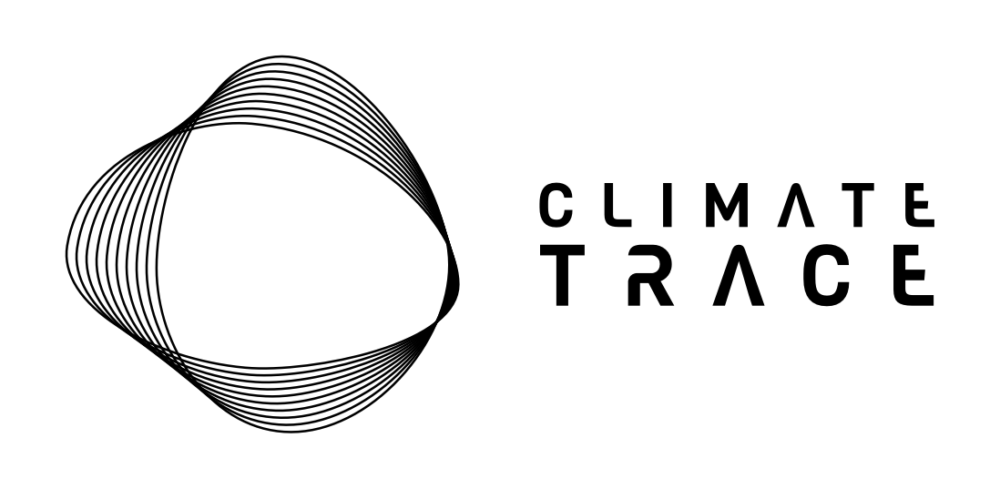

  

<h2 align="center">
  <a href="./Changelogs/V5.X">Current data release: v5.12.0 (October 2026)</a>
</h2>
<h3 align="center">
  <a href="https://climatetrace.org">Explore the data</a> |
  <a href="https://climatetrace.org/data">Download the data</a>
</h3>

---

## Climate TRACE Methodology Documents

**Detailed, sector-specific documentation of how Climate TRACE estimates greenhouse gas emissions.**

| Folder | What's in it |
|---|---|
| **[Sector-Methodologies](./Sector-Methodologies/)** | How each sector is estimated. **Start here.** [1-Sectors](./Sector-Methodologies/1-Sectors/) · [2-Cross-Cutting](./Sector-Methodologies/2-Cross-Cutting/) · [3-Archive](./Sector-Methodologies/3-Archive/) |
| **[Changelogs](./Changelogs/)** | See what changed in each monthly data release [Current Changelog in V5.X](./Changelogs/V5.X/) |
| **[Publications-and-References](./Publications-and-References/)** | Publications, peer-reviewed articles, and mentions of Climate TRACE research and members |
---
## AI Use Disclosure

OpenAI’s ChatGPT and Anthropic’s Claude assisted with methodology documentation, including reviewing, editing, converting methodology documents to Markdown, and organizing the repository structure. All AI-assisted content was reviewed and validated by the authors and reviewers.

## **New to Climate TRACE? Start here:**

1. **[How we estimate emissions](https://climatetrace.org/approach)** — how we use models, satellites, other remote sensing techniques, and AI to deliver global emissions.
2. **[Sectors we cover, about the data, and schema](https://github.com/climatetracecoalition/emissions-methodology/tree/main/Changelogs)** — see what the dataset covers, every field in the dataset defined, licensing, and how to cite it in the Changelogs.

**Looking for something specific?**

| I want to… | Go to |
|---|---|
| Understand how one sector is estimated | [Sector methodologies](./Sector-Methodologies/1-Sectors/) |
| See what changed in the latest data release | [Changelogs](./Changelogs/) |
| I want to access previous data releases | [Go to the Climate TRACE Zenodo repository](https://zenodo.org/records/22919723) |
| Find publications and articles about Climate TRACE | [Publications and references](./Publications-and-References/) |
| Understand why our numbers differ from national inventories | [How Climate TRACE compares to other inventories](https://climatetrace.org/faqs#how-does-climate-trace-compare-to-other-emissions-inventories) |
| Get my questions answered | [Climate TRACE FAQ](https://climatetrace.org/faqs) |

---

## About this repository

This repository is published output, maintained by the Climate TRACE coalition. It does not accept
pull requests or outside edits. See [CITATION.cff](./CITATION.cff) for how to cite, and
[LICENSE](./LICENSE) for terms.

<h2 align="center"><em>Still have a question or need to flag an error? <a href="https://climatetrace.org/contact">Contact us</a></em></h2>
