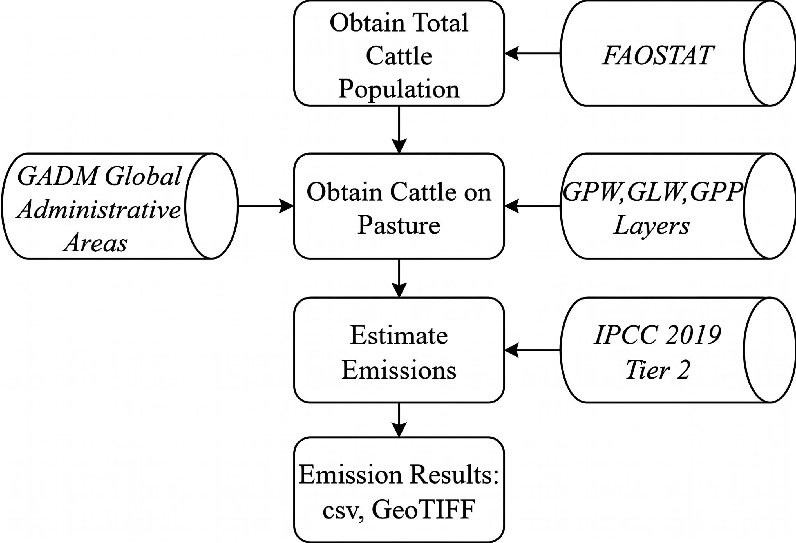
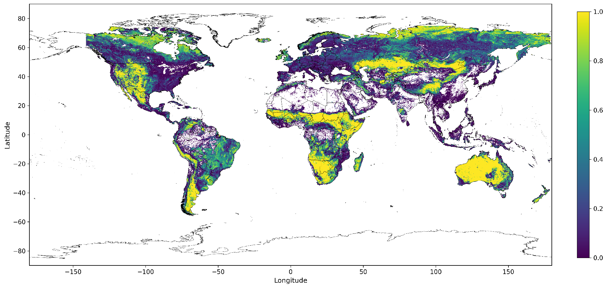
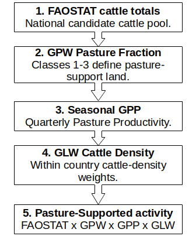
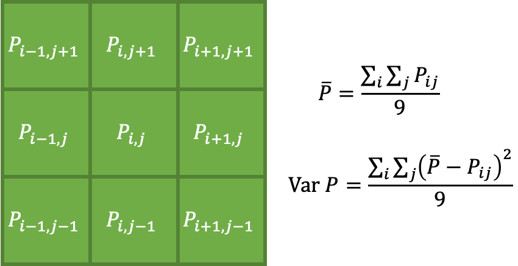
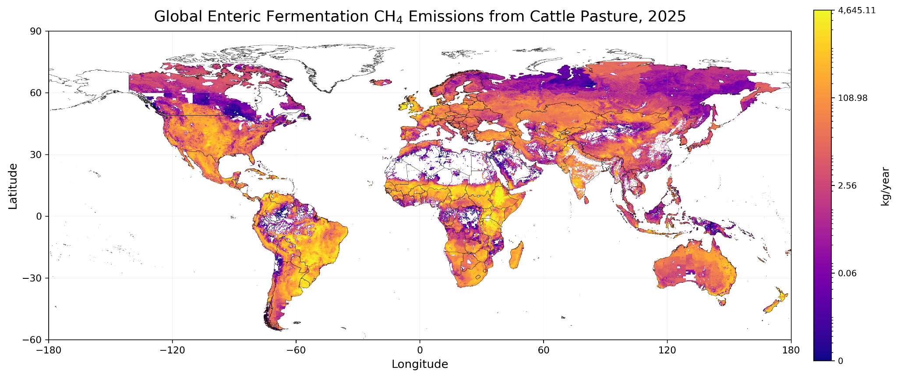
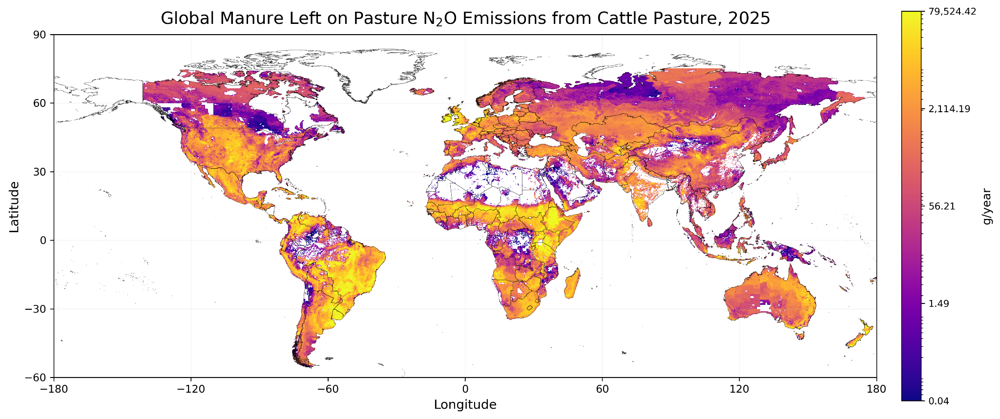
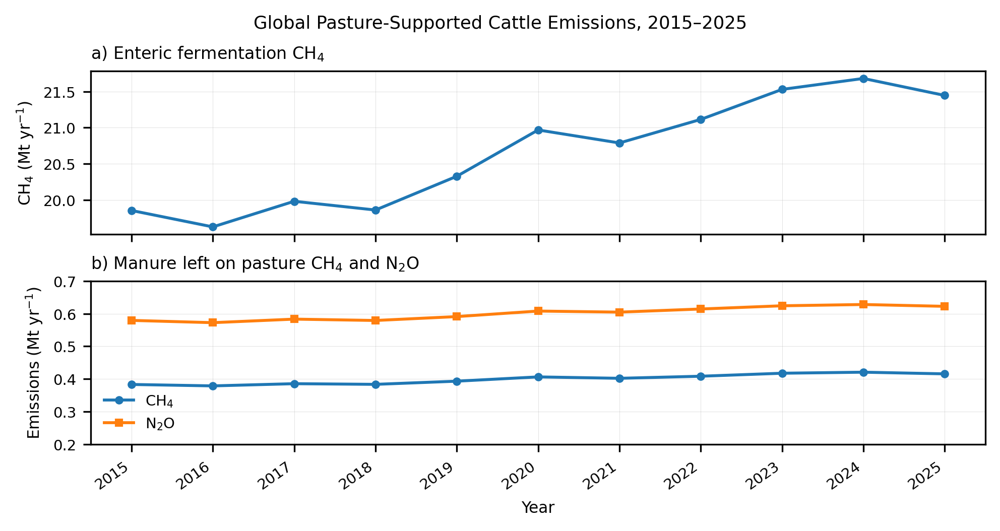
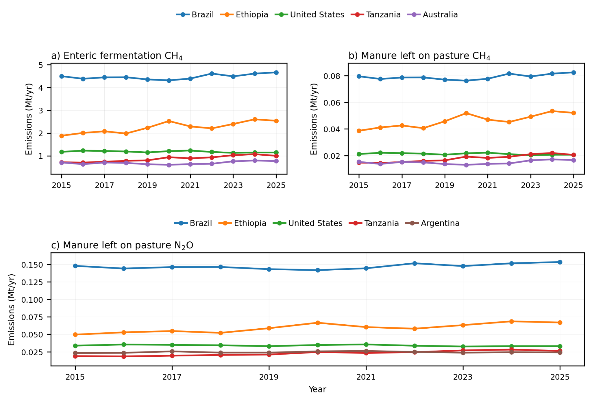
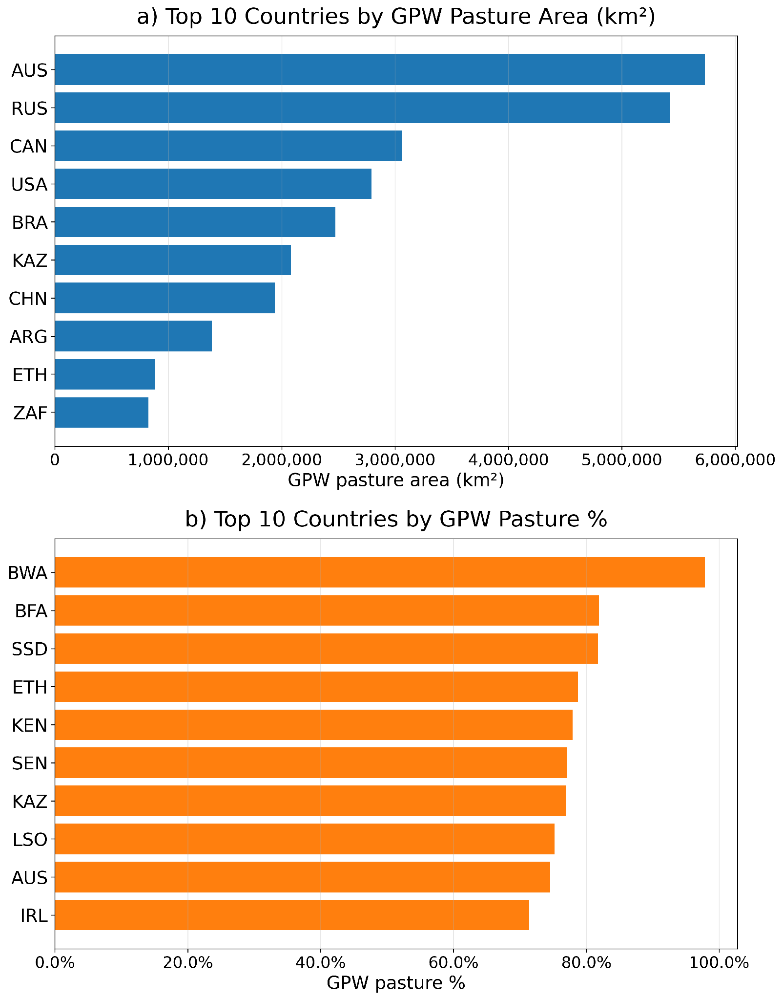

### Agriculture sector- Cattle Emissions from Enteric Fermentation and Manure Left on Pasture

**Omar Al Akkad1,2,3, Vasit Sagan1,2,3, Derek Tesser1,2,3, Aaron Davitt3, Lekha Sridhar3, and Lauren Betz3**

*1) Department of Earth, Environmental and Geospatial Science, Saint Louis University, St. Louis, MO 63108, USA, 2) Remote Sensing Lab, Saint Louis University, St. Louis, MO 63108, USA, 3) Climate TRACE*

#### 1. Introduction

The global cattle industry contributes significantly to greenhouse gas (GHG) emissions through enteric fermentation, a natural digestive process in cows that results in methane (CH4) release, and manure left on pastures, which produces both CH4 and nitrous oxide (N2O) upon decomposition (Dong, 2006). The emissions of methane and nitrous oxide from the digestion of livestock and dung must be closely measured, tracked, and monitored. In order to reduce the negative impact that livestock farming has on the environment and climate, scientists, farmers, and policymakers can develop plans or take action (manage and mitigate) by understanding how much greenhouse gas is being generated. Emitted through natural sources and human activities like agriculture and landfills, methane is 25-30 times more potent than carbon dioxide (CO2) but doesn't stay as long in the atmosphere (US Environmental Protection Agency, 2023). However, nitrous oxide from manure on pasture is about 300 times more potent than CO2. The animal itself and the surface of the pasture are the two main places where these emissions take place. Microbes in the cattle's rumen use enteric fermentation to break down fibrous plant matter, producing CH₄, which is primarily released by belching (Lynch, J. 2019). Manure left behind by grazing cattle breaks down on pastures under different oxygen and moisture levels. Anaerobic decomposition generates CH₄ during this process, whereas soil nitrification and denitrification release N₂O (Lynch, J. 2019). Temperature, soil type, and moisture are examples of environmental conditions that have a significant impact on the amount of these emissions. Grazing systems are a significant source of CH₄ and N₂O in agricultural landscapes due to these combined processes (Rivera and Chara 2021).

Current methods in reporting cattle pasture emissions include FAOSTAT estimation by following the Tier 1 method of IPCC 2006 emission factors (FAO, 2022). FAOSTAT estimated cattle enteric fermentation and manure management emissions at a country level by applying emission factors to the number of cattle. This approach is useful for producing consistent country-level inventories, but it does not show where emissions occur within each country. In addition, most cattle-emission estimates include all cattle in the country rather than separating emissions specifically associated with pasture-supported cattle systems. Although manure N₂O from pasture, range, and paddock systems is represented as a specific pathway, the resulting estimates are still reported at the country level and are not spatially disaggregated. This limits their use for identifying sub-country hotspots, evaluating regional pasture systems, or designing targeted mitigation strategies.

The methodology developed in this study directly addresses these limitations by moving from country-level cattle totals to a spatially explicit pasture-supported cattle activity model. Building on the 2021 Climate TRACE pasture-cattle emissions inventory (Brown et al., 2024), which was based on the IPCC 2006 Tier 1 approach, this study updates the sector in three major ways. First, it replaces static pasture representation with Global Pasture Watch (GPW) pasture fraction, allowing emissions to be constrained to mapped pasture-supported areas at 1km resolution. Second, it replaces a simple cattle-on-pasture estimate with an activity model that combines annual FAOSTAT total cattle counts, Gridded Livestock Watch (GLW) cattle-density weights, and seasonal Gross Primary Production (GPP). This means cattle activity is not assumed to be evenly distributed across a country or physically present on all pasture land; instead, it is assigned to pixels where pasture availability, vegetation productivity, and cattle-density patterns overlap. Third, it applies the IPCC 2019 Tier 2 framework, calculating enteric fermentation methane (CH₄) emissions from gross energy intake (GEI) and estimating manure CH₄ and N₂O using regional livestock parameters and direct and indirect nitrogen pathways. Together, these updates make the sector more useful because the output is no longer only a national emissions total. It becomes a spatially explicit emissions product that can identify where pasture-supported cattle emissions are concentrated, explain why hotspots occur, and support more targeted climate mitigation and inventory improvement.

This methodology describes the approach to estimate cattle emissions from enteric fermentation and manure left on pastures. We present a global 1km Tier 2-based assessment of enteric CH₄, manure CH₄, and manure N₂O emissions from pasture-supported cattle for years 2015–2025.

#### 2. Materials and Methods

We assemble country livestock statistics (FAOSTAT), Gridded Livestock Watch (GLW) cattle-density data, Global Pasture Watch (GPW) pasture-fraction layers, seasonal Gross Primary Production (GPP) layers, and administrative boundaries (GADM) to map pasture-supported cattle activity globally, as summarized in Figure 1. Using the IPCC 2019 Tier 2 methodology (Ch. 10–11), we compute pixel-level CH₄ (enteric, manure) and N₂O (manure on pasture) emissions at 1 km spatial resolution with region-specific parameters, then aggregate to country totals. Outputs include GeoTIFF rasters (EPSG:4326) and country-level CSV tables for 2015–2025, with accompanying uncertainty layers.

***Figure 1** Methodology Flowchart to estimate emissions from cattle on pasture based on IPCC 2019 Tier 2.*

Our primary goal was to generate high-resolution 1 km GeoTIFF datasets in EPSG 4326 (WGS84, 2004) for CH₄ and N₂O emissions from manure on pasture and enteric fermentation, along with their corresponding global warming potentials (GWPs), for the years 2015–2025. These outputs were produced using the IPCC 2019 Tier 2 methodology with region-specific livestock parameters and spatial pasture-support inputs derived from GPW pasture fraction, GLW cattle density, and seasonal GPP. In addition to the raster outputs, country-level aggregated results were compiled into CSV tables, providing annual estimates for emissions, emission factors, capacities, and capacity factors. Uncertainty layers were also generated for each sector and gas in both raster and tabular formats.

We utilized pandas, geopandas, and the rasterio library to create the GeoTIFFs and organize the data from various sources. It is important to note that our work was not inclusive of all enteric fermentation and manure management GHG emission estimation, but rather those that come from cattle on pasture only. This is different from FAOSTAT which reports all dairy and non-dairy populations in both domains “Emissions from Manure Management” and “Manure left on pasture”, creating overlap between the two. In this work, we seek to create a more representative cattle population that exists on pasture only. Annual FAOSTAT total cattle counts were used as the national candidate cattle pool, while GLW cattle density, GPW pasture fraction, and seasonal GPP were used to spatially constrain and scale pasture-supported cattle activity within each country. As such, Climate TRACE reports separately dairy and feedlot enteric fermentation and manure management emissions at the country level and for individually identified feedlots and dairies. These approaches can be found in the cattle methodologies in our [GitHub repository](https://github.com/climatetracecoalition/emissions-methodology/tree/main/Sector-Methodologies/1-Sectors/agriculture).

#### 2.1 Datasets employed

To generate the datasets, we used five primary data sources. These five were the following: Food and Agriculture Organization Corporate Statistical Database (FAOSTAT), Global Administrative Areas (GADM), Global Pasture Watch (GPW), Gridded Livestock Watch (GLW), and Gross Primary Production (GPP) data.

First, we used FAOSTAT, last updated December 31, 2025, to determine the total number of cattle for each country and year. Annual FAOSTAT cattle stocks were used as the national candidate cattle pool for 2015–2025. FAOSTAT provides livestock data under the Production: Crops and Livestock Products domain, including live-animal stock counts for cattle (FAO, 2025). Previous approaches to this sector estimated cattle on pasture by subtracting slaughtered cattle from non-dairy cattle. This has been updated where we use total cattle counts and then constrain their spatial allocation using GPW pasture fraction, GLW cattle density, and GPP vegetation productivity. The updated FAOSTAT totals were used with the GLW cattle-density layer to correct and scale gridded cattle counts within each country, ensuring that the spatially distributed cattle activity remained consistent with national inventory totals for each modeling year.

Gridded Livestock Watch (GLW) cattle-density data was used as the spatial weighting layer for cattle distribution (FAO, 2023; FAO 2015). Two GLW reference layers were used to better represent temporal changes in cattle-density patterns across the study period. The GLW4 2015 layer was used to model years 2015-2019, while the GLW4 2020 layer was used to model years 2020-2025. Because the original GLW products differ in spatial resolution, the GLW layers were harmonized to the common 1 km processing grid before being used in the activity model. GLW provided the within-country cattle-density pattern used to allocate annual FAOSTAT cattle totals across pasture-supported pixels. Because GLW represents spatial cattle density rather than the final national inventory total, the GLW grid was normalized within each country and scaled to annual FAOSTAT cattle totals for each year from 2015–2025. This correction allowed the model to preserve country-level cattle totals while still using GLW to represent where cattle are most likely distributed spatially.

Gross Primary Production (GPP) data was used to represent seasonal vegetation productivity and pasture support (Running and Zhao, 2021). Quarterly GPP layers were used to calculate seasonal pasture-support scores for Q1, Q2, Q3, and Q4. These scores were combined with GPW pasture fraction and GLW cattle-density weights to estimate quarterly pasture-supported cattle activity. The GPP product used in this workflow is based on the MODIS/ Tera Gross Primary Productivity Gap-Filled 8-day L4 Global 500 m product, which provides global GPP estimates. The GPP layers were rescaled and aligned to the common 1 km processing grid before being used in the activity model.

Next, we used Global Pasture Watch (GPW) pasture data instead of NASA SEDAC pasture data (Ramankutty et al., 2010). The previous NASA SEDAC pasture product provided a static pastureland area percentage for each 0.083° × 0.083° degree square (\~10 km at the equator) for the year 2000. In contrast, GPW provides annual grassland classes and extent maps at 30 m resolution, allowing pasture-supported areas to be represented with finer spatial detail and updated annually across the study period. In this workflow, GPW pasture layers were used for each modeling year from 2015-2024, and the most recent available GPW layer was carried forward for 2025 to identify pastureland and generate pasture-fraction layers at 1 km resolution. A 1 km resolution was selected because it balances spatial detail with global-scale computational feasibility. Aggregating the 30 m GPW to 1 km preserves pasture information as fractional cover while avoiding false precision, since cattle inventories, livestock density weights, and productivity inputs are not available at true 30 m precision. The GPW classes used to define pasture were classes 1, 2, and 3. Class 1 represents cultivated grassland, class 2 represents natural or semi-natural grassland, and class 3 represents open shrubland. These classes were assigned a value of 1 in a binary pasture-support mask, while all other GPW classes were assigned a value of 0. The binary pasture-support mask was then aggregated to the 1 km Equal Earth grid using average resampling, so that each 1 km grid cell represented the fraction of sub-pixels classified as GPW pasture-support land as shown in Figure 2. The pasture fraction was used as the spatial constraint for cattle-on-pasture activity.

Finally, GADM data (GADM, 2024) was used to obtain country boundaries for mapping the GPW pasture fraction, GLW cattle-density weights, GPP productivity layers, activity, and emissions outputs to a country. The GADM boundary dataset was formatted as a geojson provided by WattTime.

***Figure 2** Global Pasture Watch (GPW) pasture fraction data used to represent pasture-supported areas in the updated 1 km workflow for the year 2025.*

#### 2.2 Methods

#### 2.2.1 Cattle Disaggregation

In order to establish a transparent and reproducible framework for estimating greenhouse gas emissions from cattle on pasture, it is necessary to introduce the concepts of capacity, capacity factor, and activity. These terms provide a structured link between national livestock statistics, spatial pasture-support data, cattle-density data, and the IPCC’s methodological requirement that emissions be calculated as the product of activity data and emission factors.

-   Capacity - represents the relative pasture-support potential within each spatial grid cell, which is the ability of each pixel to support grazing cattle during each quarter. It is calculated from the Global Pasture Watch (GPW) pasture fraction and seasonal Gross Primary Production (GPP).

-   Capacity factor - represents the spatial cattle-pressure component, which refers to the estimated cattle head-equivalent load assigned to each grid cell, representing how much of a country’s total cattle population is allocated to that cell. In the updated workflow, Gridded Livestock Watch (GLW) cattle-density data is used as the spatial weighting layer, and annual FAOSTAT total cattle counts are used to correct and scale the cattle distribution within each country.

-   Activity - denotes the estimated number of pasture-supported cattle assigned to each grid cell. It is calculated by combining the pasture-support capacity with the cattle-pressure capacity factor, producing quarterly cattle head-equivalents for each pixel.

This three-part formulation is essential because it links national cattle statistics with spatial pasture-support conditions and cattle-density patterns. It does not assume that all cattle in a country are physically present on pasture. Instead, annual FAOSTAT total cattle counts are used as the national candidate cattle pool, and the country spatial allocation is constrained by GPW pasture fraction, seasonal GPP, and GLW cattle density to ensure that cattle activity is assigned to pixels where mapped pasture availability, vegetation productivity, and cattle-density patterns overlap, while preserving consistency with national cattle inventory . This enhances transparency by explicitly documenting the allocation mechanism, while preserving flexibility for methodological refinements, such as incorporating forage productivity, stocking rates, or updated cattle-density layers into the disaggregation workflow. Framing the approach in terms of capacity, capacity factor, and activity not only aligns with the IPCC 2019 Guidelines but also facilitates comparability and repeatability of results, ensuring that emission estimates are robust, traceable, and scientifically defensible.

For obtaining any emissions arising from cattle on pasture, the first necessity is to obtain pasture-supported cattle activity spatially. The goal is to distribute country-level cattle numbers from FAOSTAT to a global 1 km grid based on mapped pasture fraction, vegetation productivity, and cattle-density patterns. The updated workflow replaces the previous NASA SEDAC pasture allocation and “non-dairy cattle minus slaughtered cattle” logic with a spatial pasture-support approach based on GPW, GPP, GLW, and FAOSTAT total cattle stocks. Figure 3 shows the summary of the steps used to generate pasture-supported activity layers.

***Figure 3** Workflow summary for estimating pasture-supported cattle activity*

Step 1: Annual FAOSTAT total cattle counts were obtained for each country and year. These totals were used as the national candidate cattle pool for the years 2015–2025. Unlike the previous method, slaughtered cattle were not subtracted from non-dairy cattle. Instead, the updated method uses total cattle counts and then spatially constrains the allocation using pasture fraction, cattle density, and vegetation productivity.

Where for each year, “t”, the FAOSTAT total cattle stock for each country was used as the national cattle candidate pool. This value was not treated as the number of cattle physically present on pasture. Rather, it was used as the national total available for spatial allocation. The pasture-supported portion of cattle activity was then determined by the overlap between GPW pasture fraction, seasonal GPP, and GLW cattle-density weights within each country.

Step 2: The GPW land-cover classes used to define pasture were classes 1, 2, and 3. These classes were assigned a value of 1 in a binary pasture mask, while all other GPW classes were assigned a value of 0. The binary pasture mask was then aggregated to the 1 km Equal Earth grid using average resampling. Therefore, each 1 km pixel represents the fraction of sub-pixels classified as GPW pasture-support land.

Step 3: Seasonal Gross Primary Production (GPP) layers were used to represent quarterly vegetation productivity. GPP was processed for Q1, Q2, Q3, and Q4 to calculate seasonal pasture-support scores. These scores allow the model to represent changes in pasture productivity across the year rather than treating pasture capacity as static.

Step 4: Gridded Livestock Watch (GLW) cattle-density data was used to represent the spatial distribution of cattle within each country. GLW was normalized within each country and scaled using annual FAOSTAT total cattle counts. This correction preserved country-level cattle totals while using GLW to determine where cattle are most likely distributed spatially.

Step 5: The pasture-supported cattle activity was calculated for each pixel and quarter by combining pasture fraction, seasonal GPP support, GLW cattle-density weighting, and FAOSTAT total cattle counts. For each country c, pixel i, quarter q, and year t, the GPW pasture fraction was first combined with the quarterly GPP score to calculate the pixel-level pasture-support capacity as shown in Equation (1):

$`\text{Capacity}_{i,q,t} = PF_{i} \ast \text{GPPScore}_{i,q,t}`$ (1)

where PFi is the GPW pasture fraction in pixel i, and GPPScorei,q,t is the normalized seasonal GPP score for pixel i, quarter q, and year t.

The GLW cattle-density layer was then normalized within each country to calculate the spatial cattle-density weight using Equation (2):

$`\text{GLW\ Weight}_{i,c} = \frac{\text{GLW}_{i,c}}{\text{GLW}_{i,c}}`$ (2)

where GLW Weighti,c is the GLW cattle-density value in pixel i within country c. This normalized weight was then multiplied by the annual FAOSTAT total cattle count to estimate the cattle-pressure capacity factor for each pixel as shown in Equation (3):

$`\text{CapacityFactor}_{i,c,t} = \text{GLW\ Weight}_{i,c} \ast \text{FAOSTATCattle}_{c,t}`$ (3)

where FAOSTATCattlec,t is the annual FAOSTAT total cattle count for country c and year t.

Finally, quarterly pasture-supported cattle activity was calculated using Equation (4):

$`\text{Activity}_{i,q,t} = Capacity_{i,q,t} \ast \text{CapacityFactor}_{i,c,t}`$ (4)

Equation (5) shows an equivalent way to calculate the activity:

$`\text{Activity}_{i,q,t} = PF_{i} \ast \text{GPPScore}_{i,q,t} \ast \text{GLW\ Weight}_{i,c} \ast \text{FAOSTATCattle}_{c,t}`$(5)

The resulting activity layer represents pasture-supported cattle head-equivalents per pixel per quarter. Annual activity was calculated as the mean of the four quarterly activity layers using Equation (6):

$`\text{Activity}_{i,q,t}^{\text{annual}} = \frac{\text{Activity}_{i,Q1,t} + \text{Activity}_{i,Q2,t} + \text{Activity}_{i,Q3,t} + \text{Activity}_{i,Q4,t}}{4}`$ (6)

Annual activity was calculated as a mean rather than a sum because cattle activity is treated as a stock or intensity measure rather than a cumulative flow. This updated approach avoids negative cattle-on-pasture estimates produced by the previous subtraction method and provides a spatially explicit estimate of cattle activity constrained by pasture availability, vegetation productivity, and observed cattle-density patterns.

#### 2.2.2 Estimation of Emissions from Enteric Fermentation and Manure Left on Pasture

Now that we have spatially distributed pasture-supported cattle activity, emission factors were applied using IPCC 2019 Chapter 10 and Chapter 11: Emissions from Livestock and Manure Management Tier 2 method equations. All CH₄ and N₂O emissions were first calculated at the 1 km pixel level using the quarterly activity layers described above. Each pixel contains an estimate of pasture-supported cattle head-equivalents derived from GPW pasture fraction, seasonal GPP, GLW cattle-density weighting, and annual FAOSTAT cattle totals. Emissions were estimated using the IPCC 2019 Refinement to the 2006 Guidelines (Volume 4: Agriculture, Forestry and Other Land Use), specifically Chapter 10 (Emissions from Livestock and Manure Management) and Chapter 11 (N₂O Emissions from Managed Soils and Livestock Manure Management).

We implemented the Tier 2 methodology, which significantly enhances accuracy and flexibility compared to Tier 1 by deriving methane (CH₄) emission factors from gross energy intake (GEI) rather than fixed look-up tables, thereby accounting for differences in cattle body weight, growth rate, mature weight, digestibility, and methane conversion factor. Enteric fermentation CH₄ emission factors were calculated as annual kilograms of CH₄ per head per year and then applied to the quarterly pasture-supported cattle activity layers. Quarterly enteric CH₄ emissions were calculated by multiplying each quarterly activity layer by one quarter of the annual enteric CH₄ emission factor. Annual enteric CH₄ emissions were then calculated as the sum of the four quarterly emission layers.

For manure left on pasture, manure CH₄ emissions were calculated from volatile solids (VS), maximum methane-producing capacity, methane conversion factor, and the pasture manure-management pathway. Manure N₂O emissions were calculated from nitrogen excretion rates (Nₑₓ) and the direct and indirect N₂O pathways associated with manure deposited on pasture. Nitrous oxide (N₂O) emissions were refined through explicit separation of direct emissions and indirect emissions from volatilisation and leaching/runoff pathways, improving transparency and adaptability across regions and management types. Region-specific parameters, including body weight, digestible energy, mature weight, weight gain, methane conversion factor, and nitrogen excretion rates, were applied at the pixel level through the spatial activity layers and aggregated to national totals. A detailed description of the Tier 2 equations, parameter sources, and computational workflow for enteric CH₄, manure CH₄, and manure N₂O is provided in the Supplementary Section.

The workflow produced two complementary output formats:

1.  Raster outputs (GeoTIFF, EPSG 4326) – Pixel-level CH₄ and N₂O emissions and corresponding global warming potentials (GWPs), along with uncertainty layers for each sector, gas, emission factor, capacity, and capacity factor.

2.  Country-level tabular outputs (CSV) – Aggregated annual totals for each gas, sector, and associated parameters by country, obtained by spatially joining pixel-level results with national boundaries and summing values.

This dual-format approach ensures both high-resolution spatial mapping and compatibility with national inventory reporting.

**The Global Warming Potential (GWP)**

The GWP is a metric used to quantify the impact of GHG emissions on global warming. It measures the relative warming potential of different gases over specific time periods, usually 20 and 100 years, considering their radiative forcing effects and atmospheric lifetimes. GWP is crucial because it helps us understand and compare the contributions of various greenhouse gases to climate change. Specifically, for enteric fermentation and manure left on pasture, GWP calculations are essential in assessing the environmental impact of these practices, as they involve methane and nitrous oxide emissions. By applying GWP calculations with consideration of uncertainty factors, we can better comprehend the significance of these emissions in the context of climate change mitigation efforts.

To calculate the GWP for enteric fermentation and manure left on pasture over different time horizons, we use the following formulas across the Climate TRACE coalition:

For a 20-year time horizon we used Equation (7):

$`GWP20year = CH4Emissions \ast \left( 80.8 \pm 25.8 \right) + N2OEmissions \ast \left( 273 \pm 118 \right)`$ (7)

For a 100-year time horizon we used Equation (8):

$`GWP100year = CH4Emissions \ast \left( 27.2 \pm 11 \right) + N2OEmissions \ast \left( 273 \pm 130 \right)`$ (8)

**Estimating Uncertainties**

We define capacity as the pasture-support potential of a grid cell. In the updated methodology, capacity is derived from the Global Pasture Watch (GPW) pasture fraction and seasonal Gross Primary Production (GPP), which together represent the ability of each 1 km grid cell to support grazing cattle. Capacity factor represents the cattle-pressure component within each grid cell and is derived from Gridded Livestock Watch (GLW) cattle-density data scaled using annual FAOSTAT total cattle counts. Emission factors have a 20% uncertainty, and capacity has a 20% uncertainty according to the IPCC (Dong, 2006). To obtain the capacity factor uncertainty, we use convolution to assess the amount of local spatial variation around each grid cell. The convolution-based local variance is used to calculate the capacity factor uncertainty, reflecting how stable or variable cattle pressure is around a given pixel. This is illustrated in Figure 4.

***Figure 4** Capacity uncertainty calculation*

#### 2.3 Verifying modeled emissions estimates

The GeoTIFF outputs were verified by making sure the sums of the country-level tabular outputs matched the summed values from the corresponding GeoTIFF rasters. Pixel-level raster totals were compared with Pandas data frame totals for activity, CH₄ emissions, N₂O emissions, and CO₂e estimates to ensure consistency between raster and tabular outputs. The maximum values were also checked to ensure they were greater than the minimum values, and raster outputs were inspected for missing values, negative values, and unexpected NoData patterns.

The annual global rasters were also checked against the quarterly raster outputs. Annual activity was verified as the mean of the four quarterly activity layers, while annual emissions were verified as the sum of the four quarterly emissions layers. Country-level totals were then compared across years to identify unusual year-over-year changes. The new datasets were also compared with previous Climate TRACE outputs to evaluate consistency, major methodological shifts, and expected changes caused by the updated GPW pasture fraction, GLW cattle-density weighting, GPP seasonal support, FAOSTAT cattle totals, and IPCC 2019 Tier 2 parameters.

#### 2.4 Model Generated Outputs

The model outputs GeoTIFF files conforming to EPSG 4326 (WGS84, 2004) for manure left on pasture and enteric fermentation GHG emissions and global warming potentials for the years 2015–2025. These outputs include quarterly and annual spatial outputs for capacity, capacity factor, and activity, which are used to represent pasture support, cattle pressure, and pasture-supported cattle head-equivalents. To assess the uncertainty in emissions, emission factor, capacity, and capacity factor for both sectors’ GHGs, another set of GeoTIFFs was generated. Confidence files and country-level CSV tables were also generated. Table 1 provides an outline of the structure of the model-generated outputs.

**Table 1** Outline of model-generated outputs for enteric fermentation and manure left on pasture. Activity, capacity, and capacity factor outputs are shared by both sectors. CH₄ and N₂O emissions, uncertainty layers, and GWP are generated according to the modeled gas.

| **Output type** | **Output variable**                         | **Enteric Fermentation** | **Manure left on Pasture** |
|-----------------|---------------------------------------------|--------------------------|----------------------------|
| Activity        | Annual pasture-supported cattle activity    | ✓                        | ✓                          |
|                 | Quarterly pasture-supported cattle activity | ✓                        | ✓                          |
| Capacity        | Pasture-support capacity                    | ✓                        | ✓                          |
| Capacity factor | GLW and FAOSTAT scaled cattle layer         | ✓                        | ✓                          |
| CH₄ Emissions   | Emissions estimate                          | ✓                        | ✓                          |
|                 | Upper bound for emissions uncertainty       | ✓                        | ✓                          |
|                 | Lower bound for emissions uncertainty       | ✓                        | ✓                          |
|                 | Emission factor uncertainty                 | ✓                        | ✓                          |
|                 | Capacity uncertainty                        | ✓                        | ✓                          |
|                 | Capacity factor uncertainty                 | ✓                        | ✓                          |
| N₂O Emissions   | Emissions estimate                          | —                        | ✓                          |
|                 | Upper bound for emissions uncertainty       | —                        | ✓                          |
|                 | Lower bound for emissions uncertainty       | —                        | ✓                          |
|                 | Emission factor uncertainty                 | —                        | ✓                          |
|                 | Capacity uncertainty                        | —                        | ✓                          |
|                 | Capacity factor uncertainty                 | —                        | ✓                          |
| GWP, 20-year    | Upper bound for emissions uncertainty       | ✓                        | ✓                          |
|                 | Lower bound for emissions uncertainty       | ✓                        | ✓                          |
| GWP, 100-year   | Upper bound for emissions uncertainty       | ✓                        | ✓                          |
|                 | Lower bound for emissions uncertainty       | ✓                        | ✓                          |

#### 3. Results

We provide GeoTIFFs for pasture-supported cattle activity, uncertainties, and emission estimates for enteric fermentation and manure left on pasture. The spatially explicit maps of Tier 2 emission estimates for 2025 show the distribution of methane (CH₄) and nitrous oxide (N₂O) emissions across global pasture-supported cattle regions, as shown in Figures 5–7. These maps demonstrate clear regional differences in emission intensities. The results reported here refer to the updated data version using FAOSTAT cattle totals updated at the end of 2025, GLW4 2020, and the 2024 GPW layer carried forward for 2025. Higher values occur in areas where mapped pasture fraction, seasonal vegetation productivity, GLW cattle density, and FAOSTAT cattle totals overlap.

The CH₄ emissions from manure left on pasture are shown in Figure 5 and exhibit spatial patterns that follow the distribution of pasture-supported cattle activity. Higher emissions are observed in major pasture-cattle regions of South America, East Africa, parts of Sub-Saharan Africa, and Australia. These areas contain a stronger overlap between mapped pasture, cattle-density weights, and national cattle totals. This spatial pattern is consistent with previous livestock system and livestock density studies showing that grazing systems are important in Central and South America, Sub-Saharan Africa, and Australia, and that high cattle-density areas occur in middle/eastern Africa and South America (Steinfeld and Mӓki-Hokkonen, 1996; FAO 2026; Du et al., 2025). Lower values are observed in regions where pasture area, cattle density, or pasture productivity is limited. Overall, the observed spatial pattern results from the combined influence of GPW pasture fraction, seasonal GPP, GLW cattle-density weights, and annual FAOSTAT cattle totals.

|                                                                                                                                                                         |
|-------------------------------------------------------------------------------------------------------------------------------------------------------------------------|
| ***Figure 5** Manure left on pasture CH4 Estimates 2025, reported as g CH₄ yr⁻¹ per grid cell. The color scale is log transformed to improve visualization.* |

CH₄ emissions from enteric fermentation, which account for the majority of pasture-supported cattle emissions worldwide, are shown in Figure 6. The strongest hotspots occur in Brazil and other parts of South America, East Africa, parts of the Sahel, Australia, and selected pasture-supported regions of North America. Localized annual emissions reach more than 40 tons CH₄ yr⁻¹ per grid cell in the highest-emitting pixels. The spatial pattern reflects the updated activity model, where emissions are concentrated in areas where GPW pasture fraction, seasonal GPP, GLW cattle density, and FAOSTAT cattle totals overlap.

***Figure 6** Enteric Fermentation CH4 Estimates 2025, reported as kg CH₄ yr⁻¹ per grid cell. The color scale is log transformed to improve visualization.*

Figure 7 shows the spatial distribution of N₂O emissions from manure left on pasture. The highest values are concentrated in many of the same pasture-supported cattle regions identified for CH₄ emissions, including South America, East Africa, parts of Sub-Saharan Africa, and Australia. This similarity is expected because enteric CH₄, manure left on pasture CH₄, and manure left on pasture N₂O are all driven by the same pasture-supported cattle activity layer. Differences among gases reflect the Tier 2 emission-factor calculations and gas-specific pathways rather than a different spatial allocation of cattle.

***Figure 7** Manure left on pasture N2O Estimates 2025, reported as g N₂O yr⁻¹ per grid cell. The color scale is log transformed to improve visualization.*

Under the Tier 2 methodology, the temporal trends of global emissions from enteric fermentation and manure left on pasture are shown in Figure 8. Global emissions generally increased from 2015 to 2024, followed by a slight decrease in 2025. Enteric fermentation CH₄ increased from approximately 19.85 Mt CH₄ yr⁻¹ in 2015 to 21.68 Mt CH₄ yr⁻¹ in 2024, then decreased slightly to 21.45 Mt CH₄ yr⁻¹ in 2025. Manure left on pasture CH₄ increased from approximately 0.383 Mt CH₄ yr⁻¹ in 2015 to 0.421 Mt CH₄ yr⁻¹ in 2024, then decreased to 0.416 Mt CH₄ yr⁻¹ in 2025. Manure left on pasture N₂O increased from approximately 0.580 Mt N₂O yr⁻¹ in 2015 to 0.628 Mt N₂O yr⁻¹ in 2024, then decreased to 0.622 Mt N₂O yr⁻¹ in 2025. These temporal patterns reflect the combined influence of the input datasets used to generate the emissions maps, including FAOSTAT cattle totals, GPW pasture fraction, GLW cattle-density weights, and seasonal GPP pasture-support scores. Because emissions are calculated from modeled pasture-supported cattle activity rather than from FAOSTAT cattle totals alone, changes in the ability of mapped pasture areas to support cattle can shift the emissions trend. The slight decrease in 2025 is therefore attributed to lower seasonal GPP-based pasture productivity, which reduced the modeled ability of mapped pasture areas to support cattle during that year.

***Figure 8** Global Tier 2 emission trends for pasture-supported cattle during 2015-2025. Emissions are reported in megatonnes per year (Mt yr⁻¹). a) Enteric Fermentation CH₄ emissions. b) Manure left on pasture CH₄ and N₂O emissions*.

Regional dominance is evident in the national-level emission trends shown in Figure 9. The top five emitting countries were selected directly from the 2025 country-level results for each gas and sector. For enteric fermentation CH₄, the top five countries were Brazil, Ethiopia, the United States, Tanzania, and Australia. For manure left on pasture CH₄, the top five countries were also Brazil, Ethiopia, the United States, Tanzania, and Australia. For manure left on pasture N₂O, the top five countries were Brazil, Ethiopia, the United States, Tanzania, and Argentina. Brazil was the largest contributor across all three emission components, while Ethiopia consistently ranked second. This pattern reflects the combination of large cattle populations, pasture availability, and the spatial overlap between cattle density and pasture-supported areas.

***Figure 9** Top five emitting countries from the Tier 2 pasture-supported cattle workflow during 2015-2025. Emissions are reported in megatonnes per year (Mt yr⁻¹). a) Enteric Fermentation CH₄ emissions. b) Manure left on pasture CH₄ emissions. c) Manure left on pasture N₂O emissions.*

#### 4. Discussion

Figure 9 presents the top ten countries ranked by absolute GPW pasture area and by GPW pasture %, based on the processed Global Pasture Watch (GPW) pasture-fraction inputs. Large land-rich countries such as Australia, Russia, Canada, the United States, Brazil, Kazakhstan, China, Argentina, Ethiopia, and South Africa dominate in terms of total GPW pasture area, while countries such as Botswana, Burkina Faso, South Sudan, Ethiopia, Kenya, Senegal, Kazakhstan, Lesotho, Australia, and Ireland appear more prominently when considering GPW pasture %. These rankings reflect the spatial distribution of the processed GPW pasture classes rather than actual livestock populations or official national pasture-area statistics. In this methodology, GPW classes 1, 2, and 3 were used to define pasture-supported land, including cultivated grassland, natural or semi-natural grassland, and open shrubland. Therefore, Figure 9 should be interpreted as a diagnostic of the GPW-derived pasture input layer used by the emissions model rather than as a replacement for official country-level pasture inventories. This distinction is important because countries such as Botswana can show very high GPW pasture % in the processed layer, likely due to the inclusion of extensive grazing-compatible grassland and open shrubland systems.

***Figure 9** a) Top 10 Countries by GPW-Derived Pasture-Support Share (km²) and b) Top 10 Countries by GPW-Derived Pasture-Support Share (%), both are based on GPW data.*

To further interpret the difference between pasture extent and modeled cattle activity, pasture-use intensity was calculated as annual pasture-supported cattle activity divided by GPW pasture-support area. This metric identifies countries where modeled cattle activity is high relative to the amount of mapped pasture-support land, as shown in Table 2.

**Table 2** Top 10 countries by pasture intensity in 2025.

| **Rank** | **Country**        | **ISO3** | **GPW Pasture Area (km²)** | **Annual pasture-supported activity (million head-eq)** | **Pasture-use intensity (head-eq/km²)** |
|----------|--------------------|----------|----------------------------|---------------------------------------------------------|-----------------------------------------|
| 1        | Dominican Republic | DOM      | 9,773                      | 0.89                                                    | 90.91                                   |
| 2        | Netherlands        | NLD      | 10,965                     | 0.79                                                    | 71.98                                   |
| 3        | Rwanda             | RWA      | 9,298                      | 0.54                                                    | 58.49                                   |
| 4        | Uganda             | UGA      | 120,207                    | 6.86                                                    | 57.05                                   |
| 5        | Ireland            | IRL      | 49,853                     | 2.82                                                    | 56.47                                   |
| 6        | Burundi            | BDI      | 9,078                      | 0.49                                                    | 53.73                                   |
| 7        | Uruguay            | URY      | 124,065                    | 6.33                                                    | 51                                      |
| 8        | Haiti              | HTI      | 2,521                      | 0.12                                                    | 48.69                                   |
| 9        | Ethiopia           | ETH      | 887,321                    | 41.72                                                   | 47.02                                   |
| 10       | Belgium            | BEL      | 5,763                      | 0.24                                                    | 41.51                                   |

The updated workflow shows that pasture extent alone does not determine cattle emissions. Countries with large GPW pasture areas are not always the largest emitters, and countries with high GPW pasture % do not necessarily dominate the emissions totals. Table 2 further shows that pasture-supported cattle activity can vary substantially per unit of mapped GPW pasture area. Countries such as the Dominican Republic, Rwanda, and Belgium rank highly because their modeled cattle activity is concentrated over relatively smaller GPW pasture areas, while countries such as Uganda and Ethiopia combine larger pasture areas with substantial modeled cattle activity. Therefore, pasture-use intensity should be interpreted as modeled cattle activity density on GPW pasture-support land, not as a direct measure of management efficiency or official livestock productivity. This is because the model assigns emissions only where multiple spatial and inventory constraints overlap. GPW defines the pasture-support fraction, GPP represents seasonal vegetation productivity, GLW provides within-country cattle-density weights, and FAOSTAT provides annual national cattle totals. As a result, the final pasture-supported cattle activity layer reflects the combined influence of pasture availability, seasonal productivity, cattle-density distribution, and national cattle inventories rather than any single input layer.

The spatial emission maps for 2025 show similar geographic patterns for enteric fermentation CH₄, manure left on pasture CH₄, and manure left on pasture N₂O. This similarity is expected because all three gases are calculated from the same pasture-supported cattle activity layer. Differences among the three emission products are therefore mainly caused by the Tier 2 emission-factor calculations and gas-specific pathways rather than by different cattle-allocation assumptions. Enteric fermentation CH₄ remains the dominant emission component, while manure left on pasture CH₄ and N₂O are smaller in mass but still important because of their contribution to total CO₂e.

The global time-series results show that emissions generally increased from 2015 to 2024, followed by a slight decrease in 2025. Enteric fermentation CH₄ increased from approximately 19.85 Mt CH₄ yr⁻¹ in 2015 to 21.68 Mt CH₄ yr⁻¹ in 2024, then decreased slightly to 21.45 Mt CH₄ yr⁻¹ in 2025. Manure left on pasture CH₄ increased from approximately 0.383 Mt CH₄ yr⁻¹ in 2015 to 0.421 Mt CH₄ yr⁻¹ in 2024, then decreased to 0.416 Mt CH₄ yr⁻¹ in 2025. Manure left on pasture N₂O increased from approximately 0.580 Mt N₂O yr⁻¹ in 2015 to 0.628 Mt N₂O yr⁻¹ in 2024, then decreased to 0.622 Mt N₂O yr⁻¹ in 2025. These temporal patterns reflect changes in FAOSTAT cattle totals and how those national totals interact with the spatial pasture-supported activity model.

At the country level, Brazil, Ethiopia, the United States, Tanzania, and Australia were the top five emitters for enteric fermentation CH₄ and manure left on pasture CH₄ in 2025. For manure left on pasture N₂O, the top five emitters were Brazil, Ethiopia, the United States, Tanzania, and Argentina. Brazil was the largest contributor across all three emission components, while Ethiopia consistently ranked second. These rankings differ from the top countries by GPW pasture area and GPW pasture %, confirming that emissions are not controlled by pasture extent alone. Instead, emissions are driven by the overlap between mapped pasture-support land, vegetation productivity, cattle-density distribution, and national cattle totals.

The updated methodology improves spatial and temporal representation by combining remote-sensing pasture information, seasonal vegetation productivity, spatial livestock-density information, and national inventory totals. GPW provides a finer and more current pasture-support input than older static pasture products, while GPP introduces seasonal variation in the capacity of pasture areas to support cattle. GLW helps distribute cattle activity within each country according to the spatial pattern of cattle density, and FAOSTAT ensures that the modeled cattle activity remains tied to national inventory totals. The Tier 2 emission-factor calculations further improve biological representation by using regional parameters related to body weight, digestibility, methane conversion, volatile solids, and nitrogen excretion.

However, the updated workflow still has limitations. The GPW pasture-fraction layer may classify broad grassland, semi-natural grassland, and open shrubland systems as pasture-supported land, which can differ from official national pasture-area statistics. GLW provides a spatial weighting surface but does not directly observe seasonal herd movement, temporary grazing, or local pasture-management practices. GPP helps represent seasonal vegetation productivity, but it does not directly measure forage intake or grazing intensity. FAOSTAT totals provide national consistency but depend on country-reported livestock statistics, which can vary in reporting quality and update frequency. Finally, Tier 2 emission factors are more detailed than fixed emission-factor approaches, but they still rely on regional parameter assumptions and may not capture local breed, diet, management, or climate variability.

Confidence in the resulting emissions should therefore be interpreted in relation to the uncertainty of each input layer and parameter set. The cattle-density and FAOSTAT-based capacity factor is assigned medium confidence because national cattle statistics are reported by individual governments and because within-country livestock distribution is represented through spatial weighting rather than direct observation. Emission factors are also treated as medium-confidence inputs because they rely on IPCC-based regional parameters. The spatial outputs are useful for identifying broad regional patterns and relative hotspots, but they should not be interpreted as direct observations of individual herds or exact local emissions.

Overall, the updated method provides a more spatially constrained estimate of cattle emissions from pasture-supported systems. By combining GPW pasture fraction, seasonal GPP, GLW cattle-density weights, FAOSTAT cattle totals, and Tier 2 emission factors, the workflow assigns emissions to areas where pasture-support land, vegetation productivity, and cattle-density patterns overlap. This produces a more defensible representation of cattle emissions from enteric fermentation and manure left on pasture than a method based only on national cattle totals or pasture extent.

#### 5. Conclusion

Methane (CH₄) and nitrous oxide (N₂O) remain among the most important greenhouse gases associated with cattle production, and emissions from pasture-based cattle systems continue to represent a major challenge for climate monitoring and mitigation. This study developed an updated spatial workflow for estimating emissions from enteric fermentation and manure left on pasture by combining FAOSTAT total cattle populations, Gridded Livestock Watch (GLW) cattle-density weights, Global Pasture Watch (GPW) pasture-fraction data, seasonal Gross Primary Production (GPP), and IPCC 2019 Tier 2 emission factors.

The updated workflow moves beyond using pasture extent or national cattle totals alone. Instead, cattle activity was estimated as pasture-supported activity, where annual FAOSTAT cattle totals were spatially constrained by GPW pasture fraction, seasonal GPP productivity, and GLW cattle-density distributions. This approach allowed emissions to be assigned to locations where pasture availability, vegetation productivity, and cattle-density patterns overlap. As a result, the generated outputs provide a more spatially explicit representation of cattle emissions from enteric fermentation and manure left on pasture.

The results showed that global emissions generally increased from 2015 to 2024, followed by a slight decrease in 2025. Enteric fermentation CH₄ remained the dominant emission component, while manure left on pasture CH₄ and N₂O contributed smaller but important emissions. At the country level, Brazil, Ethiopia, the United States, Tanzania, and Australia were among the largest contributors for enteric fermentation CH₄ and manure left on pasture CH₄, while Brazil, Ethiopia, the United States, Tanzania, and Argentina were the largest contributors for manure left on pasture N₂O. These rankings showed that emissions are not controlled by pasture area alone, but by the combined effects of pasture fraction, cattle density, vegetation productivity, and national cattle populations.

However, the robustness of these results depends on the quality and interpretation of the underlying datasets. GPW pasture fraction provides a more useful spatial constraint than older static pasture products, but its pasture classes include cultivated grassland, natural or semi-natural grassland, and open shrubland, which may differ from official national pasture-area statistics. GLW improves the spatial allocation of cattle activity, but it does not directly observe seasonal herd movement or local grazing management. FAOSTAT provides annual national consistency, but livestock totals depend on country-reported statistics. Similarly, IPCC Tier 2 emission factors improve biological representation, but they still rely on regional assumptions about body weight, digestibility, methane conversion, volatile solids, and nitrogen excretion.

Overall, the methodology presented in this study provides a reproducible framework for generating annual and quarterly GeoTIFF and CSV outputs for pasture-supported cattle emissions and associated uncertainty. By integrating GPW, GPP, GLW, FAOSTAT, and IPCC Tier 2 calculations, this workflow improves the spatial and temporal representation of emissions from enteric fermentation and manure left on pasture. These outputs can support Climate TRACE users, researchers, and decision-makers in identifying emission hotspots, evaluating regional patterns, and developing more targeted strategies for reducing the climate impact of pasture-based cattle systems.

#### Acknowledgments

#### 6. Metadata section

Tables S1 and S2 summarize the metadata used to describe the pasture-supported cattle emissions outputs. Table S1 provides general dataset information, including sector definition, temporal coverage, temporal resolution, and data formats. Table S2 describes the confidence and uncertainty definitions for the main source level attributes, including capacity, capacity factor, and activity.

**Table S1** General dataset information for pastures.

| **General Description**                                                         | **Definition**                                                                                                                                                                      |
|---------------------------------------------------------------------------------|-------------------------------------------------------------------------------------------------------------------------------------------------------------------------------------|
| **Sector definition**                                                           | Enteric fermentation from pasture-supported cattle and manure left on pasture from pasture-supported cattle.                                                                        |
| **Temporal Coverage**                                                           | 2015 – 2025                                                                                                                                                                         |
| **Temporal Resolution**                                                         | Quarterly and Annual                                                                                                                                                                |
| **Data format(s)**                                                              | GeoTIFF and CSV                                                                                                                                                                     |
| **Coordinate Reference System**                                                 | EPSG:4326, decimal degrees                                                                                                                                                          |
| **What emission factors were used?**                                            | IPCC tier 2                                                                                                                                                                         |
| **What is the difference between a “NULL / none / nan” versus “0” data field?** | “0” values are for true non-existent emissions. If we know that the sector has emissions for that specific gas, but the gas was not modeled, this is represented by “NULL/none/nan” |
| **total\_CO2e\_100yrGWP and total\_CO2e\_20yrGWP conversions**                  | Climate TRACE uses IPCC AR6 CO2e GWPs. CO2e conversion guidelines are here:https://www.ipcc.ch/report/ar6/wg1/downloads/report/IPCC\_AR6\_WGI\_FullReport\_small.pdf                |

**Table S2** Source level metadata description confidence and uncertainty for reservoirs.

| **Data attribute**                | **Confidence Definition**                                                                                                                                                                                                                                                              | **Uncertainty Definition**                                                                                 |
|-----------------------------------|----------------------------------------------------------------------------------------------------------------------------------------------------------------------------------------------------------------------------------------------------------------------------------------|------------------------------------------------------------------------------------------------------------|
| **type**                          | Not used; N/A                                                                                                                                                                                                                                                                          | Not used; N/A                                                                                              |
| **capacity\_description**         | Medium: capacity is derived from GPW pasture fraction and quarterly GPP productivity. GPW provides the pasture-support mask, while GPP represents seasonal vegetation productivity.                                                                                                    | Capacity uncertainty is the variance of the neighboring grid cells.                                        |
| **capacity\_factor\_description** | Medium: capacity factor is derived from GLW cattle-density weights scaled to annual FAOSTAT total cattle populations. FAOSTAT totals depend on country-reported livestock statistics, and GLW provides a spatial weighting surface rather than direct observation of seasonal grazing. | Cow count uncertainty estimates, expressed as a percentage above or below the mean estimate (i.e., +/-XX%) |
| **capacity\_factor\_units**       | Head-equivalents per pixel or cattle-pressure weight scaled to national FAOSTAT cattle totals.                                                                                                                                                                                         | Not used; N/A                                                                                              |
| **activity\_description**         | Pasture-supported cattle activity estimated from GPW pasture fraction, quarterly GPP score, GLW cattle-density weight, and FAOSTAT total cattle.                                                                                                                                       | Derived from capacity uncertainty and capacity-factor uncertainty using root-sum-square propagation.       |
| **CO2\_emissions\_factor**        | Not used; N/A                                                                                                                                                                                                                                                                          | Not used; N/A                                                                                              |
| **CH4\_emissions\_factor**        | Medium: based on IPCC region-specific parameter uncertainty                                                                                                                                                                                                                            | IPCC uncertainty estimates, expressed as a percentage above or below the mean estimate (i.e., +/-XX%)      |
| **N2O\_emissions\_factor**        | Medium: based on IPCC emissions factors                                                                                                                                                                                                                                                | IPCC uncertainty estimates, expressed as a percentage above or below the mean estimate (i.e., +/-XX%)      |
| **other\_gas\_emissions\_factor** | Not used; N/A                                                                                                                                                                                                                                                                          | Not used; N/A                                                                                              |
| **CO2\_emissions**                | Not used; N/A                                                                                                                                                                                                                                                                          | Not used; N/A                                                                                              |
| **CH4\_emissions**                | Medium: based on IPCC region-specific parameter uncertainty                                                                                                                                                                                                                            | Given as an interval with an lower and upper bound of value                                                |
| **N2O\_emissions**                | Medium: based on IPCC emissions factors                                                                                                                                                                                                                                                | Given as an interval with an lower and upper bound of value                                                |
| **other\_gas\_emissions**         | Not used; N/A                                                                                                                                                                                                                                                                          | Not used; N/A                                                                                              |
| **total\_CO2e\_100yrGWP**         | Medium: based on IPCC emissions factors                                                                                                                                                                                                                                                | Given as an interval with an lower and upper bound of value                                                |
| **total\_CO2e\_20yrGWP**          | Medium: based on IPCC emissions factors                                                                                                                                                                                                                                                | Given as an interval with an lower and upper bound of value                                                |

Permissions and Use: All Climate TRACE data is freely available under the Creative Commons Attribution 4.0 International Public License, unless otherwise noted below.

Data citation format: Al Akkad, O., Sagan, V. Tesser, D., Davitt, A., Sridhar, L., and Betz, L. (2026). Agriculture sector- Cattle Emissions from Enteric Fermentation and Manure Left on Pasture. WattTime and The Saint Louis University Remote Sensing Laboratory (SLU/RSL), USA, Climate TRACE Emissions Inventory. https://climatetrace.org \[Accessed date\]

Geographic boundaries and names: The depiction and use of boundaries, geographic names and related data shown on maps and included in lists, tables, documents, and databases on Climate TRACE are generated from the Global Administrative Areas (GADM) project (Version 4.1 released on 16 July 2022) along with their corresponding ISO3 codes, and with the following adaptations:

-   HKG (China, Hong Kong Special Administrative Region) and MAC (China, Macao Special Administrative Region) are reported at GADM level 0 (country/national);

-   Kosovo has been assigned the ISO3 code ‘XKX’;

-   XCA (Caspian Sea) has been removed from GADM level 0 and the area assigned to countries based on the extent of their territorial waters;

-   XAD (Akrotiri and Dhekelia), XCL (Clipperton Island), XPI (Paracel Islands) and XSP (Spratly Islands) are not included in the Climate TRACE dataset;

-   ZNC name changed to ‘Turkish Republic of Northern Cyprus’ at GADM level 0;

-   The borders between India, Pakistan and China have been assigned to these countries based on GADM codes Z01 to Z09.

The above usage is not warranted to be error-free and does not imply the expression of any opinion whatsoever on the part of Climate TRACE Coalition and its partners concerning the legal status of any country, area, or territory or of its authorities, or concerning the delimitation of its borders.

> Disclaimer: The emissions provided for this sector are our current best estimates of emissions, and we are committed to continually increasing the accuracy of the models on all levels. Please review our terms of use and the sector-specific methodology documentation before using the data. If you identify an error or would like to participate in our data validation process, please [contact us](mailto:coalition@climatetrace.org).

#### Supplementary data

In this sector, detailed descriptions of emission calculations are provided in this section. Specifically, it outlines the step-by-step procedures used to estimate CH₄ and N₂O emissions from pasture-supported cattle activity following the IPCC 2019 Tier 2 methodology. This includes the equations, parameter sources, regional factors, and assumptions applied to compute enteric fermentation emissions and manure left on pasture emissions. In the updated workflow, annual FAOSTAT total cattle populations were used as the national cattle candidate pool and were spatially constrained using GPW pasture fraction, GPP seasonal productivity, and GLW cattle-density weights to estimate pasture-supported cattle activity.

#### 6.1 Enteric-fermentation CH₄

Enteric-fermentation CH₄ emission was calculated using the energy balance Tier 2 approach an Enteric-fermentation CH₄ emission factor for each animal category following IPCC 2019 Equation 10.21:

$`C{H4}_{\text{enteric}}\left( \text{kgh}d^{- 1}\text{yr}d^{- 1} \right) = \frac{{\text{GEI} \ast Y}_{m}}{55.65} \ast 365\ IPCC\ Equation\ \left( 10.21 \right)`$

Where:

EF = emission factor, kg CH4 head-1 yr-1

GE = gross energy intake, MJ head-1 day-1

Ym = methane conversion factor, per cent of gross energy in feed converted to methane

The factor 55.65 (MJ/kg CH4) is the energy content of methane

We can measure GEI based on the Equation as shown below. Its requirement is derived based on the summed net energy requirements and the energy availability characteristics of the feed(s):

$`\text{GEI}\  = \frac{\frac{NEm\  + \ NEa + NEl\  + \ NEwork\  + \ NEp}{\text{REM}}\  + \ \frac{NEg\  + \ NEwool}{\text{REG}}}{\text{DE}}`$IPCC Equation (10.16)

Where:

NEm = net energy required by the animal for maintenance (Equation 10.3), MJ day-1

NEa = net energy for animal activity (Equations 10.4 and 10.5), MJ day-1

NEl = net energy for lactation (Equations 10.8, 10.9, and 10.10), MJ day-1

NEwork = net energy for work (Equation 10.11), MJ day-1

NEp = net energy required for pregnancy (Equation 10.13), MJ day-1

REM = ratio of net energy available in a diet for maintenance to digestible energy (Equation 10.14)

NEg = net energy needed for growth (Equations 10.6 and 10.7), MJ day-1

REG = ratio of net energy available for growth in a diet to digestible energy consumed (Equation 10.15)

NEwool = net energy required to produce a year of wool (Equation 10.12), MJ day-1

DE = digestibility of feed expressed as a fraction of gross energy (digestible energy/gross energy, i.e. DE%/100)

**Table S3** Regional parameters of Enteric-fermentation CH₄ emission for Tier 2 IPCC 2019. BW: Body weight; DE: Digestibility; Nex: Annual N excreted/head; MW: Mature weight; Ym: Fraction of GEI lost as CH₄

<table><thead><tr class="header"><th>Region</th><th>BW (kg)</th><th>DE (%)</th><th>Nex (kg N / head day)</th><th>
MW

(kg)
</th><th>WG (kg/day)</th><th>Ym (%)</th><th>Source (IPCC 2019)</th></tr></thead><tbody><tr class="odd"><td>North America</td><td>407</td><td>69</td><td>0.4</td><td>580</td><td>1.0</td><td>6.5</td><td>
Annex Tables 10A.5 (BW &amp; DE),

Annex Tables 10A.4 (MW), Annex Tables 10A.3 (WG), Table Table 10.14 (Nex),

plus Chapter 10 guidance for Ym
</td></tr><tr class="even"><td>Western Europe</td><td>405</td><td>73</td><td>0.34</td><td>468</td><td>0.42</td><td>6.5</td><td></td></tr><tr class="odd"><td>Eastern Europe</td><td>389</td><td>66</td><td>0.36</td><td>475</td><td>0.6</td><td>6.5</td><td></td></tr><tr class="even"><td>Oceania</td><td>359</td><td>60</td><td>0.33</td><td>467</td><td>0.41</td><td>6.8</td><td></td></tr><tr class="odd"><td>Latin America</td><td>312</td><td>67</td><td>0.34</td><td>435</td><td>0.50</td><td>7.0</td><td></td></tr><tr class="even"><td>Asia</td><td>303</td><td>59</td><td>0.30</td><td>341</td><td>0.30</td><td>7.0</td><td></td></tr><tr class="odd"><td>Africa and Middle East</td><td>276</td><td>58</td><td>0.32</td><td>343</td><td>0.35</td><td>7.5</td><td></td></tr><tr class="even"><td>Indian Subcontinent</td><td>202</td><td>55</td><td>0.27</td><td>222</td><td>0.33</td><td>7.5</td><td></td></tr><tr class="odd"><td>Other Europe</td><td>397</td><td>70</td><td>0.35</td><td>472</td><td>0.51</td><td>6.5</td><td></td></tr></tbody></table>

In our Tier 2 inventory the Gross Energy Intake (GEI) equation is intentionally simplified to include maintenance (NEM), activity (NE act ≈ 10 % NEM) and growth (NEG) only, omitting net-energy terms for lactation (NEl), pregnancy (NEp), draught work (NE work) and fibre (NE wool). This is consistent with the 2019 IPCC Refinement because the herd under study is non-dairy beef cattle.

Annual enteric CH₄ emissions were calculated by multiplying the annual emission factor by the corresponding pasture-supported cattle activity as shown in Supplementary Equation (S1) and Supplementary Equation (S2). Quarterly emissions were calculated by applying one-quarter of the annual emission factor to the quarterly activity layer, and annual emissions were calculated as the sum of the four quarterly emission rasters.

$`\text{EntericCH}4_{i,q,t} = \text{Activity}_{i},q,t \times \frac{{EF\ CH4}_{\text{enteric}}}{4}`$ (S1)

$`\text{EntericCH}4_{i,t} = \text{EntericCH}4_{i,q,t}`$ (S2)

#### 6.2 Manure Left On Pasture

Manure left on pasture CH₄ and N₂O emissions were estimated using the IPCC 2019 Tier 2 approach, applying region-specific cattle parameters and pasture/range/paddock emission pathways. Because this study focuses on pasture-supported cattle activity, the manure pathway was restricted to manure deposited directly on pasture, range, and paddock systems. Confined manure systems, including liquid/slurry, solid storage, and dry-lot systems, were not included.

***CH₄ from Manure Left On Pasture***

Methane (CH₄) emissions from manure left on pasture were estimated using the IPCC 2019 Tier 2 volatile-solids approach. The annual manure CH₄ emission factor was calculated from volatile solids excretion, the maximum methane-producing capacity of manure, and the methane conversion factor for the pasture/range/paddock system. The annual CH₄ emission factor for manure left on pasture was calculated using IPCC 2019 Equation 10.23:

$`EFCH4 = \frac{\text{VS} \ast \text{Bo} \ast \text{MCF} \ast 0.67 \ast 365}{100}\text{\ IPCC\ Equation\ }\left( 10.23 \right)`$

Where:

EF₍CH₄₎ = CH₄ emission factor, kg CH₄ head⁻¹ yr⁻¹

VS = volatile solids excretion, kg head⁻¹ day⁻¹ (calculated using IPCC Equation 10.22 based on gross energy intake, digestibility, and ash content)

B₀ = maximum CH₄-producing capacity of manure, m³ CH₄ kg⁻¹ VS

MCF = methane conversion factor for the manure management system, % (adjusted for region-specific climate and system type)

0.67 = conversion factor from m³ CH₄ to kg CH₄

Volatile solids (VS) were calculated from feed intake, digestibility, and ash content using the IPCC 2019 refinement equation:

$`VS = \left\lbrack \text{GEI} \ast \left( 1 - \frac{\text{DE}}{100} \right) \ast \left( 1 - \frac{\text{Ash}}{100} \right) \right\rbrack \ast 0.45\ Equation\ \left( 10.24 \right)`$

Where:

GEI = gross energy intake (MJ head⁻¹ day⁻¹)

DE = digestibility of feed (%)

Ash = ash content of manure (%).

Climate zones were assigned using the dominant mode from 2015–2025 monthly temperature rasters, and the corresponding default MCF values for pasture/range/paddock were applied. Because manure is excreted and decomposes directly on pasture, the overall methane potential is considerably lower than in confined systems.

***N₂O from Manure Left On Pasture***

In the updated workflow, manure left on pasture emissions were calculated at the pixel level using quarterly pasture-supported cattle activity. Annual emission factors were divided by four and applied to each quarterly activity layer. Annual manure left on pasture CH₄ and N₂O rasters were then calculated as the sum of the four quarterly emission rasters. This produced pixel-level GeoTIFF outputs and country-level CSV summaries for CH₄, N₂O, and CO₂e emissions.

Additionally, data is in the form of GeoTIFF files following EPSG 4326 standards (WGS84, 2004). These files cover GHG emissions from manure and enteric fermentation on pastureland, including global warming potentials from 2015 to 2022. The data also gauges the uncertainty in emissions, emission factor, capacity, and capacity factor for both GHGs in these sectors.

Nitrous oxide (N₂O) emissions from manure left on pasture were estimated from nitrogen excreted by grazing cattle. Nitrogen deposited on pasture was calculated as:

$`F_{\text{PRP}} = \Sigma\left\lbrack N\left( T \right) \times \text{Nex}\left( T \right) \times \text{MS}\left( T,PRP \right) \right\rbrack\text{\ IPCC\ Equation\ }\left( 11.5 \right)`$

Where:

N(T)​: cattle headcount,

Nex: annual N excretion rate (kg N head⁻¹ yr⁻¹)

MS: the fraction of excreted N deposited on pasture

Direct N₂O-N from grazing deposition was:

$`N2O - N_{\text{Direct}} = F_{\text{PRP}} \times EF3PRP\ IPCC\ Equation\ \left( 11.5 \right)`$

$`N2O_{\text{Direct}} = N2O - N_{\text{Direct}} \times \left( \frac{44}{28} \right)\text{\ IPCC\ Equation\ }\left( 11.5 \right)`$

Where:

EF3PRP (cattle) default =0.004 kg N₂O-N per kg N deposited (0.4%) (Table 11.11)

44/28: Conversion factor from N₂O-N to N₂O (molecular weight ratio of N₂O to N₂)

Indirect N₂O emissions via volatilization and leaching/runoff were estimated using IPCC Equations 11.10, Equations 11.11, Table 11.3 and Table 11.11, applying system-specific emission factors (EF₄, EF₅) and fractions of nitrogen lost via volatilization (FracGASM) and leaching (FracLEACH).

$`N2O - N_{\text{ATD}} = F_{\text{PRP}} \times \text{FracGASM} \times EF4 \times \left( \frac{44}{28} \right)\text{\ IPCC\ Equation\ }\left( 11.11 \right)`$

$`N2O - N_{L} = \left( F_{\text{PRP}} \times FracLEACH - H \right) \times EF5 \times \left( \frac{44}{28} \right)\text{\ IPCC\ Equation\ }\left( 11.10 \right)`$

Where:

FracGASM= 0.21 (fraction of excreta N volatilized)

EF4= (N₂O-N per volatilized N) aggregated default=0.010

FracLEACH−(H)​=0.24

EF5​=0.011 kg N₂O-N per kg N leached/runoff

44/28=Conversion factor from N₂O-N to N₂O (molecular weight ratio of N₂O to N₂)

#### References

1.  Chapter, I.P.C.C., 2006a. 10: Emissions from livestock and manure management. Agriculture, Forestry and Other Land Use. Available at: <https://www.ipcc-nggip.iges.or.jp/public/2006gl/pdf/4_Volume4/V4_10_Ch10_Livestock.pdf>

2.  Chapter, I.P.C.C., 2006b. 11: N2O Emissions from Managed Soils, and CO2 Emissions from Lime and Urea Application. Agriculture, Forestry and Other Land Use. Available at: <https://www.ipcc-nggip.iges.or.jp/public/2006gl/pdf/4_Volume4/V4_11_Ch11_N2O&CO2.pdf>

3.  Dong, H., McAllister, T. and Mangino, J. (2006) Chapter 10 IPCC GUIDELINES FOR EMISSIONS FROM LIVESTOCK AND MANURE MANAGEMENT. Available at: https://www.ipcc-nggip.iges.or.jp/public/2006gl/pdf/4\_Volume4/V4\_10\_Ch10\_Livestock.pdf (Accessed: 11 October 2023).

4.  De Klein, C., Novoa, R. and Ogle, S. (2006) Chapter 11 IPCC GUIDELINES FOR EMISSIONS N2O EMISSIONS FROM MANAGED SOILS, AND CO2 EMISSIONS FROM LIME AND UREA APPLICATION. Available at: https://www.ipcc-nggip.iges.or.jp/public/2006gl/pdf/4\_Volume4/V4\_11\_Ch11\_N2O&CO2.pdf (Accessed: 11 October 2023).

5.  FAO. (2022). FAOSTAT Climate Change, Emissions, Manure Management. \[Online\] Available at: http://www.fao.org/faostat/en/\#data/GM (Accessed 27 October 2023\]).

6.  Intergovernmental Panel on Climate Change (IPCC). (2019). 2019 refinement to the 2006 IPCC guidelines for national greenhouse gas inventories. Agriculture, forestry and other land use, 4, 824.

7.  Lynch, J. (2019). Availability of disaggregated greenhouse gas emissions from beef cattle production: A systematic review. Environmental impact assessment review, 76, 69-78.

8.  Brown, N., Jimennex D., Rokissky, J., Davitt, A., and Reilly, E., 2024, Agriculture sector-Cattle Emissions from Enteric Fermentation and Manure Left on Pasture, Available at: https://github.com/climatetracecoalition/emissions-methodology/tree/main/Sector-Methodologies/3-Archive/2024/agriculture

9.  Nga geomatics - WGS 84 (2004) NGA Geomatics - WGS 84. Available at: https://earth-info.nga.mil/index.php?dir=wgs84&action=wgs84 (Accessed: 11 October 2023).

10. Open Geospatial Consortium. (2023). OGC GeoTIFF Standard. Available at: https://www.ogc.org/standard/geotiff/ (Accessed: 1 November 2023).

11. Ramankutty, N., Evan, A. T., Monfreda, C., & Foley, J. A. (2010). *Global Agricultural Lands: Pastures, 2000* (Version 1.00) \[Dataset\]. Palisades, NY: NASA Socioeconomic Data and Applications Center (SEDAC). https://doi.org/10.7927/H47H1GGR Date Accessed: 2026

12. Rivera, J.E. and Chará, J., (2021) CH4 and N2O emissions from cattle excreta: a review of main drivers and mitigation strategies in grazing systems. Frontiers in Sustainable Food Systems, 5, p.657936.

13. US Environmental Protection Agency. (2023) Understanding Global Warming Potentials. \[Online\] Available at: https://www.epa.gov/ghgemissions/understanding-global-warming-potentials (Accessed 2023-08-04\])

14. FAO. 2025. FAOSTAT: Production: Crops and Livestock Products, Livestock Primary, Live Animals. Food and Agriculture Organization of the United Nations. Available at: https://www.fao.org/faostat/en/\#data/QCL. Accessed 2026.

15. FAO. 2015. Food and Agriculture Organization of the United Nations (FAO). 2015, 10 km. Gridded Livestock of the World version 4 (GLW v4): livestock density, heads per square kilometer, reference year 2015. Earth Map Help Center. Available at: https://help.earthmap.org/customizations-datasets/pilafolur-datasets/livestock/glw-v4. Accessed 2026.

16. FAO. 2023. Gridded Livestock of the World, version 4 (GLW4): Gridded livestock density, global, 2020, 1 km. Food and Agriculture Organization of the United Nations. Available at: https://data.fao.org/catalog/dataset/e056a913-2a28-454d-ad83-d6ef126bf0ff. Accessed 2026.

17. Running, S., & Zhao, M. (2021). MODIS/Terra Gross Primary Productivity Gap-Filled 8-Day L4 Global 500m SIN Grid V061 \[Dataset\]. NASA Land Processes Distributed Active Archive Center. https://doi.org/10.5067/MODIS/MOD17A2HGF.061 Date Accessed: 2026

18. GADM. 2024. Database of Global Administrative Areas, version 4.1. Available at: [https://gadm.org](https://gadm.org). Accessed 2026

19. Steinfeld, H., & Mäki-Hokkonen, J. (1995). A classification of livestock production systems. World Animal Review, 83-94.

20. Food and Agriculture Organization of the United Nations (FAO). 2026. Eastern Africa: Livestock and enteric methane. FAO, Rome. Accessed 2026.

21. Du, Z., Yu, L., Zhao, Y., Li, X., Liu, X., Li, X., Hao, P., Chen, Z., Guo, Z., You, L., Ma, X., and Wang, H. 2025. Annual global grided livestock mapping from 1961 to 2021, Earth Syst. Sci. Data, 17, 5543–5556, https://doi.org/10.5194/essd-17-5543-2025
