### Agriculture sector: Cattle Operations- Asset-level Enteric Fermentation and Manure Management Emissions

**Aaron Davitt1,6, Kwin Keuter, Derek Tesser2,6, Edward Boyda3,6, Ashutosh Pawar2,6, Paul Tulloch4,6, Andrew Tulloch6, Sam Schiller5,6, Lekha Sridhar1,6, Lauren Betz,1,6, and Vasit Sagan2,6**

*1) WattTime, 2) Dept. of Earth, Environmental and Geospatial Science, Saint Louis Univ., 3) Earth Genome, 4) Machine Learning and Env., Applied Research Consultant- Ottawa, Canada, 5) Carbon Yield, 6) Climate TRACE*

#### 1. Introduction

Cattle are the largest contributors of greenhouse gas (GHG) emissions in the livestock sector. Overall, livestock agrifood systems accounted for approximately 6.2 Gt CO₂eq in 2015, around 12% of all anthropogenic GHG emissions, and cattle - meat and milk combined - account for roughly 62% of that total, or about 7% of anthropogenic emissions (FAO, 2023). Emissions from beef and dairy cattle arise from two sources. The first is enteric fermentation - methane (CH₄) produced during microbial digestion in the rumen. The second is manure management, which generates CH₄ through anaerobic decomposition and nitrous oxide (N₂O) through the microbially driven processes of nitrification and denitrification (Waldrip et al., 2016; Waldrip et al., 2020). Manure management emissions occur both within the storage facilities common to beef and dairy systems and in-field, where manure is applied as fertilizer or deposited directly by grazing animals. See the Supplemental Section in ‘Country-level Enteric Fermentation and Manure Management Emissions’ in the [Climate TRACE GitHub repo](https://github.com/climatetracecoalition/methodology-documents/tree/main/2025/Agriculture) for more information on how enteric fermentation and manure management systems generate emissions.

FAOSTAT is the de facto global inventory of beef and dairy cattle emissions, built on country-level official, implicit, or estimated activity data and reported with a two to three year latency (depending on the dataset). While it provides global coverage with a long time series, the dataset has five limitations for estimating emissions from cattle operations:

1.  The cattle subtypes FAOSTAT reports make it difficult to distinguish animals managed in confinement - hereafter operations - from those on pasture, even though emission sources and magnitudes differ substantially between the two (FAOSTAT, 2023).

2.  The non-dairy cattle category is derived as total cattle minus milking cows — a remainder that contains beef animals in confinement alongside multi-purpose, draft, stocker, backgrounding, and grazing cattle. No reported quantity corresponds directly to beef cattle in operations (FAOSTAT, 2023).

3.  Reported dairy and non-dairy cattle are presumed to be both on pasture and in some form of manure management system. While cattle can flow between an operation and pasture, dairy and beef cattle can spend larger amounts of time in one than in the other, impacting the emissions generated.

4.  FAOSTAT cattle emissions estimates continue to use the Tier 1 method and the default emission factors of the 2006 IPCC Guidelines (IPCC, 2006). These estimates do not reflect the updated climate zones of the 2019 Refinement to the 2006 IPCC Guidelines for National Greenhouse Gas Inventories, countries’ adoption of new manure management systems, or changes in cattle raising and breeding practices — changes that can raise emissions per head, and national totals with them, as countries adopt higher-productivity breeds and production systems, even where emissions per unit of milk or meat decline (IPCC, 2019a; FAO, 2023).

The fifth limitation motivates this methodology specifically: FAOSTAT carries no facility attribution. Global emissions are reported as national totals and nothing in the inventory identifies which operations produce them or where those operations exist. Facility-level information globally is generally confined to academic studies, and in those studies’ location information has been removed or kept vague (Harper et al., 2009; Costa et al., 2014; Zhu et al., 2014). The exception is the USA, where individual states maintain some form of concentrated animal feeding operation (CAFO) database that, depending on the state, contains varying levels of information on CAFOs. Overall, the location of most cattle operations worldwide remains unknown, lacking information to estimate emissions. Understanding source-level emissions and their contribution to regional and global GHG totals is therefore difficult, and discrepancies between top-down and bottom-up assessments of methane emissions may be explained in part by these gaps in facility-level location of livestock operations (Wolf et al., 2017).

To better understand emissions from individual beef and dairy production systems globally, the Climate TRACE coalition has generated a first-of-its-kind cattle operation database that unifies disparate government permit data and identifies additional, non-reported operations using two artificial intelligence (AI) models applied to remote sensing data: Earth Index and TerraDetect (TDX). An operation is defined here as any facility that raises cattle, including but not limited to animal feeding operations (AFOs), feedlots, dairies, and cow-calf operations (Rotz et al., 2019). To further improve emissions estimates and to capture the adoption of new manure management systems, models were developed to identify operations with wet manure management systems - liquid/slurry and anaerobic lagoons, hereafter called ‘manure ponds’. Operations where these ponds were identified were classified as high productivity, which in turn determined the IPCC 2019 manure management emission factors applied.

Once individual operations were identified, the total head of cattle was estimated using reported cattle numbers, mean values, or, where the operation’s area footprint could be delineated, regression modelling. With each operation’s total head determined, the Intergovernmental Panel on Climate Change (IPCC) 2019 equations and emission factors (EFs) from Chapter 10 (Emissions from Livestock and Manure Management) and Chapter 11 (N₂O Emissions from Managed Soils, and CO₂ Emissions from Lime and Urea Application) were applied (IPCC, 2019a; IPCC, 2019b). The shift to the 2019 Refinement accounts for global shifts in commercial cattle breeding and production practices, which can affect both enteric fermentation and manure management emissions (IPCC, 2019a). We also applied emissions reduction solutions (ERS) - potential mitigation strategies that quantify how much emissions could be reduced at each operation - covering feed additives added to cattle diets and modifications to manure management systems, both of which lower CH₄ emissions. The result of this work is a set of individually identified cattle operations across 41 countries with emission estimates at quarterly resolution from 2015 through 2025, improving the resolution at which cattle emissions can be monitored globally.

#### 2. Materials and Methods

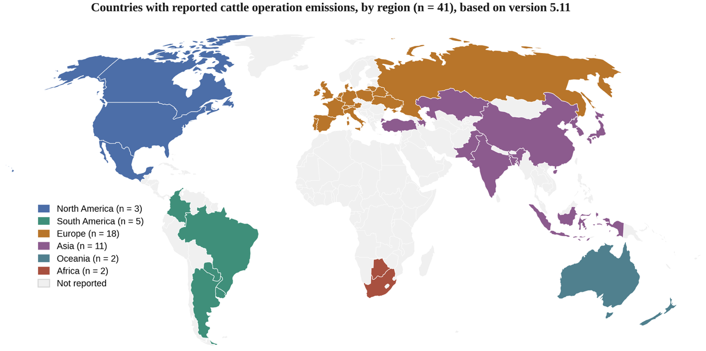

**Figure 1** Countries with cattle operation emissions, shaded by region, based on version 5.11. Climate TRACE data release. Emissions were estimated for 41 countries. The number of cattle operations identified varies by country, see Tables 5 and 6.

Figure 1 displays the current country coverage from Climate TRACE data release v5.11. To find these individual cattle operations within a specific country required identifying seed data (known cattle operations) to train AI models to find similar features in remote sensing imagery, either Sentinel-2 or PlanetScope imagery. Once operations were identified, another set of models were trained to identify those with wet manure management systems - liquid/slurry and anaerobic lagoons, hereafter 'manure ponds' - which flagged high-productivity operations and determined which IPCC 2019 manure management emission factors were applied. The total head of cattle at each operation was then estimated using reported cattle numbers, country- or sub-country-level mean values, or, where the operation's area footprint could be delineated, regression modelling. These inputs were used with IPCC 2019 EFs and equations to estimate enteric fermentation and manure management emissions quarterly for years 2015 to 2025 (Figure 2). Quarterly emissions data were generated because some of the major cattle producing countries — the U.S., Canada, and Australia — produce quarterly cattle reports every year, and the aim of this work was to match a similar quarterly reporting structure.

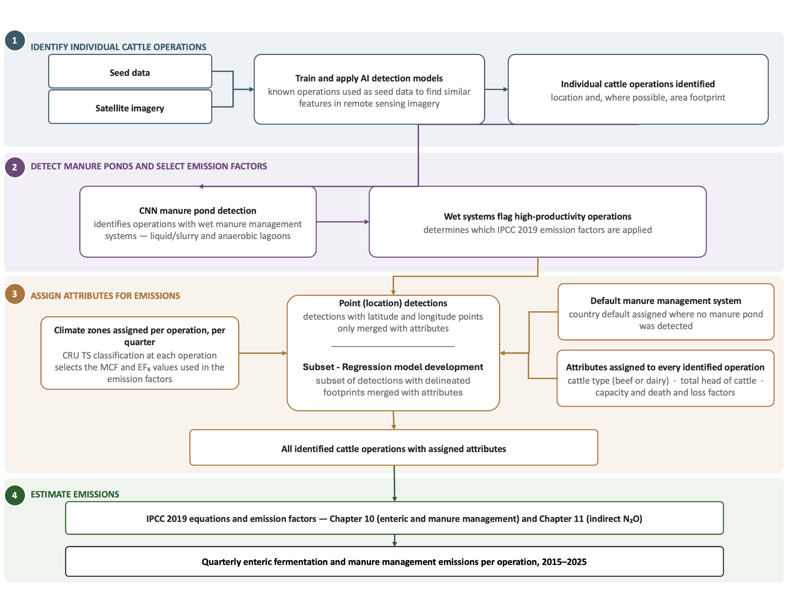

**Figure 2** Overview of the approach used to identify individual cattle operations and estimate their emissions. (1) Seed data — known cattle operations — were combined with Sentinel-2 or PlanetScope satellite imagery to train AI detection models, which identified the location and, where possible, the area footprint of individual cattle operations. (2) A convolutional neural network (CNN) then identified operations with wet manure management systems (liquid/slurry and anaerobic lagoons, hereafter ‘manure ponds’); the presence of these systems flagged high-productivity operations and determined which IPCC 2019 manure management and enteric fermentation EFs were applied. (3) Assign attributes for modeling - country default assigned where no manure pond was detected, cattle type (beef or dairy), total head of cattle, capacity and death and loss factors, and quarterly climate zones - were assigned to all operations. A subset of locations were used for regression modelling using the delineated footprint area. (4) IPCC 2019 EFs and equations were then applied to estimate manure management CH₄ (Tier 2) and N₂O (Tier 1), and enteric fermentation CH₄ (Tier 2), for each quarter from 2015 to 2025 for every cattle operation. More detailed information can be found in the following sections.

To create the Climate TRACE cattle operations dataset, the data sources, model development, and the attribution of ancillary information and cattle-type-specific emission factors to individual locations are described below, based on the order of the boxes in Figure 2.

#### 2.1 Seed data — reported and researched cattle operations

Reported cattle data formed the basis for the Climate TRACE cattle operation dataset, providing an initial set of records that included geolocation, cattle type, total head of cattle, and, in some cases, manure management type. This information served as the seed data used to train the AI detection models (Figure 2, box 1) and was obtained in two ways.

First, for the U.S., reported data comprised individual state concentrated animal feeding operation (CAFO) databases (Table S1), with the U.S. Environmental Protection Agency (EPA) Enforcement and Compliance History Online (ECHO) database providing additional coverage (accessed February 2024; https://echo.epa.gov/). Depending on the state, some records also included total head of cattle by type — beef or dairy — and the manure management systems employed.

Second, for non-U.S. countries, country-specific research was performed to identify beef and dairy operations. Cattle operations vary substantially in appearance across countries, differing in size, infrastructure, management practice, building materials, and cultural context, which limits the transferability of AI models trained on one region, such as the United States, to others (Figure 3). Detecting operations globally therefore requires region-specific calibration and seed data generation.

This involved identifying high-confidence seed locations for both the Earth Index and TDX models. Publicly available high-resolution basemaps (Google Maps, Bing Maps, and Mapbox) and ancillary tools such as Google Street View were used to visually confirm cattle operations, including verifying publicly listed farm types where available. At sub-meter resolution, individual cattle are often directly visible and can typically be distinguished from other livestock such as horses, sheep, or poultry, whose operations may share similar structural features. Additional region-specific indicators were also used, including characteristic CAFO infrastructure, manure lagoons, anaerobic digesters, hay storage, feeding troughs, open shade structures, building skylights, cattle pathways from pens to pasture, and, in particular, the presence of dark, manure-rich soil surfaces (Figure 3).

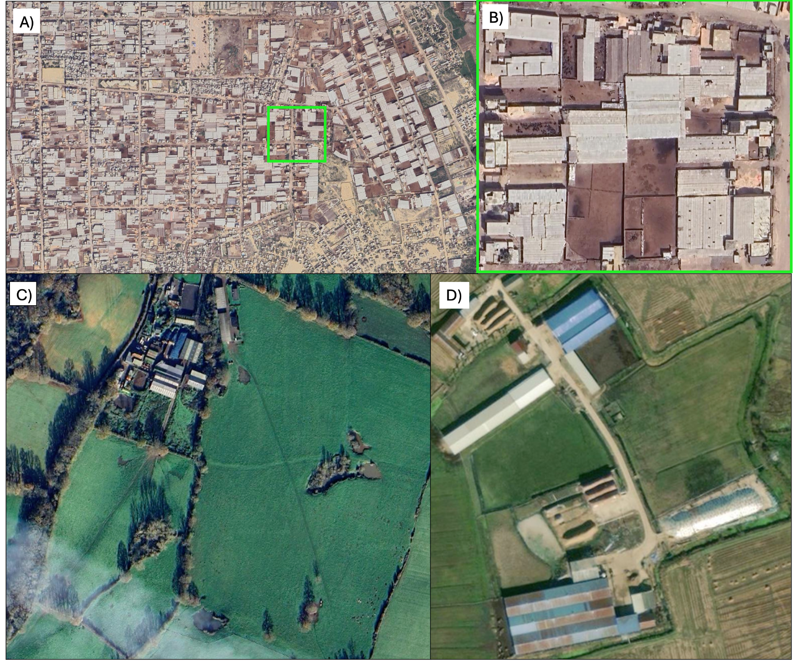

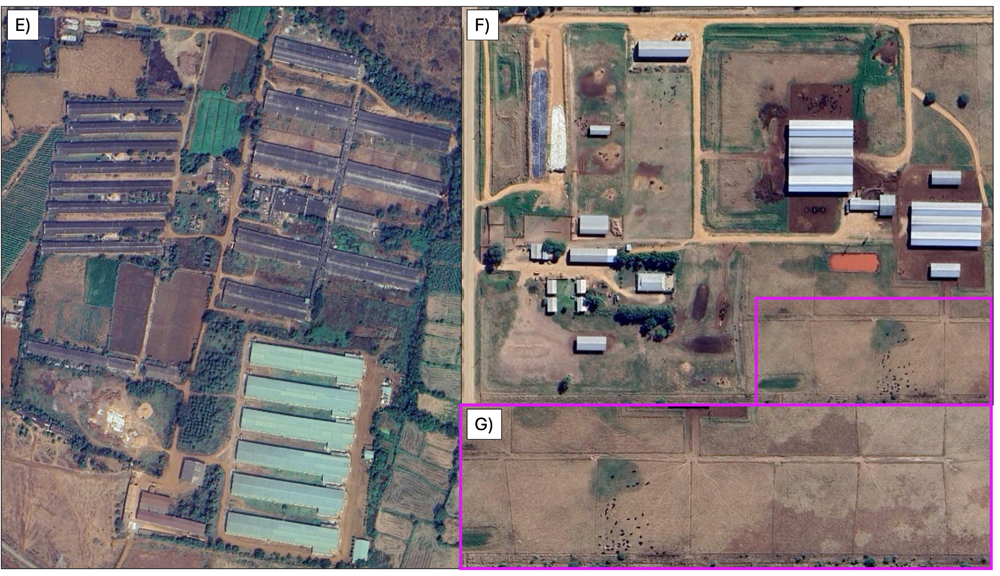

**Figure 3** Cattle operations identified in A) Pakistan, a cattle colony with B) a close-up (green box) where the cattle are housed. Note, the cattle colony has mixed buffalo and cows in this area. C) An Irish dairy farm, where cattle can be seen in the lower right corner. D) A dairy farm in China and E) in India. F) A feedlot in Paraguay with G) a close-up of the pens (purple box) where the cattle occupy the lower left corner of the pen.

#### 2.2 AI detection models and remote sensing datasets

Cattle operations were detected using two AI models - Earth Index and TerraDetect (TDX) - each paired with a different satellite imagery source and fed seed data (Figure 2, box 1). The subsections below describe each model with the remote sensing data it ingested.

#### 2.2.1 Earth Index

The Earth Index model is a digital platform developed by Earth Genome (https://www.earthgenome.org/earth-index) for detecting objects on the Earth’s surface using AI foundation models and satellite imagery. It supports a human-in-the-loop workflow for building locally tuned models and datasets iteratively. The Earth Index system processes the satellite composites through an AI foundation computer vision model, yielding embedding vectors that encode numerical representations of the topography on each small patch of the Earth’s surface. These vector representations are then passed to a target-specific classifier, trained by a user with successively larger labeled datasets, which produces detections across a region with quantifiable accuracy metrics (Figure 4).

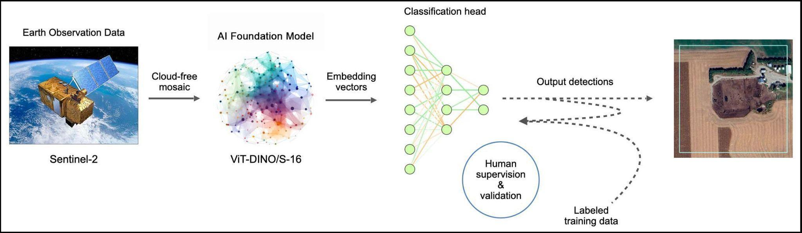

**Figure 4** Schematic Earth Index workflow for cattle facility detection.

The remote sensing ingested into Earth Index was The European Space Agency (ESA) Sentinel-2A (launched 2015) and Sentinel-2B (launched 2017) MultiSpectral Instrument (MSI) radiance measurements were used. Together the two satellites provide a revisit interval of approximately five days for most land locations on Earth. Each collects 13 spectral bands from blue to shortwave infrared (approximately 442 nm to 2,202 nm) at spatial resolutions ranging from 10 m to 60 m depending on the band. All bands were used as Earth Index model inputs. Sentinel-2A and -2B L1C data were downloaded from Google Earth Engine (GEE) and combined into cloud-free 2023 annual median composites per band for each region, which were then used to compute the embedding vectors. Further information is available from ESA (https://www.esa.int/Applications/Observing\_the\_Earth/Copernicus/Sentinel-2) and GEE (https://earthengine.google.com/).

The key components of Earth Index with Sentinel-2 are as follows:

-   **AI Remote Sensing Foundation Model-** A remote sensing foundation model is a large neural network that has undergone extensive, self-supervised pre-training on satellite and other geospatial data. In this process, the model learns representations of objects on the Earth’s surface, including buildings, vegetation, and terrain features, making it adaptable to many downstream tasks. We deployed an open-source foundation model trained on 500 GB of globally sampled Sentinel-2 imagery, specifically, a Vision Transformer (Wang et al., 2023) trained with a DINO objective (Caron, 2021). The foundation model was run on 32x32-pixel (\~320 m x \~320 m) patches drawn from the cloud-free Sentinel-2 image composite, resized to the required model input shape. The model outputs a 384-dimensional embedding vector encoding the visible content for each patch of the Earth's surface. The patches cover the entire area of interest, overlapping by half a patch width.

-   **Classification Head-** For final classifiers, we trained shallow, fully-connected neural networks, typically with two hidden layers, via the Scikit-learn Python programming package. The classification head ingests embedding vectors from the foundation model, and under training with labeled data, learns to discriminate cattle facilities from the background topography.

Classification head. For the final classifiers, shallow fully connected neural networks, typically with two hidden layers, were trained using the scikit-learn Python package. The classification head ingests embedding vectors from the foundation model and, through training on labeled data, learns to discriminate cattle facilities from the background topography.

Cattle operation features vary from country to country, as does the background topography. The problem of detecting cattle operations globally was therefore decomposed into a series of loco-regional problems covering areas of up to a few million square kilometers. Each region required its own labeled training dataset, constructed iteratively through Earth Index training, inference, and validation of model outputs.

#### 2.2.2 TerraDetect

TerraDetect (TDX) is a proprietary AI model (Tulloch, 2024): a globally scalable, regionally adaptive pipeline for infrastructure detection using medium-resolution (3–5 m) satellite imagery. It combines an attention-based backbone, a multi-tiered inference cascade, and iterative domain adaptation to balance generalization against regional precision across heterogeneous geographies.

TDX’s object detection framework was designed to identify and precisely locate concentrated animal feeding operations (CAFOs) for beef and dairy production worldwide. The data pipeline performs deep learning binary detection on several million imagery tiles. These georeferenced tiles are created through a custom, geospatially parallelized process based on Planet Labs’ PlanetScope monthly basemap imagery.

The processing pipeline combined flexible data preprocessing, multi-stage inference filtering, and geospatial clustering to balance sensitivity against precision at scale. A major focus of this work was resolving domain adaptation challenges through regionally aware training and iterative refinement.

***Data Sources and Preprocessing***

The input satellite data consisted of PlanetScope basemap RGB imagery from Planet Labs, offering monthly global coverage at approximately 3–5 m resolution. Training and inference samples were generated through a pipeline performing multi-model, window and stride-based processing, with the following key features:

-   Flexible windowing: patch size and stride are adjusted automatically;

-   Positive labels (seed data): derived from curated target sites;

-   Negative labels: drawn from OpenStreetMap and filtered by land use category;

-   Augmentation: spatial and photometric transformations improve robustness;

-   Oversampling: class balance is maintained by oversampling rare positives.

***Domain Adaptation via Iterative Regional Training***

A central challenge in applying global satellite models is domain shift — differences in landscape, architecture, and sensor artifacts between regions. To address this, the TerraDetect pipeline employed iterative, regionally focused training cycles. High-quality, manually validated datasets (seed data) were collected and used to train country-specific models. After initial detection, false positives were examined to identify underrepresented patterns, which were then incorporated into retraining cycles, enabling the model to adapt to new regions.

***Model Architecture and Tiered Model Cascade***

The core classification backbone used to identify cattle operation features from PlanetScope basemap imagery was the Swin Transformer (Swin-Tiny), a hierarchical vision transformer that processes the basemap imagery and performs self-attention within non-overlapping shifted windows to determine which image features belong to the same cattle operation. This makes it suitable for local-global reasoning within small satellite image patches.

The backbone was pretrained on multiple sources for visual feature extraction. Because PlanetScope basemap imagery varies in resolution from approximately 3 m to 5 m, the model was configured to handle varying input sizes rather than a fixed one. Training used a weighted binary cross-entropy loss, which classifies whether each pixel belongs to a cattle operation and assigns those pixels higher importance than the surrounding background, so that the comparatively rare cattle operation features are not overwhelmed by the far larger background class.

Additional information on TDX can be found in the Supplement section S.2.

#### 2.2.3 Previously detected operations (RAIC)

In earlier work for this sector, the Rapid Automatic Image Categorization (RAIC) tool developed by RAIC Labs, formerly Synthetaic ([https://raiclabs.com/](https://raiclabs.com/)) was used to identify locations. RAIC used PlanetScope basemap imagery from 2020 and 2024 to detect these operations. See this sector’s 2024 methodology in the Climate TRACE GitHub methodology repository for further information on the RAIC approach.

#### 2.3 Manure pond detection models

After running Earth Index and TDX, the following models were deployed to identify operations with wet manure management systems — liquid/slurry and anaerobic lagoons, flagged as manure ponds (Figure 2, box 2). This information was used to assign high-productivity cattle and specific manure management emission factors.

For description on pond model deployments can be found in supplementary section S.2.

#### 2.3.1 SLU manure pond detection model

The Dept. of Earth, Environmental and Geospatial Science, Saint Louis University (SLU) developed a convolutional neural network (CNN) approach for manure pond detection which used the Earth Index Model’s Vision Transformer embeddings, which served as compact representations of Sentinel-2 multispectral satellite imagery (Figure 5).

The CNN architecture consisted of successive convolutional layers to extract increasingly complex spatial patterns. Each convolutional layer is followed with a max-pooling layer to progressively condense the information creating a convolutional block. The convolutional blocks provide a hierarchy of learned features, ranging from location textures to higher-level representations. After feature extraction, the network flattens the output of the convolutional blocks and passes them through fully connected layers, ultimately reaching a SoftMax classification layer providing a probability distribution of whether the cattle operation has a pond present in its premises or not. The CNN generated a binary output that classifies feedlots as either containing a pond or not. This output produced an interpretable, map-based product that can be applied across diverse geographies.

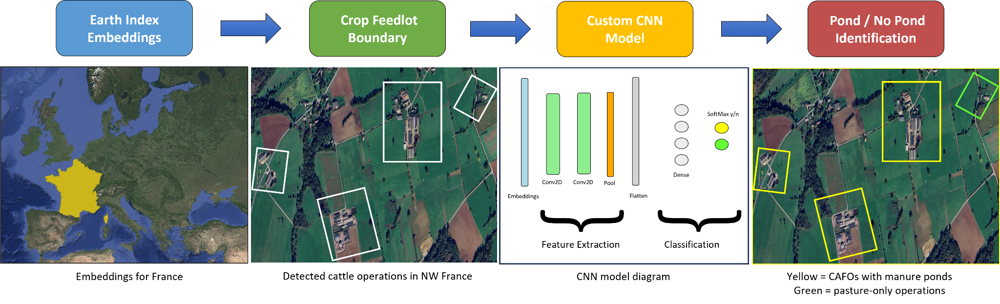

**Figure 5** CNN-Based Manure Pond Detection Workflow. Convolutional Neural Networks (CNNs), trained on Earth Index multispectral and Vision Transformer (ViT) embeddings, classify cattle operations as pond-present or pond-absent, indicating the presence of a manure lagoon management system. The workflow consists of: 1) Embedding Acquisition: Retrieve Earth Index embedding vectors for the country or region of interest. 2) Training Sample Preparation: Crop embeddings to the cattle operation boundaries previously identified in the feedlot detection stage. 3) Model Training: Train a custom CNN classifier to distinguish operations with and without manure ponds. 4) Visualization: Map model outputs using class-specific symbology—yellow boundaries denote operations with ponds; green boundaries indicate no pond.

#### 2.3.2 TerraDetect manure pond detection model

TerraDetect implements a deep learning–based segmentation pipeline for detecting manure ponds in satellite imagery. The system supports transformer backbones from the Hugging Face ecosystem—SegFormer (MiT encoder with lightweight decoders) and Mask2Former (query-driven segmentation over multi-scale features)—and extends them with dataset mechanics for native negative-image training, balanced sampling, and geospatially aware post-processing. The end-to-end pipeline spans data curation and augmentation, model construction, loss design, validation with positive and negative metrics, and georeferenced inference leading to vectorized pond polygons in GeoJSON**.**

***Segmentation Backbones Applied to Identify Manure Ponds in Satellite Imagery***

The following segmentation backbones were applied to each satellite imagery with a known cattle operation to identify the pixels associated with a manure pond feature.

-   SegFormer (MiT-B0–B5): A hierarchical transformer encoder produces multi-scale token features that are fused through an multilayer perception (MLP)-based decoder into dense masks. For this work, the SegFormer was applied to satellite imagery to understand and categorize pixels belonging to a manure pond feature.

-   Mask2Former (Swin): A transformer decoder with mask-classification queries predicts per-query class scores and mask logits. The classifier head is adapted for binary segmentation, and final per-pixel logits are reconstructed from the query-mask combination and upsampled.

Since manure ponds can vary at each cattle operation, both backbones captured long-range dependencies and multi-scale structure, enabling robust pattern detection of heterogeneous pond shapes and backgrounds globally.

***Training Objective***

Model optimization targets the foreground (pond) channel using a compound objective:

-   Dice Loss to optimize overlap under severe class imbalance and sharpen boundaries.

-   BCEWithLogits with configurable pos\_weight to penalize false negatives where ponds are rare.

The models learn with a weighted sum of these losses to ensure balanced optimization. Gradients flow only through the pond channel to “learn” from the satellite image what pixels belong to a manure pond and the background channel, anything else that isn’t a manure pond, is implicitly modeled (Figure 6).

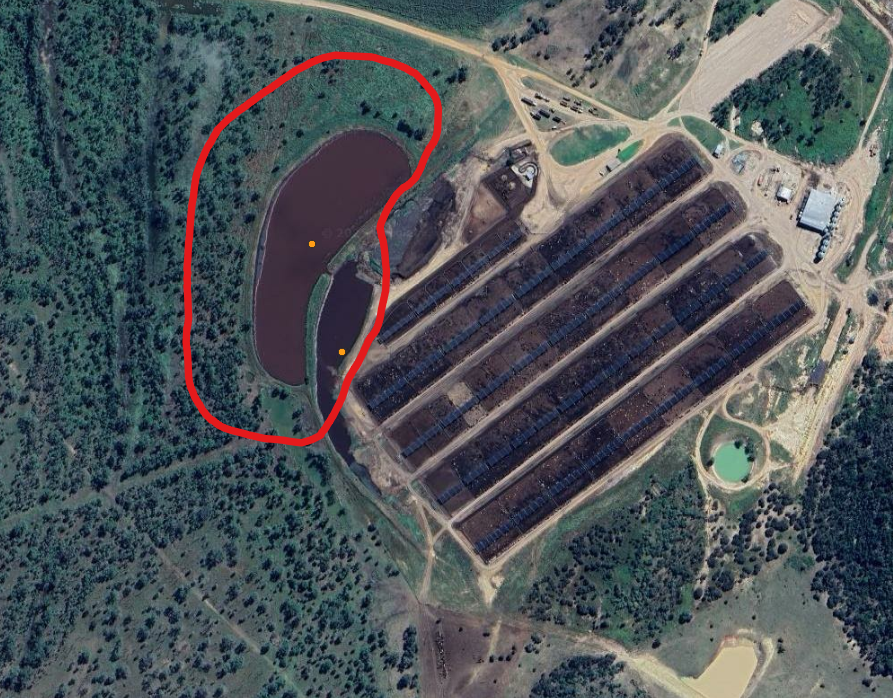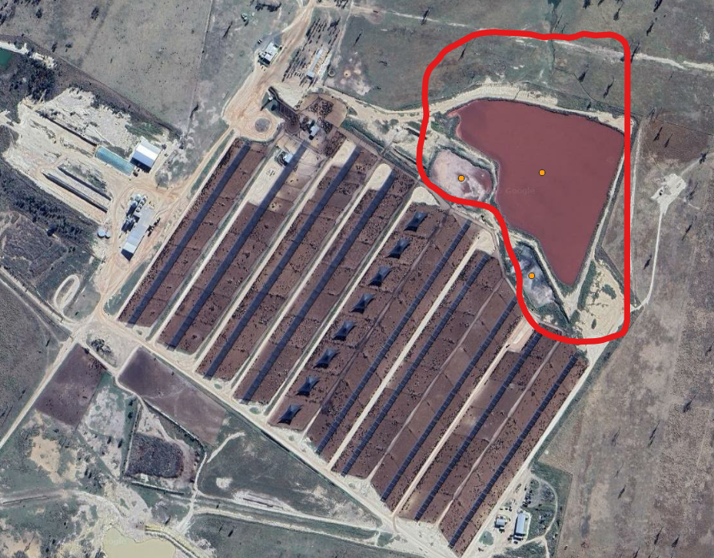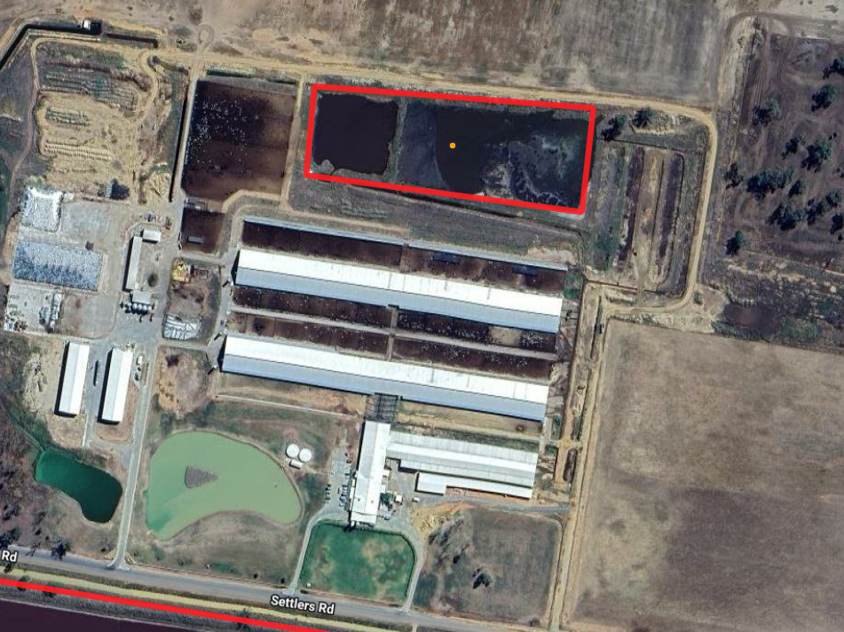

**Figure 6** TerraDetect Pond Model Segmentation Outputs for various cattle operations globally. Red bounding boxes indicate what the model determined was a pond. Note that the red bounding boxes’ extent are based on PlanetScope imagery, not the Google map imagery shown in this figure.

***Negative-Image Strategy and Validation Metrics***

Negative examples were incorporated into the sampling loop at a configurable negatives:positives (non-ponds:ponds) ratio. This unified strategy yields three benefits: (1) no need for separate loss functions, (2) calibrated confidence on true negatives, and (3) validation diagnostics including image-level false positive rate (FPR) and false-positive pixel area, which guide thresholding and augmentation tuning. This approach helps train the TerraDetect model to ignore non-pond areas, reduce mistakes, and improve overall performance.

Per-epoch evaluation reports intersection over union (IoU; threshold 0.5) on positive samples alongside FPR and FP area on negatives. Together, these metrics balance localization quality with suppression of spurious detections.

#### 2.4 Country and sub-country-level cattle data

For most of the cattle operations identified by the AI models, only the location was returned; the additional information needed for emissions modeling was not available. This was also true for reported cattle operations where some were missing other required information for emissions modeling. To fill this gap, country- and sub-country-level cattle data were used for three purposes. First, each operation had to be assigned a cattle type — beef or dairy — so that the corresponding IPCC “Mature Dairy Cattle” and “Other Cattle” (beef) emission factors and equations could be applied to estimate enteric fermentation and manure management emissions (IPCC, 2019b; IPCC, 2019c; Figure 2, box 3). Second, because total head of cattle is required to estimate total emissions, and most identified operations were point locations without a footprint area suitable for regression modeling, mean head values by cattle type were applied, along with a common manure management system. Third, capacity and death and loss factors were applied to convert the potential head of cattle at an operation into an estimate of the head actually held. How each was handled varied with the level of detail available in a country’s reporting.

#### 2.4.1 Country-level cattle data

Many countries report only national beef and dairy information or, in some cases, lack usable information altogether, requiring default assumptions drawn from the literature. For Pakistan, European Union countries, the United Kingdom, and countries without clear information, all identified operations were assigned ‘MatureDairyCattle’, since beef production in these systems is largely a byproduct of dairy production (Steinfeld and Mäki-Hokkonen, 1995; Greenwood, 2021). For South American countries, the default assignment was ‘OtherBeefCattle’, covering non-dairy, other, and beef cattle (Greenwood, 2021).

Similarly, country-specific mean total head by cattle type was then applied to each operation. Table S2 lists the references by country drawn upon for national sources.

Lastly, common manure management systems were researched in the same way, to determine the systems most widely used in each country. Where the manure pond detection model was not run in Section 2.3, or where no manure pond was detected, the operation was assigned its country’s common manure management system.

#### 2.4.2 Sub-country-level cattle data

For countries reporting sub-country cattle information — the United States, Australia, Canada, Japan, and Indonesia — geospatial data by state, territory, or province were used to assign cattle types (Table 1). For example, an operation identified in the Canadian provinces of Alberta or Saskatchewan was assigned the beef cattle type, ‘OtherBeefCattle’. Many U.S. CAFO records were already designated as either dairy (‘MatureDairyCattle’) or beef (‘OtherBeefCattle’) and were used as reported., and if missing information, the U.S. Department of Agriculture (USDA) filled in missing information.

**Table 1** Countries with sub-country cattle data with a summary of cattle data provided.

<table><thead><tr class="header"><th><strong>Country</strong></th><th><strong>Cattle type</strong></th><th><strong>Source</strong></th><th><strong>Data provided</strong></th></tr></thead><tbody><tr class="odd"><td><em>Australia</em></td><td>beef</td><td><a href="https://www.mla.com.au/prices-markets/Trends-analysis/quarterly-lot-feeding-briefs/">Meat &amp; Livestock Australia</a> (MLA, n.d.)</td><td>Utilisation % per year, Feedlot capacity, and Numbers on feed by territory and national</td></tr><tr class="even"><td><em>Canada</em></td><td>beef</td><td><a href="https://canfax.ca/resources/reports/cattle-on-feed-reports.html">CanFax cattle on feed reports</a> (CanFax, n.d.)</td><td>Placed on Feed for each month per year and capacity for Alberta and Saskatchewan</td></tr><tr class="odd"><td></td><td>dairy</td><td><a href="https://agriculture.canada.ca/en/sector/animal-industry/canadian-dairy-information-centre/statistics-market-information/farm-statistics">Agriculture and Agri-Food Canada</a> (AAFC, 2026)</td><td>
Number of Dairy Cows and Dairy Heifers by Province;

Number of Farms with Shipments of Milk on August 1st
</td></tr><tr class="even"><td><em>Indonesia</em></td><td>beef + dairy</td><td>
<a href="https://www.bps.go.id/en/publication/2024/08/09/5c1eade842cefac97aac67bd/the-complete-enumeration-results-of-the-2023-census-of-agriculture---edition-2--livestock-individual-agricultural-holdings-.html?utm_source=chatgpt.com">BPS-Statistics Indonesia, 2024</a>

(2023 data only)
</td><td>
Number of Beef Buffalo Livestock Households by Province and Main Purpose of Raising Livestock (households);

Number of Livestock Individual Agricultural Holdings by Province and Main Purpose of Raising Livestock (units);

Number of Beef Cattle Livestock Households by Province and Type of Production (households);

Number of Beef Cattle Livestock Individual Agricultural Holdings by Province and Type of Production (units);

Number of Beef Cattle Livestock Households by Province and Production Utilization (households),
</td></tr><tr class="odd"><td><em>Japan</em></td><td>beef + dairy</td><td><a href="https://www.maff.go.jp/e/data/stat/index.html">Ministry of Agriculture, Forestry and Fisheries</a> (MAFF, n.d.)</td><td>Province level beef and dairy cattle data, number of farms by cattle type.</td></tr><tr class="even"><td><em>USA</em></td><td>beef + dairy</td><td><a href="https://www.nass.usda.gov/">USDA NASS</a></td><td>For each quarter per year, the capacity factors were determined by:</td></tr></tbody></table>

Mean head of cattle was likewise assigned at the sub-country level, using the mean for the relevant cattle type within the jurisdiction in which each operation fell. The sub-country sources are listed alongside the national sources in Table S2; for the U.S., USDA state-level means were used for both dairy and beef.

#### 2.4.3 Assigning capacity factors

To estimate the actual total head of cattle held at an operation, utilization factors (hereafter capacity factors) and death and loss rates were applied to the Climate TRACE identified cattle operations.

Cattle operations are designed to hold a maximum number of animals. Dairies generally maximize and maintain the number of cows milked for production, with large dairies typically operating more efficiently in terms of labor and resources used. Beef cattle operations such as feedlots, by contrast, face several factors that limit the number of cattle occupying the available space, including market demand, the cost of feed, and the weight of the animal prior to feedlot placement (Turcios, 2022). That last factor reflects the fact that feedlots are flow-through systems, in which beef cattle spend only a fraction of their lives being fattened for slaughter (Hayek and Garrett, 2018; USDA, 2023). The fattening process is itself influenced by market demand and feed prices. Together, these factors determine the number of cattle at an operation — its capacity factor — which generally results in less than 100% of the available space being used to house cattle.

Because dairy operations were assumed to run at full capacity, a fixed capacity factor was applied to all identified dairy operations. Beef operations generally do not have fixed capacity factors. For the majority of country (rest of world, ROW), capacity factors were estimated from USDA Foreign Agricultural Service slaughter and beginning beef stock data where available, described in Section S.1 ‘Deriving beef capacity factor (utilization rate)’; where those data were unavailable, the mean quarterly value across all sources in Table S3 was applied. Countries with detailed and sub-country information are shown in Table 1. Supplemental section S.3 and equations S1 and S2 provide more information on deriving these values.

#### 2.5 Regression model development

The regression models relied on the hypothesis that a cattle operation’s area, in hectares, can serve as a predictor of the potential total head of cattle held there (Table S3; Figures S1 to S3). To develop these models, area footprints were delineated for AI-identified cattle operations in the U.S. and spatially joined to CAFO data for the relevant states. Additional training data came from two further sources: a subset of Australian operations was spatially joined to the Farm Transparency Project map dataset, an Australian nonprofit dataset (Farm Transparency Project, n.d.), and Fan et al. (2018), which provided area estimates and total head of cattle for Chinese dairy operations only.

Cattle operations that had area footprints but were not used in regression model development had one of these models applied to estimate their potential total head of cattle.

#### 2.6 IPCC 2019 Refinement — Equations and Emission Factors

Equations and emission factors (EFs) were drawn from Chapter 10 (Emissions from Livestock and Manure Management) and Chapter 11 (N₂O Emissions from Managed Soils, and CO₂ Emissions from Lime and Urea Application) of the 2019 Refinement to the 2006 IPCC Guidelines for National Greenhouse Gas Inventories, and applied to each identified cattle operation (IPCC, 2019a; IPCC, 2019b). “Mature Dairy Cattle” and “Other Cattle” EFs, selected by region, climate zone, and manure management system, were applied according to the cattle type assigned to each operation in Section 2.4.

Enteric fermentation emissions were estimated using the Tier 2 approach described in Chapter 10, Section 10.3, for both dairy and other cattle (beef) CH₄.

To better represent manure management at each individual cattle operation, emissions were estimated across multiple manure management systems (MMS) rather than a single system per operation, described in Chapter 10, Section 10.4.2, under the Tier 2 description (IPCC, 2019a). Manure CH₄ was estimated using the Tier 2 approach and manure N₂O used the Tier 1 approach in Section 10.5, both applied across the multiple MMS. Indirect N₂O from volatilisation and leaching/runoff used EF₄ and EF₅, respectively, from Chapter 11, Table 11.3. As suggested by IPCC (2019a) for MMS, the fraction of manure () entering each management system was estimated by cattle type and by the systems employed within each climate zone, using Marklein et al. (2021 and M. Stoermann (personal communication, June 2026).$`M_{\text{frac}}`$

Section 3.2.2 describes the multiple MMS and approach to estimate manure emissions. Table 3 lists the multiple MMS applied to operations by region and cattle type, and Table 4 gives the values for each multiple MMS. Figure 8 illustrates how a dairy and beef operation are assigned each.

#### 2.7 Climate Zones - Climatic Research Unit Gridded Time Series

The updated 2019 IPCC guidelines require climate zones to estimate CH₄ emissions by manure management system, an update from the 2006 guidelines, which relied on temperature-based emission factors (Figure 7). To derive climate-zone-specific methane conversion factors (MCF) (Table 10.17) to estimate manure management emissions, we used the Climatic Research Unit gridded Time Series (CRU TS) v4.10 NetCDF files (version June 7, 2026) from the University of East Anglia (Harris et al., 2020).

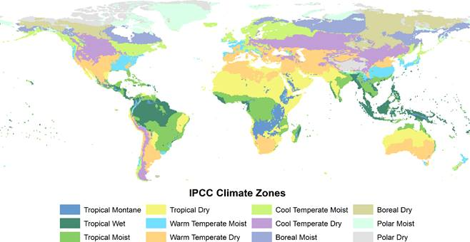

**Figure 7** IPCC 2019 major climate zones identified (image taken from IPCC 2019 Chapter 3, volume 4; IPCC, 2019a).

CRU TS provides monthly climate data for global land areas, excluding Antarctica, at a 0.5° × 0.5° resolution. The dataset includes temperature, precipitation, and potential evapotranspiration (PET), which we used to classify IPCC climate zones (Table 2). CRU TS combines weather-station observations with spatial interpolation to provide continuous climate coverage, including in areas with limited observations, although station density varies by location and over time. While CRU TS may be less reliable in regions with few weather stations, the global coverage and time-series climate variables make it well suited for generating climate zones to estimate manure CH₄ emissions across countries. For information on CRU TS refer to Harris et al. (2020), NCAR (n.d.), and the CRU TS v4.10 release notes (https://crudata.uea.ac.uk/cru/data/hrg/cru\_ts\_4.10/).

For the purpose of this work, monthly climate zones were generated for each operations’ latitude and longitude centroid and climate zones were used to derive the MCF values by livestock type per month, then averaged to quarterly MCF values for years 2015 to 2025 (Figure 2, Box 3).

#### 2.8 Emission Reduction Solutions (ERS)

Beginning in fall 2025, Climate TRACE introduced ERS — potential mitigation strategies to reduce emissions, specific to individual sectors. For the cattle operation sector, ERS are produced for both enteric fermentation and manure management, and each strategy can be viewed on the Climate TRACE website (https://climatetrace.org/reduce/countries/all/Global). This section summarizes each strategy; full detail is given in the supplemental section below and in the ‘Cattle Supporting Information’ at [GitHub Agriculture folder](https://github.com/climatetracecoalition/methodology-documents/tree/main/2025/Agriculture).

Seven ERS strategies are provided for enteric fermentation. Six are feed additives, classified as ‘retrofits’ — changing the technology or practices of an existing operation. The seventh is a demand-side reduction in herd size, classified as ‘subtract’ — turning off some or all activity at an operation. Each strategy carries a ratio of the new CH₄ emission factor to the current one, applied separately to beef and dairy cattle. Across the six feed additives, the emission factor is reduced by 6.4% to 64.8% for beef cattle and 4.9% to 23.4% for dairy cattle; the demand-side strategy reduces emissions by 10% for both.

Three strategies are provided for manure management. The first is the same demand-side reduction in herd size, described above. The second replaces a single manure management system (MMS) within an operation’s multiple MMS with a lower-emitting system, classified as a retrofit (see Figure S5 in Section S.5.2). As described in Section 2.6, manure management CH₄ and N₂O emissions were estimated across multiple MMS rather than a single system, so the multiple MMS at each operation were first determined (Section 3.2.2), then one system was replaced and emissions compared before and after to give a new ratio factor. The last strategy are chemical treatments of manure effluent. These strategies addresses CH₄ only, since it accounts for the majority of manure management emissions relative to N₂O. See section S.5 for a description on how ERS was applied to cattle operations to reduce emissions.

#### 3. Methods to estimate emissions

This section describes the steps used to estimate CH₄ from enteric fermentation and CH₄ and N₂O from manure management, based the assigned cattle attributes at each identified cattle operation (Figure 2, box 4). Enteric fermentation CH₄ was estimated using the Tier 2 approach described in Chapter 10 of IPCC (2019a). Manure CH₄ and N₂O were estimated using the Tier 2 and Tier 1 approaches but modified to account for multiple manure management systems (MMS) and the fraction of manure ($`\text{Mfrac}`$) entering each system. Emissions were reported per operation in metric tonnes (t), at quarterly resolution from 2015 to 2025.

#### 3.1 From AI-detected operations and manure ponds to emissions inputs

Sections 2.1 to 2.2 described the seed data - reported operations from state CAFO databases and EPA ECHO in the U.S., and country-specific research for the rest of the world (ROW) - used to train the Earth Index and TerraDetect (TDX) models. These models identified cattle operations in Sentinel-2 and PlanetScope imagery, returning the location of each. A subset of these locations had their area footprint delineated for regression modeling. The manure pond detection models were then run on the identified operations to find those with wet manure management systems, or ponds.

AI model detections and their outputs were QC’ed visually with a subset of detected locations and the subset quantity varied by country. Locations that were QC’ed are marked “high” in the location and provided in the confidence files.

#### 3.2 Assigning attributes for emissions

Estimating manure management and enteric fermentation emissions required different sets of attributes. Manure management emissions drew on the climate zone and the multiple manure management systems (MMS) assigned to each operation, from either a model-detected pond or a country default, which together with the cattle attributes described in Section 2.4 selected the methane conversion factors from Table 10.17 and the emission factors used to estimate CH₄ and N₂O at each individual operation (Figures 8 and 9). Enteric fermentation emissions required only the cattle attributes to estimate CH₄.

The manure pond detection also determined which productivity system was assumed at an operation. For Latin America, Africa, the Middle East, Asia, and the Indian subcontinent, any operation with a detected manure pond was assigned the high-productivity dairy or beef cattle type, overriding the regional defaults for mean or low-productivity systems, such as those given in Table 10A.5 (Default values for live weight for animal categories, kg) and Table 10.13A (Default values for volatile solid excretion rates).

#### 3.2.1 Assigning climate zones for manure management emissions

Manure management methane emissions are driven by the amount of manure produced, the system in which that manure is handled, and the climate conditions — particularly temperature and moisture — that determine whether emissions are produced under anaerobic or aerobic conditions (IPCC, 2019b; see Supplemental Section S.1 for further detail on anaerobic and aerobic conditions). The 2019 Refinement requires climate zones to estimate CH₄ emissions by manure management system, a departure from the 2006 Guidelines, which relied on annual-temperature-based emission factors.

Rather than applying a single static climate zone spanning 30 years, monthly climate zones were generated from the Climatic Research Unit gridded Time Series (CRU TS) v4.10. Climate zones were created using the decision tree published in the first Corrigenda (“things to be corrected”) to the 2019 Refinement and discussed further in Chapter 10 (Figure 7; Federici, 2021; IPCC, 2019b). Table 2 lists the climate zones and the corresponding IPCC tables used for mapping.

**Table 2** IPCC 2019 climate zones mapped to manure management systems in Table 10.17 to derive MCFs and disaggregated climate zones mapped to N₂O EF₄ in Table 11.3.

<table><thead><tr class="header"><th>
<strong>IPCC Climate Zones for manure management systems</strong>

<strong>(Table 10.17)</strong>
</th><th>
<strong>Disaggregated Climate Zones</strong>

<strong>(Table 11.3)</strong>
</th><th>
<strong>IPCC Climate Zones for manure management systems</strong>

<strong>(Table 10.17)</strong>
</th><th><strong>Disaggregated Climate Zones (Table 11.3)</strong></th></tr></thead><tbody><tr class="odd"><td>Tropical Montane</td><td>Dry Climate</td><td>Tropical Wet</td><td>Wet Climate</td></tr><tr class="even"><td>Tropical Dry</td><td></td><td>Tropical Moist</td><td></td></tr><tr class="odd"><td>Warm Temp. Dry</td><td></td><td>Warm Temp. Moist</td><td></td></tr><tr class="even"><td>Cool Temp. Dry</td><td></td><td>Cool Temp. Moist</td><td></td></tr><tr class="odd"><td>Boreal Dry</td><td></td><td>Boreal Moist</td><td></td></tr></tbody></table>

For each cattle operation identified, the latitude and longitude centroid was used to assign the monthly climate zones for every year from 2015 to 2025. This, combined with multiple manure management systems (MMS) and country specific cattle attributes, were used to select the methane conversion factors (MCFs) for each system in a multiple MMS system.

#### 3.2.2 Assign cattle types for multiple MMS assignment

Most identified cattle operations lacked the attribute information needed to estimate emissions. The most important of these is cattle type — dairy or beef — because it determines which multiple MMS are assigned and, in conjunction with the climate zone, which MCFs are derived.

Most operations were assigned ‘dairy cattle’, hereafter ‘MatureDairyCattle’, as described in Section 2.4.1. In large beef-producing countries such as Argentina and Brazil, operations were assigned ‘beef cattle’, hereafter ‘OtherBeefCattle’. Where sub-country information was available, described in Section 2.4.2, each operation was assigned the cattle type dominant in the state, territory, or province in which it fell. Once a cattle type had been assigned, multiple MMS were assigned to each operation on the basis of country-level research and whether the models detected a manure pond (Table 3). Operations with a detected manure pond were assigned wet-system combinations; those without were assigned the common combination for their region and cattle type. Operations with a missing, blank, or unknown reported manure management type were assigned dry lot, and reported liquid/slurry systems were treated as ponds.

Reported cattle numbers were also used to assign multiple MMS along with if a manure pond was detected. Where the seed data described in Sections 2.1 to 2.2 supplied a total head of cattle for an operation, that count was used alongside the manure pond detections to determine which MMS combination the operation received. For dairy operations in Australia, Canada, the United States, South Africa, and Botswana, a reported herd of 200 head or more was taken to indicate a wet manure management system, and the operation was assigned the same MMS combination as an operation with a detected pond, on the basis that dairies at or above this size typically handle manure as a liquid rather than as a solid (U.S. Environmental Protection Agency, 2023). Dairy operations in these countries below this threshold and with no detected pond were instead assigned liquid/slurry and pit storage, pasture/range/paddock, and solid storage. Reported head of cattle was not used to assign MMS for beef operations, nor in other regions, where assignment relied on the detected pond and the reported manure management type alone.

**Table 3** Manure management system (MMS) combinations assigned to cattle operations by region, cattle type, and manure pond detection status, used to select methane conversion factors from IPCC (2019a) Table 10.17. The Multiple MMS key column gives the corresponding $`\text{Mfrac}`$ combination in Table 4. Note: (a) Western and Eastern Europe are assigned the same MMS combinations. (b) These countries are grouped because they employ comparable manure management systems. (c) An operation was classified as a dry climate where at least 60 monthly climate-zone assignments over 2015–2025 fell in a dry zone, and as wet climate where more than 50 fell in a wet zone, both self-defined definitions. (d) Includes China, South America, and all countries not listed above. (e) manure management systems with pasture have their emissions skipped and are reported in *Cattle Emissions from Enteric Fermentation and Manure Left on Pasture* in the [Climate TRACE GitHub repo](https://github.com/climatetracecoalition/methodology-documents/tree/main/2025/Agriculture).

<table><thead><tr class="header"><th><strong>Region (ISO3)</strong></th><th><strong>Cattle type</strong></th><th><strong>Condition</strong></th><th>
<strong>MMS combination applied</strong>

<strong>(based on IPCC naming)</strong>
</th><th><strong>Multiple MMS key</strong></th></tr></thead><tbody><tr class="odd"><td><strong>New Zealand (NZL)</strong></td><td>All</td><td>Pond detected</td><td>Liquid/slurry &amp; pit storage below animal confinements (12 mo); Pasture/range/paddock; Uncovered anaerobic lagoon</td><td><strong>pst1</strong></td></tr><tr class="even"><td></td><td>All</td><td>No pond</td><td>Liquid/slurry &amp; pit storage below animal confinements (12 mo); Pasture/range/paddock; Solid storage</td><td><strong>pst2</strong></td></tr><tr class="odd"><td><strong>Japan, Korea (JPN, KOR)</strong></td><td>All</td><td>Pond detected</td><td>Liquid/slurry &amp; pit storage below animal confinements (12 mo); Solid storage; Composting — static pile (forced aeration)</td><td>
<strong>modified</strong>

<strong>wet3</strong>
</td></tr><tr class="even"><td></td><td>Mature dairy</td><td>No pond</td><td>Liquid/slurry &amp; pit storage below animal confinements (12 mo); Solid storage; Composting — static pile (forced aeration)</td><td>
<strong>modified</strong>

<strong>wet3</strong>
</td></tr><tr class="odd"><td></td><td>Other (beef)</td><td>No pond</td><td>Solid storage; Composting — static pile (forced aeration)</td><td>
<strong>modified</strong>

<strong>wet3</strong>
</td></tr><tr class="even"><td><strong>Western and Eastern Europe a</strong></td><td>All</td><td>Pond detected</td><td>Liquid/slurry &amp; pit storage below animal confinements (12 mo); Pasture/range/paddock; Solid storage</td><td><strong>pst2</strong></td></tr><tr class="odd"><td></td><td>All</td><td>Dry lot or solid storage</td><td>Dry lot; Solid storage</td><td><strong>dry2</strong></td></tr><tr class="even"><td><strong>AUS, CAN, USA, ZAF, BWA b</strong></td><td>Mature dairy</td><td>Pond detected or ≥200 head — dry climate operation c</td><td>Liquid/slurry &amp; pit storage below animal confinements (12 mo); Solid storage; Uncovered anaerobic lagoon; Dry lot</td><td><strong>wet1</strong></td></tr><tr class="odd"><td></td><td>Mature dairy</td><td>Pond detected or ≥200 head — all other climates</td><td>Liquid/slurry &amp; pit storage below animal confinements (12 mo); Solid storage; Uncovered anaerobic lagoon</td><td><strong>wet2</strong></td></tr><tr class="even"><td></td><td>Mature dairy</td><td>Pond detected — wet climate operation c, U.S. only</td><td>Liquid/slurry &amp; pit storage below animal confinements (12 mo); Uncovered anaerobic lagoon</td><td><strong>wet4</strong></td></tr><tr class="odd"><td></td><td>Mature dairy</td><td>No pond and &lt;200 head</td><td>Liquid/slurry &amp; pit storage below animal confinements (12 mo); Pasture/range/paddock; Solid storage</td><td><strong>pst2</strong></td></tr><tr class="even"><td></td><td>Other (beef)</td><td>Pond detected</td><td>Uncovered anaerobic lagoon; Dry lot; Solid storage</td><td><strong>dry1</strong></td></tr><tr class="odd"><td></td><td>Other (beef)</td><td>No pond</td><td>Dry lot; Solid storage</td><td><strong>dry2</strong></td></tr><tr class="even"><td><strong>ROW d</strong></td><td>All</td><td>Pond detected</td><td>Liquid/slurry &amp; pit storage below animal confinements (12 mo); Solid storage; Uncovered anaerobic lagoon</td><td><strong>wet2</strong></td></tr><tr class="odd"><td></td><td>All</td><td>Dry lot or solid storage</td><td>Dry lot; Solid storage</td><td><strong>dry2</strong></td></tr></tbody></table>

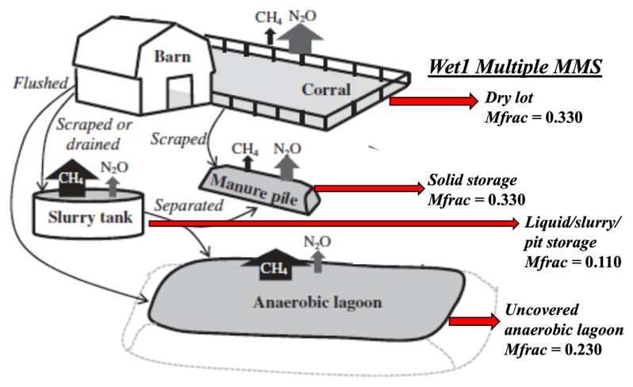 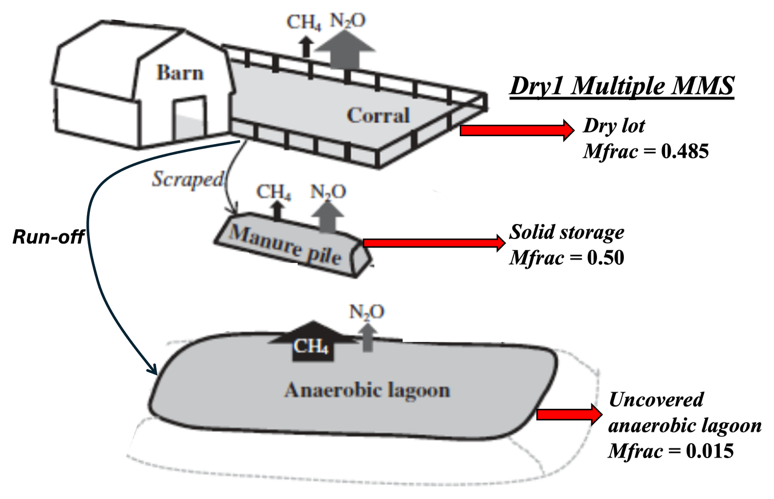

**Figure 8** Assignment of multiple manure management systems (MMS) to two detected cattle operations: left, a dairy operation assigned the wet1 multiple MMS, and, right, a beef operation assigned dry1. The dairy operation was assigned wet1 because a manure pond was detected and the operation falls in a dry climate; the beef operation was assigned dry1 because a manure pond was detected. Each system in a multiple MMS is given a fraction of manure ($`\text{Mfrac}`$), which allocates the manure produced, and the resulting volatile solids and total nitrogen excreted, across systems and sums to 1. Multiple MMS assignments by region and cattle type are given in Table 3, and $`\text{Mfrac}`$ values in Table 4 (image modified from Owen and Silver, 2015).

#### 3.2.3 Deriving MCFs

The monthly climate zones, assigned cattle types, and multiple MMS were used to select each system's methane conversion factor (MCF) from Table 10.17 (IPCC 2019b). Operations with a detected pond were assigned the condition ‘pond’ and allocated across multiple MMS based on country research, while operations without a detected pond were assigned their country’s estimated common manure management system (Table 3). Each MMS assigned to an operation carries its own MCF. The resulting monthly MCF values by MMS were then averaged to quarterly values for 2015 through 2025. The same climate zones were used to select EF₄ from Table 11.3 — N volatilisation and re-deposition, in kg N₂O–N per kg (NH₃–N + NOₓ–N volatilised) — for wet or dry climate zones. For EF₅ (leaching and runoff, in kg N₂O–N per kg N leaching or running off), a default value was used, since IPCC does not distinguish between wet and dry climates for this factor. Figures 8 and 9 provide examples of this assignment.

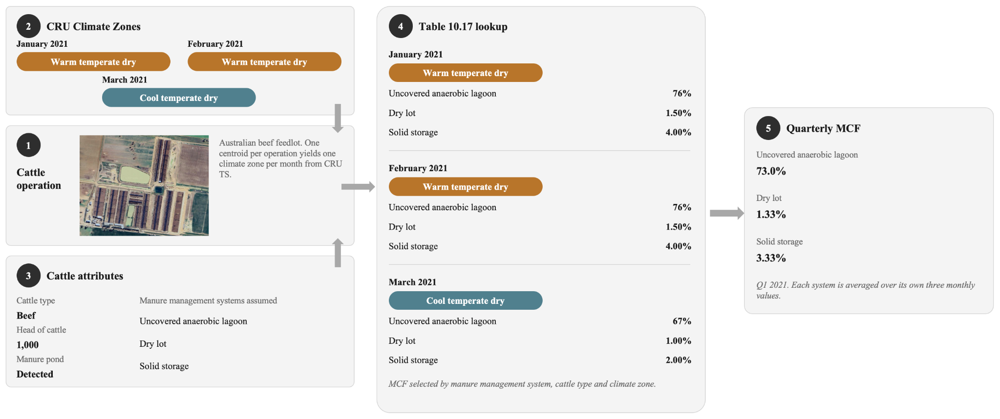

**Figure 9** An example of deriving quarterly methane conversion factors (MCF) for a beef cattle operation, using an Australian feedlot in Q1 2021 as an example. (1) For an individual cattle operation identified by the AI detection models, the centroid per operation returned a (2) CRU TS climate zone for each month: warm temperate dry in January and February, cool temperate dry in March. (3) Cattle attributes assigned to the operation — beef, 1,000 head, manure pond detected — determine the multiple MMS assumed to be in use. (4) Cattle type, manure management system, and monthly climate zone together select an MCF from IPCC (2019) Table 10.17. (5) The three monthly values for each system were averaged to a quarterly MCF.

#### 3.3 Estimating total head of cattle

The actual head of cattle held at an operation in a given quarter was derived from the potential head, the maximum the operation can house, by applying a capacity factor,

$`N_{o,c,s,t}^{\text{ACT}} = N_{o,c}^{\text{POT}}\text{x\ }\text{CF}_{s,c,t}`$(Equation 1)

Where:

$`N_{o,c,s,t}^{\text{ACT}}`$ = actual head of cattle held at operation *o,* in country *c*, for the cattle type *s*, in quarter *t* (head)

$`N_{o,c}^{\text{POT}}`$ = potential head of cattle at operation *o*, the maximum it can house, from reported values, mean values, or regression modeling (head) in country *c*;

$`\text{CF}_{s,c,t}`$ = capacity factor for cattle type *s* in country *c* in quarter *t* (proportion, typically 0 to 1). Supplemental section S.3 and equations S1 and S2 provide more information on deriving $`\text{CF}`$ values.

$`N_{o,c}^{\text{POT}}`$ represent the potential maximum head of cattle an operation can house during a given time and varies by type. Three approaches were used to estimate it: reported values, mean values, and regression modeling. Depending on the country, seed data provided reported the total head of cattle in some cases. Most identified operations used a mean country or sub-country value. Tables S1 and S2 list the U.S. state CAFO data and the country-specific mean dairy and beef head per farm, respectively. Not all state CAFO records give cattle values, but most do.

Some operations had their area footprint delineated, which allowed the size of a dairy or beef operation to be linked to the head of cattle. This led to a regression model developed based on the hypothesis that operation area, in hectares, can serve as a predictor of potential total head of cattle (see Supplemental section S.3**).** To generate the models, AI-identified operations with area footprints were spatially joined to U.S. reported cattle operations (Table S1), the Australia Farm Transparency Project map, and researched locations. Footprints that returned total head of cattle were used to develop two linear regression models:

1.  U.S.–AUS Beef, based on spatially joined U.S. and Australian beef operations.

2.  U.S.–AUS Dairy, based on spatially joined U.S. and Australian dairy operations.

A third model, the China Dairy Model, was developed for operations delineated in China. Fan et al. (2018) provided Chinese dairy operation area estimates with total head of cattle but no geolocation, so a regression model was developed from the relationship between the two. This model used only the reported milking cows from Fan et al. (2018) and was applied to both Chinese dairy and beef operations with footprint areas.

All three models follow the general relationship in Equation 2 (see Figures S1 to S3),

$`N_{o,s,c}^{\text{POT}} = m_{o,s,c} \times Area + B_{s,c}`$ (Equation 2)

Where,

$`N_{o,s,c}^{\text{POT}}`$ = potential head of cattle at operation *o*, the maximum it can house (head) by cattle type *s* (head) in country *c*;

$`\text{Area}`$ = the size of the beef or dairy operation footprint, in hectares;

$`m`$ = the slope of the regression line, describing how the total head of cattle changes with footprint area. This slope is specific to cattle operation type, beef or dairy, in a given country;

B = the country-specific constant for that cattle operation type.

While footprint area can be used to estimate total head of cattle for the subset of operation with a footprint, some operations had their totals capped because the regression models over-predicted. Where a beef or dairy operation was modeled with more than 40,000 or 4,000 head respectively, the total was capped at that value. These caps are the 75th percentile of reported beef and dairy cattle numbers in Tables S1 and S2.

Once the potential total head of cattle was derived, capacity factors were applied to achieve the actual total head of cattle in Equation 1. Dairy operations were assumed to run at full capacity, or maximum housing since herds are maximized for milk production. The capacity factor was therefore set to 1, meaning potential head equals the maximum the operation can house in each quarter. The death and loss rate was set to a mean of 1.5% per year (Bagley et al., 1999), divided by four to give approximately 0.4% per quarter. Combined, this gives a dairy capacity and death and loss value of 99.6% per quarter, applied to all identified dairy operations globally.

Beef operations used country-specific capacity factors, when available, or means when not available which range from 0% (no cattle present) to &gt;100% in some cases (overstocking). Australia, Canada, and the United States report cattle on feed directly, from which capacity factors were derived. For countries reporting slaughter and beginning beef stock data to the U.S. Department of Agriculture Foreign Agricultural Service (USDA FAS), those values were used to approximate cattle on feed, drawn from the Livestock and Poultry production, supply and distribution reports (USDA, 2024; accessed August 2024). Where neither was available, such as Russia and Argentina, the mean quarterly value across all sources in Table S3 was applied. Death and loss rates for beef herds were taken from Stehle (2016) and aggregated to quarterly means of 1.9% (Q1), 2.6% (Q2), 1.5% (Q3), and 1.4% (Q4). The beef capacity and death and loss value therefore vary by country and quarter. For example, a Q1 capacity factor of 0.80 with a Q1 death and loss rate of 1.9% gives 78.1%, which was applied to determine the actual head held at that operation in Equation 1.

#### 3.4 Estimating emissions

With a set of individually located cattle operations, each carrying a cattle type, a head count, and a manure management system, the IPCC 2019 equations and emission factors described in Section 2.6 could be applied to estimate emissions.

#### 3.4.1 Manure management CH₄

Manure management CH₄ was estimated using the Tier 2 approach described in IPCC (2019a) Chapter 10, Section 10.4. Equation 10.23 was applied, which requires that following variables: the daily volatile solids excreted by an animal; the maximum methane producing capacity for manure, B₀; and the methane conversion factor, MCF, for each manure management system for each system in a multiple MMS. Default volatile solids were derived from Table 10.13A for the productivity class assigned to each operation (Section 3.2.2). B₀ values were taken by cattle type and region from Table 10.16, and MCF values by system and climate zone from Table 10.17, as described in Section 3.2.3.

In all, CH₄ emissions from manure management are estimated in the following equation:

Estimate total volatile solids generated in a quarter by cattle type,

$`VS_{\left( s,q \right)} = VS_{\left( s \right)} \times D_{\left( q \right)}`$ (Equation 3)

Where,

$`VS_{\left( s,q \right)}`$= total volatile solids excreted per cattle type *s* over quarter *q*;

$`VS_{\left( s \right)}`$= daily volatile solids excreted for livestock category T. Note- $`VS_{\left( s \right)}`$is based on 1000 kg of animal and was adjusted by Table 10A.5 (Default values for live weights for animal categories, kg);

$`D_{\left( q \right)} =`$number of days in quarter q, based on year.

Where the Tier 2 method in Equation 10.23 assumes a single manure management system, or a fixed allocation across systems for a national herd, this methodology applies the multiple MMS combinations assigned to each individual operation in Section 3.2.2. Rather than routing all of an operation’s manure through one system, or $`VS_{\left( s,q \right)}`$, total volatile solids generated in a quarter is apportioned across the systems in that operation’s combination, and each system contributes its own CH₄ according to its own MCF. The fraction of manure entering each system is denoted $`M_{\text{frac}}`$ and applied to estimate the fraction of $`VS_{\left( s,q \right)}`$entering each system,

$`VS_{\text{frac}\left( s,q,m \right)} = VS_{\left( s,q \right)} \times M_{\text{frac}\left( m \right)}`$ (Equation 4)

Where,

$`VS_{\text{frac}\left( s,q,m \right)}`$= the fraction of total volatile solids (manure) excreted per cattle type *s* over quarter *q* entering manure management system *m*;

$`VS_{\left( s,q \right)}`$= total volatile solids excreted per cattle type *s* over quarter *q*;

$`M_{\text{frac}\left( m \right)}`$= the fraction of manure entering system *m*, based on Table 4.

**Table 4** Fraction of manure ($`M_{\text{frac}}`$) entering each manure management system for the multiple manure system combinations applied to cattle operations, identified by their MMS key. Em dashes denote systems not included in that combination. MMS keys with a ‘^’ indicate manure was assigned to pasture but not used to estimate final emissions. MMS keys with asterisk indicates the MMS key and fractions were modified for Korea and Japan to account for composting.

| **Multiple MMS key**  | **Solid storage** | **Uncovered anaerobic lagoon** | **Dry lot** | **Liquid/slurry or pit storage** | **Pasture/range/paddock** |
|-----------------------|-------------------|--------------------------------|-------------|----------------------------------|---------------------------|
| **dry1**              | 0.500             | 0.015                          | 0.485       | —                                | —                         |
| **dry2**              | 0.500             | —                              | 0.500       | —                                | —                         |
| **pst1 ^** | —                 | 0.125                          | —           | 0.335                            | 0.540                     |
| **pst2 ^** | 0.450             | —                              | —           | 0.100                            | 0.450                     |
| **wet1**              | 0.330             | 0.230                          | 0.330       | 0.110                            | —                         |
| **wet2**              | 0.490             | 0.340                          | —           | 0.160                            | —                         |
| **wet3 \***           | 0.750             | —                              | —           | 0.250                            | —                         |
| **wet4**              | —                 | 0.680                          | —           | 0.320                            | —                         |

Which multiple MMSs appear at an operation’s— and therefore which $`\text{MCF}`$and $`\text{Mfrac}`$ values apply — follows directly from the manure pond detection or using country defaults. Operations with a detected pond were assigned a wet-system combination; operations without were assigned the common combination for their region and cattle type (Table 3). If a multiple MMS has a pasture system within it, then pasture emissions were not included in the total emissions, only non-pasture were included. This was purposely since pasture emissions are reported under the Climate TRACE enteric fermentation and manure left on pasture sector.

With total $`VS_{\text{frac}\left( s,q,m \right)}`$ derived, we estimate CH₄ EFs for each manure management system,

$`EF_{\left( s,q,m \right)} = VS_{\text{frac}\left( s,q,m \right)} \times \left\lbrack B_{0\left( s \right)} \times 0.67 \times \frac{\text{MC}F_{\left( q,m \right)}}{100} \right\rbrack`$ (Equation 5)

Where,

$`EF_{\left( s,q,m \right)}`$= CH₄ emission factor for cattle type *s* in quarter *q* from manure management system *m*, kg CH₄ animal⁻¹ quarter⁻¹;

$`VS_{\text{frac}\left( s,q,m \right)}`$= volatile solids excreted by cattle type *s* over quarter *q* and apportioned to manure management system *m*, kg dry matter animal⁻¹ quarter⁻¹;

$`B_{0\left( s \right)}`$= maximum methane producing capacity for manure produced by cattle type *s*, m³ CH₄ kg⁻¹ of VS excreted;

$`B_{0\left( s \right)}`$= methane conversion factor for manure management system m in quarter q, averaged over the monthly climate zones within the quarter, %;

0.67 = conversion factor of m³ CH₄ to kg CH₄, kg m⁻³;

100 = conversion of $`\text{MC}F_{\left( q,m \right)}`$from a percentage to a fraction.

Total manure management CH₄ at an operation in a given quarter is the product of that emission factor and the estimated total head of cattle, summed across all manure management systems applied to that operation,

$`CH_{4\left( s,q \right)} = N_{o,c,s,t}^{\text{ACT}} \times EF_{\left( s,q,m \right)}`$ (Equation 6)

Where:

$`CH_{4\left( s,q \right)}`$ = total manure management CH₄ emissions from cattle type *s* in quarter *q* at an operation, kg CH₄ quarter⁻¹;

$`N_{\left( s,q \right)}`$ = actual head of cattle held at operation in quarter *t*, from Equation 1 (head);

$`EF_{\left( s,q,m \right)}`$= CH₄ emission factor for cattle type *s* in quarter *q* from manure management system *m*, kg CH₄ animal⁻¹ quarter⁻¹, from Equation 5;

$`m`$ = manure management systems in the multiple MMS, shown in Table 4.

#### 3.4.2 Manure management N₂O

Manure management N₂O was estimated using the Tier 1 approach described in IPCC (2019a) Chapter 10, Section 10.5, together with the indirect emission factors in Chapter 11, Table 11.3. Three pathways were estimated for each manure management system: direct N₂O from nitrification and denitrification within the system, indirect N₂O from nitrogen volatilised as NH₃ and NOₓ and subsequently re-deposited, and indirect N₂O from nitrogen lost through leaching and runoff. The three were converted from an N basis to N₂O and summed to give total manure management N₂O at the operation.

Where manure CH₄ begins from volatile solids, manure N₂O begins from nitrogen excretion. Total nitrogen excreted in a quarter was estimated by cattle type,

$`N_{\text{ex}\left( s,q \right)} = N_{\text{rate}\left( s \right)} \times D_{\left( q \right)}`$(Equation 7)

Where,

$`N_{\text{ex}\left( s,q \right)}`$= total nitrogen excreted per cattle type *s* over quarter q, kg N animal⁻¹ quarter⁻¹;

$`N_{\text{rate}\left( s \right)}`$= daily nitrogen excretion rate for cattle type *s*, taken from Table 10.19. Note - $`N_{\text{rate}\left( s \right)}`$ is based on 1000 kg of animal and was adjusted by Table 10A.5 (Default values for live weights for animal categories, kg);

$`D_{\left( q \right)}`$= number of days in quarter q, based on year.

As with volatile solids, total nitrogen excreted was apportioned across the systems in an operation's multiple MMS combination using the same fraction of manure, $`M_{\text{frac}}`$}, given in Table 4,

$`N_{\text{frac}\left( s,q,m \right)} = N_{\text{ex}\left( s,q \right)} \times M_{\text{frac}\left( m \right)\ }`$(Equation 8)

Where,

$`N_{\text{frac}\left( s,q,m \right)}`$ = nitrogen excreted by cattle type s over quarter q and apportioned to manure management system m, kg N animal⁻¹ quarter⁻¹;

$`N_{\text{ex}\left( s,q \right)}`$ = total nitrogen excreted per cattle type s over quarter q, kg N animal⁻¹ quarter⁻¹;

$`M_{\text{frac}\left( m \right)}`$ = the fraction of manure entering system m, based on Table 4.

Applying the same $`M_{\text{frac}\left( m \right)}`$to both volatile solids and nitrogen excretion rate keeps the gases consistent: manure routed to a given system carries both its organic matter and its nitrogen. Systems within a combination that contained pasture did not have pasture emissions estimated, as those emissions are reported under the Climate TRACE enteric fermentation and manure left on pasture sector. For each source of N2) emissions, we used IPCC equations 10.25 to 10.29. Ones with the variable $`N_{cdg(s)}`$ or the amount of nitrogen from co-digestates added to biogas plants such as food wastes or purpose grown crops, had that variable is ignored since N₂O emissions are being estimated at a cattle operation, not at the country-level.

Direct N₂O–N was estimated for each manure management system,

$`N_{2}O_{D\left( s,q,m \right)} = N_{\left( s,q \right)} \times N_{\text{frac}\left( s,q,m \right)} \times EF_{3\left( m \right)} \times \frac{44}{28}`$ (Equation 9)

Where,

$`N_{2}O_{D\left( s,q,m \right)}`$= direct N₂O emissions from cattle type s in quarter q in manure management system m at an operation, kg N₂O quarter⁻¹;

$`N_{\left( s,q \right)}`$ = actual head of cattle held at operation in quarter q, from Equation 1 (head);

$`N_{\text{frac}\left( s,q,m \right)}`$= nitrogen excreted by cattle type s over quarter q and apportioned to manure management system m, kg N animal⁻¹ quarter⁻¹;

$`EF_{3\left( m \right)}`$ = direct N₂O emission factor for manure management system m, kg N₂O–N per kg N in system m, from Table 10.21;

44/28 = conversion of N₂O–N to N₂O.

By ignoring $`N_{cdg(s)}`$, the approach to estimate indirect N₂O from volatilisation and from leaching and runoff is simplified. The nitrogen lost by each pathway is,

$`N_{2}O_{V\left( s,q,m \right)} = N_{\left( s,q \right)} \times N_{\text{frac}\left( s,q,m \right)} \times \text{Fra}c_{\text{GasMS}\left( m \right)} \times EF_{4} \times \frac{44}{28}`$ (Equation 10)

$`N_{2}O_{L\left( s,q,m \right)} = N_{\left( s,q \right)} \times N_{\text{frac}\left( s,q,m \right)} \times \text{Fra}c_{\text{LeachMS}\left( m \right)} \times EF_{5} \times \frac{44}{28}`$(Equation 11)

Where,

$`N_{2}O_{V\left( s,q,m \right)}`$ = indirect N₂O emissions from volatilisation for cattle type s in quarter q in manure management system m at an operation, kg N₂O quarter⁻¹;

$`N_{2}O_{L\left( s,q,m \right)}`$ = indirect N₂O emissions from leaching and runoff for cattle type s in quarter q in manure management system m at an operation, kg N₂O quarter⁻¹;

$`N_{\left( s,q \right)}`$ = actual head of cattle held at operation in quarter q, from Equation 1 (head);

$`N_{\text{frac}\left( s,q,m \right)}`$ = nitrogen excreted by cattle type s over quarter q and apportioned to manure management system m, kg N animal⁻¹ quarter⁻¹;

$`\text{Fra}c_{\text{GasMS}\left( m \right)}`$ = fraction of managed nitrogen in system m volatilised as NH₃ and NOₓ, from Table 10.22;

$`\text{Fra}c_{\text{LeachMS}\left( m \right)}`$ = fraction of managed nitrogen in system m lost through leaching and runoff, from Table 10.22;

$`EF_{4}`$= emission factor for N₂O from atmospheric deposition of nitrogen on soils and water surfaces, kg N₂O–N per kg (NH₃–N + NOₓ–N volatilised), selected for wet or dry climate zone from Table 11.3 as described in Section 3.2.3;

$`EF_{5}`$ = emission factor for N₂O from nitrogen leaching and runoff, kg N₂O–N per kg N leached, from Table 11.3. A default value was used, since IPCC does not distinguish between wet and dry climates for this factor;

44/28 = conversion of N₂O–N to N₂O.

Total manure management N₂O at an operation is the sum of the three pathways across all systems in the operation's combination,

$`N_{2}O_{\left( s,q \right)} = \left\lbrack N_{2}O_{D\left( s,q,m \right)} + N_{2}O_{V\left( s,q,m \right)} + N_{2}O_{L\left( s,q,m \right)} \right\rbrack`$(Equation 12)

Where,

$`N_{2}O_{\left( s,q \right)}`$= total manure management N₂O emissions from cattle type s in quarter q at an operation, kg N₂O quarter⁻¹;

$`N_{2}O_{D\left( s,q,m \right)}`$= direct N₂O emissions from manure management system m, kg N₂O quarter⁻¹;

$`N_{2}O_{V\left( s,q,m \right)}`$ = indirect N₂O emissions from volatilisation in system m, kg N₂O quarter⁻¹;

$`N_{2}O_{L\left( s,q,m \right)}`$ = indirect N₂O emissions from leaching and runoff in system m, kg N₂O quarter⁻¹;

$`m`$= manure management systems in the multiple MMS, shown in Table 4.

#### 3.4.3 Enteric fermentation CH₄

Enteric fermentation CH₄ was estimated using the Tier 2 approach described in IPCC (2019a) Chapter 10, Section 10.3. Equation 10.21A was applied, which requires two variables: the dry matter intake, , and the methane yield, , the amount of methane produced per kilogram of DMI during rumen digestion. DMI was estimated using equations 1 (dairy cows) and 4 (steers) in section 10B.4 (Feed intake estimates using a simplified Tier 2 method). The value was selected by cattle type and productivity class from Table 10.12. For example, a dairy farm in the USA used the mean value for ‘High-producing cows &gt;8500 kg/head/yr-1)’ and beef cattle at a feedlot used the mean value between ‘Feedlot (all other grains, 0-15% forage)’ and ‘Feedlot (steam-flaked corn - 0-10% forage)’.

The productivity class assigned to an operation therefore determines both variables. As described in Section 3.2.2, operations in Latin America, Africa, the Middle East, Asia, and the Indian subcontinent with a detected manure pond were assigned the high-productivity dairy or beef cattle type, overriding the regional defaults for mean or low-productivity systems. Because high-productivity systems carry higher gross energy intake and, for dairy cattle, a lower Yₘ, the manure pond detection changes the enteric fermentation estimate as well as the manure management estimate.

The enteric fermentation emission factor was calculated following IPCC (2019a) Equation 10.21A (New), with the annual term replaced by the number of days in the quarter,

$`EF_{\left( s,q \right)} = \frac{MY_{\left( s \right)} \times DMI_{\left( s \right)} \times D_{\left( q \right)}}{1000}`$ (Equation 13)

Where,

$`EF_{\left( s,q \right)}`$ = enteric fermentation CH₄ emission factor for cattle type *s* in quarter *q*, kg CH₄ animal⁻¹ quarter⁻¹;

$`MY_{\left( s \right)}`$= methane yield for cattle type *s*, g CH₄ kg⁻¹ dry matter intake, from IPCC (2019a) Table 10.12 for the feeding description assigned to the operation's region and cattle type;

$`\text{DM}I_{\left( s \right)}`$= dry matter intake for cattle type *s*, kg dry matter animal⁻¹ day⁻¹, from section 10B.4;

$`D_{\left( q \right)}`$= number of days in quarter *q*, based on year;

$`1000`$= conversion of g CH₄ to kg CH₄.

Total enteric fermentation CH₄ at an operation in a given quarter is the product of that emission factor and the actual head of cattle held,

$`CH_{4\left( s,q \right)} = N_{\left( s,q \right)} \times EF_{\left( s,q \right)}`$ (Equation 14)

Where,

$`CH_{4\left( s,q \right)}`$ = total enteric fermentation CH₄ emissions from cattle type s in quarter q at an operation, kg CH₄ quarter⁻¹;

$`N_{\left( s,q \right)}`$ = actual head of cattle held at operation in quarter q, from Equation 1 (head);

$`EF_{\left( s,q \right)}`$ = enteric fermentation CH₄ emission factor for cattle type s in quarter q, kg CH₄ animal⁻¹ quarter⁻¹.

Unlike manure management, enteric fermentation is not apportioned across systems: the emission factor depends only on the animal and its diet, so a single factor applies to all cattle of a given type at an operation regardless of how their manure is subsequently handled. Emissions were converted from kilograms to metric tonnes (t) for reporting.

#### 3.5 Climate TRACE emissions data produced

In total, 285,824 cattle operations across 41 countries had their enteric fermentation and manure management emissions estimated per quarter for years 2015 to 2025 (Figure 1, Table 5). Post-processing was performed to convert quarterly emissions to monthly, using the methodology “Temporal Disaggregation of Emissions Data for the Climate TRACE Inventory”. For more information on how this was applied here and to all Climate TRACE sectors, refer to the document in the “Post Processing for Global Emissions and Metadata Completeness” directory on Climate TRACE GitHub methodology repository.

On the Climate TRACE website, enteric fermentation and manure management emissions were reported separately since the United Nations Framework Convention on Climate Change (UNFCCC) reports emissions as Agriculture 3.A.1.a Enteric Fermentation - Cattle and 3.B.1.a Manure Management - Cattle. Emissions values were reported as CH₄, N₂O, and CO₂ equivalent 20- and 100-year global warming potential (CO₂e 20yr and 100yr GWP) on the Climate TRACE website. All emissions units were converted to metric tonnes (t).

Section 6. Metadata provides an overall description of the emissions data created in Table M1 and the confidence and uncertainty emission estimates in Table M2. Confidence and uncertainty values were included for different data fields. Confidence estimates were provided on a 5-point scale: very low, low, medium, high, and very high. This qualitatively indicates our confidence in the data used to estimate emissions. Additionally, uncertainty estimates were provided, either based on each regression model’s standard deviation or the country’s standard deviation of the mean total head of cattle and capacity factors for years’ with values. For emissions, IPCC uncertainty percentages and ranges (i.e. +/-XX%) were used or the standard deviation of either. Note that uncertainty estimates were large and should not be interpreted as negative emissions.

Lastly, Table M3 provides a description for other column data provided with enteric fermentation and/or manure management asset-level files. This includes an estimate for Total water consumption for all cattle at the operation, in liters (L) in the enteric fermentation asset file (column ‘other9’). The manure management other columns are more specific for estimating manure management emissions whereas the enteric fermentation other columns contain more general information related to the cattle operation.

#### 4. Review of data outputs and estimates

This section summarizes the data products and estimates produced by the method described above. Interpretation of spatial and temporal patterns, comparison against national inventories, and attribution of trends are provided. Below we provide a review of data products and estimates based on version v5.11 release (September 2026).

Future data releases may change the data products and estimates produced by this approach when updated with new information. This methodology will reflect those changes.

#### 4.1 Cattle operations identified

Table 5 displays the countries with estimated cattle operations, totaling 285,824. The breakdown of each country by cattle type is the result of designating cattle operations to a type. Countries with one identified operation were ‘spillover’ detections where the operations were detected close to the border of the primary searched country. This is the case for Azerbaijan, where the single identified operation resulted from a search targeting Russian cattle operations near the border. Below, we compare Climate TRACE coverage to country-reported figures for a select group of countries.

Canada — according to Agriculture and Agri-Food Canada, there were an estimated 9,048 dairy farms and 172 feedlots as of 2026 (AAFC, 2026). Climate TRACE identifies 889 dairy and 3,710 beef operations. This points to a possible misclassification. Alberta and Saskatchewan account for a significant share of Canadian beef production, with beef capacities of 1,625,500 and 1,753,500 head respectively (Canfax, 2026). Assigning every identified operation in these provinces to the beef cattle type means Climate TRACE may have misidentified dairy farms there as beef feedlots. Alternatively, the detections may include smaller producers, since the 172 reported feedlots are large operations holding more than 1,000 head.

China — 11,274 dairy farms and no beef operations were identified, following the cattle type assignment applied to operations in China. Cheng et al. (2023) identified 19,000 dairy and 83,000 beef enterprises, a category that includes companies, self-employed individuals, and farmers' cooperatives. Climate TRACE has therefore potentially identified about 59% of dairy farms in China, and none of the beef operations. However, Climate TRACE's primary goal is to find the largest emitting sources, and small farms make up the majority of the Chinese beef industry: 90% of these operations slaughter nine or fewer cattle per year (Li et al., 2018). Sources of this size would not be detectable from satellite imagery, nor are they the intended emission monitoring goal.

France — 26,317 dairy farms and 15 beef operations were identified. The high dairy count follows from assigning the majority of French operations to the dairy type. According to French Cattle 2025: Milk and Meat Production, published by the French Livestock Institute, France had approximately 144,000 suckler and dairy holdings in total, of which 45,000 were dairy holdings with more than 10 dairy cows and 50,000 were suckler farms with more than 20 suckler cows (Institut de l'Élevage, 2025). This suggests Climate TRACE has identified roughly 60% of dairy farms and well under 1% of operations raising beef. Discerning between these types of operations will require continued AI refinement to better distinguish between the suckler (beef) and dairy operations.

**Table 5** Number of cattle operations per country and cattle type, by ISO3 code. Countries are listed alphabetically across two column blocks, with each country's cattle types grouped together. Total across all 41 countries: 285,824 operations.

| **ISO3** | **Cattle type** | **Operations** |     | **ISO3** | **Cattle type** | **Operations** |
|----------|-----------------|----------------|-----|----------|-----------------|----------------|
| ARG      | Dairy           | 4              |     | ITA      | Dairy           | 12,388         |
|          | Beef            | 7,021          |     | JPN      | Dairy           | 98             |
| AUS      | Dairy           | 779            |     |          | Beef            | 2,188          |
|          | Beef            | 450            |     | KAZ      | Dairy           | 11             |
| AUT      | Dairy           | 139            |     | KOR      | Dairy           | 364            |
| AZE      | Dairy           | 1              |     |          | Beef            | 1,171          |
| BEL      | Dairy           | 6,381          |     | LTU      | Dairy           | 1              |
|          | Beef            | 33             |     | LUX      | Dairy           | 473            |
| BGD      | Dairy           | 71             |     |          | Beef            | 5              |
|          | Beef            | 3              |     | MEX      | Dairy           | 576            |
| BLR      | Dairy           | 1,156          |     | NLD      | Dairy           | 10,483         |
| BRA      | Dairy           | 54             |     |          | Beef            | 1              |
|          | Beef            | 17,074         |     | NZL      | Dairy           | 1,042          |
| BWA      | Dairy           | 1              |     | PAK      | Dairy           | 715            |
|          | Beef            | 3              |     |          | Beef            | 176            |
| CAN      | Dairy           | 889            |     | POL      | Dairy           | 27,667         |
|          | Beef            | 3,710          |     | PRK      | Dairy           | 1              |
| CHE      | Dairy           | 391            |     | PRT      | Dairy           | 7,883          |
| CHN      | Dairy           | 11,274         |     |          | Beef            | 50             |
| COL      | Beef            | 3              |     | PRY      | Dairy           | 12             |
| DEU      | Dairy           | 29,123         |     |          | Beef            | 246            |
|          | Beef            | 7              |     | RUS      | Dairy           | 3,166          |
| DNK      | Dairy           | 5,431          |     |          | Beef            | 1              |
| ESP      | Dairy           | 30,598         |     | TUR      | Dairy           | 510            |
|          | Beef            | 51             |     |          | Beef            | 5              |
| FRA      | Dairy           | 26,317         |     | UKR      | Dairy           | 774            |
|          | Beef            | 15             |     | URY      | Dairy           | 7              |
| GBR      | Dairy           | 7,207          |     |          | Beef            | 165            |
| IDN      | Dairy           | 10             |     | USA      | Dairy           | 22,001         |
|          | Beef            | 61             |     |          | Beef            | 26,330         |
| IND      | Dairy           | 18,319         |     | ZAF      | Dairy           | 1              |
| IRL      | Dairy           | 427            |     |          | Beef            | 310            |

The U.S. has the most coverage, at 48,331 operations, resulting from a combination of state-reported concentrated animal feeding operations (CAFOs) and model detections (Table 6). According to the 2022 Census of Agriculture, the U.S. had 22,613 farms with cattle on feed and 36,024 dairy farms (USDA NASS, 2024). Climate TRACE has potentially identified 26,330 beef and 22,001 dairy operations, or 116% and 61% of the reported counts respectively.

Exceeding 100% coverage for beef suggests two possibilities. First, the modeling and cattle attribute assignment may have misclassified some dairy operations as beef. Second, the Census of Agriculture methodology acknowledges that not all farm operations are captured, resulting in undercoverage: some farms did not respond to the census request, and others were misclassified. There may therefore be more beef operations in the U.S. than the Census reports, in which case the Climate TRACE count may be closer to the actual number.

**Table 6** Number of cattle operations per U.S. state and cattle type. States are listed alphabetically across two column blocks, with each state's cattle types grouped together. Total across all 47 states: 48,331 operations.

| **State**   | **Cattle type** | **Operations** |     | **State**      | **Cattle type** | **Operations** |
|-------------|-----------------|----------------|-----|----------------|-----------------|----------------|
| Alabama     | Dairy           | 8              |     | Nevada         | Dairy           | 41             |
|             | Beef            | 7              |     |                | Beef            | 11             |
| Arizona     | Beef            | 93             |     | New Hampshire  | Dairy           | 4              |
| Arkansas    | Dairy           | 21             |     | New Jersey     | Dairy           | 3              |
|             | Beef            | 6              |     |                | Beef            | 3              |
| California  | Dairy           | 1,831          |     | New Mexico     | Dairy           | 56             |
|             | Beef            | 846            |     |                | Beef            | 545            |
| Colorado    | Dairy           | 79             |     | New York       | Dairy           | 131            |
|             | Beef            | 1,532          |     |                | Beef            | 1,010          |
| Connecticut | Dairy           | 1              |     | North Carolina | Dairy           | 143            |
| Delaware    | Dairy           | 1              |     |                | Beef            | 21             |
| Florida     | Dairy           | 86             |     | North Dakota   | Dairy           | 60             |
|             | Beef            | 1              |     |                | Beef            | 920            |
| Georgia     | Dairy           | 122            |     | Ohio           | Dairy           | 62             |
| Hawaii      | Dairy           | 1              |     |                | Beef            | 294            |
|             | Beef            | 1              |     | Oklahoma       | Dairy           | 31             |
| Idaho       | Dairy           | 42             |     |                | Beef            | 339            |
|             | Beef            | 1,685          |     | Oregon         | Dairy           | 261            |
| Illinois    | Dairy           | 66             |     |                | Beef            | 208            |
|             | Beef            | 28             |     | Pennsylvania   | Dairy           | 606            |
| Indiana     | Dairy           | 122            |     |                | Beef            | 14             |
|             | Beef            | 188            |     | South Carolina | Dairy           | 68             |
| Iowa        | Dairy           | 242            |     |                | Beef            | 2              |
|             | Beef            | 3,158          |     | South Dakota   | Dairy           | 34             |
| Kansas      | Dairy           | 38             |     |                | Beef            | 2,116          |
|             | Beef            | 415            |     | Tennessee      | Dairy           | 38             |
| Kentucky    | Dairy           | 680            |     |                | Beef            | 7              |
|             | Beef            | 727            |     | Texas          | Dairy           | 633            |
| Louisiana   | Dairy           | 10             |     |                | Beef            | 1,741          |
| Maine       | Dairy           | 8              |     | Utah           | Dairy           | 26             |
|             | Beef            | 2              |     |                | Beef            | 384            |
| Maryland    | Dairy           | 39             |     | Vermont        | Dairy           | 72             |
| Michigan    | Beef            | 16             |     | Virginia       | Dairy           | 86             |
| Minnesota   | Dairy           | 14,948         |     |                | Beef            | 10             |
|             | Beef            | 3,857          |     | Washington     | Dairy           | 676            |
| Mississippi | Dairy           | 7              |     |                | Beef            | 359            |
|             | Beef            | 2              |     | West Virginia  | Dairy           | 4              |
| Missouri    | Dairy           | 84             |     | Wisconsin      | Dairy           | 332            |
|             | Beef            | 602            |     |                | Beef            | 2,127          |
| Montana     | Dairy           | 14             |     | Wyoming        | Dairy           | 1              |
|             | Beef            | 89             |     |                |                 |                |
| Nebraska    | Dairy           | 183            |     |                | Beef            | 407            |
|             | Beef            | 2,557          |     |                |                 |                |

#### 4.2 Emission estimates

The resulting enteric fermentation and manure management emissions for 2025 are shown in Table 7. These results are based on Climate TRACE cattle operation coverage. As a result, the emissions shown largely reflects variability in spatial coverage along with regional differences in operation size, beef and dairy production intensity, estimated total head of cattle by type, and manure management systems. The ten highest-emitting countries in each subsector are given in Table 7.

**Table 7** Ten highest-emitting countries in 2025 for each cattle operation subsector: CH₄ from enteric fermentation, and CH₄ and N₂O from manure management. Countries are ranked independently within each subsector, so the order differs between columns. Emissions are given in metric tonnes (t). The ten countries shown account for 87.4% of enteric fermentation CH₄, 96.0% of manure management CH₄, and 93.8% of manure management N₂O across the 41 countries in the dataset for 2025.

|          | **Enteric fermentation** |           | **Manure management** |             | **Manure management** |     |             |         |
|----------|--------------------------|-----------|-----------------------|-------------|-----------------------|-----|-------------|---------|
| **Rank** | **Country**              | **CH₄**   |                       | **Country** | **CH₄**               |     | **Country** | **N₂O** |
| 1        | USA                      | 2,974,858 |                       | USA         | 1,233,727             |     | USA         | 77,066  |
| 2        | IND                      | 2,290,254 |                       | CHN         | 390,478               |     | CAN         | 33,725  |
| 3        | CAN                      | 816,971   |                       | BRA         | 327,351               |     | AUS         | 10,956  |
| 4        | CHN                      | 622,125   |                       | IND         | 213,028               |     | ESP         | 7,593   |
| 5        | BRA                      | 477,232   |                       | AUS         | 201,265               |     | DEU         | 4,519   |
| 6        | AUS                      | 455,800   |                       | PAK         | 75,626                |     | FRA         | 4,491   |
| 7        | DEU                      | 312,026   |                       | CAN         | 65,395                |     | DNK         | 4,120   |
| 8        | ESP                      | 296,842   |                       | DEU         | 36,134                |     | NLD         | 3,699   |
| 9        | FRA                      | 245,084   |                       | FRA         | 24,602                |     | GBR         | 3,248   |
| 10       | DNK                      | 153,763   |                       | ESP         | 18,137                |     | ITA         | 2,753   |

Enteric fermentation methane is strongly concentrated in two countries. U.S. and India together emitted 5.27 million t in 2025, 53.2% of the global total of 9.90 million across the 41 countries in the dataset. U.S. enteric emissions were 2.97 million and Indian emissions 2.29 million t. U.S. emissions reflect large-scale beef and dairy industries characterized by dense, clustered CAFOs. Indian emissions are driven by an extensive cattle population.

Manure management emissions are more concentrated. The ten countries listed in Table 7 account for 96.0% of manure management methane and 93.8% of manure management nitrous oxide, against 87.4% for enteric fermentation methane, based on the coverage shown in Table 5. The United States alone accounts for 45.8% of manure CH₄ and 47.5% of manure N₂O, and together with Canada represents 68.3% of N₂O emissions.

The three rankings do not align. Brazil, China and India rank second to fifth for manure methane but fall outside the top ten for nitrous oxide, while Denmark, the Netherlands, the United Kingdom and Italy appear only in the nitrous oxide ranking, and Pakistan only in the manure methane ranking, at sixth. This follows from assigning multiple manure management systems at the operation level rather than applying default AWMS distributions at the regional level. The two gases respond inversely to the same systems: uncovered anaerobic lagoons and uncovered liquid/slurry storage carry the highest methane conversion factors but a direct N₂O emission factor of zero or near zero, because the anaerobic conditions that generate methane suppress the nitrification and denitrification pathways that generate nitrous oxide. Countries where detected manure ponds place a large share of manure into wet systems therefore rank high for methane and low for nitrous oxide, while countries whose operations are dominated by dry lot and solid storage show the reverse, where solid storage and dry lot systems direct N2O EFs are relatively higher. Regional defaults cannot reproduce this pattern, since they distribute manure across systems by region rather than by what is observed at each operation.

#### 4.3 Comparison to FAOSTAT

Because FAOSTAT remains the only globally consistent source of cattle emissions estimates, we compare our results against it for three countries with large cattle sectors and report cattle data at the sub-country level: Australia, Canada, and the U.S. The two inventories are not directly comparable in scope. Climate TRACE estimates emissions from cattle in detected operations, whereas FAOSTAT covers the entire national herd of dairy and non-dairy cattle. FAOSTAT also applies the Tier 1 method and default emission factors of the 2006 IPCC Guidelines, while the estimates presented here apply the Tier 2 approach of the 2019 Refinement with manure management systems assigned at the operation level. The comparison in Table 8 is therefore not a validation exercise. It is intended to show where the two approaches diverge and to identify which differences follow from the change in scope, which follow from the change in method, and which require further investigation. We use the most recent FAOSTAT emissions data available at the time of writing, released 28 October 2025. FAOSTAT reports through 2023, so all comparisons in Table 8 use 2023 values from both inventories.

For Australia and the U.S., FAOSTAT reports higher enteric fermentation emissions. This follows from a larger reported cattle inventory than Climate TRACE estimates. For example, in Australia, Climate TRACE identifies 6,325,771 head of cattle in operations, comprising 2,924,590 dairy and 3,401,181 beef, against a FAOSTAT national herd of 29,878,186, comprising 1,372,429 dairy and 28,505,757 non-dairy. The gap is concentrated in non-dairy cattle and is consistent with the scope difference between the two inventories, since FAOSTAT does not explicitly identify the number of beef cattle in an operation.

Canada is the exception and reflects a limitation in the current approach rather than a difference in scope. Climate TRACE estimates 35,910,164 head of cattle in Canadian operations, against a FAOSTAT national herd of 11,295,000. The discrepancy arises from cattle type assignment: 35,754,742 head are assigned to beef, more than three times the national non-dairy herd of 10,330,400, while dairy is assigned only 155,422 head against a reported 964,600. This over-assignment to beef drives the higher enteric fermentation estimate for Canada and requires refinement.

Climate TRACE methane from manure management is consistently higher than FAOSTAT across all three countries. This follows from the combination of detecting manure ponds and assigning multiple MMS to individual operations. In IPCC (2019a) Table 10A.6, the regional animal waste management system (AWMS) distribution for non-dairy cattle in Oceania reports no data for lagoon and liquid/slurry systems. Climate TRACE identifies approximately 255 ponds in the region and estimates methane emissions for the cattle managed under those systems, together with the other systems in the assigned multiple MMS. This can be due to Climate TRACE detecting manure ponds and allocating more heads of cattle to these systems that are not necessarily accounted for by FAOSTAT.

Nitrous oxide from manure management follows the same pattern as enteric fermentation in Australia and the U.S., where the larger FAOSTAT national herd yields higher estimates than Climate TRACE despite the multiple MMS approach accounting for several nitrous oxide pathways. Canada is again the exception, with Climate TRACE 74% higher, consistent with the over-assignment of cattle to beef operations described above.

**Table 8** Comparison of Climate TRACE and FAOSTAT cattle emissions estimates for 2023, in metric tonnes. FAOSTAT values are the sum of the Cattle, dairy and Cattle, non-dairy items, converted from kilotonnes; manure CH₄ is derived as Livestock total (Emissions CH₄) minus Enteric fermentation (Emissions CH₄) (FAO, 2026). Difference is Climate TRACE minus FAOSTAT. The two are not directly comparable in scope: Climate TRACE estimates emissions from detected cattle operations only, whereas FAOSTAT covers the entire national herd, including grazing cattle.

|                              | **Country**      |              |            |              |
|------------------------------|------------------|--------------|------------|--------------|
| **Subsector**                | **Source**       | **AUS**      | **CAN**    | **USA**      |
| **Enteric fermentation CH₄** | Climate TRACE    | 438,459      | 866,486    | 3,008,490    |
|                              | FAOSTAT          | 1,833,864    | 670,980    | 5,413,386    |
|                              | *Difference*     | *−1,395,405* | *+195,506* | *−2,404,895* |
|                              | *Difference (%)* | *−76%*       | *+29%*     | *−44%*       |
| **Manure management CH₄**    | Climate TRACE    | 199,163      | 68,900     | 1,267,646    |
|                              | FAOSTAT          | 96,812       | 56,631     | 530,523      |
|                              | *Difference*     | *+102,351*   | *+12,269*  | *+737,122*   |
|                              | *Difference (%)* | *+106%*      | *+22%*     | *+139%*      |
| **Manure management N₂O**    | Climate TRACE    | 10,282       | 35,810     | 77,529       |
|                              | FAOSTAT          | 70,767       | 20,601     | 163,159      |
|                              | *Difference*     | *−60,485*    | *+15,208*  | *−85,630*    |
|                              | *Difference (%)* | *−85%*       | *+74%*     | *−52%*       |

#### 5. Discussion and Conclusion

Climate TRACE's identification of cattle operations, and the enteric fermentation and manure management emissions estimated at each, provides insight into where and how much cattle emissions are generated from the operation to the country level. The AI models offer a scalable approach for spatially mapping individual operations and estimating their emissions, using reported data to estimate total head where no population data is publicly available and applying country mean values by cattle type where no footprint could be delineated. Paired with the IPCC 2019 emission factors, this top-down and bottom-up approach represents one of the first attempts to downscale emissions modeling to individual operations across entire states and countries. Additionally, the shift to the IPCC 2019 Refinement creates an emissions database that accounts for global changes in country cattle breeding and production practices, both of which affect enteric fermentation and manure management emissions.

The approach works best where operations are large enough to be distinguished from surrounding land uses. Countries with intensive cattle production, such as Australia, South Africa, and the United States, are therefore detected with higher confidence than countries with less industrialized agriculture. Conversely, small operations that blend into the landscape, areas with low-resolution or hazy imagery, extensive grazing land that resembles cropland, and indoor facilities adjacent to other enclosed buildings may all be missed. This is the case in China, Belarus, Poland, Ukraine, and Russia, which combine large industrial-scale operations with smaller rural farms and where distinguishing a cattle farm from a crop farm is difficult. Both models nonetheless improved on previous years, identifying more and smaller operations through human-in-the-loop input. As model improvement continues with identifying operations, this will include improving how cattle types are assigned to individual operations so that over-assignment does not occur.

Additionally, we applied models to detect manure ponds — a first step that will be refined over time. While these models provide current information on the system in use at an operation, false positives occur: a manure pond appears dark in visual satellite imagery, so other dark features such as a natural pond or a large tree can be misclassified as a pond.

The comparison against FAOSTAT in Section 4.3 reflects these strengths and limitations. Lower enteric fermentation emissions in Australia and the U.S. are consistent with the difference in scope between an inventory of detected operations and one covering the entire national herd, and the size of that gap tracks how pasture-based each country's sector is. Higher manure management methane across all three countries follows from operation-level detection of manure ponds and the assignment of multiple MMS, which place more manure into wet systems than the Tier 1 regional defaults do. Two results fall outside these explanations. The Canadian cattle inventory is over-assigned to beef, producing a national total that exceeds the reported herd, and manure nitrous oxide for Brazil and China is close to zero. Both point to specific components of the approach rather than to its overall design, and both are priorities for the next revision.

Adjustment factors for total head of cattle may be incorporated if the estimates prove to overestimate annual production. Where cattle spend less time in confinement than on open pasture, the current approach does not capture emissions originating upstream of the feedlot. Countries with predominantly pasture-based systems still tend to finish beef cattle on concentrated rations, so it may be possible to reverse-engineer estimates for grazing operations by combining regional feedlot capacity, utilization rates, prevailing practice for days on pasture before placement, and the appropriate grazing emission factor. Mass balance or survey approaches may be the most suitable methods in those contexts.

The next phase of this work will continue to expand AI model deployment globally, refining AI models to improve detection and increase current country coverage, along with improving manure pond identification. Future work may also integrate practice identification with remote sensing or top-down methane measurements from providers such as AVIRIS and GHGSat or apply revised emission factors that account for breed and practice changes.

#### Acknowledgements

We would like to thank M. Stoerman for providing information on manure flow and management on dairy farms and the RAIC Lab team ([https://raiclabs.com/](https://raiclabs.com/)) for their contribution to this work in previous years.

#### 6. Metadata

Enteric fermentation and manure management emissions from individual cattle operations provides the following data on the Climate TRACE website:

-   Cattle operations (ranging from CAFOs to farms) enteric fermentation CH₄, and 20yr and 100yr GWPs emissions.

-   Cattle operations (ranging from CAFOs to farms) manure management CH₄ and N₂O emissions, and 20yr and 100yr GWPs emissions.

Emissions estimates were generated quarterly for years 2015 to 2025 with the Climate TRACE websites providing only 2021 - 2025 years. The cattle emissions described here overlap with: “Cattle Operations- Country-level Enteric Fermentation and Manure Management Emissions-Agriculture Sector”. Meaning the country-level emissions encompass the subset of emissions contained at individual cattle operations’ emissions estimates. For some countries, when individual cattle operations emissions were summed, these summed values were greater than what FAOSTAT reports. For example, the N₂O emissions from manure management due to more detailed manure management information Climate TRACE was able to identify. In these cases, the aggregated sum replaced the FAOSTAT reported country value for years where this occurred. This sector does not include cattle on pasture emissions. All data is freely available on the Climate TRACE website (https://climatetrace.org/). A detailed description of what is available is described in Tables M1 to M3.

**Table M1** Metadata for this sector. For agricultural users, the following terms translate to the following: Capacity = potential (max) total head of cattle at an operation; Capacity factor = utilization capacity (specific to beef feedlots), which represents the number of cattle on feed; Activity = the actual total head of cattle at the operation. Note, Capacity *x* Capacity factor = Activity.

| **General Description**                                                     | **Definition**                                                                                                                                                                                                                                                                                                                                                                                                              |
|-----------------------------------------------------------------------------|-----------------------------------------------------------------------------------------------------------------------------------------------------------------------------------------------------------------------------------------------------------------------------------------------------------------------------------------------------------------------------------------------------------------------------|
| **Sector definition**                                                       | *Cattle operations’ emissions*                                                                                                                                                                                                                                                                                                                                                                                              |
| **UNFCCC sector equivalent**                                                | *3.A.1 Cattle*                                                                                                                                                                                                                                                                                                                                                                                                              |
| **Temporal Coverage**                                                       | *2015 – 2025. Climate TRACE websites provide 2021 - 2025 years only.*                                                                                                                                                                                                                                                                                                                                                       |
| **Temporal Resolution**                                                     | *Quarterly (original); Monthly on website; see [Temporal Disaggregation of Emissions Data for the Climate TRACE Inventory](https://github.com/climatetracecoalition/methodology-documents/blob/main/2024/Post%20Processing%20for%20Global%20Emissions%20and%20Metadata%20Completeness/Temporal%20Disaggregation%20of%20Emissions%20Data%20for%20the%20Climate%20TRACE%20Inventory.docx.pdf)* |
| **Data format**                                                             | *CSV*                                                                                                                                                                                                                                                                                                                                                                                                                       |
| **Coordinate Reference System**                                             | *None. ISO3 country code provided*                                                                                                                                                                                                                                                                                                                                                                                          |
| **Ownership**                                                               | *All operations include country-level ownership. Only AUS and USA have country-level and territory or state-level ownership information.*                                                                                                                                                                                                                                                                                   |
| **What emission factors were used?**                                        | *IPCC 2019 CH. 10 and 11*                                                                                                                                                                                                                                                                                                                                                                                                   |
| **What is the difference between a “0” versus “NULL/none/nan” data field?** | *“0” values are for non-existent emissions. If the sector has emissions for that specific gas, but the gas was not modeled, this is represented by “NULL” or blanks. Note, cattle operations with 0 GHG emissions that precede years with years that have GHG emissions indicate the operation was not active in the “0” years.*                                                                                            |
| **total\_CO2e\_100yrGWP and total\_CO2e\_20yrGWP conversions**              | *Climate TRACE uses IPCC AR6 CO₂e GWPs. CO₂e conversion guidelines are here: https://www.ipcc.ch/report/ar6/wg1/downloads/report/IPCC\_AR6\_WGI\_FullReport\_small.pdf*                                                                                                                                                                                                                                                     |

**Table M2** Beef and dairy cattle operation metadata description for confidence and uncertainty for enteric fermentation and manure management emissions. The standard deviation is represented by σ.

<table><thead><tr class="header"><th><strong>Data attributes</strong></th><th><strong>Confidence Definitions</strong></th><th><strong>Uncertainty Definitions</strong></th></tr></thead><tbody><tr class="odd"><td><strong>location</strong></td><td>
<em>Low:</em> either the operations’ location wasn’t QC’ed or reported locations where greater than &gt;1km away from actual location;

<em>Medium:</em> a subset of locations in a country or U.S. state were QC’ed and found to be with 1km of the actual operations location;

<em>High:</em> if an operations’ location was visually confirmed in a GIS program
</td><td>Not used; N/A</td></tr><tr class="even"><td><strong>type</strong></td><td>
<em>Low</em>: if operation has features similar to a cattle operation but no additional information to confirm;

<em>Medium</em>: if operation has visible features are available to confirm operation type;

<em>High</em>: if type is reported or researched and confirmed
</td><td>Not used; N/A</td></tr><tr class="odd"><td><strong>capacity_description</strong></td><td>
<em>Low</em>: if the estimated type was “<em>fill</em>” (mean value used based on country-level information), “<em>floor</em>”, or ”<em>ceiling</em>”;

<em>Medium</em>: capacity derived by “<em>lnr_model”</em>, capacity based on an operation’s ha size by livestock type;

<em>High</em>: if estimate type was from “<em>reported”</em>
</td><td>
In the asset-level emissions csv, the “other2” column describes the asset’s capacity derived by:

<em>'mean</em>: the σ normalized to the mean value based on each country’s mean total head of cattle reported. mean value reported for the country’;

“<em>lnr_model</em>”, “<em>floor</em>”, or ”<em>ceiling</em>”: the σ is model-based;

“<em>reported_capacity</em>”: no σ estimated and set to 0
</td></tr><tr class="even"><td>
<strong>capacity_factor_</strong>

<strong>description</strong>
</td><td>
<em>Low</em>

<em>Beef operations:</em> if capacity factor is a fixed value, fill-in, or an average for all years

<em>Medium</em>

<em>Beef operations:</em> if capacity utilization rate derived from USDA or FAS based on country or regional-level information; <em>Dairy operations:</em> assumed 100% or capacity factor =1.0

<em>High</em>

All operations- farm-level specific capacity factor
</td><td>Assumed ±10% for all operations</td></tr><tr class="odd"><td><strong>activity_description</strong></td><td>
<em>Low</em>: if activity value was filled-in (mean value), or a floor (min) or ceiling (max) value was used based on reported data;

<em>Medium</em>: activity derived with linear model;

<em>High:</em> permit/reported total head of cattle for that operation
</td><td>Use “capacity” and “capacity factor” uncertainty values to generate activity uncertainty</td></tr><tr class="even"><td>
<strong>CO2_emissions_</strong>

<strong>factor</strong>
</td><td>Not estimated based on IPCC definition</td><td></td></tr><tr class="odd"><td><strong>CH4_emissions_ 
factor</strong></td><td><em>Medium</em>: based on IPCC emissions factors</td><td>
<em>Enteric fermentation:</em> Tier 2 default is ± 20%;

<em>Manure Mgmt:</em> Tier 1 default is ± 30%
</td></tr><tr class="even"><td>
<strong>N2O_emissions_</strong>

<strong>factor</strong>
</td><td><em>Medium</em>: based on IPCC emissions factors</td><td>
<em>Enteric fermentation:</em> N/A;

<em>Manure Mgmt:</em> A derived factor from:

$`\frac{N2O\ emissions\ uncertainty}{\text{activity}}`$
</td></tr><tr class="odd"><td><strong>other_gas_emissions_factor</strong></td><td>Not used; N/A</td><td></td></tr><tr class="even"><td><strong>CO2_emissions</strong></td><td>Not estimated based on IPCC definition</td><td></td></tr><tr class="odd"><td><strong>CH4_emissions</strong></td><td><em>Medium</em>: based on IPCC emissions factors</td><td>Uncertainty is the cumulative of each variables’ uncertainty applied to the original emissions value</td></tr><tr class="even"><td><strong>N2O_emissions</strong></td><td><em>Medium</em>: based on IPCC emissions factors</td><td>
<em>Enteric fermentation:</em> N/A;

<em>Manure Mgmt</em>: Uncertainty is the cumulative of each variables’ uncertainty applied to the original emissions value
</td></tr><tr class="odd"><td><strong>other_gas_emissions</strong></td><td>Not used; N/A</td><td></td></tr><tr class="even"><td>
<strong>total_CO2e_</strong>

<strong>100yrGWP</strong>
</td><td><em>Medium</em>: based on IPCC emissions factors</td><td>
<em>Enteric fermentation:</em> the CH4_emissions uncertainty value <em>x</em> 100yr GWP;

<em>Manure Mgmt:</em> the CH4_emissions uncertainty value <em>x</em> 100yr GW;

N2O_emissions_uncertainty <em>x</em> 100yr GWP
</td></tr><tr class="odd"><td>
<strong>total_CO2e_</strong>

<strong>20yrGWP</strong>
</td><td><em>Medium</em>: based on IPCC emissions factors</td><td>
<em>Enteric fermentation:</em> the CH4_emissions uncertainty value <em>x</em> 20yr GWP;

<em>Manure Mgmt:</em> the CH4_emissions uncertainty value <em>x</em> 20yr GW;

N2O_emissions_uncertainty <em>x</em> 20yr GWP
</td></tr></tbody></table>

**Table M3** Other columns metadata provided in the enteric fermentation and/or manure management asset-level file.

<table><thead><tr class="header"><th><strong>column</strong></th><th><strong>description</strong></th><th></th><th><strong>column</strong></th><th><strong>description</strong></th></tr></thead><tbody><tr class="odd"><td><strong>other1</strong></td><td>Estimated year active. If year active was before 2015 then it was set to 2015</td><td></td><td><strong>other6</strong></td><td>
<em>Enteric fermentation:</em> Methane yield (My) converted to mt;

<em>Manure Mgmt</em>: Nitrogen excretion rates converted to mt
</td></tr><tr class="even"><td><strong>other2</strong></td><td>How cattle operation was identified – reported or rs+ai (remote sensing and AI model)</td><td></td><td><strong>other7</strong></td><td>
<em>Enteric fermentation:</em> Feeding Situation for Methane yield (My);

<em>Manure Mgmt</em>: EF₄
</td></tr><tr class="odd"><td><strong>other3</strong></td><td>
<em>Enteric fermentation</em>: How activity was estimated;

<em>Manure mgmt: multiple MMS assigned</em>
</td><td></td><td><strong>other8</strong></td><td>
<em>Enteric fermentation:</em> Fat corrected milk (dairy only) converted to mt;

<em>Manure Mgmt</em>: Assigned productivity class
</td></tr><tr class="even"><td><strong>other4</strong></td><td>
<em>Enteric fermentation:</em> Cattle operation footprint area (ha) or null/blank if no value;

<em>Manure mgmt</em>: Methane EF for each MMS
</td><td></td><td><strong>other9</strong></td><td>
<em>Enteric fermentation:</em> Total water consumption for all cattle at the operation, in liters (L);

<em>Manure Mgmt</em>: not used
</td></tr><tr class="odd"><td><strong>other5</strong></td><td>
<em>Enteric fermentation:</em> Dry matter intake converted to mt;

<em>Manure mgmt</em>: Volatile solid excretion rate converted to mt
</td><td></td><td><strong>other10</strong></td><td>
<em>Enteric fermentation:</em> Assigned productivity class;

<em>Manure Mgmt</em>: not used
</td></tr></tbody></table>

**Permissions and Use:** All Climate TRACE data is freely available under the Creative Commons Attribution 4.0 International Public License, unless otherwise noted below.

> **Citation format:** Davitt, A., Keuter, K., Pawar, A., Tesser, D., Boyda, E., Tulloch, P., Tulloch, A., Schiller, S., Sridhar, L., Betz, L., and Sagan, V. (2026). *Agriculture sector-* *Enteric Fermentation and Manure Management Emissions from Cattle Operations*. WattTime, USA, Climate TRACE Emissions Inventory. https://climatetrace.org \[Accessed date\]

**Geographic boundaries and names (iso3\_country data attribute):** The depiction and use of boundaries, geographic names and related data shown on maps and included in lists, tables, documents, and databases on Climate TRACE are generated from the Global Administrative Areas (GADM) project (Version 4.1 released on 16 July 2022) along with their corresponding ISO3 codes, and with the following adaptations:

-   HKG (China, Hong Kong Special Administrative Region) and MAC (China, Macao Special Administrative Region) are reported at GADM level 0 (country/national);

-   Kosovo has been assigned the ISO3 code ‘XKX’;

-   XCA (Caspian Sea) has been removed from GADM level 0 and the area assigned to countries based on the extent of their territorial waters;

-   XAD (Akrotiri and Dhekelia), XCL (Clipperton Island), XPI (Paracel Islands) and XSP (Spratly Islands) are not included in the Climate TRACE dataset;

-   ZNC name changed to ‘Turkish Republic of Northern Cyprus’ at GADM level 0;

-   The borders between India, Pakistan and China have been assigned to these countries based on GADM codes Z01 to Z09.

The above usage is not warranted to be error free and does not imply the expression of any opinion whatsoever on the part of Climate TRACE Coalition and its partners concerning the legal status of any country, area or territory or of its authorities, or concerning the delimitation of its borders.

> **Disclaimer:** The emissions provided for this sector are our current best estimates of emissions, and we are committed to continually increasing the accuracy of the models on all levels. Please review our terms of use and the sector-specific methodology documentation before using the data. If you identify an error or would like to participate in our data validation process, please [contact us](mailto:coalition@climatetrace.org).

#### 7. Supplementary information

**S.1. Links and references to datasets.**

Tables S1 and S2 provide links and citations used to identify report cattle operations and to derive mean heads of cattle by country.

**Table S1** U.S. state CAFO data used to estimate cattle operations’ emissions for Climate TRACE 2025 data release.

<table><thead><tr class="header"><th><strong>State</strong></th><th><strong>Link to state CAFO data or where to request data</strong></th></tr></thead><tbody><tr class="odd"><td>California</td><td><a href="https://ciwqs.waterboards.ca.gov/ciwqs/readOnly/CiwqsReportServlet?inCommand=reset&amp;reportName=RegulatedFacility">https://ciwqs.waterboards.ca.gov/ciwqs/readOnly/CiwqsReportServlet?inCommand=reset&amp;reportName=RegulatedFacility</a></td></tr><tr class="even"><td>Colorado</td><td><a href="https://cdphe.colorado.gov/environmental-agriculture-program/general-information-for-animal-feeding-operations">https://cdphe.colorado.gov/environmental-agriculture-program/general-information-for-animal-feeding-operations</a></td></tr><tr class="odd"><td>Delaware</td><td>Denied access; non-Delaware citizens cannot access data</td></tr><tr class="even"><td>Idaho</td><td>Emailed state government for access</td></tr><tr class="odd"><td>Iowa</td><td><a href="https://geodata.iowa.gov/documents/abfbd972640d4e87b6c48dc669775767/about">https://geodata.iowa.gov/documents/abfbd972640d4e87b6c48dc669775767/about</a></td></tr><tr class="even"><td>Kansas</td><td><a href="https://agriculture.ks.gov/docs/default-source/dah---forms/2015-annual-feedlot-report.pdf">https://agriculture.ks.gov/docs/default-source/dah---forms/2015-annual-feedlot-report.pdf</a></td></tr><tr class="odd"><td>Kentucky</td><td><a href="https://cdn.arcgis.com/home/item.html?id=ecc3f0b1bfb946ba940fd3add6fb1839&amp;view=list&amp;sortOrder=desc&amp;sortField=defaultFSOrder#data">https://cdn.arcgis.com/home/item.html?id=ecc3f0b1bfb946ba940fd3add6fb1839&amp;view=list&amp;sortOrder=desc&amp;sortField=defaultFSOrder#data</a></td></tr><tr class="even"><td>Missouri</td><td>
https://data-msdis.opendata.arcgis.com/datasets/MSDIS::mo-npdes-animal-feeding-operations/explore?location=37.433226%2C-90.840151%2C6.36

https://modnr.maps.arcgis.com/apps/webappviewer/index.html?id=cf630b020a17452fb30994cb4b36f003

<a href="https://info.mo.gov/dnr/DNR_GIS/metadata/WASTE.NPDES_AFO.xml">https://info.mo.gov/dnr/DNR_GIS/metadata/WASTE.NPDES_AFO.xml</a>
</td></tr><tr class="odd"><td>Nebraska</td><td>
<a href="https://nda.nebraska.gov/publications/promotion/cattle_feeders/cattle_feeders.pdf">Nebraska feeders directory</a>

<a href="https://deqmaps.nebraska.gov/deqmapportal/nebraskaMapPortal.html">https://deqmaps.nebraska.gov/deqmapportal/nebraskaMapPortal.html</a>
</td></tr><tr class="even"><td>New Mexico</td><td><a href="https://www.env.nm.gov/gwqb/permits/">https://www.env.nm.gov/gwqb/permits/</a></td></tr><tr class="odd"><td>New York</td><td><a href="https://data.gis.ny.gov/datasets/8f81795a3d1745ab9867d0af872e87a1/explore">https://data.gis.ny.gov/datasets/8f81795a3d1745ab9867d0af872e87a1/explore</a></td></tr><tr class="even"><td>North Dakota</td><td><a href="https://deq.nd.gov/OpenRecords.aspx">https://deq.nd.gov/OpenRecords.aspx</a></td></tr><tr class="odd"><td>Ohio</td><td><a href="https://oepa.maps.arcgis.com/apps/webappviewer/index.html?id=a3f7dbe293ed4c9a8218ed8c013dfb68">https://oepa.maps.arcgis.com/apps/webappviewer/index.html?id=a3f7dbe293ed4c9a8218ed8c013dfb68</a></td></tr><tr class="even"><td>Oklahoma</td><td><a href="https://gis.deq.ok.gov/maps/?page=page_0&amp;views=view_97%2Cview_88%2Cview_91%2Cview_83">https://gis.deq.ok.gov/maps/?page=page_0&amp;views=view_97%2Cview_88%2Cview_91%2Cview_83</a></td></tr><tr class="odd"><td>Pennsylvania</td><td>Emailed state government for access</td></tr><tr class="even"><td>South Dakota</td><td><a href="https://danr.sd.gov/Press/DataAndMapping.aspx">https://danr.sd.gov/Press/DataAndMapping.aspx</a></td></tr><tr class="odd"><td>Texas</td><td><a href="https://www2.tceq.texas.gov/wq_dpa/index.cfm">https://www2.tceq.texas.gov/wq_dpa/index.cfm</a></td></tr><tr class="even"><td>Washington</td><td><a href="https://www.arcgis.com/apps/dashboards/095a77415ea947278ecc394b0c47b845">https://www.arcgis.com/apps/dashboards/095a77415ea947278ecc394b0c47b845</a></td></tr><tr class="odd"><td>West Virginia</td><td>Freedom of Information Act</td></tr><tr class="even"><td>Wisconsin</td><td><a href="https://dnr.wisconsin.gov/topic/CAFO/StatsMap.html">https://dnr.wisconsin.gov/topic/CAFO/StatsMap.html</a></td></tr></tbody></table>

**Table S2** Referenced country specific mean dairy and beef total head of cattle sizes per farm.

| **ISO3** | **Source**                                                                                                                                                              | **ISO3** | **Source**                                                                                                        |
|----------|-------------------------------------------------------------------------------------------------------------------------------------------------------------------------|----------|-------------------------------------------------------------------------------------------------------------------|
| ARG      | Modernel et al. (2018); Lopez-Villalobos (2019); van Heerden, B. (2019)                                                                                                 | ITA      | Farm Accountancy Data Network (FADN), EUROSTAT for Agricultural prices and price indices- Structural Information. |
| AUS      | Australian Bureau of Agricultural and Resource Economics and Sciences (n.d.)                                                                                            | JPN      | Ministry of Agriculture, Forestry and Fisheries (n.d.).                                                           |
| BLR      | Farm Accountancy Data Network (FADN), EUROSTAT for Agricultural prices and price indices- Structural Information.                                                       | KAZ      | Petrick, M. and Götz, L. (2019)                                                                                   |
| BRA      | Modernel et al. (2018);                                                                                                                                                 | MEX      | USDA Report Dairy and Products Annual Mexico; Peel, D.S. (2010); Ibarrola-Rivas, M.J. et al. (2023).              |
| BWA      | UNEP Copenhagen Climate Centre (2023).                                                                                                                                  | PAK      | Zia (2009)                                                                                                        |
| CAN      | Government of Canada. (2021).                                                                                                                                           | RUS      | Korobkov et al. (2021).                                                                                           |
| CHN      | DuBois, T. and Gao, A., 2017. Big meat: The rise and impact of mega-farming in China's beef, sheep and dairy industries. *Asia-Pacific Journal, Japan Focus*, *15*(17). | UKR      | Tulush, L et al. (2023)                                                                                           |
| DEU      | Gieseke, D. et al. (2018); Farm Accountancy Data Network (FADN), EUROSTAT for Agricultural prices and price indices- Structural Information.                            | URY      | Modernel et al. (2018)                                                                                            |
| FRA      | Farm Accountancy Data Network (FADN), EUROSTAT for Agricultural prices and price indices- Structural Information.                                                       | USA      | United States. U.S. National Agricultural Statistics Service NASS. Version 2025-06-07                             |
| GBR      | Farm Accountancy Data Network (FADN), EUROSTAT for Agricultural prices and price indices- Structural Information.                                                       | ZAF      | Scholtz et al. (2008); van Heerden, B. (2019)                                                                     |
| IRL      | Farm Accountancy Data Network (FADN), EUROSTAT for Agricultural prices and price indices- Structural Information.                                                       |          |                                                                                                                   |

**S.2 Pond detection models**

**S.2.1 SLU CNN pond detection**

Sentinel-2 embeddings were cropped to the cattle operation boundaries in order to remove the agricultural land-use from the classification workflow to emphasize the features that are highly related to manure ponds. By removing landcover types such as buildings or lakes or grasslands adjacent to cattle operations, the cropped embeddings reduced noise and improved classification accuracy. The cropped cattle operation embeddings were fed into a custom CNN designed to distinguish between cattle operations with and without manure ponds that captured both spectral and spatial information, making the CNN well-suited for identifying subtle environmental features such as manure ponds. After feature extraction, a softmax classification layer provided a probability distribution of whether the cattle operation has a pond present in its premises or not.

To convert the probability distribution into an actionable output, we established a decision threshold of 0.5. This value was chosen because it represents a balanced trade-off between detecting true ponds and avoiding false detections, ensuring the classifier assigns a "has pond" label only when it's more than 50% sure the cattle operation has a pond, and aligning with standard practices in binary classification. In practice, the threshold can be tuned in future iterations depending on the geographical location. For example, lowering it captures more ponds in locations where ponds are scarce, or raising it to ensure high certainty for confirmed detections in locations where manure ponds are visually similar to lakes or water ponds.

By highlighting only cattle operations with detected ponds, it streamlined analysis and reduced manual effort. Instead of checking every cattle operation individually, QC was performed on a targeted subset of locations most likely to have a pond on their premises.

For easier interpretability, final model outputs were inserted into a GeoJSONs containing information about the detected cattle operations. Each feature in the GeoJSON represented a single cattle operation and included attributes such as location (EPSG 4326), confidence level of the location being a cattle operation, livestock type, manure management type and their number if present, and the CNN generated pond detection confidence values. The confidence level ranges from low to high depending on if the location was detected through the AI detection models or manually detected and the livestock type explains what type of livestock is present in the operation. The manure management type explains whether the manure is being managed using digesters or rectangular or circular shaped ponds and their count as countries use different types of manure management systems. The file also included a column derived from the threshold set for the pond detection confidence values, where the column’s value would be ‘yes’ as in the operation having a pond present if the value is greater than the threshold set, or ‘no’ if it is not.

**S.2.2 TerraDetect pond detection**

Since manure ponds can vary at each cattle operation, both SegFormer and Mask2Former backbones enabled a robust pattern detection of heterogeneous pond shapes and backgrounds globally.

***Data Pipeline***

PlanetScope monthly basemaps provided the training imagery. Candidate cattle operations within each country were sampled, and an autoencoder was used to characterize variance across image patches. Clustering of the learned feature manifold guided selection of training samples. These training samples were manually inspected by subject matter experts and target ponds were outlined to produce masks (stored as raster masks or rasterized from GeoJSON). A curated negative dataset from Open Street Maps provided imagery without ponds; in these cases, the dataset deterministically assigns all-zero masks so the same segmentation loss applies consistently. Data augmentation was used to provide more robust training through Albumentations (flips, rotations, color jitter, RandomResizedCrop) with ImageNet-style normalization; validation applies padding and resizing to maintain consistency.

***Inference & Vectorization***

During inference (manure pond detection), logits were passed through sigmoid to convert the probability that a pixel is a manure pond to between 0 and 1 and thresholded the probability a pixel is a pond to greater than 0.50. This produced a binary pond mask in each satellite imagery where a cattle operation was identified. The pipeline then (1) computes per-polygon confidence by averaging probabilities inside each rasterized polygon and (2) Measures geodesic area (m²) on WGS84 for filtering and reporting.

Outputs include per-pond and per-image GeoJSONs containing pond count, total area and mean confidence—enabling downstream spatial analysis. For this work, only the pond detected was used and future work will include per-pond and total area identified for future emissions estimates.

**S.3 Deriving beef capacity factor (utilization rate)**

For beef operations in U.S., USDA provided the following data to estimate the capacity factor (utilization rate) of feedlots for states that contain them:

$`CF_{\left( c,q \right)} = \frac{CATTLE,\ ON\ FEED\  - \ INVENTORY,\ CAPACITY:\ (1,000\ OR\ MORE\ HEAD)}{CATTLE,\ ON\ FEED\  - \ INVENTORY,\ TOTAL}`$ (Equation S1)

For ROW, USDA Foreign Agricultural Service (FAS) Production, Supply, and Distribution (PSD reports were used (https://apps.fas.usda.gov/psdonline/app/index.html\#/app/home). If country data reported beef cattle data, then the following was used to generate capacity factors per quarter per year:

$`CF_{\left( c,q \right)} = \frac{\text{Cow~Slaughter} + \text{Total~Slaughter}}{\text{Beef~Cows~Beg.~Stocks}}`$ (Equation S2)

Countries lacking information used the mean values of the two capacity factors above.

**S.4 Regression model development**

**S.4.1 The relationship between cattle operation footprint area to total head of cattle**

To estimate total head of cattle using area footprints relies on the relationship between an operation’s area to the total head of cattle. Our analysis found that the operation footprint area and the total head of cattle have a relationship. There is a direct relationship between operation size and the total head of cattle housed. For beef operations, the Rs value is 0.78 and 0.74 (both p&lt;.001) for all operations in the U.S. and Australia, a strong relationship between the two (Table S3). For dairy operations, there was an overall moderate correlation, with an overall value of 0.54 and 0.60 (both p&lt;.001; Table S3) for all operations in the U.S. and China. Within some regions and by cattle operation type, the correlations displayed a stronger relationship. Only beef operations in the eastern U.S. showed no statistical significance, which could be due to a lack of samples to compare since the eastern U.S. is not a significant beef producer.

**Table S3** Spearman correlation coefficient between feedlot and dairy footprint area to total head of cattle for different regions. Included are the number of samples (*n*) compared. A “x” indicates there was no beef or dairy for comparison. The “\*\*\*” represent statistically significant at *p&lt;.001*.

<table><thead><tr class="header"><th></th><th><strong>Region</strong></th><th><strong>Total Head of Cattle</strong></th><th></th><th></th></tr></thead><tbody><tr class="odd"><td></td><td></td><td><em><strong>Overall</strong></em></td><td><em><strong>Beef</strong></em></td><td><em><strong>Dairy</strong></em></td></tr><tr class="even"><td>
<strong>Cattle</strong>

<strong>Operation</strong>

<strong>Area (ha)</strong>
</td><td>U.S., all</td><td>
0.61***

(<em>n=1,327</em>)
</td><td>
0.78***

(<em>n=439</em>)
</td><td>
0.54***

(<em>n=888</em>)
</td></tr><tr class="odd"><td></td><td>U.S., western</td><td>x</td><td>
0.80***

(<em>n=366</em>)
</td><td>
0.61***

(<em>n=299</em>)
</td></tr><tr class="even"><td></td><td>U.S., eastern</td><td>x</td><td>
0.32

(<em>n=24</em>)
</td><td>
0.53***

(<em>n=159</em>)
</td></tr><tr class="odd"><td></td><td>Australia</td><td>x</td><td>
0.74***

(<em>n=41</em>)
</td><td>x</td></tr><tr class="even"><td></td><td>China</td><td>
0.51***

(<em>n=172</em>)
</td><td>x</td><td>
0.6***

(<em>n=86</em>)
</td></tr></tbody></table>

Figures S1 to S3 display the relationship between beef and dairy footprint area to total head of cattle. For all regions, as the total area increases, so does the total head of cattle. Beef operations have relatively higher R2 values compared to dairy operations, ranging between 0.65 to 0.91 (p&lt;.001; Figures S1 and S3). Additionally, beef operations tend to have larger cattle populations than dairies. In Figures S2 and S3, dairy R2 values vary between 0.22 (not statistically significant) to 0.57 (p&lt;.001). Dairy operations tend to have relatively smaller cattle populations compared to beef operations. The lower R2 values for dairy operations also suggest there may be a density factor occurring. Based on literature describing dairy farm design, the stall width and length requirements allocate less space to dairy cows, \~2.8m2 to \~3.2m2, compared to beef, \~2.3m2 to \~14m2 (Euken et al., 2015; McFarland and Tyson 2016; Krekelberg 2020). Less area is allocated to dairy cows suggesting more cows are packed into an area, a density factor currently not captured here. However, based on the Spearman correlation analysis, and the scatter plots with R2 values, does support our hypothesis that beef or dairy operation footprint area can be used as a useful predictor of the total head of cattle.

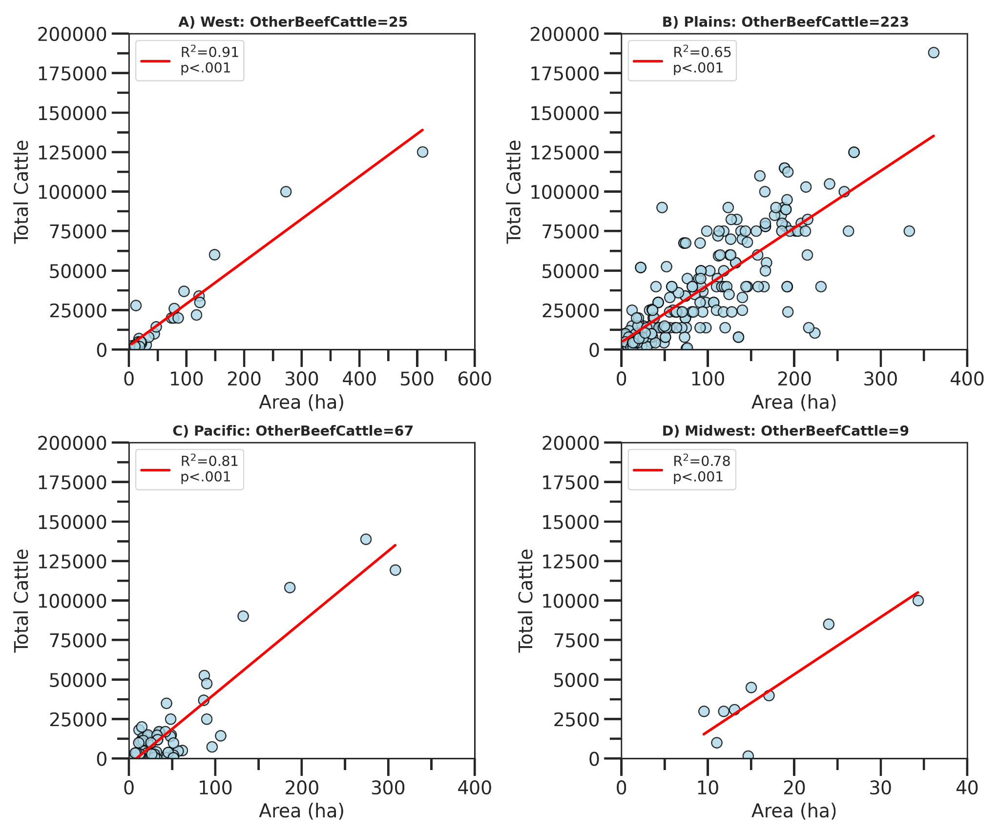

**Figure S1** The relationship between U.S. beef operation footprint areas to total head of cattle for A) West, B) Plains, C) Pacific, and D) Midwest, Number of operations, R2 values, and statistical significance are included for each U.S. region. Note, the x- and y-axis ranges differ for each plot.

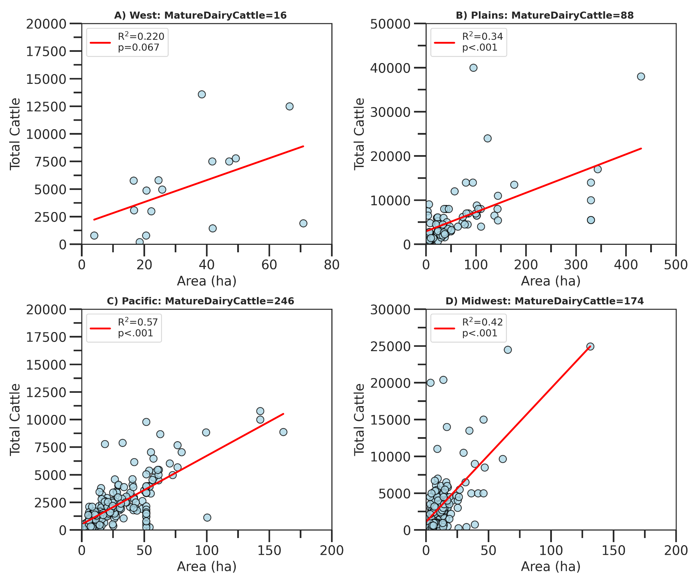

**Figure S2** The relationship between U.S. dairy operation footprint areas to total head of cattle for A) West, B) Plains, C) Pacific, and D) Midwest, Number of operations, R2 values, and statistical significance are included for each U.S. region. Note, the x- and y-axis ranges differ for each plot.

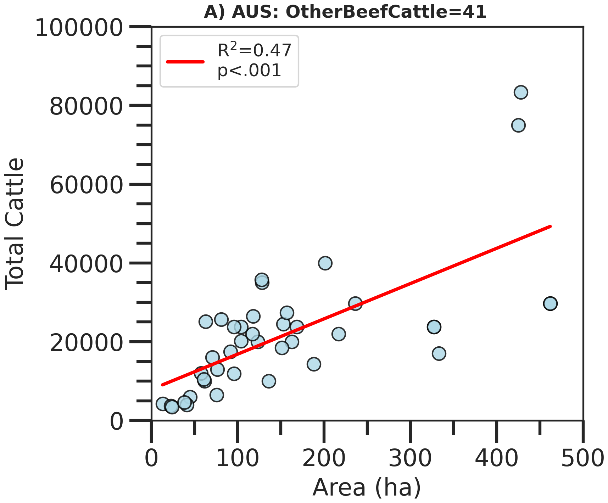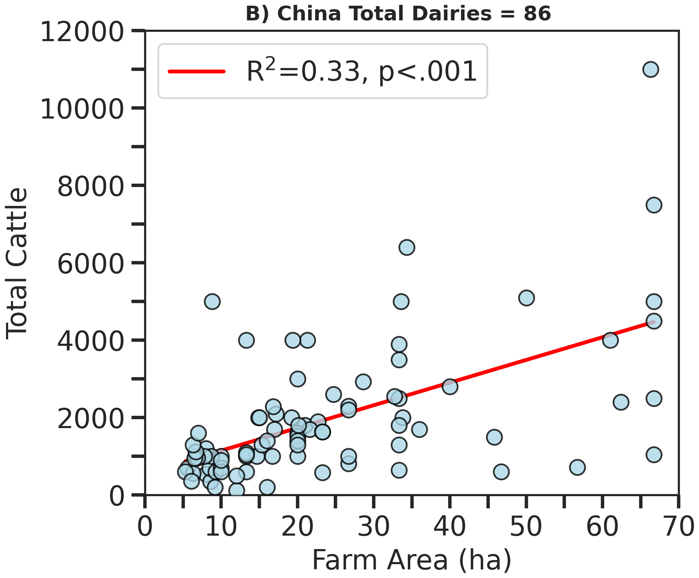

**Figure S3** The relationship between A) Australia beef operation footprint areas and B) China dairy operation footprint areas to total head of cattle. Number of operations, R2 values, and statistical significance are included for each country. Note, the x- and y-axis ranges differ for each plot.

**S.4.2 Regression model results**

Figure S4 displays each linear regression model’s performance relative to estimate the total head of cattle. The *U.S.-AUS Beef* model has the largest RMSE at 22,590 followed by the *U.S.-AUS Dairy* at 3,605, and, lastly, *Dairy China at 1,467*. R2 values range between 0.197 to 0.474 (*p*&lt;.001). The *U.S.-AUS Beef* and *Dairy* tend to underpredict when the total head of cattle is 55,000 and 10,000, respectively. The *Dairy China model* tends to underpredict when the total head of cattle is \~2,000. This underprediction is due Climate TRACE seeking to identify the largest emitters in each sector. For this sector, we focused on the largest emitting cattle operations based on size. For the AI models discussed in section 2.2, it was easier to identify large cattle operations since they stand out relative to the background. Smaller operations, which could be a single barn and no other defining features, were harder to identify. As a result, our sample training data for the regression models are slightly biased. As a result, extremes in estimating total head of cattle can exist.

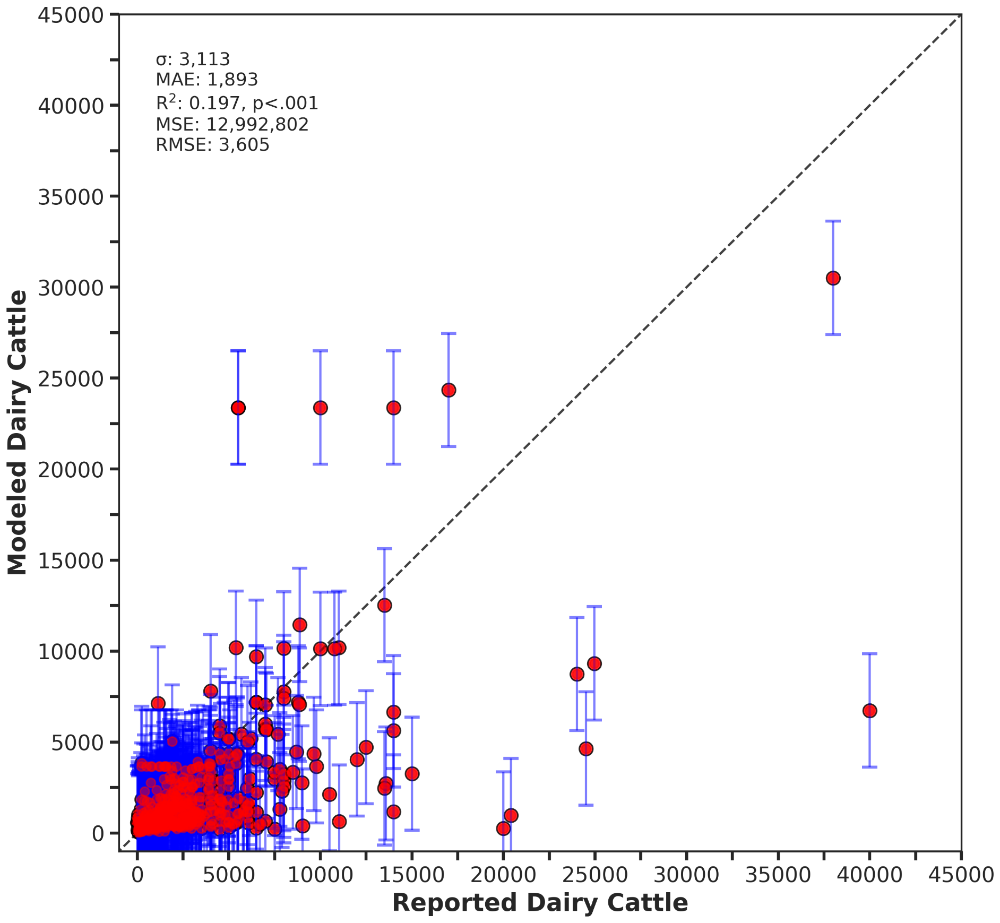 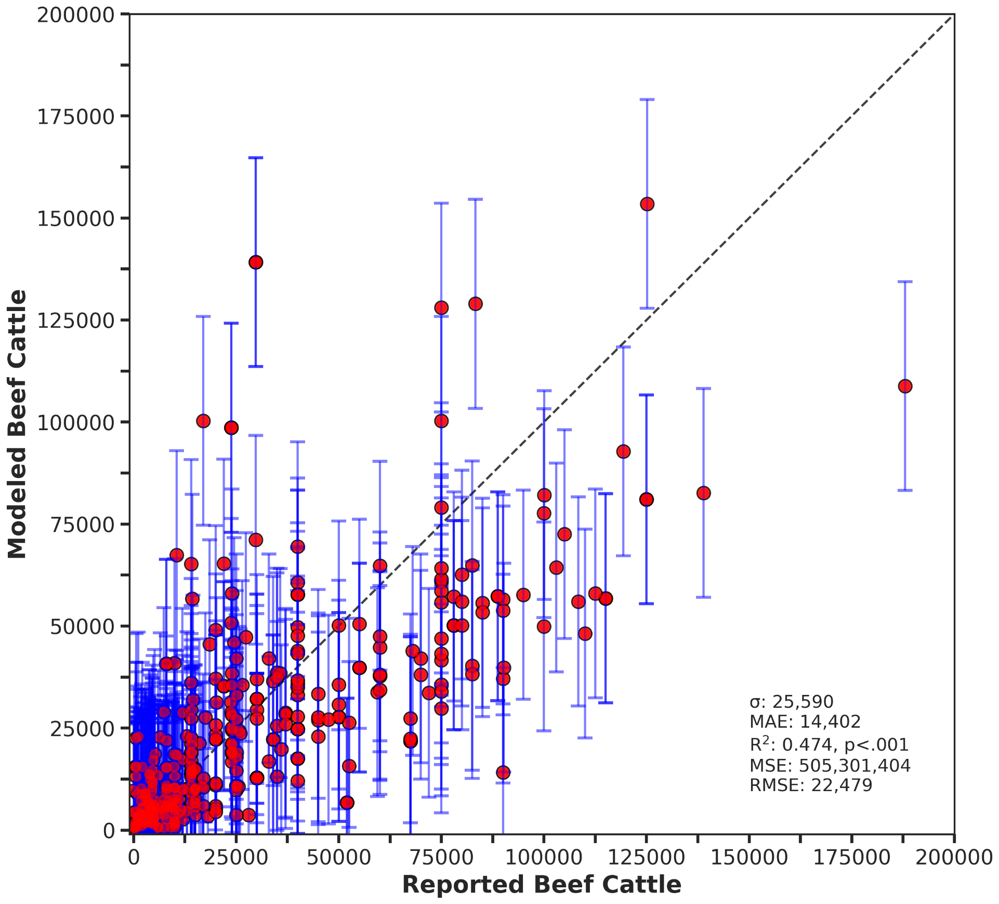

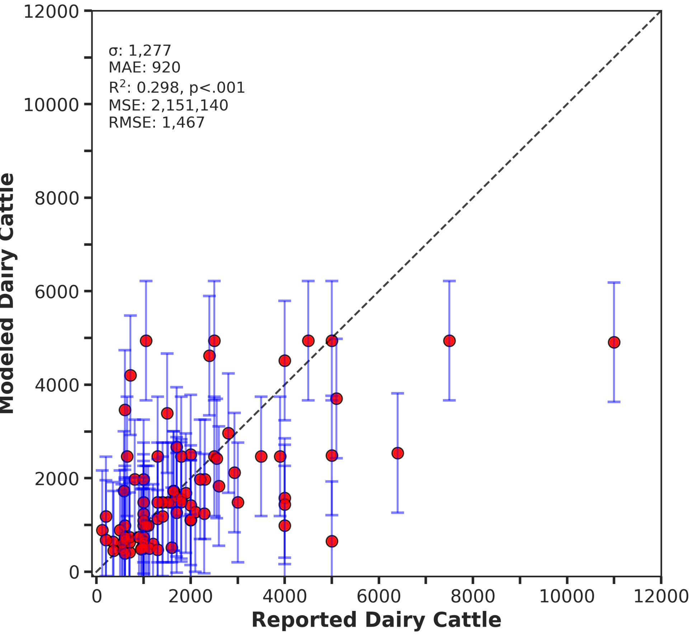

**Figure S4** Scatter plots comparing reported total head of cattle (x-axis) to estimated (modeled) total head of cattle (y-axis). The models are as follows: Top left) U.S and Australia Beef Operations; Top right) U.S and Australia Dairy Operations; Bottom left) China Dairy Operations. Blue vertical lines are 95% confidence intervals.

**S.5 Emission reduction solutions**

Emission reduction solution (ERS) was applied to differently enteric fermentation and manure management sectors. The main focus was methane mitigation

**S.5.1 Feed additives in cattle diets**

A potentially effective emission reduction solution for enteric fermentation is introducing feed additives to dairy and beef diets. Feed additives can inhibit or influence the chemical pathways in the rumen that lead to methane production: they suppress the microbial populations that produce methane in the rumen during enteric fermentation (see in the ‘Cattle Supporting Information’ at [GitHub Agriculture folder](https://github.com/climatetracecoalition/methodology-documents/tree/main/2025/Agriculture)).

Seven ERS strategies are provided for enteric fermentation and were applied to each individual cattle operation by cattle type (Table S4). Six are feed additives and each were applied as separate strategies, each classified as a retrofit, meaning a change to the practices of an existing operation (Table S4). Each carries a ratio of the new CH₄ emission factor to the current one, applied separately to beef and dairy cattle. The reductions vary widely by additive and by cattle type. Bovaer (3-NOP) and *Asparagopsis* seaweed produce the largest reductions in beef cattle, at 64.8% and 49.9% respectively, but considerably smaller reductions in dairy cattle at 19.3% and 23.4%. Nitrate, tannin, monensin, and agolin fall between 4.9% and 16.7% across both cattle types.

Feed additives methane reduction potential was determined by comparing change in methane production before (control) and after (treatment dosage). Studies that applied a low, medium, and high doses and measured the methane change had their values combined into one. Below is a list of citations based on feed additive,

1.  Tannin - Caetano et al., 2019; Aboagye et al., 2019; Perna Junior et al., 2020; Fagundes et al., 2020; Williams et al., 2020; Magnani et al., 2023; and Carrazco et al., 2025 — individual trials;

2.  Nitrate - Feng et al., 2020 — meta-analysis, 56 treatments from 24 studies;

3.  Monensin - Appuhamy et al., 2013; and Cooke et al., 2024 — both meta-analyses;

4.  Agolin - Castro-Montoya et al., 2015; Klop et al., 2017; Hart et al., 2019; Belanche et al., 2020; and Carrazco et al., 2020 — Belanche et al. is a meta-analysis, the rest individual trials;

5.  Bovaer - MLA, 2022; Almeida et al., 2023; MLA, 2024; Johansen et al., 2025; and Ma, 2026 — journal articles, a doctoral dissertation, and two industry reports;

6.  Seaweed - Roque et al., 2021; Stefenoni et al., 2021; Meo-Filho et al., 2024; and Angellotti et al., 2025 — individual trials.

Lastly, information from Spark Climate Solutions. (n.d.) and Hegarty et al. (2021) were also included.

A seventh strategy, a demand-side reduction in herd size, is classified as a subtract — turning off some or all activity at an operation — and reduces emissions by 10% for both beef and dairy. Meaning, consumer demand for beef and dairy consumption has reduced for either product, resulting in fewer beef and dairy cattle being raised. This ERS is similar to what is similar to Project Drawdown’s suggestion to reduce emissions by improving diets ([https://drawdown.org/explorer/improve-diets](https://drawdown.org/explorer/improve-diets)).

**Table S4** ERS feed additives applied to enteric fermentation at cattle operations. The Beef or Dairy CH₄ ratios are the new CH₄ emission factor divided by the current one, applied separately to beef and dairy cattle. ERS keys are given for beef (b\_\*) and dairy (d\_\*) respectively. Values shown are constants applied to every country.

| **ERS key**             | **Strategy**                                                        | **Mechanism** | **Beef CH₄ ratio** | **Dairy CH₄ ratio** | **Description**                                                                                                                                       |
|-------------------------|---------------------------------------------------------------------|---------------|--------------------|---------------------|-------------------------------------------------------------------------------------------------------------------------------------------------------|
| b\_agn / d\_agn         | Include agolin to the diet                                          | Retrofit      | 0.9356             | 0.9155              | Adding agolin, a plant-based extract, can influence the rumen microbiome to reduce methane production.                                                |
| b\_3nop / d\_3nop       | Include bovaer to the diet                                          | Retrofit      | 0.3519             | 0.8071              | Adding bovaer (3-NOP) can inhibit a final step in enteric fermentation, reducing methane production.                                                  |
| b\_asp / d\_asp         | Include seaweed to the diet                                         | Retrofit      | 0.5012             | 0.7662              | Adding asparagopsis seaweed, a haloform-based inhibitor, can reduce methane production by blocking a key enzyme produced during enteric fermentation. |
| b\_mon / d\_mon         | Include monensin to the diet                                        | Retrofit      | 0.8440             | 0.9514              | Adding monensin, an antimicrobial compound, can alter enteric fermentation to reduce methane production.                                              |
| b\_no3 / d\_no3         | Include nitrate to the diet                                         | Retrofit      | 0.8756             | 0.8334              | Adding nitrate, a non-protein nitrogen source, can reduce methane production by redirecting hydrogen from methane formation to ammonia production.    |
| b\_tan / d\_tan         | Include tannin to the diet                                          | Retrofit      | 0.8876             | 0.9226              | Adding tannins, plant-based compounds, can alter the rumen microbiome, leading to reduced methane production.                                         |
| b\_demand1 / d\_demand1 | Raise fewer beef or dairy cattle due to decreasing consumer demand. | Subtract      | 0.9000             | 0.9000              | Raise fewer beef cattle since consumption is down as consumer habits shift.                                                                           |

**S.5.2 Modifying manure management systems**

We present three potential ERS to mitigate manure CH₄ emissions: a demand-side reduction in herd size, modifying or retrofitting an existing manure management system within a multiple MMS, and chemical treatment of manure effluent.

The demand-side reduction is the same as described above and follows Project Drawdown. We apply a 10% reduction in cattle activity, or total head of cattle, which produces less manure and thereby reduces manure CH₄ emissions.

The second strategy replaces a single manure management system (MMS) within an operation's multiple MMS with a lower-emitting system, classified as a retrofit. As described in Section 2.6, we estimate emissions from each individual system in the assigned multiple MMS. To reduce emissions, we introduce a scenario in which one system in the multiple MMS is replaced with a lower-emitting system, as shown in Figure S5. The change from a higher- to a lower-emitting source gives a new ratio factor. This approach addresses CH₄ only, since CH₄ accounts for the majority of manure management emissions relative to N₂O.

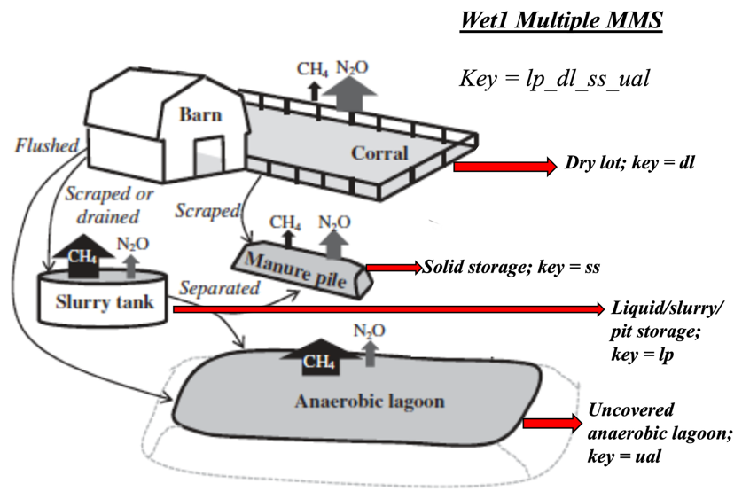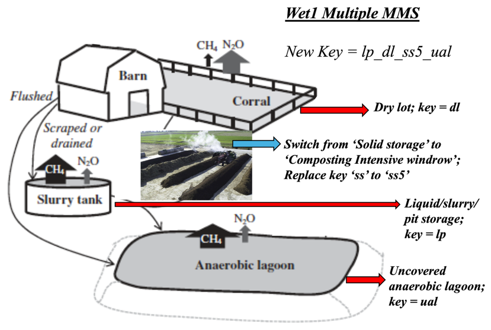

**Figure S5** An example of replacing a single manure system in a multiple MMS. Left image, the original multiple MMS identified as ‘*wet1*’ with the following systems: liquid/slurry or pit storage (*lp*), dry lot (*dl*), solid storage (*ss*), and uncovered anaerobic lagoon (*ual*), creating the key combo lp\_dl\_ss\_ual. Right image, to reduce emissions, the solid storage system is replaced with composting intensive windrow (*ss5; blue arrow*) creating the new key *lp\_dl\_ss5\_ual* (**(image modified from** Dentel and Qi, 2014 and Owen and Silver, 2015).

Eleven single-system retrofit strategies were applied, grouped by the manure management system they modify (Table S5). Several will be familiar from Table 10.17 (Methane conversion factors for manure management systems): we took lower-MCF systems and assigned them to specific individual systems within an operation's multiple MMS, based on a literature review. The remaining strategies were drawn from the literature and are given in Table S5. The sources consulted to determine how an existing system could be changed to a lower-emitting one, and the resulting CH₄ reduction, were,

-   Solid–liquid separation (key: ss-ual1a+ss-ual1b) — Mukhtar et al., 1999; Worley, 2009; and LPELC, 2019

-   Aeration (key: lp2) — Penner Farm Service, n.d.; WRI, n.d.; Williams et al., 2020; and Place et al., 2025

-   Composting (keys: ss3, ss4 and ss5) — Green Mountain Technologies, n.d.

The following sources were consulted to understand cattle operation emissions inventories, manure management practices and the costs of implementing each retrofit, plus inform which system in Table 10.17 could potentially represent an alternative and lower emitting system: Wright et al., 2001; USDA Rural Development, 2009; EPA, 2013; Williams et al., 2020; Marklein et al., 2021; Erb and Ciolkosz, 2025; Osei et al., 2025; CIAS, n.d.; and WRI, n.d.

Lastly, the third strategy applies chemical amendments to treat manure effluent, following Cameron and Di (2021) for polyferric sulfate (key: ual1) and Sokolov et al. (2019) for sulfuric acid (key: ual2). Both treatments are considered to be applied to uncovered anaerobic lagoons, indicated by the 'ual' prefix (Table S5).

**Table S5** ERS applied to manure management at cattle operations. Retrofit strategies change the technology or practice at an existing operation; subtract strategies reduce the head of cattle held. Each strategy is applied to the manure management system indicated. A CH₄ ratio of 'varies' indicates that the ratio is climate-zone dependent, since operations fall in different climate zones and therefore take different MCFs.

<table><thead><tr class="header"><th><strong>ERS key</strong></th><th><strong>MMS</strong></th><th><strong>Strategy</strong></th><th><strong>Table 10.17 equivalent or reference</strong></th><th><strong>Mechanism</strong></th><th><strong>CH₄ Ratio</strong></th><th><strong>Description</strong></th></tr></thead><tbody><tr class="odd"><td>ss-ual1a+ss-ual1b</td><td>Liquid systems (solids separation)</td><td>Improve the solid/liquid separation by 10%</td><td>Mukhtar et al., 1999; Worley, 2009; and LPELC, 2019</td><td>Retrofit</td><td>Varies</td><td>Improve solids separation with mechanical equipment to reduce the amount of volatile solids in the anaerobic lagoon effluent.</td></tr><tr class="even"><td>lp1</td><td>Liquid/slurry and pit storage</td><td>Remove stored liquid manure every 9 months</td><td>
Mean MCF of

Liquid/Slurry, and Pit storage below animal confinements 12 and 6 month
</td><td>Retrofit</td><td>Varies</td><td>Remove liquid manure from liquid-slurry/pit systems every 9 months, instead of every 12 months, to reduce ch4 emissions.</td></tr><tr class="odd"><td>lp2</td><td>Liquid/slurry and pit storage</td><td>Add air pumps to liquid-slurry/pit storage system</td><td>
CARB, 2020;

AgNext, n.d.;

Penner Farm Service, n.d.;

Williams, El-Mashad and Kaffka, 2020;

WRI, n.d.
</td><td>Retrofit</td><td>Varies</td><td>Add aeration systems to stir and mix liquid manure in a liquid-slurry/pit system to reduce ch4 emissions.</td></tr><tr class="even"><td>dl1</td><td>Solid storage</td><td>Shift solids to daily spread if pasture and/or cropland is available</td><td>Daily spread</td><td>Retrofit</td><td>Varies</td><td>This assumes solid storage is replaced and the solid manure is directly spread onto available pasture and/or cropland.</td></tr><tr class="odd"><td>ss1</td><td>Solid storage</td><td>Add bulking material to solid storage</td><td>Solid storage – Bulking agent addition</td><td>Retrofit</td><td>Varies</td><td>Adding bulking agents (e.g., straw) to solid storage and mixing with manure can increase aeration and reduce ch4 emissions.</td></tr><tr class="even"><td>ss2</td><td>Solid storage</td><td>Include additives to solid storage</td><td>Solid storage – Additives</td><td>Retrofit</td><td>Varies</td><td>Adding additives (e.g., gypsum) to solid storage that inhibit microbial activity can reduce ch4 emissions.</td></tr><tr class="odd"><td>ss3</td><td>Solid storage</td><td>Switch solid storage to composting in a building</td><td>Composting - Static pile (Forced aeration)</td><td>Retrofit</td><td>Varies</td><td>Switching to composting in a building (e.g., a shed) with passive airflow creates aerobic conditions that can reduce ch4 emissions.</td></tr><tr class="even"><td>ss4</td><td>Solid storage</td><td>Switch solid storage to in-vessel composting with aeration</td><td>Composting - In-vessel</td><td>Retrofit</td><td>Varies</td><td>Switching to in-vessel composting with aeration (e.g., in a composter) creates aerobic conditions that can reduce ch4 emissions.</td></tr><tr class="odd"><td>ss5</td><td>Solid storage</td><td>Switch solid storage to intensive windrow composting</td><td>Composting - Intensive windrow</td><td>Retrofit</td><td>Varies</td><td>Switching to intensive windrow composting, where compost piles are turned periodically, can reduce ch4 emissions.</td></tr><tr class="even"><td>ual1</td><td>Uncovered anaerobic lagoon</td><td>Add polyferric sulfate to liquid manure</td><td>Cameron and Di, 2021</td><td>Retrofit</td><td>Varies</td><td>Add polyferric sulfate to anaerobic lagoon effluent to reduce ch4 emissions.</td></tr><tr class="odd"><td>ual2</td><td>Uncovered anaerobic lagoon</td><td>Add sulfuric acid to liquid manure</td><td>Sokolov et al., 2019</td><td>Retrofit</td><td>Varies</td><td>Add sulfuric acid to anaerobic lagoon effluent to reduce ch4 emissions.</td></tr><tr class="even"><td>demand1</td><td>All systems</td><td>Raise fewer beef and dairy cattle due to declining consumer demand for meat and dairy products.</td><td>Project Drawdown, 2026</td><td>Subtract</td><td>0.9000 for both beef and dairy</td><td>Consumers are eating fewer beef and dairy products due to shifting dietary habits.</td></tr></tbody></table>

#### References

1.  Aboagye, I.A., Oba, M., Koenig, K.M., Zhao, G.Y. and Beauchemin, K.A. (2019) 'Use of gallic acid and hydrolyzable tannins to reduce methane emission and nitrogen excretion in beef cattle fed a diet containing alfalfa silage', Journal of Animal Science, 97(5), pp. 2230–2244. doi: 10.1093/jas/skz101.

2.  Agriculture and Agri-Food Canada (2026) Canadian farms. Canadian Dairy Information Centre. Available at: https://agriculture.canada.ca/en/sector/animal-industry/canadian-dairy-information-centre/statistics-market-information/farm-statistics (Accessed: 1 September 2026).

3.  Almeida, A.K., Cowley, F., McMeniman, J.P., Karagiannis, A., Walker, N., Tamassia, L.F., McGrath, J.J. and Hegarty, R.S. (2023) 'Effect of 3-nitrooxypropanol on enteric methane emissions of feedlot cattle fed with a tempered barley-based diet with canola oil', Journal of Animal Science, 101, skad237. doi: 10.1093/jas/skad237.

4.  Angellotti, M., Lindberg, M., Ramin, M., Krizsan, S.J. and Danielsson, R. (2025) 'Asparagopsis taxiformis supplementation to mitigate enteric methane emissions in dairy cows — effects on performance and metabolism', Journal of Dairy Science, 108(3), pp. 2503–2516. doi: 10.3168/jds.2024-25258.

5.  Appuhamy, J.A.D.R.N., Strathe, A.B., Jayasundara, S., Wagner-Riddle, C., Dijkstra, J., France, J. and Kebreab, E. (2013) 'Anti-methanogenic effects of monensin in dairy and beef cattle: a meta-analysis', Journal of Dairy Science, 96(8), pp. 5161–5173. doi: 10.3168/jds.2012-5923.

6.  Australian Bureau of Agricultural and Resource Economics and Sciences (n.d.) Australian dairy: financial performance of dairy farms. Available at: https://www.agriculture.gov.au/abares (Accessed: 3 September 2026).

7.  Bagley, C.V., Kirk, J.H. and Farrell-Poe, K. (1999) Cow mortality disposal. Extension Publication AG-507. Logan, UT: Utah State University Cooperative Extension Service.

8.  Belanche, A., Newbold, C.J., Morgavi, D.P., Bach, A., Zweifel, B. and Yáñez-Ruiz, D.R. (2020) 'A meta-analysis describing the effects of the essential oils blend Agolin Ruminant on performance, rumen fermentation and methane emissions in dairy cows', Animals, 10(4), 620. doi: 10.3390/ani10040620.

9.  BPS-Statistics Indonesia (2024) The complete enumeration results of the 2023 Census of Agriculture – Edition 2: Livestock individual agricultural holdings (Catalog No. 5106051; Publication No. 05100.24011). Jakarta: BPS-Statistics Indonesia. Available at: https://www.bps.go.id/en/publication/2024/08/09/5c1eade842cefac97aac67bd/the-complete-enumeration-results-of-the-2023-census-of-agriculture---edition-2--livestock-individual-agricultural-holdings-.html (Accessed: 4 September 2026).

10. Caetano, M., Wilkes, M.J., Pitchford, W.S., Lee, S.J. and Hynd, P.I. (2019) 'Effect of ensiled crimped grape marc on energy intake, performance and gas emissions of beef cattle', Animal Feed Science and Technology, 247, pp. 166–172. doi: 10.1016/j.anifeedsci.2018.10.007.

11. Cameron, K.C. and Di, H.J. (2021) 'Discovery of a new method to reduce methane emissions from farm dairy effluent', Journal of Soils and Sediments, 21(11), pp. 3543–3555. doi: 10.1007/s11368-021-03014-w.

12. Canfax (2026) Region capacity: Alberta and Saskatchewan feedlot capacity by region. Available at: https://canfax.ca/resources/reports/cattle-on-feed-reports/region-capacity.html (Accessed: 1 September 2026).

13. Canfax (n.d.) Cattle on feed historical reports. Available at: https://canfax.ca/resources/reports/cattle-on-feed-reports/historical-reports.html (Accessed: 1 September 2026).

14. Caron, M., Touvron, H., Misra, I., Jégou, H., Mairal, J., Bojanowski, P. and Joulin, A. (2021) 'Emerging properties in self-supervised vision transformers', 2021 IEEE/CVF International Conference on Computer Vision (ICCV), pp. 9630–9640. doi: 10.1109/ICCV48922.2021.00951.

15. Carrazco, A.V., Peterson, C.B., Zhao, Y., Pan, Y., McGlone, J.J., DePeters, E.J. and Mitloehner, F.M. (2020) 'The impact of essential oil feed supplementation on enteric gas emissions and production parameters from dairy cattle', Sustainability, 12(24), 10347. doi: 10.3390/su122410347.

16. Carrazco, A.V., Rocha, A.S., Ross, E.G., Zhao, Y., Pan, Y., Pandey, P.K., Castillo, A.R., DePeters, E.J. and Mitloehner, F.M. (2025) 'Effect of a tannin and saponin blend feed additive on greenhouse gas and ammonia emissions from lactating dairy cows', Journal of Dairy Science, 108(8), pp. 8582–8593. doi: 10.3168/jds.2025-26410.

17. Castro-Montoya, J., Peiren, N., Cone, J.W., Zweifel, B., Fievez, V. and De Campeneere, S. (2015) 'In vivo and in vitro effects of a blend of essential oils on rumen methane mitigation', Livestock Science, 180, pp. 134–142. doi: 10.1016/j.livsci.2015.08.010.

18. Center for Integrated Agricultural Systems (n.d.) Windrow composting systems can be feasible, cost effective. University of Wisconsin–Madison. Available at: https://cias.wisc.edu/uncategorized/windrow-composting-systems-can-be-feasable-cost-effective/ (Accessed: 4 September 2026).

19. Cheng, M., Quan, J., Yin, J., Liu, X., Yuan, Z. and Ma, L. (2023) 'High-resolution maps of intensive and extensive livestock production in China', Resources, Environment and Sustainability, 12, 100104.

20. Cooke, R.F., Eloy, L.R., Bosco, S.C., Lasmar, P.V.F., de Simas, J.M.C., Leiva, T. and de Medeiros, S.R. (2024) 'An updated meta-analysis of the anti-methanogenic effects of monensin in beef cattle', Translational Animal Science, 8, txae032. doi: 10.1093/tas/txae032.

21. Costa Jr, C., Li, C., Cerri, C.E. and Cerri, C.C. (2014) 'Measuring and modeling nitrous oxide and methane emissions from beef cattle feedlot manure management: first assessments under Brazilian condition', Journal of Environmental Science and Health, Part B, 49(9), pp. 696–711.

22. Dentel, S.K. and Qi, Y. (2014) 'Management of sludges, biosolids, and residuals', in Comprehensive Water Quality and Purification, Vol. 3. Amsterdam: Elsevier, pp. 223–243. doi: 10.1016/B978-0-12-382182-9.00049-9.

23. Erb, J. and Ciolkosz, D. (2025) Enhancing digester profitability: strategies for farmers. Penn State Extension, 24 March. Available at: https://extension.psu.edu/enhancing-digester-profitability-strategies-for-farmers (Accessed: 4 September 2026).

24. Euken, R., Doran, B., Clark, C., Shouse, S., Ellis, S., Loy, D. and Schulz, L. (2015) Beef feedlot systems manual. PM 1867. Ames, IA: Iowa State University.

25. Fagundes, G.M., Benetel, G., Welter, K.C., Melo, F.A., Muir, J.P., Carriero, M.M., Souza, R.L.M., Meo-Filho, P., Frighetto, R.T.S., Berndt, A. and Bueno, I.C.S. (2020) 'Tannin as a natural rumen modifier to control methanogenesis in beef cattle in tropical systems: friend or foe to biogas energy production?', Research in Veterinary Science, 132, pp. 88–96. doi: 10.1016/j.rvsc.2020.05.010.

26. Fan, X., Chang, J., Ren, Y., Wu, X., Du, Y., Xu, R., Liu, D., Chang, S.X., Meyerson, L.A., Peng, C. and Ge, Y. (2018) 'Recoupling industrial dairy feedlots and industrial farmlands mitigates the environmental impacts of milk production in China', Environmental Science & Technology, 52(7), pp. 3917–3925.

27. Farm Accountancy Data Network (n.d.) EUROSTAT agricultural prices and price indices: structural information. Available at: https://agridata.ec.europa.eu/extensions/DairyReport/DairyReport.html (Accessed: 3 September 2026).

28. Farm Transparency Project (n.d.) Farm Transparency Map \[Data set\]. Available at: https://www.farmtransparency.org/map (Accessed: 1 April 2025).

29. Feng, X.Y., Dijkstra, J., Bannink, A., van Gastelen, S., France, J. and Kebreab, E. (2020) 'Antimethanogenic effects of nitrate supplementation in cattle: a meta-analysis', Journal of Dairy Science, 103(12), pp. 11375–11385. doi: 10.3168/jds.2020-18541.

30. Food and Agriculture Organization of the United Nations (2013) Major cuts of greenhouse gas emissions from livestock within reach, 26 September. Available at: https://www.fao.org/news/story/en/item/197608/icode (Accessed: 19 September 2022).

31. Gieseke, D., Lambertz, C. and Gauly, M. (2018) 'Relationship between herd size and measures of animal welfare on dairy cattle farms with freestall housing in Germany', Journal of Dairy Science, 101(8), pp. 7397–7411.

32. Gilbert, M., Nicolas, G., Cinardi, G., Van Boeckel, T.P., Vanwambeke, S.O., Wint, G.R. and Robinson, T.P. (2018) 'Global distribution data for cattle, buffaloes, horses, sheep, goats, pigs, chickens and ducks in 2010', Scientific Data, 5(1), pp. 1–11.

33. Green Mountain Technologies (n.d.a) In-vessel composting systems. Available at: https://compostingtechnology.com/in-vessel-systems/ (Accessed: 4 September 2026).

34. Green Mountain Technologies (n.d.b) Earth Flow in-vessel composting system. Available at: https://compostingtechnology.com/in-vessel-systems/earth-flow/ (Accessed: 4 September 2026).

35. Green Mountain Technologies (n.d.c) CompTainer in-vessel composting system. Available at: https://compostingtechnology.com/in-vessel-systems/comptainer/ (Accessed: 4 September 2026).

36. Green Mountain Technologies (n.d.d) CompoBox tunnel system. Available at: https://compostingtechnology.com/in-vessel-systems/compobox-tunnel-system/ (Accessed: 4 September 2026).

37. Greenwood, P.L. (2021) 'An overview of beef production from pasture and feedlot globally, as demand for beef and the need for sustainable practices increase', Animal, 15, 100295.

38. Harper, L.A., Flesch, T.K., Powell, J.M., Coblentz, W.K., Jokela, W.E. and Martin, N.P. (2009) 'Ammonia emissions from dairy production in Wisconsin', Journal of Dairy Science, 92(5), pp. 2326–2337.

39. Hart, K.J., Jones, H.G., Waddams, K.E., Worgan, H.J., Zweifel, B. and Newbold, C.J. (2019) 'An essential oil blend decreases methane emissions and increases milk yield in dairy cows', Open Journal of Animal Sciences, 9(3), pp. 259–267. doi: 10.4236/ojas.2019.93022.

40. Harter, T., Viers, J.H., Liptzin, D., Rosenstock, T.S., Jensen, V.B., Hollander, A.D., McNally, A., King, A.M., Kourakos, G., Lopez, E.M., DeLaMora, N., Fryjoff-Hung, A., Dzurella, K.N., Canada, H., Laybourne, S., McKenney, C., Darby, J. and Quinn, J.F. (2013) Dairies and other sources of nitrate loading to groundwater. Task Report 6, SWRCB Agreement No. 04-184-555. Davis, CA: Department of Land, Air and Water Resources, University of California, Davis. Available at: http://groundwater.ucdavis.edu (Accessed: 3 September 2026).

41. Hayek, M.N. and Garrett, R.D. (2018) 'Nationwide shift to grass-fed beef requires larger cattle population', Environmental Research Letters, 13(8), 084005.

42. Hegarty, R.S., Cortez Passetti, R.A., Dittmer, K.M., Wang, Y., Shelton, S., Emmet-Booth, J., Wollenberg, E., McAllister, T., Leahy, S., Beauchemin, K. and Gurwick, N. (2021) An evaluation of emerging feed additives to reduce methane emissions from livestock. Edition 1. A report coordinated by the CGIAR Research Program on Climate Change, Agriculture and Food Security (CCAFS) and the New Zealand Agricultural Greenhouse Gas Research Centre (NZAGRC), an initiative of the Global Research Alliance (GRA). Available at: https://hdl.handle.net/10568/116489 (Accessed: 4 September 2026).

43. Hopkins, F.M., Rafiq, T. and Duren, R.M. (2019) Sources of methane emissions (Vista-CA), State of California, USA \[Data set\]. Oak Ridge, TN: ORNL DAAC. doi: 10.3334/ORNLDAAC/1726.

44. Ibarrola-Rivas, M.J., Orozco-Ramírez, Q. and Guibrunet, L. (2023) 'How much of the Mexican agricultural supply is produced by small farms, and how?', PLOS ONE, 18(10), e0292528.

45. Institut de l'Élevage (2025) French cattle 2025: milk and meat production. Available at: https://idele.fr/ (Accessed: September 2025).

46. Iowa State University (2018) Iowa farm outlook: capacity utilization in the cattle feeding sector improving. Available at: http://www2.econ.iastate.edu/ifo/files/ifo2018/ifo050118.pdf (Accessed: August 2022).

47. Intergovernmental Panel on Climate Change (2006a) 'Chapter 10: Emissions from livestock and manure management', in 2006 IPCC guidelines for national greenhouse gas inventories, Volume 4: Agriculture, forestry and other land use. Hayama: IGES.

48. Intergovernmental Panel on Climate Change (2006b) 'Chapter 11: N₂O emissions from managed soils, and CO₂ emissions from lime and urea application', in 2006 IPCC guidelines for national greenhouse gas inventories, Volume 4: Agriculture, forestry and other land use. Hayama: IGES.

49. Johansen, M., Maigaard, M. and Lund, P. (2025) 'Effect of Bovaer inclusion in rations with high proportion of corn silage harvested with different stubble height on production performance and gas emission in dairy cows', Animal Feed Science and Technology, 329, 116512. doi: 10.1016/j.anifeedsci.2025.116512.

50. Klop, G., Dijkstra, J., Dieho, K., Hendriks, W.H. and Bannink, A. (2017) 'Enteric methane production in lactating dairy cows with continuous feeding of essential oils or rotational feeding of essential oils and lauric acid', Journal of Dairy Science, 100(5), pp. 3563–3575. doi: 10.3168/jds.2016-12033.

51. Korobkov, E.V., Kozlov, V.G., Shalaev, A.V. and Korolev, A.I. (2021) 'Modern state of the production organization of beef cattle breeding in the Russian Federation', IOP Conference Series: Earth and Environmental Science, 659(1), 012105.

52. Krekelberg, E. (2020) Space requirements for dairy cows. University of Minnesota Extension. Available at: https://extension.umn.edu/dairy-milking-cows/space-requirements-dairy-cows (Accessed: 30 August 2022).

53. Lazzarini, B., Baudracco, J., Tuñon, G., Gastaldi, L., Lyons, N., Quattrochi, H. and Lopez-Villalobos, N. (2019) 'Milk production from dairy cows in Argentina: current state and perspectives for the future', Applied Animal Science, 35(4), pp. 426–432.

54. Li, X.Z., Yan, C.G. and Zan, L.S. (2018) 'Current situation and future prospects for beef production in China — a review', Asian-Australasian Journal of Animal Sciences, 31(7), pp. 984–991. doi: 10.5713/ajas.18.0212.

55. Livestock and Poultry Environmental Learning Community (2019) Role of solid–liquid separation in manure storage, 5 March. Available at: https://lpelc.org/role-of-solid-liquid-separation-in-manure-storage/ (Accessed: 4 September 2026).

56. Ma, X. (2026) Integrating dietary mitigation strategies, manure emissions, and measurement techniques for on-farm methane assessment in dairy cattle. Doctoral dissertation. ETH Zurich.

57. Ministry of Agriculture, Forestry and Fisheries (n.d.) Statistics. Available at: https://www.maff.go.jp/e/data/stat/index.html (Accessed: June 2026).

58. Magnani, E., Silva, T.H., Sakamoto, L.S., Manella, M.Q., Dias, F.M.G.N., Mercadante, M.E.Z., Henry, D.H., Marcatto, J.O.S., Paula, E.M. and Branco, R.H. (2023) 'Tannin-based product in feedlot diet as a strategy to reduce enteric methane emissions of Nellore cattle finished under tropical conditions', Translational Animal Science, 7(1), txad048. doi: 10.1093/tas/txad048.

59. Marklein, A.R., Meyer, D., Fischer, M.L., Jeong, S., Rafiq, T., Carr, M. and Hopkins, F.M. (2021) 'Facility-scale inventory of dairy methane emissions in California: implications for mitigation', Earth System Science Data, 13(3), pp. 1151–1166. doi: 10.5194/essd-13-1151-2021.

60. McFarland, D. and Tyson, J. (2016) Designing and building dairy cattle freestalls. Penn State Extension. Available at: https://extension.psu.edu/designing-and-building-dairy-cattle-freestalls (Accessed: 20 August 2022).

61. Meo-Filho, P., Ramirez-Agudelo, J.F. and Kebreab, E. (2024) 'Mitigating methane emissions in grazing beef cattle with a seaweed-based feed additive: implications for climate-smart agriculture', Proceedings of the National Academy of Sciences, 121(50), e2410863121. doi: 10.1073/pnas.2410863121.

62. Meat & Livestock Australia (2022) Methane emissions of Australian feedlot cattle as influenced by 3-nitrooxypropanol (Bovaer-10). Available at: https://www.mla.com.au/research-and-development/reports/2021/methane-emissions-of-australian-feedlot-cattle-as-influenced-by-3-nitrooxypropanol-bovaer-102/ (Accessed: 4 September 2026).

63. Meat & Livestock Australia (2024) B.FLT.5015 — Reducing emissions of backgrounded cattle: combining Bovaer®10 with supplementation to reduce methane and increase productivity. Available at: https://www.mla.com.au/research-and-development/reports/2024/b.flt.5015---reducing-emissions-of-backgrounded-cattle---combining-bovaer10-with-supplementation-to-reduce-methane-and-increase-productivity/ (Accessed: 4 September 2026).

64. Meat & Livestock Australia (2025) Quarterly lot feeding briefs. Available at: https://www.mla.com.au/prices-markets/Trends-analysis/quarterly-lot-feeding-briefs (Accessed: 1 September 2026).

65. Modernel, P., Dogliotti, S., Alvarez, S., Corbeels, M., Picasso, V., Tittonell, P. and Rossing, W.A. (2018) 'Identification of beef production farms in the Pampas and Campos area that stand out in economic and environmental performance', Ecological Indicators, 89, pp. 755–770.

66. Mukhtar, S., Sweeten, J.M. and Auvermann, B.W. (1999) Solid–liquid separation of animal manure and wastewater. Texas A&M AgriLife Extension Service. Available at: https://hdl.handle.net/1969.1/86859 (Accessed: 4 September 2026).

67. Muñoz Sabater, J. (2019) ERA5-Land monthly averaged data from 1981 to present \[Data set\]. Copernicus Climate Change Service (C3S) Climate Data Store (CDS). doi: 10.24381/cds.68d2bb30.

68. Oklahoma State University (2018) Changes in Mexican cattle industry will affect American beef trade as well. Available at: https://news.okstate.edu/articles/agriculture/2018/changes-in-mexican-cattle-industry-will-affect-american-beef-trade-as-well.html (Accessed: 1 November 2023).

69. Osei, E., Kan, E., Jafri, S.H.H., Lovell, A., Henson, L., Wellmann, K., Muir, J., Spencer, J. and Liu, Z. (2025) 'Economics of conventional dairy manure management in north central Texas', Agriculture, 15(23), 2472. doi: 10.3390/agriculture15232472.

70. Owen, J.J. and Silver, W.L. (2015) 'Greenhouse gas emissions from dairy manure management: a review of field-based studies', Global Change Biology, 21(2), pp. 550–565. doi: 10.1111/gcb.12687.

71. Peel, D.S. (2010) Cow-calf beef production in Mexico. DIANE Publishing.

72. Peel, D.S., Mathews Jr, K.H. and Johnson, R.J. (2011) Trade, the expanding Mexican beef industry, and feedlot and stocker cattle production in Mexico. Outlook Report No. LDP-M-206-01. Washington, DC: USDA Economic Research Service. Available at: http://www.ers.usda.gov/media/118317/ldpm20601.pdf (Accessed: 4 September 2023).

73. Penner Farm Service (n.d.) Manure aeration system: creating safer barns for livestock and humans. Available at: https://pennerfarmservice.com/manure-aeration-system-creating-safer-barns-for-livestock-humans/ (Accessed: 4 September 2026).

74. Pereira, H. (2022) Technical opinion: critical evaluation of the methodology adopted in the IATP (Institute for Agriculture and Trade Policy) study to estimate JBS' GHG emissions. Available at: https://jbs.com.br/wp-content/uploads/2022/08/-jbs-technical-note-iatp-eng.pdf (Accessed: 7 July 2023).

75. Perna Junior, F., Zapata Vásquez, D.C., Gardinal, R., Meyer, P.M., Berndt, A., Frighetto, R.T.S., Demarchi, J.J.A.A. and Rodrigues, P.H.M. (2020) 'Short-term use of monensin and tannins as feed additives on digestibility and methanogenesis in cattle', Revista Brasileira de Zootecnia, 49, e20190098. doi: 10.37496/rbz4920190098.

76. Petersen, S.O. (2018) 'Greenhouse gas emissions from liquid dairy manure: prediction and mitigation', Journal of Dairy Science, 101(7), pp. 6642–6654.

77. Petrick, M. and Götz, L. (2019) 'Herd growth, farm organisation and subsidies in the dairy sector of Russia and Kazakhstan', Journal of Agricultural Economics, 70(3), pp. 789–811.

78. Pienaar, J., Louw, A. and Jordaan, D. (2019) A study on the potential product development for the commercialization and value add to beef products. University of Pretoria.

79. Place, S., Sharvelle, S. and Kraft-Lambert, J. (2025) Options for mitigating manure methane emissions. AgNext, Colorado State University, 14 June. Available at: https://agnext.colostate.edu/wp-content/uploads/sites/14/2025/06/ManureMgmt.pdf (Accessed: 4 September 2026).

80. Project Drawdown (2026) Improve diets. Available at: https://drawdown.org/explorer/improve-diets (Accessed: 3 September 2026).

81. Roque, B.M., Venegas, M., Kinley, R.D., de Nys, R., Duarte, T.L., Yang, X. and Kebreab, E. (2021) 'Red seaweed (Asparagopsis taxiformis) supplementation reduces enteric methane by over 80 percent in beef steers', PLOS ONE, 16(3), e0247820. doi: 10.1371/journal.pone.0247820.

82. Scholtz, M.M., Bester, J., Mamabolo, J.M. and Ramsay, K.A. (2008) Results of the national cattle survey undertaken in South Africa, with emphasis on beef. Pretoria: Agricultural Research Council.

83. Skidmore, M.E., Sims, K.M., Rausch, L.L. and Gibbs, H.K. (2022) 'Sustainable intensification in the Brazilian cattle industry: the role for reduced slaughter age', Environmental Research Letters, 17(6), 064026.

84. Sokolov, V., VanderZaag, A., Habtewold, J., Dunfield, K., Wagner-Riddle, C., Venkiteswaran, J.J. and Gordon, R. (2019) 'Greenhouse gas mitigation through dairy manure acidification', Journal of Environmental Quality, 48(5), pp. 1435–1443. doi: 10.2134/jeq2018.10.0355. Erratum (2020) Journal of Environmental Quality, 49(3), pp. 788–790. doi: 10.1002/jeq2.20040.

85. Spark Climate Solutions (n.d.) Livestock enteric methane mitigation roadmap. Available at: https://www.sparkclimate.org/enteric/roadmap (Accessed: May 2026).

86. Stefenoni, H.A., Räisänen, S.E., Cueva, S.F., Wasson, D.E., Lage, C.F.A., Melgar, A., Fetter, M.E., Smith, P., Hennessy, M., Vecchiarelli, B., Bender, J., Pitta, D., Cantrell, C.L., Yarish, C. and Hristov, A.N. (2021) 'Effects of the macroalga Asparagopsis taxiformis and oregano leaves on methane emission, rumen fermentation, and lactational performance of dairy cows', Journal of Dairy Science, 104(4), pp. 4157–4173. doi: 10.3168/jds.2020-19686.

87. Stehle, A.M. (2016) Determining the impacts of cattle origin and ownership characteristics on feedlot performance and economic returns. Master's thesis. Oklahoma State University.

88. Steinfeld, H. and Mäki-Hokkonen, J. (1995) 'A classification of livestock production systems', World Animal Review, pp. 83–94.

89. Tulush, L., Hryshchenko, O. and Strikhovskyi, D. (2023) 'Trends in the development of dairy farming and its state financial support in Ukraine', Ekonomika APK, 30(5), pp. 33–45.

90. Turcios, S. (2022) A breakdown of the American beef sector: how do U.S. cattle ranchers put food on our table? Available at: https://clear.ucdavis.edu/explainers/how-do-us-cattle-ranchers-put-food-our-table (Accessed: 27 September 2023).

91. UNEP Copenhagen Climate Centre (2023) Botswana: drought resistant cattle moving in. Available at: https://unepccc.org/botswana-drought-resistant-cattle-moving-in/ (Accessed: 3 September 2026).

92. United States Department of Agriculture (2023) Cattle and beef: sector at a glance. Economic Research Service. Available at: https://www.ers.usda.gov/topics/animal-products/cattle-beef/sector-at-a-glance/ (Accessed: 27 September 2023).

93. United States Department of Agriculture, Foreign Agricultural Service (2024) Livestock and poultry: world markets and trade — production, supply and distribution, 12 July. Available at: https://apps.fas.usda.gov/psdonline/app/index.html (Accessed: 3 September 2026).

94. United States Department of Agriculture, National Agricultural Statistics Service (n.d.) NASS statistics. Available at: https://www.nass.usda.gov/index.php (Accessed: 3 September 2026).

95. United States Department of Agriculture, Rural Development (2009) Cooperative approaches for implementation of dairy manure digesters. Research Report 217. Washington, DC: USDA Rural Development. Available at: https://www.rd.usda.gov/publicationforcooperatives/rr-217-cooperative-approaches-implementation-dairy-manure-digesters (Accessed: 4 September 2026).

96. United States Environmental Protection Agency (2013) Global mitigation of non-CO₂ greenhouse gases: 2010–2030. EPA-430-R-13-011. Washington, DC: Office of Atmospheric Programs. Available at: https://www.epa.gov/sites/production/files/2016-06/documents/mac\_report\_2013.pdf (Accessed: 4 September 2026).

97. United States Environmental Protection Agency (2023) Annex 3: Methodological descriptions for additional source or sink categories (Part B). Inventory of U.S. Greenhouse Gas Emissions and Sinks: 1990–2021. EPA 430-R-23-002. Washington, DC: U.S. Environmental Protection Agency. Available at: https://www.epa.gov/ghgemissions/inventory-us-greenhouse-gas-emissions-and-sinks-1990-2021 (Accessed: 5 September 2026).

98. United States Geological Survey (2018) USGS EROS archive: aerial photography, National Agriculture Imagery Program (NAIP). Available at: https://www.usgs.gov/centers/eros/science/usgs-eros-archive-aerial-photography-national-agriculture-imagery-program-naip (Accessed: August 2022).

99. van Heerden, B. (2019) Lacto Data, 22(2). Milk SA. Available at: https://milksa.co.za (Accessed: 3 September 2026).

100. Waldrip, H.M., Todd, R.W., Parker, D.B., Cole, N.A., Rotz, C.A. and Casey, K.D. (2016) 'Nitrous oxide emissions from open-lot cattle feedyards: a review', Journal of Environmental Quality, 45(6), pp. 1797–1811.

101. Waldrip, H.M., Parker, D.B., Miller, S., Miller, D.N., Casey, K.D., Todd, R.W., Min, B.R., Spiehs, M.J. and Woodbury, B. (2020) 'Nitrous oxide from beef cattle manure: effects of temperature, water addition and manure properties on denitrification and nitrification', Atmosphere, 11(10), 1056.

102. Waldron, S., Wang, J.M., Zhang, H.J., Dong, X.X. and Wang, M.L. (2015) 'The Chinese beef industry', Regional Workshop on Beef Markets and Trade in Southeast Asian and China. Ben Tre, Vietnam.

103. Wang, Y., Braham, N.A.A., Xiong, Z., Liu, C., Albrecht, C.M. and Zhu, X.X. (2023) 'SSL4EO-S12: a large-scale multi-modal, multi-temporal dataset for self-supervised learning in Earth observation', IEEE Geoscience and Remote Sensing Magazine, 11(3), pp. 98–106. doi: 10.1109/MGRS.2023.3281651.

104. Williams, R.B., El-Mashad, H. and Kaffka, S. (2020) Research and technical analysis to support and improve the Alternative Manure Management Program quantification methodology. CARB Agreement No. 17TTD010. Davis, CA: California Biomass Collaborative, University of California, Davis. Available at: https://ww2.arb.ca.gov/sites/default/files/auction-proceeds/ucd\_ammp\_qm\_analysis\_final\_april2020.pdf (Accessed: 4 September 2026).

105. Williams, S.R.O., Hannah, M.C., Eckard, R.J., Wales, W.J. and Moate, P.J. (2020) 'Supplementing the diet of dairy cows with fat or tannin reduces methane yield, and additively when fed in combination', Animal, 14(S3), pp. s464–s472. doi: 10.1017/S1751731120001032.

106. Wolf, J., Asrar, G.R. and West, T.O. (2017) 'Revised methane emissions factors and spatially distributed annual carbon fluxes for global livestock', Carbon Balance and Management, 12(1), pp. 1–24.

107. Worley, J.W. (2009) Manure solids separators. University of Georgia Cooperative Extension. Available at: https://site.extension.uga.edu/aware/files/2009/08/Manure-Solids-Separato46.pdf (Accessed: 4 September 2026).

108. World Resources Institute (n.d.) US manure methane mitigation solutions. Technical perspectives. Available at: https://www.wri.org/technical-perspectives/us-manure-methane-mitigation-solutions (Accessed: 4 September 2026).

109. Wright, P., Gooch, C. and Inglis, S. (2001) 'Biodrying dairy manure: initial experiences', 2001 ASAE Annual International Meeting, Sacramento, California, 30 July–1 August. ASAE Paper No. 01-2292. St. Joseph, MI: American Society of Agricultural Engineers. Available at: https://elibrary.asabe.org/abstract.asp?aid=4207 (Accessed: 4 September 2026).

110. Zahniser, S., Angadjivand, S., Hertz, T., Kuberka, L. and Santos, A. (2015) NAFTA at 20: North America's free trade area and its impact on agriculture. Washington, DC: USDA Economic Research Service.

111. Zhu, G., Ma, X., Gao, Z., Ma, W., Li, J. and Cai, Z. (2014) 'Characterizing CH₄ and N₂O emissions from an intensive dairy operation in summer and fall in China', Atmospheric Environment, 83, pp. 245–253.

112. Zia, U.E. (2009) 'Pakistan: a dairy sector at a crossroads', Smallholder dairy development: lessons learnt in Asia, pp. 76–92. Bangkok: FAO.

113. Zupanc, A. (2017) Improving cloud detection with machine learning. Sentinel Hub. Available at: https://medium.com/sentinel-hub/improving-cloud-detection-with-machine-learning-c09dc5d7cf13 (Accessed: 1 November 2024).
