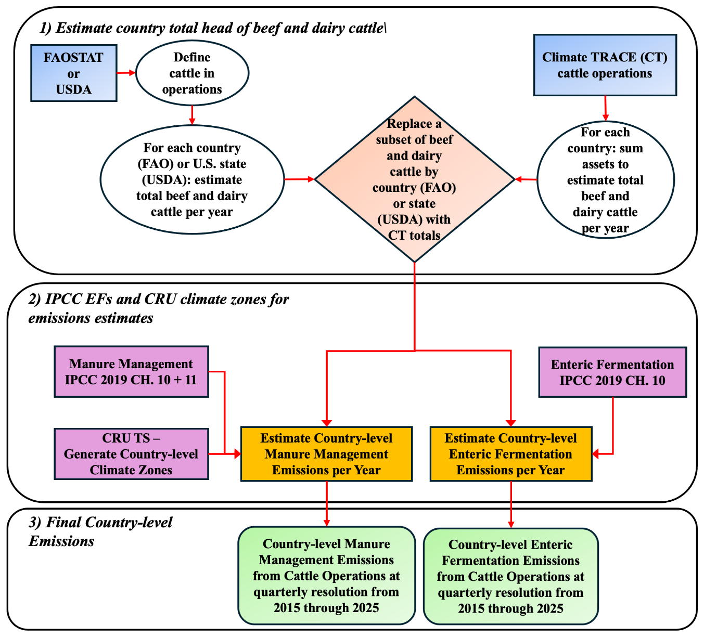
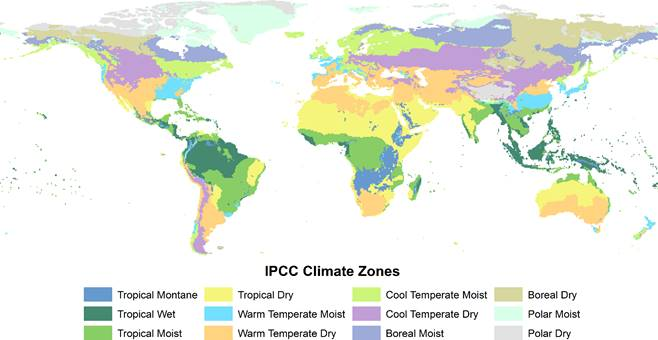
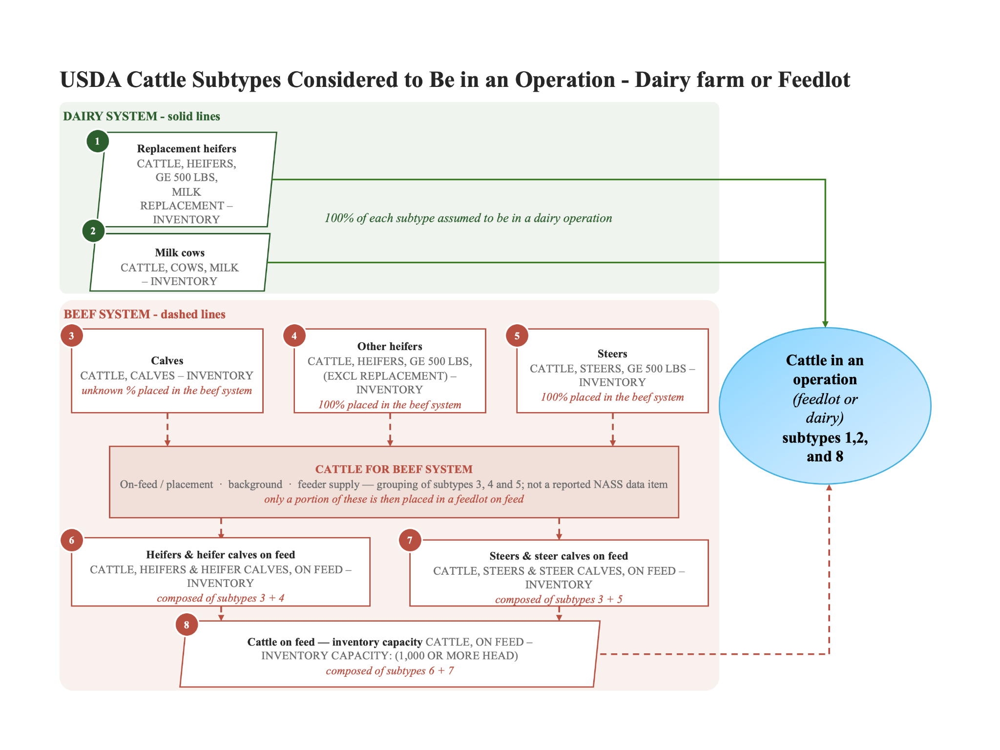
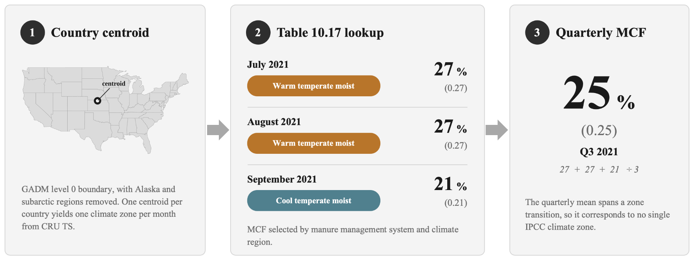

### Agriculture sector- Cattle Operations- Country-level Enteric Fermentation and Manure Management Emissions

**Aaron Davitt1,2, Andrew Tulloch2, Peter Thomas1,2, and Amy Piscopo1,2**

*1) WattTime, 2) Climate TRACE*

#### 1. Introduction

Cattle are the largest contributors of greenhouse gas (GHG) emissions in the livestock sector. Overall, livestock agrifood systems accounted for approximately 6.2 Gt CO₂eq in 2015, around 12% of all anthropogenic GHG emissions, and cattle — meat and milk combined — account for roughly 62% of that total, or about 7% of anthropogenic emissions (FAO, 2023). Emissions from beef and dairy cattle arise from two sources. The first is enteric fermentation - methane (CH4) produced during microbial digestion in the rumen. The second is manure management, which generates CH₄ through anaerobic decomposition and nitrous oxide (N2O) through the microbially driven processes of nitrification and denitrification (Waldrip et al., 2016; Waldrip et al., 2020). Manure management emissions occur both within the storage facilities common to beef and dairy systems and in-field, where manure is applied as fertilizer or deposited directly by grazing animals. See the ‘Supporting Information on Enteric Fermentation and Manure Management’ supplement in the [GitHub Agriculture folder](https://github.com/climatetracecoalition/emissions-methodology/tree/main/Sector-Methodologies/1-Sectors/agriculture) for more information on how enteric fermentation and manure management systems generate emissions.

FAOSTAT is the primary global source of cattle data, reporting stocks (total animals) and emissions at the country level with a two to three year latency (depending on data set). While it provides global coverage with a long time series of emissions estimates, the dataset has four limitations for this purpose:

1.  The cattle subtypes FAOSTAT reports make it difficult to distinguish animals managed in confinement - hereafter operations - from those on pasture, even though emission sources and magnitudes differ substantially between the two.

2.  The non-dairy cattle category is derived as total cattle minus milking cows - a remainder that contains beef animals in confinement alongside multi-purpose, draft, stocker, backgrounding, and grazing cattle. No reported quantity corresponds directly to beef cattle in operations.

3.  Reported dairy and non-dairy cattle are presumed to be both on pasture and in some form of manure management system. While cattle can flow between an operation and pasture, dairy and beef cattle can spend larger amounts on one over the other, impacting emissions generated.

4.  FAOSTAT cattle emissions estimates continue to use the Tier 1 method and the default emission factors of the 2006 IPCC Guidelines. These estimates do not reflect the updated climate zones of the 2019 Refinement to the 2006 IPCC Guidelines for National Greenhouse Gas Inventories countries' adoption of new manure management systems, or changes in cattle raising and breeding practices — changes that can raise emissions per head, and national totals with them, as countries adopt higher-productivity breeds and production systems, even where emissions per unit of milk or meat decline.

In all, these limitations make it difficult to separate the emissions of beef and dairy operations from those of cattle on pasture. That separation is important because cattle operations are highly controlled systems in which feed, housing, and manure handling are all actively managed. As a result, they concentrate and can increase emissions. As more countries adopt higher-productivity systems, the share of cattle emissions from these operations is likely to grow. FAOSTAT nonetheless remains the only globally consistent source available, so we retain it as the backbone and address these limitations by combining multiple datasets and updating emission estimates.

To improve country-level emission estimates for beef and dairy cattle in operations, we combine FAOSTAT with USDA data and with AI-based detections of individual cattle operations from satellite imagery. To account for global shifts in commercial cattle breeding and production practices, we replace default emission factors with the Tier 2 approach of the 2019 Refinement to the 2006 IPCC Guidelines for National Greenhouse Gas Inventories: Chapter 10 (Emissions from Livestock and Manure Management) for enteric fermentation and manure management, and Chapter 11 (N₂O Emissions from Managed Soils, and CO₂ Emissions from Lime and Urea Application) for N₂O from manure applied to or deposited on soils. The result is a set of country-level enteric fermentation and manure management emission estimates at quarterly resolution from 2015 through 2025 that distinguishes cattle in operations from cattle on pasture and reflects current production practices.

#### 2. Materials and Methods

Figure 1 displays the overall process used to estimate country-level enteric fermentation and manure management emissions from cattle operations. FAOSTAT and USDA datasets were used to estimate emissions from cattle in operations at the country level (FAOSTAT) or the U.S. state level (USDA) then summed to the U.S. country total. Here, we define an operation as any facility that raises cattle, including but not limited to animal feeding operations (AFOs), feedlots, ranches, farms, dairies, and cow-calf operations (Rotz et al., 2019). Because FAOSTAT and USDA report cattle differently, each required its own sequence of steps to identify the animals held in operations (Figure 1, Box 1). Where Climate TRACE had deployed AI models to identify individual cattle operations, asset-level totals were summed by country and used to replace a subset of the FAOSTAT or USDA beef and dairy cattle in each country or U.S. state, improving the representation of cattle in operations. Once the datasets were combined, emissions were estimated using the Tier 2 emission factors and equations of the 2019 IPCC Refinement (Figure 1, Box 2). Enteric fermentation drew on Chapter 10 (Emissions from Livestock and Manure Management); manure management drew on Chapter 10 and Chapter 11 (N₂O Emissions from Managed Soils, and CO₂ Emissions from Lime and Urea Application) (IPCC, 2019a; IPCC, 2019b). Country-level climate zones generated from CRU TS v4.10 determined which climate-dependent factors applied. The resulting per-year estimates constituted the final country-level emissions (Figure 1, Box 3). A description of each dataset and application to these emitting sectors are described in section 2.1. below.

**Figure 1.** Flowchart of the process used to generate country-level enteric fermentation and manure management emissions from cattle operations. Box 1: FAOSTAT (by country) and USDA (by U.S. state) data were used to define the cattle held in operations; where Climate TRACE has identified individual cattle operations, asset-level totals were summed by country and replaced a subset of the FAOSTAT or USDA beef and dairy cattle. Box 2: IPCC (2019) Chapter 10 and Chapter 11 emission factors and equations, together with country-level climate zones generated from CRU TS, were applied to those cattle totals to estimate manure management and enteric fermentation emissions for each quarter per year. Box 3: The resulting per-year estimates constituted the final country-level emissions. See the following section for detail on each box and dataset used.

#### 2.1 Datasets employed

#### 2.1.1 FAOSTAT

To estimate cattle in operations for all countries except the U.S., two FAOSTAT items (cattle subtypes) were used from the “Crops and livestock products” domain:

-   “Producing Animals/Slaughtered, Meat of cattle with the bone, fresh or chilled” (beef and veal; not equivalent to “Cattle, non-dairy”, discussed below);

-   “Milk animals, Raw milk of cattle”.

According to the FAOSTAT methodology, the cattle stock item “Producing Animals/Slaughtered” refers to “All data shown relate to total meat production, that is, from both commercial and farm slaughter.” The item “Milk animals” is defined as “Data on cow milk production relate to total production of whole fresh milk” (FAOSTAT, 2023). As such, we treated the reported numbers for each item as representing cattle raised for beef and for dairy production, respectively, in each country.

Data were downloaded for 2015 through 2024, and 2025 was forward-filled with 2024 values to match the USDA range, which extends from 2015 to 2025. Estimates for 2025 in non-U.S. countries therefore reflect 2024 FAOSTAT data.

The “Crops and livestock products” domain was selected because, at the time of this study, it provided the most recently updated cattle data, current as of December 31, 2025 (accessed March 2026). The “Emissions from Enteric Fermentation” and “Emissions from Manure Management” domains were not used: both were last updated on October 28, 2025 and carry cattle data only through 2023. The “Crops and livestock products” domain also carried more current Flags and Flag Descriptions. Country-level values that appear as “Estimated value” in the emissions domains were, in some cases, reported as “Official figure” in this domain, which lent additional confidence to a country’s reported data. Finally, FAOSTAT’s own livestock emissions estimates were not used, because they were generated with IPCC (2006) equations and emission factors rather than the 2019 Refinement applied here.

A country-level dataset was also produced from "[Agriculture sector Emissions from Enteric Fermentation and Manure Left on Pasture from Cattle](https://github.com/climatetracecoalition/emissions-methodology/tree/main/Sector-Methodologies/1-Sectors/agriculture/cattle-enteric-fermentation-manure-pasture)", which identified countries with reporting discrepancies in beef cattle populations by comparing the "Cattle, non-dairy" stock item against "Producing Animals/Slaughtered, Meat of cattle with the bone, fresh or chilled." Countries presumed to have no operations devoted exclusively to beef were filtered out on this basis, as described in Sections 2.2.1.1 and Table S1.

#### 2.1.2 USDA

Emissions for the U.S. were estimated from U.S. Department of Agriculture (USDA) National Agricultural Statistics Service (NASS) Quick Stats data, using the agricultural statistics large dataset ‘qs.animals\_products\_20260701’ (July 1, 2026 release; [https://www.nass.usda.gov/datasets/](https://www.nass.usda.gov/datasets/)). For each U.S. state, the following Data Items (hereafter *cattle subtypes*) were selected to represent cattle in operations:

-   CATTLE, COWS, MILK – INVENTORY

-   CATTLE, HEIFERS, GE 500 LBS, MILK REPLACEMENT – INVENTORY

-   CATTLE, ON FEED – INVENTORY

Section 2.2.2 explains in more detail the USDA subtypes considered to represent cattle in operations.

#### 2.1.3 Climate TRACE cattle operation asset data

The Climate TRACE database includes specific locations of individual cattle operations, either identified using artificial intelligence (AI) detection models with remote sensing data or reported. In addition, this database contains individual cattle operation estimates of total heads of beef or dairy cattle and the associated enteric fermentation and manure management emissions estimates. In total, an estimated 285,824 beef and dairy operations have been identified across 41 countries (Tables 3 and 4).

For this work, where Climate TRACE identified individual cattle operations the mean total head of beef or dairy cattle was estimated at each operation and summed by country (for non-U.S. countries) or by U.S. state to produce a country or state total to be combined with FAOSTAT or USDA data, discussed further in section 2.2.1.3.

#### 2.1.4 IPCC 2019 Refinement — Equations and Emission Factors

Equations and emission factors (EFs) were drawn from Chapter 10 (Emissions from Livestock and Manure Management) and Chapter 11 (N₂O Emissions from Managed Soils, and CO₂ Emissions from Lime and Urea Application) of the 2019 Refinement to the 2006 IPCC Guidelines for National Greenhouse Gas Inventories, and applied to the FAOSTAT and USDA cattle populations described above (IPCC, 2019a; IPCC, 2019b). Default "Other Cattle" and "Dairy Cows" EFs, selected by region, climate zone, and manure management system, were applied to the "Producing Animals/Slaughtered, Meat of cattle with the bone, fresh or chilled" and "Milk animals, Raw milk of cattle" populations, respectively.

Enteric fermentation emissions were estimated using the Tier 2 approach in Section 10.3, for both dairy and other cattle CH₄. Manure management emissions were estimated using the Tier 2 approach in Sections 10.4 and 10.5, together with Table 10A.6 (Animal Waste Management System (AWMS) Regional Averages for Cattle and Buffalo) and Table 11.3 from Chapter 11.

#### 2.1.5 Climate Zones - Climatic Research Unit Gridded Time Series

The updated 2019 IPCC guidelines require climate zones to estimate CH₄ emissions by manure management system, an update from the 2006 guidelines, which relied on temperature-based emission factors (Figure 2). To derive climate-zone-specific methane conversion factors (MCF) (Table 10.17) to estimate manure management emissions, we used the Climatic Research Unit gridded Time Series (CRU TS) v4.10 NetCDF files (version June 7, 2026) from the University of East Anglia (Harris et al., 2020).

**Figure 2** IPCC 2019 major climate zones identified (image taken from IPCC 2019 Chapter 3, volume 4; IPCC, 2019a).

CRU TS provides monthly climate data for global land areas, excluding Antarctica, at a 0.5° × 0.5° resolution. The dataset includes temperature, precipitation, and potential evapotranspiration (PET), which we used to classify IPCC climate zones (Table 5). CRU TS combines weather-station observations with spatial interpolation to provide continuous climate coverage, including in areas with limited observations, although station density varies by location and over time. While CRU TS may be less reliable in regions with few weather stations, the global coverage and time-series climate variables make it well suited for generating climate zones to estimate manure CH4 emissions across countries. For information on CRU TS refer to Harris et al. (2020), NCAR (n.d.), and the CRU TS v4.10 release notes (https://crudata.uea.ac.uk/cru/data/hrg/cru\_ts\_4.10/).

For the purpose of this work, monthly climate zones were generated for each country's latitude and longitude centroid and climate zones were used to derive the MCF values by livestock type per month, then averaged to quarterly MCF values for years 2015 to 2025.

#### 2.2 Methods

#### 2.2.1.1 FAOSTAT

As stated above, the FAOSTAT items "Producing Animals/Slaughtered" and "Milk animals" were treated as representing cattle raised for beef and for dairy production, respectively, as reported by each country.

The "Cattle, dairy" and "Cattle, non-dairy" items were not used, for two reasons. First, they provide population totals only through 2023. Second, "Cattle, non-dairy" does not represent cattle raised exclusively for meat production; it also includes other cattle types. Table 1 demonstrates this: the summed USDA cattle subtypes matched the FAOSTAT "Cattle, non-dairy" totals for the U.S. for 2018 through 2021, and that sum includes stockers, heifers, steers, and bulls. In other words, USDA reports these other cattle types to FAOSTAT, which aggregates them into "Cattle, non-dairy."

**Table 1** USDA cattle types mapped to FAOSTAT “Cattle, non-dairy” population for years 2018 to 2021. Note, data used in this table was from an FAOSTAT version March 24, 2023, and values may have changed since then.

<table><thead><tr class="header"><th><em><strong>Year</strong></em></th><th><strong>Data Item</strong></th><th><strong>Value</strong></th><th><em><strong>Year</strong></em></th><th><strong>Data Item</strong></th><th><strong>Value</strong></th></tr></thead><tbody><tr class="odd"><td><em><strong>2018</strong></em></td><td><blockquote>
CATTLE, BULLS, GE 500 LBS - INVENTORY
</blockquote></td><td>2,252,300</td><td><em><strong>2020</strong></em></td><td><blockquote>
CATTLE, BULLS, GE 500 LBS - INVENTORY
</blockquote></td><td>2,237,400</td></tr><tr class="even"><td></td><td><blockquote>
CATTLE, CALVES - INVENTORY
</blockquote></td><td>14,401,400</td><td></td><td><blockquote>
CATTLE, CALVES - INVENTORY
</blockquote></td><td>14,309,000</td></tr><tr class="odd"><td></td><td><blockquote>
CATTLE, COWS, BEEF - INVENTORY
</blockquote></td><td>31,466,200</td><td></td><td><blockquote>
CATTLE, COWS, BEEF - INVENTORY
</blockquote></td><td>31,338,700</td></tr><tr class="even"><td></td><td><blockquote>
CATTLE, HEIFERS, GE 500 LBS - INVENTORY
</blockquote></td><td>20,217,800</td><td></td><td><blockquote>
CATTLE, HEIFERS, GE 500 LBS - INVENTORY
</blockquote></td><td>20,024,400</td></tr><tr class="odd"><td></td><td><blockquote>
CATTLE, STEERS, GE 500 LBS - INVENTORY
</blockquote></td><td>16,528,200</td><td></td><td><blockquote>
CATTLE, STEERS, GE 500 LBS - INVENTORY
</blockquote></td><td>16,541,200</td></tr><tr class="even"><td></td><td><blockquote>
<em><strong>Total USDA NASS "non-dairy" =</strong></em>
</blockquote></td><td><em><strong>84,865,900</strong></em></td><td></td><td><blockquote>
<em><strong>Total USDA NASS "non-dairy" =</strong></em>
</blockquote></td><td><em><strong>84,450,700</strong></em></td></tr><tr class="odd"><td></td><td><blockquote>
<em><strong>FAOSTAT Cattle, non-dairy =</strong></em>
</blockquote></td><td><em><strong>84,865,900</strong></em></td><td></td><td><blockquote>
<em><strong>FAOSTAT Cattle, non-dairy =</strong></em>
</blockquote></td><td><em><strong>84,450,700</strong></em></td></tr><tr class="even"><td><em><strong>Year</strong></em></td><td><strong>Data Item</strong></td><td><strong>Value</strong></td><td><em><strong>Year</strong></em></td><td><strong>Data Item</strong></td><td><strong>Value</strong></td></tr><tr class="odd"><td><em><strong>2019</strong></em></td><td><blockquote>
CATTLE, BULLS, GE 500 LBS - INVENTORY
</blockquote></td><td>2,253,000</td><td><em><strong>2021</strong></em></td><td><blockquote>
CATTLE, BULLS, GE 500 LBS - INVENTORY
</blockquote></td><td>2,210,500</td></tr><tr class="even"><td></td><td><blockquote>
CATTLE, CALVES - INVENTORY
</blockquote></td><td>14,539,900</td><td></td><td><blockquote>
CATTLE, CALVES - INVENTORY
</blockquote></td><td>14,305,100</td></tr><tr class="odd"><td></td><td><blockquote>
CATTLE, COWS, BEEF - INVENTORY
</blockquote></td><td>31,690,700</td><td></td><td><blockquote>
CATTLE, COWS, BEEF - INVENTORY
</blockquote></td><td>30,843,600</td></tr><tr class="even"><td></td><td><blockquote>
CATTLE, HEIFERS, GE 500 LBS - INVENTORY
</blockquote></td><td>20,210,000</td><td></td><td><blockquote>
CATTLE, HEIFERS, GE 500 LBS - INVENTORY
</blockquote></td><td>20,200,100</td></tr><tr class="odd"><td></td><td><blockquote>
CATTLE, STEERS, GE 500 LBS - INVENTORY
</blockquote></td><td>16,757,700</td><td></td><td><blockquote>
CATTLE, STEERS, GE 500 LBS - INVENTORY
</blockquote></td><td>16,787,800</td></tr><tr class="even"><td></td><td><em><strong>Total USDA NASS "non-dairy" =</strong></em></td><td><em><strong>85,451,300</strong></em></td><td></td><td><em><strong>Total USDA NASS "non-dairy" =</strong></em></td><td><em><strong>84,347,100</strong></em></td></tr><tr class="odd"><td></td><td><em><strong>FAOSTAT Cattle, non-dairy =</strong></em></td><td><em><strong>85,451,300</strong></em></td><td></td><td><em><strong>FAOSTAT Cattle, non-dairy =</strong></em></td><td><em><strong>N/A</strong></em></td></tr></tbody></table>

These ‘other’ cattle types serve as replacements for cattle in feedlots or to replenish the herd. Stockers, heifers, steers, and bulls can be considered to forage on pasture or grassland until they reach the weight at which they are finished in feedlots (McKinley et al., 2004; Endres and Schwartzkopf-Genswein, 2018; Hayek and Garrett, 2018; Aubuchon, 2021). Because we considered these cattle to be on pasture, they were excluded from this sector and reported instead under the Climate TRACE sector "Emissions from Enteric Fermentation and Manure Left on Pasture from Cattle." in the agriculture sector folder hosted on the [Climate TRACE GitHub repo](https://github.com/climatetracecoalition/emissions-methodology/tree/main/Sector-Methodologies/1-Sectors/agriculture).

To obtain a more representative population of cattle raised for meat, the same mapping exercise was applied to "Producing Animals/Slaughtered, Meat of cattle with the bone, fresh or chilled" (Table 2). Breaking down the USDA NASS cattle types destined for slaughter identified "CATTLE, CALVES – SLAUGHTERED" and "CATTLE, GE 500 LBS – SLAUGHTERED" as the types reported to FAOSTAT for meat production. Their sum matched the FAOSTAT item for 2018 and 2019; the remaining two years, 2020 and 2021, differed slightly. This may reflect U.S. states revising county-level data after USDA had submitted their information to FAOSTAT (USDA NASS, 2018).

**Table 2** FAOSTAT Crops and livestock products “Producing Animals/Slaughtered, Meat of cattle with the bone, fresh or chilled” totals compared to USDA slaughtered cattle population for years 2018 to 2021. When there is a positive difference between FAOSTAT and USDA NASS, FAOSTAT reported a higher volume of slaughtered beef cattle; negative numbers indicate USDA NASS reported a higher slaughtered beef cattle volume; and zero values indicate matching reported values between FAOSTAT and USDA NASS. Non-zero values in the difference row suggests a reporting entity updated their values since last submission. Note, data used in this table was from an FAOSTAT version March 24, 2023, and values may have changed in the most recent FAOSTAT update.

<table><thead><tr class="header"><th><strong>Year</strong></th><th><strong>Database</strong></th><th><strong>Element (FAOSTAT) or Data Item (USDA) and Unit</strong></th><th><strong>Value</strong></th></tr></thead><tbody><tr class="odd"><td><em><strong>2018</strong></em></td><td>FAOSTAT</td><td>Producing Animals/Slaughtered, Meat of cattle with the bone, fresh or chilled (An)</td><td><blockquote>
33,703,400
</blockquote></td></tr><tr class="even"><td></td><td>USDA</td><td>CATTLE, CALVES - SLAUGHTERED, MEASURED IN HEAD</td><td><blockquote>
603,600
</blockquote></td></tr><tr class="odd"><td></td><td>USDA</td><td>CATTLE, GE 500 LBS - SLAUGHTERED, MEASURED IN HEAD</td><td><blockquote>
33,099,800
</blockquote></td></tr><tr class="even"><td></td><td><em><strong>Difference (FAOSTAT - USDA NASS) =</strong></em></td><td><blockquote>
<em><strong>0</strong></em>
</blockquote></td><td></td></tr><tr class="odd"><td><em><strong>2019</strong></em></td><td>FAOSTAT</td><td>Producing Animals/Slaughtered, Meat of cattle with the bone, fresh or chilled (An)</td><td><blockquote>
34,264,800
</blockquote></td></tr><tr class="even"><td></td><td>USDA</td><td>CATTLE, CALVES - SLAUGHTERED, MEASURED IN HEAD</td><td><blockquote>
608,900
</blockquote></td></tr><tr class="odd"><td></td><td>USDA</td><td>CATTLE, GE 500 LBS - SLAUGHTERED, MEASURED IN HEAD</td><td><blockquote>
33,655,900
</blockquote></td></tr><tr class="even"><td></td><td><em><strong>Difference (FAOSTAT - USDA NASS) =</strong></em></td><td><blockquote>
<em><strong>0</strong></em>
</blockquote></td><td></td></tr><tr class="odd"><td><em><strong>2020</strong></em></td><td>FAOSTAT</td><td>Producing Animals/Slaughtered, Meat of cattle with the bone, fresh or chilled (An)</td><td><blockquote>
33,366,100
</blockquote></td></tr><tr class="even"><td></td><td>USDA</td><td>CATTLE, CALVES - SLAUGHTERED, MEASURED IN HEAD</td><td><blockquote>
479,800
</blockquote></td></tr><tr class="odd"><td></td><td>USDA</td><td>CATTLE, GE 500 LBS - SLAUGHTERED, MEASURED IN HEAD</td><td><blockquote>
32,885,300
</blockquote></td></tr><tr class="even"><td></td><td><em><strong>Difference (FAOSTAT - USDA NASS) =</strong></em></td><td><blockquote>
<em><strong>1,000</strong></em>
</blockquote></td><td></td></tr><tr class="odd"><td><em><strong>2021</strong></em></td><td>FAOSTAT</td><td>Producing Animals/Slaughtered, Meat of cattle with the bone, fresh or chilled (An)</td><td><blockquote>
34,360,000
</blockquote></td></tr><tr class="even"><td></td><td>USDA</td><td>CATTLE, CALVES - SLAUGHTERED, MEASURED IN HEAD</td><td><blockquote>
413,500
</blockquote></td></tr><tr class="odd"><td></td><td>USDA</td><td>CATTLE, GE 500 LBS - SLAUGHTERED, MEASURED IN HEAD</td><td><blockquote>
33,946,600
</blockquote></td></tr><tr class="even"><td></td><td><em><strong>Difference (FAOSTAT - USDA NASS) =</strong></em></td><td><blockquote>
<em><strong>-100</strong></em>
</blockquote></td><td></td></tr></tbody></table>

We therefore assumed that other countries reporting "Cattle, non-dairy" likewise include other cattle types in that category. "Producing Animals/Slaughtered, Meat of cattle with the bone, fresh or chilled" was taken to be more representative of cattle destined for meat production that passed through an operation where animals were confined for some period to fatten before slaughter. For "Milk animals, Raw milk of cattle," the reported values were treated as cows milked at a dairy operation.

Some countries had their “Producing Animals/Slaughtered, Meat of cattle with the bone, fresh or chilled” populations set to zero for all years and were interpreted as having no cattle in beef operations (Table S1). This occurred where FAOSTAT reported a “Producing Animals/Slaughtered” value greater than the country’s reported “Cattle, non-dairy” population, so that subtracting the two produced a negative result. One likely cause is that FAOSTAT accounts for animals slaughtered in a country other than the one where they were raised under the “Total meat production” category (FAOSTAT, 2023). Imported animals can raise the slaughtered population above the “Cattle, non-dairy” population, which may not have been updated to reflect that trade.

Where “Producing Animals/Slaughtered” exceeded “Cattle, non-dairy,” a representative population for meat production could not be identified: the remaining “Cattle, non-dairy” animals would consist of non-producing cattle — stockers, heifers, steers, and bulls — which are typically raised on pasture and accounted for elsewhere (see Section 2.1.1). Beef operation emissions were therefore not generated for these countries; only dairy emissions were estimated. Their “Producing Animals/Slaughtered” populations were instead reported under the Climate TRACE sector “Emissions from Enteric Fermentation and Manure Left on Pasture from Cattle,” since these cattle were considered to be foraging on pasture.

#### 2.2.1.2 USDA

USDA reports specific "Data Items" (hereafter cattle subtypes) in its Cattle Inventory (https://www.nass.usda.gov/Surveys/Guide\_to\_NASS\_Surveys/). Not all of these subtypes represent cattle in an operation, and for those that do end up on feed, only a percentage is allocated to an operation. Figure 3 shows the subtypes considered to be in an operation for each U.S. state, and the identification process is described below (numbering follows Figure 3).

**Figure 3** USDA NASS cattle subtypes considered to be in an operation. Parallelograms (subtypes 1, 2, and 8) are the subtypes carried forward and combined with Climate TRACE asset-level cattle operations to estimate state- and country-level emissions (circle); rectangles are intermediate subtypes. Solid lines represent the dairy system and dashed lines the beef system. Subtypes 1 and 2 — replacement heifers and milk cows — were assumed to be 100% in a dairy operation. On the beef side, all of subtypes 4 and 5 and an unknown percentage of subtype 3 enter the “Cattle for Beef System,” a grouping that is not itself a reported NASS Data Item; a portion of these are placed in a feedlot on feed and reported as subtypes 6 and 7, which together compose subtype 8. Subtype 8 is Cattle on feed – inventory capacity.

For dairy operations (green box in Figure 3), two subtypes were considered and 100% of each was assumed to be in a dairy operation:

> 1\) CATTLE, HEIFERS, GE 500 LBS, MILK REPLACEMENT – INVENTORY
>
> 2\) CATTLE, COWS, MILK – INVENTORY

For beef cattle — raised on a farm, ranch, or feedlot — (red box in Figure 3) USDA reports several subtypes destined for the "Cattle for Beef System," a grouping that is not itself a reported NASS Data Item. Not all of these cattle enter a feedlot on feed; only a portion do (Davitt, 2024). The dashed lines in Figure 3 trace these subtypes:

> 3\) CATTLE, CALVES – INVENTORY — an unknown percentage was placed in the beef system.
>
> 4\) CATTLE, HEIFERS, GE 500 LBS, (EXCL REPLACEMENT) – INVENTORY — 100% was considered placed in the beef system.
>
> 5\) CATTLE, STEERS, GE 500 LBS – INVENTORY — 100% was considered placed in the beef system.

Subtypes 3, 4, and 5 constitute the "Cattle for Beef System" as "On-Feed/Placement," "Background," and/or "Feeder Supply." A portion of these were then placed in a feedlot on feed and reported as:

> 6\) CATTLE, HEIFERS & HEIFER CALVES, ON FEED – INVENTORY — composed of subtypes 3 and 4.
>
> 7\) CATTLE, STEERS & STEER CALVES, ON FEED – INVENTORY — composed of subtypes 3 and 5.

The final beef subtype considered to be in an operation was 8) CATTLE, ON FEED – INVENTORY CAPACITY: (1,000 OR MORE HEAD), which is composed of subtypes 6 and 7. This subtype covers only feedlots with a capacity of 1,000 head or more, which accounted for approximately 85% of all fed U.S. cattle as of 2024 (USDA NASS, 2024). It therefore does not represent the total cattle on feed in each U.S. state, but a large portion of that total.

Cattle subtypes 1, 2, and 8 were used in combination with individual cattle operations identified in “[*Cattle Operations- Asset-level Enteric Fermentation and Manure Management Emissions*](https://github.com/climatetracecoalition/emissions-methodology/tree/main/Sector-Methodologies/1-Sectors/agriculture/cattle-operations-asset-level)” to estimate updated U.S. country-level emissions, discussed in section 2.2.4.1.

#### 2.2.1.3 Climate TRACE identified cattle operations

Where individual cattle operations were identified using the AI detection model or reported, the mean total head of beef or dairy cattle was estimated at each operation and summed by country to produce a Climate TRACE operation country total using Equation 1,

$`N_{c,t,s}^{\text{CT}} = {\bar{n}}_{i,t,s}`$ (Equation 1)

Where,

$`N_{c,t,s}^{\text{CT}}`$ = total head of cattle type *s* in country *c* in year *t*, derived from Climate TRACE identified cattle operations (head);

$`{\bar{n}}_{i,t,s}`$= mean total head of cattle type *s* at identified cattle operation *i* in year t (head);

$`O_{c}`$ = number of individual cattle operations identified in country *c* (count);

$`i`$ = an individual identified cattle operation, numbered 1 through $`O_{c}`$;

$`c`$ = the country for which the total is calculated;

$`t`$ = the year for which the total is calculated; and

$`s`$ = the cattle type, beef or dairy.

Climate TRACE derived totals were then incorporated into the country-level populations derived from FAOSTAT or USDA data, described in section 2.2.1.4. Tables 3 and 4 provide totals per country and U.S. state, respectively.

**Table 3** Counties with AI detected or reported cattle operations and their estimated mean total head of cattle, by type, for years 2015 to 2025.

| **ISO3** | **Type** | **Heads** | **ISO3** | **Type** | **Heads**  | **ISO3** | **Type** | **Heads** | **ISO3** | **Type** | **Heads** |
|----------|----------|-----------|----------|----------|------------|----------|----------|-----------|----------|----------|-----------|
| *ARG*    | Beef     | 2,015,027 | *CAN*    | Beef     | 35,754,742 | *IRL*    | Dairy    | 36,103    | *POL*    | Dairy    | 618,840   |
|          | Dairy    | 772       |          | Dairy    | 155,422    | *ITA*    | Dairy    | 755,668   | *PRK*    | Dairy    | 200       |
| *AUS*    | Beef     | 2,924,590 | *CHE*    | Dairy    | 18,041     | *JPN*    | Beef     | 352,062   | *PRT*    | Beef     | 3,668     |
|          | Dairy    | 3,401,181 | *CHN*    | Dairy    | 6,107,606  |          | Dairy    | 11,991    |          | Dairy    | 578,297   |
| *AUT*    | Dairy    | 6,369     | *COL*    | Beef     | 96         | *KAZ*    | Dairy    | 748       | *PRY*    | Beef     | 42,500    |
| *AZE*    | Dairy    | 68        | *DEU*    | Beef     | 758        | *KOR*    | Beef     | 42,699    |          | Dairy    | 19,100    |
| *BEL*    | Beef     | 3,438     |          | Dairy    | 3,153,147  |          | Dairy    | 24,552    | *RUS*    | Beef     | 225,000   |
|          | Dairy    | 664,773   | *DNK*    | Dairy    | 1,150,394  | *LTU*    | Dairy    | 638       |          | Dairy    | 292,129   |
| *BGD*    | Beef     | 3,785     | *ESP*    | Beef     | 3,741      | *LUX*    | Beef     | 521       | *TUR*    | Beef     | 16,073    |
|          | Dairy    | 49,393    |          | Dairy    | 2,244,669  |          | Dairy    | 49,277    |          | Dairy    | 68,423    |
| *BLR*    | Dairy    | 730,645   | *FRA*    | Beef     | 1,046      | *MEX*    | Dairy    | 15,254    | *UKR*    | Dairy    | 192,031   |
| *BRA*    | Beef     | 7,444,528 |          | Dairy    | 1,835,084  | *NLD*    | Beef     | 104       | *URY*    | Beef     | 76,832    |
|          | Dairy    | 143,559   | *GBR*    | Dairy    | 1,041,178  |          | Dairy    | 1,092,119 |          | Dairy    | 805       |
| *BWA*    | Beef     | 18,000    | *IDN*    | Beef     | 205,890    | *NZL*    | Dairy    | 436,598   | *ZAF*    | Beef     | 2,002,520 |
|          | Dairy    | 750       |          | Dairy    | 75,617     | *PAK*    | Beef     | 253,427   |          | Dairy    | 3,000     |
|          |          |           | *IND*    | Dairy    | 46,438,665 |          | Dairy    | 734,365   |          |          |           |

**Table 4** U.S. states with AI detected and reported cattle operations and their estimated mean total head of cattle, by type, for years 2015 to 2025.

| **State**     | **Type** | **Heads** | **State**     | **Type** | **Heads** | **State**        | **Type** | **Heads** | **State**        | **Type** | **Heads** |
|---------------|----------|-----------|---------------|----------|-----------|------------------|----------|-----------|------------------|----------|-----------|
| *Alabama*     | Beef     | 3,528     | *Indiana*     | Beef     | 88,374    | *Nevada*         | Beef     | 176,258   | *South Carolina* | Beef     | 1,520     |
|               | Dairy    | 88        |               | Dairy    | 185,552   |                  | Dairy    | 46,339    |                  | Dairy    | 22,722    |
| *Arizona*     | Beef     | 2,072,732 | *Iowa*        | Beef     | 2,018,911 | *New Hampshire*  | Beef     | 20,266    | *South Dakota*   | Beef     | 3,277,581 |
| *Arkansas*    | Beef     | 86        |               | Dairy    | 252,033   |                  | Dairy    | 21,782    |                  | Dairy    | 163,950   |
|               | Dairy    | 525       | *Kansas*      | Beef     | 3,411,653 | *New Jersey*     | Beef     | 114       | *Tennessee*      | Beef     | 7,245     |
| *California*  | Beef     | 1,505,586 |               | Dairy    | 183,312   |                  | Dairy    | 117       |                  | Dairy    | 5,016     |
|               | Dairy    | 2,275,564 | *Kentucky*    | Beef     | 72,218    | *New Mexico*     | Beef     | 1,974,925 | *Texas*          | Beef     | 5,714,950 |
| *Colorado*    | Beef     | 3,396,660 |               | Dairy    | 63,749    |                  | Dairy    | 29,622    |                  | Dairy    | 1,324,151 |
|               | Dairy    | 334,841   | *Louisiana*   | Dairy    | 590       | *New York*       | Beef     | 59,716    | *Utah*           | Beef     | 683,207   |
| *Connecticut* | Dairy    | 5,200     | *Maine*       | Beef     | 154       |                  | Dairy    | 379,688   |                  | Dairy    | 79,764    |
| *Delaware*    | Dairy    | 1,075     | *Maine*       | Dairy    | 1,248     | *North Carolina* | Beef     | 98,211    | *Vermont*        | Dairy    | 37,296    |
| *Florida*     | Beef     | 5,320     | *Maryland*    | Dairy    | 19,798    |                  | Dairy    | 77,742    | *Virginia*       | Beef     | 166       |
|               | Dairy    | 99,062    | *Michigan*    | Beef     | 512       | *North Dakota*   | Beef     | 458,611   |                  | Dairy    | 32,250    |
| *Georgia*     | Dairy    | 10,858    | *Minnesota*   | Beef     | 246,316   |                  | Dairy    | 35,582    | *Washington*     | Beef     | 398,049   |
| *Hawaii*      | Beef     | 36        |               | Dairy    | 1,588,573 | *Ohio*           | Beef     | 32,011    |                  | Dairy    | 212,863   |
|               | Dairy    | 1         | *Mississippi* | Beef     | 3,664     |                  | Dairy    | 132,684   | *West Virginia*  | Dairy    | 116       |
| *Idaho*       | Beef     | 539,218   |               | Dairy    | 266       | *Oklahoma*       | Beef     | 2,282,067 | *Wisconsin*      | Beef     | 53,005    |
|               | Dairy    | 52,018    | *Missouri*    | Beef     | 20,391    |                  | Dairy    | 92,987    |                  | Dairy    | 810,552   |
| *Illinois*    | Beef     | 858       |               | Dairy    | 44,661    | *Oregon*         | Beef     | 235,555   | *Wyoming*        | Beef     | 611,171   |
|               | Dairy    | 29,436    | *Montana*     | Beef     | 2,771     |                  | Dairy    | 211,627   |                  | Dairy    | 5         |
|               |          |           |               | Dairy    | 560       | *Pennsylvania*   | Beef     | 228       |                  |          |           |
|               |          |           | *Nebraska*    | Beef     | 5,890,438 |                  | Dairy    | 2,741,829 |                  |          |           |
|               |          |           |               | Dairy    | 24,148    |                  |          |           |                  |          |           |

#### 2.2.1.4 Final country totals: combining total country cattle numbers

Sections 2.2.1.1 and 2.2.1.2 produced estimated beef and dairy populations in operations for each country from FAOSTAT and, for the U.S., for each state from USDA summed to a country total. Where Climate TRACE had also identified individual cattle operations through the AI detection model, those asset-level totals were used in place of a subset of the reported population rather than added to it (Figure 1, Box 1). This substitution avoids double-counting the same animals, since an operation detected by the AI detection model is considered represented within the FAOSTAT country or USDA U.S. total in which the operation exists.

The substitution was applied independently for each country, year, and cattle type. For each country where individual operations were identified, the Climate TRACE operations country total was calculated by summing the mean head at every identified operation (Equation 1). That total then was subtracted from the corresponding reported population, and the remaining reported head were carried forward unchanged (Equation 2),

$`N_{c,t,s}^{\text{REM}} = N_{c,t,s}^{\text{REP}} - N_{c,t,s}^{\text{CT}}`$ (Equation 2)

Where,

$`N_{c,t,s}^{\text{REP}}`$= total head of cattle type *s* in operations reported by FAOSTAT for country *c*, or by USDA for U.S. *c*, in year *t* (head);

$`N_{c,t,s}^{\text{CT}}`$= total head of cattle type *s* derived from Climate TRACE identified cattle operations, from Equation 1 (head);

$`N_{c,t,s}^{\text{REM}}`$ = remaining head of cattle type *s* in operations in country *c* in year *t*, after the Climate TRACE identified operations have been subtracted from the reported population; these head were assigned to manure management systems using IPCC (2019) Table 10A.6 regional averages described in section 2.2.2.1;

$`c`$ = the country for which the total is calculated;

$`t`$ = the year for which the total is calculated;

$`s`$ = the cattle type, beef or dairy.

Where no operations were identified in a country, or the country is an island with limited land area for raising cattle, $`N_{c,t,s}^{\text{REM}} = N_{c,t,s}^{\text{REP}}`$. Lastly, the annual total dairy cattle were assigned to each quarter for *c* and *t*, since dairy cattle are kept alive throughout the year. The annual beef cattle total was divided by four and assigned to each quarter for *c* and *t*, to present the flow-through system that occurs at beef operations.

The subtracted Climate TRACE cattle operation portion carries the asset-level attributes of each identified operation, while the remainder retains the country-level characteristics applied in Section 2.2.2. Because the two components sum to the reported total ($`N_{c,t,s}^{\text{CT}}`$ + $`N_{c,t,s}^{\text{REM}}`$ = $`N_{c,t,s}^{\text{REP}}`$), the population carried into the emissions calculation is unchanged in magnitude; what changes is the proportion of that population described by reported and AI-detected operations rather than by regional averages.

The extent of $`N_{c,t,s}^{\text{CT}}`$ substitution varies by country and U.S. state. Where the detection model has tens of thousands of identified operations, most of the reported population is described by summed Climate TRACE assets; where coverage is partial or absent, the reported FAOSTAT or USDA population is the primary coverage. Generally, for non-U.S. countries, individual cattle operations replaced between 0.0008% to 21.0% of total heads of cattle. For U.S. states, 0.013% to 100% of the total head of cattle, where 100% replacement means that summing up individual cattle operations in the state is considered either to have found all of the cattle operations, or that the estimated heads of cattle equal or exceed the USDA reported numbers for that state. The resulting remainder population, $`N_{c,t,s}^{\text{REM}}`$, whether substituted in whole, in part, or not at all, is the input to the emission factors and climate zone assignment described in Section 2.2.4 (Figure 1, Box 2).

#### 2.2.2 Assigning manure management systems

#### 2.2.2.1 FAOSTAT and USDA populations

Once the population of dairy and beef cattle in an operation had been determined for each country from FAOSTAT or USDA data, after accounting for summed operations identified with an AI detection model, the remainder population ($`N_{c,t,s}^{\text{REM}})`$ was distributed across manure management systems using IPCC (2019) Table 10A.6, “Animal Waste Management System (AWMS) Regional Averages for Cattle and Buffalo”.

Cattle allocated to the “Pasture/Range/Paddock” system were excluded from the total manure management emissions and considered reported in the Climate TRACE pasture sector. Any cattle allocated to the “Burned for Fuel” system were likewise excluded from these country-level estimates, as those emissions are accounted for in the Climate TRACE residential onsite fuel usage sector.

#### 2.2.3 Deriving methane conversion factors by climate zone

Manure management methane emissions are driven by the amount of manure produced, the system in which that manure is handled, and the climate conditions — particularly temperature and moisture — that determine whether emissions are produced under anaerobic or aerobic conditions (IPCC, 2019b; see Supplemental Section S.1 for further detail on anaerobic and aerobic conditions). The 2019 Refinement requires climate zones to estimate CH₄ emissions by manure management system, a departure from the 2006 Guidelines, which relied on annual-temperature-based emission factors.

Rather than applying a single static climate zone spanning 30 years to every year of the inventory, monthly climate zones were generated for each country and each year from 2015 to 2025. Climate zones were created using the decision tree published in the first Corrigenda ("things to be corrected") to the 2019 Refinement and discussed further in Chapter 10 (Figure 2; Federici, 2021; IPCC, 2019b). Four CRU TS variables were used: temperature (TMP), frost day frequency (FRS), potential evapotranspiration (PET), and precipitation (PRE). GMTED2010 global elevation data (Geffen, 2023) were used alongside these variables to define montane climate zones. Table 5 lists the climate zones and the corresponding IPCC tables used for mapping.

**Table 5** IPCC 2019 climate zones mapped to manure management systems in Table 10.17 to derive MCFs and disaggregated climate zones mapped to N2O EF4 in Table 11.3.

<table><thead><tr class="header"><th>
<strong>IPCC Climate Zones for manure management systems</strong>

<strong>(Table 10.17)</strong>
</th><th><strong>Disaggregated Climate Zones (Table 11.3)</strong></th><th>
<strong>IPCC Climate Zones for manure management systems</strong>

<strong>(Table 10.17)</strong>
</th><th><strong>Disaggregated Climate Zones (Table 11.3)</strong></th></tr></thead><tbody><tr class="odd"><td>Tropical Montane</td><td>Dry Climate</td><td>Tropical Wet</td><td>Wet Climate</td></tr><tr class="even"><td>Tropical Dry</td><td></td><td>Tropical Moist</td><td></td></tr><tr class="odd"><td>Warm Temp. Dry</td><td></td><td>Warm Temp. Moist</td><td></td></tr><tr class="even"><td>Cool Temp. Dry</td><td></td><td>Cool Temp. Moist</td><td></td></tr><tr class="odd"><td>Boreal Dry</td><td></td><td>Boreal Moist</td><td></td></tr></tbody></table>

Country boundaries came from the Global Administrative Areas (GADM) project, version 4.1 (released 16 July 2022), as modified by Climate TRACE. Level 0 boundaries were used to generate a latitude and longitude centroid for each country, from which the climate zone for each month of each year was extracted. For countries containing Arctic and subarctic regions — Canada, the United States (Alaska), and Russia — the GADM boundaries were modified to minimize or remove those regions before the centroids were generated, so that the extracted climate zones better represent the conditions where cattle are actually raised.

The monthly climate zones were then used to select methane conversion factors (MCF) from IPCC (2019b) Table 10.17 by manure management system and climate region, applied separately to dairy cattle and non-dairy cattle. The resulting monthly MCF values were then averaged to quarterly MCF values for 2015 through 2025. The same disaggregated climate zones were used to select EF4 from Table 11.3 — N volatilisation and re-deposition, in kg N₂O–N per kg (NH3–N + NOX–N volatilised) — for wet or dry climate zones. For EF₅ (leaching/runoff, kg N₂O–N (kg N leaching/runoff)-1, a default value was used since there is no difference between wet and dry climates.

**Figure 4** Illustrative example of the monthly-to-quarterly MCF derivation. Step 1 - a single GADM level 0 centroid per country gives one climate zone per month. Step 2 - each monthly climate zone selects an MCF from IPCC 2019 Table 10.17 by manure management system (from Table 10A.6 AWMS) and climate zone, applied separately to dairy and non-dairy cattle. Step 3 - the three monthly MCF values are averaged to a quarterly value - July, August, and September MCFs become quarter 3 MCF.

#### 2.2.4 Emissions estimates

Enteric fermentation methane emissions were estimated for all countries with cattle populations reported in FAOSTAT and USDA data, following the Tier 2 approach in IPCC (2019b) Chapter 10, Section 10.3. Dry matter intake (DMI, kg day-1) was estimated for dairy cows and steers, and enteric fermentation CH₄ EFs were derived using the Tier 2 formulation (Equation 10.21a), in which DMI is multiplied by the methane conversion factors (Table 10.12, g CH₄ kg DMI-1) to produce EFs for beef and dairy cattle. These EFs were then multiplied by the total dairy and beef cattle populations and summed to give total enteric CH₄ emissions by country and year.

Manure management CH₄ and N₂O emissions were estimated from the same population data. For CH4, section 10.4 Tier 2 equation 10.23 (for CH4) and related equations were used to generate the CH4 EF by cattle type. For N2O emissions, section 10.5, Tier 1 equations were used, with indirect N₂O EFs in Table 11.3 in Chapter 11, to estimate direct and indirect (volatilization and leaching) emissions. Default or regional mean emission factors for Other Cattle and Dairy Cows were selected by region, climate zone, and manure management system.

The general approach to estimate emissions for enteric fermentation and manure management is shown in Equation 3,

$`E_{c,t,s,g}^{\text{REM}} = N_{c,t,s}^{\text{REM}}\text{\ x\ }\text{EF}_{c,t,s,g}`$(Equation 3)

Where,

$`E_{c,t,s,g}^{\text{REM}}`$ = total emissions of gas *g* from the remaining head of cattle type *s* in country *c* in year *t* (kg yr⁻¹);

$`N_{c,t,s}^{\text{REM}}`$ = remaining head of cattle type *s* in country *c* in year *t*, after the Climate TRACE identified operations have been subtracted from the reported population, from Equation 2 (head);

$`\text{EF}_{c,t,s,g}`$= emission factor for gas *g* for cattle type *s* in country *c* in year *t*, derived from the IPCC (2019) Tier 2 equations using the Table 10A.6 regional-average manure management system distribution described in Section 2.2.2.1 (kg gas head⁻¹ yr⁻¹);

*c* = the country for which the total is calculated;

*t* = the year for which the total is calculated;

*s* = the cattle type, beef or dairy;

*g* = the gas, CH₄ or N₂O.

For AI detected cattle operations, manure management CH₄ and N₂O emissions were estimated assuming multiple manure management systems, allocating a fraction of total manure to each system per operation rather than the single regional-average allocation applied in Section 2.2.2.1. This distinction is why the subtraction described in Section 2.2.1.4 changes the resulting emissions: substituted heads carry the multiple manure management systems observed at each identified operation, whereas the remaining FAOSTAT and USDA head use Table 10A.6 regional average manure management systems. For more information on the operation approach to estimate emissions, refer to “*Cattle Operations- Asset-level Enteric Fermentation and Manure Management Emissions*” in the agriculture sector folder hosted on the [Climate TRACE GitHub repo](https://github.com/climatetracecoalition/emissions-methodology/tree/main/Sector-Methodologies/1-Sectors/agriculture).

To incorporate the Climate TRACE identified operations into the country-level estimates, asset-level emissions were summed to a country total for each year, cattle type, and gas. The population attributed to those operations was subtracted from the reported FAOSTAT or USDA population in Section 2.2.1.4 with Equation 2. The country total is the sum of the two components, represented as,

$`E_{c,t,s,g} = \sum\text{\ E}_{c,t,s,g}^{\text{CT}} + E_{c,t,s,g}^{\text{REM}}`$ (Equation 4)

Where,

$`\sum`$ $`E_{c,t,s,g}^{\text{CT}}`$ = is the sum of emissions of gas *g* from Climate TRACE identified operations of cattle type *s* in country *c* in year *t*, summed across quarters (kg yr⁻¹, converted to metric tonnes or mt). If no Climate TRACE operations, $`\text{\ E}_{c,t,s,g}^{\text{CT}}`$, were identified in a country, then $`E_{c,t,s,g}`$= $`E_{c,t,s,g}^{\text{REM}}`$.

#### 2.3 Final Country-level Emissions

Country-level enteric fermentation CH4 and manure management CH4 and N2O emissions estimates were generated and reported as separate sub-sectors on the Climate TRACE website ([https://climatetrace.org/](https://climatetrace.org/)). To generate CO2 equivalent (CO2e) for 20 year and 100 year global warming potentials (GWPs), 79.7 (20 year) and 27.0 (100 year) Methane - non fossil values were applied to total country-level CH4 emissions for each year. For total country-level N2O emissions, a 273 value was applied for each 20 and 100 year GWPs. The manure management sub-sector summed each CH4 and N2O emissions into 20 and 100 year GWPs emissions values. Additional information on specific data fields and values are described in the Metadata and Supplementary sections below.

Of the 250 countries and administrative regions reported for this sector, 190 had emissions estimated generated for years 2015 to 2025. The remaining 61 countries and administrative regions (i.e., Bermuda, Palau, and Tuvalu) either do not report cattle information in FAOSTAT, or were assumed to have cattle on pasture based on section 2.2.1 and shown in Table S1.

#### 3. Results

Country-level enteric fermentation and manure management emissions were estimated for 190 countries and administrative regions for 2015 through 2025, as described in Section 2.2.5.

Because FAOSTAT and USDA report cattle consistently from one release to the next, the reported populations - and therefore the country-level estimates derived from them - change little between Climate TRACE releases. What does change is the set of individually identified cattle operations, reported in "*Cattle Operations- Asset-level Enteric Fermentation and Manure Management Emissions*" in the agriculture sector folder hosted on the [Climate TRACE GitHub repo](https://github.com/climatetracecoalition/emissions-methodology/tree/main/Sector-Methodologies/1-Sectors/agriculture). As detections are added, removed, or revised, the share of each country's population represented by observed operations changes, and those changes propagate to the country-level estimates reported here.

Release-to-release differences in this sector should therefore be read as changes in asset-level detection rather than as changes in reported cattle populations or in the methodology itself. See "*Cattle Operations- Asset-level Enteric Fermentation and Manure Management Emissions*" for the current detection results.

#### 4. Discussion and conclusion

Combining FAOSTAT and USDA population data with Climate TRACE AI-identified operations produces a more representative population of dairy and beef cattle in operations, and therefore a more representative attribution of emissions by cattle type. Incorporating USDA data improved coverage of cattle in U.S. operations, and restricting the FAOSTAT population to the category "Producing Animals/Slaughtered, Meat of cattle with the bone, fresh or chilled" yielded a beef population more representative of commercial beef production.

However, there are four limitations with this approach that need to be addressed. First, a single centroid represents each country, so one climate zone is assigned per country per month. For large or climatically heterogeneous countries, this does not capture the range of climate zones in which cattle are actually raised, and the Arctic and subarctic boundary modifications described in Section 2.2.3 address only the most extreme cases. Second, MCF values were averaged from monthly to quarterly values. A quarterly average spanning a zone transition yields a value that corresponds to no single IPCC zone; however, this was accepted as a reasonable approximation of within-quarter climate variability. Third, while the USDA mapping exercise does help identify beef cattle in countries with beef production, this is not necessarily so with every country. Pastoralist countries can have large beef cattle populations that are not necessarily within an operation but a much smaller subset that FAOSTAT data is not capturing. This can skew beef emission estimates to be higher than in reality. Fourth, manure emissions in conflict-affected regions with large cattle populations (e.g., Afghanistan, East Africa) may overestimate emissions due to IPCC 2019 animal waste management system regional defaults assigned. Five avenues would improve these emissions estimates:

1.  Expanding asset-level coverage. Identifying additional individual cattle operations and folding them into the country-level estimates would replace more of the regional-average allocation with observed manure management system mixes and better define cattle in operations.

2.  Refining the reported population. The countries that produced negative differences in Section 2.2.1.1 and Table S1 warrant further investigation to establish why those values arise. Import and export data may help distinguish domestically bred and slaughtered cattle from animals traded across borders.

3.  Developing country-specific emission factors. Emission factors beyond the IPCC (2019) regional defaults would potentially better reflect differences in meat and dairy production practices between countries, and would capture change in those practices over time.

4.  Improving manure management system assignment. IPCC manure management system distributions are regional rather than country-specific, so a country can be assigned a disproportionate share of a given system, overestimating manure management emissions. Afghan agriculture and cattle production rely on traditional farming and pastoral systems (UNEP, 2017; U.S. Department of State, 2017), indicating limited infrastructure for confined cattle operations. In this work, however, Afghan dairy cattle were assigned to lagoon and liquid/slurry systems, which does not necessarily reflect the dairy cattle management practices in the country. Additional countries will be examined to determine how widespread this over-assignment is.

5.  Refining the climate zones used for manure management. Where spatially distributed cattle density data exist, climate zones can be derived for the areas where cattle are actually raised rather than from a whole-country centroid. In Australia, for example, cattle density is concentrated near the coasts and is sparse in the interior; in Russia, cattle production is concentrated in the relatively temperate south and west, whereas a country-wide average is heavily influenced by the colder, larger land areas of the north and east.

In all, the methods applied to country-level enteric fermentation and manure management emissions estimates from cattle operations represent a meaningful step toward emissions estimates that reflect where and how cattle are actually raised. Combining reported population data with individually identified operations, and deriving climate-dependent factors at monthly resolution, moves the estimates closer to observed conditions while remaining anchored in the IPCC (2019) Tier 2 framework and therefore keeping these two sectors comparable with national inventories. The limitations described above make clear that this is a starting point rather than a finished product, and each of the five avenues identified offers a tractable path to refinement, and in turn to better targeted emission reductions.

#### 5. Metadata Section

The Agriculture sector: *Country-level Enteric Fermentation and Manure Management Emissions Estimates from Cattle Operations* sector reports the following data on the Climate TRACE website:

-   Country-level enteric fermentation CH4, and 20 and 100 year GWPs emissions from cattle operations

-   Country-level manure management CH4 and N2O emissions, and 20 and 100 year GWPs from cattle operations

Emissions estimates were reported for the years 2015 to 2025. The country-level cattle emissions described here include the asset-level emissions estimates from the Climate TRACE agriculture sector, "Agriculture Sector — Enteric Fermentation and Manure Management Emissions from Cattle Operations," meaning that the aggregated cattle operation emissions represent a subset of the emissions contained in the country-level estimates. This sector does not include emissions from cattle on pasture. All data are freely available on the Climate TRACE website ([https://climatetrace.org/](https://climatetrace.org/)). A detailed description of what is available is described in Table

**Table SM1** Metadata for Country-level Enteric fermentation and Manure Management Emissions Estimates from Cattle Feedlots and Dairies**.**

| **General Description**                                                     | **Definition**                                                                                                                                                                                                                                                                                                                                                                                                             |
|-----------------------------------------------------------------------------|----------------------------------------------------------------------------------------------------------------------------------------------------------------------------------------------------------------------------------------------------------------------------------------------------------------------------------------------------------------------------------------------------------------------------|
| **Sector definition**                                                       | *Country-level cattle operation emissions*                                                                                                                                                                                                                                                                                                                                                                                 |
| **UNFCCC sector equivalent**                                                | *3.A.1 Cattle*                                                                                                                                                                                                                                                                                                                                                                                                             |
| **Temporal Coverage**                                                       | *2015–2025. For non-U.S. countries, 2025 data were forward filled with FAOSTAT 2024 data.*                                                                                                                                                                                                                                                                                                                                 |
| **Temporal Resolution**                                                     | *Annual (original); Monthly (on website, see [Temporal Disaggregation of Emissions Data for the Climate TRACE Inventory](https://github.com/climatetracecoalition/emissions-methodology/tree/main/Sector-Methodologies/2-Cross-Cutting/temporal-disaggregation))* |
| **Data format**                                                             | *CSV*                                                                                                                                                                                                                                                                                                                                                                                                                      |
| **Coordinate Reference System**                                             | *None. ISO3 country code provided*                                                                                                                                                                                                                                                                                                                                                                                         |
| **Number of countries available for download**                              | *250 countries*                                                                                                                                                                                                                                                                                                                                                                                                            |
| **Ownership**                                                               | *Country*                                                                                                                                                                                                                                                                                                                                                                                                                  |
| **What emission factors were used?**                                        | *IPCC 2019 CH. 10 and 11 EFs*                                                                                                                                                                                                                                                                                                                                                                                              |
| **What is the difference between a “0” versus “NULL/none/nan” data field?** | *“0” values are for true non-existent emissions. If we know that the sector has emissions for that specific gas, but the gas was not modeled, this is represented by “NULL/none/nan”*                                                                                                                                                                                                                                      |
| **total\_CO2e\_100yrGWP and total\_CO2e\_20yrGWP conversions**              | *Climate TRACE uses IPCC AR6 CO2e GWPs. CO2e conversion guidelines are here: https://www.ipcc.ch/report/ar6/wg1/downloads/report/IPCC\_AR6\_WGI\_FullReport\_small.pdf*                                                                                                                                                                                               |

**Permissions and Use:** All Climate TRACE data is freely available under the Creative Commons Attribution 4.0 International Public License, unless otherwise noted below.

> **Citation format:** Davitt, A., Tulloch, A., Thomas, P., and Piscopo, A. (2026). *Agriculture sector- Country-level Enteric fermentation and Manure Management Emissions Estimates from Cattle Operations.* WattTime and Climate TRACE, USA, Climate TRACE Emissions Inventory. https://climatetrace.org \[Accessed date\]

**Geographic boundaries and names (iso3\_country data attribute):** The depiction and use of boundaries, geographic names and related data shown on maps and included in lists, tables, documents, and databases on Climate TRACE are generated from the Global Administrative Areas (GADM) project (Version 4.1 released on 16 July 2022) along with their corresponding ISO3 codes, and with the following adaptations:

-   HKG (China, Hong Kong Special Administrative Region) and MAC (China, Macao Special Administrative Region) are reported at GADM level 0 (country/national);

-   Kosovo has been assigned the ISO3 code ‘XKX’;

-   XCA (Caspian Sea) has been removed from GADM level 0 and the area assigned to countries based on the extent of their territorial waters;

-   XAD (Akrotiri and Dhekelia), XCL (Clipperton Island), XPI (Paracel Islands) and XSP (Spratly Islands) are not included in the Climate TRACE dataset;

-   ZNC name changed to ‘Turkish Republic of Northern Cyprus’ at GADM level 0;

-   The borders between India, Pakistan and China have been assigned to these countries based on GADM codes Z01 to Z09.

The above usage is not warranted to be error free and does not imply the expression of any opinion whatsoever on the part of Climate TRACE Coalition and its partners concerning the legal status of any country, area or territory or of its authorities, or concerning the delimitation of its borders.

> **Disclaimer:** The emissions provided for this sector are our current best estimates of emissions, and we are committed to continually increasing the accuracy of the models on all levels. Please review our terms of use and the sector-specific methodology documentation before using the data. If you identify an error or would like to participate in our data validation process, please [contact us](mailto:coalition@climatetrace.org).

#### 6. References

1.  Alemu, A.W., Pekrul, L.K., Shreck, A.L., Booker, C.W., McGinn, S.M., Kindermann, M. and Beauchemin, K.A., 2021. 3-Nitrooxypropanol decreased enteric methane production from growing beef cattle in a commercial feedlot: implications for sustainable beef cattle production. *Frontiers in Animal Science*, *2*, p.641590.

2.  Aubuchon, Adriene (2021). Stocker cattle could add value to your operation without breaking the bank Available at: [https://extension.missouri.edu/news/stocker-cattle-could-add-value-to-your-operation-without-breaking-the-bank-5192](https://extension.missouri.edu/news/stocker-cattle-could-add-value-to-your-operation-without-breaking-the-bank-5192) (Accessed: 9 October 2023).

3.  Basile, E.J., Launico, M.V. & Sheer, A.J. (2023) *Physiology, nutrient absorption*. StatPearls Publishing. Available at: [https://www.ncbi.nlm.nih.gov/books/NBK597379/](https://www.ncbi.nlm.nih.gov/books/NBK597379/) (Accessed: 9 September 2025).

4.  Batley, R.J., Romanzini, E.P., Johnson, J.B., De Souza, W.L., Naiker, M., Trotter, M.G., Quigley, S.P., de Souza Congio, G.F. and Costa, D.F.A., 2024. Rapid screening of methane-reducing compounds for deployment via water with a commercial livestock supplement using in vitro and FTIR-ATR analyses. *Methane*, *3*(3), pp.437-455.

5.  Bergman, E.N. (1990) ‘Energy contributions of volatile fatty acids from the gastrointestinal tract in various species’, *Physiological Reviews*, 70(2), pp. 567–590. doi: 10.1152/physrev.1990.70.2.567.

6.  Castro-Montoya, J., Peiren, N., Cone, J.W., Zweifel, B., Fievez, V. and De Campeneere, S., 2015. In vivo and in vitro effects of a blend of essential oils on rumen methane mitigation. *Livestock Science*, *180*, pp.134-142.

7.  Cooke, R.F., Eloy, L.R., Bosco, S.C., Lasmar, P.V., de Simas, J.M., Leiva, T. and de Medeiros, S.R., 2024. An updated meta-analysis of the anti-methanogenic effects of monensin in beef cattle. *Translational Animal Science*, *8*, p.txae032.

8.  Ding, W., Zhang, Y. & Applegate, T.J. (2016) ‘Greenhouse gas emissions from open-lot dairy operations in Idaho and California’, *Journal of the Air & Waste Management Association*, 66(4), pp. 421–430. doi: 10.1080/10962247.2015.1124058.

9.  Džermeikaitė, K., Krištolaitytė, J. & Antanaitis, R. (2024) ‘Relationship between dairy cow health and intensity of greenhouse gas emissions’, *Animals*, 14(6), p. 829. doi: 10.3390/ani14060829.

10. FAO. (2023). Pathways towards lower emissions – A global assessment of the greenhouse gas emissions and mitigation options from livestock agrifood systems. Rome. <https://doi.org/10.4060/cc9029en>.

11. Food and Agriculture Organization of the United Nations (n.d.) *Cattle \| Livestock systems*. FAO. Available at: [https://www.fao.org/livestock-systems/global-distributions/cattle/en/](https://www.fao.org/livestock-systems/global-distributions/cattle/en/) (Accessed: 23 September 2025).

12. Foster, D. (2024) *The ruminant digestive system*. MSD Veterinary Manual (Professional version). Available at: [https://www.msdvetmanual.com/pharmacology/systemic-pharmacotherapeutics-of-the-digestive-system/the-ruminant-digestive-system](https://www.msdvetmanual.com/pharmacology/systemic-pharmacotherapeutics-of-the-digestive-system/the-ruminant-digestive-system) (Accessed: 8 September 2025).

13. Garnsworthy, P.C., Difford, G.F., Bell, M.J., Bayat, A.R., Huhtanen, P., Kuhla, B., Lassen, J., Peiren, N., Pszczola, M., Sorg, D., Visker, M.H.P.W. & Yan, T. (2019) ‘Comparison of methods to measure methane for use in genetic evaluation of dairy cattle’, *Animals*, 9(10), p. 837. doi: 10.3390/ani9100837.

14. Grant, B., Desjardins, R.L., Worth, D., McConkey, B., VanderZaag, A. & McGinn, S. (2015) ‘Methane and carbon dioxide emissions from manure storage facilities at two free-stall dairies’, *Agricultural Systems*, 139, pp. 119–129. doi: 10.1016/j.agrformet.2015.06.008.

15. Harris, I., Osborn, T. J., Jones, P., & Lister, D. (2020). Version 4 of the CRU TS monthly high-resolution gridded multivariate climate dataset. *Scientific Data, 7*, 109. [https://doi.org/10.1038/s41597-020-0453-3](https://doi.org/10.1038/s41597-020-0453-3)

16. Hristov, A.N., Oh, J., Giallongo, F., Frederick, T.W., Harper, M.T., Weeks, H.L., Branco, A.F., Moate, P.J., Deighton, M.H., Williams, S.R.O. and Kindermann, M., 2015. An inhibitor persistently decreased enteric methane emission from dairy cows with no negative effect on milk production. *Proceedings of the national academy of sciences*, *112*(34), pp.10663-10668.

17. IPCC (2019a) ‘Chapter 3 – Consistent Representation of Lands’, in *2019 Refinement to the 2006 IPCC Guidelines for National Greenhouse Gas Inventories, Volume 4: Agriculture, Forestry and Other Land Use*. Intergovernmental Panel on Climate Change. Available at: [https://www.ipcc-nggip.iges.or.jp/public/2019rf/](https://www.ipcc-nggip.iges.or.jp/public/2019rf/) (Accessed: July 2025).

18. IPCC (2019b) *2019 Refinement to the 2006 IPCC Guidelines for National Greenhouse Gas Inventories. Chapter 10: Emissions from livestock and manure management.* Geneva: Intergovernmental Panel on Climate Change. Available at: [https://www.ipcc-nggip.iges.or.jp/public/2019rf/](https://www.ipcc-nggip.iges.or.jp/public/2019rf/) (Accessed: July 2025).

19. IPCC (2019c) *2019 Refinement to the 2006 IPCC Guidelines for National Greenhouse Gas Inventories. Chapter 11: N₂O emissions from managed soils, and CO₂ emissions from lime and urea application.* Geneva: Intergovernmental Panel on Climate Change. Available at: [https://www.ipcc-nggip.iges.or.jp/public/2019rf/](https://www.ipcc-nggip.iges.or.jp/public/2019rf/) (Accessed: July 2025).

20. Kebreab, E., Bannink, A., Pressman, E.M., Walker, N., Karagiannis, A., van Gastelen, S. and Dijkstra, J., 2023. A meta-analysis of effects of 3-nitrooxypropanol on methane production, yield, and intensity in dairy cattle. *Journal of dairy science*, *106*(2), pp.927-936.

21. Leytem, A.B., Dungan, R.S., Bjorneberg, D.L. & Koehn, A.C. (2011) ‘Greenhouse gas emissions from open-lot dairy facilities in southern Idaho’, *Journal of Environmental Quality*, 40(3), pp. 698–705. doi: 10.2134/jeq2012.0106.

22. Davitt, A. (2024) Email to R.C.- USDA, NASS. 06 January.

23. Endres, M. I., & Schwartzkopf-Genswein, K. (2018). Overview of cattle production systems. Advances in Cattle Welfare, 1–26. doi:10.1016/b978-0-08-100938-3.00001-2.

24. Geffen, J. van (2023) *TEMIS -- GMTED2010 elevation data at different resolutions*. Available at: https://www.temis.nl/data/gmted2010/ (Accessed: 31 October 2023).

25. Harris, I. *et al.* (2020) ‘Version 4 of the CRU TS monthly high-resolution gridded multivariate climate dataset’, *Scientific Data*, 7(1), p. 109. Available at: https://doi.org/10.1038/s41597-020-0453-3.

26. Hayek, M.N. and Garrett, R.D., 2018. Nationwide shift to grass-fed beef requires larger cattle population. *Environmental Research Letters*, *13*(8), p.084005.

27. McKinley, Blair, Parish, Jane, Watson, Richard, Anderson, John, Engelken, Terry, and White, Brad (2004). Stocker Production in Mississippi. Available at; [https://extension.msstate.edu/sites/default/files/topic-files/cattle-business-mississippi-articles/cattle-business-mississippi-articles-landing-page/stocker\_aug2004.pdf](https://extension.msstate.edu/sites/default/files/topic-files/cattle-business-mississippi-articles/cattle-business-mississippi-articles-landing-page/stocker_aug2004.pdf) (Accessed: 9 October 2023).

28. Miller, G.A., Bowen, J.M., Dewhurst, R.J., Zweifel, B., Spengler, K. and Duthie, C.A., 2023. Enteric methane emissions from dairy–beef steers supplemented with the essential oil blend Agolin Ruminant. *Animals*, *13*(11), p.1826.

29. National Center for Atmospheric Research (NCAR). (n.d.). *The Climate Data Guide: CRU TS gridded precipitation and other meteorological variables since 1901.*

30. Odongo, N.E., Bagg, R., Vessie, G., Dick, P., Or-Rashid, M.M., Hook, S.E., Gray, J.T., Kebreab, E., France, J. and McBride, B.W., 2007. Long-term effects of feeding monensin on methane production in lactating dairy cows. *Journal of Dairy Science*, *90*(4), pp.1781-1788.

31. Owen, J.J. & Silver, W.L. (2014) ‘Greenhouse gas emissions from dairy manure management: A review of field-based studies’, *Global Change Biology*, 21(2), pp. 550–565. doi: 10.1111/gcb.12687.

32. Place, S.E., Pan, Y., Zhao, Y. and Mitloehner, F.M., 2013. Short-term dose effects of feeding monensin on methane emissions from lactating Holstein dairy cattle. In *Energy and protein metabolism and nutrition in sustainable animal production* (pp. 493-494). Wageningen Academic.

33. Rotz, C.A., Asem-Hiablie, S., Place, S. and Thoma, G., 2019. Environmental footprints of beef cattle production in the United States. *Agricultural systems*, *169*, pp.1-13.

34. Tomkins, N.W., Denman, S.E., Pilajun, R., Wanapat, M., McSweeney, C.S. and Elliott, R., 2015. Manipulating rumen fermentation and methanogenesis using an essential oil and monensin in beef cattle fed a tropical grass hay. *Animal Feed Science and Technology*, *200*, pp.25-34.

35. UNEP (2017) *A Guide to Fodder and Forage in Afghanistan*, 07 August. Available at: [https://www.unep.org/news-and-stories/story/guide-fodder-and-forage-afghanistan](https://www.unep.org/news-and-stories/story/guide-fodder-and-forage-afghanistan?utm_source=chatgpt.com) (Accessed: October 2025).

36. United States. U.S. National Agricultural Statistics Service (NASS) (2018). NASS - County Data FAQs. United States. Web Archive. [https://www.nass.usda.gov/Data\_and\_Statistics/County\_Data\_Files/Frequently\_Asked\_Questions/index.php\#](https://www.nass.usda.gov/Data_and_Statistics/County_Data_Files/Frequently_Asked_Questions/index.php) (Accessed: 1 July 2023).

37. United States. U.S. National Agricultural Statistics Service (NASS) (2024) *Cattle on Feed*. Available at: [https://www.nass.usda.gov/Surveys/Guide\_to\_NASS\_Surveys/Cattle\_On\_Feed/index.php](https://www.nass.usda.gov/Surveys/Guide_to_NASS_Surveys/Cattle_On_Feed/index.php) (Accessed: 19 March 2025).

38. U.S. Department of State (2017) *Background Note: Afghanistan*. Available at: [https://2009-2017.state.gov/outofdate/bgn/afghanistan/32639.htm](https://2009-2017.state.gov/outofdate/bgn/afghanistan/32639.htm?utm_source=chatgpt.com) (Accessed: \[date you accessed\])

39. University of Minnesota Extension (2025) *The ruminant digestive system*. 20 February. Available at: [https://extension.umn.edu/dairy-nutrition/ruminant-digestive-system](https://extension.umn.edu/dairy-nutrition/ruminant-digestive-system) (Accessed: 8 September 2025).

40. Vugt, S.V., Waghorn, G.C., Clark, D.A. and Woodward, S.L., 2005. Impact of monensin on methane production and performance of cows fed forage diets.

41. Vyas, D., Alemu, A.W., McGinn, S.M., Duval, S.M., Kindermann, M. and Beauchemin, K.A., 2018. The combined effects of supplementing monensin and 3-nitrooxypropanol on methane emissions, growth rate, and feed conversion efficiency in beef cattle fed high-forage and high-grain diets. *Journal of animal science*, *96*(7), pp.2923-2938.

#### 7. Supplemental section

**Table S1.** Cattle population 2023 data in countries where the “Producing Animals/Slaughtered, Meat of cattle with the bone, fresh or chilled” populations are larger than “Cattle, non-dairy” population. Negative values indicate years where all “Producing Animals/Slaughtered, Meat of cattle with the bone, fresh or chilled” were interpreted to mean that no beef operations generated emissions at the country-level.

| **Country**           | **ISO3** | **Cattle, non-dairy** | **Producing Animals/Slaughtered** | **Difference** |
|-----------------------|----------|-----------------------|-----------------------------------|----------------|
| Albania               | ALB      | 20,984                | 245,097                           | -224,113       |
| Armenia               | ARM      | 279,797               | 496,293                           | -216,496       |
| Azerbaijan            | AZE      | 1,110,798             | 1,366,481                         | -255,683       |
| Bahamas               | BHS      | 79                    | 110                               | -31            |
| Bahrain               | BHR      | 2,317                 | 6,520                             | -4,203         |
| Brunei Darussalam     | BRN      | 238                   | 3,367                             | -3,129         |
| Israel                | ISR      | 464,177               | 484,449                           | -20,272        |
| Jordan                | JOR      | 33,478                | 132,161                           | -98,683        |
| Lebanon               | LBN      | 25,991                | 212,562                           | -186,571       |
| Mauritius             | MUS      | 360                   | 7,425                             | -7,065         |
| Morocco               | MAR      | 1,303,681             | 1,400,000                         | -96,319        |
| Palestine             | PSE      | 18,086                | 66,071                            | -47,985        |
| Sao Tome and Principe | STP      | 1,039                 | 1,757                             | -718           |
| Syrian Arab Republic  | SYR      | 370,407               | 409,006                           | -38,599        |
| Tunisia               | TUN      | 168,600               | 221,826                           | -53,226        |
| United Arab Emirates  | ARE      | 65,367                | 80,637                            | -15,270        |
