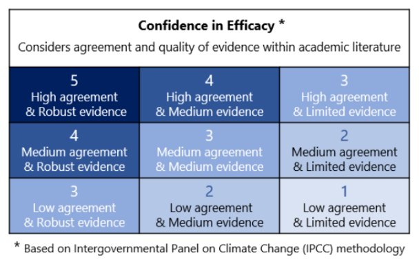
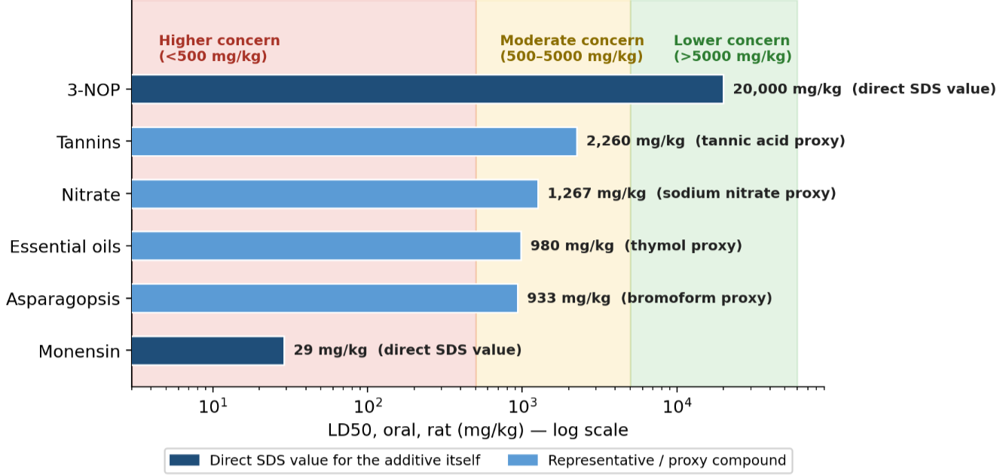
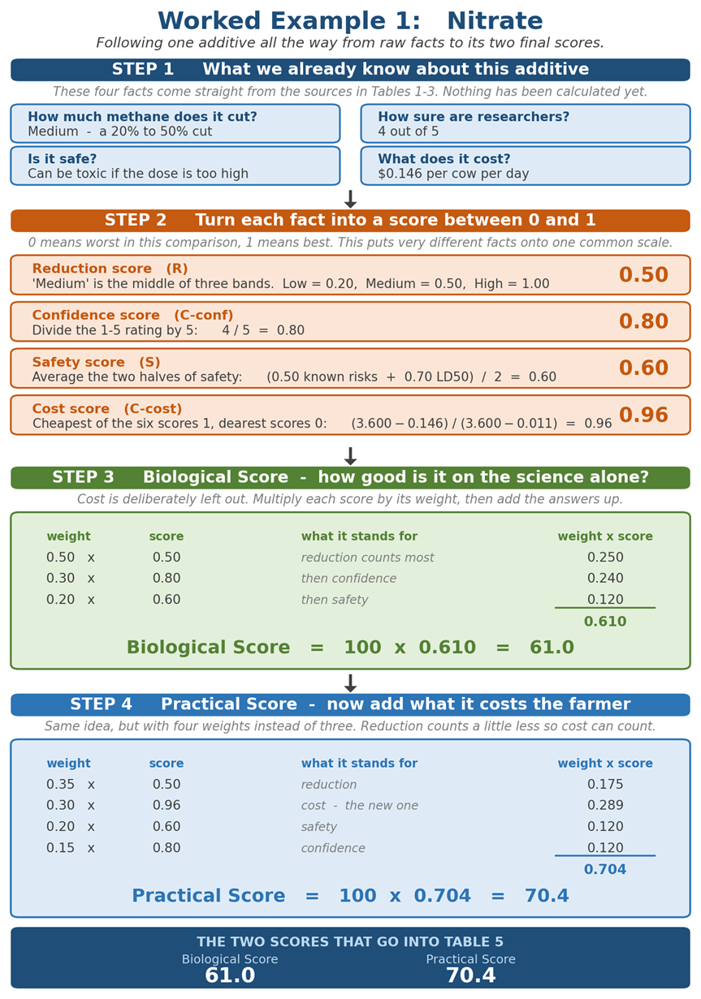
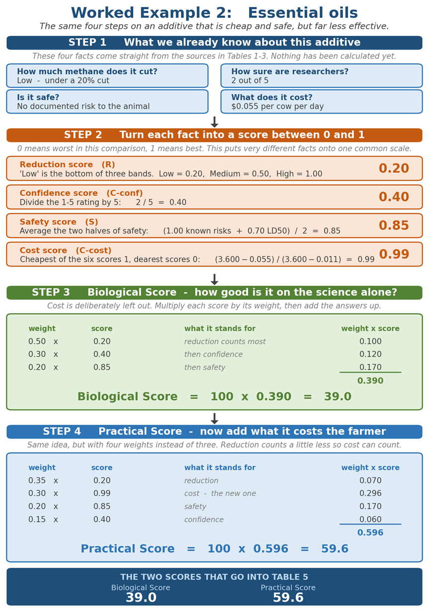
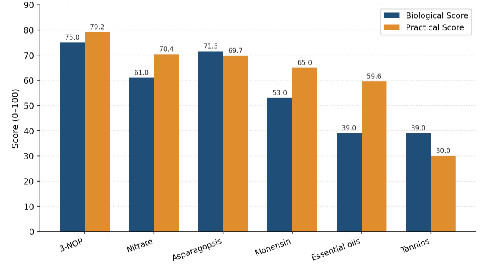

### Cattle Operations- Methane Mitigation Feed Additives: Methods and Results for Quantitative Scoring of Feed Additives

**Andrew Tulloch1 and Aaron Davitt1,2**

*1) Climate TRACE, 2) WattTime*

V5.11.0, Sept. 2026

#### 1. Introduction

Methane from cattle digestion is a major and comparatively fast-acting target for agricultural climate action. Methane (CH₄) from enteric fermentation traps more heat in the short term than CO₂. This report focuses specifically on interventions that reduce enteric methane produced during rumen digestion rather than methane arising from manure management.

Evidence on methane-reducing feed additives is currently spread across separate reviews, meta-analyses, product safety sheets, and market price sources, each reporting different measures in different units. This report brings those disparate sources together into a single consistent framework, with the aim of providing a consistent and transparent basis for identifying which feed additives are practical options for reducing methane from cattle.

Several approaches have been investigated to reduce enteric methane production, including changes in animal nutrition, selective breeding, microbial manipulation, vaccines, and chemical feed additives.

This project developed a framework to compare feed additive interventions for beef and dairy cattle. For this comparison, a feed additive is defined as a substance included in the diet in small quantities, typically well under 5% of dietary dry matter, to influence rumen fermentation, animal health, or performance, as distinct from bulk dietary ingredients such as forages, grains, or lipids, which make up much of the ration (Hegarty et al., 2021).

The comparison focused on six feed additive interventions identified from Hegarty et al. (2021):

-   **3-Nitrooxypropanol (3-NOP):** A human-made compound that blocks the last step of methane production in the rumen. It works by shutting down a key enzyme that methane-producing microbes (called methanogens) need to make methane. 3-NOP is one of the most heavily studied methane-blocking additives and has consistently lowered methane output in cattle (Yu et al., 2021).

-   ***Asparagopsis spp*.:** A red seaweed that naturally contains bromoform, a compound that blocks the same methane-making step as 3-NOP. Asparagopsis has produced some of the largest methane reductions of any additive tested, but it is still expensive, hard to grow and process at large scale, and researchers are still checking whether it leaves any trace behind in meat or milk.

-   **Nitrate:** A feed additive that competes with methanogens for hydrogen in the rumen. Normally, methanogens combine hydrogen with carbon dioxide to make methane; nitrate gives that hydrogen somewhere else to go instead, so less methane is made. Nitrate is relatively cheap and can meaningfully cut methane, but feeding too much too quickly can be toxic to the animal, so it must be introduced carefully. More specifically, if animals are not adapted, a by-product called nitrite can build up and reduce the blood’s ability to carry oxygen.

-   **Essential oils:** Natural compounds extracted from plants such as oregano, garlic, or cinnamon. They can change which microbes grow in the rumen and how those microbes break down feed. How much they reduce methane varies a lot depending on which plant they come from, how concentrated they are, and how they are prepared.

-   **Tannins:** Natural plant compounds, found in many trees and shrubs, that bind to proteins and can change how the rumen breaks down feed. They can also reduce the numbers of certain single-celled organisms (protozoa) living in the rumen, which may lower methane production. How well tannins work depends strongly on which type is used and how much is fed.

-   **Monensin:** A feed additive, from a class of antibiotics called ionophores, that changes which bacteria thrive in the rumen. It has long been used to help cattle convert feed into weight gain more efficiently, and as a side effect it can modestly lower methane production, though usually less than newer additives like 3-NOP.

Hegarty et al. (2021) and the other key methane mitigation reviews cited report efficacy, confidence, safety, and cost descriptively for each additive, but do not combine them into a single comparable score, and a highly effective additive is unlikely to be adopted if it is not economically feasible for beef and dairy cattle managers. To help close that gap, this project builds on Hegarty et al. (2021)'s efficacy and confidence ratings and adds several components not present in those reviews: LD₅₀ acute toxicity values, standardized daily doses and inclusion rates, cost assumptions on a per-cow-per-day basis, and the normalization steps needed to combine reduction, confidence, safety, and cost into a single comparative framework.

#### 2. Methods

#### 2.1 Data Source and Additive Selection

Feed additives were selected from Table 1 of Hegarty et al. (2021), which evaluates methane-inhibiting feed additives according to efficacy, safety, and applicability. This selection is consistent with the broader enteric methane mitigation literature: invited reviews by Beauchemin et al. (2022) and Fouts et al. (2022) similarly identify feed additives and rumen modifiers as primary methane-mitigation strategies, while Almeida et al. (2021) and Martins et al. (2024) provide supporting evidence for the methane-reducing potential of feed additives as a group, from live-animal and laboratory (test-tube) studies, respectively.

#### 2.1.1 Data Extraction and Standardization

For each feed-additive intervention, seven components were recorded. Components 1 to 3.2 are adapted from Hegarty et al. (2021); components 3.3, 4, and 5 were added in this work:

1\. **Methane reduction category**: Low, Medium, or High, drawn from the meta-analyses and reviews compiled for each additive (Table 1).

2\. **Confidence in efficacy**: a 1–5 rating of how well-supported that reduction estimate is (Figure 1).

3\. **Health and Safety:** Any documented risk the additive poses to animals, or to people through food products (Table 2).

3.1. **Animal welfare risk**: any documented adverse effect on the animal (e.g., toxicity, rumen irritation).

3.2. **Food safety risk**: any documented residue or human food-safety concern (e.g., bromide/iodine carry-over).

3.3. **LD₅₀ toxicity**: LD₅₀ is a standard toxicology measurement, the dose of a substance that would be lethal to 50% of a test population, used here to compare how dangerous different substances are. Values come from standard laboratory tests in rats, the usual benchmark for comparing chemicals, and are not cattle-specific. LD₅₀ safety was recorded where a usable value existed for the additive itself or a chemically similar stand-in compound.

4\. **Dose or inclusion rate**: standardized to a common daily amount.

5\. **Cost assumptions**: standardized to a cost per cow per day.

These additional components were added because acute toxicity, dose, and cost are important factors to communicate to beef and dairy managers. Dose and cost indicate how accessible an additive is to producers: the higher the daily cost, the lower the likely uptake. LD50 adds a standardized, quantitative measure of acute toxicity that complements the qualitative animal welfare and food safety categories.

#### 2.2 Methane Reduction Mapping

**Table 1.** Methane reduction category mapping.

| **Reduction Category** | **Reduction range**   | **Standardized Reduction Score** |
|------------------------|-----------------------|----------------------------------|
| Low                    | &lt;20% CH₄ reduction | 0.20                             |
| Medium                 | 20-50% CH₄ reduction  | 0.50                             |
| High                   | &gt;50% CH₄ reduction | 1.00                             |

Methane reduction categories were converted to scores using the mapping in Table 1. The scores form a categorical screening scale rather than a linear conversion of exact percentage reductions. The High category is deliberately scored twice as high as Medium because cuts above 50% represent a step-change in mitigation, while the Medium category covers a broad 20–50% range. The effect of these values on the rankings is tested in Section 3.2.

#### 2.3 Confidence in Efficacy

Confidence scores (**Cconf**) directly adopt the 1–5 evidence framework (based on IPCC ratings of agreement and evidence) described by Hegarty et al. (2021) and normalized to a 0–1 scale by dividing by five.

**Cconf = confidence score / 5** *Eq. 1*

**Figure 1.** Confidence in efficacy used to quantify how reliable each feed additive intervention is based on current academic literature. Adapted from Hegarty et al., 2021.

#### 2.4 Safety Scoring

Safety evaluation uses two qualitative safety inputs, animal welfare risk and food safety risk, and a quantitative LD50 toxicity measure (where an applicable value existed).

The qualitative safety inputs match each additive’s documented risk profile, from Hegarty et al. (2021) and the wider literature, to one of a small set of standard categories, shown in Table 2. Documented or potential risks lower the safety score, while “None known” receives the highest value (1.0). The animal welfare and food safety scores are averaged to give a single qualitative safety score: (Animal welfare score + Food safety score) / 2.

**Table 2.** Qualitative animal safety and food safety summary for feed-additives.

| **Feed additive(s)**                               | **Animal welfare risk**                                      | **Score** |
|----------------------------------------------------|--------------------------------------------------------------|-----------|
| 3-NOP, Monensin, Essential Oils, Tannins.          | None known                                                   | 1.0       |
| *Asparagopsis*                                     | Potential damage to rumen wall                               | 0.5       |
| Nitrate                                            | Potential toxicity in non-adapted animals                    | 0.0       |
| **Feed additive(s)**                               | **Food safety risk**                                         | **Score** |
| 3-NOP, Nitrate, Monensin, Essential Oils, Tannins. | None known                                                   | 1.0       |
| *Asparagopsis*                                     | Potential bromide & iodine residues in animal tissue/product | 0.0       |

LD50 values were grouped into three concern levels based on the United States Environmental Protection Agency’s standard acute oral toxicity categories (40 CFR §156.62; United States Environmental Protection Agency, 2024), which are broadly consistent with the United Nations Globally Harmonized System (GHS) (United Nations, 2023), as shown in Table 3 and Figure 2.

Table 3 converts each additive’s LD50 into a toxicity score. The first column gives the LD50 range, in milligrams of substance per kilogram of body weight of the standard test animal (rats); the second gives the level of concern that range represents; and the third gives the score used in *Eq. 2.* A higher LD50 means a larger dose is needed to cause harm, so it receives a higher (safer) score. Additives without an applicable LD50 are scored on qualitative safety only.

**Table 3.** Lethal Dose 50% toxicity scoring.

| **LD50 threshold value (mg/kg rat body weight)** | **Interpretation**      | **LD50 toxicity score** |
|-------------------------------------------------------------|-------------------------|------------------------------------|
| &gt;5000 mg/kg                                              | Lower concern           | 1.0                                |
| 500-5000 mg/kg                                              | Moderate concern        | 0.7                                |
| &lt;500 mg/kg                                               | Higher concern          | 0.3                                |
| No applicable LD50                               | Qualitative safety only | Not used                           |

**Figure 2.** LD50 values for the included feed-additives with an applicable toxicology reference, plotted against the three tiered acute toxicity bands defined in Table 3. Values are found in standard oral toxicity tests in rats, in mg of substance per kg of rat body weight and are not cattle-specific. Bars ending in the green band show lower concern; bars ending in the red band indicate higher concern.

LD50 (“Lethal dose, 50%”) is a toxicology measurement: the dose of a substance (expressed per kg of body weight) that would be expected to kill 50% of a test population after a single oral dose. LD50 is one of the most widely used screening indicators of how dangerous a substance can be. A higher LD50 value means a much larger dose is needed to reach a lethal (50%) threshold and indicates lower toxicity concern. A lower LD50 means a comparatively small dose can be dangerous or toxic and therefore indicates a higher concern. Figure 2 shows this in a single comparison. Each bar shows an additive’s LD50 in mg per kg of rat body weight on a log scale, with their values also shown directly on the graph. Bar colors indicate two separate evidence types: dark navy bars are direct Safety Data Sheet (SDS) values measured for the additive itself. Lighter blue bars use a representative or proxy compound (e.g. bromoform standing in for *Asparagopsis*) used where a compound-specific LD50 was not available. The shaded background bands mark the three concern categories defined in Table 3: red for high concern (&lt;500 mg/kg), yellow for moderate concern (500-5,000 mg/kg), and green for low concern (&gt;5,000 mg/kg).

As an example, 3-NOP has a directly reported Safety Data Sheet LD50 of 20,000 mg/kg, the highest value of any additive compared here. Because this exceeds the 5,000 mg/kg threshold, 3-NOP falls into the lower-concern band and receives an LD50 score of 1.0. Monensin sits at the opposite end of the same scale, with a directly reported LD50 of 29 mg/kg placing it in the higher-concern band and giving it a toxicity score of 0.3. The remaining additives fall between these two, in the moderate-concern band.

The overall safety score **S** is the mean of the qualitative safety score and the LD50 toxicity score. (where no applicable LD50 exists, **S** equals the qualitative safety score):

**S = (Qualitative safety score + LD50 toxicity score) / 2** *Eq. 2*

The qualitative safety score and LD₅₀ toxicity scores are weighted equally because they capture complementary aspects of safety. Qualitative scoring reflects documented animal welfare and food safety concerns under practical conditions, whereas LD₅₀ provides a standardized measure of acute chemical toxicity (from standard rat tests). As no established framework exists for assigning relative importance to these dimensions across diverse methane-mitigation feed additives, equal weighting does not prioritize either toxicological hazard or practical safety considerations and gives a balanced assessment suitable for comparing diverse feed additive classes for beef and dairy cattle operations.

#### 2.5 Dose and Cost Estimation

In addition to improving safety scoring metrics from previous literature, dose and cost estimates were added to reflect practical feasibility and the likelihood of adoption by producers of cattle products. Cost calculations are standardized to estimate the daily cost requirement of each feed additive intervention on a per-cow basis. Because additives are reported using different units (for example, mg/kg dry matter, g/day, or inclusion percentage), dose values were converted into a common daily amount before calculating cost.

Cost per cow per day was calculated using the following relationship:

**Cost per cow per day = Dose per cow per day × Unit cost (US\$/kg product)** *Eq. 3*

For feed additives the unit cost was expressed as United States Dollars per kilogram of finished product (US\$/kg). Here, "finished product" means the commercial product or benchmarked formulation used for the costing assumption, not the pure active ingredient alone.

A baseline dry matter intake (DMI) of 20 kilograms per day was assumed for feed-based calculations so that dose and cost could be standardized across feed-additive interventions. This value was chosen as a single representative reference point spanning the beef-and-dairy scope of the comparison: the baseline DMI approximates typical intake for a moderate-production lactating dairy cow (National Academies of Sciences, Engineering, and Medicine \[NASEM\], 2021) and is within the range reported for the heaviest, large-frame finishing beef cattle, though most finishing beef cattle at typical U.S. slaughter weights consume somewhat less (NASEM, 2016). It is also consistent with the dry-matter basis on which additive inclusion rates (g/kg of dry matter \[DM\], i.e. feed mass after water is removed, or % of DM) are reported (NASEM, 2021). Because a single DMI value cannot capture the full range of intake across production stages and cattle types, this is treated as a standardizing assumption rather than an animal-specific prediction (see Section 3.2).

Doses are reported on two different bases, which matters when the dry matter intake assumption is varied. Nitrate, *Asparagopsis*, monensin, and tannins are dosed as a share of dietary dry matter and therefore rescale when DMI changes, whereas 3-NOP and essential oils are dosed per head per day and do not. The effect of this is tested in Section 3.2.

Dose (kg/day) was calculated according to how each dose was reported. Doses reported in g/day were converted directly to kg/day; otherwise:

If reported as a percentage included in DMI, then:

**Dose (kg/day) = 20 kg/day (Assumed cattle DMI) × inclusion rate** *Eq. 4*

Where **inclusion rate** is the additive’s share of total dietary dry matter, expressed as a decimal fraction (e.g., 1% = 0.01), and 20 kg/day is the standardized DMI baseline described above.

If reported as a dietary concentration (mg/kg DM), then:

**Dose (kg/day) = \[Dose (mg/kg DM) × DMI\] / 10⁶ Eq. 5**

Where **DM (dry matter)** is feed mass after water content has been removed, the standard unit for expressing inclusion rates in cattle nutrition, and DMI is the 20 kg/day baseline defined above. Where a dose was reported as g/day, it was converted directly to kg/day.

Because direct market prices were not equally available for all feed-additive interventions, a tiered cost evidence framework was used: each cost input was labeled with one of five evidence types, defined in Table 4. The evidence type is a transparency label and does not change the score.

**Table 4.** Cost evidence tier summary based on evidence type.

| **Evidence type**        | **Definition**                                                                                                                                                                             |
|--------------------------|--------------------------------------------------------------------------------------------------------------------------------------------------------------------------------------------|
| Direct report anchor     | A cost figure stated explicitly in a peer-reviewed source or in Hegarty et al. (2021) (e.g., monensin \~US\$28/kg; nitrate \~US\$730/t).                                                   |
| Back-calculated estimate | A \$USD/kg (or \$USD/dose) figure derived indirectly by dividing a reported \$USD/cow/day or \$USD/head/day figure by the assumed daily dose (e.g., 3-NOP).                                |
| Retail proxy             | A current public retail price for a comparable commercial product, used where no research-reported price exists (e.g., tannin extracts, essential oil blends).                             |
| Commercial product proxy | Pricing benchmarked to a named commercial product in the same class, used where no market price exists for the studied compound itself (e.g., quebracho extract pricing used for tannins). |
| Midpoint proxy           | A central estimate used where multiple public price points span a wide range with no single clear anchor (e.g., tannins).                                                                  |

#### 2.6 Scoring and Ranking Framework

Two outputs were generated to evaluate different aspects of methane mitigation performance:

1.  **Biological Score:** evaluates the inherent mitigation value of each feed-additive intervention based on methane reduction, confidence in evidence, and safety.

2.  **Practical Score:** evaluates real-world implementation potential by incorporating methane reduction, cost, safety, and confidence in evidence.

The variables used in these equations represent:

-   **R:** methane reduction score

-   **Cconf:** confidence score

-   **S:** safety score

-   **Ccost:** normalized cost score

#### 2.7 Weighting Rationale

The scoring weights reflect the difference between evaluating scientific potential and evaluating practical adoption. For the biological score, more emphasis is placed on methane reduction because the purpose is to identify interventions with strong mitigation potential; cost is excluded so the score reflects potential in the absence of economic barriers (Eq. 6, 0.50 \[50%\] of Biological score for Reduction \[R\]), while confidence and safety were included to ensure that high-performing but poorly supported or unsafe interventions are not overvalued (Eq. 6, 0.30 \[30%\] for Confidence in evidence \[Cconf\] and 0.20 \[20%\] for Safety \[S\]).

The practical score included cost as an additional factor (Eq. 7, cost \[Ccost\] equating to 0.30 \[30%\]) because successful methane interventions must be economically feasible for beef and dairy cattle managers. The remaining weights were therefore rescaled to account for the added metric of cost, giving the practical score, Eq. 7, a reduction \[R\] score of 0.35 (35%), a cost \[Ccost\] score of 0.30 (30%), a safety \[S\] score 0.20 (20%), and a confidence \[Cconf\] score of 0.15 (15%) (see Section 3.2 for a test of how sensitive the rankings are to these weights).

#### 2.7.1 Biological Score

The biological score evaluated methane reduction potential independent of cost:

**Biological Score = 100 x (0.50R + 0.30Cconf + 0.20S)** *Eq. 6*

#### 2.7.2 Practical Score

The base practical score added cost (**Ccost**) to represent real-world feasibility:

**Practical Score = 100 x (0.35R + 0.30Ccost + 0.20S + 0.15Cconf)** *Eq. 7*

where Ccost is the normalized cost score, calculated using min-max normalization:

**Ccost = 1 - \[(Base cost/day - Minimum base cost/day) / (Maximum base cost/day - Minimum base cost/day)\]** *Eq. 8*

This assigns 1.0 to the lowest-cost intervention and 0.0 to the highest-cost intervention in the base-case comparison. Because min-max normalization is calculated only within the feed additive interventions included, cost scores and practical scores are relative to this specific dataset. Adding or removing a feed-additive intervention, or changing one major price assumption, would shift the normalized cost scores for the full table. Because cost evidence is uneven across intervention types, practical scores should be interpreted as scenario-based rankings rather than fixed market predictions.

#### 2.8 Worked Examples of Scoring Metrics

Figures 3 and 4 follow two additives through every step, from raw inputs to final scores. Nitrate and essential oils were chosen because they behave very differently: nitrate cuts more methane but costs more and carries a toxicity risk, while essential oils are cheap and safe but cut far less methane and rest on weaker evidence. Following both shows how our framework balances those trade-offs.

**Figure 3**. Worked example of the Nitrate feed-additive intervention. A step-by-step example, using values generated by the project framework, showing how the final scores are produced.

**Figure 4**. Step-by-step worked example for essential oils, following the same four steps as Figure 3. Comparing the two figures shows why a cheap, safe additive can still rank below a more expensive one: essential oils score higher than nitrate on safety and cost, but their lower reduction and confidence scores carry more weight in both totals.

#### 3. Results

Feed additives were ranked using two scores. The Biological Score excludes cost and reflects mitigation potential alone; the Practical Score, which adds cost, was used as the main “real-world” ranking because it includes methane reduction, cost, safety, and confidence.

**Table 5.** Biological and practical scores for each feed additive, sorted by practical score, with the CH4 reduction category.

| **Practical Rank** | **Feed Additive** | **Reduction Category** | **Biological Score** | **Practical Score** |
|--------------------|-------------------|------------------------|----------------------|---------------------|
| 1                  | 3-NOP             | Medium                 | 75.0                 | **79.2**            |
| 2                  | Nitrate           | Medium                 | 61.0                 | **70.4**            |
| 3                  | Asparagopsis      | High                   | 71.5                 | **69.7**            |
| 4                  | Monensin          | Low                    | 53.0                 | **65.0**            |
| 5                  | Essential oils    | Low                    | 39.0                 | **59.6**            |
| 6                  | Tannins           | Low                    | 39.0                 | **30.0**            |

**Figure 5.** Biological Scores (Blue) and Practical scores (Orange) for all feed-additive interventions, ranked using scores from Table 5.

#### 3.1 Biological Ranking and Practical Rankings

Using methane reduction, confidence, and safety alone, 3-NOP ranked highest with a biological score of 75.0. Under the current three-category framework, 3-NOP is categorized as Medium (20-50%) rather than High (&gt;50%), but its high confidence score and safety score kept it first overall. Asparagopsis ranked second biologically at 71.5. It was the only intervention assigned to the High (&gt;50%) methane reduction category, but its lower confidence score and the food-safety penalty for bromide and iodine residue concerns held its biological score below that of 3-NOP. Nitrate ranked third biologically at 61.0, followed by monensin at 53.0, with essential oils and tannins tied at 39.0.

When cost was included, 3-NOP remained the highest-ranked intervention with a base practical score of 79.2. Nitrate ranked second at 70.4 because it combined Medium methane reduction with comparatively low base cost/day. Asparagopsis ranked third at 69.7: despite being the only High (&gt;50%) methane reduction category, its higher cost, lower confidence, and safety penalty for bromide/iodine residue concerns kept it slightly below nitrate in the practical ranking. Monensin ranked fourth with a practical score of 65.0, followed by essential oils at 59.6, and tannins at 30.0.

Overall, the scoring system shows that 3-NOP remains the strongest balanced feed-additive intervention under the practical score. Asparagopsis has the strongest methane reduction category but is limited by cost, safety, and confidence constraints. Nitrate is a potential lower-cost alternative, although its safety concerns and its sensitivity to the assumed dose (see Section 3.2) are important.

The two scores can rank the same additive differently because they weigh the inputs differently (*Eq. 6* and *Eq. 7*). The Biological score gives methane reduction half of the total weight (0.50) and confidence 0.30 while ignoring cost altogether. The Practical Score lowers these to 0.35 and 0.15 so that cost can carry a 0.30 weight. Additives that are inexpensive relative to the others therefore gain on the Practical Score: nitrate rises from 61.0 to 70.4 (third to second). Monensin from 53.0 to 65.0 and essential oils from 39.0 to 59.6. *Asparagopsis*, which leads to reduction but is costly, falls from 71.5 to 69.7 (second to third). The best example shown is the comparison of essential oils and tannins, which have identical reduction, confidence and safety scores and tie at 39.0 on the Biological Score but separate by 29.6 points on the Practical scores because of the high estimated daily cost.

#### 3.2 Sensitivity Analysis

A weight sensitivity analysis allows for the resulting practical scores to be recalculated under base, cost-emphasis, reduction-emphasis, safety/confidence-emphasis, and equal-weight scenarios. Biological scores, similarly, are recalculated under base, reduction-emphasis, confidence/safety-emphasis, and equal weight scenarios. This analysis tests whether rankings depend strongly on the selected weights rather than on the underlying evidence inputs themselves (Table 6).

Each scenario uses the same equations as the base case (*Eq.6* and *Eq. 7*) with only the weights changed. Shifting weight toward one dimension to test whether it drives the ranking. For the Practical Score, the cost-emphasis scenario (reduction 0.25, cost 0.40, safety 0.20, confidence 0.15) tests whether low-cost additives can overtake more effective ones; reduction-emphasis (0.50, 0.20, 0.15, 0.15) tests whether the High reduction category dominates; safety/confidence-emphasis (0.30, 0.20, 0.25, 0.25) tests whether well-evidenced, safe additives rise; and equal weights (0.25 each) provide a neutral comparison with no dimension favored. The Biological score was tested in the same way under reduction emphasis, confidence/safety-emphasis, and near-equal weights. Scores and ranks for all six additives under every scenario are given in Tables 7 and 8, and Table 6 summarizes the top two under each practical scenario. Across the scenarios, 3-NOP ranks first in all but the reduction-emphasis scenarios, nitrate ranks second in four of the five practical scenarios, tannins rank last in every scenario. Asparagopsis shows the widest range, from first to fifth, because it combines the only High reduction category with high cost and low confidence.

The weight sensitivity analysis shows the top rankings are generally stable, but not completely fixed. In the practical score, 3-NOP remains first under the base, cost-emphasis, safety/confidence-emphasis, and equal-weight scenarios. When methane reduction is weighted most heavily, Asparagopsis moves into first place because it is the only intervention assigned to the High (&gt;50%) reduction category. Nitrate remains consistently near the top of the practical rankings, but its position depends partly on the nitrate dose and cost assumptions.

The biological sensitivity analysis shows a similar pattern. 3-NOP remains first under the base, confidence/safety-emphasis, and equal weight biological scenarios, while Asparagopsis ranks first when methane reduction is given the strongest weighting. This indicates that the framework is reasonably robust for identifying 3-NOP and nitrate as strong practical options, but that the exact ordering of 3-NOP and Asparagopsis depends on how heavily methane reduction is weighted.

The reduction scores of 0.20, 0.50, and 1.00 are assigned rather than measured, so alternative values were also tested. Spacing the three bands evenly (0.20, 0.60, 1.00), which is equivalent to using the band midpoints (10%, 35%, and 60% methane reduction) rescaled to the same range, produced the same biological and practical rankings as the assigned values. Applying the midpoints without rescaling narrows the range of the reduction score and so reduces its contribution to the total; under this scoring, Asparagopsis moves from third to fifth on the practical score and from second to third on the biological score, an effect similar to down-weighting reduction in the weight sensitivity analysis above. 3-NOP remained first in every case.

Dry matter intake was also varied. A single intake of 20 kg/day is applied to both beef and dairy cattle, although finishing beef cattle typically consume less. Recalculation at 12 kg/day, a representative finishing-beef intake, leaves the practical ranking unchanged. Only two additives shift, 3-NOP by 2.2 points and essential oils by 0.3 points, because they are dosed per animal rather than as a share of dietary dry matter, so their daily cost is unaffected while the costs of the remaining four decrease. Intakes from 20 down to 6 kg/day were tested, and none altered the ranking. The ranking is therefore insensitive to this assumption, but the cost figures themselves are not: the cost per cow per day reported here reflects the 20 kg/day baseline described in Section 2.1.1.

The nitrate dose was also tested. Nitrate is costed at 1% of dietary dry matter, but trials suggest that a Medium (20-50%) reduction generally requires about 2% (Olijhoek et al., 2016). Costing nitrate at 2% doubles its daily cost and lowers its Practical score from 70.4 to 69.2, moving it from second to third, 0.5 points behind *Asparagopsis*; its Biological Score remains unchanged due to Cost not having an effect. Nitrate keeps second place up to inclusion rates of about 1.5%. 3-NOP remains first, and nitrate remains one of the lower-cost additives.

**Table 6.** Summary of practical score weight sensitivity scenarios with general interpretations of how the dataset trends.

| **Weight sensitivity Scenario** | **Top ranked** | **Runner-up** | **Interpretation**                                                               |
|---------------------------------|----------------|---------------|----------------------------------------------------------------------------------|
| Base practical                  | 3-NOP          | Nitrate       | Default ranking.                                                                 |
| Cost-emphasis                   | 3-NOP          | Nitrate       | Lower-cost interventions improve but do not overtake 3-NOP.                      |
| Reduction-emphasis              | *Asparagopsis* | 3-NOP         | High reduction category feed-additive interventions dominate.                    |
| Safety/confidence-emphasis      | 3-NOP          | Nitrate       | Strong evidence and safety keep 3-NOP first. More studied interventions improve. |
| Equal-weight                    | 3-NOP          | Nitrate       | All metrics are given equal weights. Ranking matches the base case.              |

**Table 7.** Practical Scores (rank in brackets) for all six feed additives under each weight sensitivity scenario. Weights are listed as reduction / cost / safety / confidence.

<table><tbody><tr class="odd"><td><strong>Feed additive</strong></td><td><strong>Base 
(0.35 / 0.30 / 0.20 / 0.15)</strong></td><td><strong>Cost-emphasis 
(0.25 / 0.40 / 0.20 / 0.15)</strong></td><td><strong>Reduction-emphasis 
(0.50 / 0.20 / 0.15 / 0.15)</strong></td><td><strong>Safety/confidence-emphasis 
(0.30 / 0.20 / 0.25 / 0.25)</strong></td><td><strong>Equal weights 
(0.25 each)</strong></td></tr><tr class="even"><td>3-NOP</td><td>79.2 (1)</td><td>83.2 (1)</td><td>72.8 (2)</td><td>82.8 (1)</td><td>84.8 (1)</td></tr><tr class="odd"><td>Nitrate</td><td>70.4 (2)</td><td>75.0 (2)</td><td>65.2 (3)</td><td>69.2 (2)</td><td>71.6 (2)</td></tr><tr class="even"><td>Asparagopsis</td><td>69.7 (3)</td><td>66.1 (5)</td><td>75.9 (1)</td><td>64.7 (4)</td><td>62.9 (4)</td></tr><tr class="odd"><td>Monensin</td><td>65.0 (4)</td><td>73.0 (3)</td><td>54.8 (4)</td><td>67.2 (3)</td><td>71.2 (3)</td></tr><tr class="even"><td>Essential oils</td><td>59.6 (5)</td><td>67.5 (4)</td><td>48.5 (5)</td><td>57.0 (5)</td><td>60.9 (5)</td></tr><tr class="odd"><td>Tannins</td><td>30.0 (6)</td><td>28.0 (6)</td><td>28.7 (6)</td><td>37.2 (6)</td><td>36.3 (6)</td></tr></tbody></table>

**Table 8.** Biological Scores (rank in brackets) for all six feed additives under each weight sensitivity scenario. Weights are listed as reduction / confidence / safety. Essential oils and tannins have identical biological inputs and are tied (=) in every scenario.

<table><tbody><tr class="odd"><td><strong>Feed additive</strong></td><td><strong>Base 
(0.50 / 0.30 / 0.20)</strong></td><td><strong>Reduction-emphasis 
(0.60 / 0.25 / 0.15)</strong></td><td><strong>Confidence/safety-emphasis 
(0.40 / 0.35 / 0.25)</strong></td><td><strong>Near-equal weights 
(0.34 / 0.33 / 0.33)</strong></td></tr><tr class="even"><td>3-NOP</td><td>75.0 (1)</td><td>70.0 (2)</td><td>80.0 (1)</td><td>83.0 (1)</td></tr><tr class="odd"><td>Nitrate</td><td>61.0 (3)</td><td>59.0 (3)</td><td>63.0 (3)</td><td>63.2 (2)</td></tr><tr class="even"><td>Asparagopsis</td><td>71.5 (2)</td><td>77.1 (1)</td><td>65.9 (2)</td><td>62.9 (3)</td></tr><tr class="odd"><td>Monensin</td><td>53.0 (4)</td><td>46.8 (4)</td><td>59.2 (4)</td><td>61.3 (4)</td></tr><tr class="even"><td>Essential oils</td><td>39.0 (5=)</td><td>34.8 (5=)</td><td>43.2 (5=)</td><td>48.1 (5=)</td></tr><tr class="odd"><td>Tannins</td><td>39.0 (5=)</td><td>34.8 (5=)</td><td>43.2 (5=)</td><td>48.1 (5=)</td></tr></tbody></table>

#### 3.3 Application to Climate TRACE Cattle Operation Sector

The six feed additive emission reduction solutions (ERSs) are applied to each individual cattle operation, by cattle type, in the document [*Cattle Operations- Asset-level Enteric Fermentation and Manure Management Emissions*](https://github.com/climatetracecoalition/emissions-methodology/tree/main/Sector-Methodologies/1-Sectors/agriculture/cattle-operations-asset-level). They are 3-NOP (Bovaer), Asparagopsis seaweed, nitrate, tannins, monensin and essential oils (Agolin). Each was applied as a separate strategy and classified as a retrofit, meaning a change to the practices of an existing operation.

Each strategy carries a ratio of the new CH₄ emission factor to the current one, applied separately to beef and dairy cattle. Reductions vary widely by additive and by cattle type. Methane reduction potential for each additive was determined by comparing methane production before (control) and after (treatment) dosing. Where a study tested low, medium and high doses, the measured reductions were combined into a single value. The sources for each additive are: tannins (Caetano et al., 2019; Aboagye et al., 2019; Perna Junior et al., 2020; Fagundes et al., 2020; Williams et al., 2020b; Magnani et al., 2023; Carrazco et al., 2025); nitrate (Feng et al., 2020); monensin (Appuhamy et al., 2013; Cooke et al., 2024); essential oils (Agolin) (Castro-Montoya et al., 2015; Klop et al., 2017; Hart et al., 2019; Belanche et al., 2020; Carrazco et al., 2020); 3-NOP (Bovaer) (MLA, 2022; Almeida et al., 2023; MLA, 2024; Johansen et al., 2025; Ma, 2026); and Asparagopsis seaweed (Roque et al., 2021; Angellotti et al., 2025) \[Asparagopsis sources proposed by the reviewer; authors to confirm\].

#### 4. Discussion and Conclusions

By combining methane reduction, confidence, safety and cost into two scores, this framework allows six very different feed additives to be compared on the same terms.

Across both scores, 3-NOP came out on top. It combines a reliably documented, moderate level of methane reduction with strong evidence and a clean safety profile, and it remained top-ranked under most weighting scenarios; only when methane reduction was weighted most heavily did *Asparagopsis* rank first. Asparagopsis had the single highest reduction potential of any additive in this comparison, but its practical score was held back by its higher cost, thinner evidence base, and open questions about bromide and iodine residues. Nitrate landed as a strong middle-ground option: its reduction is more modest than Asparagopsis’s, but its low cost and reasonably good evidence keep it near the top of the practical ranking, provided the toxicity risk from over-dosing is properly managed. However, this ranking assumes nitrate is fed at 1% of dietary dry matter, while published trials suggest that methane reductions in the Medium range (20-50%) generally require higher doses (Olijhoek et al., 2016); at that dose nitrate ranks third on the Practical Score (Section 3.2). Monensin, essential oils, and tannins trailed behind on both scores, reflecting their smaller methane reductions and, for essential oils and tannins, a weaker evidence base.\[1\]

This framework is a comparative screening tool, not a formal economic, toxicological, or life-cycle emissions model, and its results should be read with several limitations in mind. It assesses enteric methane only, and does not account for emissions from producing, transporting, or feeding the additives themselves, or for downstream nutrient effects. Methane reduction was also standardized into three broad bands rather than additive-specific percentages. That choice makes very different studies comparable, but it trades away precision: any two additives placed in the same band receive the same reduction score even where their underlying trial results differ. Alternative reduction scores were tested in Section 3.2, and 3-NOP remained first in every case, indicating that the choice of band values affects how finely additives are separated more than which additive ranks highest.

The inputs carry their own uncertainties. Cost evidence is uneven across additives: some figures come from directly reported prices, while others are estimated from related products, so the practical score should be read as a reasonable starting point for comparison rather than a fixed prediction of what any one farm will pay. Because cost is normalized against the cheapest and most expensive additive in this comparison, adding, removing, or repricing an additive would shift the cost scores for the whole table. The single 20 kg/day dry matter intake overstates daily costs for finishing beef cattle, although lower intakes did not change the ranking (Section 3.2). Four of the six LD50 values also come from a representative compound rather than the exact commercial formulation, and LD50 reflects the pure compound rather than the amount fed, so it may overstate the risk of additives typically fed in very small doses.

Finally, the reduction and confidence scores summarize what published studies report today, mostly from shorter feeding trials. They do not directly capture whether that mitigation holds up over months or years of commercial use. Hegarty et al. (2021) note that for 3-NOP specifically, efficacy has declined over time at lower doses in some trials, and whether methanogens (methane-producing microbes) in the rumen (largest compartment of a cow’s stomach, where feed is fermented) adapt to sustained exposure to any of these additives is still not fully settled. Longer, farm-scale studies would help confirm whether the reduction categories used in this framework hold up under everyday feeding conditions.

Probiotics and direct fed microbials, along with methane vaccines, represent a further set of approaches worth tracking as this framework develops. Both are earlier in their development than the six additives compared here, and the published evidence for their methane-reducing effect is more mixed. As more field data on their cost, dosing, and real-world performance becomes available, they are a natural next addition to this scoring framework.

The results point to a practical hierarchy for beef and dairy managers weighing methane-reducing feed additives today: 3-NOP offers the best overall balance of proven reduction, safety, and evidence; nitrate may be a lower-cost alternative where toxicity risk can be managed, although its ranking is sensitive to the dose assumed; and Asparagopsis remains the additive with the highest ceiling on methane reduction, but is currently the hardest to justify on cost and safety grounds alone. As with any screening tool, these rankings are a starting point for further evaluation, not a substitute for additive-specific due diligence before adoption. Despite these limitations, the framework provides a transparent, reproducible way to compare feed additives under consistent biological, safety and cost assumptions, and it can be updated as new evidence on their efficacy, cost and safety becomes available.

#### 5. Supplemental Section

Public price, product, and SDS URLs used for the cost and LD₅₀ assumptions are documented directly in the Sources sheet of the original dataset. These inputs were used as market or toxicology proxies where peer-reviewed price or product-specific LD₅₀ values were unavailable and full sources are available upon request.

**Table S1.** Source key for each feed-additive, showing the main source supporting each scored input. Journal and report sources appear in full in the reference list.

| **Feed Additive** | **Reduction & confidence**              | **Dose**                                          | **Cost**                                                                                                                                                        | **LD₅₀**                                                                                                                             |
|-------------------|-----------------------------------------|---------------------------------------------------|-----------------------------------------------------------------------------------------------------------------------------------------------------------------|--------------------------------------------------------------------------------------------------------------------------------------|
| 3-NOP             | Hegarty et al. (2021); Yu et al. (2021) | https://pmc.ncbi.nlm.nih.gov/articles/PMC8697901/ | Back-calculated estimate: https://dellait.com/bovaer-friend-or-foe-in-the-fight-against-methane-dellait/                                                        | Direct SDS value: https://public.spheracloud.net/Pdf/MsdsIAImages/OUYeci1CjEOvvuyFhF9bJQ.PDF                                         |
| Nitrate           | Hegarty et al. (2021)                   | Lee and Beauchemin (2014)                         | Report anchor (Hegarty et al., 2021) + retail proxy: https://gardenfx.ca/products/calcium-nitrate-25kg                                                          | Representative compound (nitrate salt): https://tsapps.nist.gov/srmext/msds/8569-MSDS.pdf                                            |
| Asparagopsis      | Hegarty et al. (2021)                   | Eason and Fennessy (2025)                         | Report anchor (Hegarty et al., 2021) + market proxy: https://www.thebullvine.com/news/this-red-seaweed-could-bank-you-200-per-cow-but-are-you-ready-to-dive-in/ | Representative compound (bromoform): https://www.spectrumchemical.com/media/sds/B1155\_AGHS.pdf                                      |
| Monensin          | Hegarty et al. (2021)                   | Rezaei Ahvanooei et al. (2024)                    | Report anchor (Hegarty et al., 2021) + retail proxy: https://extension.illinois.edu/beef-cattle/feed-additives                                                  | Direct SDS value: https://assets.elanco.com/7eafa302-37b3-00f8-2e74-bb902d1a0ba2/03f0c351-522c-4941-a337-5224ab5f638e/R100%20sds.pdf |
| Essential oils    | Hegarty et al. (2021)                   | Belanche et al. (2020)                            | Retail proxy / benchmark: https://www.feedstuffs.com/agribusiness-news/feedworks-usa-launches-agolin-ruminant                                                   | Representative compound (thymol): https://www.spectrumchemical.com/media/sds/T1050\_AGHS.pdf                                         |
| Tannins           | Hegarty et al. (2021)                   | Souza et al. (2026)                               | Retail proxy: https://www.verifiedmarketreports.com/product/quebracho-extract-market/                                                                           | Representative compound (tannic acid): https://www.aurochemicals.com/wp-content/uploads/2019/03/TANNIC-ACID-Natural-SDS.pdf          |

#### References

1.  Aboagye, I.A., Oba, M., Koenig, K.M., Zhao, G.Y. and Beauchemin, K.A. (2019) 'Use of gallic acid and hydrolyzable tannins to reduce methane emission and nitrogen excretion in beef cattle fed a diet containing alfalfa silage', Journal of Animal Science, 97(5), pp. 2230–2244. Available at: https://doi.org/10.1093/jas/skz101.

2.  Almeida, A.K., Cowley, F., McMeniman, J.P., Karagiannis, A., Walker, N., Tamassia, L.F., McGrath, J.J. and Hegarty, R.S. (2023) 'Effect of 3-nitrooxypropanol on enteric methane emissions of feedlot cattle fed with a tempered barley-based diet with canola oil', Journal of Animal Science, 101, skad237. Available at: https://doi.org/10.1093/jas/skad237.

3.  Almeida, A.K., Hegarty, R.S. and Cowie, A. (2021) ‘Meta-analysis quantifying the potential of dietary additives and rumen modifiers for methane mitigation in ruminant production systems’, Animal Nutrition, 7(4), pp. 1219–1230. Available at: https://doi.org/10.1016/j.aninu.2021.09.005.

4.  Angellotti, M., Lindberg, M., Ramin, M., Krizsan, S.J. and Danielsson, R. (2025) 'Asparagopsis taxiformis supplementation to mitigate enteric methane emissions in dairy cows — effects on performance and metabolism', Journal of Dairy Science, 108(3), pp. 2503–2516. Available at: https://doi.org/10.3168/jds.2024-25258.

5.  Appuhamy, J.A.D.R.N., Strathe, A.B., Jayasundara, S., Wagner-Riddle, C., Dijkstra, J., France, J. and Kebreab, E. (2013) 'Anti-methanogenic effects of monensin in dairy and beef cattle: a meta-analysis', Journal of Dairy Science, 96(8), pp. 5161–5173. Available at: https://doi.org/10.3168/jds.2012-5923.

6.  Beauchemin, K.A., Ungerfeld, E.M., Abdalla, A.L., Alvarez, C., Arndt, C., Becquet, P., Benchaar, C., Berndt, A., Mauricio, R.M., McAllister, T.A., Oyhantçabal, W., Salami, S.A., Shalloo, L., Sun, Y., Tricarico, J., Uwizeye, A., De Camillis, C., Bernoux, M., Robinson, T. and Kebreab, E. (2022) ‘Invited review: Current enteric methane mitigation options’, Journal of Dairy Science, 105(12), pp. 9297–9326. Available at: https://doi.org/10.3168/jds.2022-22091.

7.  Belanche, A., Newbold, C.J., Morgavi, D.P., Bach, A., Zweifel, B. and Yáñez-Ruiz, D.R. (2020) 'A meta-analysis describing the effects of the essential oils blend Agolin Ruminant on performance, rumen fermentation and methane emissions in dairy cows', Animals, 10(4), p. 620. Available at: https://doi.org/10.3390/ani10040620.

8.  Caetano, M., Wilkes, M.J., Pitchford, W.S., Lee, S.J. and Hynd, P.I. (2019) 'Effect of ensiled crimped grape marc on energy intake, performance and gas emissions of beef cattle', Animal Feed Science and Technology, 247, pp. 166–172. Available at: https://doi.org/10.1016/j.anifeedsci.2018.10.007.

9.  Carrazco, A.V., Peterson, C.B., Zhao, Y., Pan, Y., McGlone, J.J., DePeters, E.J. and Mitloehner, F.M. (2020) 'The impact of essential oil feed supplementation on enteric gas emissions and production parameters from dairy cattle', Sustainability, 12(24), 10347. Available at: https://doi.org/10.3390/su122410347.

10. Carrazco, A.V., Rocha, A.S., Ross, E.G., Zhao, Y., Pan, Y., Pandey, P.K., Castillo, A.R., DePeters, E.J. and Mitloehner, F.M. (2025) 'Effect of a tannin and saponin blend feed additive on greenhouse gas and ammonia emissions from lactating dairy cows', Journal of Dairy Science, 108(8), pp. 8582–8593. Available at: https://doi.org/10.3168/jds.2025-26410.

11. Castro-Montoya, J., Peiren, N., Cone, J.W., Zweifel, B., Fievez, V. and De Campeneere, S. (2015) 'In vivo and in vitro effects of a blend of essential oils on rumen methane mitigation', Livestock Science, 180, pp. 134–142. Available at: https://doi.org/10.1016/j.livsci.2015.08.010.

12. Cooke, R.F., Eloy, L.R., Bosco, S.C., Lasmar, P.V.F., de Simas, J.M.C., Leiva, T. and de Medeiros, S.R. (2024) 'An updated meta-analysis of the anti-methanogenic effects of monensin in beef cattle', Translational Animal Science, 8, txae032. Available at: https://doi.org/10.1093/tas/txae032.

13. Eason, C.T. and Fennessy, P.F. (2025) 'Methane reduction, health and regulatory considerations regarding *Asparagopsis* and bromoform for ruminants', New Zealand Journal of Agricultural Research, 68(1), pp. 1–30. Available at: https://doi.org/10.1080/00288233.2023.2248948.

14. Fagundes, G.M., Benetel, G., Welter, K.C., Melo, F.A., Muir, J.P., Carriero, M.M., Souza, R.L.M., Meo-Filho, P., Frighetto, R.T.S., Berndt, A. and Bueno, I.C.S. (2020) 'Tannin as a natural rumen modifier to control methanogenesis in beef cattle in tropical systems: friend or foe to biogas energy production?', Research in Veterinary Science, 132, pp. 88–96. Available at: https://doi.org/10.1016/j.rvsc.2020.05.010.

15. Feng, X.Y., Dijkstra, J., Bannink, A., van Gastelen, S., France, J. and Kebreab, E. (2020) 'Antimethanogenic effects of nitrate supplementation in cattle: a meta-analysis', Journal of Dairy Science, 103(12), pp. 11375–11385. Available at: https://doi.org/10.3168/jds.2020-18541.

16. Fouts, J.Q., Honan, M.C., Roque, B.M., Tricarico, J.M. and Kebreab, E. (2022) ‘Enteric methane mitigation interventions’, Translational Animal Science, 6(2), txac041. Available at: https://doi.org/10.1093/tas/txac041.

17. Hart, K.J., Jones, H.G., Waddams, K.E., Worgan, H.J., Zweifel, B. and Newbold, C.J. (2019) 'An essential oil blend decreases methane emissions and increases milk yield in dairy cows', Open Journal of Animal Sciences, 9(3), pp. 259–267. Available at: https://doi.org/10.4236/ojas.2019.93022.

18. Hegarty, R.S., Cortez Passetti, R.A., Dittmer, K.M., Wang, Y., Shelton, S., Emmet-Booth, J., Wollenberg, E., McAllister, T., Leahy, S., Beauchemin, K. and Gurwick, N. (2021) An evaluation of emerging feed additives to reduce methane emissions from livestock. Edition 1. Climate Change, Agriculture and Food Security (CCAFS), New Zealand Agricultural Greenhouse Gas Research Centre (NZAGRC) and the Global Research Alliance (GRA). Available at: https://hdl.handle.net/10568/116489.

19. Johansen, M., Maigaard, M. and Lund, P. (2025) 'Effect of Bovaer inclusion in rations with high proportion of corn silage harvested with different stubble height on production performance and gas emission in dairy cows', Animal Feed Science and Technology, 329, 116512. Available at: https://doi.org/10.1016/j.anifeedsci.2025.116512.

20. Klop, G., Dijkstra, J., Dieho, K., Hendriks, W.H. and Bannink, A. (2017) 'Enteric methane production in lactating dairy cows with continuous feeding of essential oils or rotational feeding of essential oils and lauric acid', Journal of Dairy Science, 100(5), pp. 3563–3575. Available at: https://doi.org/10.3168/jds.2016-12033.

21. Lee, C. and Beauchemin, K.A. (2014) 'A review of feeding supplementary nitrate to ruminant animals: nitrate toxicity, methane emissions, and production performance', Canadian Journal of Animal Science, 94(4), pp. 557–570. Available at: https://doi.org/10.4141/cjas-2014-069.

22. Ma, X. (2026) Integrating dietary mitigation strategies, manure emissions, and measurement techniques for on-farm methane assessment in dairy cattle. Doctoral dissertation. ETH Zurich.

23. Magnani, E., Silva, T.H., Sakamoto, L.S., Manella, M.Q., Dias, F.M.G.N., Mercadante, M.E.Z., Henry, D.H., Marcatto, J.O.S., Paula, E.M. and Branco, R.H. (2023) 'Tannin-based product in feedlot diet as a strategy to reduce enteric methane emissions of Nellore cattle finished under tropical conditions', Translational Animal Science, 7(1), txad048. Available at: https://doi.org/10.1093/tas/txad048.

24. Martins, L.F., Cueva, S.F., Lage, C.F.A., Ramin, M., Silvestre, T., Tricarico, J. and Hristov, A.N. (2024) ‘A meta-analysis of methane-mitigation potential of feed additives evaluated in vitro’, Journal of Dairy Science, 107(1), pp. 288–300. Available at: https://doi.org/10.1016/S0022-0302(23)00819-6.

25. Meat & Livestock Australia (2022) Methane emissions of Australian feedlot cattle as influenced by 3-nitrooxypropanol (Bovaer-10). Available at: https://www.mla.com.au/research-and-development/reports/2021/methane-emissions-of-australian-feedlot-cattle-as-influenced-by-3-nitrooxypropanol-bovaer-102/ (Accessed: 4 September 2026).

26. Meat & Livestock Australia (2024) B.FLT.5015 — Reducing emissions of backgrounded cattle: combining Bovaer®10 with supplementation to reduce methane and increase productivity. Available at: https://www.mla.com.au/research-and-development/reports/2024/b.flt.5015---reducing-emissions-of-backgrounded-cattle---combining-bovaer10-with-supplementation-to-reduce-methane-and-increase-productivity/ (Accessed: 4 September 2026).

27. National Academies of Sciences, Engineering, and Medicine (2016) *Nutrient Requirements of Beef Cattle: Eighth Revised Edition*. Washington, DC: The National Academies Press. Available at: https://doi.org/10.17226/19014.

28. National Academies of Sciences, Engineering, and Medicine (2021) *Nutrient Requirements of Dairy Cattle: Eighth Revised Edition*. Washington, DC: The National Academies Press. Available at: https://doi.org/10.17226/25806.

29. Olijhoek, D.W., Hellwing, A.L.F., Brask, M., Weisbjerg, M.R., Højberg, O., Larsen, M.K., Dijkstra, J., Erlandsen, E.J. and Lund, P. (2016) 'Effect of dietary nitrate level on enteric methane production, hydrogen emission, rumen fermentation, and nutrient digestibility in dairy cows', Journal of Dairy Science, 99(8), pp. 6191–6205. Available at: https://doi.org/10.3168/jds.2015-10691.

30. Perna Junior, F., Zapata Vásquez, D.C., Gardinal, R., Meyer, P.M., Berndt, A., Frighetto, R.T.S., Demarchi, J.J.A.A. and Rodrigues, P.H.M. (2020) 'Short-term use of monensin and tannins as feed additives on digestibility and methanogenesis in cattle', Revista Brasileira de Zootecnia, 49, e20190098. Available at: https://doi.org/10.37496/rbz4920190098.

31. Rezaei Ahvanooei, M.R., Norouzian, M.A., Piray, A.H., Vahmani, P. and Ghaffari, M.H. (2024) 'Effects of monensin supplementation on rumen fermentation, methane emissions, nitrogen balance, and metabolic responses of dairy cows: A systematic review and dose-response meta-analysis', Journal of Dairy Science, 107(1), pp. 607–624. Available at: https://doi.org/10.3168/jds.2023-23441.

32. Roque, B.M., Venegas, M., Kinley, R.D., de Nys, R., Duarte, T.L., Yang, X. and Kebreab, E. (2021) 'Red seaweed (Asparagopsis taxiformis) supplementation reduces enteric methane by over 80 percent in beef steers', PLOS ONE, 16(3), e0247820. Available at: https://doi.org/10.1371/journal.pone.0247820.

33. Souza, V.C., Almeida, K.V., Rosenstein, P.K., Desrues, O., Panciroli, N. and Kebreab, E. (2026) ‘Impact of tannin-based additives on animal performance and enteric methane emissions in dairy and beef cattle: A meta-analysis’. Journal of Dairy Science, 109(3), pp. 2383-2399. Available at: https://doi.org/10.3168/jds.2025-27254.

34. United Nations (2023) Globally Harmonized System of Classification and Labelling of Chemicals (GHS). 10th revised edn. New York and Geneva: United Nations. Available at: https://unece.org/transport/dangerous-goods/ghs-rev10-2023.

35. United States Environmental Protection Agency (2024) 40 CFR §156.62 Toxicity Category. Washington, DC: U.S. Environmental Protection Agency. Available at: https://www.ecfr.gov/current/title-40/chapter-I/subchapter-E/part-156/subpart-H/section-156.62.

36. Williams, S.R.O., Hannah, M.C., Eckard, R.J., Wales, W.J. and Moate, P.J. (2020b) 'Supplementing the diet of dairy cows with fat or tannin reduces methane yield, and additively when fed in combination', Animal, 14(S3), pp. s464–s472. Available at: https://doi.org/10.1017/S1751731120001032.

37. Yu, G., Beauchemin, K.A. and Dong, R. (2021) ‘A review of 3-nitrooxypropanol for enteric methane mitigation from ruminant livestock’, Animals, 11(12), p. 3540. Available at: https://doi.org/10.3390/ani11123540.
