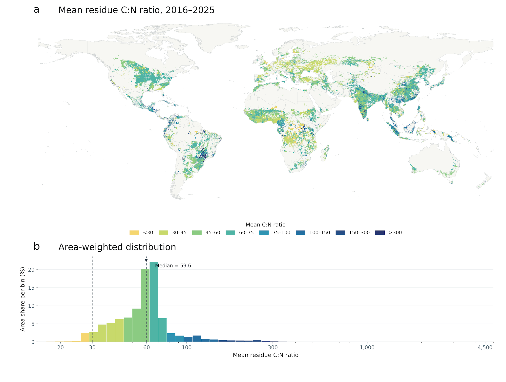
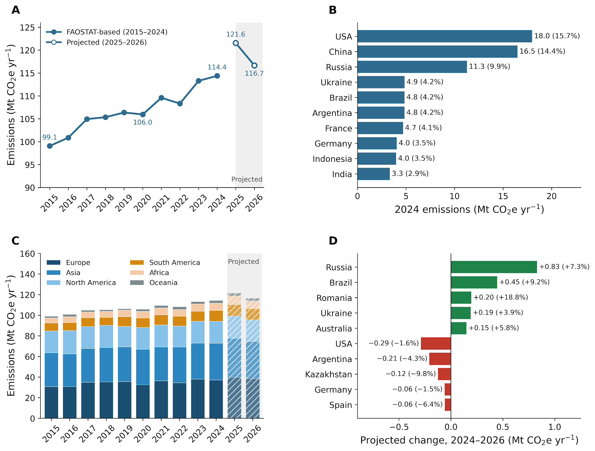
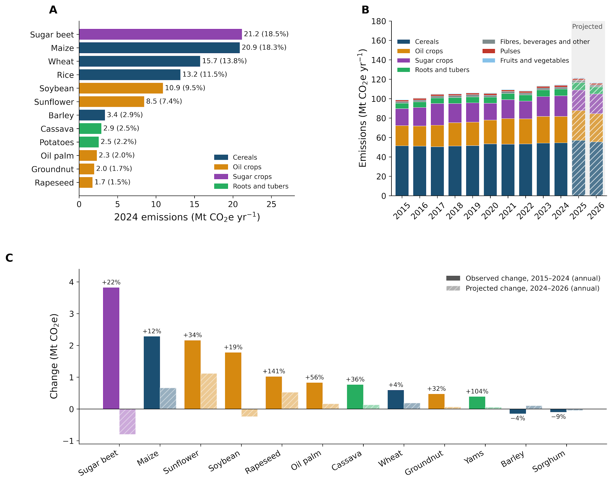
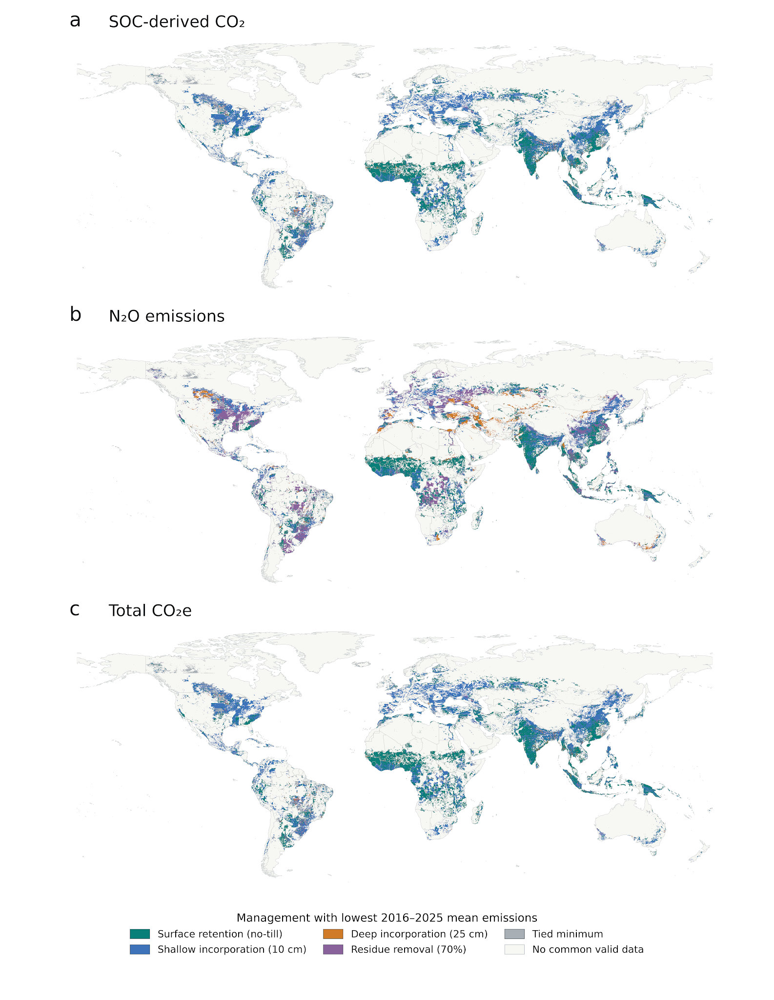
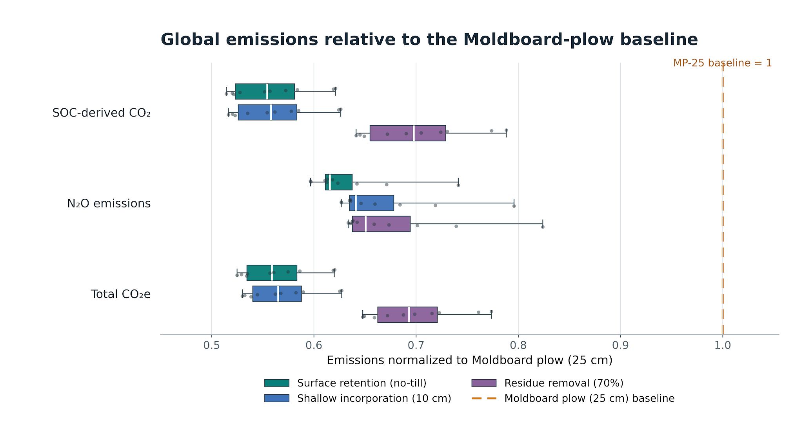
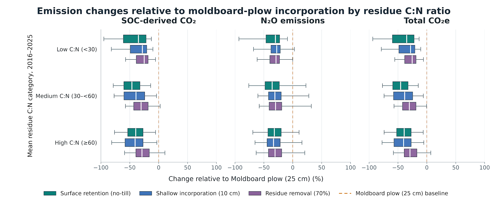

**Agriculture sector: Crop Residue Retention- Direct and Indirect Nitrous Oxide Emissions**

**Prateek Sharma\*1, Rajvi Trivedi1, Adity Manuraj1, Mukta Sharma1, Neville Millar1, Sam Schiller2, Mike Hsu2 and Bruno Basso\*1**

*1) Department of Earth and Environmental Sciences,*

*Michigan State University, 2) Carbon Yield, 3) all affiliated with Climate TRACE*

*\*Corresponding Author: basso@msu.edu; sharm165@msu.edu*

**1. Introduction**

Agricultural soils are a major anthropogenic source of nitrous oxide (N₂O), a long-lived and radiatively important greenhouse gas that also contributes to stratospheric ozone depletion (Ravishankara et al. 2009; Prather et al. 2012; IPCC 2021). Soil N₂O is produced primarily through microbial nitrification and denitrification, and emissions are strongly influenced by the availability of reactive nitrogen (N) in soil (Robertson and Groffman 2024). In addition to synthetic and organic fertilizers, crop residues returned to agricultural soils represent an important source of N because residue decomposition releases N that can subsequently undergo nitrification and denitrification. Crop-residue N is therefore explicitly included as a source of direct N₂O emissions from managed soils in the IPCC greenhouse-gas inventory framework (Hergoualc’h et al. 2019).

Global crop production generates several billion tonnes of residues each year globally (Lal 2005; Shinde et al. 2022), contributing to more than 11 million tonnes of annual N input to the soil (Liu et al., 2010). A recent spatially explicit assessment estimated that crop residues incorporated into cropland supplied approximately 20 Tg N yr⁻¹ globally in 2020 (Cao et al. 2026). While retaining crop residues can provide important soil-health benefits (e.g., Turmel et al. 2015), including maintaining or increasing soil organic carbon (Blanco-Canqui and Lal 2009; Li et al. 2020), the additional N and carbon returned to soil can also increase N₂O emissions under conditions favorable for residue decomposition, nitrification, and denitrification (Chen et al. 2013; Lugato et al. 2018; Xia et al. 2018).

The magnitude of residue-induced N₂O emissions is highly variable. Residue biochemical properties, including N concentration, C:N ratio and the relative abundance of readily decomposable and resistant compounds, interact with soil moisture, temperature, soil properties, crop type, and residue placement to regulate decomposition and N₂O production. A global meta-analysis found that crop-residue incorporation increased soil N₂O emissions by an average of 43% relative to residue removal, while individual observations included both increases and decreases, illustrating the strong dependence of the response on residue and environmental characteristics (Abalos et al. 2022b). These interactions also mean that residue management can simultaneously influence short-term N₂O emissions and longer-term SOC dynamics, creating potential trade-offs between soil carbon retention and non-CO₂ greenhouse-gas emissions.

Despite the importance of crop residues in agricultural greenhouse-gas accounting, globally consistent information describing where residues are produced and how they are managed remains limited. Crop production statistics are generally available at national scales, whereas residue production, retention, removal, and burning vary substantially among crops and within countries. Smerald et al. (2023) identified the lack of globally consistent crop-residue management information as a major limitation and developed the first spatially explicit global dataset partitioning cereal residues among field burning, livestock use, other off-field uses, and residues left on the field. Their dataset demonstrates both the importance and the spatial heterogeneity of residue-management pathways globally. Translating these heterogeneous residue flows into annual, crop-specific greenhouse-gas estimates at subnational scales therefore requires integration of crop production, spatial crop distributions, residue-production characteristics, residue-management information, and emission factors within a consistent framework.

Climate TRACE addresses this gap by developing annual, spatially explicit estimates of crop-residue production, management, and associated greenhouse-gas emissions across global cropland. The framework combines national crop production and harvested-area statistics with gridded crop distributions, crop-specific residue-production relationships and N contents, spatial information on residue management, and IPCC emission factors (Hergoualc’h et al. 2019). These inputs are harmonized to generate crop-specific estimates at 5-arc-minute resolution while maintaining consistency with national crop-production statistics. The resulting baseline inventory identifies where crop residues are produced, how much residue N is returned to agricultural soils, and the associated greenhouse-gas emissions across crops, countries, and years.

As a second component of the analysis, we evaluate how alternative crop-residue management practices affect N₂O emissions while also accounting for their consequences for SOC. We consider counterfactual residue-management scenarios representing residue removal, retention on the soil surface, shallow incorporation to approximately 10 cm, and deeper incorporation to approximately 25 cm. Differences in residue amount and placement influence residue decomposition, N availability, and soil environmental conditions and therefore can alter residue-derived N₂O emissions. At the same time, these practices change the quantity and distribution of residue-derived carbon entering the soil and can consequently affect SOC dynamics. We therefore evaluate changes in N₂O emissions together with the associated changes in SOC and CO₂ to provide a more complete assessment of the greenhouse-gas implications of each residue-management strategy. This framework allows a practice that reduces N₂O emissions to be evaluated alongside any corresponding gain or loss of soil carbon, rather than considering the N₂O response in isolation.

The primary objective of this study is to provide a consistent, crop-specific and spatially explicit inventory of greenhouse-gas emissions associated with crop residues across global cropland. The resulting Climate TRACE dataset provides annual and monthly estimates of crop-residue production, residue-derived N₂O emissions, and associated management pathways at 5-arc-minute resolution for 2015–2026, covering 40 crop groups across more than 150 countries. A secondary objective is to quantify the N₂O emission-reduction potential of alternative residue-management practices—including residue removal, surface retention, shallow incorporation, and deep incorporation—and to evaluate the associated changes in SOC and CO₂ relative to baseline management. Together, these datasets provide a consistent framework for identifying major crop- and region-specific sources of residue-related emissions and for evaluating potential trade-offs between N₂O mitigation and soil carbon retention under alternative residue-management strategies.

**2. Materials and Methods**

**2.1 Methodological overview and scope**

We estimate direct and indirect N₂O emissions from crop residues retained on agricultural land globally for 2015–2026. The inventory covers 40 crop groups and produces annual estimates at 5-arc-minute resolutions, which are subsequently disaggregated to monthly time steps. Unlike the synthetic N fertilizer inventory, N-fixing crops are retained in the crop-residue analysis because residues from both N-fixing and non-N-fixing crops return nitrogen to the soil.

The calculation follows a sequential workflow. Annual crop production and harvested areas are first harmonized spatially using SPAM 2020 as the common crop-distribution framework. Crop-specific aboveground residue production is then estimated from crop yield using yield-dependent residue functions where available and harvest-index relationships for the remaining crops. Residue production is partitioned according to spatially explicit residue-management fractions, and the retained residue is converted to dry matter before crop-specific nitrogen concentrations are applied. The resulting residue N returned to soil is used to estimate direct and indirect N₂O emissions following the IPCC Tier 1 framework. Annual emissions are subsequently distributed to monthly values using the temporal distribution of soil N₂O emissions from EDGAR. Detailed equations, crop-specific coefficients, and data harmonization procedures are provided in Supplementary Text S1–S5.

**2.2 Crop production, harvested area, and spatial harmonization**

Annual crop production and harvested-area data were compiled at the country scale and harmonized with SPAM 2020 to generate spatially explicit crop activity data at 5-arc-minute resolution. SPAM 2020 was used to define the within-country spatial distribution of each crop, while annual national crop statistics constrained the corresponding country totals. This approach preserves the spatial pattern of crop production and harvested area represented by SPAM while maintaining consistency with annual national statistics.

For recent years in which finalized crop-production data were unavailable, projected crop activity from the same framework used in the Climate TRACE synthetic N fertilizer methodology was used to extend the time series through 2026. Because the crop-production projection methodology is common to both inventories, details of the prediction framework are provided in the [Synthetic N Fertilizer Methodology](https://github.com/climatetracecoalition/methodology-documents/tree/main/2025/Agriculture).

All crop-activity layers were harmonized to the same 5-arc-minute spatial grid before residue production was calculated. This common grid provides the spatial basis for combining crop production, harvested area, residue-management information, crop-specific residue characteristics, and subsequent N₂O emission calculations.

**2.3 Aboveground crop-residue production**

Aboveground crop-residue production was estimated independently for each crop, grid cell, and year. Crop yield was first calculated from gridded crop production and harvested area. Residue production was then estimated using one of two approaches depending on crop type.

For barley, maize, rice, wheat, millet, sorghum, and other cereals, we used yield-dependent residue relationships based on Smerald et al. (2023). These relationships allow the residue-to-product relationship to vary with crop yield rather than assuming a constant residue coefficient. For the remaining crop groups, aboveground residue production was estimated using a harvest-index approach, in which the harvested product represents a specified fraction of total aboveground biomass. Crop-specific harvest-index values were used where available, and a default value was used for crop groups lacking a specific coefficient.

The resulting residue yield was multiplied by the corresponding harvested area to obtain total aboveground residue production for each crop and grid cell. Root biomass was not included in this residue-production calculation. Full equations and crop-specific parameters are provided in Supplementary Text S2 and Supplementary Table S1.

**2.4 Partitioning crop residue among management pathways**

Not all aboveground crop residue produced in a grid cell is returned to the soil. We therefore used the spatially explicit crop-residue management dataset of Smerald et al. (2023) to estimate the fraction of residue retained on agricultural land. The dataset distinguishes residue retained in the field from residue allocated to other management pathways, including open-field burning, livestock use, and other off-field uses.

The residue-management fractions are spatially explicit but are not crop-specific. Accordingly, the same grid-cell-level retention fraction was applied to the estimated aboveground residue production of each crop present within that location. Because the Smerald dataset has a coarser spatial resolution than the 5-arc-minute crop inventory, each crop grid cell was assigned the residue-management fraction from the geographically nearest source grid cell.

Annual residue-management information was used through 2023. For 2024–2026, the 2023 spatial pattern of residue management was held constant because more recent globally consistent residue-management data were unavailable. The retained fraction was then multiplied by crop-specific aboveground residue production to estimate the quantity of residue remaining on agricultural land and available to contribute carbon and nitrogen to the soil.

Only the retained-residue pathway is considered in the N₂O calculations described in this methodology. Residue subjected to open-field burning is quantified separately in the Climate TRACE Crop Residue Burning Methodology and is excluded from the retained-residue N₂O calculation to avoid double counting. Residues allocated to livestock use or other off-field uses are likewise not treated as soil N inputs within this component of the inventory.

**2.5 Dry-matter conversion and nitrogen returned to soil**

Retained aboveground crop residue was converted to a dry-matter basis before estimating the amount of residue N returned to the soil. Crop-specific dry-matter fractions were derived primarily from Table 11.1A (New), Chapter 11, Volume 4: Agriculture, Forestry and Other Land Use, of the 2019 Refinement to the 2006 IPCC Guidelines for National Greenhouse Gas Inventories. Table 11.1A provides default values for the dry-matter fraction of harvested product ($\text{DRY}$) for major crops and crop groups. Crop-specific IPCC values were used where available, while representative crop-group values or literature-based proxies were applied where a direct value was unavailable. The complete dry-matter parameterization and proxy assignments are provided in Supplementary Table S2.

Nitrogen contained in retained crop residues was then estimated by applying crop-specific residue N concentrations to the dry residue mass. Residue N-content values were derived primarily from Table 5.5B (New), Chapter 5: Cropland, Volume 4: Agriculture, Forestry and Other Land Use, of the 2019 Refinement to the 2006 IPCC Guidelines for National Greenhouse Gas Inventories. Table 5.5B provides default N contents of crop residues for major crops and crop groups. For crops not represented in the IPCC table, residue N concentrations were supplemented using Table 15, “Nutrient content of harvested product, crop residues, and removal factors for crop residues,” in the FAO publication Scaling Soil Nutrient Balances: Enabling Mesolevel Applications for African Realities (FAO, 2004).

Where a direct crop-specific parameter was unavailable, an appropriate crop-group value was used as a proxy. The resulting residue-N estimates represent the amount of N returned to agricultural soils through retained aboveground crop residues and provide the activity data for the subsequent direct and indirect N₂O emission calculations. Detailed equations, parameter sources, and proxy assignments are provided in Supplementary Text S4 and Supplementary Tables S2 and S3.

**2.6 Direct and indirect N₂O emission calculation**

Direct and indirect N₂O emissions from retained crop residues were estimated from the amount of residue N returned to soil using the Tier 1 methodology of the 2019 Refinement to the 2006 IPCC Guidelines for National Greenhouse Gas Inventories, Volume 4, Chapter 11, “N₂O Emissions from Managed Soils, and CO₂ Emissions from Lime and Urea Application.” Crop-residue N was treated as an organic N input to managed agricultural soils.

Direct N₂O emissions were calculated using the IPCC Tier 1 direct emission factor (EF₁) of 0.01 kg N₂O–N per kg N returned to soil. Indirect N₂O emissions associated with N leaching and runoff were estimated using the IPCC default fraction of N lost through leaching and runoff (Frac\_LEACH = 0.24) and the corresponding indirect emission factor (EF₅ = 0.011 kg N₂O–N per kg N leached or runoff). Thus, the effective Tier 1 emission factor for the leaching/runoff pathway was 0.00264 kg N₂O–N per kg residue N returned to soil. These parameters were applied consistently across crops, countries, and years. The implementation therefore uses a uniform IPCC Tier 1 framework rather than country- or region-specific direct emission factors.

Direct and indirect emissions were calculated independently for each crop and 5-arc-minute grid cell and subsequently summed to obtain total residue-derived N₂O emissions. Emissions expressed as N₂O–N were converted to N₂O using the molecular-weight ratio of 44/28. Detailed equations, units, and emission-factor definitions are provided in Supplementary Text S5.

### **2.7 Monthly disaggregation of annual N₂O emissions**

Annual crop-residue-derived N₂O emissions were disaggregated to monthly estimates using the same temporal allocation framework applied in the Climate TRACE Synthetic N Fertilizer Methodology. Monthly N₂O emissions from the Emissions Database for Global Atmospheric Research (EDGAR) were used to characterize the intra-annual distribution of emissions. For each location and year, the 12 monthly EDGAR N₂O estimates were summed to obtain an annual total, and the contribution of each month to that annual total was calculated as a monthly fraction.

Because EDGAR and the Climate TRACE crop-residue inventory have different spatial resolutions, the monthly EDGAR fractions were assigned to each 5-arc-minute crop grid cell using the geographically nearest EDGAR grid location. The 12 monthly fractions were normalized to sum to one and were subsequently multiplied by the independently estimated annual crop-residue N₂O emissions. Thus, EDGAR was used only to determine the intra-annual temporal distribution of emissions and did not determine the magnitude of annual crop-residue-derived N₂O emissions.

This procedure preserves the annual Climate TRACE N₂O total for each grid cell while providing monthly estimates that reflect the temporal distribution represented by EDGAR. The EDGAR dataset, calculation of monthly fractions, spatial matching procedure, and normalization approach are described in detail in the Climate TRACE [Synthetic N Fertilizer Methodology](https://github.com/climatetracecoalition/methodology-documents/tree/main/2025/Agriculture), Section 2.2.4, and are therefore not repeated here.

**2.8 Final crop-residue N and N₂O emission dataset**

The final Climate TRACE crop-residue dataset provides annual and monthly, spatially explicit estimates of crop-residue N returned to agricultural soils, and associated N₂O emissions for global cropland from 2015 to 2026. The dataset covers 40 harmonized crop groups across more than 150 countries and is available at both 5-arc-minute gridded resolution and country scale.

For each crop, grid cell, and year, the dataset provides estimates of total aboveground crop-residue N returned to the soil. These activity data are reported by crops and can also be aggregated across crops to provide total residue-N inputs for individual grid cells, countries, and the global cropland domain.

The emissions component provides crop-specific direct, indirect, and total N₂O emissions associated with retained crop-residue N. Direct and indirect N₂O emissions are available separately, allowing the relative contribution of each emission pathway to be quantified. Emissions are reported as N₂O and as CO₂-equivalent emissions using a 100-year global warming potential of 273. Annual emission estimates are also provided at monthly resolution using the EDGAR temporal allocation framework described in the Climate TRACE Synthetic N Fertilizer Methodology.

The resulting data product therefore includes, for 2015–2026: (1) residue N returned to soil, (2) direct N₂O emissions, (3) indirect N₂O emissions from leaching and runoff, and (4) total residue-derived N₂O emissions. These outputs are provided consistently across 40 crop groups, 5-arc-minute grid cells, countries, and annual and monthly reporting periods.

**3. Emission Reduction Solutions (ERS)**
=========================================

Here we outline the rationale and approach we used to investigate and quantify the potential of crop residue management options to mitigate N2O emissions and enhance SOC stocks. The ERS strategies are outlined in Table 1. The Climate TRACE emissions reduction roadmap is located at: [https://climatetrace.org/reduce/countries/all/Global](https://climatetrace.org/reduce/countries/all/Global).

The choice of how crop residue and associated tillage management are combined has a major impact on the magnitude and change of N2O emissions and SOC sequestration in agricultural soils. Crop residues can provide large inputs of C and N, however the potential benefits of enhanced SOC sequestration from the additional residue C can be offset to a varying extent by increases in N2O emissions from more available N substrate in the soils (Chen et al., 2013, Lugato et al., 2018, Xia et al. 2018). This trade-off also depends on, among other factors, residue quality – discussed below – (Abalos et al. 2022, Lashermes et al. 2022), pedoclimatic conditions (Lu et al., 2009, Nguyen et al. 2014), and residue management, such as whether it is all or partially removed, retained intact on the soil surface as mulch, or incorporated into the soils (Turmel et al. 2015, Sarkar et al. 2024), and to what depth (Hu et al. 2019). As such, estimates of N2O emissions from crop residues are associated with high uncertainties, and there are few long-term, large-scale studies that investigate crop residue and tillage management in combination. Under different climate change projections and crop residue management scenarios, Haas et al. (2022) found that with 100% residue retention under reduced tillage, average SOC stocks across 27 European Union countries could increase by around 20%, but when combined with the concomitant increase in N2O emissions of between 17-30%, any initial net SOC benefits were gradually, over time, completely offset. Increased N2O emissions have been shown to occur when crop residues were fully retained (either buried close to the surface or surface applied) when compared to when all residues were removed or buried at greater depth (Haas et al. 2022, Hu et al. 2019). Both partial (50%) and full retention of cereal residue were found to increase N2O emissions compared to complete removal under conventional (deep) tillage and no-till systems (Mirzaei et al., 2022).

Higher quality residues, considered as having high N concentrations, low lignin and cellulose concentrations and low C:N ratios typically result in high N mineralization rates in the soil, whereas lower quality residues result in lower N mineralization or N immobilization (e.g., Trinsoutrot et al., 2000, Chen et al., 2014). Given that the size and availability of pools of inorganic N substrate strongly influences N2O emissions (Robertson and Groffman, 2024), higher quality residues would be expected to promote higher emissions of N2O when compared to lower quality residues. In a meta-analysis of field studies using crop biochemical composition as a determinant, Abalos et al. (2022b) found that the amount of residue N returned to the soil as well as water-soluble carbon best predicted soil N2O emissions. The importance of residue quality was also borne out in a separate global meta-analysis investigating mitigation options for N2O, where Abalos et al. (2022a) found several practices that when crop residues were retained, helped reduce N2O emissions. These included shallow residue incorporation, incorporation of residues with C:N ratios &gt;30, and avoiding incorporation when the crop residues were ‘immature’ due to early termination. Maturity criteria based on chemical composition can therefore be used to categorize crop residues according to their potential to reduce N2O emissions (Abalos et al. 2022a, Janz et al. 2022), which in turn can inform management options. In our analysis, as an initial approach, where all crop residues can be considered mature, i.e., they are present post-harvest and therefore senescent, we use C:N ratios of 30 and 60 as threshold values to respectively distinguish between the likelihood of net N mineralization and net N immobilization (Abalos et al. 2022a) and separate some of the most common crop residue types investigated (Rogers et al. 2025, Norén et al. 2022) to investigate impacts on N2O emissions and SOC.

The current Climate TRACE inventory for crop-residue N₂O emissions is calculated using the IPCC Tier 1 methodology as described above. This approach estimates emissions from the amount of residue N returned to agricultural soils using fixed direct and indirect emission factors. While appropriate for constructing a globally consistent emissions inventory, the Tier 1 approach does not explicitly simulate how changes in residue placement and removal, tillage intensity, and residue incorporation depth alter N₂O emissions through time.

For this reason, the crop-residue ERS analysis was conducted separately using the process-based Systems Approach to Land Use Sustainability (SALUS) model. SALUS was used to perform controlled counterfactual simulations in which weather, soil properties, crop characteristics, and the amount and quality of crop residue were held constant, while only residue placement and associated tillage management were changed. This provides a mechanistically based comparison of alternative residue-management practices without requiring the IPCC Tier 1 inventory to represent management processes that it was not designed to resolve.

The general SALUS configuration, including the global cropland domain, weather and soil inputs, model initialization, crop parameterization, SOC accounting, and other common model inputs, is described in detail in the Climate TRACE Net Soil Organic Carbon Change methodology. Those common components are not repeated here. The present section focuses on the residue-management scenarios that differ from the Net SOC methodology.

**3.1 Derivation of ERS estimates**

Annual SOC stock change from SALUS was converted to an equivalent atmospheric CO₂ flux using the molecular mass ratio of CO₂ to C. The sign was reversed so that increasing SOC represents atmospheric CO₂ removal and declining SOC represents a positive CO₂ emission:

|     |                                                                           |       |
|-----|---------------------------------------------------------------------------|-------|
|     | $E_{SOC - CO_{2},i,t} = \  - \Delta\text{SO}C_{i,t} \times \frac{44}{12}$ | \(1\) |

SALUS N₂O outputs were converted to CO₂ equivalents using a 100-year global warming potential of 273 (IPCC 2021).

|     |                                                    |       |
|-----|----------------------------------------------------|-------|
|     | $E_{N_{2}O,CO_{2}e,i,t} = N_{2}O_{i,t} \times 273$ | \(2\) |

Total modeled greenhouse-gas emissions were then calculated as the sum of SOC-derived CO₂ and N₂O expressed as CO₂ equivalents:

|     |                                                                 |       |
|-----|-----------------------------------------------------------------|-------|
|     | $E_{total,i,t} = E_{SOC - CO_{2},i,t} + E_{N_{2}O,CO_{2}e,i,t}$ | \(3\) |

All quantities were retained as signed values. Consequently, lower values represent lower atmospheric emissions, and negative values indicate modeled net removal.

Three complementary comparisons were conducted. First, the lowest-emission management was identified independently for SOC-derived CO₂, N₂O, and their combined total. For each grid cell and scenario, annual emissions were averaged over 2016–2025, and the scenario with the minimum signed ten-year mean was selected. Numerical ties were retained as a separate category. This comparison identifies which of the four management configurations produced the lowest modeled emissions at each location; it does not quantify the magnitude of the difference among scenarios.

Second, temporal consistency among management responses was evaluated at the global scale. For each year, grid-cell emissions were summed over the common spatial footprint for each management scenario. Surface retention, shallow incorporation, and residue removal were then expressed relative to the moldboard-plow scenario for the same year:

|     |                                        |       |
|-----|----------------------------------------|-------|
|     | $R_{s,t} = \frac{E_{s,t}}{E_{MP25,t}}$ | \(4\) |

where $R_{s,t}$ is the normalized annual emission for management scenario $s$ in year $t,\ \ E_{s,t}$ is the corresponding global emission total, and $E_{MP25,t}\ $is the global total emission for 25-cm moldboard-plow incorporation. Moldboard incorporation therefore has a normalized value of 1.0 in every year. This scenario was used only as a common reference for comparison among the four SALUS treatments and should not be interpreted as the Climate TRACE inventory baseline.

Third, management responses were evaluated according to residue quality. Annual residue C:N ratios and annual emissions were first averaged across 2016–2025 within each grid cell. Mean residue C:N ratios were then classified as low (&lt;30), medium (30–&lt;60), or high (≥60). These classes represented 3.63%, 47.72%, and 48.66% of the area-weighted C:N analysis domain (Figure 1), respectively.

For each component and grid cell, the percentage difference from moldboard incorporation was calculated relative to the absolute magnitude of the moldboard value:

|     |                                                                                                       |       |
|-----|-------------------------------------------------------------------------------------------------------|-------|
|     | $\Delta E_{s,i}\left( \% \right) = 100 \times \frac{E_{s,i} - E_{MP25,i}}{\left| E_{MP25,i} \right|}$ | \(5\) |

Using the absolute denominator preserves a consistent sign interpretation for the small number of grid cells where the moldboard-plow scenario produced negative emissions. Negative percentage values therefore indicate lower emissions than moldboard incorporation, whereas positive values indicate higher emissions. Grid cells with moldboard values extremely close to zero were excluded to prevent unstable percentage changes; this affected 32 cells for SOC-derived CO₂, 56 for N₂O, and 16 for total CO₂e.

**3.2 Incorporating ERS into the model**

Four residue-management scenarios were evaluated using SALUS: surface retention under no-till, shallow incorporation, deep incorporation, and partial residue removal (Table 1). Crop residue was supplied to SALUS as an explicit organic input containing both carbon (C) and nitrogen (N), consistent with the residue-input framework described in the Climate TRACE Net Soil Organic Carbon Change methodology. The quantity of residue supplied to the scenario analysis was first determined using the existing crop-residue management fraction described in Sections 2.4 and 2.5. Consequently, the residue pool used in the SALUS simulations represents the crop residue that would otherwise remain on the field after application of the existing residue-management fraction.

For each comparison, the same weather, soil properties, crop characteristics, residue amount, and residue C:N characteristics were used. Only residue placement, incorporation depth, and associated tillage management were changed. The crop-residue C:N ratio distribution (Figure 1) was relatively stable across 2016–2025, with annual median values ranging from 59.16 to 59.57 and mean values from 68.80 to 69.38. The higher mean relative to the median indicates a right-skewed distribution, driven by a relatively small number of grid cells with very high C:N ratios. Across the years, the 5th percentile was approximately 31–32, whereas the 95th percentile was about 119 and the 99th percentile about 281–291. Although maximum values reached 4,500, these extreme values represented only a very small fraction of the cropland area.

Using the C:N thresholds adopted for the ERS analysis, only about 3.6–3.8% of the simulated cropland area fell within the low C:N category (&lt;30). In contrast, the distribution was almost evenly divided between the medium C:N category (30–60), which represented approximately 47.1–48.0% of the area, and the high C:N category (≥60), which accounted for 48.2–49.3%. This distribution places the global median close to the C:N = 60 threshold and indicates that most simulated cropland residue inputs were characterized by medium to high C:N ratios.

This design allows differences among simulations to be attributed specifically to residue-management practices rather than to differences in environmental forcing, crop activity, or residue supply. Accordingly, the SALUS results should be interpreted as relative management responses and not as an alternative estimate of the Climate TRACE IPCC Tier 1 baseline emissions.

**Figure 1** Spatial distribution and area-weighted frequency distribution of crop-residue carbon-to-nitrogen (C:N) ratios used as inputs to the SALUS residue-management simulations. (a) Mean crop-residue C:N ratio across cropland for 2016–2025, calculated from the annual residue inputs supplied to SALUS. Colors indicate the spatial variation in mean residue C:N ratio across cropland grid cells. (b) Area-weighted distribution of the 2016–2025 mean residue C:N ratio. Dashed vertical lines at C:N ratios of 30 and 60 indicate the thresholds used to classify residues into low (&lt;30), medium (30–60), and high (≥60) C:N categories for the ERS analysis. The area-weighted median C:N ratio was 59.6.

**Table 1** Emission Reduction Solution (ERS) scenario descriptions

| **ERS Scenario**            | **Fraction of retained residue remaining in field** | **Tillage Management** | **Residue Placement**                     |
|-----------------------------|-----------------------------------------------------|------------------------|-------------------------------------------|
| Surface retention / no-till | 100%                                                | No-tillage             | Soil surface                              |
| Shallow incorporation       | 100%                                                | Chisel plow            | Incorporated to approximately 10 cm       |
| Deep incorporation          | 100%                                                | Moldboard plow         | Incorporated to approximately 25 cm       |
| Residue removal             | 30%                                                 | No-till                | 30% retained on soil surface; 70% removed |

Note: Percentages refer to the residue pool remaining after application of the existing spatial residue-management fraction, not to total aboveground crop residue production.

**4. Results and Discussion**

**4.1 N₂O emissions from retained crop residue**

This section presents direct and indirect N₂O emissions associated with crop residues retained on agricultural land for 2015–2026 using IPCC Tier 1 methodology. Estimates for 2015–2024 are based on FAOSTAT crop-production and harvested-area statistics, whereas estimates for 2025 and 2026 are based on projected crop activity. Accordingly, national and crop-level distributions are described primarily for 2024, the most recent year based on FAOSTAT crop statistics, and projected changes are presented separately. Emissions are reported as the combined direct and indirect N₂O total and expressed as CO₂ equivalents using a 100-year global warming potential of 273. Depending on year, the inventory includes 157–159 countries.

**4.1.1 Global emissions between 2015 and 2026**

Global N₂O emissions from retained crop residue increased from 99.1 Mt CO₂e yr⁻¹ in 2015 to 114.4 Mt CO₂e yr⁻¹ in 2024, corresponding to an absolute increase of 15.3 Mt CO₂e yr⁻¹, or 15.5% (Table 2; Figure 2A). Expressed as N₂O mass, emissions increased from 0.363 to 0.419 Mt N₂O yr⁻¹ over the same period. The corresponding compound annual growth rate was 1.6%. Given that our post-harvest crop residues inputs are a sub-set of the total crop residues applied to cropland annually, the magnitude of emissions compares well with the limited prior global estimates; Mosier et al. (1998) estimated 0.4 Mt of N2O–N annually from crop residues in 1989, corresponding to 0.63 Mt N₂O yr⁻¹ with an EF of 1.0 %, and for 2020, Olesen et al. (2023) reported emissions derived from FAOSTAT data of 1.13 Mt N₂O.

The increase was not uniform throughout time. Annual emissions increased in seven of the nine year-to-year transitions between 2015 and 2024, with the largest increases occurring between 2022 and 2023 (+4.95 Mt CO₂e; +4.6%), 2016 and 2017 (+4.06 Mt CO₂e; +4.0%), and 2020 and 2021 (+3.64 Mt CO₂e; +3.4%). Smaller declines occurred between 2019 and 2020 (−0.43 Mt CO₂e; −0.4%) and between 2021 and 2022 (−1.25 Mt CO₂e; −1.1%), indicating that the overall upward trend was accompanied by substantial interannual variability.

For the projected period, global emissions increased to 121.6 Mt CO₂e yr⁻¹ in 2025, 7.17 Mt CO₂e (+6.3%) above the 2024 level. Emissions were then projected to decline to 116.7 Mt CO₂e yr⁻¹ in 2026, corresponding to a decrease of 4.90 Mt CO₂e (−4.0%) relative to 2025. Despite this decline, projected 2026 emissions remained 2.27 Mt CO₂e (+2.0%) above the 2024 value. These projected changes reflect the projected crop-production and harvested-area inputs used for 2025 and 2026 and should therefore be interpreted as provisional estimates until corresponding FAOSTAT statistics become available.

**Table 2** Global annual direct and indirect N₂O emissions from crop residue retained on agricultural land and annual change from the preceding year. Changes were calculated from unrounded totals. Estimates for 2015–2024 are based on FAOSTAT crop statistics, whereas 2025 and 2026 are projected.

| **Year** | **N₂O (kt yr⁻¹)** | **CO₂e (Mt yr⁻¹)** | **Change (Mt CO₂e)** | **Change (%)** |
|----------|-------------------|--------------------|----------------------|----------------|
| 2015     | 362.9             | 99.08              | —                    | —              |
| 2016     | 369.5             | 100.88             | +1.80                | +1.8           |
| 2017     | 384.4             | 104.94             | +4.06                | +4.0           |
| 2018     | 385.9             | 105.36             | +0.41                | +0.4           |
| 2019     | 389.7             | 106.38             | +1.02                | +1.0           |
| 2020     | 388.1             | 105.96             | −0.43                | −0.4           |
| 2021     | 401.4             | 109.59             | +3.64                | +3.4           |
| 2022     | 396.8             | 108.34             | −1.25                | −1.1           |
| 2023     | 415.0             | 113.29             | +4.95                | +4.6           |
| 2024     | 419.0             | 114.39             | +1.09                | +1.0           |
| 2025     | 445.3             | 121.56             | +7.17                | +6.3           |
| 2026     | 427.3             | 116.66             | −4.90                | −4.0           |

**4.1.2 Country-scale distribution and changes**

National emissions from retained crop residue were concentrated in a relatively small number of countries. In 2024, the USA was the largest contributor, with 17.99 Mt CO₂e yr⁻¹ (15.7% of the global total), followed by China at 16.48 Mt CO₂e yr⁻¹ (14.4%) and Russia at 11.29 Mt CO₂e yr⁻¹ (9.9%) (Table 3; Figure 2B). Together, these three countries accounted for 40.0% of global emissions. The five largest contributors accounted for 48.5%, the ten largest for 66.8%, and the twenty largest for 82.2% of the global total. In contrast, 91 countries each contributed less than 0.1 Mt CO₂e yr⁻¹ and collectively accounted for only 2.0% of global emissions.

The same ten countries remained among the largest contributors in both 2015 and 2024, although their relative rankings and contributions changed over time. The USA remained the largest contributor, but its emissions decreased slightly from 18.17 to 17.99 Mt CO₂e yr⁻¹ and its global share declined from 18.3% to 15.7%. China’s emissions increased by 8.1%, although its share of the global total declined from 15.4% to 14.4%. Russia showed the largest increase among the leading countries, rising by 3.51 Mt CO₂e yr⁻¹ (+45.1%) and increasing its global share from 7.9% to 9.9%. Brazil moved from eighth to fifth place, while Germany moved from tenth to eighth and France declined from fourth to seventh. These changes indicate that the concentration of emissions among major countries remained broadly stable, while their relative contributions shifted substantially. Across the countries represented in both 2015 and 2024, emissions increased in 104 countries and decreased in 53. The largest absolute increases occurred in Russia (+3.51 Mt CO₂e yr⁻¹), Brazil (+1.42), Germany (+1.29), Argentina (+1.28), and China (+1.24). These national changes reflected different crop-specific contributions. In Russia, the increase was driven primarily by sunflower, sugar beet, and wheat; in Brazil, by soybean and maize; and in Germany, by sugar beet and rapeseed. The largest decreases occurred in Türkiye, Morocco, Viet Nam, the USA, and Italy. Because country coverage differed slightly among years, changes calculated for matched countries do not sum exactly to the change in the global total.

Projected national emissions from 2024 to 2026 showed only a small increase in the global total (+2.27 Mt CO₂e yr⁻¹; +2.0%), but this net change masked contrasting national trajectories (Figure 2D). Russia showed the largest projected absolute increase (+0.83 Mt CO₂e yr⁻¹; +7.3%), followed by Brazil (+0.45; +9.2%), Romania (+0.20; +18.8%), Ukraine (+0.19; +3.9%), and Australia (+0.15; +5.8%). These increases were partially offset by projected declines in the USA, Argentina, Kazakhstan, Germany, and Spain. The projections therefore indicate a redistribution of residue-derived N₂O emissions among countries even when the global total changes only modestly.

**Table 3** Ten largest national contributors to N₂O emissions from retained crop residue in 2024. Emissions 2015 and 2024, and absolute changes are expressed as Mt CO₂e yr⁻¹. The 2015–2024 change is based on FAOSTAT crop activity, whereas the 2024–2026 change represents the projected change between the final FAOSTAT-based year and 2026.

<table><thead><tr class="header"><th><strong>Country</strong></th><th>
<strong>Emission</strong>

<strong>2015</strong>
</th><th>
<strong>Emission</strong>

<strong>2024</strong>
</th><th><strong>2024 
share (%)</strong></th><th><strong>Emission Change 
2015–2024</strong></th><th><strong>Emission Change 
2024–2026 (%)</strong></th></tr></thead><tbody><tr class="odd"><td>USA</td><td>18.17</td><td>17.99</td><td>15.7</td><td>−0.17</td><td>−1.6</td></tr><tr class="even"><td>China</td><td>15.25</td><td>16.48</td><td>14.4</td><td>+1.24</td><td>+0.4</td></tr><tr class="odd"><td>Russia</td><td>7.78</td><td>11.29</td><td>9.9</td><td>+3.51</td><td>+7.3</td></tr><tr class="even"><td>Ukraine</td><td>4.48</td><td>4.86</td><td>4.2</td><td>+0.38</td><td>+3.9</td></tr><tr class="odd"><td>Brazil</td><td>3.43</td><td>4.85</td><td>4.2</td><td>+1.42</td><td>+9.2</td></tr><tr class="even"><td>Argentina</td><td>3.57</td><td>4.84</td><td>4.2</td><td>+1.28</td><td>−4.3</td></tr><tr class="odd"><td>France</td><td>4.62</td><td>4.70</td><td>4.1</td><td>+0.08</td><td>−0.8</td></tr><tr class="even"><td>Germany</td><td>2.75</td><td>4.04</td><td>3.5</td><td>+1.29</td><td>−1.5</td></tr><tr class="odd"><td>Indonesia</td><td>3.54</td><td>3.98</td><td>3.5</td><td>+0.44</td><td>+1.6</td></tr><tr class="even"><td>India</td><td>3.13</td><td>3.34</td><td>2.9</td><td>+0.21</td><td>+3.8</td></tr></tbody></table>

**Figure 2.** Historical and projected N₂O emissions from crop residue retained on agricultural land and their national and continental composition. (A) Global annual emissions, 2015–2026; filled symbols denote FAOSTAT-based years (2015–2024), and open symbols and shading denote projected years (2025–2026). (B) The ten largest national contributors in 2024; values in parentheses are shares of the global total. (C) Annual emissions by continent, 2015–2026; hatched bars and shading denote projected years (2025–2026). Russia and Cyprus are included in Europe, and Türkiye, Kazakhstan and the South Caucasus countries in Asia. (D) The five largest projected national increases and the five largest projected decreases between 2024 and 2026, ranked by absolute change; values in parentheses give the percentage change. Emissions are the combined direct and indirect total, expressed as CO₂e using GWP₁₀₀ = 273.

**4.1.3 Individual crop contributions**

Emissions from retained crop residue were concentrated in a relatively small number of crop groups. In 2024, sugar beet was the largest crop-specific source, contributing 21.17 Mt CO₂e yr⁻¹ (18.5% of the global total), followed closely by maize at 20.89 Mt CO₂e yr⁻¹ (18.3%). Wheat, rice, soybean, and sunflower contributed 15.73, 13.17, 10.90, and 8.46 Mt CO₂e yr⁻¹, respectively (Table 4; Figure 3A). Together, the three largest crops accounted for 50.5% of global emissions, the five largest for 71.6%, and the ten largest for 88.7%. When aggregated into broader crop groups (Table S4), cereals were the dominant source in 2024, contributing 54.5 Mt CO₂e yr⁻¹ (47.6% of the global total), followed by oil crops at 27.3 Mt CO₂e yr⁻¹ (23.8%), sugar crops at 21.3 Mt CO₂e yr⁻¹ (18.6%), and roots and tubers at 6.9 Mt CO₂e yr⁻¹ (6.1%). Pulses, fruits and vegetables, and the combined fibres, beverages, and other-crops category together contributed the remaining 3.9%. Soybean and groundnut were included in the oil-crop category for this aggregation (Figure 3B).

The relative importance of crop groups also changed between 2015 and 2024. Oil-crop emissions increased by 6.5 Mt CO₂e yr⁻¹ (+31.2%) and accounted for 42.3% of the net global increase, with their share rising from 21.0% to 23.8%. Cereal emissions increased by 3.0 Mt CO₂e yr⁻¹ (+5.8%), although their share declined from 52.0% to 47.6%. At the individual-crop level, the largest absolute increases occurred for sugar beet (+3.82 Mt CO₂e yr⁻¹; +22.0%), maize (+2.28; +12.3%), sunflower (+2.16; +34.3%), soybean (+1.78; +19.5%), and rapeseed (+1.02; +140.6%) (Figure 3C). Sugar beet, maize, and sunflower together accounted for 54.0% of the net global increase. By contrast, barley and sorghum showed modest declines of 0.15 and 0.10 Mt CO₂e yr⁻¹, respectively. Projected crop-level changes from 2024 to 2026 were smaller than the historical changes but differed among crops. Sunflower showed the largest projected increase (+1.12 Mt CO₂e yr⁻¹; +13.2%), followed by maize (+0.66; +3.2%), rapeseed (+0.53; +30.1%), and wheat (+0.19; +1.2%).

In contrast, sugar beet and soybean were projected to decline by 0.80 Mt CO₂e yr⁻¹ (−3.8%) and 0.24 Mt CO₂e yr⁻¹ (−2.2%), respectively. As a result, the projected share of oil crops increased from 23.8% in 2024 to 24.8% in 2026, whereas the contribution of sugar crops declined from 18.6% to 17.5%. The crop composition of the retained-residue inventory differs from that of the synthetic N fertilizer inventory because residue-derived emissions depend on the amount of aboveground residue produced, the fraction retained on the field, residue dry matter and N content, and the IPCC emission factors applied to residue N returned to soil. In addition, N-fixing crops such as soybean are included in the residue inventory because their residues return N to agricultural soils, even though these crops are excluded from the synthetic fertilizer allocation. Consequently, crops with moderate synthetic fertilizer use can make comparatively large contributions to residue-derived N₂O emissions when they generate substantial N-rich residue that is retained on the field.

**Table 4** Ten largest crop contributors to N₂O emissions from retained crop residue in 2024. Emissions 2015 and 2014, and absolute changes are expressed as Mt CO₂e yr⁻¹. Historical change compares 2015 with 2024, while projected change compares 2024 with 2026.

<table><thead><tr class="header"><th><strong>Crop</strong></th><th>
<strong>Emission</strong>

<strong>2015</strong>
</th><th>
<strong>Emission</strong>

<strong>2024</strong>
</th><th><strong>2024 
share (%)</strong></th><th><strong>Emission Change 
2015–2024</strong></th><th><strong>Emission Change 
2024–2026 (%)</strong></th></tr></thead><tbody><tr class="odd"><td>Sugar beet</td><td>17.35</td><td>21.17</td><td>18.5</td><td>+3.82</td><td>−3.8</td></tr><tr class="even"><td>Maize</td><td>18.61</td><td>20.89</td><td>18.3</td><td>+2.28</td><td>+3.2</td></tr><tr class="odd"><td>Wheat</td><td>15.14</td><td>15.73</td><td>13.8</td><td>+0.59</td><td>+1.2</td></tr><tr class="even"><td>Rice</td><td>12.82</td><td>13.17</td><td>11.5</td><td>+0.35</td><td>+0.8</td></tr><tr class="odd"><td>Soybean</td><td>9.13</td><td>10.90</td><td>9.5</td><td>+1.78</td><td>−2.2</td></tr><tr class="even"><td>Sunflower</td><td>6.30</td><td>8.46</td><td>7.4</td><td>+2.16</td><td>+13.2</td></tr><tr class="odd"><td>Barley</td><td>3.51</td><td>3.36</td><td>2.9</td><td>−0.15</td><td>+3.1</td></tr><tr class="even"><td>Cassava</td><td>2.13</td><td>2.89</td><td>2.5</td><td>+0.77</td><td>+4.6</td></tr><tr class="odd"><td>Potatoes</td><td>2.53</td><td>2.55</td><td>2.2</td><td>+0.02</td><td>−0.9</td></tr><tr class="even"><td>Oil palm</td><td>1.47</td><td>2.30</td><td>2.0</td><td>+0.83</td><td>+7.1</td></tr></tbody></table>

**Figure 3** Crop contributions to N₂O emissions from retained crop residue. (A) The twelve largest crop contributors in 2024; values in parentheses are shares of the global total. (B) Emissions by crop group, 2015–2026; hatched bars and shading denote projected years (2025–2026). Soybean and groundnut are included in oil crops. (C) Crops with the largest absolute changes between 2015 and 2024 (solid bars; labels give the percentage change relative to 2015), and the corresponding projected changes between 2024 and 2026 (hatched bars). Colours denote crop groups. Emissions are the combined direct and indirect total, expressed as CO₂e using GWP₁₀₀ = 273.

**4.1.4 Crop–country distribution of emissions**

The leading national contributors differed substantially among crops, reflecting the geographic concentration of crop production and retained-residue N inputs (Table 5). In 2024, global maize-residue emissions were dominated by the USA (33.3%) and China (25.7%). Soybean emissions were even more geographically concentrated, with the USA (44.5%), Brazil (22.6%), and Argentina (16.4%) together contributing 83.5% of the global total. Oil-palm emissions were dominated by Indonesia (65.8%) and Malaysia (21.0%), while sunflower emissions were concentrated primarily in Russia (39.0%) and Ukraine (23.1%).

Other crops showed a more distributed geographic pattern. Sugar-beet emissions were shared among Russia (19.4%), Germany (14.0%), France (13.5%), the USA (12.8%), and Poland (7.8%), while rice emissions were led by China (34.2%), followed by India (10.2%), Indonesia (8.4%), Thailand (7.9%), and Viet Nam (7.1%). Wheat emissions were also distributed across several major producing regions, with Russia, China, the USA, Canada, and Australia as the five largest contributors.

These crop-specific geographic patterns also explain much of the national composition of residue-derived N₂O emissions. In the USA, maize, soybean, and sugar beet accounted for most retained-residue emissions; in Brazil, soybean and maize dominated; and in Russia, sugar beet, sunflower, and wheat were the principal contributors. Thus, national emission totals reflect not only the overall scale of crop production but also the crop composition of agricultural systems within each country.

**Table 5** Leading national contributors to N₂O emissions from retained crop residue for the ten largest crop contributors in 2024. The first column reports global crop-specific emissions in Mt CO₂e yr⁻¹. The remaining columns identify the five largest national contributors and their percentage share of global emissions for each crop.

| **Crop (2024 total)** | **Rank 1**      | **Rank 2**      | **Rank 3**      | **Rank 4**     | **Rank 5**     |
|-----------------------|-----------------|-----------------|-----------------|----------------|----------------|
| Sugar beet (21.2)     | Russia 19.4%    | Germany 14.0%   | France 13.5%    | USA 12.8%      | Poland 7.8%    |
| Maize (20.9)          | USA 33.3%       | China 25.7%     | Brazil 7.3%     | Argentina 6.8% | Ukraine 3.0%   |
| Wheat (15.7)          | Russia 16.1%    | China 14.5%     | USA 11.1%       | Canada 8.0%    | Australia 7.6% |
| Rice (13.2)           | China 34.2%     | India 10.2%     | Indonesia 8.4%  | Thailand 7.9%  | Viet Nam 7.1%  |
| Soybean (10.9)        | USA 44.5%       | Brazil 22.6%    | Argentina 16.4% | China 4.7%     | Canada 2.7%    |
| Sunflower (8.5)       | Russia 39.0%    | Ukraine 23.1%   | Argentina 6.8%  | Hungary 4.2%   | Bulgaria 3.7%  |
| Barley (3.4)          | Russia 15.8%    | Australia 14.0% | Canada 8.4%     | France 6.7%    | Spain 6.2%     |
| Cassava (2.9)         | Nigeria 17.5%   | Thailand 13.2%  | Ghana 12.3%     | Indonesia 7.2% | Cambodia 7.0%  |
| Potatoes (2.5)        | China 21.3%     | Ukraine 10.1%   | USA 9.8%        | Russia 7.0%    | Germany 6.3%   |
| Oil palm (2.3)        | Indonesia 65.8% | Malaysia 21.0%  | Thailand 4.1%   | Nigeria 2.4%   | Ghana 1.1%     |

**4.1.5 Continental distribution**

For regional comparison, country-level emissions were aggregated into six continental groups: Africa, Asia, Europe, North America, South America, and Oceania. The country assignments used for each continental group are provided in Supplementary Table S5. Europe and Asia were the largest continental contributors to N₂O emissions from retained crop residue throughout the study period (Table 6; Figure 2C). Asia was the largest source in 2015, contributing 33.0 Mt CO₂e yr⁻¹ (33.3% of the global total), whereas Europe became the largest contributor in 2024 at 37.2 Mt CO₂e yr⁻¹ (32.5%). In 2024, Asia contributed 35.7 Mt CO₂e yr⁻¹ (31.2%), followed by North America at 21.3 Mt CO₂e yr⁻¹ (18.6%), South America at 10.5 Mt CO₂e yr⁻¹ (9.2%), Africa at 7.1 Mt CO₂e yr⁻¹ (6.2%), and Oceania at 2.6 Mt CO₂e yr⁻¹ (2.3%). Europe showed the largest absolute increase between 2015 and 2024, rising by 6.50 Mt CO₂e yr⁻¹ (+21.2%). Approximately half of this increase was associated with Russia; when Russia was excluded, emissions from the remainder of Europe increased by 3.00 Mt CO₂e yr⁻¹ (+13.1%). South America and Africa also showed substantial increases of 36.0% and 48.0%, respectively, increasing their combined contribution to the global total from 12.7% in 2015 to 15.4% in 2024. In contrast, North American emissions changed little (+0.3%), resulting in a decline in its global share from 21.5% to 18.6%. Projected changes from 2024 to 2026 were relatively modest compared with the historical changes. Africa showed the largest proportional increase (+6.6%), followed by Oceania (+5.7%), while Europe, South America, and Asia were also projected to increase. North America was the only continent projected to decline, by 1.2%. These regional totals describe the distribution of aggregate emissions and should not be interpreted as differences in emission intensity per unit of cropland or harvested area.

**Table 6** Continental N₂O emissions from retained crop residue in 2015 and 2024 and projected changes to 2026. Annual emissions and absolute changes are expressed as Mt CO₂e yr⁻¹. Russia and Cyprus are assigned to Europe; Türkiye, Kazakhstan, and the South Caucasus countries are assigned to Asia.

<table><thead><tr class="header"><th><strong>Continent</strong></th><th><strong>2015</strong></th><th><strong>2024</strong></th><th><strong>2024 
share (%)</strong></th><th><strong>Change 
(Mt CO₂e)</strong></th><th><strong>Change 
(%)</strong></th><th><strong>2026 
share (%)</strong></th><th><strong>Change 
2024–2026 (%)</strong></th></tr></thead><tbody><tr class="odd"><td>Europe</td><td>30.64</td><td>37.15</td><td>32.5</td><td>+6.50</td><td>+21.2</td><td>33.0</td><td>+3.6</td></tr><tr class="even"><td>Asia</td><td>32.97</td><td>35.68</td><td>31.2</td><td>+2.71</td><td>+8.2</td><td>30.9</td><td>+1.1</td></tr><tr class="odd"><td>North America</td><td>21.26</td><td>21.32</td><td>18.6</td><td>+0.06</td><td>+0.3</td><td>18.1</td><td>−1.2</td></tr><tr class="even"><td>South America</td><td>7.73</td><td>10.52</td><td>9.2</td><td>+2.78</td><td>+36.0</td><td>9.2</td><td>+2.0</td></tr><tr class="odd"><td>Africa</td><td>4.81</td><td>7.11</td><td>6.2</td><td>+2.31</td><td>+48.0</td><td>6.5</td><td>+6.6</td></tr><tr class="even"><td>Oceania</td><td>1.66</td><td>2.61</td><td>2.3</td><td>+0.95</td><td>+57.2</td><td>2.4</td><td>+5.7</td></tr></tbody></table>

**4.2 Emission Reduction Solutions for crop-residue management using SALUS**

While appropriate for constructing a globally consistent emissions inventory, the Tier 1 N2O EF approach does not explicitly simulate how changes in residue placement and removal, tillage intensity, and residue incorporation depth alter N₂O emissions or SOC stock change through time. For this reason, the crop-residue ERS analysis was conducted separately using the process-based Systems Approach to Land Use Sustainability (SALUS) model. This provides a mechanistically based comparison of alternative residue-management scenarios (practices).

#### **4.2.1 Spatial differences among residue-management scenarios**

#### 

The residue-management practices with the lowest modeled emissions varied spatially and differed among SOC-derived CO₂, N₂O, and their combined (CO₂e) total (Figure 4). For total CO₂e, surface retention of residue under no-till was the lowest-emission practice across 45.9% of the area, while shallow (10 cm) incorporation of residue was lowest across 43.5%. Moldboard plow incorporation of residue (25 cm) and residue removal (70%) were lowest across only 1.6% and 1.3% of the area, respectively, while 7.7% of the area was classified as tied. For SOC-derived CO₂, surface retention and shallow incorporation again dominated, accounting for 45.5% and 43.5% of the area considered, respectively.

The spatial pattern for N₂O was more heterogeneous. Surface retention of residue remained the most widespread lowest-emission practice, accounting for 40.1% of the area, followed by shallow incorporation of residue at 25.6% and residue removal at 23.5%. Moldboard incorporation of residue was the most infrequent best-case N₂O scenario occurring across 6.9% of the area, with 3.9% classified as tied.

The practice that had the lowest SOC-derived CO₂ emissions did not always have the lowest N₂O emissions. The practice with the lowest SOC-derived CO₂ emissions and lowest N₂O emissions differed across 35.0% of the comparable area, a divergence indicating that residue management can produce trade-offs between SOC accrual and N₂O emissions increases, supporting the evaluation of the combined greenhouse-gas response rather than either component in isolation.

**Figure 4 cont.**

**Figure 4** Spatial distribution of the lowest-emission crop-residue management practice across global cropland. The residue-management practice with the lowest 2016–2025 mean emissions was identified independently for (a) SOC-derived CO₂, (b) N₂O emissions expressed as CO₂ equivalents, and (c) total CO₂e, calculated as the sum of SOC-derived CO₂ and N₂O CO₂e. The practices are surface retention under no-till, shallow incorporation to approximately 10 cm using a chisel plow, deep incorporation to approximately 25 cm using a moldboard plow, and 70% residue removal with the remaining 30% retained on the soil surface under no-till. Colors identify the scenario with the minimum signed mean emission at each grid cell; gray indicates numerical ties and uncolored areas indicate locations without common valid data across all scenarios and years. The map identifies the lowest modeled scenario among the four counterfactual treatments and does not indicate the magnitude of the difference among scenarios or comparison with the independent Climate TRACE IPCC Tier 1 inventory.

#### **4.2.2 Temporal consistency relative to moldboard incorporation**

The relative differences among residue-management scenarios were persistent over 2016–2025 (Figure 5). For every year and for each emission component, surface retention, shallow incorporation, and residue removal remained below the corresponding moldboard-plow reference.

For total CO₂e, surface retention had a median annual normalized ratio of 0.559 relative to moldboard incorporation, corresponding to a 44.1% reduction. Shallow incorporation was very similar, with a median ratio of 0.565 and a 43.5% reduction, while 70% residue removal had a median ratio of 0.693, equivalent to a 30.7% reduction. Surface retention and shallow incorporation therefore showed consistently similar performance at the global scale, with surface retention slightly lower overall.

The same overall pattern was observed for the individual components. Median SOC-derived CO₂ reductions relative to moldboard incorporation were 44.6% for surface retention, 44.2% for shallow incorporation, and 30.2% for residue removal. Corresponding median N₂O reductions were 38.4%, 35.9%, and 34.9%, respectively. The smaller separation among scenarios for N₂O than for SOC-derived CO₂ indicates that differences in the combined response were influenced more strongly by the SOC component.

The annual normalized ranges also showed that these relative differences were sustained through time. For total CO₂e, the ratio relative to moldboard incorporation ranged from 0.525 to 0.620 for surface retention, from 0.530 to 0.627 for shallow incorporation, and from 0.648 to 0.774 for residue removal.

**Figure 5** Temporal variation in modeled emissions under alternative crop-residue management practices relative to deep residue incorporation using moldboard-plow. Annual global emissions for surface retention under no-till, shallow incorporation to approximately 10 cm, and 70% residue removal were normalized to the corresponding annual value under moldboard-plow incorporation to approximately 25 cm, which was assigned a value of 1.0 in each year. Results are shown separately for SOC-derived CO₂, N₂O emissions expressed as CO₂ equivalents, and total CO₂e for 2016–2025. Each box summarizes the ten annual normalized ratios; boxes indicate the interquartile range, white lines indicate medians, whiskers span the full annual range, and points represent individual years. Values below 1 indicate lower modeled emissions than the moldboard-plow reference. Moldboard incorporation is used here only as a common reference for comparing the four SALUS management scenarios and does not represent the baseline of the Climate TRACE IPCC Tier 1 crop-residue inventory.

#### **4.2.3 Influence of residue C:N ratio**

The relative response to residue management varied with residue C:N ratio (Figure 6). Low-C:N residues (&lt;30) represented 3.63% of the area-weighted analysis domain, while medium-C:N residues (30–&lt;60) and high-C:N residues (≥60) accounted for 47.72% and 48.66%, respectively.

For low-C:N residues, surface retention produced the largest median reduction in total CO₂e relative to moldboard incorporation, at 34.9%, followed by shallow incorporation at 28.2% and residue removal at 25.4%. The difference among treatments became more pronounced for medium-C:N residues, for which surface retention reduced median total emissions by 45.4%, compared with 38.4% for shallow incorporation and 30.3% for residue removal.

For high-C:N residues, the ordering changed slightly. Shallow incorporation produced the largest median reduction in total CO₂e, at 40.3%, compared with 39.2% under surface retention and 29.2% under residue removal. A similar small advantage for shallow incorporation was observed for both individual components: SOC-derived CO₂ reductions were 40.8% under shallow incorporation and 39.7% under surface retention, while N₂O reductions were 33.4% and 31.9%, respectively. These results indicate that residue quality modifies both the magnitude and, in some cases, the relative ranking of residue-management responses.

Most of the mapped area remained below the moldboard-plow reference across all three alternative management scenarios. For total CO₂e, the area with lower emissions than moldboard incorporation ranged from 96.7% to 98.8% under surface retention, from 96.2% to 98.0% under shallow incorporation, and from 92.7% to 97.2% under residue removal across the three C:N classes. The high-C:N residue-removal category was the only total-emission distribution whose 95th percentile extended above the moldboard reference, indicating that this treatment increased emissions in part of the high-C:N domain. N₂O responses showed greater spatial variability, with positive upper tails in several C:N-management combinations.

**Figure 6** Effect of residue C:N ratio on the relative response of modeled emissions to crop-residue management. Percentage changes in 2016–2025 mean annual grid-cell emissions are shown for surface retention under no-till, shallow incorporation to approximately 10 cm, and 70% residue removal relative to moldboard-plow incorporation to approximately 25 cm. Results are presented separately for (a) SOC-derived CO₂, (b) N₂O emissions expressed as CO₂ equivalents, and (c) total CO₂e, and stratified by mean residue C:N ratio as low (&lt;30), medium (30–&lt;60), and high (≥60). Boxes show cosine-of-latitude-weighted interquartile ranges, white lines indicate weighted medians, and whiskers represent weighted 5th–95th percentiles. Negative percentage values indicate lower modeled emissions than moldboard-plow references, whereas positive values indicate higher emissions.

#### **4.2.4 Overall ERS response**

Across the spatial, temporal, and C:N-stratified comparisons, surface retention under no-till and shallow incorporation consistently produced the lowest relative greenhouse-gas outcomes among the four SALUS management scenarios. Surface retention showed the largest relative reductions for low- and medium-C:N residues, whereas shallow incorporation had a small advantage for high-C:N residues. Residue removal also reduced emissions relative to moldboard incorporation, but the magnitude of the reduction was consistently smaller than for the two full-retention strategies.

The results also show that no single residue-management practice minimized both SOC-derived CO₂ and N₂O at every location. The differing spatial responses of the two components, together with the shift in relative performance across C:N classes, indicate that residue-management effectiveness depends on both location and residue quality.

The comparison is restricted to modeled field-level SOC-derived CO₂ and N₂O responses under the four SALUS scenarios. It does not include machinery emissions, transport or subsequent use of removed residue, displaced products, or other off-field effects. In addition, moldboard incorporation is used only as a common reference for relative comparison among the SALUS scenarios and should not be interpreted as the baseline of the Climate TRACE IPCC Tier 1 crop-residue inventory.

**5. Conclusion**

This study provides a globally consistent assessment of N₂O emissions associated with crop residues retained on agricultural land and evaluates how alternative residue-management practices can modify both N₂O emissions and SOC-related CO₂ fluxes. Global residue-derived N₂O emissions increased from 99.1 Mt CO₂e yr⁻¹ in 2015 to 114.4 Mt CO₂e yr⁻¹ in 2024, although the increase was not uniform through time. Emissions were concentrated in a relatively small number of countries and crops, with the USA, China, and Russia among the largest national contributors and sugar beet, maize, wheat, rice, soybean, and sunflower dominating crop-specific totals. Cereals remained the largest crop group, while oil crops showed a particularly strong increase over the study period.

The process-based ERS analysis further showed that the climate effect of retained crop residues depends strongly on how residues are managed after harvest. Across the four SALUS counterfactual scenarios, surface retention under no-till and shallow incorporation to approximately 10 cm most frequently produced the lowest combined SOC-derived CO₂ and N₂O emissions, together accounting for 89.4% of the comparable area. Relative to deep moldboard-plow incorporation, surface retention and shallow incorporation reduced median annual total CO₂e by 44.1% and 43.5%, respectively, whereas 70% residue removal produced a smaller median reduction of 30.7%.

Residue quality further modified the response. Surface retention produced the largest median reduction for low- and medium-C:N residues, whereas shallow incorporation had a small advantage for high-C:N residues. The scenario minimizing SOC-derived CO₂ also differed from the scenario minimizing N₂O across 35.0% of uniquely classified area, demonstrating that management effects on SOC and N₂O cannot always be optimized simultaneously. These findings highlight the importance of considering both residue quality and residue placement when evaluating mitigation strategies, rather than treating all retained residues as functionally equivalent.

Taken together, the inventory and ERS analyses provide complementary information. The IPCC Tier 1 inventory identifies where and how much N₂O is associated with retained crop residues, while the SALUS simulations quantify the relative response of alternative residue-management practices under otherwise consistent environmental and crop conditions. The results indicate that retaining residues under no-till or incorporating them at shallow depth can, in many locations, provide lower combined greenhouse-gas outcomes than deep incorporation, but the preferred management varies spatially and with residue C:N ratio. These results should therefore be interpreted as management-response comparisons rather than as replacements for the Climate TRACE crop-residue inventory. They also represent field-level effects and do not include machinery emissions, transport or subsequent use of removed residues, displaced products, or other off-field consequences.

Overall, the results demonstrate that crop-residue management is not only a question of how much residue remains on the field, but also how and where that residue is placed in the soil system. Incorporating residue-management practices and residue quality into global emissions assessments can therefore improve identification of context-specific mitigation opportunities while preserving the trade-offs between SOC retention and N₂O emissions that are otherwise obscured by fixed-factor approaches.

**6. Metadata Information**
===========================

Direct and indirect N₂O emissions from retained crop residue are provided on the Climate TRACE website at country and asset (gridded) resolution. The dataset covers crop residue left on agricultural land after harvest and excludes emissions from open burning of crop residue, which are reported separately (Table 7). Emissions are reported at monthly and annual resolution and expressed using IPCC AR6 global warming potentials. Confidence and uncertainty definitions for each reported data attribute are given in Table 8.

**Table 7** Metadata for crop residues left on the field N2O emissions

| **General description** | **Definition**                                                                               |
|-------------------------|----------------------------------------------------------------------------------------------|
| Sector definition       | N₂O emissions from crop residue retained on agricultural land                                |
| Emission source         | Nitrogen returned to soil through retained crop residue                                      |
| Gases included          | N₂O                                                                                          |
| Emission scope          | Direct and indirect N₂O from retained crop residue                                           |
| Spatial resolution      | 5 arc-minute (\~10 km) grid; country-level summaries                                         |
| Temporal resolution     | Monthly and annual                                                                           |
| Time period             | 2015-2026                                                                                    |
| Activity data           | Crop-specific production, harvested area, retained residue, dry matter, and residue nitrogen |
| Emission factors used   | IPCC Tier 1 direct and indirect emission factors                                             |
| CO₂e basis              | IPCC AR6 global warming potential                                                            |
| Excluded source         | Open burning of crop residue                                                                 |
| License                 | Creative Commons Attribution 4.0 International Public License                                |

**Table 8** Source-level description, confidence, and uncertainty.

<table><thead><tr class="header"><th><strong>Data attribute</strong></th><th><strong>Confidence Definition</strong></th><th><strong>Uncertainty Definition</strong></th></tr></thead><tbody><tr class="odd"><td>type</td><td>
<em>Medium</em>: if estimate is modeled and not validated

<em>High</em>: if estimate type is modeled and validated
</td><td>Not used; N/A</td></tr><tr class="even"><td>capacity_description</td><td><em>Medium</em>: if estimate type was modeled based on published data</td><td>Given as an interval with a lower and upper bound of value</td></tr><tr class="odd"><td>activity_description</td><td>
<em>Medium</em>: if estimate is modeled and not validated

<em>High</em>: if estimate type is modeled and validated
</td><td>Given as an interval with a lower and upper bound of value</td></tr><tr class="even"><td>CO2_emissions_factor</td><td>Not used; N/A</td><td>Not used; N/A</td></tr><tr class="odd"><td>CH4_emissions_factor</td><td>Not used; N/A</td><td>Not used; N/A</td></tr><tr class="even"><td>N2O_emissions_factor</td><td><em>Medium</em>: based on IPCC emissions factors</td><td>IPCC uncertainty estimates, expressed as a percentage above or below the mean estimate (i.e. +/-XX%), or as an interval with an upper and lower bound of values.</td></tr><tr class="odd"><td>other_gas_emissions_factor</td><td>Not used; N/A</td><td>Not used; N/A</td></tr><tr class="even"><td>CO2_emissions</td><td>Not used; N/A</td><td>Not used; N/A</td></tr><tr class="odd"><td>CH4_emissions</td><td>Not used; N/A</td><td>Not used; N/A</td></tr><tr class="even"><td>N2O_emissions</td><td>
<em>Medium</em>: if estimate is modeled and not validated

<em>High</em>: if estimate type is modeled and validated
</td><td>Given as an interval with a lower and upper bound of value</td></tr><tr class="odd"><td>other_gas_emissions</td><td>Not used; N/A</td><td>Not used; N/A</td></tr><tr class="even"><td>total_CO2e_100yrGWP</td><td>
<em>Medium</em>: if estimate is modeled and not validated

<em>High</em>: if estimate type is modeled and validated
</td><td>Given as an interval with a lower and upper bound of value</td></tr><tr class="odd"><td>total_CO2e_20yrGWP</td><td>
<em>Medium</em>: if estimate is modeled and not validated

<em>High</em>: if estimate type is modeled and validated
</td><td>Given as an interval with a lower and upper bound of value</td></tr></tbody></table>

**Permissions and Use:** All Climate TRACE data is freely available under the Creative Commons Attribution 4.0 International Public License, unless otherwise noted below.

**Data citation format:** Sharma, P., Trivedi, R., Manuraj, A., Sharma, M., Millar, N., Schiller, S., Hsu, M., and Basso, B. (2026). *Crop Residue Retention- Direct and Indirect Nitrous Oxide Emissions.* Department of Earth and Environmental Sciences, Michigan State University, USA, Climate TRACE Emissions Inventory. https://climatetrace.org \[Accessed date\].

**Geographic boundaries and names (iso3\_country data attribute):** The depiction and use of boundaries, geographic names and related data shown on maps and included in lists, tables, documents, and databases on Climate TRACE are generated from the Global Administrative Areas (GADM) project (Version 4.1 released on 16 July 2022) along with their corresponding ISO3 codes, and with the following adaptations:

-   HKG (China, Hong Kong Special Administrative Region) and MAC (China, Macao Special Administrative Region) are reported at GADM level 0 (country/national);

-   Kosovo has been assigned the ISO3 code ‘XKX’;

-   XCA (Caspian Sea) has been removed from GADM level 0 and the area assigned to countries based on the extent of their territorial waters;

-   XAD (Akrotiri and Dhekelia), XCL (Clipperton Island), XPI (Paracel Islands) and XSP (Spratly Islands) are not included in the Climate TRACE dataset;

-   ZNC name changed to ‘Turkish Republic of Northern Cyprus’ at GADM level 0;

-   The borders between India, Pakistan and China have been assigned to these countries based on GADM codes Z01 to Z09.

-   

The above usage is not warranted to be error free and does not imply the expression of any opinion whatsoever on the part of Climate TRACE Coalition and its partners concerning the legal status of any country, area or territory or of its authorities, or concerning the delimitation of its borders.

**Disclaimer:** The emissions provided for this sector are our current best estimates of emissions, and we are committed to continually increasing the accuracy of the models on all levels. Please review our terms of use and the sector-specific methodology documentation before using the data. If you identify an error or would like to participate in our data validation process, please [contact us.](mailto:coalition@climatetrace.org)

**7. Supplementary information**

**Supplementary Text S1. Crop activity data and spatial harmonization**

Annual crop-specific production and harvested-area data were assembled for 2015–2026 and spatially harmonized using SPAM 2020 as the common 5-arc-minute crop-distribution framework. For each crop and year, the national production and harvested-area totals were distributed spatially while preserving the within-country crop pattern represented by SPAM.

Where annual observed crop statistics were available, these data were used directly to constrain the gridded crop layers. For recent years without finalized observations, projected crop-production and harvested-area estimates from the same crop-activity framework used in the Climate TRACE synthetic N fertilizer inventory were used. Because the projection methodology is shared between the two inventories, the machine-learning architecture, predictor datasets, model training, and validation procedures are described in the Synthetic N Fertilizer Methodology and are not repeated here.

All crop layers were aligned to the same geographic grid and spatial extent before residue calculations were performed. The resulting annual crop-production and harvested-area arrays formed the basis for estimating crop yield and aboveground residue production.

**Supplementary Text S2. Calculation of aboveground crop-residue production**

**S2.1 Crop yield**

For each crop, grid cell, and year, crop yield was calculated as crop production divided by harvested area:

|     |                                                       |      |
|-----|-------------------------------------------------------|------|
|     | $Y_{cro,i,j,y} = \frac{P_{cro,i,j,y}}{A_{cro,i,j,y}}$ | (S1) |

where $Y_{cro,i,j,y}$is crop yield, $P_{cro,i,j,y}$ is crop production, and $A_{cro,i,j,y}$ is harvested area for crop in grid cell (i,j) and year y. Grid cells with zero harvested area were assigned a crop yield of zero.

**S2.2 Yield-dependent residue-production functions**

For barley, maize, rice, wheat, millet, sorghum, and other cereals, aboveground residue yield was estimated using yield-dependent relationships following Smerald et al. (2023). For crop yield values below the crop-specific threshold, residue yield was calculated as:

|     |                                                                                                       |      |
|-----|-------------------------------------------------------------------------------------------------------|------|
|     | $R_{cro,i,j,y} = a_{\text{cro}}Y_{cro,i,j,y}\exp\exp\ \left( - b_{\text{cro}}Y_{cro,i,j,y} \right)\ $ | (S2) |

where $R_{cro,i,j,y}$is aboveground residue yield and $a_{\text{cro}}$ and $b_{\text{cro}}$ are crop-specific coefficients (Table S1).

|     |                                                          |      |
|-----|----------------------------------------------------------|------|
|     | $M_{res,cro,i,j,y} = R_{cro,i,j,y} \times A_{cro,i,j,y}$ | (S3) |

where $A_{cro,i,j,y}$ is the harvest area for the crop, and $M_{res,cro,i,j,y}$ is total aboveground crop-residue production within the grid cell. The crop-specific a and b coefficients used in the inventory are provided in Supplementary Table S1.

**S2.3 Harvest-index approach**

For crop groups without a yield-dependent residue relationship, aboveground residue yield was estimated from crop yield and harvest index:

|     |                                                                            |      |
|-----|----------------------------------------------------------------------------|------|
|     | $R_{cro,i,j,y} = \frac{1 - HI_{\text{cro}}}{HI_{\text{cro}}}Y_{cro,i,j,y}$ | (S4) |

where $HI_{\text{cro}}$ is the harvest index of the corresponding crop (Table S1). The harvest index represents the fraction of total aboveground biomass contained in the harvested product. Crop-specific harvest-index values were used where available; a value of 0.40 was used as the default for crop groups for which a specific value was unavailable.

Total aboveground residue production was subsequently calculated as:

|     |                                                          |      |
|-----|----------------------------------------------------------|------|
|     | $M_{res,cro,i,j,y} = R_{cro,i,j,y} \times A_{cro,i,j,y}$ | (S5) |

where $M_{res,cro,i,j,y}$is total aboveground crop-residue production within the grid cell. The residue estimates represent aboveground crop residues only; belowground root biomass was not included in this calculation.

**Table S1** Crop-specific parameters used to estimate aboveground crop-residue production.

| Crop or crop group                           | Residue-production approach | Parameter(s)         |
|----------------------------------------------|-----------------------------|----------------------|
| Wheat                                        | Yield-dependent             | a = 2.183; b = 0.127 |
| Rice                                         | Yield-dependent             | a = 2.450; b = 0.084 |
| Maize                                        | Yield-dependent             | a = 2.656; b = 0.103 |
| Barley                                       | Yield-dependent             | a = 1.822; b = 0.149 |
| Millet                                       | Yield-dependent             | a = 1.900; b = 0.250 |
| Sorghum                                      | Yield-dependent             | a = 2.302; b = 0.100 |
| Other Cereals                                | Yield-dependent             | a = 1.900; b = 0.250 |
| Sugarcane                                    | Harvest index               | HI = 0.70            |
| Soybean                                      | Harvest index               | HI = 0.42            |
| Cassava                                      | Harvest index               | HI = 0.38            |
| Groundnut                                    | Harvest index               | HI = 0.40            |
| Potatoes                                     | Harvest index               | HI = 0.50            |
| Sweet potatoes                               | Harvest index               | HI = 0.50            |
| Bean                                         | Harvest index               | HI = 0.35            |
| Chickpea                                     | Harvest index               | HI = 0.35            |
| Cowpea                                       | Harvest index               | HI = 0.35            |
| Pigeon Pea                                   | Harvest index               | HI = 0.35            |
| Lentil                                       | Harvest index               | HI = 0.35            |
| Other Pulses                                 | Harvest index               | HI = 0.35            |
| Rapeseed                                     | Harvest index               | HI = 0.30            |
| Sugarbeet                                    | Harvest index               | HI = 0.40            |
| Sunflower                                    | Harvest index               | HI = 0.27            |
| Other crop groups without a crop-specific HI | Harvest index               | HI = 0.40            |

**Supplementary Text S3. Spatial allocation of crop-residue management**

**S3.1 Residue-management fractions**

Crop-residue management was represented using the spatially explicit dataset of Smerald et al. (2023). The dataset partitions crop residues among major management pathways, including retention on agricultural land, open-field burning, livestock use, and other off-field removal.

For the retained-residue N₂O inventory, only the fraction of residue remaining on agricultural land was used. The residue-management fraction spatially varies but is represented as a common fraction across crops within a given source grid cell. In the implementation, a single annual two-dimensional residue-management layer was therefore applied to all crop groups occurring within each location.

**S3.2 Spatial harmonization**

The residue-management dataset and the Climate TRACE crop inventory differ in spatial resolution. To harmonize the datasets without altering the 5-arc-minute crop grid, each crop grid cell was assigned the residue-management value associated with the geographically nearest source-grid location.

The retained aboveground residue mass was calculated as:

|     |                                                              |       |
|-----|--------------------------------------------------------------|-------|
|     | $M_{ret,cro,i,j,y} = M_{res,cro,i,j,y} \times f_{ret,i,j,y}$ | \(6\) |

where $M_{ret,cro,i,j,y}$ is the mass of crop residue is retained on agricultural land, $M_{res,cro,i,j,y}$ is total aboveground residue production, and $f_{ret,i,j,y}$ is the fraction of residue retained in grid cell ($i,j$) and year $y$.

An important limitation is that the residue-management fractions reported by Smerald et al. (2023) were developed for cereal residues rather than for the full range of crop groups represented in the Climate TRACE inventory. Because globally consistent, spatially explicit residue-management fractions were not available for non-cereal crops, we assumed that the residue-management pattern represented by the Smerald et al dataset was also applicable to the other crop groups within the same location. Consequently, the same grid-cell-level retention fraction was applied to all crops present within a given grid cell. This assumption allows residue management to vary spatially while maintaining a consistent global framework, but it does not capture crop-specific differences in residue removal, retention, or other management practices.

Residues not retained on agricultural land were not included as N inputs to soil in this component of the inventory. Open-field burning emissions are estimated independently in the Climate TRACE Crop Residue Burning Methodology. Separating these pathways prevents residue burned or removed from the field from also being counted as residue N returned to agricultural soils.

**Supplementary Text S4. Dry-matter conversion and nitrogen returned to soil**

Retained aboveground crop residue was converted to a dry-matter basis before the amount of residue N returned to the soil was estimated. For each crop, grid cell, and year, dry retained residue was calculated as:

|     |                                                              |       |
|-----|--------------------------------------------------------------|-------|
|     | $M_{ret,DM,cro,i,j,y} = M_{ret,cro,i,j,y} \times f_{DM,cro}$ | \(7\) |

where $M_{ret,DM,cro,i,j,y}$is the dry mass of retained aboveground residue, $M_{ret,cro,i,j,y}$ is the retained residue mass prior to dry-matter conversion, and $f_{DM,cro}$ is the crop-specific dry-matter fraction.

Dry-matter fractions were derived primarily from Table 11.1A (New), in Chapter 11, “N₂O Emissions from Managed Soils, and CO₂ Emissions from Lime and Urea Application,” Volume 4: Agriculture, Forestry and Other Land Use, of the 2019 Refinement to the 2006 IPCC Guidelines for National Greenhouse Gas Inventories. Crop-specific IPCC values were used where available. Where a direct value was unavailable, the corresponding IPCC crop-group value or another representative crop was used as a proxy.

Additional literature values were used for crops not adequately represented by the IPCC defaults. For example, literature-derived dry-matter fractions were used for rapeseed, sugarcane, and oil palm. For coconut and the aggregated temperate- and tropical-fruit groups, the oil-palm value was used as a tree-crop proxy. For the aggregated vegetable group, a dry-matter fraction of approximately 0.10 was assumed because vegetables generally have high fresh-matter moisture contents. The complete set of dry-matter fractions, parameter sources, and proxy assignments is provided in Supplementary Table S2.

Nitrogen returned to the soil was subsequently calculated as:

|     |                                                             |       |
|-----|-------------------------------------------------------------|-------|
|     | $N_{res,cro,i,j,y} = M_{ret,DM,cro,i,j,y} \times f_{N,cro}$ | \(8\) |

where $N_{res,cro,i,j,y}$ is the amount of N contained in retained crop residue and $f_{N,cro}$ is the crop-specific residue N concentration expressed as a mass fraction.

For reporting purposes, residue N concentrations are expressed in Supplementary Table S3 as kg N Mg⁻¹ residue. The corresponding values were converted to mass fractions for the calculations:

|     |                                      |       |
|-----|--------------------------------------|-------|
|     | $f_{N,cro} = \frac{C_{N,cro}}{1000}$ | \(9\) |

where $C_{N,cro}$ is the crop-specific residue N concentration in kg N Mg⁻¹ residue.

The primary source of crop-residue N concentrations was Table 5.5B (New), “Default values for nitrogen and lignin contents in crops for the Steady-State Method,” in Chapter 5, “Cropland,” Volume 4: Agriculture, Forestry and Other Land Use, of the 2019 Refinement to the 2006 IPCC Guidelines for National Greenhouse Gas Inventories. This table provides crop-residue N concentrations for major crop groups, including generic crops, generic grains, wheat, barley, maize, rice, millet, sorghum, beans and pulses, soybean, peanuts, and potatoes and tubers. For example, the values used in the Climate TRACE inventory include 0.0063 kg N kg⁻¹ residue for maize, 0.0090 for barley, 0.0070 for rice and millet, and 0.0080 for beans and pulses and soybean.

For crops not represented directly in IPCC Table 5.5B, N-content values were supplemented using Table 15, “Nutrient content of harvested product, crop residues, and removal factors for crop residues,” in Scaling Soil Nutrient Balances: Enabling Mesolevel Applications for African Realities, FAO Fertilizer and Plant Nutrition Bulletin 15 (FAO, 2004). FAO Table 15 provides nutrient concentrations for both harvested products and crop residues and was used to obtain residue N-content values for crops such as coffee, banana, coconut, cocoa, cotton, oil palm, plantain, sesame, sugarcane, sunflower, tea, tobacco, fruits, and vegetables. The FAO methodology explicitly calculates nutrient removal in crop residues by multiplying residue yield by the crop-residue nutrient concentration reported in Table 15.

Where neither source contained a direct value for a Climate TRACE crop group, a biologically similar crop or crop category was used as a proxy. For example, chickpea, cowpea, lentils, pigeon pea, and other pulses were assigned the IPCC beans-and-pulses value; cassava, sweet potatoes, yams, other roots, and sugarbeet were assigned the potatoes-and-tubers value; other cereals were assigned the generic grain value; and crop groups lacking a more specific match were assigned the IPCC generic crop value. These assignments were held constantly across all grid cells and years. The complete crop-specific N-content values, source tables, and proxy assignments are provided in Supplementary Table S3.

**Table S2** Crop-specific dry-matter fractions used in the crop-residue calculations

| **Crop or crop group** | **Dry-matter fraction** | **Crop or crop group** | **Dry-matter fraction** |
|------------------------|-------------------------|------------------------|-------------------------|
| Coffee                 | 0.85                    | Plantain               | 0.85                    |
| Banana                 | 0.85                    | Millet                 | 0.90                    |
| Barley                 | 0.89                    | Potatoes               | 0.22                    |
| Beans                  | 0.91                    | Rapeseed               | 0.90                    |
| Cassava                | 0.22                    | Rest of crops          | 0.85                    |
| Chickpea               | 0.91                    | Rice                   | 0.89                    |
| Coconut                | 0.53                    | Sesame seed            | 0.85                    |
| Cocoa                  | 0.85                    | Sorghum                | 0.89                    |
| Cotton                 | 0.85                    | Soybean                | 0.91                    |
| Cowpea                 | 0.91                    | Sugarbeet              | 0.94                    |
| Groundnut              | 0.94                    | Sugarcane              | 0.32                    |
| Lentils                | 0.91                    | Sunflower              | 0.85                    |
| Maize                  | 0.87                    | Sweet potatoes         | 0.22                    |
| Other cereals          | 0.88                    | Tea                    | 0.85                    |
| Other fibres           | 0.85                    | Temperate fruits       | 0.53                    |
| Oil palm               | 0.53                    | Tobacco                | 0.85                    |
| Other oil crops        | 0.85                    | Tropical fruits        | 0.53                    |
| Other pulses           | 0.91                    | Vegetables             | 0.1                     |
| Other roots            | 0.22                    | Wheat                  | 0.89                    |
| Pigeon pea             | 0.91                    | Yams                   | 0.22                    |

**Source:** 2019 Refinement to the 2006 IPCC Guidelines for National Greenhouse Gas Inventories, Volume 4: Agriculture, Forestry and Other Land Use, Chapter 11: “N₂O Emissions from Managed Soils, and CO₂ Emissions from Lime and Urea Application,” Table 11.1A (New), “Default values for N\_AG(T), N\_BG(T), R\_AG(T), RS(T) and DRY to be used in Equations 11.6 and 11.7.” DRY is defined as the dry-matter fraction of harvested products. Relevant values include 0.85 for generic crops, 0.88 for generic grains, 0.89 for wheat and barley, 0.87 for maize, 0.89 for rice, 0.90 for millet, 0.89 for sorghum, 0.91 for beans and pulses and soybean, 0.22 for potatoes and tubers, and 0.94 for peanuts. Huang et al. (2007), Table 1, “Parameters used for estimating crop net primary production.” Crop-specific dry-matter fractions used here include 0.90 for rapeseed, 0.85 for sesame, and approximately 0.32 for sugarcane. The implemented sugarcane factor of 0.3197 is effectively equivalent to the published value of 0.32. Siang et al. (2022), The dry weight of oil-palm fresh fruit bunches was calculated using a fresh-to-dry conversion factor of 0.5275; this was rounded to 0.53 for the Climate TRACE inventory. 2006 IPCC Guidelines for National Greenhouse Gas Inventories, Volume 4: Agriculture, Forestry and Other Land Use, Chapter 11, Table 11.2, “Default factors for estimation of N added to soils from crop residues.” The value 0.94 for “Root crops, other” was used as the basis for sugarbeet. No direct crop-specific value was available for the corresponding Climate TRACE crop group; therefore, a representative crop or crop-group value was used as a proxy. Assignments included the IPCC generic crop value (0.85) for coffee, banana, cocoa, cotton, other fibres, other oil crops, plantain, sunflower, tea, and tobacco; the IPCC beans-and-pulses value (0.91) for chickpea, cowpea, lentils, and pigeon pea; the IPCC potatoes-and-tubers value (0.22) for cassava, sweet potatoes, yams, and other roots; and the oil-palm value (0.53) for coconut and the aggregated temperate- and tropical-fruit groups. For vegetables, a value of 0.101 was assumed to represent the high moisture content of fresh vegetable products.

**Table S3** Crop-specific nitrogen-content factors used to estimate nitrogen returned from retained crop residue.

<table><thead><tr class="header"><th><strong>Crop or crop group</strong></th><th>
<strong>N content</strong>

<strong>(kg N per Mg residue)</strong>
</th><th><strong>Crop or crop group</strong></th><th>
<strong>N content</strong>

<strong>(kg N per Mg residue)</strong>
</th></tr></thead><tbody><tr class="odd"><td>Coffee</td><td>4.3</td><td>Plantain</td><td>1.2</td></tr><tr class="even"><td>Banana</td><td>1.6</td><td>Millet</td><td>7.0</td></tr><tr class="odd"><td>Barley</td><td>9.0</td><td>Potatoes</td><td>16.9</td></tr><tr class="even"><td>Beans</td><td>8.0</td><td>Rapeseed</td><td>8.3</td></tr><tr class="odd"><td>Cassava</td><td>16.9</td><td>Rest of crops</td><td>8.3</td></tr><tr class="even"><td>Chickpea</td><td>8.0</td><td>Rice</td><td>7.0</td></tr><tr class="odd"><td>Coconut</td><td>27.0</td><td>Sesame seed</td><td>15.0</td></tr><tr class="even"><td>Cocoa</td><td>19.9</td><td>Sorghum</td><td>6.5</td></tr><tr class="odd"><td>Cotton</td><td>13.9</td><td>Soybean</td><td>8.0</td></tr><tr class="even"><td>Cowpea</td><td>8.0</td><td>Sugarbeet</td><td>16.9</td></tr><tr class="odd"><td>Groundnut</td><td>16.0</td><td>Sugarcane</td><td>0.3</td></tr><tr class="even"><td>Lentils</td><td>8.0</td><td>Sunflower</td><td>23.0</td></tr><tr class="odd"><td>Maize</td><td>6.3</td><td>Sweet potatoes</td><td>16.9</td></tr><tr class="even"><td>Other cereals</td><td>6.8</td><td>Tea</td><td>0.1</td></tr><tr class="odd"><td>Other fibres</td><td>2.1</td><td>Temperate fruits</td><td>1.8</td></tr><tr class="even"><td>Oil palm</td><td>3.7</td><td>Tobacco</td><td>0.1</td></tr><tr class="odd"><td>Other oil crops</td><td>8.3</td><td>Tropical fruits</td><td>1.8</td></tr><tr class="even"><td>Other pulses</td><td>8.0</td><td>Vegetables</td><td>3.2</td></tr><tr class="odd"><td>Other roots</td><td>16.9</td><td>Wheat</td><td>7.0</td></tr><tr class="even"><td>Pigeon pea</td><td>8.0</td><td>Yams</td><td>16.9</td></tr></tbody></table>

**Source:** 2019 Refinement to the 2006 IPCC Guidelines for National Greenhouse Gas Inventories, Volume 4: Agriculture, Forestry and Other Land Use, Chapter 5: Cropland, Table 5.5B (New), “Default values for nitrogen and lignin contents in crops for the Steady-State Method.” The table provides crop- or crop-group-specific residue N concentrations, including values for grains, wheat, barley, maize, rice, millet, sorghum, beans and pulses, soybean, peanuts, potatoes and tubers, and generic crops. FAO (2004), Scaling Soil Nutrient Balances: Enabling Mesolevel Applications for African Realities, FAO Fertilizer and Plant Nutrition Bulletin 15, Table 15, “Nutrient content of harvested product, crop residues, and removal factors for crop residues.” Values from this source were used for crop groups not represented directly in IPCC Table 5.5B, including coffee, banana, coconut, cocoa, cotton, fibres, oil palm, plantain, sesame, sugarcane, sunflower, tea, tobacco, fruits, and vegetables. No crop-specific value was available for the corresponding Climate TRACE crop group; therefore, the value of the most appropriate IPCC crop category was used as a proxy. Assignments included beans and pulses for chickpea, cowpea, lentils, and pigeon pea; potatoes and tubers for cassava, sweet potatoes, yams, other roots, and sugarbeet; generic grains for other cereals; and the generic crop value for rapeseed, other oil crops, and the Rest of Crops group.

**Supplementary Text S5. Calculation of direct and indirect N₂O emissions from retained crop residue**

The amount of N returned to agricultural soils in retained aboveground crop residues, calculated as described in Supplementary Text S4, was used as the activity variable for estimating direct and indirect N₂O emissions. For each crop, grid cell, and year, residue N was represented as $N_{res,cro,i,j,y}$ , which is the mass of N contained in the retained crop residue for crop $\text{cro}$, grid cell ($i,j$), and year $y$.

**S5.1 Direct N₂O emissions**

Direct N₂O–N emissions were calculated using the IPCC Tier 1 direct emission factor for N inputs to managed soils:

|     |                                                                  |        |
|-----|------------------------------------------------------------------|--------|
|     | $E_{direct,N2O - N,cro,i,j,y} = N_{res,cro,i,j,y} \times EF_{1}$ | \(10\) |

where $E_{direct,N2O - N,cro,i,j,y}$ is direct N₂O–N emission and $EF_{1}$ is the direct emission factor.

The Tier 1 value applied in the Climate TRACE crop-residue inventory was

|     |                 |        |
|-----|-----------------|--------|
|     | $EF_{1} = 0.01$ | \(11\) |

corresponding to 1% of residue N returned to the soil being emitted directly as N₂O–N. The same factor was applied across all crops, countries, grid cells, and years. This value follows the Tier 1 framework in Chapter 11, Volume 4 of the 2019 Refinement to the 2006 IPCC Guidelines for National Greenhouse Gas Inventories. Computational implementation uses this constant value directly in the annual residue-emission calculation.

**S5.2 Indirect N₂O emissions**

Indirect N₂O emissions associated with N leaching and runoff were estimated in two conceptual steps. First, the quantity of residue N entering the leaching/runoff pathway was represented using the IPCC default leaching fraction:

|     |                                                                                  |        |
|-----|----------------------------------------------------------------------------------|--------|
|     | $N_{leach,cro,i,j,y} = N_{res,cro,i,j,y} \times Frac_{LEACH - \left( H \right)}$ | \(12\) |

where $\text{Fra}c_{\text{LEACH}}\ $represents the fraction of N additions lost through leaching and runoff.

The value used was:

|     |                                     |        |
|-----|-------------------------------------|--------|
|     | $\text{Fra}c_{\text{LEACH}} = 0.24$ | \(13\) |

The resulting N lost through leaching and runoff was multiplied by the IPCC indirect emission factor:

|     |                                                                      |        |
|-----|----------------------------------------------------------------------|--------|
|     | $E_{indirect,N2O - N,cro,i,j,y} = N_{leach,cro,i,j,y} \times EF_{5}$ | \(14\) |

where:

|     |                  |        |
|-----|------------------|--------|
|     | $EF_{5} = 0.011$ | \(15\) |

Combining these two terms gives:

|     |                                                                               |        |
|-----|-------------------------------------------------------------------------------|--------|
|     | $E_{indirect,N2O - N,cro,i,j,y} = N_{res,cro,i,j,y} \times 0.24 \times 0.011$ | \(16\) |

or equivalently:

|     |                                                                     |        |
|-----|---------------------------------------------------------------------|--------|
|     | $E_{indirect,N2O - N,cro,i,j,y} = N_{res,cro,i,j,y} \times 0.00264$ | \(17\) |

Thus, the effective emission factor for the leaching/runoff pathway was 0.00264 kg N₂O–N per kg residue N returned to the soil.

**S5.2 Total N₂O emissions**

Total residue-derived N₂O–N emissions were calculated as the sum of direct and indirect emissions:

|     |                                                                                               |        |
|-----|-----------------------------------------------------------------------------------------------|--------|
|     | $E_{total,N2O - N,cro,i,j,y} = E_{direct,N2O - N,cro,i,j,y} + E_{indirect,N2O - N,cro,i,j,y}$ | \(18\) |

Under the Tier 1 factors used here, this can be expressed as:

|     |                                                                                        |        |
|-----|----------------------------------------------------------------------------------------|--------|
|     | $E_{total,N2O - N,cro,i,j,y} = N_{res,cro,i,j,y} \times \left( 0.01 + 0.00264 \right)$ | \(19\) |

**Table S4** Assignment of the 40 crops to crop groups used for crop-group aggregation. Crops are listed alphabetically within each group. Soybean and groundnut are included in oil crops.

| **Crop group**              | **Number of crops** | **Crops**                                                                                |
|-----------------------------|---------------------|------------------------------------------------------------------------------------------|
| Cereals                     | 7                   | Barley, Maize, Millet, Other cereals, Rice, Sorghum, Wheat                               |
| Oil crops                   | 8                   | Coconut, Groundnut, Oil palm, Other oil crops, Rapeseed, Sesame seed, Soybean, Sunflower |
| Sugar crops                 | 2                   | Sugar beet, Sugarcane                                                                    |
| Roots and tubers            | 5                   | Cassava, Other roots, Potatoes, Sweet potatoes, Yams                                     |
| Pulses                      | 6                   | Beans, Chickpea, Cowpea, Lentils, Other pulses, Pigeon pea                               |
| Fruits and vegetables       | 5                   | Banana, Plantain, Temperate fruits, Tropical fruits, Vegetables                          |
| Fibres, beverages and other | 7                   | Cocoa, Coffee, Cotton, Other fibres, Rest of crops, Tea, Tobacco                         |

**Table S5** Assignment of countries to continents used for continental aggregation. The 159 countries with emission estimates are listed alphabetically within each continent, with ISO 3166-1 alpha-3 codes in parentheses. Transcontinental countries were assigned to a single continent: Russia and Cyprus to Europe, and Türkiye, Kazakhstan, Armenia, Azerbaijan and Georgia to Asia.

| **Continent** | **Countries**                                                                                                                                                                                                                                                                                                                                                                                                                                                                                                                                                                                                                                                                                                                                                 |
|---------------|---------------------------------------------------------------------------------------------------------------------------------------------------------------------------------------------------------------------------------------------------------------------------------------------------------------------------------------------------------------------------------------------------------------------------------------------------------------------------------------------------------------------------------------------------------------------------------------------------------------------------------------------------------------------------------------------------------------------------------------------------------------|
| Africa        | Algeria (DZA), Angola (AGO), Benin (BEN), Botswana (BWA), Burkina Faso (BFA), Burundi (BDI), Cameroon (CMR), Central African Republic (CAF), Chad (TCD), Congo (COG), Côte d'Ivoire (CIV), DR Congo (COD), Egypt (EGY), Eritrea (ERI), Eswatini (SWZ), Ethiopia (ETH), Gabon (GAB), Gambia (GMB), Ghana (GHA), Guinea (GIN), Guinea-Bissau (GNB), Kenya (KEN), Lesotho (LSO), Liberia (LBR), Libya (LBY), Madagascar (MDG), Malawi (MWI), Mali (MLI), Mauritania (MRT), Morocco (MAR), Mozambique (MOZ), Namibia (NAM), Niger (NER), Nigeria (NGA), Rwanda (RWA), Senegal (SEN), Sierra Leone (SLE), Somalia (SOM), South Africa (ZAF), South Sudan (SSD), Sudan (SDN), Tanzania (TZA), Togo (TGO), Tunisia (TUN), Uganda (UGA), Zambia (ZMB), Zimbabwe (ZWE) |
| Asia          | Afghanistan (AFG), Armenia (ARM), Azerbaijan (AZE), Bangladesh (BGD), Bhutan (BTN), Cambodia (KHM), China (CHN), Georgia (GEO), India (IND), Indonesia (IDN), Iran (IRN), Iraq (IRQ), Israel (ISR), Japan (JPN), Jordan (JOR), Kazakhstan (KAZ), Kuwait (KWT), Kyrgyzstan (KGZ), Laos (LAO), Lebanon (LBN), Malaysia (MYS), Mongolia (MNG), Myanmar (MMR), Nepal (NPL), North Korea (PRK), Oman (OMN), Pakistan (PAK), Philippines (PHL), Qatar (QAT), Saudi Arabia (SAU), South Korea (KOR), Sri Lanka (LKA), Syria (SYR), Tajikistan (TJK), Thailand (THA), Timor-Leste (TLS), Turkmenistan (TKM), Türkiye (TUR), United Arab Emirates (ARE), Uzbekistan (UZB), Viet Nam (VNM), Yemen (YEM)                                                                 |
| Europe        | Albania (ALB), Austria (AUT), Belarus (BLR), Belgium (BEL), Bosnia and Herzegovina (BIH), Bulgaria (BGR), Croatia (HRV), Cyprus (CYP), Czechia (CZE), Denmark (DNK), Estonia (EST), Finland (FIN), France (FRA), Germany (DEU), Greece (GRC), Hungary (HUN), Ireland (IRL), Italy (ITA), Latvia (LVA), Lithuania (LTU), Luxembourg (LUX), Moldova (MDA), Montenegro (MNE), Netherlands (NLD), North Macedonia (MKD), Norway (NOR), Poland (POL), Portugal (PRT), Romania (ROU), Russia (RUS), Serbia (SRB), Slovakia (SVK), Slovenia (SVN), Spain (ESP), Sweden (SWE), Switzerland (CHE), Ukraine (UKR), United Kingdom (GBR)                                                                                                                                 |
| North America | Belize (BLZ), Canada (CAN), Costa Rica (CRI), Cuba (CUB), Dominican Republic (DOM), El Salvador (SLV), Guatemala (GTM), Haiti (HTI), Honduras (HND), Jamaica (JAM), Mexico (MEX), Nicaragua (NIC), Panama (PAN), Trinidad and Tobago (TTO), USA (USA)                                                                                                                                                                                                                                                                                                                                                                                                                                                                                                         |
| Oceania       | Australia (AUS), New Caledonia (NCL), New Zealand (NZL), Papua New Guinea (PNG), Solomon Islands (SLB), Vanuatu (VUT)                                                                                                                                                                                                                                                                                                                                                                                                                                                                                                                                                                                                                                         |
| South America | Argentina (ARG), Bolivia (BOL), Brazil (BRA), Chile (CHL), Colombia (COL), Ecuador (ECU), Guyana (GUY), Paraguay (PRY), Peru (PER), Uruguay (URY), Venezuela (VEN)                                                                                                                                                                                                                                                                                                                                                                                                                                                                                                                                                                                            |

**References**

1.  Abalos, D., Recous, S., Butterbach-Bahl, K., De Notaris, C., Rittl, T.F., Topp, C.F., Petersen, S.O., Hansen, S., Bleken, M.A., Rees, R.M. and Olesen, J.E., 2022a. A review and meta-analysis of mitigation measures for nitrous oxide emissions from crop residues. *Science of the Total Environment*, *828*, p.154388. DOI: 10.1016/j.scitotenv.2022.154388.

2.  Abalos, D., Rittl, T.F., Recous, S., Thiébeau, P., Topp, C.F.E., van Groenigen, K.J., Butterbach-Bahl, K., Thorman, R.E., Smith, K.E., Ahuja, I., Olesen, J.E., Bleken, M.A., Rees, R.M. and Hansen, S., 2022b. Predicting field N₂O emissions from crop residues based on their biochemical composition: A meta-analytical approach. *Science of the Total Environment*, *812*, p.152532. DOI: 10.1016/j.scitotenv.2021.152532.

3.  Blanco‐Canqui, H. and Lal, R., 2009. Crop residue management and soil carbon dynamics. *Soil carbon sequestration and the greenhouse effect*, *57*, pp.291-309. DOI: 10.2136/sssaspecpub57.2ed.c17.

4.  Cao, P., Bilotto, F., Gonzalez Fischer, C., Mueller, N.D., Carlson, K.M., Driscoll, A.W., Gerber, J.S., Smith, P., Tubiello, F.N., West, P.C. and You, L., 2026. Spatially explicit global assessment of cropland greenhouse gas emissions circa 2020. *Nature Climate Change*, *16*(3), pp.354-363. DOI: 10.1038/s41558-026-02558-4.

5.  Chen BaoQing, C.B., Liu Enke, L.E., Tian QiZhuo, T.Q., Yan ChangRong, Y.C. and Zhang YanQing, Z.Y., 2014*.* Soil nitrogen dynamics and crop residues. A review. *Agronomy for Sustainable Development,* *34*, pp.429–442. DOI: 10.1007/s13593-014-0207-8.

6.  Chen, H., Li, X., Hu, F. and Shi, W., 2013. Soil nitrous oxide emissions following crop residue addition: A meta-analysis. *Global Change Biology*, 19(10), pp.2956–2964. DOI: 10.1111/gcb.12274.

7.  FAO, 2004. Scaling Soil Nutrient Balances: Enabling Mesolevel Applications for African Realities. FAO Fertilizer and Plant Nutrition Bulletin 15. Rome: Food and Agriculture Organization of the United Nations.

8.  Haas, E., Carozzi, M., Massad, R.S., Butterbach-Bahl, K. and Scheer, C., 2022. Long term impact of residue management on soil organic carbon stocks and nitrous oxide emissions from European croplands. *Science of the Total Environment, 836*, p.154932. DOI: 10.1016/j.scitotenv.2022.154932.

9.  Hergoualc'h, K., Akiyama, H., Bernoux, M., Chirinda, N., del Prado, A., Kasimir, Å., MacDonald, J.D., Ogle, S.M., Regina, K. and van der Weerden, T.J., 2019. N₂O emissions from managed soils, and CO₂ emissions from lime and urea application. In: 2019 Refinement to the 2006 IPCC Guidelines for National Greenhouse Gas Inventories, Volume 4: Agriculture, Forestry and Other Land Use, Chapter 11, pp.11.1–11.48. *Geneva: Intergovernmental Panel on Climate Change*.

10. Hu, N., Chen, Q. and Zhu, L., 2019. The responses of soil N₂O emissions to residue returning systems: A meta-analysis. *Sustainability, 11(3),* p.748. DOI: 10.3390/su11030748.

11. Huang, Y., Zhang, W., Sun, W. and Zheng, X., 2007. Net primary production of Chinese croplands from 1950 to 1999. *Ecological Applications, 17(3),* pp.692–701. DOI: 10.1890/05-1792.

12. IPCC, 2019. 2019 Refinement to the 2006 IPCC Guidelines for National Greenhouse Gas Inventories. Calvo Buendia, E., Tanabe, K., Kranjc, A., Baasansuren, J., Fukuda, M., Ngarize, S., Osako, A., Pyrozhenko, Y., Shermanau, P. and Federici, S., eds. *Geneva: Intergovernmental Panel on Climate Change*.

13. IPCC, 2021. Climate Change 2021: The Physical Science Basis. Contribution of Working Group I to the Sixth Assessment Report of the Intergovernmental Panel on Climate Change. Masson-Delmotte, V., Zhai, P., Pirani, A., Connors, S.L., Péan, C., Berger, S., Caud, N., Chen, Y., Goldfarb, L., Gomis, M.I., Huang, M., Leitzell, K., Lonnoy, E., Matthews, J.B.R., Maycock, T.K., Waterfield, T., Yelekçi, O., Yu, R. and Zhou, B., eds. Cambridge: *Cambridge University Press*. DOI: 10.1017/9781009157896.

14. Janz, B., Havermann, F., Lashermes, G., Zuazo, P., Engelsberger, F., Torabi, S.M. and Butterbach-Bahl, K., 2022. Effects of crop residue incorporation and properties on combined soil gaseous N₂O, NO, and NH₃ emissions—A laboratory-based measurement approach. *Science of the Total Environment, 807*, p.151051. DOI: 10.1016/j.scitotenv.2021.151051.

15. Lal, R., 2005. World crop residues production and implications of its use as a biofuel. *Environment International, 31(4),* pp.575–584. DOI: 10.1016/j.envint.2004.09.005.

16. Lashermes, G., Recous, S., Alavoine, G., Janz, B., Butterbach-Bahl, K., Ernfors, M. and Laville, P., 2022. N₂O emissions from decomposing crop residues are strongly linked to their initial soluble fraction and early C mineralization. *Science of the Total Environment, 806*, p.150883. DOI: 10.1016/j.scitotenv.2021.150883.

17. Li, Y., Li, Z., Chang, S.X., Cui, S., Jagadamma, S., Zhang, Q. and Cai, Y., 2020. Residue retention promotes soil carbon accumulation in minimum tillage systems: Implications for conservation agriculture. *Science of the Total Environment, 740*, p.140147. DOI: 10.1016/j.scitotenv.2020.140147.

18. Liu, J., You, L., Amini, M., Obersteiner, M., Herrero, M., Zehnder, A.J.B. and Yang, H., 2010. A high-resolution assessment on global nitrogen flows in cropland. *Proceedings of the National Academy of Sciences, 107(17),* pp.8035–8040. DOI: 10.1073/pnas.0913658107.

19. Lu, F., Wang, X., Han, B., Ouyang, Z., Duan, X., Zheng, H. and Miao, H., 2009. Soil carbon sequestrations by nitrogen fertilizer application, straw return and no-tillage in China's cropland. *Global Change Biology, 15(2),* pp.281–305. DOI: 10.1111/j.1365-2486.2008.01743.x.

20. Lugato, E., Leip, A. and Jones, A., 2018. Mitigation potential of soil carbon management overestimated by neglecting N₂O emissions. *Nature Climate Change, 8(3),* pp.219–223. DOI: 10.1038/s41558-018-0087-z.

21. Mirzaei, M., Gorji Anari, M., Taghizadeh-Toosi, A., Zaman, M., Saronjic, N., Mohammed, S., Szabo, S. and Caballero-Calvo, A., 2022. Soil nitrous oxide emissions following crop residues management in corn-wheat rotation under conventional and no-tillage systems. *Air, Soil and Water Research, 15*, p.11786221221128789. DOI: 10.1177/11786221221128789.

22. Mosier, A., Kroeze, C., Nevison, C., Oenema, O., Seitzinger, S. and Van Cleemput, O., 1998. Closing the global atmospheric N₂O budget: Nitrous oxide emissions through the agricultural nitrogen cycle. *Nutrient Cycling in Agroecosystems, 52(2–3),* pp.225–248. DOI: 10.1023/A:1009740530221.

23. Nguyen, D.H., Biala, J., Grace, P.R., Scheer, C. and Rowlings, D.W., 2014. Greenhouse gas emissions from sub-tropical agricultural soils after addition of organic by-products. *SpringerPlus, 3*, p.491. DOI: 10.1186/2193-1801-3-491.

24. Norén, I.S., Kooistra, K., van Geel, W. and de Haan, J., 2022. Reference values for arable crop residues: Organic matter and C:N ratio. *Wageningen Plant Research Report WPR-OT 928. Wageningen: Wageningen Plant Research.* DOI: 10.18174/566378.

25. Olesen, J.E., Rees, R.M., Recous, S., Bleken, M.A., Abalos, D., Ahuja, I., Butterbach-Bahl, K., Carozzi, M., De Notaris, C., Ernfors, M., Haas, E., Hansen, S., Janz, B., Lashermes, G., Massad, R.S., Petersen, S.O., Rittl, T.F., Scheer, C., Smith, K.E., Thiébeau, P., Taghizadeh-Toosi, A., Thorman, R.E. and Topp, C.F.E., 2023. Challenges of accounting nitrous oxide emissions from agricultural crop residues. *Global Change Biology, 29(24),* pp.6846–6855. DOI: 10.1111/gcb.16962.

26. Prather, M.J., Holmes, C.D. and Hsu, J., 2012. Reactive greenhouse gas scenarios: Systematic exploration of uncertainties and the role of atmospheric chemistry. *Geophysical Research Letters, 39(9),* p.L09803. DOI: 10.1029/2012GL051440.

27. Ravishankara, A.R., Daniel, J.S. and Portmann, R.W., 2009. Nitrous oxide (N₂O): The dominant ozone-depleting substance emitted in the 21st century. *Science, 326(5949),* pp.123–125. DOI: 10.1126/science.1176985.

28. Robertson, G.P. and Groffman, P.M., 2024. Nitrogen transformations. *In: Soil Microbiology, Ecology and Biochemistry. 5th ed. Elsevier*, pp.407–438. DOI: 10.1016/B978-0-12-822941-5.00014-4.

29. Rogers, C.W., Thurgood, G., Dari, B., Sihi, D. and Marshall, J.M., 2025. Barley, corn, and wheat residue decomposition as affected by tillage and nitrogen rate in semi-arid conditions. *Agrosystems, Geosciences & Environment, 8(4)*, p.e70229. DOI: 10.1002/agg2.70229.

30. Sarkar, S., Kumar, R., Kumar, A., Singh, D.K. and Hans, H., 2024. Retention vs incorporation of cereal residues on soil health: A comprehensive review. *Communications in Soil Science and Plant Analysis, 55(12),* pp.1883–1902. DOI: 10.1080/00103624.2024.2328621.

31. Shinde, R., Shahi, D.K., Mahapatra, P., Singh, C.S., Naik, S.K., Thombare, N. and Singh, A.K., 2022. Management of crop residues with special reference to the on-farm utilization methods: A review. *Industrial Crops and Products, 181*, p.114772. DOI: 10.1016/j.indcrop.2022.114772.

32. Siang, C.S., Wahid, S.A.A. and Sung, C.T.B., 2022. Standing biomass, dry-matter production, and nutrient demand of Tenera oil palm. *Agronomy, 12(2),* p.426. DOI: 10.3390/agronomy12020426.

33. Smerald, A., Rahimi, J. and Scheer, C., 2023. A global dataset for the production and usage of cereal residues in the period 1997–2021. *Scientific Data, 10(1),* p.685. DOI: 10.1038/s41597-023-02587-0.

34. Trinsoutrot, I., Recous, S., Bentz, B., Linères, M., Chèneby, D. and Nicolardot, B., 2000. Biochemical quality of crop residues and carbon and nitrogen mineralization kinetics under nonlimiting nitrogen conditions. *Soil Science Society of America Journal, 64(3),* pp.918–926. DOI: 10.2136/sssaj2000.643918x.

35. Turmel, M.S., Speratti, A., Baudron, F., Verhulst, N. and Govaerts, B., 2015. Crop residue management and soil health: A systems analysis. *Agricultural Systems, 134*, pp.6–16. DOI: 10.1016/j.agsy.2014.05.009.

36. Xia, L., Lam, S.K., Wolf, B., Kiese, R., Chen, D. and Butterbach-Bahl, K., 2018. Trade-offs between soil carbon sequestration and reactive nitrogen losses under straw return in global agroecosystems. *Global Change Biology, 24(12),* pp.5919–5932. DOI: 10.1111/gcb.14466.
