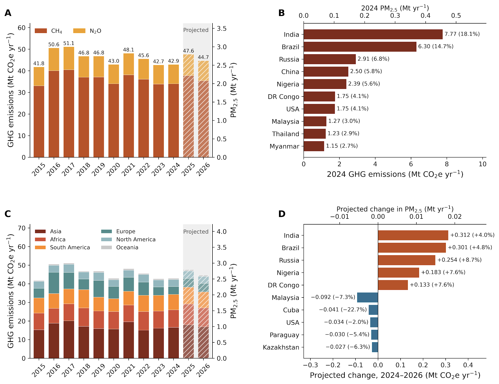
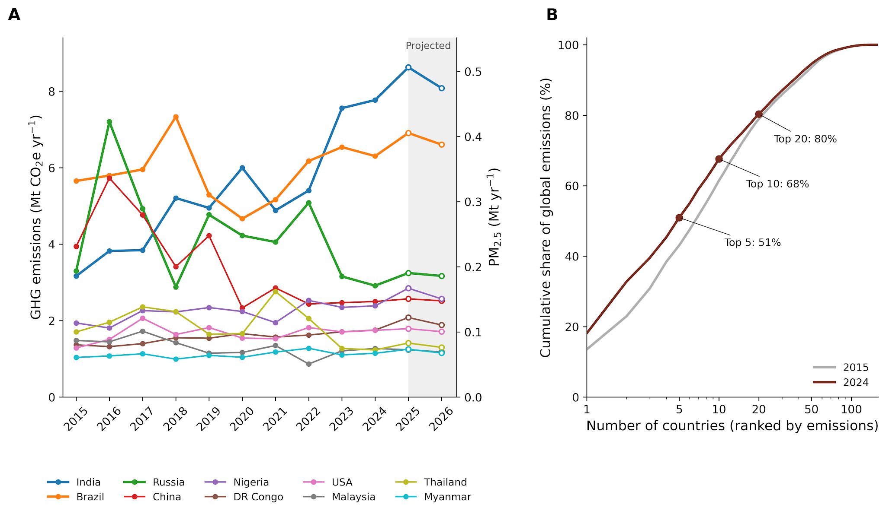
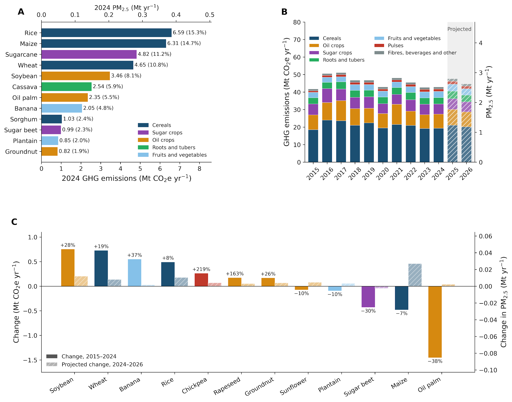
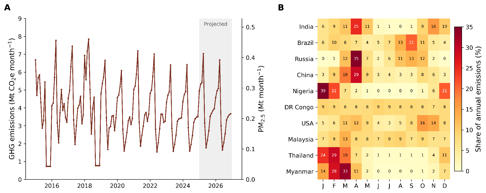

### Agriculture sector: Cropland Fires – N2O, CH4 and PM2.5 Emissions

*Greenhouse-gas and air-quality emissions from open burning of crop residue*

**Prateek Sharma\*1,3, Rajvi Trivedi1,3, Aditya Manuraj1,3, Mukta Sharma1,3, Neville Millar1,3, Sam Schiller2,3, Mike Hsu2,3, and Bruno Basso\*1,3**

*1) Department of Earth and Environmental Sciences, Michigan State University, 2) Carbon Yield, 3) Climate TRACE*

V5.12.0, Oct. 2026

*\*Corresponding Author: basso@msu,edu; sharm165@msu.edu*

#### 1. Introduction

Crop-residue burning remains a widespread post-harvest management practice in many agricultural regions because it provides a rapid and inexpensive means of clearing fields, controlling pests and weeds, and preparing land for subsequent crops (Beuchelt et al. 2015). Its persistence can also reflect local traditions, limited markets for alternative residue uses, constraints on labor and machinery, and changes in agricultural production systems that generate residue surpluses beyond local demand (Xu and You 2023; Oraby et al. 2025). Open-field burning therefore represents an important crop-residue management pathway alongside retention on the soil surface, incorporation into soil, livestock use, and other off-field uses.

Large quantities of agricultural residues are burned annually, particularly from major crops such as rice, wheat, maize, and sugarcane. Open-field burning occurs across Asia, Africa, Latin America, and other agricultural regions, including parts of North America (Andreae and Merlet 2001; McCarty et al. 2009; Vera et al. 2017; Ravindra et al. 2019). Because field burning generally involves incomplete combustion, it releases a mixture of greenhouse gases and air pollutants directly to the atmosphere. These emissions include methane (CH₄), nitrous oxide (N₂O), carbon monoxide, volatile organic compounds, black and organic carbon, and fine particulate matter. In this methodology, we focus on CH₄, N₂O, and primary particulate matter with an aerodynamic diameter ≤ 2.5 µm (PM₂.₅), which together represent important climate and air-quality consequences of crop-residue burning.

CH₄ and N₂O are radiatively important greenhouse gases, whereas PM₂.₅ is a major air-quality pollutant associated with adverse respiratory and cardiovascular outcomes and other health impacts. Because these pollutants are produced during the same combustion process, their spatial and temporal distributions are closely linked to the amount of residue burned, the geographic distribution of crop production, and the timing of post-harvest burning. Quantifying emissions from crop-residue burning therefore requires information not only on crop production and residue generation, but also on the fraction of residue that is burned and when burning occurs during the year.

Globally consistent information describing crop-residue burning remains limited. National crop-production statistics are widely available, but residue production and management vary substantially among crops, locations, and years. Smerald et al. (2023) addressed part of this gap by developing a spatially explicit global dataset that partitions cereal residues among several management pathways, including field burning, livestock use, other off-field uses, and residues retained on agricultural land. Satellite-derived cropland burned-area datasets, Global Cropland Area Burned dataset (GloCAB; Hall et al. 2024) provides monthly cropland burned-area estimates at 0.25° spatial resolution from 2002 to 2020 and was used for the timing and spatial occurrence of agricultural fires, but they do not directly quantify the mass of crop residue burned for individual crop groups. Consequently, a globally consistent emission inventory requires integration of crop-production statistics, spatial crop distributions, crop-specific residue-production characteristics, residue-management fractions, burned dry matter, pollutant-specific emission factors, and information on the seasonal timing of burning.

Climate TRACE addresses this gap through a spatially explicit framework for estimating emissions from open-field crop-residue burning. The approach uses the same underlying crop-production and residue-production framework as the companion Climate TRACE retained-residue methodology, thereby maintaining consistency between alternative residue-management pathways. Annual crop production and harvested area are spatially harmonized, aboveground residue production is estimated by crop, and the spatially explicit burned fraction is then applied to isolate the portion of residue subjected to open-field burning. Burned residue is converted to dry matter before pollutant-specific emission factors are applied to estimate direct emissions of N₂O, CH₄, and primary PM₂.₅. Annual emissions are subsequently distributed to monthly time steps using the seasonal distribution of cropland burned area from the Global Cropland Area Burned dataset (GloCAB; Hall et al. 2024).

The resulting Climate TRACE cropland-fire inventory provides annual and monthly estimates of N₂O, CH₄, and primary PM₂.₅ emissions from crop-residue burning for 2015–2026 at 5-arc-minute spatial resolution. The dataset covers 40 harmonized crop groups across more than 150 countries and provides both gridded and country-level estimates. N₂O and CH₄ are reported as individual gases and as CO₂ equivalents using IPCC AR6 global warming potentials, whereas PM₂.₅ is reported as pollutant mass. Because all three pollutants are calculated from the same burned dry-matter activity, the framework provides a consistent basis for comparing their spatial, crop-specific, national, continental, and seasonal distributions.

The primary objective of this study is to provide a globally consistent, crop-specific, and spatially explicit inventory of N₂O, CH₄, and primary PM₂.₅ emissions associated with open-field crop-residue burning. The inventory is designed to identify major crop- and region-specific sources of burning emissions and to characterize how emissions vary among crops, countries, continents, years, and months. Together, these outputs provide a consistent framework for assessing the magnitude, spatial distribution, and seasonal timing of emissions from crop-residue burning across global cropland.

#### 2. Materials and Methods

#### 2.1 Methodological overview and scope

We estimate emissions of nitrous oxide (N₂O), methane (CH₄), and primary fine particulate matter (PM₂.₅) from open-field burning of crop residues globally for 2015–2026. The inventory covers 40 harmonized crop groups and produces annual estimates at 5-arc-minute spatial resolution, which are subsequently disaggregated to monthly time steps. Emissions are calculated independently for each crop and grid cell and can subsequently be aggregated to country, continental, and global scales.

The calculation follows a sequential workflow. Annual crop production and harvested area are first harmonized spatially using the same crop-activity framework applied in the Climate TRACE retained-residue methodology. Crop-specific aboveground residue production is then estimated from crop yield using yield-dependent residue relationships where available and harvest-index relationships for the remaining crops. The resulting residue production is partitioned among management pathways using spatially explicit residue-management fractions, and the fraction assigned to open-field burning is isolated for the burning inventory.

Burned residue mass is converted to dry matter using crop-specific dry-matter fractions because the burning emission factors are expressed per unit of dry matter combusted. Pollutant-specific emission factors are then applied to estimate direct emissions of N₂O, CH₄, and primary PM₂.₅. Unlike the retained-residue N₂O methodology, the burning pathway does not include indirect soil-emission processes such as N leaching or runoff because emissions are released directly during combustion.

Annual emissions are subsequently distributed to monthly values using the temporal distribution of cropland burned area from the Global Cropland Area Burned dataset (GloCAB; Hall et al. 2024). Monthly burned-area fractions are used only to determine the intra-annual timing of emissions; they do not determine the magnitude of the annual crop-residue burning estimate. This approach preserves the independently calculated annual emission total for each grid cell while introducing spatially varying seasonality in burning emissions.

The final dataset therefore provides crop-specific annual and monthly estimates of N₂O, CH₄, and primary PM₂.₅ emissions from crop-residue burning across global cropland for 2015–2026. N₂O and CH₄ are reported both as emitted gas mass and as CO₂ equivalents using IPCC AR6 global warming potentials, whereas PM₂.₅ is reported as pollutant mass.

#### 2.2 Crop production, harvested area, and spatial harmonization

Annual crop production and harvested-area data were compiled at the country scale and harmonized with SPAM 2020 (IFPRI 2024) to generate spatially explicit crop activity data at 5-arc-minute resolution. This crop-production and harvested-area framework is common across the Climate TRACE agricultural methodologies, including synthetic N fertilizer, retained crop residue, and crop-residue burning, to ensure consistency among emission sources.

SPAM 2020 was used to define the within-country spatial distribution of each crop, while annual national crop statistics constrained the corresponding country totals. This approach preserves the spatial pattern of crop production and harvested area represented by SPAM 2020 while maintaining consistency with year-specific national statistics.

For 2015–2024, crop production and harvested area were based on FAOSTAT statistics (FAO 2025). For 2025 and 2026, projected crop activity from the same framework used in the Climate TRACE Synthetic N Fertilizer Methodology was used to extend the time series. Because the crop-production projection and spatial harmonization procedures are common across agricultural inventories, the detailed prediction framework is not repeated here.

All crop-production and harvested-area layers were aligned to the same 5-arc-minute geographic grid before residue production was calculated. This common spatial framework provides the basis for combining crop activity with crop-specific residue-production relationships, residue-management fractions, dry-matter conversion factors, and subsequent emission calculations for open-field burning.

#### 2.3 Aboveground crop-residue production

Aboveground crop-residue production was estimated independently for each crop, grid cell, and year using the same residue-production framework applied in the Climate TRACE retained-residue methodology. Crop yield was first calculated from gridded crop production and harvested area, and residue production was then estimated using crop-specific relationships according to crop type.

For barley, maize, rice, wheat, millet, sorghum, and other cereals, residue production was estimated using yield-dependent relationships derived from Smerald et al. (2023). These relationships allow the amount of residue produced per unit of harvested product to vary with crop yield rather than assuming a constant residue-to-product ratio.

For the remaining crop groups, aboveground residue production was estimated using a harvest-index approach. Harvest index represents the fraction of total aboveground biomass allocated to the harvested product and was used to derive the corresponding quantity of aboveground residue. Crop-specific harvest-index values were applied where available, with representative crop-group values used where direct crop-specific estimates were unavailable.

The resulting residue yield was multiplied by the corresponding harvested area to obtain total aboveground residue production for each crop and 5-arc-minute grid cell. Root biomass was not included in this calculation. Because the residue-production framework is common to the retained-residue and burning inventories, the detailed equations and crop-specific coefficients are provided in the Climate TRACE retained-residue methodology and are not repeated here.

The resulting annual aboveground residue estimates provide the activity basis for determining the fraction of residue assigned to open-field burning in the subsequent step.

#### 2.4 Partitioning crop residue to the open-field burning pathway

Not all aboveground crop residue produced in a grid cell is burned. We therefore used the spatially explicit crop-residue management dataset of Smerald et al. (2023) to determine the fraction of residue allocated to open-field burning. The dataset distinguishes among several residue-management pathways, including field burning, residue retained on agricultural land, livestock use, and other off-field uses.

For the crop-residue burning inventory, only the fraction assigned to field burning was used. This burned fraction was multiplied by the estimated aboveground residue production for each crop, grid cell, and year to calculate the quantity of crop residue subjected to open-field burning.

The residue-management fractions are spatially explicit but were developed primarily for cereal residues and are not available separately for all 40 crop groups represented in the Climate TRACE inventory. In the absence of a globally consistent crop-specific residue-management dataset, the same grid-cell-level burning fraction was therefore applied to all crop groups present within a given location. This approach preserves spatial variation in residue-burning practices but does not represent crop-specific differences in the probability of burning within the same grid cell.

Because the Smerald et al. (2023) residue-management data are available at a coarser spatial resolution than the 5-arc-minute crop inventory, each crop grid cell was assigned the burning fraction from the geographically nearest source-grid location.

Annual residue-management information was used through 2021. For 2022–2026, the 2021 spatial pattern of residue burning was held constant because more recent globally consistent residue-management information was unavailable. Consequently, changes in modeled burning emissions after 2021 reflect changes in crop production and harvested areas rather than assumed changes in the fraction of residue burned. The resulting crop- and grid-specific burned-residue estimates provide the activity data for conversion to burned dry matter and subsequent calculation of N₂O, CH₄, and PM₂.₅ emissions.

#### 2.5 Burned dry matter and emission calculation

The quantity of crop residue assigned to open-field burning was converted to a dry-matter basis before emissions were calculated because biomass-burning emission factors are expressed per unit of dry matter combusted. Crop-specific dry-matter fractions were the same as those used in the Climate TRACE retained-residue methodology, thereby maintaining consistency in residue characterization across the retained and burned pathways. Crop-specific values were used where available, with representative crop-group values or literature-based proxies applied where direct values were unavailable.

For each crop, grid cell, and year, burned dry matter was calculated as:

|     |                                                    |       |
|-----|----------------------------------------------------|-------|
|     | $`DM_{burn,c,i,t} = R_{burn,c,i,t} \times f_{DM,c}`$ | \(1\) |

where $`DM_{burn,c,i,t}`$is the burned residue dry matter for crop $`c`$, grid cell $`i`$, and year $`t;R_{burn,c,i,t}`$ is the residue mass allocated to open-field burning; and $`f_{DM,c}`$ is the crop-specific dry-matter fraction. The complete dry-matter parameterization is common to the retained-residue methodology and is therefore not repeated here.

Annual emissions of N₂O, CH₄, and primary PM₂.₅ were then calculated by applying pollutant-specific emission factors to the estimated burned dry matter:

|     |                                               |       |
|-----|-----------------------------------------------|-------|
|     | $`E_{p,c,i,t} = DM_{burn,c,i,t} \times EF_{p}`$ | \(2\) |

where $`E_{p,c,i,t}`$ represents emissions of pollutant $`p`$ and $`EF_{p}`$is the corresponding emission factor per unit of dry matter burned.

For N₂O and CH₄, default emission factors for agricultural-residue burning were obtained from Volume 4, Chapter 2, Table 2.5 of the 2019 Refinement to the 2006 IPCC Guidelines for National Greenhouse Gas Inventories (IPCC 2019). The emission factors were 0.07 g N₂O kg⁻¹ dry matter burned and 2.7 g CH₄ kg⁻¹ dry matter burned.

Primary PM₂.₅ emissions were estimated using the Tier 1 emission factor reported by Dobosz et al. (2025). A default emission factor of 5.4 g PM₂.₅ kg⁻¹ dry matter burned was applied to all burned crop residues. Dobosz et al. (2025) reported a 95% confidence interval of 4.2–6.7 g PM₂.₅ kg⁻¹ dry matter for this Tier 1 factor.

Because N₂O, CH₄, and PM₂.₅ emissions are all calculated from the same burned dry-matter activity, the three species have the same underlying spatial, crop-specific, and temporal activity patterns. Differences in their emission magnitudes arise from the pollutant-specific emission factors.

The N₂O and CH₄ emissions estimated here represent direct emissions released during open-field combustion. Unlike N₂O emissions from residues retained on agricultural land, no indirect emission pathway associated with N leaching or runoff is included. Country- or region-specific soil N₂O emission factors are also not applied because these emissions arise directly from biomass combustion rather than from subsequent soil microbial processes.

N₂O and CH₄ emissions were converted to CO₂ equivalents using global warming potentials from the IPCC Sixth Assessment Report (AR6). For the 100-year time horizon, GWP₁₀₀ values of 273 for N₂O and 27 for non-fossil CH₄ were used, while GWP₂₀ values of 273 for N₂O and 79.7 for non-fossil CH₄ were used for the 20-year time horizon (Forster et al. 2021).

For the 100-year time horizon,

|     |                                                                  |       |
|-----|------------------------------------------------------------------|-------|
|     | $`E_{CO_{2}e,100} = 273 \times E_{N_{2}O} + 27 \times E_{CH_{4}}`$ | \(3\) |

For the 20-year time horizon,

|     |                                                                   |       |
|-----|-------------------------------------------------------------------|-------|
|     | $`E_{CO_{2}e,20} = 273 \times E_{N_{2}O} + 79.7 \times E_{CH_{4}}`$ | \(4\) |

PM₂.₅ was reported separately as pollutant mass and was not converted to CO₂ equivalents.

#### 2.6 Monthly disaggregation of annual burning emissions

Annual N₂O, CH₄, and primary PM₂.₅ emissions from crop-residue burning were disaggregated to monthly estimates using the Global Cropland Area Burned dataset (GloCAB; Hall et al. 2024). GloCAB provides monthly cropland burned-area estimates at 0.25° spatial resolution from 2002 to 2020 and was used only to characterize the intra-annual timing of burning. The magnitude of annual emissions remained determined independently from the crop-residue burning calculations described above.

For inventory years 2015–2020, the corresponding year-specific GloCAB monthly layers were used. Because GloCAB does not extend beyond 2020, the 2020 monthly burned-area pattern was applied to 2021–2026. The monthly layers were processed as 12-band annual datasets and spatially aligned with the 5-arc-minute Climate TRACE emission grid.

For each grid cell, the monthly burned-area values were converted to temporal weights by dividing the burned area in each month by the sum across all 12 months:

|     |                                             |       |
|-----|---------------------------------------------|-------|
|     | $`w_{i,m.t} = \frac{BA_{i,m,t}}{BA_{i,m,t}}`$ | \(5\) |

where $`w_{i,m,t}`$ is the monthly temporal weight for grid cell $`i`$, month $`m`$, and year $`t`$, and $`BA_{i,m,t}`$ is the corresponding GloCAB burned-area value. The resulting 12 monthly weights sum to one for each grid cell.

Monthly emissions were then calculated by multiplying independently estimated annual emissions by the corresponding monthly weight:

|     |                                                            |       |
|-----|------------------------------------------------------------|-------|
|     | $`E_{p,i,m,t} = E_{p,i,t}^{\text{annual}} \times w_{i,m,t}`$ | \(6\) |

where $`E_{p,i,m,t}`$ is the monthly emission of pollutant $`p`$ and $`E_{p,i,t}^{\text{annual}}`$ is the annual crop-residue burning emission for the same grid cell and year. This procedure was applied identically to N₂O, CH₄, and PM₂.₅ and therefore preserves the annual emission total exactly while allocating it among months according to the GloCAB seasonal pattern.

In some grid cells, the crop-residue inventory estimated non-zero annual burning emissions even though GloCAB contained no burned area in any month. This can occur because the annual inventory is derived from crop production and residue-management information rather than directly from satellite fire detections. Small or short-duration agricultural fires may not be detected, and differences can also occur between the cropland distributions represented by the two datasets. For these grid cells, annual emissions were distributed uniformly across the year, assigning one twelfth of the annual total to each month.

Where individual monthly GloCAB values were missing, the processing framework allowed the value to be assigned from the geographically nearest valid grid cell for that month. However, the GloCAB layers used in the final implementation contained no missing monthly pixel values requiring this procedure.

The processed 2015 and 2018 GloCAB layers contained no burned-area values during September–December. Consequently, monthly estimates for these two years do not fully represent the expected seasonal distribution of cropland burning during those months. Annual emissions remain unaffected because the temporal disaggregation preserves the independently calculated annual totals, but the monthly distribution for 2015 and 2018 should be interpreted with caution.

#### 2.7 Final crop-residue burning emission dataset

The final Climate TRACE crop-residue burning dataset provides annual and monthly, spatially explicit estimates of N₂O, CH₄, and primary PM₂.₅ emissions from open-field burning of crop residues for global cropland from 2015 to 2026. The dataset covers 40 harmonized crop groups and is available at both 5-arc-minute gridded resolution and country scale.

For each crop, grid cell, and year, the dataset includes the estimated quantity of aboveground crop residue allocated to open-field burning and the corresponding burned dry matter. These activity data provide the basis for calculating pollutant-specific emissions using the emission factors described in Section 2.5.

The emissions component provides crop-specific estimates of N₂O, CH₄, and primary PM₂.₅ released directly from open-field combustion. N₂O and CH₄ are reported as emitted gas mass and as CO₂-equivalent emissions using IPCC AR6 20-year and 100-year global warming potentials. Primary PM₂.₅ is reported as pollutant mass and is not converted to CO₂ equivalents.

Annual emission estimates are additionally provided at monthly resolution using the GloCAB temporal-allocation framework described in Section 2.6. Monthly values preserve the independently calculated annual emission total for each grid cell while distributing emissions according to the seasonal pattern of cropland burning represented by GloCAB.

Estimates for 2015–2024 are based on FAOSTAT crop-production and harvested-area statistics, whereas crop activity for 2025 and 2026 is projected using the common Climate TRACE crop-production framework. The spatial residue-burning fractions are available through 2021 and are held constant at their 2021 values for 2022–2026. Consequently, changes in estimated emissions during 2022–2026 reflect changes in crop production and harvested area rather than assumed changes in residue-burning behavior.

The resulting dataset therefore includes, for 2015–2026: (1) crop residue allocated to open-field burning, (2) direct N₂O emissions, (3) direct CH₄ emissions, (4) primary PM₂.₅ emissions, and (5) annual and monthly emission estimates at crop, grid-cell, country, continental, and global scales.

#### 3. Emission Reduction Solutions (ERS)

The Emission Reduction Solution (ERS) for crop-residue burning is defined as the avoidance of open-field burning rather than the complete removal of crop residues from field. Residues that would otherwise be burned should remain on the field or managed differently than burning if removed. In-field alternatives to burning clearly include retaining residues on the soil surface and sowing through them with low-till or no-till equipment, mulching, and incorporating chopped residues into the soil surface. Off-field alternatives to burning include collection for livestock feed or bedding, composting, mushroom cultivation, bioenergy production (including electricity generation), biochar production, and other industrial uses where suitable infrastructure and markets are available (Dutta et al. 2022; Kaur et al. 2022; Singh et al. 2022).

The suitability of these alternatives depends strongly on the cropping system, soil and climate conditions, machinery availability, transportation requirements, local processing capacity, and demand for residue-derived products (Kaur et al. 2022; Krishna and Mkondiwa 2023). These constraints can be particularly important in intensive multiple-cropping systems, where the short interval between harvest and establishment of the subsequent crop can limit the time available for residue management (Dutta et al. 2022; Kaur et al. 2022; Lan et al. 2022). Consequently, no single alternative residue-management pathway is expected to be appropriate across all agricultural systems. In-field retention or incorporation may be preferable where maintaining soil cover and organic matter is important, whereas off-field collection may be appropriate where residues are in excess and can be sustainably removed and used economically for feed, energy, biochar, compost, or other products, without impact soil organic matter and soil health (Turmel et al. 2015; Dutta et al. 2022; Kaur et al. 2022).

A recent life-cycle analysis provides quantitative evidence that alternative residue-management pathways can substantially reduce the environmental impacts associated with open burning. Prateep Na Talang et al. (2024) compared open burning with two zero-burning pathways for corn residue, rice straw, and sugarcane leaves through the conversion of residues to organic fertilizer by chopping and incorporation into soil, and conversion to biochar by slow pyrolysis. Under the assumptions and system boundaries of that study, the fertilizer-management scenarios reduced the global warming impact by factors of 1.88–1.96 relative to open burning, while the biochar scenarios reduced it by factors of 2.46–3.22. The biochar scenarios produced the lowest modeled global warming impacts, ranging from approximately −2,477 to −1,473 kg CO₂e per tonne of residue depending on residue type (Prateep Na Talang et al. 2024).

These quantitative values should not be interpreted as universal emission-reduction factors for the Climate TRACE ERS. Prateep Na Talang et al. (2024) evaluated three residue types under conditions representative of Thailand, and the system boundaries included processes that differ from those represented in the Climate TRACE cropland-burning inventory. For example, the biochar scenarios included truck transport of residues to processing facilities within a 100-km radius, and the fertilizer scenarios included machinery and fuel use for residue chopping and field incorporation. In both pathways, fossil-fuel consumption was the main source of the remaining life-cycle impacts. The results therefore demonstrate the potential environmental benefit of alternative residue-management pathways but should not be extrapolated as a single globally applicable mitigation factor.

Even where complete residue removal is logistically feasible, it is not necessarily the preferred management option from a soil-health perspective. Retaining crop residues can provide important benefits by returning organic matter and nutrients to the soil, protecting the soil surface, and supporting soil moisture retention, aggregate stability, biological activity, and long-term soil organic carbon storage. Reviews of residue-management systems indicate that retention or incorporation generally provides greater soil-health benefits than complete residue removal, although responses depend on climate, soil conditions, cropping system, and competing uses of residues (Turmel et al. 2015; Fu et al. 2021; Kaur et al. 2022). Accordingly, an ERS designed to eliminate burning should not be interpreted as a recommendation to remove all crop residues. The amount that can be sustainably removed or diverted to alternative uses should be determined according to local residue production, soil condition, erosion risk, nutrient requirements, and competing uses.

For this version of the Climate TRACE ERS, we use a simplified counterfactual representing complete avoidance of modeled open-field burning (Table S2). The biomass-burned activity value is set to zero, corresponding to 100% elimination of the burning activity represented in the baseline inventory. As a result, direct N₂O, CH₄, and primary PM₂.₅ emissions from crop-residue burning are avoided. This scenario represents an upper-bound estimate of gross emissions that could be avoided if modeled open-field burning ceased; it does not assume that 100% of residues are physically removed from the field and does not prescribe a single alternative residue-management pathway.

The avoided emissions reported by this ERS should be interpreted as gross avoided open-burning emissions rather than net life-cycle mitigation. Alternative residue-management pathways can generate additional emissions through machinery operation, residue collection, transportation, processing, and energy use (Prateep Na Talang et al. 2024), and can also alter soil organic carbon and nutrient cycling (Turmel et al. 2015; Fu et al. 2021). The magnitude and direction of these additional effects depend on the alternative pathway selected and the local production system.

Future iterations will aim to identify location-specific management pathways using a systems approach by distinguishing residue that should remain in the field to maintain soil functions from residue that could be sustainably collected for alternative uses. Such an assessment should account for crop residue characteristics, soil organic carbon status, erosion risk, nutrient requirements, machinery availability, transportation distance, processing infrastructure, local markets, and the emissions and potential carbon benefits associated with the final use of the residue. This location-specific systems approach is important because the technical feasibility, economic viability, and environmental performance of alternatives to burning vary substantially among cropping systems and regions (Dutta et al. 2022; Kaur et al. 2022; Krishna and Mkondiwa 2023).

#### 4. Results

This section presents emissions of N₂O, CH₄, and primary PM₂.₅ from open-field crop-residue burning for 2015–2026. Estimates for 2015–2024 are based on FAOSTAT crop-production and harvested-area statistics, whereas estimates for 2025 and 2026 are based on projected crop activity. Residue-burning fractions are held at their 2021 values from 2022 onward; therefore, changes during 2022–2026 reflect changes in crop production and harvested area rather than assumed changes in residue-burning behavior. National and crop-level distributions are described primarily for 2024, the most recent year based on FAOSTAT statistics, while projected changes are reported separately. Depending on the year, the inventory includes 153–158 countries.

#### 4.1 Reporting of N₂O, CH₄, and PM₂.₅ emissions

N₂O, CH₄, and primary PM₂.₅ emissions were calculated by applying fixed, pollutant-specific emission factors to the same burned dry-matter activity. Consequently, the three emitted species have identical spatial distributions, temporal patterns, crop rankings, and country rankings, while differing in absolute magnitude according to their respective emission factors (Figure 1A).

Based on the emission factors used in this inventory, CH₄ emissions are approximately 38.6 times larger than N₂O emissions by mass, while PM₂.₅ emissions are approximately twice CH₄ emissions by mass. Because these proportional relationships are constant across crops, countries, grid cells, and years, the three species are presented together in the following analyses rather than in separate result sections.

Greenhouse-gas emissions are reported as the combined contribution of N₂O and CH₄ expressed as CO₂ equivalents using IPCC AR6 global warming potentials. For the 100-year time horizon, GWP₁₀₀ values of 273 for N₂O and 27 for non-fossil CH₄ were used. Primary PM₂.₅ is reported separately as pollutant mass because it is not treated as a greenhouse gas in this inventory (Table 1; Figure 1A).

Using GWP₁₀₀, CH₄ accounted for 79.2% of combined N₂O + CH₄ CO₂-equivalent emissions, while N₂O accounted for 20.8% in every year (Table 1; Figure 1A).

#### 4.2 Global emissions between 2015 and 2026

Global greenhouse-gas emissions from open-field crop-residue burning were 41.8 Mt CO₂e yr⁻¹ in 2015 and 42.9 Mt CO₂e yr⁻¹ in 2024, representing an increase of 1.15 Mt CO₂e yr⁻¹, or 2.7% (Table 1; Figure 1A). The corresponding emissions were 0.032 and 0.033 Mt N₂O yr⁻¹, 1.23 and 1.26 Mt CH₄ yr⁻¹, and 2.45 and 2.52 Mt PM₂.₅ yr⁻¹, respectively. Over 2015–2024, however, emissions did not show a sustained monotonic trend. Annual GHG emissions ranged from 41.8 to 51.1 Mt CO₂e yr⁻¹ and averaged 45.9 Mt CO₂e yr⁻¹, with the highest value occurring in 2017 at 51.1 Mt CO₂e yr⁻¹, corresponding to 3.00 Mt PM₂.₅ yr⁻¹ (Table 1; Figure 1A).

###

Substantial interannual variability occurred throughout the historical period. Emissions increased in five of the nine year-to-year transitions between 2015 and 2024, with the largest increase occurring between 2015 and 2016 (+8.81 Mt CO₂e; +21.1%). A second pronounced increase occurred between 2020 and 2021 (+5.19 Mt CO₂e; +12.1%), while smaller increases occurred between 2016 and 2017, 2018 and 2019, and 2023 and 2024. Emissions declined between 2017 and 2018 (−8.5%), 2019 and 2020 (−8.3%), 2021 and 2022 (−5.3%), and 2022 and 2023 (−6.2%) (Table 1; Figure 1A).

For the projected period, global emissions increased to 47.6 Mt CO₂e yr⁻¹ in 2025, 4.70 Mt CO₂e yr⁻¹ (+11.0%) above the 2024 level, before declining to 44.7 Mt CO₂e yr⁻¹ in 2026 (Table 1; Figure 1A). Despite this decline, projected emissions in 2026 remained 1.74 Mt CO₂e yr⁻¹ (+4.1%) above the 2024 value. The corresponding projected PM₂.₅ emissions were 2.80 Mt yr⁻¹ in 2025 and 2.62 Mt yr⁻¹ in 2026. Because the residue-burning fractions were held constant at their 2021 values after this year, these projected changes reflect changes in crop production and harvested area rather than assumed changes in residue-burning behavior.

**Table 1** Global annual emissions from cropland fires by species, and GHG emissions expressed with 100-year and 20-year global warming potentials. The annual change refers to GWP₁₀₀ GHG emissions and is calculated from unrounded totals. Values for 2015–2024 are based on FAOSTAT crop statistics; 2025 and 2026 are projected.

<table><thead><tr class="header"><th><strong>Year</strong></th><th><strong>N₂O 
(Mt yr⁻¹)</strong></th><th><strong>CH₄ 
(Mt yr⁻¹)</strong></th><th><strong>PM₂.₅ 
(Mt yr⁻¹)</strong></th><th><strong>GHG, GWP₁₀₀ 
(Mt CO₂e yr⁻¹)</strong></th><th><strong>GHG, GWP₂₀ 
(Mt CO₂e yr⁻¹)</strong></th><th><strong>Change 
(%)</strong></th><th><strong>Data basis</strong></th></tr></thead><tbody><tr class="odd"><td>2015</td><td>0.0318</td><td>1.227</td><td>2.453</td><td>41.80</td><td>106.43</td><td>—</td><td>FAOSTAT-based</td></tr><tr class="even"><td>2016</td><td>0.0385</td><td>1.485</td><td>2.970</td><td>50.60</td><td>128.86</td><td>+21.1</td><td>FAOSTAT-based</td></tr><tr class="odd"><td>2017</td><td>0.0389</td><td>1.501</td><td>3.002</td><td>51.14</td><td>130.23</td><td>+1.1</td><td>FAOSTAT-based</td></tr><tr class="even"><td>2018</td><td>0.0356</td><td>1.373</td><td>2.746</td><td>46.78</td><td>119.13</td><td>−8.5</td><td>FAOSTAT-based</td></tr><tr class="odd"><td>2019</td><td>0.0356</td><td>1.374</td><td>2.748</td><td>46.82</td><td>119.22</td><td>+0.1</td><td>FAOSTAT-based</td></tr><tr class="even"><td>2020</td><td>0.0327</td><td>1.260</td><td>2.521</td><td>42.95</td><td>109.38</td><td>−8.3</td><td>FAOSTAT-based</td></tr><tr class="odd"><td>2021</td><td>0.0366</td><td>1.413</td><td>2.825</td><td>48.14</td><td>122.58</td><td>+12.1</td><td>FAOSTAT-based</td></tr><tr class="even"><td>2022</td><td>0.0347</td><td>1.337</td><td>2.674</td><td>45.57</td><td>116.04</td><td>−5.3</td><td>FAOSTAT-based</td></tr><tr class="odd"><td>2023</td><td>0.0325</td><td>1.254</td><td>2.507</td><td>42.72</td><td>108.79</td><td>−6.2</td><td>FAOSTAT-based</td></tr><tr class="even"><td>2024</td><td>0.0327</td><td>1.260</td><td>2.520</td><td>42.94</td><td>109.36</td><td>+0.5</td><td>FAOSTAT-based</td></tr><tr class="odd"><td>2025</td><td>0.0362</td><td>1.398</td><td>2.796</td><td>47.65</td><td>121.33</td><td>+11.0</td><td>Projected</td></tr><tr class="even"><td>2026</td><td>0.0340</td><td>1.311</td><td>2.623</td><td>44.69</td><td>113.79</td><td>−6.2</td><td>Projected</td></tr></tbody></table>

**Figure 1** Historical and projected emissions from cropland fires and their national and continental composition. (A) Global annual GHG emissions by gas, 2015–2026. (B) The ten largest national contributors in 2024; values in parentheses are shares of the global total. (C) Annual emissions by continent, 2015–2026; Russia and Cyprus are included in Europe, and Türkiye, Kazakhstan and the South Caucasus countries in Asia. (D) The five largest projected national increases and the five largest projected decreases between 2024 and 2026, ranked by absolute change; values in parentheses give the percentage change. In panels A and C, hatched bars and shading denote projected years (2025–2026). GHG emissions are the sum of N₂O and CH₄ expressed as CO₂e using GWP₁₀₀ (N₂O = 273; CH₄ = 27). The secondary axis gives the corresponding primary PM₂.₅ emissions; because all three species are calculated from the same burned dry matter, 1 Mt CO₂e corresponds to 0.0587 Mt PM₂.₅.

###

#### 4.3 Country-scale distribution and changes

Emissions from open-field crop-residue burning were concentrated in a relatively small number of countries (Table 2; Figure 1B). In 2024, India was the largest national contributor, with 7.77 Mt CO₂e yr⁻¹, representing 18.1% of the global total. Brazil was the second-largest contributor at 6.30 Mt CO₂e yr⁻¹ (14.7%), followed by Russia at 2.91 Mt CO₂e yr⁻¹ (6.8%), China at 2.50 Mt CO₂e yr⁻¹ (5.8%), and Nigeria at 2.39 Mt CO₂e yr⁻¹ (5.6%). India and Brazil together accounted for 32.8% of global emissions, while the five largest contributors accounted for 50.9%, the ten largest for 67.6%, and the twenty largest for 80.3% (Figure 2B). In contrast, 49 countries each emitted less than 0.01 Mt CO₂e yr⁻¹ and together accounted for only 0.3% of the global total.

The concentration of emissions among the largest national sources increased between 2015 and 2024. The share of the five largest contributors rose from 43.1% to 50.9%, while the share of the ten largest contributors increased from 61.5% to 67.6% (Figure 2B). National rankings also shifted over this period. India moved from fourth place in 2015 to first place in 2024, Brazil moved from first to second, and China moved from second to fourth. The Democratic Republic of Congo moved from ninth to sixth, the USA from tenth to seventh, and Myanmar from twelfth to tenth, whereas Indonesia, which ranked sixth in 2015, was no longer among the ten largest contributors in 2024 (Table 2; Figure 2A).

National trajectories differed substantially among major emitting countries (Figure 2A). Emissions from India increased from 3.17 Mt CO₂e yr⁻¹ in 2015 to 7.77 Mt CO₂e yr⁻¹ in 2024 and exceeded those from Brazil in 2020 and again from 2023 onward. In contrast, Russia and China showed greater interannual variability, with both reaching their highest annual emissions in 2016 at 7.20 and 5.73 Mt CO₂e yr⁻¹, respectively.

Among the 153 countries represented in both 2015 and 2024, emissions increased in 73 countries and decreased in 80. The largest absolute increase occurred in India, where emissions increased by 4.61 Mt CO₂e yr⁻¹ (+145.5%), followed by Brazil (+0.65 Mt CO₂e yr⁻¹; +11.5%), the USA (+0.46; +35.9%), Nigeria (+0.45; +23.1%), and the Democratic Republic of Congo (+0.39; +28.3%). The largest decreases occurred in Indonesia (−1.51 Mt CO₂e yr⁻¹; −81.1%), China (−1.44; −36.6%), Thailand (−0.47; −27.6%), Russia (−0.39; −11.7%), and Argentina (−0.34; −42.2%) (see Table 2 for countries among the ten largest contributors in 2024).

These national changes were associated with different crop contributions. The increase in India was driven primarily by rice, wheat, and banana, while the decline in Indonesia was dominated by oil palm. In China, decreases in rice and maize made the largest contributions to the national decline. Because residue-burning fractions vary through 2023, changes between 2015 and 2024 reflect both changes in crop production and harvested area and changes in the estimated fraction of residue allocated to burning.

Between 2024 and 2026, global emissions were projected to increase by 1.74 Mt CO₂e yr⁻¹ (+4.1%), but the magnitude and direction of change varied substantially among countries (Figure 1D). India showed the largest projected absolute increase (+0.31 Mt CO₂e yr⁻¹; +4.0%), followed by Brazil (+0.30; +4.8%), Russia (+0.25; +8.7%), Nigeria (+0.18; +7.6%), and the Democratic Republic of Congo (+0.13; +7.6%). These increases were partially offset by projected decreases in Malaysia, Cuba, the USA, Paraguay, and Kazakhstan. Because residue-burning fractions are held constant after 2023, projected changes during 2024–2026 reflect changes in projected crop production and harvested area rather than assumed changes in burning behavior.

**Table 2** The ten largest national contributors to emissions from cropland fires in 2024. GHG emissions are in Mt CO₂e yr⁻¹ (GWP₁₀₀) and PM₂.₅ in Mt yr⁻¹. Percentage changes apply equally to N₂O, CH₄ and PM₂.₅.

<table><thead><tr class="header"><th><strong>Country</strong></th><th><strong>2015</strong></th><th><strong>2024</strong></th><th><strong>2024 
share (%)</strong></th><th><strong>Change 
2015–2024 (%)</strong></th><th><strong>PM₂.₅ 
2024 (Mt)</strong></th><th><strong>2026 
(projected)</strong></th><th><strong>Change 
2024–2026 (%)</strong></th></tr></thead><tbody><tr class="odd"><td>India</td><td>3.17</td><td>7.77</td><td>18.1</td><td>+145.5</td><td>0.456</td><td>8.08</td><td>+4.0</td></tr><tr class="even"><td>Brazil</td><td>5.65</td><td>6.30</td><td>14.7</td><td>+11.5</td><td>0.370</td><td>6.60</td><td>+4.8</td></tr><tr class="odd"><td>Russia</td><td>3.30</td><td>2.91</td><td>6.8</td><td>−11.7</td><td>0.171</td><td>3.17</td><td>+8.7</td></tr><tr class="even"><td>China</td><td>3.94</td><td>2.50</td><td>5.8</td><td>−36.6</td><td>0.147</td><td>2.52</td><td>+0.7</td></tr><tr class="odd"><td>Nigeria</td><td>1.94</td><td>2.39</td><td>5.6</td><td>+23.1</td><td>0.140</td><td>2.57</td><td>+7.6</td></tr><tr class="even"><td>DR Congo</td><td>1.37</td><td>1.75</td><td>4.1</td><td>+28.3</td><td>0.103</td><td>1.89</td><td>+7.6</td></tr><tr class="odd"><td>USA</td><td>1.29</td><td>1.75</td><td>4.1</td><td>+35.9</td><td>0.102</td><td>1.71</td><td>−2.0</td></tr><tr class="even"><td>Malaysia</td><td>1.48</td><td>1.27</td><td>3.0</td><td>−14.1</td><td>0.075</td><td>1.18</td><td>−7.3</td></tr><tr class="odd"><td>Thailand</td><td>1.70</td><td>1.23</td><td>2.9</td><td>−27.6</td><td>0.072</td><td>1.30</td><td>+5.4</td></tr><tr class="even"><td>Myanmar</td><td>1.04</td><td>1.15</td><td>2.7</td><td>+10.5</td><td>0.067</td><td>1.15</td><td>+0.7</td></tr></tbody></table>

**Figure 2** National trajectories and concentration of emissions from cropland fires. (A) Annual emissions, 2015–2026, for the ten largest national contributors in 2024; open symbols and shading denote projected years (2025–2026). (B) Cumulative share of global emissions by number of countries, ranked from largest to smallest emitter, in 2015 and 2024; the shares apply equally to N₂O, CH₄ and PM₂.₅. GHG emissions are the sum of N₂O and CH₄ expressed as CO₂e using GWP₁₀₀ (N₂O = 273; CH₄ = 27). The secondary axis in panel A gives the corresponding primary PM₂.₅ emissions; because all three species are calculated from the same burned dry matter, 1 Mt CO₂e corresponds to 0.0587 Mt PM₂.₅.

#### 4.4 Crop contributions

Emissions from open-field crop-residue burning were concentrated in a relatively small number of crops (Table 3; Figure 3A). In 2024, rice was the largest crop-specific source, contributing 6.59 Mt CO₂e yr⁻¹, or 15.3% of the global total, followed by maize at 6.31 Mt CO₂e yr⁻¹ (14.7%), sugarcane at 4.82 Mt CO₂e yr⁻¹ (11.2%), wheat at 4.65 Mt CO₂e yr⁻¹ (10.8%), and soybean at 3.46 Mt CO₂e yr⁻¹ (8.1%). Cassava, oil palm, banana, sorghum, and sugar beet completed the ten largest crop contributors. The three largest crops accounted for 41.2% of global emissions, the five largest for 60.1%, and the ten largest for 81.0%.

When aggregated into broader crop groups, cereals were the dominant source in 2024, contributing 19.4 Mt CO₂e yr⁻¹, or 45.1% of the global total (Figure 3B). Oil crops contributed 8.0 Mt CO₂e yr⁻¹ (18.7%), followed by sugar crops at 5.8 Mt CO₂e yr⁻¹ (13.5%), roots and tubers at 3.7 Mt CO₂e yr⁻¹ (8.5%), and fruits and vegetables at 3.5 Mt CO₂e yr⁻¹ (8.2%). Pulses and the combined fibres, beverages, and other-crops category together accounted for the remaining 5.9%. Soybean and groundnut were included within the oil-crop category for this aggregation.

Crop-specific contributions changed substantially between 2015 and 2024 (Figure 3C). The largest absolute increases occurred for soybean (+0.75 Mt CO₂e yr⁻¹; +27.8%), wheat (+0.73; +18.5%), banana (+0.55; +36.6%), and rice (+0.49; +8.0%). In contrast, emissions decreased for oil palm (−1.45 Mt CO₂e yr⁻¹; −38.2%), maize (−0.48; −7.1%), and sugar beet (−0.43; −30.2%). At the crop-group level, emissions increased most strongly in proportional terms for pulses (+52.2%) and fruits and vegetables (+15.4%), while emissions from sugar crops and oil crops declined by 6.8% and 4.9%, respectively.

Projected crop-level changes between 2024 and 2026 were generally smaller than the historical changes but varied among crops (Table 3; Figure 3C). The largest projected increases occurred for maize (+0.46 Mt CO₂e yr⁻¹; +7.3%), soybean (+0.20; +5.9%), rice (+0.18; +2.7%), cassava (+0.16; +6.3%), and wheat (+0.14; +2.9%). Sugar beet and sugarcane were projected to decline slightly over the same period, by 4.4% and 0.3%, respectively.

Because N₂O, CH₄, and PM₂.₅ are all calculated from the same burned dry-matter activity using fixed pollutant-specific emission factors, the crop rankings and percentage contributions reported here apply equally to all three emitted species.

**Table 3** The ten largest crop contributors to emissions from cropland fires in 2024. GHG emissions are in Mt CO₂e yr⁻¹ (GWP₁₀₀) and PM₂.₅ in Mt yr⁻¹. Percentage changes apply equally to N₂O, CH₄ and PM₂.₅.

<table><thead><tr class="header"><th><strong>Crop</strong></th><th><strong>2015</strong></th><th><strong>2024</strong></th><th><strong>2024 
share (%)</strong></th><th><strong>Change 
2015–2024 (%)</strong></th><th><strong>PM₂.₅ 
2024 (Mt)</strong></th><th><strong>2026 
(projected)</strong></th><th><strong>Change 
2024–2026 (%)</strong></th></tr></thead><tbody><tr class="odd"><td>Rice</td><td>6.10</td><td>6.59</td><td>15.3</td><td>+8.0</td><td>0.387</td><td>6.77</td><td>+2.7</td></tr><tr class="even"><td>Maize</td><td>6.79</td><td>6.31</td><td>14.7</td><td>−7.1</td><td>0.370</td><td>6.77</td><td>+7.3</td></tr><tr class="odd"><td>Sugarcane</td><td>4.81</td><td>4.82</td><td>11.2</td><td>+0.1</td><td>0.283</td><td>4.80</td><td>−0.3</td></tr><tr class="even"><td>Wheat</td><td>3.92</td><td>4.65</td><td>10.8</td><td>+18.5</td><td>0.273</td><td>4.79</td><td>+2.9</td></tr><tr class="odd"><td>Soybean</td><td>2.71</td><td>3.46</td><td>8.1</td><td>+27.8</td><td>0.203</td><td>3.67</td><td>+5.9</td></tr><tr class="even"><td>Cassava</td><td>2.45</td><td>2.54</td><td>5.9</td><td>+3.7</td><td>0.149</td><td>2.70</td><td>+6.3</td></tr><tr class="odd"><td>Oil palm</td><td>3.80</td><td>2.35</td><td>5.5</td><td>−38.2</td><td>0.138</td><td>2.39</td><td>+1.7</td></tr><tr class="even"><td>Banana</td><td>1.50</td><td>2.05</td><td>4.8</td><td>+36.6</td><td>0.120</td><td>2.08</td><td>+1.4</td></tr><tr class="odd"><td>Sorghum</td><td>0.91</td><td>1.03</td><td>2.4</td><td>+14.0</td><td>0.061</td><td>1.03</td><td>−0.4</td></tr><tr class="even"><td>Sugar beet</td><td>1.42</td><td>0.99</td><td>2.3</td><td>−30.2</td><td>0.058</td><td>0.95</td><td>−4.4</td></tr></tbody></table>

**Figure 3** Crop contributions to emissions from cropland fires. (A) The twelve largest crop contributors in 2024; values in parentheses are shares of the global total. (B) Emissions by crop group, 2015–2026; hatched bars and shading denote projected years (2025–2026). Soybean and groundnut are included in oil crops. (C) Crops with the largest absolute changes between 2015 and 2024 (solid bars; labels give the percentage change relative to 2015) and their projected changes between 2024 and 2026 (hatched bars). GHG emissions are the sum of N₂O and CH₄ expressed as CO₂e using GWP₁₀₀ (N₂O = 273; CH₄ = 27). The secondary axes give the corresponding primary PM₂.₅ emissions; because all three species are calculated from the same burned dry matter, 1 Mt CO₂e corresponds to 0.0587 Mt PM₂.₅.

#### 4.4.1 Crop–country distribution of emissions

The leading national contributors differed substantially among crops, reflecting the geographic distribution of crop production and the spatial pattern of residue burning (Table 4). In 2024, rice emissions were dominated by India, which contributed 36.2% of the global rice-burning total, followed by Myanmar (11.0%), Thailand (10.0%), and China (10.0%). Maize emissions were more geographically distributed, with Brazil contributing 17.1%, China 15.7%, India 8.2%, and the USA 6.4%.

Several crops showed strong geographic concentration. Brazil accounted for 61.0% of global sugarcane-burning emissions and 43.8% of soybean-burning emissions, while Malaysia contributed 51.0% of emissions from oil palm. Wheat emissions were led by India (33.5%) and Russia (26.7%), which together accounted for 60.2% of the global wheat total. Cassava emissions were concentrated primarily in the Democratic Republic of Congo (33.7%) and Nigeria (17.1%), which together contributed 50.8% of global cassava-burning emissions. Sugar-beet emissions were dominated by Russia, which accounted for 53.8% of the global total (Table 4).

These crop-specific geographic patterns also explain much of the composition of national emissions. In India, rice accounted for 30.7% of national crop-residue burning emissions, followed by wheat at 20.1% and banana at 10.0%. In Brazil, sugarcane contributed 46.6% of national emissions, followed by soybean at 24.1% and maize at 17.1%. In Russia, wheat and sugar beet were the dominant crop sources, while maize and rice accounted for the largest shares in China. Oil palm was the dominant crop source in Indonesia, contributing 76.8% of national crop-residue burning emissions.

These results demonstrate that national burning emissions are determined not only by the overall scale of agricultural production, but also by the crop composition of each agricultural system and the spatially varying fraction of residue allocated to open-field burning.

**Table 4** Leading national contributors to emissions from cropland fires for the ten largest crop contributors in 2024. The first column gives global crop-specific GHG emissions in Mt CO₂e yr⁻¹ (GWP₁₀₀); the remaining columns give the five largest national contributors and their share (%) of global emissions for that crop, which applies equally to N₂O, CH₄ and PM₂.₅. National values were obtained by aggregating the 5-arc-minute crop-specific emission rasters to Natural Earth (1:50m) country boundaries.

| **Crop (2024 total)** | **Rank 1**     | **Rank 2**      | **Rank 3**        | **Rank 4**     | **Rank 5**    |
|-----------------------|----------------|-----------------|-------------------|----------------|---------------|
| Rice (6.59)           | India 36.2%    | Myanmar 11.0%   | Thailand 10.0%    | China 10.0%    | Nigeria 4.2%  |
| Maize (6.31)          | Brazil 17.1%   | China 15.7%     | India 8.2%        | USA 6.4%       | Nigeria 4.5%  |
| Sugarcane (4.82)      | Brazil 61.0%   | India 9.2%      | USA 5.5%          | Mexico 5.0%    | Thailand 2.8% |
| Wheat (4.65)          | India 33.5%    | Russia 26.7%    | Kazakhstan 4.3%   | Australia 4.1% | Canada 4.1%   |
| Soybean (3.46)        | Brazil 43.8%   | India 13.1%     | Paraguay 9.1%     | USA 8.6%       | Russia 7.7%   |
| Cassava (2.54)        | DR Congo 33.7% | Nigeria 17.1%   | Ghana 8.6%        | Thailand 8.0%  | Angola 6.2%   |
| Oil palm (2.35)       | Malaysia 51.0% | Indonesia 11.2% | Nigeria 7.3%      | Thailand 3.8%  | DR Congo 3.6% |
| Banana (2.05)         | India 38.0%    | Cameroon 9.3%   | Brazil 7.4%       | Angola 7.4%    | Nigeria 4.3%  |
| Sorghum (1.03)        | Nigeria 16.3%  | India 11.2%     | South Sudan 10.6% | Sudan 9.6%     | Brazil 6.8%   |
| Sugar beet (0.99)     | Russia 53.8%   | USA 16.0%       | Ukraine 4.8%      | Chile 3.2%     | China 3.2%    |

#### 4.5 Continental distribution

For regional comparison, country-level emissions were aggregated into six continental groups: Africa, Asia, Europe, North America, South America, and Oceania. Russia and Cyprus were included in Europe, whereas Türkiye, Kazakhstan, and the South Caucasus countries were included in Asia.

Asia was the largest continental source of emissions from open-field crop-residue burning throughout 2015–2026 (Table 5; Figure 1C). In 2024, Asia contributed 16.6 Mt CO₂e yr⁻¹, representing 38.6% of the global total, followed by Africa at 9.5 Mt CO₂e yr⁻¹ (22.0%) and South America at 8.3 Mt CO₂e yr⁻¹ (19.2%). Europe contributed 4.3 Mt CO₂e yr⁻¹ (9.9%), North America 3.7 Mt CO₂e yr⁻¹ (8.7%), and Oceania 0.7 Mt CO₂e yr⁻¹ (1.5%). Together, Africa and South America accounted for 41.2% of global emissions in 2024, exceeding the combined contribution of Europe and North America.

Continental trajectories differed between 2015 and 2024 (Table 5; Figure 1C). Emissions increased by 8.5% in Asia, 5.3% in Africa, and 1.5% in South America, while North America changed little (−0.1%). Europe showed the largest decline, decreasing by 17.9% over the same period. Oceania increased by 36.3%, although its contribution to the global total remained small.

Between 2024 and 2026, emissions were projected to increase in all six continental groups (Table 5; Figure 1C). The largest proportional increases were projected for Europe (+7.9%) and Africa (+7.3%), followed by Oceania (+6.4%), South America (+3.6%), Asia (+2.1%), and North America (+0.7%). These regional totals describe the distribution of aggregate crop-residue burning emissions and should not be interpreted as emission intensity per unit of cropland or harvested area.

**Table 5** Continental emissions from cropland fires, changes from 2015 to 2024, and projected changes to 2026. GHG emissions are in Mt CO₂e yr⁻¹ (GWP₁₀₀) and PM₂.₅ in Mt yr⁻¹. Russia and Cyprus are included in Europe; Türkiye, Kazakhstan and the South Caucasus countries are included in Asia.

<table><thead><tr class="header"><th><strong>Continent</strong></th><th><strong>2015</strong></th><th><strong>2024</strong></th><th><strong>2024 
share (%)</strong></th><th><strong>Change 
2015–2024 (%)</strong></th><th><strong>PM₂.₅ 
2024 (Mt)</strong></th><th><strong>2026 
(projected)</strong></th><th><strong>Change 
2024–2026 (%)</strong></th></tr></thead><tbody><tr class="odd"><td>Asia</td><td>15.28</td><td>16.59</td><td>38.6</td><td>+8.5</td><td>0.973</td><td>16.93</td><td>+2.1</td></tr><tr class="even"><td>Africa</td><td>8.98</td><td>9.45</td><td>22.0</td><td>+5.3</td><td>0.555</td><td>10.14</td><td>+7.3</td></tr><tr class="odd"><td>South America</td><td>8.14</td><td>8.26</td><td>19.2</td><td>+1.5</td><td>0.485</td><td>8.56</td><td>+3.6</td></tr><tr class="even"><td>Europe</td><td>5.18</td><td>4.26</td><td>9.9</td><td>−17.9</td><td>0.250</td><td>4.59</td><td>+7.9</td></tr><tr class="odd"><td>North America</td><td>3.73</td><td>3.72</td><td>8.7</td><td>−0.1</td><td>0.219</td><td>3.75</td><td>+0.7</td></tr><tr class="even"><td>Oceania</td><td>0.49</td><td>0.67</td><td>1.5</td><td>+36.3</td><td>0.039</td><td>0.71</td><td>+6.4</td></tr></tbody></table>

#### 4.6 Monthly distribution

Emissions from open-field crop-residue burning showed pronounced seasonality, reflecting differences in crop calendars and post-harvest burning periods among regions (Figure 4A). Excluding 2015 and 2018 because of incomplete monthly burned-area coverage discussed below, April had the highest mean share of annual emissions at 14.8%, while June had the lowest at 3.7%. Across the years with complete monthly coverage, global April emissions ranged from 6.09 to 7.78 Mt CO₂e month⁻¹, compared with 1.54 to 2.05 Mt CO₂e month⁻¹ in June. The same seasonal structure was retained in the projected period, with 2026 monthly emissions ranging from 1.65 Mt CO₂e in June to 6.68 Mt CO₂e in April (Figure 4A).

The timing of burning differed substantially among the largest national contributors (Figure 4B). In India, emissions were concentrated in April, which accounted for approximately 25% of annual emissions, and during October–December, which together accounted for approximately 36%. In China and Russia, April was the dominant burning month, accounting for approximately 29% and 35% of annual emissions, respectively, while Russia also showed a smaller secondary peak during August–October. Brazil showed a later seasonal pattern, with approximately 34% of annual emissions occurring during August–September.

Other major emitting countries showed distinct seasonal patterns. In Nigeria, approximately 82% of annual emissions occurred during December–February, while January–March accounted for approximately 73% of emissions in Thailand and 75% in Myanmar (Figure 4B). In contrast, emissions in the Democratic Republic of Congo and Malaysia were distributed more evenly across the year.

The monthly distributions for 2015 and 2018 should be interpreted with caution because the processed GloCAB layers contained no burned-area values during September–December in those two years. Consequently, emissions during these months arose only from grid cells assigned a uniform monthly distribution, while emissions that would otherwise have been allocated to September–December were redistributed among January–August. Annual emission totals for 2015 and 2018 were unaffected because the temporal disaggregation preserves the independently calculated annual totals, but the monthly seasonal profiles for these two years are incomplete (Figure 4A).

**Figure 4** Monthly distribution of emissions from cropland fires. (A) Global monthly GHG emissions from January 2015 to December 2026; shading denotes the projected period (January 2025 to December 2026). (B) Mean share of annual emissions allocated to each month for the ten largest national contributors in 2024, averaged over 2016–2026 excluding 2018. Shares apply equally to N₂O, CH₄ and PM₂.₅. GHG emissions are the sum of N₂O and CH₄ expressed as CO₂e using GWP₁₀₀ (N₂O = 273; CH₄ = 27). The secondary axis in panel A gives the corresponding PM₂.₅ emissions.

#### 5. Discussion and conclusion

This study provides a globally consistent, crop-specific, and spatially explicit inventory of N₂O, CH₄, and primary PM₂.₅ emissions from open-field crop-residue burning for 2015–2026. By integrating national crop statistics, SPAM 2020 crop distributions, crop-specific residue-production relationships, spatial residue-burning fractions, pollutant-specific emission factors, and satellite-derived information on the seasonal timing of cropland fires, the framework links crop production directly to the quantity, location, and timing of emissions. The resulting dataset covers 40 crop groups across more than 150 countries at 5-arc-minute resolution and provides both annual and monthly estimates, allowing crop-residue burning to be assessed simultaneously as a greenhouse-gas source and an air-quality concern.

The results show that crop-residue burning emissions are highly heterogeneous across countries, crops, and regions. A relatively small number of countries account for a large share of the global total, with India and Brazil among the dominant contributors in 2024. At the crop level, rice, maize, sugarcane, wheat, and soybean were major sources, while cereals represented the largest broader crop group. These patterns reflect the combined influence of crop production, residue generation, and the spatial distribution of residue-burning practices, emphasizing that national agricultural production alone is not sufficient to explain differences in burning emissions.

Temporal variability was also substantial. Global annual emissions fluctuated considerably over the historical period rather than following a simple increasing or decreasing trend. Because residue-burning fractions vary through 2021, these changes reflect both changes in crop activity and changes in estimated residue management. For 2022–2026, burning fractions are held constant, so projected changes are driven only by crop production and harvested area. The projected years should therefore be interpreted as extensions of the current residue-management pattern rather than forecasts of future burning behavior.

The crop–country results further highlight the importance of resolving agricultural emissions by crop. Different crops dominate burning emissions in different production systems, such as rice in South and Southeast Asia, sugarcane and soybean in Brazil, wheat in India and Russia, and oil palm in Southeast Asia. This crop-specific information can help identify the agricultural systems responsible for regional emission hotspots and provide a stronger basis for targeted residue-management strategies than inventories based only on aggregated national biomass burning.

An important feature of the inventory is its monthly temporal resolution. Open-field burning is closely linked to harvest timing, and the resulting seasonal patterns differ markedly among countries and cropping systems. The monthly dataset therefore provides information that annual inventories cannot capture and can support comparison with satellite fire observations, seasonal air-quality episodes, atmospheric transport analyses, and other temporally resolved emission datasets.

The simultaneous estimation of N₂O, CH₄, and PM₂.₅ from a common burned dry-matter activity dataset is another useful feature of the framework. It provides an internally consistent representation of both climate and air-quality emissions from crop-residue burning and allows the same agricultural activity to be evaluated across multiple environmental outcomes. However, because fixed pollutant-specific emission factors are applied, the current inventory captures variation in the amount of biomass burned more explicitly than variation in combustion conditions, fuel moisture, combustion efficiency, or crop-specific burning characteristics.

Several limitations remain. The residue-management fractions are not available separately for all 40 crop groups and are therefore applied across crops within each location. Burning fractions are held constant after 2023, and monthly allocation for 2021–2026 relies on the 2020 GloCAB seasonal pattern. In addition, grid cells with modeled burning but no detected GloCAB burned area require a uniform monthly allocation, and the monthly patterns for 2015 and 2018 are affected by incomplete burned-area coverage. These assumptions do not alter the independently calculated annual totals, but they introduce greater uncertainty into crop-specific burning behavior and monthly timing.

Despite these limitations, the inventory is useful because it combines global coverage, crop specificity, fine spatial resolution, monthly timing, and multiple emitted species within a single consistent framework. It can support identification of major emitting crops and regions, comparison of national and regional trajectories, assessment of seasonal burning patterns, and evaluation of locations where alternatives to open-field burning may provide both climate and air-quality benefits.

Overall, the results demonstrate that crop-residue burning remains an important and highly unevenly distributed source of agricultural greenhouse gases and primary PM₂.₅. By explicitly linking crop production, residue generation, residue-burning practices, and seasonal fire activity, the Climate TRACE inventory provides a transparent and reproducible basis for tracking open-field crop-residue burning emissions and improving their representation in global agricultural emission assessments.

#### 6. Metadata Information

Emissions from crop-residue burning are provided on the Climate TRACE platform at country and asset (gridded) resolution and monthly timestep, covering 40 aggregated crop groups. N₂O and CH₄ are reported using both 20-year and 100-year global warming potentials (IPCC AR6); primary PM₂.₅ is reported as a mass air-quality pollutant and is not converted to CO₂e. The dataset covers 2015–2026. All data are freely available under the Creative Commons Attribution 4.0 International Public License. Metadata for this dataset is summarized in Table 6, and source-level confidence and uncertainty definitions are provided in Table S1.

**Table 6** Metadata for crop-residue burning N2O, CH4, and PM₂.₅ emissions

| **General description** | **Definition**                                                                                                                      |
|-------------------------|-------------------------------------------------------------------------------------------------------------------------------------|
| Sector definition       | N₂O, CH₄, and primary PM₂.₅ from crop-residue burning                                                                               |
| Temporal coverage       | 2015–2026                                                                                                                           |
| Temporal resolution     | Annual and Monthly                                                                                                                  |
| Data format             | CSV; GeoTIFF (gridded)                                                                                                              |
| Emission factors used   | IPCC Tier 1 for N₂O and CH₄ (IPCC 2019); Tier 1 for PM₂.₅ (Dobosz et al. 2025); direct emissions only — no indirect pathway applies |
| GWP basis               | IPCC AR6 CO₂e (20- and 100-year) for N₂O and CH₄                                                                                    |
| File name               | country-climate-trace\_cropland-fires.csv                                                                                           |

**Permissions and Use:** All Climate TRACE data is freely available under the Creative Commons Attribution 4.0 International Public License, unless otherwise noted below.

**Data citation format:** Sharma, P., Trivedi, R., Manuraj, A., Sharma, M., Millar, N., Schiller, S., Hsu, M., and Basso, B. (2026). Emissions from Crop Residue Burning. Department of Earth and Environmental Sciences, Michigan State University, USA, Climate TRACE Emissions Inventory. https://climatetrace.org \[Accessed date\].

**Geographic boundaries and names (iso3\_country data attribute):** The depiction and use of boundaries, geographic names and related data shown on maps and included in lists, tables, documents, and databases on Climate TRACE are generated from the Global Administrative Areas (GADM) project (Version 4.1 released on 16 July 2022; GADM 2022) along with their corresponding ISO3 codes, and with the following adaptations:

• HKG (China, Hong Kong Special Administrative Region) and MAC (China, Macao Special Administrative Region) are reported at GADM level 0 (country/national);

• Kosovo has been assigned the ISO3 code 'XKX';

• XCA (Caspian Sea) has been removed from GADM level 0 and the area assigned to countries based on the extent of their territorial waters;

• XAD (Akrotiri and Dhekelia), XCL (Clipperton Island), XPI (Paracel Islands) and XSP (Spratly Islands) are not included in the Climate TRACE dataset;

• ZNC name changed to 'Turkish Republic of Northern Cyprus' at GADM level 0;

• The borders between India, Pakistan and China have been assigned to these countries based on GADM codes Z01 to Z09.

The above usage is not warranted to be error free and does not imply the expression of any opinion whatsoever on the part of Climate TRACE Coalition and its partners concerning the legal status of any country, area or territory or of its authorities, or concerning the delimitation of its borders.

**Disclaimer:** The emissions provided for this sector are our current best estimates of emissions, and we are committed to continually increasing the accuracy of the models at all levels. Please review our terms of use and the sector-specific methodology documentation before using the data. If you identify an error or would like to participate in our data validation process, please [contact us](mailto:coalition@climatetrace.org) (<coalition@climatetrace.org>).

#### 7. Supplementary Information

**Table S1** Source-level description, confidence, and uncertainty.

<table><thead><tr class="header"><th><strong>Data attribute</strong></th><th><strong>Confidence Definition</strong></th><th><strong>Uncertainty Definition</strong></th></tr></thead><tbody><tr class="odd"><td>type</td><td>
Medium: if estimate is modeled and not validated

High: if estimate type is modeled and validated
</td><td>Not used; N/A</td></tr><tr class="even"><td>capacity_description</td><td>Medium: if estimate type was modeled based on published data</td><td>Given as an interval with an lower and upper bound of value</td></tr><tr class="odd"><td>activity_description</td><td>
Medium: if estimate is modeled and not validated

High: if estimate type is modeled and validated for crop-specific burned residue amount
</td><td>Given as an interval with an lower and upper bound of value</td></tr><tr class="even"><td>CO2_emissions_factor</td><td>Not used; N/A</td><td>Not used; N/A</td></tr><tr class="odd"><td>CH4_emissions_factor</td><td>Not used; N/A</td><td>Not used; N/A</td></tr><tr class="even"><td>N2O_emissions_factor</td><td>Medium: based on IPCC emissions factors</td><td>IPCC uncertainty estimates, expressed as a percentage above or below the mean estimate (i.e. +/-XX%), or as an interval with an upper and lower bound of values.</td></tr><tr class="odd"><td>other_gas_emissions_factor</td><td>Medium: based on the Tier 1 PM₂.₅ emission factor of Dobosz et al. (2025)</td><td>Given as the 95% confidence interval reported by Dobosz et al. (2025) (4.2–6.7 g PM₂.₅ kg⁻¹ dry matter)</td></tr><tr class="even"><td>CO2_emissions</td><td>Not used; N/A</td><td>Not used; N/A</td></tr><tr class="odd"><td>CH4_emissions</td><td>
Medium: if estimate is modeled and not validated

High: if estimate type is modeled and validated total amount with UNFCCC
</td><td>Given as an interval with an lower and upper bound of value</td></tr><tr class="even"><td>N2O_emissions</td><td>
Medium: if estimate is modeled and not validated

High: if estimate type is modeled and validated total amount with UNFCCC
</td><td>Given as an interval with an lower and upper bound of value</td></tr><tr class="odd"><td>other_gas_emissions (PM2.5)</td><td>
Medium: if estimate is modeled and not validated

High: if estimate type is modeled and validated total amount with UNFCCC
</td><td>Given as an interval with an lower and upper bound of value</td></tr><tr class="even"><td>total_CO2e_100yrGWP</td><td>
Medium: if estimate is modeled and not validated

High: if estimate type is modeled and validated total amount with UNFCCC
</td><td>Given as an interval with an lower and upper bound of value</td></tr><tr class="odd"><td>total_CO2e_20yrGWP</td><td>
Medium: if estimate is modeled and not validated

High: if estimate type is modeled and validated total amount with UNFCCC
</td><td>Given as an interval with an lower and upper bound of value</td></tr></tbody></table>

**Table S2.** ERS practice employed for crop-residue burning. The strategy represents complete avoidance of modeled open-field burning, with residues managed through appropriate in-field or off-field alternatives. Unlike emission-factor-based ERSs, the relative value is applied to the biomass-burned activity rather than to the N₂O, CH₄, or PM₂.₅ emission factors. A relative burned-biomass activity of 0 represents an upper-bound counterfactual in which modeled open-field burning is completely eliminated. Alternative residue-management pathways are supported by the literature but are not individually assigned global mitigation factors because their environmental performance depends on local conditions and downstream management (Dutta et al. 2022; Kaur et al. 2022; Prateep Na Talang et al. 2024).

| **ERS**                               | **Strategy**                                                                                                                                                                                                                                           | **Mechanism**        | **Relative burned-biomass activity** | **Confidence** |
|---------------------------------------|--------------------------------------------------------------------------------------------------------------------------------------------------------------------------------------------------------------------------------------------------------|----------------------|--------------------------------------|----------------|
| Avoid open-field crop-residue burning | Residues that would otherwise be burned are instead retained or incorporated in the field, or sustainably collected for alternative uses such as livestock feed, composting, bioenergy, biochar, mushroom cultivation, or other locally suitable uses. | Activity replacement | 0.0                                  | \-             |

#### References

1.  Andreae, M.O. and Merlet, P., 2001. Emission of trace gases and aerosols from biomass burning. *Global Biogeochemical Cycles*, *15*(4), pp.955-966.. [DOI: 10.1029/2000GB001382](https://doi.org/10.1029/2000GB001382).

2.  Beuchelt, T.D., Villa, C.T.C., Göhring, L., Rodríguez, V.M.H., Hellin, J., Sonder, K. and Erenstein, O., 2015. Social and income trade-offs of conservation agriculture practices on crop residue use in Mexico’s central highlands. *Agricultural Systems*, *134*, pp.61-75. DOI: [10.1016/j.agsy.2014.09.003](https://doi.org/10.1016/j.agsy.2014.09.003).

3.  Bhatia, A., Jain, N. and Pathak, H., 2013. Methane and nitrous oxide emissions from Indian rice paddies, agricultural soils and crop residue burning. *Greenhouse Gases: Science and Technology*, *3*(3), pp.196-211.. DOI: [10.1002/ghg.1339](https://doi.org/10.1002/ghg.1339).

4.  Dobosz, B., Roman, K. and Grzegorzewska, E., 2025. An Estimation Model of Emissions from Burning Areas Based on the Tier Method. *Remote Sensing*, *17*(7), p.1264. DOI: [10.3390/rs17071264](https://doi.org/10.3390/rs17071264).

5.  FAO, 2025. *FAOSTAT: Crops and Livestock Products*. Food and Agriculture Organization of the United Nations, Rome. https://www.fao.org/faostat/en/\#data/QCL \[2024\].

6.  Forster, P., T. Storelvmo, K. Armour, W. Collins, J.-L. Dufresne, D. Frame, D.J. Lunt, T. Mauritsen, M.D. Palmer, M. Watanabe, M. Wild, and H. Zhang, 2021: The Earth’s Energy Budget, Climate Feedbacks, and Climate Sensitivity. In: Climate Change 2021: The Physical Science Basis. Contribution of Working Group I to the Sixth Assessment Report of the Intergovernmental Panel on Climate Change \[Masson-Delmotte, V., P. Zhai, A. Pirani, S.L. Connors, C. Péan, S. Berger, N. Caud,

7.  Y. Chen, L. Goldfarb, M.I. Gomis, M. Huang, K. Leitzell, E. Lonnoy, J.B.R. Matthews, T.K. Maycock, T. Waterfield, O. Yelekçi, R. Yu, and B. Zhou (eds.)\]. Cambridge University Press, Cambridge, United Kingdom and New York, NY, USA, pp. 923–1054. DOI: [10.1017/9781009157896.009](https://doi.org/10.1017/9781009157896.009).

8.  GADM, 2022. *GADM database of Global Administrative Areas, version 4.1*. https://gadm.org \[2024\].

9.  Hall, J.V., Argueta, F., Zubkova, M., Chen, Y., Randerson, J.T. and Giglio, L., 2024. GloCAB: global cropland burned area from mid-2002 to 2020. *Earth System Science Data*, *16*(2), pp.867-885. DOI: [10.5194/essd-16-867-2024](https://doi.org/10.5194/essd-16-867-2024).

10. IFPRI (International Food Policy Research Institute), 2024. *Global Spatially-Disaggregated Crop Production Statistics Data for 2020 Version 1.0*. Harvard Dataverse. https://www.mapspam.info \[2025\].

11. IPCC. 2019 Refinement to the 2006 IPCC Guidelines for National Greenhouse Gas Inventories—IPCC. Retrieved September 29, 2026, from [https://www.ipcc.ch/report/2019-refinement-to-the-2006-ipcc-guidelines-for-national-greenhouse-gas-inventories/](https://www.ipcc.ch/report/2019-refinement-to-the-2006-ipcc-guidelines-for-national-greenhouse-gas-inventories/)

12. McCarty, J.L., Korontzi, S., Justice, C.O. and Loboda, T., 2009. The spatial and temporal distribution of crop residue burning in the contiguous United States. *Science of the Total Environment*, *407*(21), pp.5701-5712. DOI: [10.1016/j.scitotenv.2009.07.009](https://doi.org/10.1016/j.scitotenv.2009.07.009).

13. Oraby, G.A.E.M., Putra, F., Natsir, M.H., Siswanto, D., Abdullah, M.M. and Abulibdeh, A., 2025. Straw burning dilemma in modern agriculture: a systematic review of driving factors, environmental impacts, and sustainable solutions. *Rice Science*, *32*(5), pp.637-648. DOI: [10.1016/j.rsci.2025.06.007](https://doi.org/10.1016/j.rsci.2025.06.007).

14. Ravindra, K., Singh, T. and Mor, S., 2019. Emissions of air pollutants from primary crop residue burning in India and their mitigation strategies for cleaner emissions. *Journal of Cleaner Production*, *208*, pp.261-273. DOI: [10.1016/j.jclepro.2018.10.031](https://doi.org/10.1016/j.jclepro.2018.10.031).

15. Smerald, A., Rahimi, J. and Scheer, C., 2023. A global dataset for the production and usage of cereal residues in the period 1997–2021. *Scientific Data*, *10*(1), p.685. . DOI: [10.1038/s41597-023-02587-0](https://doi.org/10.1038/s41597-023-02587-0)

16. Vera, J.C., Valeiro, A., Posse, G. and Acreche, M.M., 2017. To burn or not to burn: The question of straw burning and nitrogen fertilization effect on nitrous oxide emissions in sugarcane. *Science of The Total Environment*, *587*, pp.399-406. DOI: [10.1016/j.scitotenv.2017.02.172](https://doi.org/10.1016/j.scitotenv.2017.02.172).

17. Xu, C. and You, C., 2023. Agricultural expansion dominates rapid increases in cropland fires in Asia. *Environment International*, *179*, p.108189. . DOI: [10.1016/j.envint.2023.108189](https://doi.org/10.1016/j.envint.2023.108189)

18. Dutta, A., Patra, A., Hazra, K.K., Nath, C.P., Kumar, N. and Rakshit, A. (2022) ‘A state of the art review in crop residue burning in India: Previous knowledge, present circumstances and future strategies’, *Environmental Challenges*, 8, 100581. doi: 10.1016/j.envc.2022.100581

19. Fu, B., Chen, L., Huang, H., Qu, P. and Wei, Z. (2021) ‘Impacts of crop residues on soil health: A review’, *Environmental Pollutants and Bioavailability*, 33(1), pp. 164–173. doi: 10.1080/26395940.2021.1948354.

20. Kaur, M., Malik, D.P., Malhi, G.S., Sardana, V., Bolan, N.S., Lal, R. and Siddique, K.H.M. (2022) ‘Rice residue management in the Indo-Gangetic Plains for climate and food security: A review’, *Agronomy for Sustainable Development*, 42, 92. doi: 10.1007/s13593-022-00817-0.

21. Krishna, V.V. and Mkondiwa, M. (2023) ‘Economics of crop residue management’, *Annual Review of Resource Economics*, 15, pp. 19–39. doi: 10.1146/annurev-resource-101422-090019.

22. Lan, R., Eastham, S.D., Liu, T., Norford, L.K. and Barrett, S.R.H. (2022) ‘Air quality impacts of crop residue burning in India and mitigation alternatives’, *Nature Communications*, 13, 6537. doi: 10.1038/s41467-022-34093-z.

23. Prateep Na Talang, R., Na Sorn, W., Polruang, S. and Sirivithayapakorn, S. (2024) ‘Alternative crop residue management practices to mitigate the environmental and economic impacts of open burning of agricultural residues’, *Scientific Reports*, 14, 14372. doi: 10.1038/s41598-024-65389-3.

24. Raza, M.H., Abid, M., Faisal, M., Yan, T., Akhtar, S. and Adnan, K.M.M. (2022) ‘Environmental and health impacts of crop residue burning: Scope of sustainable crop residue management practices’, *International Journal of Environmental Research and Public Health*, 19(8), 4753. doi: 10.3390/ijerph19084753.

25. Singh, D., Dhiman, S.K., Kumar, V., Babu, R., Shree, K., Priyadarshani, A., Singh, A., Shakya, L., Nautiyal, A. and Saluja, S. (2022) ‘Crop residue burning and its relationship between health, agriculture value addition, and regional finance’, *Atmosphere*, 13(9), 1405. doi: 10.3390/atmos13091405.

26. Turmel, M.-S., Speratti, A., Baudron, F., Verhulst, N. and Govaerts, B. (2015) ‘Crop residue management and soil health: A systems analysis’, *Agricultural Systems*, 134, pp. 6–16. doi: 10.1016/j.agsy.2014.05.009.
