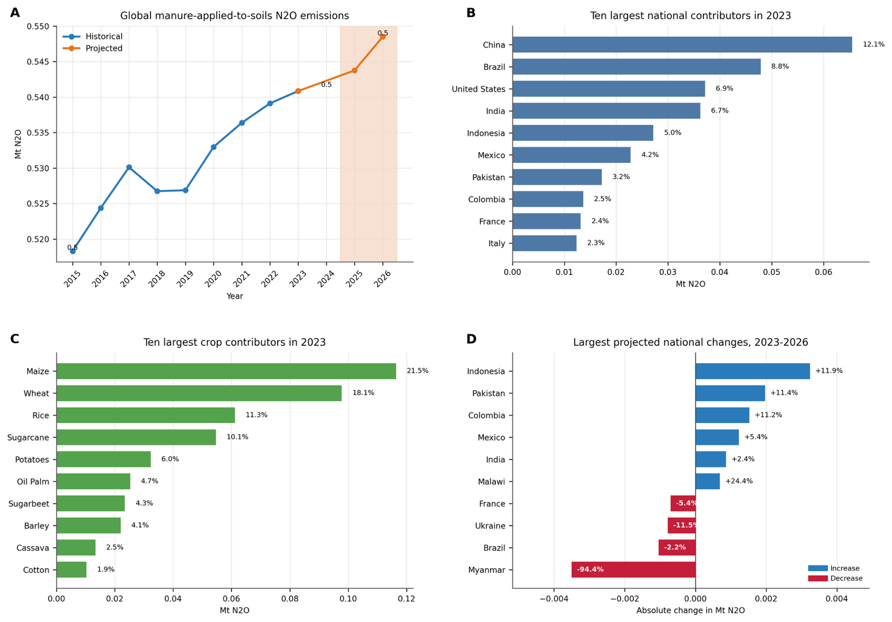
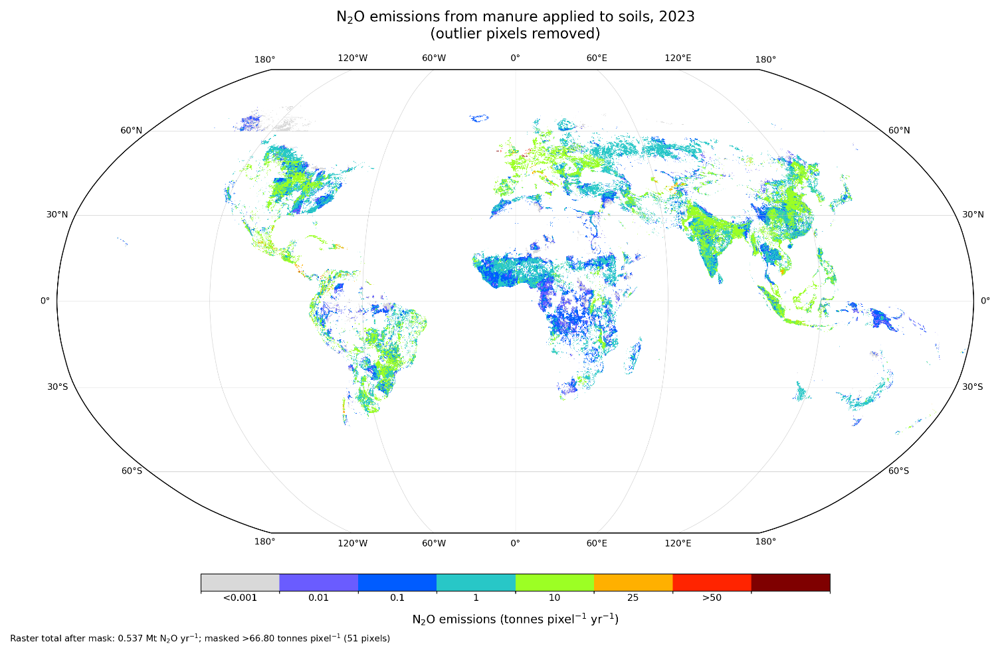
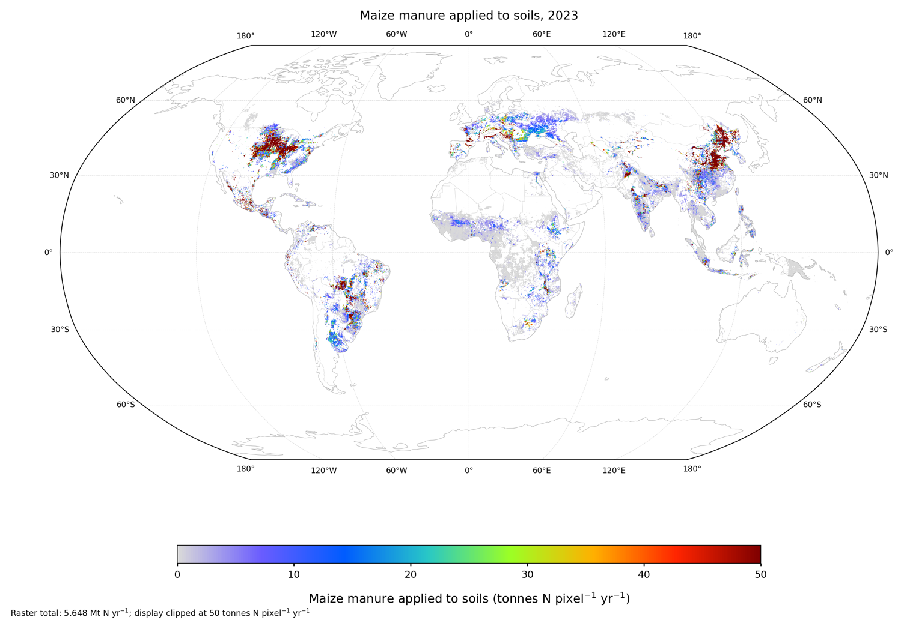

**Agriculture sector: Manure Applied to Soil**

*Nitrous oxide emissions from animal manure applied to croplands*

**Prateek Sharma\*1, Rajvi Trivedi1, Adity Manuraj1, Mukta Sharma1, Neville Millar1, Sam Schiller2, Mike Hsu2 and Bruno Basso\*1**

*1) Department of Earth and Environmental Sciences,*

*Michigan State University, 2) Carbon Yield*

*\*Corresponding Author: basso@msu,edu; sharm165@msu.edu*

**1. Introduction**

Agricultural soils are a major anthropogenic source of nitrous oxide (N₂O), a long-lived greenhouse gas that also contributes to stratospheric ozone depletion (Ravishankara et al. 2009; Prather et al. 2012; IPCC 2021). Soil N₂O is produced primarily through microbial nitrification and denitrification, and emissions are strongly influenced by the amount and availability of reactive nitrogen (N) in soil (Robertson and Groffman 2024). In addition to synthetic fertilizer and crop residues, animal manure applied to agricultural land represents an important source of N entering managed soils and can therefore contribute substantially to agricultural N₂O emissions.

Animal manure has long been used as a source of nutrients and organic matter for crop production. Globally, livestock systems generate several billion tonnes of manure annually, and manure N represents a substantial component of total agricultural N inputs to soils (Thangarajan et al. 2013; Bouwman et al. 2013). Continued growth in livestock production and changes in dietary demand may further increase the amount of manure requiring management and land application in many regions (Herrero and Thornton 2013). The contribution of manure varies considerably among livestock systems and regions, with cattle representing a major source of manure N globally.

Applying manure to cropland can provide important agronomic and soil-quality benefits. In addition to supplying N and other nutrients, manure can increase soil organic matter and contribute to soil organic carbon accumulation (Zhou et al. 2017). However, manure also supplies both readily available N and organic carbon, which can stimulate microbial activity and alter soil conditions controlling N₂O production. Changes in soil aeration, oxygen availability, aggregation, pH, porosity, and water retention can influence nitrification and denitrification following manure application (Whalen et al. 2000; Broucek 2020; Fu et al. 2022; Sangotayo et al. 2023). Consequently, the magnitude of manure-induced N₂O emissions depends not only on the amount of N applied but also on environmental conditions, manure characteristics, and management practices.

National greenhouse-gas inventories generally estimate N₂O emissions from manure applied to soils using the amount of manure N entering agricultural land together with direct and indirect emission factors. The IPCC framework treats manure N applied to managed soils as an organic N input and accounts for both direct N₂O production in soil and indirect emissions associated with N losses through pathways such as leaching and runoff (Baasansuren et al. 2019, IPCC 2019). While this approach provides a consistent basis for national accounting, national annual totals do not resolve the substantial spatial variation in where manure is applied or the seasonal timing of resulting emissions.

Globally consistent, spatially explicit information on manure applications remains limited. National statistics provide estimates of manure N applied to soils, but these data do not directly identify the cropland locations or crops receiving manure within each country. Translating national manure-N totals into spatially resolved emissions therefore requires a consistent framework that combines country-level manure activity data with spatial information describing agricultural land use and crop production, while preserving the national totals used as the activity constraint.

Climate TRACE addresses this gap by developing annual and monthly estimates of N₂O emissions from manure applied to cropland at 5-arc-minute spatial resolution for 2015–2026. National manure-N totals are combined with the common crop-production and harvested-area framework used across the Climate TRACE agricultural inventories to distribute manure N across cropland while preserving country-level totals. Direct and indirect N₂O emissions are then estimated using the same emission-factor framework applied in the Climate TRACE synthetic N fertilizer methodology, and annual emissions are subsequently distributed to monthly time steps using the temporal distribution of soil N₂O emissions.

The primary objective of this study is to provide a globally consistent, crop-specific, and spatially explicit inventory of N₂O emissions associated with manure applied to cropland. The resulting dataset provides annual and monthly estimates for 2015–2026 and enables manure-related emissions to be evaluated across crops, grid cells, countries, and years. The scope is limited to manure intentionally applied to cropland; emissions from manure deposited directly on pasture, range, and paddock by grazing animals, as well as emissions occurring during livestock housing, manure storage, and other stages of the manure-management chain before field application, are treated separately and are outside the scope of this methodology.

**2 Materials and Methods**

**2.1 Methodological overview and scope**

We estimate direct and indirect N₂O emissions from animal manure applied to cropland globally for 2015–2026. The inventory covers 40 harmonized crop groups and produces annual estimates at 5-arc-minute spatial resolution, which are subsequently disaggregated to monthly time steps. Emissions are calculated for individual crop and grid-cell combinations and can be aggregated to countries, continental, and global scales.

The methodology follows a sequential workflow. National manure nitrogen applied to soils is first obtained from FAOSTAT and used as the country-level activity constraint. For years in which finalized manure-N data are unavailable, country-level manure N is projected to extend the time series through 2026. These national totals are then spatially distributed across cropland using the common crop-production and harvested-area framework applied across the Climate TRACE agricultural inventories.

Within each country, manure N is first allocated among 5-arc-minute grid cells according to their contribution to total harvested area. The manure N assigned to each grid cell is then partitioned among the crops present within that cell using crop-specific agricultural production as the allocation proxy. The resulting crop- and grid-specific manure-N estimates are normalized so that their sum preserves the corresponding national manure-N total.

Direct N₂O emissions are calculated from manure N applied to soils using the same direct emission-factor framework applied in the Climate TRACE synthetic N fertilizer methodology. Country- and region-specific emission factors are used where available, with IPCC defaults applied where a specific factor is unavailable. Indirect N₂O emissions associated with N leaching and runoff are also calculated using the same IPCC 2019 (Baasansuren et al. 2019) framework adopted for synthetic N fertilizer, including the corresponding leaching fraction and EF₅ applied only where the IPCC leaching/runoff conditions are met.

Annual direct and indirect emissions are calculated independently for each crop and grid cell and subsequently summed to obtain total manure-application N₂O emissions. Annual emissions are then distributed to monthly values using the same temporal allocation framework applied in the Climate TRACE synthetic N fertilizer methodology, based on the monthly distribution of soil N₂O emissions.

The final dataset therefore provides crop-specific annual and monthly estimates of manure N applied to cropland and associated direct, indirect, and total N₂O emissions for 2015–2026 at both 5-arcminute and country scales.

**2.2 Crop production, harvested area, and spatial harmonization**

Annual crop production and harvested-area data were compiled at the country scale from FAOSTAT and harmonized with SPAM 2020 to generate spatially explicit crop activity data at 5-arc-minute resolution (FAO 2026; IFPRI 2026). This crop-production and harvested-area framework is common across the Climate TRACE agricultural methodologies, including synthetic N fertilizer, retained crop residue, crop-residue burning, and manure applied to cropland, to ensure consistency among emission sources.

SPAM 2020 was used to define the within-country spatial distribution of each crop, while annual national crop statistics from FAOSTAT constrained the corresponding country totals (FAO 2026; IFPRI 2026). This approach preserves the spatial pattern of crop production and harvested area represented by SPAM 2020 while maintaining consistency with year-specific national statistics.

For 2015–2024, crop production and harvested area were based on FAOSTAT Crops and Livestock Products statistics (FAO 2026). For 2025 and 2026, projected crop activity from the same framework used in the Climate TRACE Synthetic N Fertilizer Methodology was used to extend the time series. Because the crop-production projection and spatial harmonization procedures are common across agricultural inventories, the detailed prediction framework is not repeated here.

All crop-production and harvested-area layers were aligned to the same 5-arc-minute geographic grid before manure N was spatially allocated. This common spatial framework provides the basis for distributing country-level manure N among grid cells and subsequently among crops while preserving the corresponding national manure-N totals.

**2.3 Country-level manure N applied to soils**

National manure nitrogen applied to soils was obtained from FAOSTAT and used as the country-level activity constraint for the manure-application inventory (Tubiello et al. 2021). FAOSTAT reports manure applied to agricultural soils as the nitrogen content of manure applied, expressed as mass of N per country and year. Reported FAOSTAT values were used through the most recent years for which observations were available.

For 2024–2026, country-level manure N applied to soils was extended independently for each country using a simple linear interpolation and extrapolation procedure implemented in Python. Historical FAOSTAT manure-N records for each country were used to define the linear relationship through time, which was then used to estimate values for years without reported observations.

Observed and projected values were combined to produce a continuous annual country-level manure-N dataset for 2015–2026. These national totals were retained as the primary constraint during subsequent spatial allocation so that the sum of gridded manure-N estimates within each country remained consistent with the corresponding FAOSTAT-based or projected national total.

**2.4 Spatial and crop allocation of manure N**

Country-level manure N applied to soils was spatially distributed across cropland using the same country-to-grid and grid-to-crop allocation framework described in the Climate TRACE Synthetic N Fertilizer Methodology. The harmonized annual crop-production and harvested-area layers described in Section 2.2 were used as the spatial activity data for this allocation.

Within each country, the national manure-N total from FAOSTAT, or the corresponding projected value for years without reported data, was used as the country-level constraint (FAO 2026). Manure N was first distributed among 5-arc-minute grid cells according to the spatial distribution of harvested area and was subsequently allocated among crops within each grid cell using the same crop-allocation procedure applied in the [Synthetic N Fertilizer Methodology](https://drive.google.com/drive/folders/1jGBzeAw04vhVlT2HbWQUnuLv1EQFvkra).

The detailed equations, normalization procedure, and treatment of country boundaries are therefore not repeated here. As in the synthetic N fertilizer inventory, the allocation preserves the annual country-level activity total so that the sum of crop- and grid-specific manure-N estimates within each country equals the corresponding national manure-N value.

**2.5 Direct and indirect N₂O emission calculation**

Direct and indirect N₂O emissions from manure N applied to cropland were calculated using the same emission-factor framework described in the Climate TRACE Synthetic N Fertilizer Methodology. Because the equations and emission-factor assignment procedures are identical between the two inventories, they are not repeated here.

Direct soil N₂O emissions were calculated using the same country- and region-specific EF₁ values applied in the synthetic N fertilizer inventory, with IPCC default emission factors used where a country- or region-specific value was unavailable (IPCC 2019, Baasansuren et al. 2019; Menegat et al. 2022). The corresponding emission factor was applied to the crop- and grid-specific manure-N activity estimated in Section 2.4.

Indirect N₂O emissions associated with nitrogen losses through leaching and runoff were estimated using the same IPCC 2019 (Baasansuren et al. 2019) framework applied in the Synthetic N Fertilizer Methodology. For locations meeting the IPCC conditions for N leaching and runoff, a default $FracLEACH - \left( H \right)$ of 0.24 was applied together with $EF₅ = 0.011kgN₂O - NperkgN$ leached or runoff (Baasansuren et al. 2019, IPCC 2019). The leaching fraction was not applied uniformly to all locations; its application followed the same wet climate/leaching classification used in the synthetic N fertilizer inventory.

Direct and indirect emissions were calculated separately for each crop and grid cell and then summed to obtain total N₂O emissions associated with manure N applied to cropland. Conversion from N₂O–N to N₂O and from N₂O to CO₂-equivalent emissions followed the same procedures described in the [Synthetic N Fertilizer Methodology](https://drive.google.com/drive/folders/1jGBzeAw04vhVlT2HbWQUnuLv1EQFvkra).

**2.6 Temporal disaggregation**

Annual manure-application N₂O emissions were distributed to monthly time steps using the same temporal-disaggregation framework described in the Climate TRACE Synthetic N Fertilizer Methodology. Monthly fractions derived from the Emissions Database for Global Atmospheric Research (EDGAR) soil N₂O emissions were used to represent the seasonal distribution of emissions within each year.

For each grid cell, the annual direct and indirect N₂O emissions estimated in Section 2.5 were partitioned among the 12 months according to the corresponding EDGAR-derived monthly fractions. The monthly fractions were normalized so that their sum equaled the annual total, ensuring that temporal disaggregation did not alter the annual manure-application N₂O estimate.

Because the detailed derivation of the monthly fractions, spatial matching procedure, and normalization steps are identical to those used for synthetic N fertilizer, these procedures are not repeated here, and readers are referred to the Climate TRACE [Synthetic N Fertilizer Methodology](https://drive.google.com/drive/folders/1jGBzeAw04vhVlT2HbWQUnuLv1EQFvkra).

**2.7 Final manure-applied-to-soils N₂O dataset**

The final inventory combines the crop- and grid-specific manure-N activity data with the direct and indirect N₂O emission estimates described above. Estimates are produced annually for 2015–2026 at 5-arc-minute spatial resolution for the 40 harmonized crop groups used across the Climate TRACE agricultural inventories. Monthly emissions are generated from the annual estimates using the temporal-disaggregation procedure described in Section 2.6.

For each crop and grid cell, the dataset reports manure N applied to cropland together with direct, indirect, and total N₂O emissions. Gridded estimates can be aggregated to country, continental, and global scales while preserving the country-level manure-N activity totals used as the primary constraint.

N₂O emissions are reported both as N₂O mass and as CO₂-equivalent emissions using the IPCC Sixth Assessment Report global warming potentials. Because the 20-year and 100-year GWP values for N₂O are both 273, the resulting CO₂-equivalent values are identical for the two time horizons (Forster et al. 2021). Conversion procedures are the same as those described in the Climate TRACE Synthetic N Fertilizer Methodology and are therefore not repeated here.

The resulting dataset provides a spatially and temporally consistent representation of N₂O emissions from manure intentionally applied to cropland. It excludes emissions from manure deposited directly by grazing animals and emissions occurring during manure housing, storage, treatment, or other stages of the manure-management chain prior to field application.

**3. Emission Reduction Solutions (ERS)**

Beginning in 2025, Climate TRACE introduced Emission Reduction Solutions (ERS) to estimate how alternative management practices could modify emissions relative to the baseline inventory. For manure applied to cropland, ERS scenarios were developed from paired manure-management comparisons reported in the global meta-analysis of Hou et al. (2015), which synthesized results from 126 published studies examining NH₃, CH₄, and N₂O emissions across the manure-management chain.

Four manure-management comparisons were evaluated: (1) injection or incorporation relative to surface spreading, (2) anaerobic digestate relative to raw slurry, (3) separated liquid fraction relative to raw slurry, and (4) separated solid fraction relative to raw slurry (Table S1). These strategies represent changes either in how manure is placed in the soil or in how manure is processed before field application.

Injection places liquid manure or slurry below the soil surface, whereas incorporation mixes manure into the upper soil layer shortly after surface application. Both practices differ from conventional surface spreading, in which manure remains on the soil surface after application. Anaerobic digestate is the material remaining after manure undergoes anaerobic digestion for biogas production before being applied to the field. Solid–liquid separation mechanically separates raw slurry into a more dilute liquid fraction and a fiber- and dry-matter-rich solid fraction, which can subsequently be managed and applied separately.

For each ERS, the N₂O response was represented by a new-to-reference emission ratio derived from the paired comparisons used in the ERS analysis. The ratio was applied multiplicatively to the baseline manure-applied-to-soils N₂O emissions. A ratio below 1 represents lower N₂O emissions under the alternative practice, a ratio of 1 represents no change, and a ratio above 1 represents an increase relative to the reference treatment. For example, a ratio of 0.80 represents emissions equivalent to 80% of the reference value, or a 20% reduction.

The ERS estimates are counterfactual scenarios rather than estimates of current practice adoption. The baseline inventory does not explicitly identify manure-application technology at each grid cell; therefore, the ERS results indicate the potential change in N₂O emissions associated with applying the literature-derived relative response rather than a measured transition from an observed local management practice. In addition, manure-management practices can produce trade-offs among gases. Hou et al. (2015), for example, found that injection substantially reduced NH₃ losses but could increase N₂O emissions, emphasizing that a practice that mitigates one emission pathway does not necessarily reduce all emissions.

**4. Results**

**4.1 Global trends in manure N application and N₂O emissions**

Global N₂O emissions from manure applied to soils increased modestly over the historical period, from approximately 0.518 Mt N₂O in 2015 to 0.541 Mt N₂O in 2023, representing an increase of about 4.4% (Figure 1A). Emissions increased from 2015 to 2017, declined slightly during 2018–2019, and subsequently increased each year through 2023. Projected emissions for 2024–2026 remained close to the most recent historical level but continued to increase gradually, reaching approximately 0.55 Mt N₂O by 2026. Overall, the projections indicate continued but relatively modest growth relative to the 2023 historical estimate.

National emissions were distributed across a broad range of countries, although the largest contributors accounted for a substantial fraction of the global total. In 2023, China was the largest national contributor, accounting for 12.1% of global manure-applied-to-soils N₂O emissions, followed by Brazil (8.8%), the United States (6.9%), India (6.7%), and Indonesia (5.0%) (Figure 1B). Together, these five countries contributed approximately 39.5% of global emissions. Mexico, Pakistan, Colombia, France, and Italy completed the ten largest contributors, bringing the combined share of the top ten countries to approximately 54.2%.

Projected national changes between 2023 and 2026 were generally small in absolute magnitude relative to the global total, but trajectories differed considerably among individual countries (Figure 1D). Among the countries with the largest projected absolute increases, emissions increased by 11.9% in Indonesia, 11.4% in Pakistan, 11.2% in Colombia, 5.4% in Mexico, 2.4% in India, and 24.4% in Malawi. In contrast, projected declines among the countries shown included Myanmar (−94.4%), Ukraine (−11.5%), France (−5.4%), and Brazil (−2.2%). Thus, the relatively small projected change in the global total masks substantially larger proportional changes within some countries.

Crop-level emissions were more concentrated than national emissions. In 2023, maize was the largest crop contributor, accounting for 21.5% of global manure-applied-to-soils N₂O emissions, followed by wheat (18.1%), rice (11.3%), and sugarcane (10.1%) (Figure 1C). Together, these four crops accounted for 61.0% of global emissions. Their corresponding emission totals were 0.116 Mt N₂O for maize, 0.098 Mt N₂O for wheat, 0.061 Mt N₂O for rice, and 0.055 Mt N₂O for sugarcane (Table 1). Potatoes, oil palm, sugarbeet, barley, cassava, and cotton completed the ten largest crop contributors, with the ten crops together accounting for approximately 84.5% of global emissions.

**Figure 1** Historical and projected global N₂O emissions from manure applied to soils and their national and crop-specific composition. (A) Global manure-applied-to-soils N₂O emissions for the historical period 2015–2023 and projected emissions for 2024–2026. (B) Ten largest national contributors in 2023. (C) Ten largest crop contributors in 2023. (D) Countries with the largest projected absolute increases and decreases in N₂O emissions between 2023 and 2026. Percentage labels in panel D indicate the relative change between 2023 and 2026.

**4.2 National contributions within major crops**

The geographic distribution of manure-associated N₂O emissions differed substantially among major crops in 2023 (Table 1). Maize emissions were concentrated in the United States (20.0%), China (19.0%), and Brazil (17.2%), which together accounted for 56.2% of global maize-related N₂O emissions. Mexico contributed a further 9.9%, followed by Argentina at 3.3%.

Wheat emissions were more broadly distributed among countries. China was the largest contributor, accounting for 11.4% of the global wheat total, followed by the United States (7.2%), India (6.0%), Italy (5.9%), and France (5.6%). In contrast, rice emissions were strongly concentrated in Asian production systems. China accounted for 25.2% of global rice-related emissions, followed by India (16.5%), Indonesia (10.0%), Vietnam (8.5%), and Bangladesh (5.4%). Together, these five countries represented 65.6% of manure-associated N₂O emissions allocated to rice.

Sugarcane emissions showed a different geographic pattern, with Brazil alone accounting for 30.3% of the global crop total. Pakistan (10.8%), India (10.4%), Mexico (6.9%), and Colombia (5.6%) were the next largest contributors. Oil palm exhibited the strongest national concentration among the major crops, with Indonesia accounting for 51.9% and Malaysia for another 18.1%; together, the two countries contributed 70.0% of global manure-associated N₂O emissions allocated to oil palm.

Other crops also exhibited distinct geographic patterns. China was the largest contributor to potato emissions (15.6%), whereas European countries dominated the leading contributors for sugarbeet and barley. Cotton emissions were concentrated in Uzbekistan (21.8%), India (17.6%), Brazil (14.1%), China (12.7%), and the United States (12.0%), which together accounted for 78.2% of the global cotton total.

**Table 1** Leading national contributors within major manure-applied-to-soils N2O emitting crops in 2023. Values indicate each country's percentage contribution to global manure-applied-to-soils N2O emissions for the corresponding crop.

<table><thead><tr class="header"><th><strong>Crop (2023 total N2O)</strong></th><th><strong>Rank 1</strong></th><th><strong>Rank 2</strong></th><th><strong>Rank 3</strong></th><th><strong>Rank 4</strong></th><th><strong>Rank 5</strong></th></tr></thead><tbody><tr class="odd"><td>Maize (0.116 Mt N2O)</td><td>United States 
20.0%</td><td>China 
19.0%</td><td>Brazil 
17.2%</td><td>Mexico 
9.9%</td><td>Argentina 
3.3%</td></tr><tr class="even"><td>Wheat (0.098 Mt N2O)</td><td>China 
11.4%</td><td>United States 
7.2%</td><td>India 
6.0%</td><td>Italy 
5.9%</td><td>France 
5.6%</td></tr><tr class="odd"><td>Rice (0.061 Mt N2O)</td><td>China 
25.2%</td><td>India 
16.5%</td><td>Indonesia 
10.0%</td><td>Vietnam 
8.5%</td><td>Bangladesh 
5.4%</td></tr><tr class="even"><td>Sugarcane (0.055 Mt N2O)</td><td>Brazil 
30.3%</td><td>Pakistan 
10.8%</td><td>India 
10.4%</td><td>Mexico 
6.9%</td><td>Colombia 
5.6%</td></tr><tr class="odd"><td>Potatoes (0.032 Mt N2O)</td><td>China 
15.6%</td><td>Belgium 
8.5%</td><td>Netherlands 
6.8%</td><td>India 
5.8%</td><td>Uzbekistan 
4.3%</td></tr><tr class="even"><td>Oil Palm (0.025 Mt N2O)</td><td>Indonesia - 
51.9%</td><td>Malaysia 
18.1%</td><td>Colombia 
10.0%</td><td>Costa Rica 
4.4%</td><td>Guatemala 
2.8%</td></tr><tr class="odd"><td>Sugarbeet (0.023 Mt N2O)</td><td>Belgium 
14.9%</td><td>Germany 
14.1%</td><td>France 
9.4%</td><td>Netherlands 
9.4%</td><td>Poland 
7.2%</td></tr><tr class="even"><td>Barley (0.022 Mt N2O)</td><td>Ireland 
9.4%</td><td>United Kingdom 
9.0%</td><td>France 
8.7%</td><td>Spain 
7.8%</td><td>Germany 
6.6%</td></tr><tr class="odd"><td>Cassava (0.013 Mt N2O)</td><td>Brazil 
15.8%</td><td>Indonesia 
9.3%</td><td>Vietnam 
6.7%</td><td>Peru 
4.8%</td><td>Nigeria 
4.5%</td></tr><tr class="even"><td>Cotton (0.010 Mt N2O)</td><td>Uzbekistan 
21.8%</td><td>India 
17.6%</td><td>Brazil 
14.1%</td><td>China 
12.7%</td><td>United States 
12.0%</td></tr></tbody></table>

**4.3 Spatial distribution of manure-applied-to-soils N₂O emissions**

The global distribution of N₂O emissions from manure applied to soils was highly heterogeneous in 2023, with distinct emission hotspots embedded within much larger areas of lower-intensity agricultural emissions (Figure 2). The highest grid-cell emissions were concentrated in several major agricultural regions, particularly eastern China, northern India, Europe, the central and eastern United States, southern and southeastern Brazil, and parts of Southeast Asia. These regions correspond to areas where substantial manure N inputs coincide with intensive crop production and, in some cases, relatively high country-specific N₂O emission factors.

Within North America, emissions were particularly concentrated across the major agricultural regions of the United States, whereas lower-intensity emissions extended through parts of Mexico and other cultivated areas. In South America, the strongest concentrations occurred in major agricultural regions of Brazil, with additional emission areas extending through parts of Argentina and neighboring countries. European emissions were spatially widespread across cultivated regions, forming a relatively continuous pattern across western, central, and eastern Europe rather than being confined to a small number of isolated hotspots.

Across Asia, some of the most pronounced emission concentrations occurred in eastern China and the Indo-Gangetic region, with additional areas of elevated emissions across parts of Southeast Asia. In contrast, emissions across much of sub-Saharan Africa were generally lower at the individual grid-cell scale but geographically widespread, reflecting manure N distributed across a large area of cropland. Similar low-to-moderate but spatially extensive patterns were observed across portions of South America and South Asia.

The spatial pattern therefore shows that national manure-associated N₂O emissions are not distributed uniformly within countries. Instead, emissions are concentrated in specific agricultural regions where cropland extent, crop composition, and allocated manure N converge. The 5-arc-minute inventory consequently resolves substantial subnational heterogeneity that is not apparent from country-level totals alone and identifies agricultural regions that contribute disproportionately to national manure-associated N₂O emissions.

**Figure 2** Global gridded N₂O emissions from manure applied to soils in 2023 at 5-arc-minute resolution. For visualization, 51 pixels with emissions greater than 66.8 tonnes N₂O pixel⁻¹ yr⁻¹ were masked. Masking was applied only to the displayed map and does not alter the underlying inventory.

4.4 Spatial distribution of manure N applied to maize

Maize received the largest share of manure-associated N₂O emissions among the crop groups evaluated in 2023, and its manure-N allocation showed a strongly heterogeneous global distribution (Figure 3). A total of 5.648 Mt N yr⁻¹ of manure N was allocated to maize cropland globally. Although maize production occurs across a wide range of climatic and agricultural systems, manure N applied to maize was concentrated within a limited number of major production regions.

The most prominent concentrations occurred across the U.S. Corn Belt, where high manure-N application values formed a broad and spatially continuous region across the central and eastern United States. A second major concentration occurred in northeastern and eastern China, where numerous high-intensity grid cells coincided with extensive maize-producing areas. Elevated manure-N inputs were also evident across parts of northern India and Pakistan and across several agricultural regions of Europe.

In South America, manure N applied to maize was concentrated primarily in major agricultural areas of Brazil and Argentina. Smaller but spatially distinct concentrations were also evident in Mexico and parts of Central America. Across sub-Saharan Africa, maize manure-N inputs were geographically widespread but generally lower in intensity, with localized areas of higher application in eastern and southern Africa.

The maize map also illustrates an important feature of the allocation framework. A relatively large global manure-N total can be distributed very unevenly within the cropland area of a crop. High-intensity grid cells occur where substantial national manure-N availability overlaps with large or productive maize-growing areas, whereas maize-growing regions with lower allocated manure N appear as more diffuse, lower-intensity patterns. The resulting spatial distribution therefore provides information on where manure N associated with a globally important crop is concentrated within countries, beyond what can be inferred from national or global crop totals alone.

**Figure 3** Global distribution of manure N applied to maize cropland in 2023 at 5-arc-minute spatial resolution. A total of 5.648 Mt N yr⁻¹ of manure N was allocated to maize globally. Display values were capped at 50 tonnes N pixel⁻¹ yr⁻¹ to improve visualization of spatial variation.

**5. Discussion and Conclusion**

This methodology provides a globally consistent and spatially explicit estimate of N₂O emissions from manure applied to cropland, addressing several limitations of national-scale inventories. National manure-N statistics provide an essential constraint on total activity, but by themselves do not resolve where manure is applied within countries, which crops receive it, or how emissions are distributed through the year. By combining FAOSTAT manure-N totals with harmonized crop production and harvested-area data, the present framework distributes national manure inputs across a 5-arc-minute grid while preserving the country-level activity totals. The resulting inventory therefore complements conventional national reporting by resolving emissions across crops, locations, and monthly time steps.

Global emissions changed relatively little over the historical period compared with the substantial spatial heterogeneity evident within the inventory. N₂O emissions increased from 0.518 Mt N₂O in 2015 to 0.541 Mt N₂O in 2023, equivalent to an increase of approximately 4.4%. Projected emissions for 2024–2026 remain close to the most recent historical level, indicating that the global manure-associated N₂O source is relatively stable under the activity trends represented in the projection. This global stability, however, masks considerable differences among countries. China, Brazil, the United States, India, and Indonesia together accounted for approximately 40% of global emissions in 2023, while the ten largest national contributors accounted for slightly more than half of the global total. The projected country trajectories similarly indicate that relatively small changes in the global total can coexist with larger increases or decreases within individual countries.

The crop-specific results further demonstrate that manure-associated emissions are concentrated in a limited number of major cropping systems. Maize was the largest contributor in 2023, followed by wheat, rice, and sugarcane; together these four crops accounted for 61% of global N₂O emissions from manure applied to cropland. Their geographic distributions differed substantially. Maize emissions were concentrated primarily in the United States, China, and Brazil, whereas rice emissions were dominated by Asian production systems. Brazil accounted for a particularly large share of sugarcane emissions, while oil-palm emissions were strongly concentrated in Indonesia and Malaysia. These patterns illustrate that the importance of a crop cannot be interpreted independently of its geographic distribution because the resulting emissions reflect both the amount of manure N allocated to the crop and the emission factor associated with the country in which that crop is grown.

The gridded results reveal additional spatial heterogeneity that is obscured by national totals. Major emission concentrations occurred across eastern China, northern India, Europe, the United States, Brazil, and parts of Southeast Asia, while lower-intensity emissions extended across considerably larger agricultural areas in Africa and South America. The maize-specific manure-N map provides a clear example of this subnational variation. Although manure N was allocated to maize across many regions globally, the highest application intensities were concentrated in a comparatively small number of intensive agricultural areas, including the U.S. Corn Belt, northeastern China, northern South Asia, Europe, and major maize-producing regions of Brazil and Argentina. This spatial information is particularly relevant for identifying where changes in manure management could have the greatest effect on emissions.

Several limitations should be considered when interpreting these estimates. First, the spatial allocation of manure N is model-based rather than a direct observation of field-level manure application. National manure-N totals are distributed using harvested areas and crop production as proxies for the spatial distribution of manure use. The framework therefore does not explicitly represent livestock-to-cropland transport distances, manure availability at individual farms, local nutrient-management regulations, or differences in manure application rates among fields growing the same crop. Improving globally consistent information on manure production, transport, and field application would reduce this source of uncertainty.

Second, the direct N₂O emission-factor framework does not explicitly resolve field-specific environmental and management conditions. Country- or region-specific emission factors improve representation of broad spatial differences relative to a single global default, but the same factor is applied across crops within the corresponding geographic unit. Crop-level emission differences therefore partly reflect where crops are grown rather than crop-specific manure-management responses. Similarly, indirect emissions from leaching and runoff are represented using the IPCC framework rather than explicit simulation of nitrogen transport and hydrology. These simplifications are necessary for a globally consistent inventory but limit interpretation in individual fields or management systems.

Third, most recent years contain projected rather than reported manure-N activity. Historical FAOSTAT manure-N observations were used through 2023, whereas country-level values for 2024–2026 were extended from the historical time series. These projected years should therefore be interpreted as estimates of likely continuation of recent trends rather than observations of manure use. The spatial crop framework also relies on projected crop activity for the most recent years where reported crop data is unavailable. Country-level changes during the projection period, particularly unusually large proportional changes, should consequently be interpreted cautiously until updated activity statistics become available.

The monthly estimates introduce an additional source of uncertainty. Annual manure-associated N₂O emissions are temporally distributed using the monthly pattern of soil N₂O emissions derived from EDGAR rather than observations of manure-application dates in individual cropping systems. The monthly dataset therefore represents a consistent temporal allocation of annual emissions but does not explicitly simulate local manure application timing, rainfall following application, soil moisture, temperature, or other short-term controls on N₂O production. Improved information on manure-application calendars would allow future versions of the inventory to better resolve seasonal emission dynamics.

The ERS analysis extends the inventory by evaluating how alternative manure placement and processing practices could alter N₂O emissions. Injection or incorporation, anaerobic digestion, and solid–liquid separation changes the physical placement or chemical composition of manure before or during field application and can therefore modify the conditions controlling nitrification and denitrification (Hou et al. 2015). These scenarios should be interpreted as literature-based counterfactual responses rather than estimates of current practice adoption. Their effects can also vary with soil moisture, manure characteristics, climate, and application method, and practice that reduces one gaseous loss pathway does not necessarily reduce another. Hou et al. (2015), for example, documented trade-offs among NH₃, CH₄, and N₂O across manure-management practices. The ERS results therefore represent potential changes in N₂O under specific alternative practices rather than universally achievable mitigation rates.

Manure application should also be considered within the broader agricultural nitrogen cycle. Synthetic fertilizer, manure, crop residues, and biological nitrogen inputs jointly determine the amount and timing of reactive N entering agricultural soils. Changes in one input or management practice can consequently affect the need for or response to another. The manure-applied-to-soils inventory is therefore designed to be interpreted alongside the companion Climate TRACE methodologies for synthetic N fertilizer, crop residues, and soil carbon rather than as an isolated component of cropland greenhouse-gas emissions.

**6. Metadata Information**

Direct and indirect N₂O emissions from animal manure applied to cropland are reported by Climate TRACE at country and gridded spatial scales for 40 harmonized crop groups. The dataset covers 2015–2026 at annual and monthly temporal resolution and 5-arc-minute spatial resolution. Estimates for 2015–2023 are based on historical FAOSTAT manure-N activity data, whereas country-level manure N for 2024–2026 is projected from the historical FAOSTAT time series as described in Section 2.3. Crop production and harvested area data are used to spatially distribute national manure-N totals while preserving the corresponding country-level activity constraint.

The inventory includes direct soil N₂O emissions following manure application and indirect N₂O emissions associated with nitrogen losses through leaching and runoff. Emission calculations follow the same emission-factor framework used in the Climate TRACE Synthetic N Fertilizer Methodology, using country- or region-specific direct emission factors where available and IPCC 2019 (Baasansuren et al. 2019) default factors where required. Indirect emissions are estimated using the IPCC 2019 (Baasansuren et al. 2019) leaching/runoff framework.

N₂O emissions are provided as both N₂O mass and CO₂-equivalent emissions using the IPCC Sixth Assessment Report global warming potentials. The dataset is limited to manure intentionally applied to cropland. Emissions from manure deposited directly by grazing animals on pasture, range, and paddock, and emissions occurring during animal housing, manure storage, treatment, or other stages of manure management prior to field application are outside the scope of this sector. Metadata for the dataset is summarized in Table 2. Climate TRACE data are made available under the Creative Commons Attribution 4.0 International License (CC BY 4.0).

**Table 2** Metadata for N₂O emissions from manure applied to cropland

| **General description**                 | **Definition**                                                                                                                                                         |
|-----------------------------------------|------------------------------------------------------------------------------------------------------------------------------------------------------------------------|
| Sector definition                       | Direct and indirect N₂O emissions resulting from animal manure N applied to cropland.                                                                                  |
| UNFCCC sector equivalent                | 3.D.1.2.a Animal manure applied to soils.                                                                                                                              |
| Greenhouse gas                          | N₂O.                                                                                                                                                                   |
| Temporal coverage                       | 2015–2026.                                                                                                                                                             |
| Historical activity period              | 2015–2023.                                                                                                                                                             |
| Projected activity period               | 2024–2026.                                                                                                                                                             |
| Temporal resolution                     | Annual and monthly.                                                                                                                                                    |
| Spatial coverage                        | Global Cropland.                                                                                                                                                       |
| Spatial resolution                      | 5 arcminutes (\~10 km at the equator).                                                                                                                                 |
| Reporting scales                        | Grid cells, crops, country, continent, and global.                                                                                                                     |
| Coordinate reference system             | WGS 84 (EPSG:4326).                                                                                                                                                    |
| Crop coverage                           | 40 harmonized crop groups.                                                                                                                                             |
| Primary activity variable               | Manure nitrogen applied to cropland.                                                                                                                                   |
| Activity units                          | Mass of N applied per country, crop, grid cell, and year.                                                                                                              |
| Country-level activity source           | FAOSTAT manure applied to soils, N content.                                                                                                                            |
| Recent-year activity estimates          | Country-level manure N for 2024–2026 projected from the historical FAOSTAT time series using a linear procedure in Python.                                             |
| Crop activity data                      | Annual crop production and harvested area from FAOSTAT, spatially harmonized with SPAM 2020.                                                                           |
| Spatial allocation                      | National manure-N totals distributed to 5-arc-minute cropland using the common Climate TRACE allocation framework described in the Synthetic N Fertilizer Methodology. |
| Direct N₂O emission factors             | Same country-/region-specific EF₁ framework used in the Climate TRACE Synthetic N Fertilizer Methodology; IPCC 2019 defaults where unavailable.                        |
| Indirect N₂O pathway                    | Nitrogen leaching and runoff.                                                                                                                                          |
| Indirect N₂O factors                    | IPCC 2019 FracLEACH-(H) and EF₅ framework, following the same conditions as the Climate TRACE Synthetic N Fertilizer Methodology.                                      |
| Monthly temporalization                 | Annual emissions distributed using EDGAR-derived monthly patterns of soil N₂O emissions.                                                                               |
| Emission outputs                        | Direct N₂O, indirect N₂O, total N₂O, and corresponding CO₂-equivalent emissions.                                                                                       |
| N₂O units                               | Mass N₂O per year or month, depending on output.                                                                                                                       |
| GWP basis                               | IPCC AR6; N₂O GWP₂₀ = 273 and GWP₁₀₀ = 273.                                                                                                                            |
| Historical vs. projected interpretation | 2015–2023 estimates use reported national manure-N activity; 2024–2026 estimates use projected national manure-N activity.                                             |
| Included sources                        | Manure intentionally applied to cropland.                                                                                                                              |
| Excluded sources                        | Manure deposited directly on pasture, range, and paddock; housing, storage, treatment, and other pre-application manure-management emissions.                          |
| Data format                             | CSV; GeoTIFF for gridded outputs.                                                                                                                                      |
| Country-level file name                 | country-climate-trace\_manure-applied-to-soils.csv                                                                                                                     |
| Data license                            | Creative Commons Attribution 4.0 International License (CC BY 4.0).                                                                                                    |

**Table 3** Source-level description, confidence, and uncertainty for manure-applied-to-soils N₂O emissions

<table><thead><tr class="header"><th><strong>Data attribute</strong></th><th><strong>Confidence definition</strong></th><th><strong>Uncertainty definition</strong></th></tr></thead><tbody><tr class="odd"><td>type</td><td>
Medium: modeled estimate based on published activity data and established inventory methods.

High: modeled estimate that has been independently benchmarked against a comparable external inventory or reported dataset.
</td><td>Not used; N/A</td></tr><tr class="even"><td>capacity_description</td><td>Not used; N/A. No facility- or asset-capacity variable is used to estimate manure applied to cropland in this sector.</td><td>Not used; N/A</td></tr><tr class="odd"><td>activity_description</td><td>
High: 2015–2023 country-level manure-N activity is based on reported FAOSTAT manure applied to soils (N content).

Medium: 2024–2026 country-level manure N is projected from the historical FAOSTAT time series; crop- and grid-level activity is spatially allocated using modeled crop production and harvested-area data.
</td><td>Where activity uncertainty bounds are available, lower and upper activity estimates are used.</td></tr><tr class="even"><td>CO2_emissions_factor</td><td>Not used; N/A</td><td>Not used; N/A</td></tr><tr class="odd"><td>CH4_emissions_factor</td><td>Not used; N/A</td><td>Not used; N/A</td></tr><tr class="even"><td>N2O_emissions_factor</td><td>Medium: direct and indirect N₂O emission factors are based on the country-/region-specific EF₁ framework used in the Climate TRACE Synthetic N Fertilizer Methodology, with IPCC 2019 defaults where required; indirect emissions use the IPCC FracLEACH-(H) and EF₅ framework.</td><td>Uncertainty estimates, expressed as a percentage above or below the mean estimate (i.e. +/-XX%), or as an interval with an upper and lower bound of values.</td></tr><tr class="odd"><td>other_gas_emissions_factor</td><td>Not used; N/A</td><td>Not used; N/A</td></tr><tr class="even"><td>CO2_emissions</td><td>Not used; N/A</td><td>Not used; N/A</td></tr><tr class="odd"><td>CH4_emissions</td><td>Not used; N/A</td><td>Not used; N/A</td></tr><tr class="even"><td>N2O_emissions</td><td>
Medium: modeled from manure-N activity and direct/indirect N₂O emission factors.

High: country-level modeled emissions independently benchmarked against a comparable external inventory where such a comparison is available.
</td><td>Uncertainty estimates, expressed as a percentage above or below the mean estimate (i.e. +/-XX%), or as an interval with an upper and lower bound of values.</td></tr><tr class="odd"><td>other_gas_emissions</td><td>Not used; N/A</td><td>Not used; N/A</td></tr><tr class="even"><td>total_CO2e_100yrGWP</td><td>
Medium: derived directly from modeled N₂O emissions using the IPCC AR6 100-year GWP.

High: applies where the underlying N₂O estimate is independently benchmarked against a comparable external inventory.
</td><td>Relative uncertainty is inherited from the N₂O emission estimate. The AR6 GWP₁₀₀ value is treated as fixed for inventory conversion, so no additional GWP uncertainty is added.</td></tr><tr class="odd"><td>total_CO2e_20yrGWP</td><td>
Medium: derived directly from modeled N₂O emissions using the IPCC AR6 20-year GWP.

High: applies where the underlying N₂O estimate is independently benchmarked against a comparable external inventory.
</td><td>Relative uncertainty is inherited from the N₂O emission estimate. The AR6 GWP₂₀ value is treated as fixed for inventory conversion, so no additional GWP uncertainty is added.</td></tr></tbody></table>

**Permissions and Use:** All Climate TRACE data is freely available under the Creative Commons Attribution 4.0 International Public License, unless otherwise noted below.

**Data citation format:** Sharma, P., Trivedi, R., Manuraj, A., Sharma, M., Millar, N., Schiller, S., Hsu, M., and Basso, B. (2026). Emissions from Animal Manure - N2O. Department of Earth and Environmental Sciences, Michigan State University, USA, Climate TRACE Emissions Inventory. https://climatetrace.org \[Accessed date\].

**Geographic boundaries and names (iso3\_country data attribute):** The depiction and use of boundaries, geographic names and related data shown on maps and included in lists, tables, documents, and databases on Climate TRACE are generated from the Global Administrative Areas (GADM) project (Version 4.1 released on 16 July 2022) along with their corresponding ISO3 codes, and with the following adaptations:

• HKG (China, Hong Kong Special Administrative Region) and MAC (China, Macao Special Administrative Region) are reported at GADM level 0 (country/national);

• Kosovo has been assigned the ISO3 code 'XKX';

• XCA (Caspian Sea) has been removed from GADM level 0 and the area assigned to countries based on the extent of their territorial waters;

• XAD (Akrotiri and Dhekelia), XCL (Clipperton Island), XPI (Paracel Islands) and XSP (Spratly Islands) are not included in the Climate TRACE dataset;

• ZNC name changed to 'Turkish Republic of Northern Cyprus' at GADM level 0;

• The borders between India, Pakistan and China have been assigned to these countries based on GADM codes Z01 to Z09.

The above usage is not warranted to be error free and does not imply the expression of any opinion whatsoever on the part of Climate TRACE Coalition and its partners concerning the legal status of any country, area or territory or of its authorities, or concerning the delimitation of its borders.

**Disclaimer:** The emissions provided for this sector are our current best estimates of emissions, and we are committed to continually increasing the accuracy of the models on all levels. Please review our terms of use and the sector-specific methodology documentation before using the data. If you identify an error or would like to participate in our data validation process, please [contact us](mailto:coalition@climatetrace.org) (<coalition@climatetrace.org>).

**7. Supplementary information**

**Table S1** Main ERSs employed for this sector. Strategies include injection/incorporation of manure, application of digestate instead of raw slurry, and separation or composting of solids before application. The "Relative N₂O emission factor" values are derived from meta-analyses (Hou et al., 2015) and represent global mean ratios if the respective strategy were employed across cropland systems.

| **strategy\_id** | **strategy\_name**                            | **strategy\_description**                                                                                                                                                                    | **mechanism** | **n2o\_emissions\_factor\_new\_to\_old\_ratio** | **confidence** |
|------------------|-----------------------------------------------|----------------------------------------------------------------------------------------------------------------------------------------------------------------------------------------------|---------------|-------------------------------------------------|----------------|
| a                | Injection/incorporation vs. surface spreading | Injecting or incorporating slurry below the surface reduces N₂O by limiting anaerobic microsites and promoting better aeration. Strongly supported as the most consistent mitigation option. | retrofit      | 0.2159                                          | high           |
| b                | Digestate vs. raw slurry                      | Anaerobic digestion reduces labile carbon in slurry, lowering denitrification and N₂O. Effective in regions with digestion infrastructure.                                                   | retrofit      | 0.9738                                          | high           |
| c                | Liquid fraction vs. raw slurry                | Liquid fraction has lower organic matter, reducing N₂O formation. Smaller effect than digestate but still beneficial.                                                                        | retrofit      | 0.8148                                          | medium         |
| d                | Solid fraction vs. raw slurry                 | Solid fraction effects vary; sometimes reduces N₂O, but risk of increase exists. Prefer composting or digesting before use.                                                                  | retrofit      | 0.8979                                          | medium         |

**References**

Bouwman, A.F., Beusen, A.H.W., Griffioen, J., Van Groenigen, J.W., Hefting, M.M., Oenema, O., Van Puijenbroek, P.J.T.M., Seitzinger, S., Slomp, C.P. and Stehfest, E., 2013. Global trends and uncertainties in terrestrial denitrification and N2O emissions. *Philosophical Transactions of the Royal Society B: Biological Sciences*, *368*(1621), p.20130112. DOI:10.1098/rstb.2013.0112.

Broucek, J., 2017. Nitrous oxide production from soil and manure application: a review. *Slovak Journal of Animal Science*, *50*(1), pp.21-32. DOI: 10.14269/2318-1265/jabb.v5n1p13-19.

Fao, F.A.O.S.T.A.T., 2018. Food and agriculture organization of the United Nations. *Rome, URL: http://faostat. fao. org*, *403*. \[Used for crop production, harvested area, and manure applied to soils; accessed October 2026.\]

Forster, P., T. Storelvmo, K. Armour, W. Collins, J.-L. Dufresne, D. Frame, D.J. Lunt, T. Mauritsen, M.D. Palmer, M. Watanabe, M. Wild, and H. Zhang, 2021: The Earth’s Energy Budget, Climate Feedbacks, and Climate Sensitivity. In *Climate Change 2021: The Physical Science Basis. Contribution of Working Group I to the Sixth Assessment Report of the Intergovernmental Panel on Climate Change* \[Masson-Delmotte, V., P. Zhai, A. Pirani, S.L. Connors, C. Péan, S. Berger, N. Caud, Y. Chen, L. Goldfarb, M.I. Gomis, M. Huang, K. Leitzell, E. Lonnoy, J.B.R. Matthews, T.K. Maycock, T. Waterfield, O. Yelekçi, R. Yu, and B. Zhou (eds.)\]. *Cambridge University Press, Cambridge, United Kingdom and New York, NY, USA*, pp. 923–1054, doi:[10.1017/9781009157896.009](https://dx.doi.org/10.1017/9781009157896.009).

Fu, Y., de Jonge, L.W., Moldrup, P., Paradelo, M. and Arthur, E., 2022. Improvements in soil physical properties after long-term manure addition depend on soil and crop type. *Geoderma*, *425*, p.116062. DOI: 10.1016/j.geoderma.2022.116062.

Herrero, M. and Thornton, P.K., 2013. Livestock and global change: Emerging issues for sustainable food systems. *Proceedings of the National Academy of Sciences*, *110*(52), pp.20878-20881. DOI: 10.1073/pnas.1321844111.

Hou, Y., Velthof, G.L. and Oenema, O., 2015. Mitigation of ammonia, nitrous oxide and methane emissions from manure management chains: a meta‐analysis and integrated assessment. *Global change biology*, *21*(3), pp.1293-1312. DOI: 10.1111/gcb.12767.

IFPRI (2026). Guo, Z., Zhou, S., You, L. and van Dijk, M., 2024. Global Spatially-Disaggregated Crop Production Statistics Data for 2020 Version 2.0. DOI: [10.7910/DVN/SWPENT](https://doi.org/10.7910/DVN/SWPENT).

Baasansuren, J., Fukuda, M., Ngarize, S., Osako, A., Pyrozhenko, Y., Shermanau, P. and Federici, S., 2019. 2019 refinement to the 2006 IPCC guidelines for national greenhouse gas inventories. *IPCC Switzerland***.**

IPCC (2021) Climate Change 2021: The Physical Science Basis. Contribution of Working Group I to the Sixth Assessment Report of the Intergovernmental Panel on Climate Change. Masson-Delmotte, V., Zhai, P., Pirani, A. et al. (eds.). Cambridge: Cambridge University Press. DOI: 10.1017/9781009157896.

Menegat, S., Ledo, A. and Tirado, R., 2022. Greenhouse gas emissions from global production and use of nitrogen synthetic fertilisers in agriculture. *Scientific Reports*, *12*(1), p.14490. DOI: 10.1038/s41598-022-18773-w.

Prather, M.J., Holmes, C.D. and Hsu, J., 2012. Reactive greenhouse gas scenarios: Systematic exploration of uncertainties and the role of atmospheric chemistry. *Geophysical Research Letters*, *39*(9). DOI: 10.1029/2012GL051440.

Ravishankara, A.R., Daniel, J.S. and Portmann, R.W., 2009. Nitrous oxide (N2O): the dominant ozone-depleting substance emitted in the 21st century. *science*, *326*(5949), pp.123-125. DOI: 10.1126/science.1176985.

Robertson, G.P. and Groffman, P.M., 2024. Nitrogen transformations. In *Soil microbiology, ecology and biochemistry* (pp. 407-438). Elsevier. DOI: 10.1016/B978-0-12-822941-5.00014-4.

Sangotayo, A.O., Chakraborty, P., Xu, S., Kumar, S. and Kovacs, P., 2023. Cattle manure application for 12 and 17 years enhanced depth distribution of soil organic carbon and X-ray computed tomography-derived pore characteristics. *Scientific reports*, *13*(1), p.23042. DOI: 10.1038/s41598-023-50110-7.

Thangarajan, R., Bolan, N.S., Tian, G., Naidu, R. and Kunhikrishnan, A., 2013. Role of organic amendment application on greenhouse gas emission from soil. *Science of the Total Environment*, *465*, pp.72-96.

Tubiello, F.N., Rosenzweig, C., Conchedda, G., Karl, K., Gütschow, J., Xueyao, P., Obli-Laryea, G., Wanner, N., Qiu, S.Y., Barros, J.D. and Flammini, A., 2021. Greenhouse gas emissions from food systems: building the evidence base. *Environmental Research Letters*, *16*(6), p.065007. DOI: 10.1088/1748-9326/ac018e

Whalen, J.K., Chang, C., Clayton, G.W. and Carefoot, J.P., 2000. Cattle manure amendments can increase the pH of acid soils. *Soil Science Society of America Journal*, *64*(3), pp.962-966. DOI: 10.2136/sssaj2000.643962x.

Zhou, M., Zhu, B., Wang, S., Zhu, X., Vereecken, H. and Brüggemann, N., 2017. Stimulation of N2O emission by manure application to agricultural soils may largely offset carbon benefits: A global meta‐analysis. *Global change biology*, *23*(10), pp.4068-4083. DOI: 10.1111/gcb.13648
