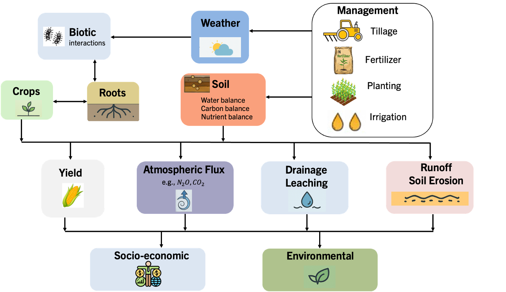
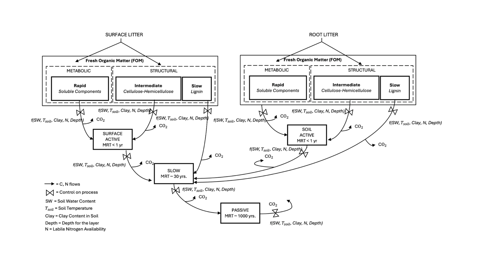
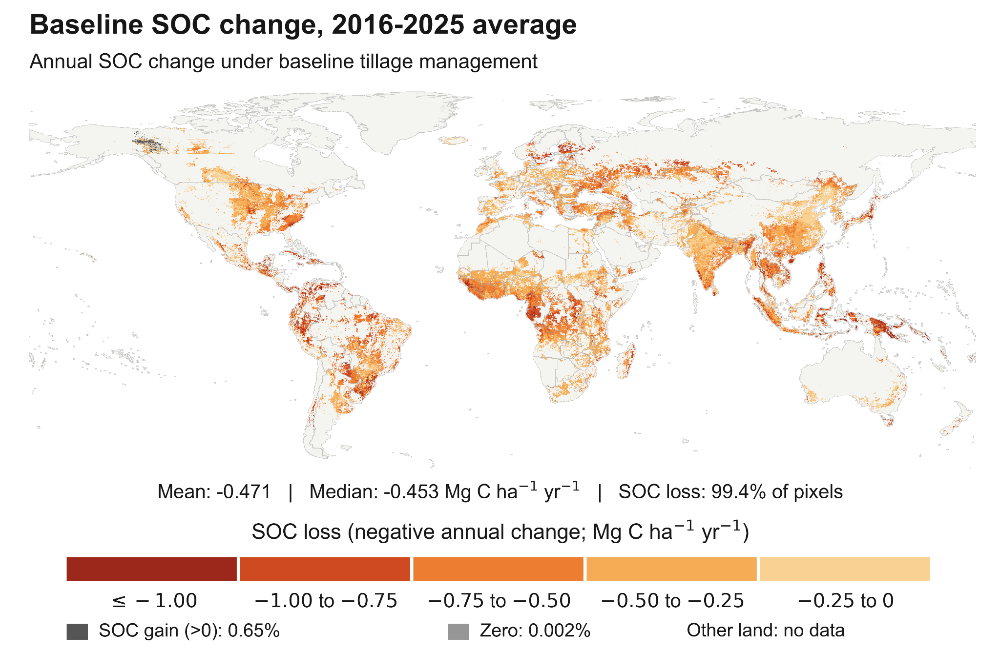
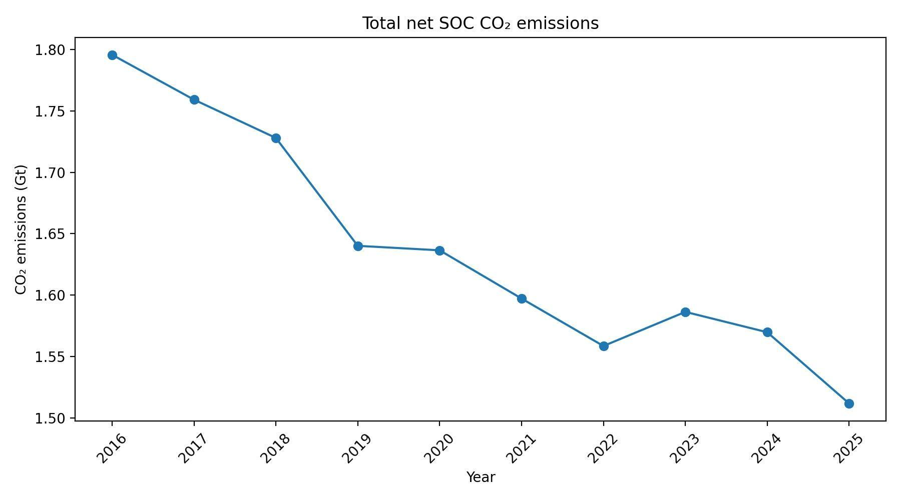
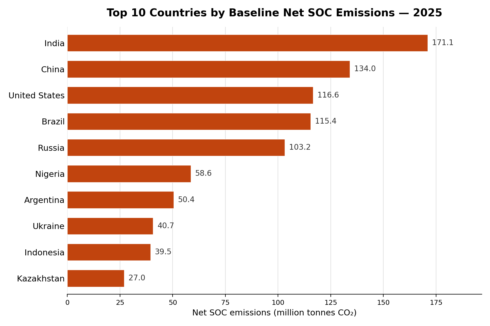
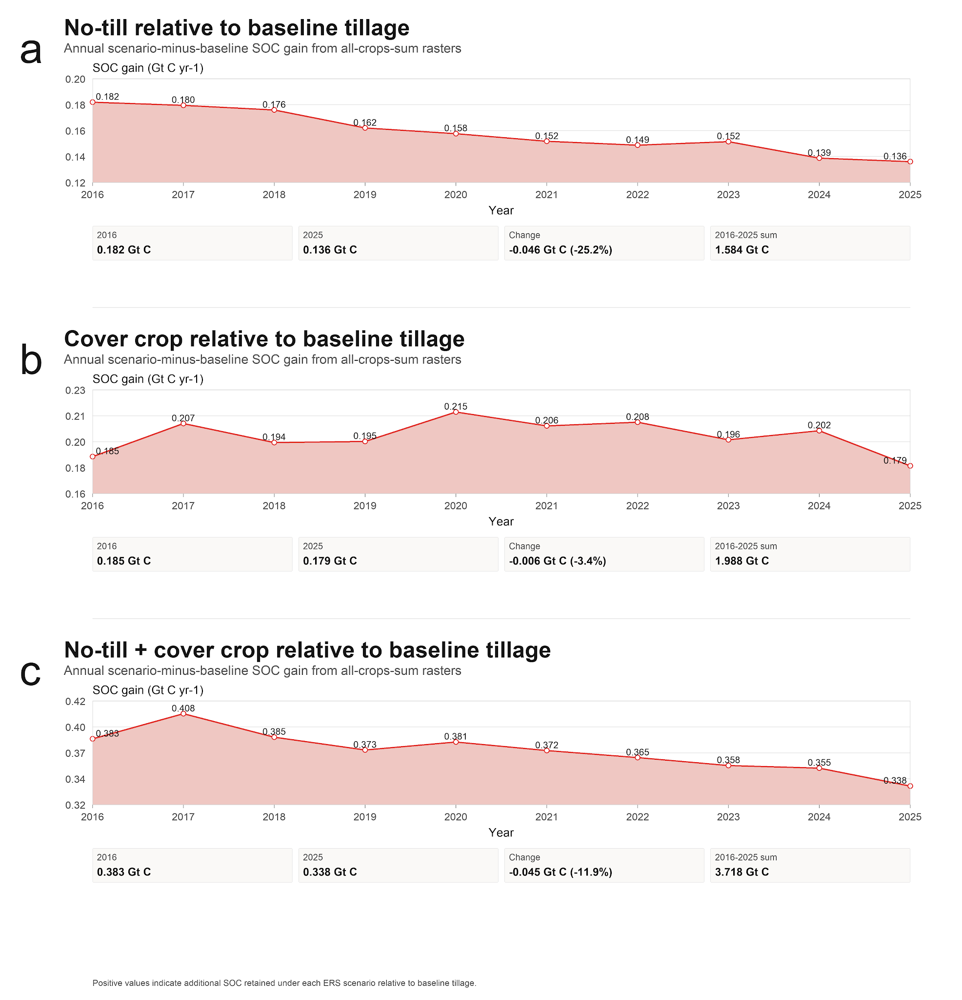
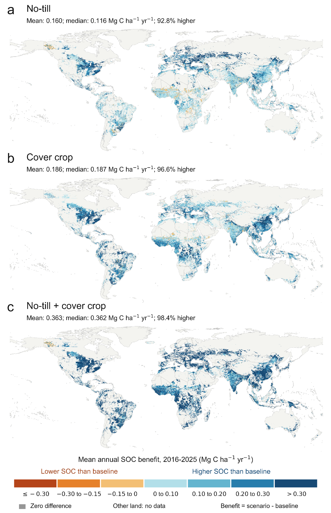
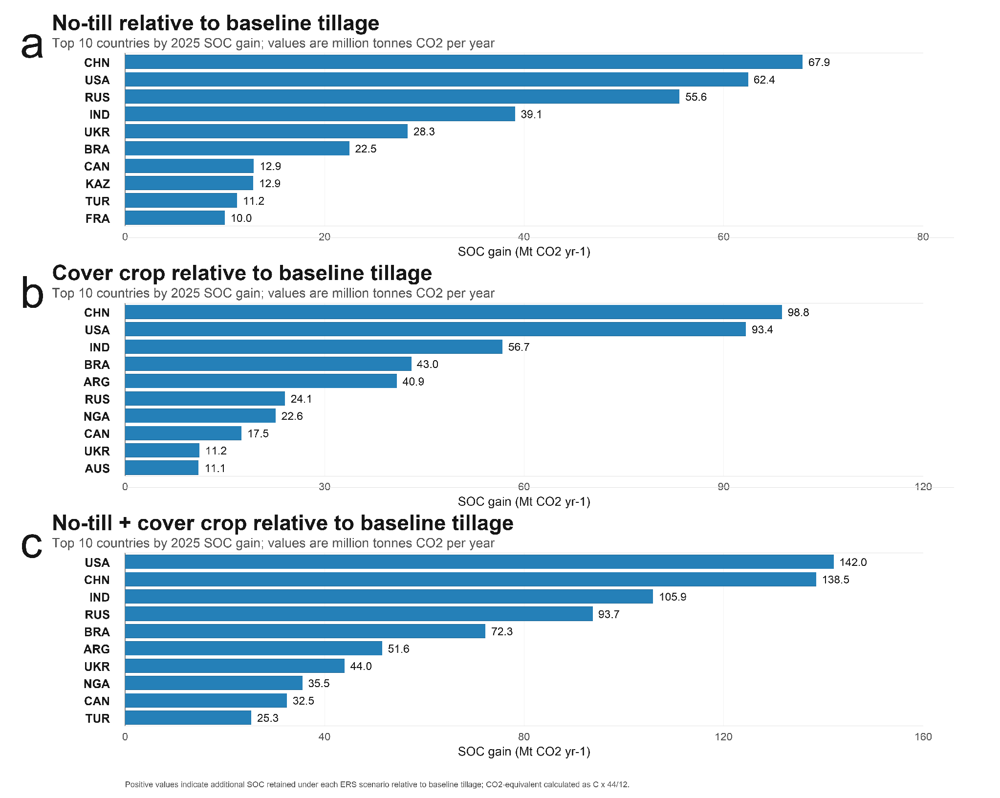
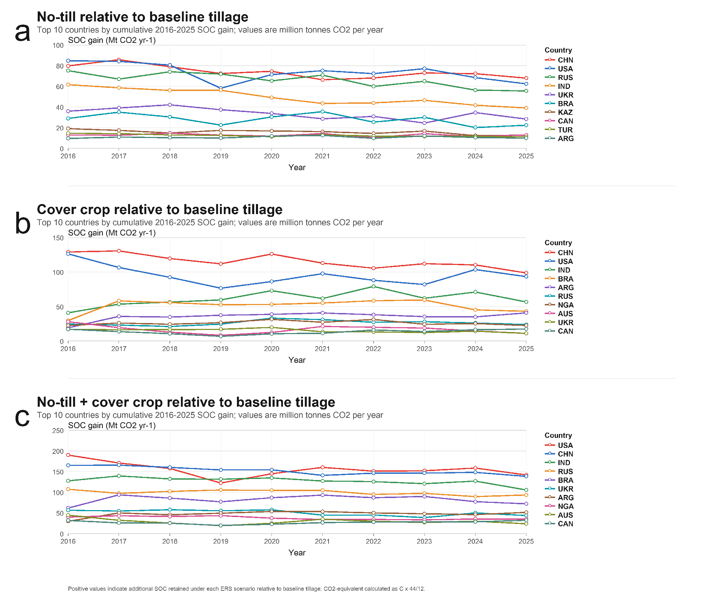

**Agriculture sector: Net Soil Organic Carbon Change**

**Prateek Sharma\*1, Rajvi Trivedi1, Adity Manuraj1, Mukta Sharma1, Neville Millar1, Sam Schiller2, Mike Hsu2, Aaron Davitt3, and Bruno Basso\*1**

*1) Department of Earth and Environmental Sciences, Michigan State University, 2) Carbon Yield 3) Climate TRACE*

*\*Corresponding Author: basso@msu.edu; sharm165@msu.edu*

**1. Introduction**

Soil organic carbon (SOC) is a major component of the terrestrial carbon cycle and plays an important role in soil fertility, water retention, nutrient cycling, and agricultural productivity. Globally, soils store considerably more carbon than either the atmosphere or terrestrial vegetation, meaning that relatively small changes in SOC stocks can influence atmospheric carbon dioxide (CO₂) concentrations and the global carbon balance (Batjes 1996; Friedlingstein et al. 2020). Agricultural soils are particularly dynamic because conversion to cropland and subsequent management alter both the quantity of carbon entering the soil and the processes controlling its decomposition and stabilization.

Despite its importance, quantifying annual SOC gains and losses from cropland remains challenging. Direct measurements of SOC change require repeated soil sampling over sufficiently long periods, and available monitoring networks vary substantially in sampling density, depth, analytical methods, spatial coverage, and temporal frequency (Jandl et al. 2014). National greenhouse-gas inventories can estimate mineral-soil carbon changes using IPCC Tier 1 stock-change factors or more detailed country-specific and model-based approaches, but the degree of spatial and management detail varies among inventories (IPCC 2019). Recent assessments of agricultural greenhouse-gas reporting similarly identify limited SOC observations and inadequate representation of spatially variable environmental and management effects as major constraints on field- and regional-scale reporting (Palosuo et al. 2025).

Consequently, globally consistent datasets that resolve annual cropland SOC stock change and the associated CO₂ source or sink across individual crops and fine spatial scales remain limited. Existing global soil datasets predominantly describe SOC stocks at particular points or reference periods, while changes in those stocks are generally more difficult to quantify because the temporal signal can be small relative to the large spatial variability in SOC. This creates an important reporting gap: knowing how much carbon is currently stored in agricultural soils does not by itself indicate whether those soils are gaining or losing carbon in a given year. Process-based modeling provides one means of estimating these temporal changes consistently by integrating weather, soils, crop growth, residue inputs, and management within a common framework. The need to represent these factors explicitly is particularly important because current agricultural GHG reporting approaches can inadequately capture the substantial spatial variability in SOC change.

Long-term conversion and cultivation of land for agriculture have substantially depleted SOC in many regions. Global reconstructions indicate that historical land-use change has generated considerable soil carbon debt, particularly in intensively cultivated regions (Sanderman et al. 2017). More recent analyses further indicate that agricultural topsoil SOC is influenced not only by historical land-use change but also by ongoing climate change and agricultural management. For example, Poeplau and Dechow (2023) estimated that climate change during 1919–2018 contributed to widespread SOC losses from agricultural topsoils, although the magnitude of the response varied substantially among regions and assumptions about changes in plant productivity. Agricultural management can partly modify these trajectories by altering carbon inputs, decomposition, and stabilization processes (Paustian et al. 2016; Lessmann et al. 2022).

Management affects SOC through multiple interacting pathways. Crop productivity and residue return determine the amount of organic material entering the soil, while soil disturbance, moisture, temperature, nutrient availability, and residue quality regulate how rapidly that material decomposes and how much is stabilized as SOC. A synthesis of 113 meta-analyses found that practices increasing organic matter inputs, including residue retention and cover cropping, generally increased SOC, whereas the effects of reduced or no tillage were smaller and more variable. The magnitude of these responses was strongly influenced by climate, crop type, soil properties, initial SOC, and experimental duration (Young et al. 2021). Similarly, global synthesis indicates substantial regional differences in SOC sequestration potential arising from differences in crop productivity, existing management, and initial SOC conditions (Lessmann et al. 2022).

Two widely discussed management strategies for increasing cropland SOC are reduced soil disturbance and the use of cover crops. No-till management minimizes mechanical soil disturbance and alters residue placement, soil structure, aeration, and decomposition conditions, whereas cover crops maintain vegetation during periods that would otherwise be fallow and provide additional above- and below-ground carbon inputs to the soil. Cover cropping has been identified as an important pathway for increasing SOC in agricultural soils (Poeplau and Don 2015). However, responses to both practices are strongly context dependent. A global meta-analysis of no-till systems, for example, showed that SOC responses depended on cropping intensity and additional carbon inputs, including the use of cover crops, rather than on the elimination of tillage alone (Nicoloso and Rice 2021). This variability is also consistent with previous assessments showing that tillage effects depend on climate, soil properties, cropping system, and sampling depth (Powlson et al. 2014; Ogle et al. 2019).

Representing this heterogeneity remains a major challenge in global assessments of agricultural soil carbon. Extrapolating uniform management-response factors across cropland can overlook differences in existing management, crop productivity, soil properties, and climatic constraints. Global analyses that combine meta-analytical evidence with spatial information have demonstrated large regional differences in the potential SOC response to improved Cropland management (Lessmann et al. 2022). More broadly, Paustian et al. (2016) highlighted accurate quantification of soil greenhouse-gas mitigation as a central challenge because management effects depend on interacting environmental and management conditions. Spatially explicit process-based modeling provides a means of addressing this challenge by allowing SOC responses to emerge from interactions among local climate, soil properties, crop growth, residue inputs, and management.

Here, our primary objective is to provide annual, spatially explicit estimates of cropland SOC stock change and the associated CO₂ source or sink under baseline management conditions. Climate TRACE uses the process-based System Approach for Land Use Sustainability (SALUS) model (Basso et al. 2025b) to simulate SOC dynamics in the upper 0–30 cm soil profile across global cropland. SALUS integrates crop growth with soil water, nutrient, and carbon cycling and dynamically represents the production, decomposition, and stabilization of crop-derived organic matter. Baseline simulations incorporate spatially varying weather, soils, crop and residue inputs, and reconstructed tillage management to estimate where cropland soils are gaining or losing SOC each year.

As a second application of this framework, we evaluate how alternative management could modify the baseline SOC trajectory. Three emission-reduction scenarios are considered: no-till, cover cropping, and the stacking of no-till and cover cropping. These scenarios are evaluated using paired simulations so that their modeled SOC effects are quantified relative to the corresponding baseline conditions. This enables the analysis to distinguish the current modeled SOC source or sink from the additional SOC retained through a management intervention.

The resulting Climate TRACE dataset provides annual, spatially explicit estimates of net SOC change and the associated CO₂ sink or source across 40 crop groups and more than 170 countries for 2016–2025. The baseline dataset identifies the magnitude and spatial distribution of ongoing cropland SOC losses and gains, while the ERS analysis quantifies where no-till, cover cropping, or their combination could reduce SOC losses or increase carbon retention relative to those baseline trajectories. Together, these outputs provide a consistent framework for agricultural SOC emissions accounting while explicitly representing variation across crops, countries, management systems, and environmental conditions.

**2. Materials and Methods**

We simulate annual soil organic carbon (SOC) stock change and the associated CO₂ emissions or removals for global cropland from 2016 to 2025 using the process-based System Approach for Land Use Sustainability (SALUS) model (Basso et al. 2025b; Figure 1). SALUS couples crop growth with soil water, nutrient, and carbon cycling and represents the processes controlling the production, decomposition, and stabilization of organic matter in agricultural soils (Section 2.2). Simulations were conducted for 40 crop groups across the global 5-arc-minute cropland domain, with SOC stocks evaluated for the upper 0–30 cm soil profile for each grid cell, crop, management scenario, and simulation year from 2016-2025. Annual changes in SOC stocks were subsequently converted to the corresponding CO₂ source or sink.

For each grid cell, SALUS simulations are conducted using input forcing as provided in Table 1. Annual differences in simulated SOC stocks are used to estimate the delta SOC change. Positive differences indicate greater soil carbon storage, whereas negative values indicate lower SOC. Carbon-stock differences are converted to CO₂ mass using the molecular-weight ratio between CO₂ and carbon. For the emission-reduction scenarios, annual mitigation benefits were calculated relative to the paired baseline simulation. Detailed equations, units, sign conventions, annual accounting definitions, and the distinction between annual SOC change, CO₂ flux, and annual mitigation benefit are provided in Supplementary Text S1. These definitions should be considered when interpreting the SOC and CO₂ results presented below.

**Figure 1** Process-based SALUS schematic (Basso et al., 2025b).

**2.1 Model inputs**

To run the SALUS biogeochemical model globally, we assembled spatially explicit datasets describing weather, soil properties, crop-residue inputs, and tillage management (Table 1). These datasets were harmonized (Section 2.1.1) to provide consistent environmental and management inputs for the SOC simulations across all grid cells, crops, and years.

**Table 1** Primary inputs used to simulate SOC stock change with SALUS.

| **Model input**          | **Spatial resolution**         | **Temporal**                                               | **Source**                                                                     | **Crop-specific** |
|--------------------------|--------------------------------|------------------------------------------------------------|--------------------------------------------------------------------------------|-------------------|
| Cropland mask            | 5 arc-min                      | SPAM 2020; fixed simulation domain for 2016–2025           | SPAM 2020 / IFPRI (2026)                                                       | Yes               |
| Weather                  | 1° in processed global dataset | Daily; simulation-period weather forcing                   | NASA/POWER (NASA LaRC, 2024)                                                   | No                |
| Soil properties          | 250 m                          | Static soil-profile information                            | SoilGrids (Poggio et al. 2021; Ritchie et al. 1999; Suleiman and Ritchie 2001) | No                |
| Tillage practices        | 5 arc-min                      | Representative baseline management; held constant for 2005 | Porwollik et al. 2019                                                          | Yes               |
| Residue retained on soil | 0.5°                           | Annual, 1997–2021 in source dataset                        | Smerald et al. 2023                                                            | No                |

**2.1.1 Cropland mask and spatial harmonization**

A global cropland mask was developed to define the spatial domain and reference grid for all SALUS simulations. We used the SPAM 2020 dataset, derived from the Global Spatially Disaggregated Crop Production Statistics Data for 2020, version 2.0, release 2 (IFPRI, 2026), at 5-arc-minute resolution (\~10 km2 spatial resolution). Harvested area was summed across all crop groups represented in SPAM, and grid cells with total harvested area greater than zero were retained as cropland simulation cells. Grid cells with no reported harvested area were excluded from the SALUS simulation domain.

The resulting 5-arc-minute cropland mask served as the spatial backbone for assembling all other model inputs. For each retained cropland grid cell, the corresponding weather, soil, crop-residue, tillage, and other spatially explicit inputs were extracted from their source datasets based on the location of the cropland mask cell. When an input dataset had a spatial resolution different from the 5-arc-minute mask, the value from the geographically closest source-grid location was assigned to the corresponding cropland cell. In this way, the SPAM cropland grid remained fixed, while datasets at different native spatial resolutions were mapped onto the same set of cropland locations.

This procedure ensured that every SALUS simulation location had a consistent set of environmental, crop, residue, and management inputs referenced to the same cropland mask. The mask was therefore not derived from the ancillary input datasets; rather, it defined the simulation locations to which all other datasets were assigned. The cropland mask was held constant throughout the simulation period and across the baseline and emission-reduction scenarios.

**2.1.2 Weather inputs**

Daily weather variables required by SALUS were obtained from the NASA Prediction of Worldwide Energy Resources (NASA/POWER) project maintained by the NASA Langley Research Center (NASA LaRC, 2024). The meteorological inputs included daily maximum and minimum air temperature, accumulated precipitation, downward surface shortwave radiation, wind speed, and maximum and minimum relative humidity. These variables provide the atmospheric forcing required by SALUS to simulate soil biogeochemical processes. The NASA/POWER data were processed and harmonized to a common 1° spatial grid (\~10,000 km2 spatial resolution, depending on latitude) for global simulations. Daily weather inputs were assigned to each simulation grid point and year, and identical weather forcing was used across the baseline and emission-reduction scenarios so that differences in simulated SOC could be attributed to management rather than to climate forcing.

**2.1.3 Soil inputs**

Soil properties required by SALUS were derived from SoilGrids (Poggio et al. 2021) a globally consistent soil dataset. The primary soil variables supplied to the model included bulk density, sand, silt and clay content, coarse-fragment content, soil organic carbon, total nitrogen, and pH for individual soil-profile layers. These properties describe the soil’s initial physical and biogeochemical state and influence water storage and movement, aeration, root growth, residue decomposition, and SOC turnover.

Additional hydraulic properties required by SALUS were derived from available soil information, including the drained upper and lower limits of soil water availability following Ritchie et al. (1999), and saturated hydraulic conductivity following Suleiman and Ritchie (2001). Soil organic carbon and nitrogen information were used to initialize the soil C and N pools represented by SALUS (Section 2.2), while soil texture and bulk density contributed to the calculation of soil-water and transport properties. Soil profile information was spatially harmonized with the global simulation grid before being supplied to SALUS.

**2.1.4 Crop residue retained in soil**

Crop residues represent an important source of carbon entering the soil and were therefore explicitly included in the SALUS biogeochemistry simulations. Crop-residue production was estimated from the corresponding crop-production framework (crop-residue N₂O emissions methodology; in the [Agriculture GitHub folder](https://github.com/climatetracecoalition/methodology-documents/tree/main/2025/Agriculture)), and the fraction of aboveground crop residue retained on the field was derived from crop-specific residue-retention coefficients reported by Smerald et al. (2023), which provides annual, spatially explicit estimates of residue management at 0.5° resolution for 1997–2021. For simulation years beyond 2021, the 2021 residue-retention fraction was held constant and applied through 2025.

Smerald et al. (2023) partitions total cereal residues within each grid cell among residues burned in the field, used for livestock feed or bedding, used for other off-field purposes, and retained on the field. The resulting residue-management fractions are spatially explicit but are not reported separately for individual crops. We therefore applied the grid-cell-level fraction of cereal residue retained on the field to the crop-specific residue-production estimates generated by our framework. This procedure preserves differences in residue production among crops while using a common spatially varying residue-retention fraction within each location. The resulting quantity of retained total main-crop residue was supplied to SALUS as an organic-matter input.

The prescribed main-crop residue inputs were held constant among the paired baseline and emission-reduction scenarios of no-till for a given grid cell, crop, and year. This ensured that differences between scenarios were not caused by changes in the externally prescribed production or retention of the main-crop residue. Tillage scenarios could nevertheless alter the subsequent fate of this residue within SALUS through differences in residue placement, soil disturbance, incorporation, decomposition, and stabilization.

Cover-crop carbon inputs were treated separately from these prescribed main-crop residues. In the cover-crop and combined no-till + cover-crop scenarios, vegetation was introduced during periods that were bare in the baseline simulation. Cover-crop growth generated additional above- and below-ground biomass that entered the SALUS carbon cycle and provided an additional source of organic carbon beyond the prescribed main-crop residue input. Consequently, total carbon inputs were not identical between the baseline and cover-crop scenarios; only the externally prescribed main-crop residue inputs were held constant. The modeled SOC response to cover cropping therefore reflects the additional carbon input and associated soil-process interactions generated by the cover crop. For cover crops, all the residue (100%) is left on the ground.

Because main-crop residue production was prescribed from the external crop-production framework rather than recalculated in response to each ERS scenario, management-induced changes in main-crop productivity were not used to modify the prescribed main-crop residue input.

**2.1.5 Tillage practice**

Baseline tillage management was derived from the global gridded tillage dataset developed by Porwollik et al. (2019). Tillage refers to the mechanical disturbance of soil for crop production, such as plowing, disking, or other operations used to prepare the seedbed, control weeds, and incorporate crop residues. Different tillage systems vary in the intensity and frequency of soil disturbance and therefore can influence soil structure, residue placement, aeration, water dynamics, and SOC decomposition. The dataset provides crop-specific estimates of tillage systems at 5-arc-minute resolution and represents global management conditions around 2005. Porwollik et al. (2019) classified globally relevant tillage practices into six systems: no-tillage within Conservation Agriculture, traditional annual tillage, traditional rotational tillage, rotational tillage, reduced tillage, and conventional annual tillage. The dataset assigns a specific tillage system to each crop-specific 5-arc-minute grid cell using a rule-based allocation framework; therefore, no global or regional mean tillage value was applied in our simulations. The allocation considers crop type, water-management regime, field size, water erosion, income, aridity, and reported national Conservation Agriculture area. For example, conventional annual tillage is generally associated with mechanized annual-crop systems, traditional annual tillage with smaller-scale annual cropping systems, and rotational or traditional rotational tillage with perennial cropping systems, while reduced tillage is assigned under specific soil-depth constraints and Conservation Agriculture is spatially downscaled from reported national areas. Full definitions, parameterization, allocation rules, and global spatial distributions of the six tillage systems are provided by Porwollik et al. (2019).

For the SALUS simulations, the Porwollik et al. (2019) tillage information was spatially harmonized with the cropland mask (Section 2.1.1) and used to define the baseline tillage condition for each simulated crop and grid cell. The assigned tillage system determines the level of soil disturbance represented in SALUS and thereby affects residue incorporation, soil mixing, soil-water and temperature conditions, and SOC decomposition.

**2.2 SALUS soil organic carbon dynamics**

SALUS represents SOC dynamics by tracking the movement of carbon from fresh plant material into progressively more stable soil organic matter pools (Figure 2). Aboveground crop residues and root biomass enter the model as fresh organic matter. These inputs are partitioned according to residue quality into rapidly decomposing soluble compounds, intermediate cellulose and hemicellulose fractions, and more resistant lignin-rich material. This initial partitioning controls how quickly residue carbon becomes available for decomposition and transfer into soil organic matter.

As fresh organic matter decomposes, carbon enters three soil organic matter pools with contrasting turnover rates. The ACTIVE pool represents microbial biomass and readily decomposable microbial products and therefore has the shortest residence time. Carbon can subsequently be transferred to the SLOW pool, which contains more resistant organic matter with turnover on longer, decadal timescales, and ultimately to the PASSIVE pool, which represents highly stabilized organic matter with much longer residence times. Carbon can move among these pools as decomposition and stabilization proceed.

At each stage of decomposition, only a portion of carbon is retained within the soil organic matter pools. The remaining fraction is released as CO₂ through microbial respiration. Annual SOC change therefore reflects the net balance between carbon entering the soil from crop residues and roots, carbon transferred and stabilized within the soil organic matter pools, and carbon lost through decomposition and respiration.

The rates of these transformations are dynamically regulated by environmental and soil conditions, including soil temperature, soil water content, clay content, nitrogen availability, residue quality, and soil depth. As a result, the same quantity of residue input or the same management intervention can produce different SOC responses among locations because decomposition and stabilization are controlled by local climate, soil properties, crop productivity, and residue characteristics.

**Figure 2** SALUS Soil Organic Carbon dynamics (Basso et al. 2015; Basso et al. 2025b).

**2.3 Management scenarios and analytical framework**

SALUS simulations were initialized using the SOC stock derived from SoilGrids for the soil profile in each cropland grid cell. The initial SOC stock was partitioned among the SALUS soil organic matter pools using the model’s default initialization fractions: 50% of SOC was assigned to the resistant pool, 46% to the SLOW pool, and 4% to the ACTIVE pool. This initialization establishes the starting distribution of carbon among pools with contrasting turnover rates before the annual simulations begin.

The same initial SOC stock and pool partitioning were used for the baseline and all emission-reduction scenarios within a given grid cell. Consequently, differences in subsequent SOC trajectories among scenarios arise from the simulated management changes rather than from differences in initial soil carbon conditions.

SALUS simulations were then conducted independently for each of the 40 crop groups represented within the global cropland mask. For each grid cell and year, crop-specific SOC stocks were combined using the corresponding harvested area of each crop as a weighting factor to obtain a single area-weighted SOC stock for the cropland represented within that grid cell. The same crop-level simulation, initialization, and aggregation procedure was applied consistently to the baseline and all emission-reduction scenarios. Additional details on crop-level aggregation and annual SOC accounting are provided in Supplementary Text S2.

Four management scenarios were evaluated: baseline, no-till, cover crop, and no-till + cover crop (Table 2). The baseline represents the reconstructed current-management condition and serves as the reference trajectory for all ERS comparisons. Each ERS was simulated independently from the same initial SOC stock and using the same weather, soil properties, main-crop characteristics, and prescribed main-crop residue inputs as its paired baseline. Thus, ERS scenarios represent counterfactual management alternatives rather than sequential modifications applied after completion of the baseline simulation.

In the baseline scenario, each crop and grid cell retained the tillage practice assigned by Porwollik et al. (2019), and no cover crop was introduced. In the no-till scenario, the baseline tillage practice was replaced by no-till, defined here as the absence of mechanical soil disturbance from tillage operations. In the cover-crop scenario, baseline tillage was retained while rye was introduced during the off-season between main-crop cycles. In the combined scenario, both management changes were applied simultaneously: baseline tillage was replaced by no-till and rye was grown during the off-season.

The SOC response under each ERS was then compared with the corresponding baseline SOC trajectory for the same grid cell and year. Consequently, the reported ERS benefit represents the additional SOC retained, or SOC loss avoided, under the counterfactual management practice relative to the reconstructed baseline management condition. Detailed equations, weighting procedures, units, sign conventions, and definitions of annual versus cumulative SOC and CO₂ benefits are provided in Supplementary Text S1 and S2.

**Table 2** Scenarios definitions.

<table><thead><tr class="header"><th><strong>Scenario</strong></th><th><strong>Prescribed main-crop inputs</strong></th><th><strong>Tillage Management</strong></th><th><strong>Cover-crop management</strong></th></tr></thead><tbody><tr class="odd"><td>Baseline</td><td>Same weather, soil, crop characteristics, and prescribed main-crop residue inputs used in paired scenarios</td><td>Crop- and grid-specific baseline tillage from Porwollik et al. (2019)</td><td>No cover crop grown</td></tr><tr class="even"><td>No-till (ERS)</td><td>Same prescribed main-crop inputs as baseline</td><td>Baseline tillage replaced by no-till; no mechanical tillage disturbance</td><td>No cover crop grown</td></tr><tr class="odd"><td>
Cover crop

(ERS)
</td><td>Same prescribed main-crop inputs as baseline</td><td>Baseline tillage retained</td><td>Rye grown during the off-season between main-crop cycles; cover-crop biomass provides additional C inputs</td></tr><tr class="even"><td>
No-till + Cover crop

(ERS)
</td><td>Same prescribed main-crop inputs as baseline</td><td>Baseline tillage replaced by no-till; no mechanical tillage disturbance</td><td>Rye grown during the off-season between main-crop cycles</td></tr></tbody></table>

**2.4** **Final dataset**

The final Climate TRACE dataset provides annual, spatially explicit estimates of cropland soil organic carbon (SOC) change and the associated CO₂ source or sink for 2016–2025. Estimates were generated across the global 5-arc-minute cropland domain defined from SPAM 2020 and cover 40 crop groups in more than 170 countries. SALUS was simulated separately for each crop, after which crop-specific SOC stocks were combined within each grid cell using harvested-area weighting to produce a single cropland SOC estimate for each grid cell and year.

For the baseline dataset, annual SOC change was calculated from year-to-year differences in simulated 0–30 cm SOC stocks and reported on an area basis as carbon change per hectare. These SOC changes were converted to the corresponding CO₂ source or sink using the molecular-weight ratio of CO₂ to C. Grid-level estimates were subsequently aggregated to national and global scales, with country totals reported in Mt CO₂ yr⁻¹ and global totals in Gt CO₂ yr⁻¹.

In addition to the baseline SOC trajectory, the dataset includes three counterfactual emission-reduction scenarios: no-till, cover cropping, and the combined application of no-till and cover cropping. For each scenario, Climate TRACE reports the annual SOC benefit relative to the paired baseline, representing the additional SOC retained or SOC loss avoided under the alternative management practice. The same outputs are available spatially at 5-arc-minute resolution and can be aggregated to country and global scales.

The final dataset therefore contains two complementary types of information: (1) annual baseline cropland SOC change and associated CO₂ emissions or removals under reconstructed current management, and (2) annual additional SOC retention and associated CO₂ mitigation potential under the three modeled management scenarios.

**3. Emission Reduction Solution**

**3.1 Derivation of ERS estimates**

The SOC benefit of each emission-reduction solution (ERS) was quantified relative to the paired baseline simulation. Annual SOC change was calculated from year-to-year differences in simulated SOC stocks, and the annual ERS benefit was calculated as the difference between the annual SOC change under the ERS and the corresponding baseline for the same grid cell and year. Positive values indicate greater SOC retention under the ERS relative to the baseline, whereas negative values indicate lower SOC retention. Because both the baseline and ERS scenarios may be losing SOC, the sign of the benefit reflects the difference between scenarios rather than the absolute direction of the CO₂ flux. Detailed equations, units, sign conventions, crop-level aggregation, and the distinction between annual and cumulative benefits are provided in Supplementary Text S1 and S2.

**3.2 Incorporate ERS into the model**

Four management scenarios were simulated: baseline, no-till, cover crop, and no-till + cover crop (Table 2). Paired scenarios used the same weather, soil properties, crop characteristics, and prescribed main-crop residue inputs, while tillage and cover-crop management were modified according to the scenario. This design allows differences in modeled SOC to be attributed to the management intervention rather than differences in environmental forcing or prescribed main-crop inputs.

The baseline retained the crop- and grid-specific tillage management prescribed by Porwollik et al. (2019) and did not include a cover crop. In the no-till scenario, no-till management was imposed across all simulated cropland. In the cover-crop scenario, baseline tillage was retained and rye was grown during the off-season between main crops. The combined scenario applied both no-till and off-season rye cover cropping. Cover-crop scenarios therefore included additional carbon inputs generated by cover-crop biomass, whereas prescribed main-crop residue inputs remained unchanged among paired scenarios.

SALUS was run separately for the 40 crop groups represented within the global cropland domain for 2016–2025. Crop-specific SOC outputs were aggregated within each grid cell using harvested-area weighting before annual SOC changes and ERS benefits were calculated. Further details on scenario implementation, crop aggregation, and SOC accounting are provided in Supplementary Text S1 and S2.

**4. Results**

**4.1 Net Soil Organic Carbon Change (Baseline Scenario)**

Under the baseline scenario, modeled cropland soils were a persistent net source of CO₂ to the atmosphere throughout the study period. The baseline reflects each grid cell's tillage practice, as characterized by the rule-based global gridded tillage dataset of Porwollik et al. (2019), rather than an assumed uniform conventional-tillage condition. A net loss of soil organic carbon occurred across approximately 99% of evaluated grid cells every year from 2016 to 2025 (Figure 3), a far more spatially uniform signal than any of the emission-reduction scenarios, consistent with the absence of an offsetting management-change practice in this scenario.

Per unit area, the modeled net SOC change was approximately −0.53 Mg C ha⁻¹ in 2016, easing to approximately −0.41 Mg C ha⁻¹ by 2025 (Figure 3). This statistic is a simple unweighted spatial average of the per-pixel model output rather than the crop-area-weighted figure used for the no-till, cover-crop, and combined scenarios elsewhere in this report, and should be read as indicative of magnitude and spatial pattern rather than compared directly to those weighted values.

When aggregated across all included crops and countries, baseline cropland soils released approximately 1.80 Gt CO₂ in 2016, declining to approximately 1.51 Gt CO₂ in 2025 — a reduction of approximately 0.28 Gt CO₂, or 15.8%, over the analysis period (Figure 4). Summed across 2016–2025, cumulative baseline net SOC emissions totaled approximately 16.38 Gt CO₂.

At the national scale, the largest modeled baseline emissions were concentrated in India, China, the United States, Brazil, and Russia, rankings that were consistent across the decade (Figure 5). In the most recent year 2025, India had the largest estimated baseline emission (171.1 Mt CO₂), followed by China (134.0 Mt CO₂), the United States (116.6 Mt CO₂), Brazil (115.4 Mt CO₂), and Russia (103.2 Mt CO₂) (Figure 5).

These results establish the reference trajectory against which the no-till, cover-crop, and combined emission-reduction scenarios reported in the following sections are evaluated: a large but gradually narrowing global cropland carbon source under current management practice.

**Figure 3** Baseline SOC change (Mg C ha⁻¹; negative = net source or a loss of carbon), for 2016-2025 average.

 

**Figure 4** Global baseline net SOC emissions, 2016–2025 (Gt CO₂).

  
**Figure 5** Top 10 countries by baseline net SOC emissions, 2016-2025 (Mt CO₂).

**4.2 SOC benefits of emission reduction solutions**

All three emission reduction solutions increased SOC retention relative to baseline management across most of the global cropland area evaluated, although the magnitude and temporal behavior differed among scenarios (Figure 6). The values shown in Figure 6 represent the annual difference in SOC change between each ERS scenario and its corresponding baseline simulation, rather than the absolute annual change in SOC under the ERS (Section S1.3). Positive values therefore indicate that more SOC was retained under the ERS than under baseline management. Because the baseline simulations generally showed net SOC losses, this benefit often represents a reduction in the rate of SOC loss rather than an absolute increase in SOC stock. Each ERS was simulated independently from the same initial SOC conditions as its paired baseline, with only the specified management practice altered.

In the no-till scenario (Figure 6a), replacing baseline tillage with no-till resulted in an additional 0.182 Gt C retained relative to baseline in 2016. The annual benefit gradually declined to 0.136 Gt C yr⁻¹ by 2025, a 25.2% reduction in the magnitude of the annual benefit. Thus, the main result from Figure 6a is that no-till consistently reduced SOC losses relative to baseline management, but the additional amount of SOC retained each year became smaller over time. Cumulative additional SOC retention relative to baseline was 1.584 Gt C during 2016–2025, with annual benefits equivalent to approximately 0.50–0.67 Gt CO₂ yr⁻¹.

The cover-crop scenario (Figure 6b) also retained more SOC than its paired baseline in every year, but its temporal response differed from that of no-till. The annual SOC benefit was 0.185 Gt C yr⁻¹ in 2016 and 0.179 Gt C yr⁻¹ in 2025, corresponding to only a 3.4% decrease between the beginning and end of the period. Interannual variability was more pronounced, with the annual benefit ranging from 0.179 to 0.215 Gt C yr⁻¹ and reaching its maximum in 2020. The main result from Figure 6b is therefore that cover cropping produced a larger and more persistent annual SOC benefit than no-till, although the magnitude varied among years. Cumulative additional SOC retention relative to baseline was 1.988 Gt C during 2016–2025, corresponding to approximately 0.66–0.79 Gt CO₂ yr⁻¹ of annual benefit.

Applying no-till and cover cropping together produced the largest additional SOC retention relative to baseline throughout the study period (Figure 6c). The annual benefit was 0.383 Gt C yr⁻¹ in 2016, reached 0.408 Gt C yr⁻¹ in 2017, and declined to 0.338 Gt C yr⁻¹ by 2025. Thus, Figure 6c shows that combining the two management changes consistently reduced SOC losses relative to baseline by more than either practice applied individually. Cumulative additional SOC retention reached 3.718 Gt C during 2016–2025, corresponding to approximately 1.24–1.50 Gt CO₂ yr⁻¹ of annual benefit.

The combined response was slightly greater than the summed benefits of the two individual scenarios over the full study period. No-till and cover cropping applied independently produced cumulative benefits of 1.584 and 1.988 Gt C, respectively, corresponding to 3.572 Gt C when summed, compared with 3.718 Gt C under the combined scenario. The combined response was therefore approximately 4.1% greater than the simple additive expectation over 2016–2025. However, this difference varied among years, indicating that the interaction between the two management practices was not consistently additive through time.

**Figure 6** Annual soil organic carbon (SOC) benefit of alternative management scenarios relative to paired baseline management during 2016–2025. Values represent the difference in annual SOC change between each ERS simulation and its corresponding baseline simulation, rather than absolute SOC change under the ERS. Positive values indicate that more SOC was retained under the ERS than under baseline management; because the baseline simulations generally exhibited net SOC losses, a positive benefit can represent a reduction in SOC loss rather than an absolute increase in SOC stock. Each ERS was simulated independently from the same initial SOC conditions as its paired baseline. (a) No-till relative to baseline tillage. (b) Cover cropping with baseline tillage retained. (c) Combined no-till and cover cropping relative to baseline management. Values below each panel summarize the annual benefit in 2016 and 2025, the change between those years, and cumulative additional SOC retained during 2016–2025.

Spatial patterns further demonstrated substantial heterogeneity in the SOC response to management (Figure 7). Averaged across 2016–2025, no-till increased SOC relative to the baseline in 92.8% of evaluated grid cells, with a mean annual benefit of 160 kg C ha⁻¹ and a median of 116 kg C ha⁻¹ (Figure 7a). Positive responses were concentrated across major agricultural regions of North America, Europe, South and East Asia, and parts of South America, although localized negative responses also occurred.

Cover cropping produced a broader and more spatially consistent response, with positive SOC benefits in 96.6% of evaluated grid cells (Figure 7b). The global mean and median annual benefits were 186 and 187 kg C ha⁻¹, respectively. Strong positive responses occurred across major cropping regions of the United States, Europe, China, India, Southeast Asia, South America, and parts of sub-Saharan Africa.

The combined no-till + cover-crop scenario produced both the largest per-area SOC gain and the greatest spatial consistency (Figure 7c). Positive responses occurred in 98.4% of evaluated grid cells, with a global mean annual benefit of 363 kg C ha⁻¹ and a median of 362 kg C ha⁻¹. The close agreement between the mean and median, together with the high proportion of positive grid cells, indicates that the greater global benefit of the combined scenario was distributed broadly across the modeled cropland area rather than being driven only by a small number of high-response locations.

**Figure 7** Spatial distribution of mean annual SOC benefit for (a) no-till, (b) cover cropping, and (c) no-till + cover cropping relative to baseline management, averaged across 2016–2025. Positive values indicate additional SOC retention and therefore an emission-reduction benefit. Values are expressed as kg C ha⁻¹ yr⁻¹.

National contributions to SOC mitigation also differed among management scenarios (Figures 8–9). Under no-till, China had the largest SOC benefit in 2025 at 67.9 Mt CO₂ yr⁻¹, followed by the United States at 62.4 Mt CO₂ yr⁻¹, Russia at 55.6 Mt CO₂ yr⁻¹, India at 39.1 Mt CO₂ yr⁻¹, and Ukraine at 28.3 Mt CO₂ yr⁻¹ (Figure 8a). These countries remained among the major contributors throughout 2016–2025, although their annual benefits generally declined over time (Figure 9a).

The geographic distribution shifted under cover cropping (Figure 8b). China and the United States dominated the 2025 global benefit, contributing 98.8 and 93.4 Mt CO₂ yr⁻¹, respectively, followed by India at 56.7 Mt CO₂ yr⁻¹, Brazil at 43.0 Mt CO₂ yr⁻¹, and Argentina at 40.9 Mt CO₂ yr⁻¹. Country-level trajectories were more variable than for no-till, particularly in the United States, India, Brazil, and Russia, consistent with the greater interannual variability observed in the global cover-crop response (Figure 9b).

Under the combined scenario, the United States became the largest national contributor in 2025, with an estimated SOC benefit of 142.0 Mt CO₂ yr⁻¹, followed closely by China at 138.5 Mt CO₂ yr⁻¹ (Figure 8c). India contributed 105.9 Mt CO₂ yr⁻¹, Russia 93.7 Mt CO₂ yr⁻¹, and Brazil 72.3 Mt CO₂ yr⁻¹. The United States and China remained the dominant contributors throughout most of the study period, while India consistently represented the third-largest contribution during the latter part of the analysis (Figure 9c).

Overall, the results show a clear ranking among the evaluated management strategies. Cover cropping produced a larger and more temporally stable global SOC benefit than no-till alone, whereas their combined implementation generated the greatest and most spatially consistent increase in SOC retention. However, the magnitude of the response varied substantially among regions and countries, emphasizing the importance of representing management effects within their local soil, climate, and cropping-system context

**Figure 8** Ten largest national SOC benefits in 2025 under (a) no-till, (b) cover cropping, and (c) no-till + cover cropping relative to baseline management. Values are expressed as Mt CO₂ yr⁻¹.

**Figure 9** Annual SOC benefits for the ten largest cumulative national contributors under (a) no-till, (b) cover cropping, and (c) no-till + cover cropping during 2016–2025. Values are expressed as Mt CO₂ yr⁻¹. Positive values represent additional SOC retained relative to baseline management.

**4.3 Verifying modeled emissions estimates**

SALUS has previously been evaluated against field measurements and long-term agricultural experiments under a range of soil, climate, and management conditions. In long-term experiments in the U.S. Corn Belt, Senthilkumar et al. (2009) evaluated SALUS against measured changes in soil carbon over 18–21 years under conventional tillage, no-till, nitrogen fertilization, and cover-crop-based management and reported close agreement between modeled and observed SOC changes. Similarly, field measurements from eight farms in northern Italy were used to calibrate and validate SALUS under conventional and no-till management, with the model reproducing differences in SOC dynamics associated with tillage intensity (Pezzuolo et al. 2017).

SALUS has also been evaluated using long-term conservation-tillage experiments in Mediterranean cropping systems (Iocola et al. 2017) and soil measurements from multiple experimental sites in the U.S. Great Lakes region (Martinez-Feria and Basso 2020). More recently, SALUS was included in a multi-model ensemble evaluated against 17 long-term experimental locations and 52 management treatments across North America, including conventional tillage, reduced tillage, no-till, and cover cropping (Basso et al. 2025a). Together, these studies provide independent field-based evidence that SALUS can represent the direction and magnitude of SOC responses to changes in agricultural management.

However, to evaluate the plausibility of the SALUS-based emission reduction solution (ERS) estimates, modeled annual SOC benefits were compared with values reported in the literature for no-till, cover crops, and their combined implementation (Table S1). Because the available literature includes both field-based meta-analyses and process-based modeling studies evaluated against long-term field experiments, these comparisons are used as external benchmarks rather than as a formal validation of the global gridded estimates. For each ERS scenario, the annual SOC benefit was calculated relative to the corresponding baseline simulation and expressed in Mg C ha⁻¹ yr⁻¹. Annual final weighted-average SOC-benefit rasters, originally expressed in kg C ha⁻¹, were converted to Mg C ha⁻¹ by dividing by 1,000. Mean values were then calculated across the 2016–2025 period using all valid grid cells. This comparison evaluates whether the magnitude and direction of modeled SOC responses are consistent with those reported from field experiments while recognizing that SOC responses vary substantially with climate, soil properties, crop type, management history, experimental duration, and soil sampling depth.

The modeled SOC benefit of no-till relative to the baseline averaged 0.159 Mg C ha⁻¹ yr⁻¹ in the 0–30 cm soil profile during 2016–2025, with annual global means ranging from 0.130 to 0.192 Mg C ha⁻¹ yr⁻¹. This estimate is lower than several published global syntheses but lies within the broad range of responses reported for no-till systems. West and Post (2002) estimated an average SOC sequestration rate of 0.57 ± 0.14 Mg C ha⁻¹ yr⁻¹ following conversion from conventional tillage to no-till. Nicoloso and Rice (2021), using 953 SOC comparisons distributed across six continents, reported an average difference of 0.40 ± 0.11 Mg C ha⁻¹ yr⁻¹ between no-till and tilled soils when SOC stocks were integrated over the 0–100 cm profile. Ogle et al. (2019) reported estimated SOC changes ranging from approximately 0.06 to 0.54 Mg C ha⁻¹ yr⁻¹ across combinations of climate and soil texture, emphasizing the substantial environmental dependence of the no-till response. Mondal et al. (2023) similarly found that the SOC response to no-till varied with climate, soil texture, cropping system, and duration of adoption, with the strongest overall stock response occurring within the upper 30 cm.

An important distinction between these literature estimates and the present analysis is the definition of the counterfactual baseline. Many meta-analyses explicitly compare no-till with conventional tillage, whereas our baseline represents the reconstructed tillage practice already occurring within each grid cell according to Porwollik et al. (2019). Consequently, some baseline grid cells may already have reduced-tillage or no-till management, and the reported ERS value represents the additional SOC benefit of imposing no-till relative to existing management rather than a universal conversion from conventional tillage. This distinction is particularly relevant because Nicoloso and Rice (2021) found that differences between no-till and low-disturbance alternative tillage were much smaller than differences between no-till and more intensive tillage systems. In addition, literature syntheses show that SOC responses vary with climate, soil texture, cropping intensity, experimental duration, and sampling depth. Therefore, direct numerical comparisons among studies should be interpreted as benchmarks of magnitude rather than as equivalent estimates.

For cover crops, the modeled global SOC benefit averaged 0.186 Mg C ha⁻¹ yr⁻¹ during 2016–2025, with annual values ranging from 0.162 to 0.204 Mg C ha⁻¹ yr⁻¹. Published syntheses span a relatively wide range. Poeplau and Don (2015) reported an average SOC accumulation rate of 0.32 ± 0.08 Mg C ha⁻¹ yr⁻¹ based on 139 plots from 37 sites, with a mean sampling depth of 22 cm and experiments extending up to 54 years. Jian et al. (2020) estimated a mean rate of 0.56 Mg C ha⁻¹ yr⁻¹ and found significant SOC increases primarily in soils sampled to ≤30 cm. In a meta-analysis restricted to corn-based systems, Joshi et al. (2023) reported 0.88 Mg C ha⁻¹ yr⁻¹ for the 0–30 cm profile. More recent reviews have reported values closer to 0.24–0.32 Mg C ha⁻¹ yr⁻¹.

These literature estimates should nevertheless be compared cautiously. Cover-crop SOC estimates are sensitive to sampling depth, experimental duration, initial SOC, cover-crop biomass and type, soil properties, and climatic conditions. Chaplot and Smith (2023) also questioned the magnitude of some previously reported cover-crop sequestration rates, emphasizing limitations related to sampling depth, equivalent-soil-mass accounting, experimental duration, and control selection. Their interpretation has subsequently been debated in the literature, underscoring the uncertainty associated with assigning a single SOC sequestration rate to cover cropping across contrasting environments. The lower global mean simulated here should therefore not be interpreted simply as a consequence of broader spatial coverage; rather, differences among estimates may reflect contrasts in baseline conditions, environmental distributions, management assumptions, sampling depths, and methods used to quantify SOC change.

The modeled SOC benefit of the combined no-till + cover-crop scenario averaged 0.362 Mg C ha⁻¹ yr⁻¹ during 2016–2025, with annual global means ranging from 0.318 to 0.409 Mg C ha⁻¹ yr⁻¹. Few studies have evaluated this combination at comparable spatial scales, but the modeled estimate closely agrees with Basso et al. (2025a), who reported an increase of 0.36 ± 0.12 Mg C ha⁻¹ yr⁻¹ for combined no-till and cover cropping across approximately 46 million ha of U.S. Midwest cropland using a multi-model ensemble evaluated against long-term field experiments. The same study reported 0.19 ± 0.13 Mg C ha⁻¹ yr⁻¹ for no-till alone and 0.18 ± 0.14 Mg C ha⁻¹ yr⁻¹ for cover crops alone, values that are also close to the corresponding global SALUS estimates in the present analysis.

The mean response when no-till and cover crops were simulated simultaneously was slightly greater than the sum of their individual mean effects. Individually, the two practices summed to 0.345 Mg C ha⁻¹ yr⁻¹, compared with 0.362 Mg C ha⁻¹ yr⁻¹ in the combined simulation, corresponding to an approximately 5% greater response. This modest difference indicates a non-additive response within the SALUS simulations, potentially arising from interactions between reduced soil disturbance and additional carbon inputs from cover crops. It should not, however, be interpreted as evidence that synergistic responses necessarily occur at every location.

Taken together, the modeled ERS responses fall within the broad range reported by field-based syntheses and regional modeling studies. However, differences in baseline management, soil depth, study duration, climate, soils, cropping systems, and analytical methods prevent direct one-to-one comparison among estimates. The literature benchmarks, therefore, provide an evaluation of the direction and plausible magnitude of the modeled SOC responses rather than an independent validation of a single global sequestration rate.

**5. Discussion**

The baseline simulations indicate that global cropland soils remained a persistent net source of CO₂ throughout 2016–2025 under existing management conditions. This persistent baseline carbon loss is consistent with the broader evidence that historical cultivation has generated a substantial SOC debt and that many cropland soils continue to approach lower carbon equilibria following land-use conversion and long-term agricultural management (Sanderman et al. 2017; Karstens et al. 2022). Importantly, the baseline used here does not represent a uniform conventional-tillage system. Instead, it incorporates the tillage practice assigned to each grid cell from the global tillage dataset of Porwollik et al. (2019). The resulting trajectory therefore represents modeled SOC change under existing tillage patterns rather than a hypothetical intensively tilled global cropland system.

Our ERS results demonstrate that changes in agricultural management can substantially alter modeled SOC trajectories across global cropland, but the magnitude and consistency of the response differ among management strategies. All three ERS increased SOC retention relative to baseline management across most evaluated grid cells, with the combined no-till + cover-crop scenario producing the largest and most spatially consistent benefit. Averaged across 2016–2025, the combined scenario increased SOC retention by approximately 363 kg C ha⁻¹ yr⁻¹ and produced positive responses across 98.4% of evaluated grid cells, compared with 186 kg C ha⁻¹ yr⁻¹ and 96.6% of grid cells for cover crops and 160 kg C ha⁻¹ yr⁻¹ and 92.8% for no-till. These results indicate that increasing carbon inputs while simultaneously reducing soil disturbance provides a stronger modeled SOC response than either intervention alone.

The differences among scenarios are consistent with the processes controlling SOC dynamics represented in SALUS. No-till primarily modifies soil disturbance and decomposition conditions, whereas cover crops increase the quantity of plant-derived carbon entering the soil during periods that would otherwise have limited vegetation cover. Previous global analyses have similarly emphasized that changes in carbon inputs, particularly crop-residue inputs, can exert a strong influence on cropland SOC trajectories (Karstens et al. 2022). The relatively stable response to cover cropping in our simulations is therefore consistent with a management strategy that directly increases carbon inputs, whereas the gradual decline in the no-till benefit likely reflects the interaction between soil disturbance, decomposition, crop productivity, and environmental conditions through time.

The temporal trajectories also differed substantially among management strategies. The annual global SOC benefit from no-till declined by approximately 25% between 2016 and 2025, whereas the cover-crop benefit changed by only about 3% over the same period and showed greater interannual variability. The combined scenario declined by approximately 12%, remaining consistently above individual practice. These contrasting trajectories indicate that the mitigation potential of an ERS should not be represented using a single constant sequestration factor through time. Instead, SOC responses depend on evolving interactions among crop productivity, residue inputs, climate, and soil conditions. This finding supports the use of a process-based approach in which annual SOC responses emerge dynamically rather than being prescribed from a fixed emission-reduction coefficient.

The combined no-till + cover-crop response was also slightly greater than the sum of the individual scenarios. Cumulative SOC retention during 2016–2025 was 3.718 Gt C under the combined scenario, compared with 1.584 Gt C for no-till and 1.988 Gt C for cover crops implemented independently. The combined benefit was therefore approximately 4% greater than the additive expectation over the full period. This difference indicates a modest nonlinear interaction within the modeled soil carbon system, potentially arising because additional carbon supplied by cover crops is subjected to different decomposition and stabilization conditions when soil disturbance is simultaneously reduced. However, this response should be interpreted as a model-derived interaction rather than evidence that the two practices will universally produce synergistic effects under field conditions.

The magnitude of the modeled responses is broadly consistent with independent estimates in the literature (e.g., West and Post 2002; Nicoloso and Rice 2021). Any differences (see section 3.3) are likely due to several factors, of which baseline divergence is potentially the most explanatory, i.e., the SALUS baseline includes locations where reduced tillage or no-till may already occur. Our global estimate also includes climates, soils, and cropping systems in which no-till responses are small or negative, consistent with previous studies showing strong environmental controls on the SOC response to tillage (Powlson et al. 2014; Ogle et al. 2019).

For cover crops, the modeled mean SOC benefit of 0.186 Mg C ha⁻¹ yr⁻¹ was lower but of the same order of magnitude as the meta-analyses of Poeplau and Don (2015), Jian et al. (2020) and Demissie et al. (2026). Again, any differences are reasonable given the much broader range of climatic, soil, and crop conditions represented in the global SALUS simulations, the potential that these meta-analyses overestimate SOC accrual (Chaplot and Smith 2023), and the controlled conditions that exemplify field experiments included in meta-analyses, where management practice is intentionally implemented and maintained, in effect maximizing residue return from cover crop biomass.

The combined management scenario (0.362 Mg C ha⁻¹ yr⁻¹) showed close agreement with Basso et al. (2025a) where the same practice combination was investigated across U.S. Midwest cropland using an ensemble of process-based models evaluated against long-term field experiments. Although the spatial extent and baseline assumptions differ between the two analyses, the agreement provides further evidence that our SALUS framework is a reliable approach.

The global maps further reveal that SOC mitigation potential is strongly spatially heterogeneous. Positive responses were widespread, but the magnitude of SOC gain varied considerably among regions. Major agricultural areas across North America, Europe, South and East Asia, and South America consistently showed large SOC benefits, while weaker or locally negative responses occurred elsewhere. This heterogeneity arises because the same management practice is imposed on cropping systems that differ in climate, soil properties, crop productivity, residue availability, and baseline management. Similar spatial dependence has been reported for no-till, for which climate and soil characteristics strongly influence whether SOC increases following adoption (Ogle et al. 2019). These findings caution against applying a single global SOC sequestration rate to estimate the mitigation potential of agricultural management.

National patterns reinforce this global conclusion. China, the United States, India, Russia, and Brazil contributed disproportionately to the global SOC benefit, but their relative importance varied among ERS scenarios. China and the United States dominated both no-till and cover-crop benefits, while the United States became the largest contributor under the combined scenario in 2025. These national totals reflect both the per-area SOC response and the extent of cultivated land over which the practice can be implemented. Consequently, large national mitigation potential does not necessarily imply a larger response per hectare, but rather the interaction between local SOC response and the spatial extent of agricultural production.

The results also have important implications for interpreting SOC-based emission reductions. A positive ERS value represents greater SOC retention, or a smaller SOC loss, relative to the baseline trajectory. It therefore represents an emission-reduction benefit relative to current management rather than necessarily indicating that the soil becomes an absolute net carbon sink. Soil may continue losing SOC under an ERS while losing less carbon than under the baseline. Maintaining this distinction is particularly important for greenhouse-gas accounting because avoided SOC loss and net atmospheric carbon removal represent different outcomes even though both produce a positive difference relative to the baseline.

Several uncertainties should be considered when interpreting the estimates. The simulations depend on global datasets describing weather, soil properties, residue retention, tillage, and crop distribution, each of which contains uncertainty and may not capture field-scale management variability. The representation of baseline tillage is particularly important because the estimated additional benefit of no-till depends directly on the management already assigned to each grid cell. Similarly, global information on cover-crop species, planting dates, termination dates, biomass production, and management remains limited, requiring a generalized representation of cover cropping.

Despite these limitations, the analysis provides a consistent framework for comparing agricultural SOC mitigation opportunities across management strategies, crops, countries, and years. By preserving common environmental and crop conditions between the baseline and ERS simulations, the paired-scenario design isolates the modeled effect of management while retaining the spatial heterogeneity of the underlying agricultural system. This enables Climate TRACE to move beyond uniform sequestration factors and identify where specific management interventions are most likely to produce meaningful reductions in net CO₂ emissions from cropland soils.

**6. Conclusion**

Global cropland soils remained a substantial net source of CO₂ under baseline management throughout 2016–2025, with modeled emissions declining from approximately 1.80 Gt CO₂ yr⁻¹ in 2016 to 1.51 Gt CO₂ yr⁻¹ in 2025. Approximately 99% of evaluated grid cells experienced annual SOC losses, and cumulative baseline emissions reached approximately 16.38 Gt CO₂ over the study period.

All three emission reduction solutions reduced these modeled SOC losses. No-till increased SOC retention by an average of approximately 0.160 Mg C ha⁻¹ yr⁻¹, cover cropping by 0.186 Mg C ha⁻¹ yr⁻¹, and their combined implementation by 0.363 Mg C ha⁻¹ yr⁻¹. Positive responses occurred across 92.8%, 96.6%, and 98.4% of evaluated grid cells, respectively. Over 2016–2025, cumulative emission-reduction benefits were equivalent to approximately 5.81 Gt CO₂ for no-till, 7.29 Gt CO₂ for cover crops, and 13.63 Gt CO₂ for the combined scenario.

The combined no-till + cover-crop scenario therefore produced the largest and most spatially consistent mitigation benefit, equivalent to approximately 83% of cumulative baseline SOC emissions over the study period. However, even this scenario did not completely offset the modeled baseline carbon source, emphasizing that additional SOC retention relative to current management should not automatically be interpreted as complete compensation for ongoing SOC losses or as permanent atmospheric carbon removal.

The strong variation among regions, countries, years, and management strategies demonstrates the importance of estimating SOC responses within their local environmental and agricultural context. By applying SALUS consistently across 40 crop groups and more than 170 countries, the Climate TRACE framework provides a spatially explicit basis for identifying where agricultural management changes can most effectively reduce SOC-related CO₂ emissions and for evaluating future regenerative management strategies.

**7. Metadata Information**

Net SOC change and the associated CO₂ sink or source are provided on the Climate TRACE website at the gridded and country level. All data are freely available under the Creative Commons Attribution 4.0 International Public License.

**Table M1.** Metadata for net soil organic carbon change in cropland.

| **General Description**                                        | **Definition**                                                                                                                                                                                                                                                 |
|----------------------------------------------------------------|----------------------------------------------------------------------------------------------------------------------------------------------------------------------------------------------------------------------------------------------------------------|
| **Sector definition**                                          | Net soil organic carbon (SOC) stock change in global cropland and the associated CO₂ emissions or removals estimated using the Systems Approach to Land Use Sustainability (SALUS) model.                                                                      |
| **UNFCCC sector equivalent**                                   | 3.B.2 Cropland                                                                                                                                                                                                                                                 |
| **Temporal coverage**                                          | 2016–2025. Annual SOC change is calculated as the difference between SOC stocks in consecutive years; therefore, 2015 SOC is used as the initial year for calculating the 2016 change.                                                                         |
| **Temporal resolution**                                        | Annual                                                                                                                                                                                                                                                         |
| **Spatial resolution**                                         | 5-arc-minute grid (\~10 km at the equator), with gridded estimates also aggregated to country level.                                                                                                                                                           |
| **Data format**                                                | CSV; GeoTIFF for gridded outputs                                                                                                                                                                                                                               |
| **Coordinate reference system**                                | WGS 84 geographic coordinate system (EPSG:4326)                                                                                                                                                                                                                |
| **Model**                                                      | Systems Approach to Land Use Sustainability (SALUS)                                                                                                                                                                                                            |
| **Soil depth**                                                 | 0–30 cm                                                                                                                                                                                                                                                        |
| **Activity / quantity modeled**                                | Annual net SOC stock change, calculated as SOC in year t minus SOC in year t−1.                                                                                                                                                                                |
| **Units of SOC stock change**                                  | kg C ha⁻¹ yr⁻¹ or Mg C ha⁻¹ yr⁻¹, depending on the reporting product; aggregated carbon changes may also be reported as total mass of C.                                                                                                                       |
| **Sign convention for SOC change**                             | Positive SOC change indicates an increase in soil carbon stock; negative SOC change indicates a loss of soil carbon.                                                                                                                                           |
| **CO₂ conversion**                                             | SOC stock change is converted to atmospheric CO₂ using the molecular-weight ratio 44/12. The sign is reversed so that SOC loss is reported as positive CO₂ emissions and SOC gain is reported as negative CO₂ emissions, representing atmospheric CO₂ removal. |
| **What emission factors were used?**                           | No IPCC emission factor is applied to estimate SOC change. SOC dynamics are simulated directly by SALUS. Modeled carbon stock change is converted to CO₂ using the molecular-weight ratio of CO₂ to C (44/12).                                                 |
| **total\_CO2e\_100yrGWP and total\_CO2e\_20yrGWP conversions** | SOC-derived emissions are CO₂ and therefore use a GWP of 1. The numerical CO₂e value is the same for 20-year and 100-year reporting horizons. Climate TRACE follows IPCC AR6 conventions for CO₂-equivalent reporting.                                         |
| **Geographic coverage**                                        | Global cropland.                                                                                                                                                                                                                                               |
| **Cropland spatial framework**                                 | SPAM 2020 was used to define the global cropland and crop-distribution framework at 5-arc-minute resolution.                                                                                                                                                   |
| **Baseline management**                                        | Existing tillage practices represented using spatially explicit tillage information, with no cover crop included in the baseline simulation.                                                                                                                   |
| **Main environmental inputs**                                  | Daily weather from NASA POWER and soil properties from SoilGrids, together with crop-specific and management inputs required by SALUS.                                                                                                                         |
| **Reporting interpretation**                                   | Positive SOC-derived CO₂ values represent net atmospheric emissions associated with SOC loss; negative values represent net atmospheric CO₂ removal associated with SOC gain.                                                                                  |

**Table M2. Net soil organic carbon (SOC) change metadata description for confidence and uncertainty.**

| **Data attributes**               | **Confidence Definitions**                                                                                                                                                                                                                  | **Uncertainty Definitions**                                                                                                                                                                                     |
|-----------------------------------|---------------------------------------------------------------------------------------------------------------------------------------------------------------------------------------------------------------------------------------------|-----------------------------------------------------------------------------------------------------------------------------------------------------------------------------------------------------------------|
| **location**                      | High: model outputs are assigned to a fixed 5-arc-minute geographic grid (WGS 84; EPSG:4326), and country-level summaries are obtained from the corresponding gridded locations.                                                            | Not used; N/A. Spatial coordinates are fixed by the model grid; uncertainty in the underlying spatial input datasets is not represented as a separate location uncertainty field.                               |
| **type**                          | Medium: the estimate is modeled using the Systems Approach to Land Use Sustainability (SALUS) model with published crop, weather, soil, and management datasets.                                                                            | Not used; N/A. Model structural and input-data uncertainties are not represented as a separate uncertainty interval for this attribute.                                                                         |
| **capacity\_description**         | Not used; N/A. Capacity is not applicable to net SOC change.                                                                                                                                                                                | Not used; N/A.                                                                                                                                                                                                  |
| **capacity\_factor\_description** | Not used; N/A. Capacity factor is not applicable to net SOC change.                                                                                                                                                                         | Not used; N/A.                                                                                                                                                                                                  |
| **activity\_description**         | Medium: annual net SOC stock change is modeled by SALUS as the difference in SOC stock between consecutive years for the 0–30 cm soil layer using spatially explicit environmental, crop, and management inputs.                            | A formal asset-level uncertainty interval is not currently propagated through the SALUS SOC simulations. Uncertainty arises from model structure, input datasets, parameterization, and management assumptions. |
| **CO2\_emissions\_factor**        | Not used; N/A. SOC-derived CO₂ is not estimated with an emission factor. Modeled SOC stock change is converted to atmospheric CO₂ using the molecular-weight ratio 44/12 with the sign reversed.                                            | Not used; N/A. The 44/12 molecular-weight conversion is exact for the accounting conversion and is not treated as an uncertain emission factor.                                                                 |
| **CH4\_emissions\_factor**        | Not used; N/A. CH₄ is not estimated in this sector.                                                                                                                                                                                         | Not used; N/A.                                                                                                                                                                                                  |
| **N2O\_emissions\_factor**        | Not used; N/A. N₂O is not estimated in this sector.                                                                                                                                                                                         | Not used; N/A.                                                                                                                                                                                                  |
| **other\_gas\_emissions\_factor** | Not used; N/A.                                                                                                                                                                                                                              | Not used; N/A.                                                                                                                                                                                                  |
| **CO2\_emissions**                | Medium: CO₂ emissions or removals are derived from SALUS-modeled annual SOC stock change. Positive CO₂ values represent SOC loss to the atmosphere, whereas negative CO₂ values represent atmospheric CO₂ removal associated with SOC gain. | A formal propagated uncertainty interval is not currently reported. Uncertainty reflects SALUS model behavior and uncertainty in weather, soil, crop, tillage, residue, and other management inputs.            |
| **CH4\_emissions**                | Not used; N/A.                                                                                                                                                                                                                              | Not used; N/A.                                                                                                                                                                                                  |
| **N2O\_emissions**                | Not used; N/A.                                                                                                                                                                                                                              | Not used; N/A.                                                                                                                                                                                                  |
| **other\_gas\_emissions**         | Not used; N/A.                                                                                                                                                                                                                              | Not used; N/A.                                                                                                                                                                                                  |
| **total\_CO2e\_100yrGWP**         | Medium: because this sector reports only SOC-derived CO₂, total CO₂e is numerically equal to the modeled CO₂ emission or removal. CO₂ has a GWP of 1.                                                                                       | Same as the CO₂ emissions uncertainty. No additional GWP conversion uncertainty is applied for CO₂.                                                                                                             |
| **total\_CO2e\_20yrGWP**          | Medium: because this sector reports only SOC-derived CO₂, total CO₂e is numerically equal to the modeled CO₂ emission or removal. CO₂ has a GWP of 1.                                                                                       | Same as the CO₂ emissions uncertainty. No additional GWP conversion uncertainty is applied for CO₂.                                                                                                             |

**Note:** Confidence and uncertainty definitions apply to the SALUS-based cropland net SOC change and associated SOC-derived CO₂ emissions. Where a field is not applicable to this sector, it is identified as “Not used; N/A.

**Permissions and Use**: All Climate TRACE data is freely available under the Creative Commons Attribution 4.0 International Public License, unless otherwise noted below.

**Data citation format**: Sharma, P., Trivedi, R., Manuraj, A., Sharma, M., Millar, N., Schiller, S., Hsu M., Davitt, A., and Basso, B. (2026). *Net Soil Organic Carbon Change.* Department of Earth and Environmental Sciences, Michigan State University, USA, Climate TRACE Emissions Inventory. https://climatetrace.org \[Accessed date\].

**Geographic boundaries and names (iso3\_country data attribute):** The depiction and use of boundaries, geographic names and related data shown on maps and included in lists, tables, documents, and databases on Climate TRACE are generated from the Global Administrative Areas (GADM) project (Version 4.1 released on 16 July 2022) along with their corresponding ISO3 codes, and with the following adaptations:

-   HKG (China, Hong Kong Special Administrative Region) and MAC (China, Macao Special Administrative Region) are reported at GADM level 0 (country/national);

-   Kosovo has been assigned the ISO3 code 'XKX';

-   XCA (Caspian Sea) has been removed from GADM level 0 and the area assigned to countries based on the extent of their territorial waters;

-   XAD (Akrotiri and Dhekelia), XCL (Clipperton Island), XPI (Paracel Islands) and XSP (Spratly Islands) are not included in the Climate TRACE dataset;

-   ZNC name changed to 'Turkish Republic of Northern Cyprus' at GADM level 0;

-   The borders between India, Pakistan and China have been assigned to these countries based on GADM codes Z01 to Z09.

The above usage is not warranted to be error free and does not imply the expression of any opinion whatsoever on the part of Climate TRACE Coalition and its partners concerning the legal status of any country, area or territory or of its authorities, or concerning the delimitation of its borders.

**Disclaimer**: The emissions provided for this sector are our current best estimates of emissions, and we are committed to continually increasing the accuracy of the models at all levels. Please review our terms of use and the sector-specific methodology documentation before using the data. If you identify an error or would like to participate in our data validation process, please [contact us](mailto:coalition@climatetrace.org) ([coalition@climatetrace.org](mailto:coalition@climatetrace.org)).

**8. Supplementary Information**

**Supplementary Text S1. Calculation of annual SOC change, CO₂ flux, and ERS benefits**

SALUS was used to simulate soil organic carbon (SOC) stocks in the upper 0–30 cm soil profile for each grid cell, crop, management scenario, and year. SOC stocks were expressed as Mg C ha⁻¹. To ensure consistency among the baseline and emission-reduction-solution (ERS) scenarios, all paired simulations were initialized using the same environmental and crop conditions, and SOC changes were evaluated using the same annual accounting interval.

**S1.1 Annual SOC stock change**

Annual SOC change was calculated as the difference between the simulated SOC stock in year t and that of the preceding year:

|     |                                                            |       |
|-----|------------------------------------------------------------|-------|
|     | $\Delta\text{SO}C_{s,i,t} = SOC_{s,i,t} - SOC_{s,i,t - 1}$ | \(1\) |

where $\text{SO}C_{s,i,t}$is the simulated SOC stock in the 0-30 cm soil profile (Mg C ha⁻¹), s represents the management scenario, $i$ represents the grid-cell and crop combination, and t represents the simulation year. Annual SOC change $\left( \Delta\text{SOC} \right)\ $is therefore expressed as Mg C ha⁻¹ yr⁻¹.

Under this convention, a positive $\Delta\text{SOC\ }$represents an increase in SOC stock during the annual accounting period, whereas a negative value represents SOC loss. For example, the SOC change assigned to 2016 represents the difference between the SOC stocks at the corresponding annual accounting points in 2016 and 2015.

**S1.2 Conversion of annual SOC change to CO₂ flux**

Annual SOC stock change was converted to an equivalent atmospheric CO₂ flux using the molecular-weight ratio of CO₂ to elemental carbon:

|     |                                                                      |       |
|-----|----------------------------------------------------------------------|-------|
|     | $F_{CO_{2},s,i,t} = - \Delta\text{SO}C_{s,i,t} \times \frac{44}{12}$ | \(2\) |

For spatially aggregated reporting, grid-cell at 5 arc-minute CO₂ fluxes were multiplied by the corresponding cropland area and summed across the reporting domain. Country-level totals were reported in Mt CO₂ yr⁻¹, whereas global totals were reported in Gt CO₂ yr⁻¹.

Under this sign convention, positive CO₂ values represent a net source to the atmosphere resulting from SOC loss, whereas negative values represent net atmospheric CO₂ removal associated with an increase in SOC. Thus:

<table><tbody><tr class="odd"><td></td><td>
<em>Δ</em><em>S</em><em>O</em><em>C</em> &gt; 0= SOC gain and atmospheric CO₂ removal.

<em>Δ</em><em>S</em><em>O</em><em>C</em> &lt; 0= SOC loss and atmospheric CO₂ emission.

<em>F</em><em>C</em><em>O</em>2 &gt; 0= net CO₂ source.

<em>F</em><em>C</em><em>O</em>2 &lt; 0 = net CO₂ sink.
</td><td>(3)</td></tr></tbody></table>

**S1.3 Annual ERS benefit relative to the baseline**

The annual SOC benefit of each ERS was calculated as the difference between the annual SOC change under the ERS scenario and the corresponding annual SOC change under the paired baseline simulation:

|     |                                                                              |       |
|-----|------------------------------------------------------------------------------|-------|
|     | $B_{SOC,s,i,t} = \Delta\text{SO}C_{s,i,t} - \Delta\text{SO}C_{baseline,i,t}$ | \(4\) |

where $B_{SOC,s,i,t}$ is the annual SOC benefit of management scenario s relative to the baseline, expressed as Mg C ha⁻¹ yr⁻¹.

A positive value indicates that the ERS retained more SOC than the baseline during that year, whereas a negative value indicates that the ERS retained less SOC than the baseline. Importantly, a positive ERS benefit does not necessarily mean that SOC increased in absolute terms. Both the baseline and ERS scenarios may experience SOC loss, but the ERS is considered beneficial when the magnitude of SOC loss is smaller than under the baseline.

For example, if the baseline loses 0.50 Mg C ha⁻¹ yr⁻¹ and the ERS loses 0.30 Mg C ha⁻¹ yr⁻¹:

|     |                                                                                                          |       |
|-----|----------------------------------------------------------------------------------------------------------|-------|
|     | $B_{\text{SOC}} = \left( - 0.30 \right) - \left( - 0.50 \right) = 0.20\ Mg\ C\ ha^{- 1}\text{~y}r^{- 1}$ | \(5\) |

The ERS therefore provides a positive SOC benefit of 0.20 Mg C ha⁻¹ yr⁻¹ even though the soil remains an absolute net carbon source during that year.

**S1.4 Annual CO₂ emission-reduction benefit**

The corresponding annual CO₂ benefit was calculated from the annual SOC benefit as:

|     |                                                         |       |
|-----|---------------------------------------------------------|-------|
|     | $B_{CO_{2},s,i,t} = B_{SOC,s,i,t} \times \frac{44}{12}$ | \(6\) |

where $B_{CO_{2},s,i,t}$ is expressed as Mg CO₂ ha⁻¹ yr⁻¹. Annual ERS benefits were reported in Mt CO₂ yr⁻¹ at the country scale and Gt CO₂ yr⁻¹ at the global scale. Under this convention, a positive value represents avoided CO₂ emissions or additional CO₂ removal relative to the baseline. This quantity represents a relative management benefit and is therefore distinct from the absolute CO₂ source or sink calculated independently for each scenario.

**Supplementary Text S2. Crop-level SALUS simulations and spatial aggregation**

**S2.1 Crop-specific simulations**

SALUS was run separately for each of the 40 crop groups included in the analysis. Within each 5-arc-minute cropland grid cell, a crop was simulated where its corresponding harvested area was greater than zero. Each crop-specific simulation used the weather, soil, residue, and management information assigned to that grid cell together with the corresponding crop parameters.

This approach produced an independent SOC trajectory for each crop × grid-cell × management-scenario combination. Consequently, a grid cell containing multiple crops could contain several separate SALUS simulations rather than a single simulation representing all cropland within the cell.

**S2.2 Harvested-area weighting of crop-specific SOC**

After completing the crop-specific SALUS simulations, SOC stocks were aggregated within each grid cell using crop harvested area as the weighting variable. For year $t$, the harvested-area weight of crop $c$ within grid cell $i$ was calculated as:

|     |                                           |       |
|-----|-------------------------------------------|-------|
|     | $w_{c,i,t} = \frac{A_{c,i,t}}{A_{c,i,t}}$ | \(7\) |

where $A_{c,i,t}$is the harvested area of crop c in grid cell$i$ and year $t$, and the weights across all crops present within a grid cell sum to one.

The area-weighted SOC stock for each management scenario was then calculated as:

|     |                                                                         |       |
|-----|-------------------------------------------------------------------------|-------|
|     | $\text{SO}C_{s,i,t}^{\text{weighted}} = w_{c,i,t} \times SOC_{s,c,i,t}$ | \(8\) |

where $\text{SO}C_{s,c,i,t}$is the simulated 0-30 cm SOC stock for scenario $s$, crop $c$, grid cell $i$, and year $t$.

This procedure produced one representative cropland SOC stock per grid cell and scenario while retaining the contribution of individual crops according to their relative harvested area. SALUS SOC output was expressed on an area basis and was subsequently reported in Mg C ha⁻¹ after unit conversion where required.

**S2.3 Baseline scenario**

For the baseline scenario, each of the 40 crop groups was simulated independently under the crop- and grid-specific tillage management assigned from Porwollik et al. (2019). No cover crop was included. Crop-specific SOC stocks were then combined using harvested-area weighting to obtain the annual baseline SOC stock for each grid cell.

Because the Porwollik et al. (2019) dataset includes multiple tillage systems, the baseline does not represent uniform conventional tillage. Depending on location and crop, baseline conditions may already include conventional, reduced, rotational, traditional, or no-till management.

**S2.4 No-till scenario**

The no-till scenario repeated the same crop-specific simulations while replacing the baseline tillage management with no-till across all simulated crop × grid-cell combinations. Weather, soil properties, crop characteristics, and prescribed main-crop residue inputs were unchanged relative to the baseline.

Crop-specific SOC stocks were again aggregated using harvested-area weights. The resulting weighted SOC trajectory was therefore directly comparable with the baseline trajectory. Where baseline management was already classified as no-till, no additional tillage-management change was imposed.

**S2.5 Cover-crop scenario**

For the cover-crop scenario, baseline tillage management was retained and rye was introduced as a standardized cover crop during the off-season associated with each main crop. A single cover-crop species was used globally because spatially explicit information describing the species, frequency, and management of cover crops is not consistently available at the global scale.

The prescribed main-crop residue input remained identical to the baseline. However, the cover crop generated additional biomass during simulation. This additional above- and belowground biomass entered the SALUS soil carbon cycle and therefore constituted a scenario-generated carbon input that was absent from the baseline and no-till-only scenarios.

Each main crop was simulated together with the off-season rye cover crop, after which the resulting crop-specific SOC stocks were aggregated using the same harvested-area weighting procedure used for the baseline.

**S2.6 Combined no-till + cover-crop scenario**

The combined scenario simultaneously imposed no-till management and introduced rye during the off-season for each main crop. All other prescribed environmental and main-crop inputs remained unchanged relative to the paired baseline.

Crop-specific SOC stocks from the combined scenario were aggregated using the same harvested-area weights, ensuring that differences among scenarios were not caused by differences in the aggregation procedure.

**Table S1.** Comparison of modeled SOC benefits from SALUS with published estimates for no-till, cover cropping, and stacking no-till and cover crop.

<table><thead><tr class="header"><th>Practice</th><th>Study</th><th>Soil depth</th><th>Reported SOC response</th></tr></thead><tbody><tr class="odd"><td>No-till</td><td>This study</td><td>0-30 cm</td><td>0.159 Mg C ha⁻¹ yr⁻¹ (annual means: 0.130–0.192)</td></tr><tr class="even"><td></td><td>West and Post 2002</td><td>Variable; predominantly surface soil</td><td>0.57 ± 0.14 Mg C ha⁻¹ yr⁻¹</td></tr><tr class="odd"><td></td><td>Ogle et al. 2019</td><td>≥0–30 cm; deeper where significant responses occurred</td><td>Up to 0.54 Mg C ha⁻¹ yr⁻¹; highly variable among climate–soil combinations</td></tr><tr class="even"><td></td><td>Nicoloso and Rice 2021</td><td>0–60 cm for baseline-based sequestration analysis</td><td>0.42 ± 0.17 Mg C ha⁻¹ yr⁻¹</td></tr><tr class="odd"><td></td><td>Mondal et al. 2023</td><td>0–30 cm</td><td>approximately 0.664 Mg C ha⁻¹ yr⁻¹ for the ≤10-year adoption category</td></tr><tr class="even"><td></td><td>Novara et al. 2021</td><td></td><td>0.21 Mg C ha⁻¹ yr⁻¹ on flat areas; 0.32 Mg C ha⁻¹ yr⁻¹ on sloping areas</td></tr><tr class="odd"><td>Cover crop</td><td>This study</td><td>0-30 cm</td><td>0.186 Mg C ha⁻¹ yr⁻¹ (annual means: 0.162–0.204)</td></tr><tr class="even"><td></td><td>Poeplau and Don 2015</td><td>Mean depth 22 cm</td><td><table><tbody><tr class="odd"><td>0.32 ± 0.08 Mg C ha⁻¹ yr⁻¹</td></tr></tbody></table></td></tr><tr class="odd"><td></td><td>Jian et al. 2020</td><td>0-30 cm</td><td>0.56 Mg C ha⁻¹ yr⁻¹</td></tr><tr class="even"><td></td><td><table><tbody><tr class="odd"><td>Joshi et al. 2023</td></tr></tbody></table></td><td>0-30 cm</td><td>0.88 Mg C ha⁻¹ yr⁻¹</td></tr><tr class="odd"><td>No-till + cover crop</td><td>This study</td><td>0-30 cm</td><td>0.362 Mg C ha⁻¹ yr⁻¹ (annual means: 0.318–0.409)</td></tr><tr class="even"><td></td><td>Basso et al. 2025a</td><td>0-30 cm</td><td><table><tbody><tr class="odd"><td>0.36 ± 0.12 Mg C ha⁻¹ yr⁻¹</td></tr></tbody></table></td></tr></tbody></table>

**References**

1.  Basso, B., Ritchie, J.T., Grace, P.R. and Sartori, L., 2006. Simulation of tillage systems impact on soil biophysical properties using the SALUS model, *Italian Journal of Agronomy*, 1(4), pp. 677–688. DOI:10.4081/ija.2006.677.

2.  Basso, B. and Ritchie, J.T., 2015. Simulating crop growth and biogeochemical fluxes in response to land management using the SALUS model, in Hamilton, S.K., Doll, J.E. and Robertson, G.P. (eds.) *The Ecology of Agricultural Landscapes: Long-Term Research on the Path to Sustainability. New York: Oxford University Press*, pp. 252–274.

3.  Basso, B., Tadiello, T., Millar, N., Robertson, G.P., Paustian, K., Maureira, F.S., Albarenque, S., Baer, B., Price, L., Sharma, P. and Villalobos, C., 2025a. A multi model ensemble reveals net climate benefits from regenerative practices in US Midwest croplands. *Scientific Reports*, *15*(1), p.24881. DOI:10.1038/s41598-025-08419-y.

4.  Basso, B., Tadiello, T., Sharma, P., Price, L. and Ritchie, J.T., 2025b. The Systems Approach to Land Use Sustainability (SALUS) model. In *Current crop models* (pp. 199-221). Burleigh Dodds Science Publishing, Cambridge, UK. DOI:10.19103/AS.2025.0155.08.

5.  Batjes, N.H., 1996. Total carbon and nitrogen in the soils of the world, *European Journal of Soil Science*, 47(2), pp. 151–163. DOI: 10.1111/j.1365-2389.1996.tb01386.x.

6.  Chaplot, V. and Smith, P., 2023. Cover crops do not increase soil organic carbon stocks as much as has been claimed: What is the way forward?. *Global Change Biology*, *29*(22), pp.6163-6169. DOI: [https://doi.org/10.1111/gcb.16917](https://doi.org/10.1111/gcb.16917).

7.  Demissie, S., Fekadu, G. and Tiruneh, G.A., 2026. Cover crops for soil carbon sequestration and sustainable agroecosystem: a review of ecological processes. *Ecological Processes*, *15*(1), p.83. DOI: https://doi.org/10.1186/s13717-026-00738-w

8.  Friedlingstein, P., O'sullivan, M., Jones, M.W., Andrew, R.M., Hauck, J., Olsen, A., Peters, G.P., Peters, W., Pongratz, J., Sitch, S. and Le Quéré, C., 2020. Global carbon budget 2020. *Earth System Science Data*, *12*(4), pp.3269-3340.

9.  Iocola, I., Bassu, S., Farina, R., Antichi, D., Basso, B., Bindi, M., Dalla Marta, A., Danuso, F., Doro, L., Ferrise, R., Giglio, L., Ginaldi, F., Mazzoncini, M., Mula, L., Orsini, R., Corti, G., Pasqui, M., Seddaiu, G., Tomozeiu, R., Ventrella, D., Villani, G. and Roggero, P.P., 2017. Can conservation tillage mitigate climate change impacts in Mediterranean cereal systems? A soil organic carbon assessment using long term experiments, *European Journal of Agronomy*, 90, pp. 96–107. DOI: 10.1016/j.eja.2017.07.011.

10. Jandl, R., Rodeghiero, M., Martinez, C., Cotrufo, M.F., Bampa, F., van Wesemael, B., Harrison, R.B., Guerrini, I.A., Richter, D.D., Rustad, L., Lorenz, K., Chabbi, A. and Miglietta, F., 2014. Current status, uncertainty and future needs in soil organic carbon monitoring. *Science of the Total Environment*, *468–469*, pp.376–383. DOI: [https://doi.org/10.1016/j.scitotenv.2013.08.026](https://doi.org/10.1016/j.scitotenv.2013.08.026)

11. Jian, J., Du, X., Reiter, M.S. and Stewart, R.D., 2020. A meta-analysis of global cropland soil carbon changes due to cover cropping. *Soil Biology and Biochemistry*, *143*, p.107735. DOI: [10.1016/j.soilbio.2020.107735](https://doi.org/10.1016/j.soilbio.2020.107735).

12. Joshi, D.R., Sieverding, H.L., Xu, H., Kwon, H., Wang, M., Clay, S.A., Johnson, J.M., Thapa, R., Westhoff, S. and Clay, D.E., 2023. A global meta‐analysis of cover crop response on soil carbon storage within a corn production system. *Agronomy journal*, *115*(4), pp.1543-1556. DOI: [https://doi.org/10.1002/agj2.21340](https://doi.org/10.1002/agj2.21340).

13. Karstens, K., Bodirsky, B.L., Dietrich, J.P., Dondini, M., Heinke, J., Kuhnert, M., Müller, C., Rolinski, S., Smith, P., Weindl, I., Lotze-Campen, H. and Popp, A., 2022. Management-induced changes in soil organic carbon on global croplands, *Biogeosciences*, 19(21), pp. 5125–5149. DOI:10.5194/bg-19-5125-2022.

14. Lessmann, M., Ros, G.H., Young, M.D. and de Vries, W., 2022. Global variation in soil carbon sequestration potential through improved cropland management. *Global Change Biology*, 28, 1162–1177. DOI:10.1111/gcb.15954.

15. Martinez-Feria, R. and Basso, B., 2020. Predicting soil carbon changes in switchgrass grown on marginal lands under climate change and adaptation strategies, *GCB Bioenergy*, 12(9), pp. 742–755. DOI:10.1111/gcbb.12726.

16. Mondal, S., Chakraborty, D., Paul, R.K., Mondal, A. and Ladha, J.K., 2023. No-till is more of sustaining the soil than a climate change mitigation option. *Agriculture, Ecosystems & Environment*, *352*, p.108498. DOI: [10.1016/j.agee.2023.108498](https://doi.org/10.1016/j.agee.2023.108498).

17. NASA Langley Research Center (LaRC), 2024. POWER Data Services, Prediction Of Worldwide Energy Resources (POWER). Available at: [https://power.larc.nasa.gov/docs/services/](https://power.larc.nasa.gov/docs/services/) Accessed: 8 September 2026).

18. Nicoloso, R.S. and Rice, C.W., 2021. Intensification of no-till agricultural systems: An opportunity for carbon sequestration. *Soil Science Society of America Journal*, 85, 1395–1409. DOI:10.1002/saj2.20260.

19. Novara, A., Sarno, M. and Gristina, L., 2021. No till soil organic carbon sequestration could be overestimated when slope effect is not considered. *Science of the Total Environment*, *757*, p.143758. DOI: [10.1016/j.scitotenv.2020.143758](https://doi.org/10.1016/j.scitotenv.2020.143758).

20. Ogle, S.M., Alsaker, C., Baldock, J., Bernoux, M., Breidt, F.J., McConkey, B., Regina, K. and Vazquez-Amabile, G.G., 2019. Climate and soil characteristics determine where no-till management can store carbon in soils and mitigate greenhouse gas emissions, *Scientific Reports*, 9, 11665. DOI:10.1038/s41598-019-47861-7.

21. Palosuo, T., Heikkinen, J., Hilasvuori, E., Kulmala, L., Launiainen, S., Lehtilä, A., Leinonen, I., Liimatainen, M., Salminen, M., Shurpali, N., Silfver, T., Soinne, H., Vira, J. and Liski, J., 2025. Demands and possibilities for field-scale estimation of agricultural greenhouse gas balances. *CATENA*, *249*, 108649. DOI: [https://doi.org/10.1016/j.catena.2024.108649](https://doi.org/10.1016/j.catena.2024.108649).

22. Paustian, K., Lehmann, J., Ogle, S., Reay, D., Robertson, G.P. and Smith, P., 2016. Climate-smart soils. *Nature*, 532, 49–57. DOI:10.1038/nature17174.

23. Pezzuolo, A., Dumont, B., Sartori, L., Marinello, F., De Antoni Migliorati, M. and Basso, B., 2017. Evaluating the impact of soil conservation measures on soil organic carbon at the farm scale, *Computers and Electronics in Agriculture*, 135, pp. 175–182. DOI: 10.1016/j.compag.2017.02.004.

24. Poeplau, C. and Dechow, R., 2023. The legacy of one hundred years of climate change for organic carbon stocks in global agricultural topsoils. *Scientific Reports*, 13, 7483. DOI:10.1038/s41598-023-34753-0.

25. Poeplau, C. and Don, A., 2015. Carbon sequestration in agricultural soils via cultivation of cover crops–A meta-analysis. *Agriculture, Ecosystems & Environment*, *200*, pp.33-41. DOI: 10.1016/j.agee.2014.10.024.

26. Poggio, L., de Sousa, L.M., Batjes, N.H., Heuvelink, G.B.M., Kempen, B., Ribeiro, E. and Rossiter, D., 2021. SoilGrids 2.0: producing soil information for the globe with quantified spatial uncertainty, *SOIL*, 7, pp. 217–240. DOI:10.5194/soil-7-217-2021.

27. Porwollik, V., Rolinski, S., Heinke, J. and Müller, C., 2019. Generating a rule-based global gridded tillage dataset, *Earth System Science Data*, 11(2), pp. 823–843. DOI:10.5194/essd-11-823-2019.

28. Powlson, D.S., Stirling, C.M., Jat, M.L., Gerard, B.G., Palm, C.A., Sanchez, P.A. and Cassman, K.G., 2014. Limited potential of no-till agriculture for climate change mitigation, *Nature Climate Change*, 4(8), pp. 678–683. DOI:10.1038/nclimate2292.

29. Ritchie, J.T., Gerakis, A. and Suleiman, A., 1999. Simple model to estimate field-measured soilwater limits. *Transactions of the ASAE*, *42*(6), pp.1609-1614. DOI: 10.13031/2013.13326

30. Sanderman, J., Hengl, T. and Fiske, G.J., 2017. Soil carbon debt of 12,000 years of human land use, *Proceedings of the National Academy of Sciences of the United States of America*, 114(36), pp. 9575–9580. DOI:10.1073/pnas.1706103114.

31. Senthilkumar, S., Basso, B., Kravchenko, A.N. and Robertson, G.P., 2009. Contemporary evidence of soil carbon loss in the U.S. Corn Belt, *Soil Science Society of America Journal*, 73(6), pp. 2078–2086. DOI:10.2136/sssaj2009.0044.

32. Smerald, A., Rahimi, J. and Scheer, C., 2023. A global dataset for the production and usage of cereal residues in the period 1997–2021, *Scientific Data*, 10, 685. https://doi.org/10.1038/s41597-023-02439-x

33. Suleiman, A.A. and Ritchie, J.T., 2001. Estimating saturated hydraulic conductivity from soil porosity. *Transactions of the ASAE*, *44*(2), p.235. DOI: [10.13031/2013.4683](https://doi.org/10.13031/2013.4683).

34. West, T.O. and Post, W.M., 2002. Soil organic carbon sequestration rates by tillage and crop rotation: a global data analysis, *Soil Science Society of America Journal*, 66(6), pp. 1930–1946. doi:10.2136/sssaj2002.1930.

35. Young, M.D., Ros, G.H. and de Vries, W. (2021). Impacts of agronomic measures on crop, soil, and environmental indicators: A review and synthesis of meta-analysis. *Agriculture, Ecosystems & Environment*, 319, 107551. DOI: 10.1016/j.agee.2021.107551.
