### Agriculture sector: Rice Cultivation Methane Emissions Estimated from Satellite, Statistical, and Inventory-Based Methods

**Rudiyanto<sup>1,3</sup>, Mike Hsu<sup>2,3</sup>, Vivian Powell<sup>2,3</sup>, and Sam Schiller<sup>2,3</sup>**

*1) Universiti Malaysia Terengganu, 2) Carbon Yield, 3) Climate TRACE*

V5.12.0, Oct. 2026

#### 1. Introduction

The agricultural sector is a major contributor to global GHG emissions, contributing around 11.7% of total emissions; within agriculture, rice cultivation is the third-highest contributor, at over 1% of total global emissions (Ge, Friedrich and Vigna, 2024). Rice cultivation primarily emits methane (CH₄), a potent GHG with a 100-year global warming potential (GWP) 27.2 times that of carbon dioxide. Rice is generally grown in flooded paddies, creating anaerobic conditions ideal for bacteria that feed on decomposing organic matter and emit methane as a byproduct. Given that rice is a key staple crop in much of the world, it is crucial to be able to track methane production from rice cultivation and to investigate potential methods for mitigating those emissions.

Rice-cultivation methane is most commonly estimated through national inventory compilations, notably the Food and Agriculture Organization's FAOSTAT “Emissions from Crops” database and the greenhouse-gas inventories that countries report to the UNFCCC. These inventories are globally comprehensive and authoritative, but they carry important limitations for tracking rice methane. They are spatially coarse, reporting a single national total rather than resolving where within a country rice is grown; they are temporally lagged, typically trailing the current year by roughly two years and reported only at annual resolution; and they rest largely on self-reported activity data and periodic agricultural surveys rather than on direct observation and modeling of production activity. These gaps motivate an observation-based approach that resolves rice extent, cropping intensity, and seasonal timing directly.

Building on methods previously published by the authors, the Climate TRACE coalition estimates rice-cultivation methane using three complementary approaches: (1) direct, independent modeling of rice extent and emissions from 10 m Sentinel-1 and Sentinel-2 satellite observations for the major rice-producing countries; (2) a FAOSTAT harvested-area-indexed back-cast that extends the satellite record to earlier years for those countries; and (3) direct republication of FAOSTAT inventory estimates for the remaining countries that are not independently modeled. Together these approaches yield a spatially explicit, monthly, globally complete dataset for 2015–2025.

Building upon the first approach, we currently extend the methodology by developing a framework for estimating spatially explicit monthly CH₄ emissions from rice cultivation. The framework integrates global rice cropping-system mapping with temporal characterization of rice cultivation and season-specific emission factors. This includes identifying and mapping the rice extent with multi-temporal satellite observations (Ginting et al., 2025). The mapped rice areas are then further characterized using temporal rice profiles to identify Rice Pattern Units (RPUs), cropping intensity, rice-growing seasons, and seasonal activity periods (Ginting et al., 2026). These spatial and temporal characteristics are subsequently combined with annual or season-specific CH₄ emission factors to estimate annual pixel-level emissions. Seasonal emissions are then disaggregated to the monthly scale according to the identified active cultivation months. For this temporal disaggregation, we assume that the emission factor assigned to each rice season is distributed uniformly across the active cultivation months of that season. Finally, pixel-level monthly emissions are aggregated within administrative boundaries to generate a global spatially explicit monthly and annual CH₄ emission inventory from rice cultivation.

Second, for countries not covered by the satellite, or first, approach, country-level rice cultivation data from the Food and Agriculture Organization (FAO) FAOSTAT were combined with appropriate emission factors derived from the literature. This was applied to countries that are not among the largest rice producers, where FAOSTAT national statistics provide adequate activity data; for these countries, methane is estimated from FAOSTAT harvested area combined with IPCC Tier-1 emission factors that distinguish flooded, rainfed, and upland production systems, and the estimates are reported at annual resolution.

These approaches correspond to the three categories of estimation listed for every country-year in the inventory and coded in Table S1: direct 10 m satellite observation; a FAOSTAT harvested-area-indexed back-cast for the years preceding satellite modeling, which accounts for the majority of country-years in the 2015–2025 series; and direct FAOSTAT republication for countries that are not independently modeled.

In all, the three approaches described here create a consistent and complete dataset that provides rice cultivation methane emissions for 2015 to 2025, provided at monthly resolution (annual for FAOSTAT-reported countries), for 118 countries globally. Of these, 57 countries are independently modeled from 10 m satellite observations and contribute roughly 98% of the inventory’s total methane; the remaining 61 countries are drawn from the FAOSTAT inventory and contribute the balance (about 2%). With this consistent dataset, we identified ways to reduce rice emissions by assigning Emission Reduction Solutions (ERSs) and suggest strategies alternate wetting and drying (AWD) and balanced fertilizer composition **to** reduce methane emissions generated by rice cultivation. These ERS strategies are discussed further in section 2.5.

#### 2. Materials and Methods

The Climate TRACE coalition provides rice cultivation emissions estimates using multiple methods. For the approach described here, rice cultivation emission estimates were produced using Sentinel-1A synthetic aperture radar (SAR) and Sentinel-2A/B time-series data and applied to map rice field extents, rice growth patterns, and number of plantings in rice producing regions at a 10m spatial resolution. Using regional, sub-regional, and seasonal emission factors (EFs), rice emissions estimates were derived which reflect rice growing practices at the country and sub-national level (see Tables S2 to S5). The application of these satellite measurements to map rice fields and growth was piloted in Malaysia and is documented in the publication by Rudiyanto et al. (2019) and Fatchurrachman et al. (2022). This approach was applied to 57 countries out of 60, which is shown in Table S1. These countries represent the majority of rice producing regions globally.

The methodological framework consists of two sequential and interconnected components: (A) rice cropping system mapping and (B) methane (CH₄) emission estimation and monthly disaggregation, as shown in Figure 1:

-   In Part A, multi-temporal satellite observations are used to first determine where rice is cultivated, followed by characterization of the temporal rice signal to identify rice cropping patterns and Rice Pattern Units (RPUs). The number of distinct rice-growing cycles is then used to determine cropping intensity, while the temporal phenological profile is used to identify when each rice season is active and its corresponding growth stages and duration. The resulting spatial and temporal rice information provides the basis for the subsequent emission calculation.

-   In Part B, annual or season-specific (where available) CH₄ emission factors (EFs) are assigned to individual rice seasons to estimate annual pixel-level emissions. The seasonal emissions are then temporally disaggregated to the monthly scale according to the identified active months of each rice season, assuming that the corresponding EF is distributed equally across its active cultivation months. Finally, pixel-level monthly emissions are summed within administrative boundaries to produce monthly and annual CH₄ emission inventories.

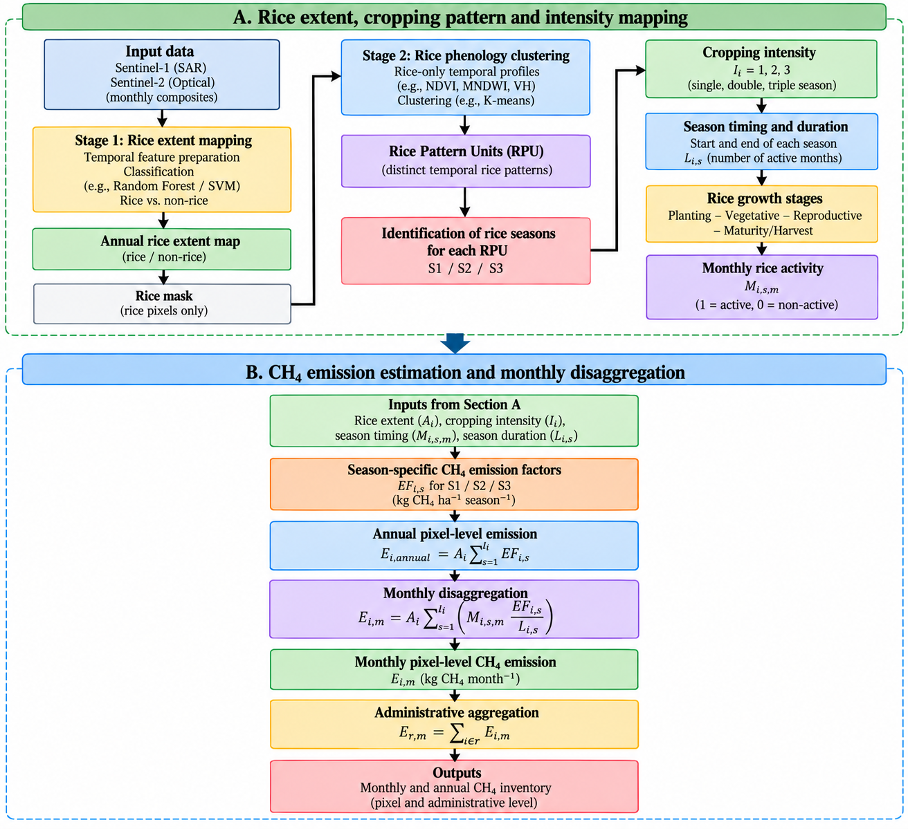

**Figure 1. Overall methodological framework for spatial and monthly estimation of rice CH₄ emissions.**

The workflow proceeds from multi-temporal Sentinel-1 and Sentinel-2 inputs through rice-extent masking, phenology-based clustering into Rice Pattern Units, and expert interpretation of cropping intensity and seasonal calendars (Part A), to assignment of season-specific emission factors, pixel-level annual emission estimation, monthly disaggregation, and aggregation to administrative units (Part B).

Each of the 57 countries that received the approach described above then received a ‘back-cast’ (BC) which is a FAOSTAT harvested-area-indexed back-cast, anchored to each country's first 10 m-modeled year, used for the years preceding 10 m modeling. See Section 2.4 for more information.

Lastly, for the remaining 61 countries that did not receive the above approach, FAOSTAT rice data was used. These countries cumulatively make up about 2% of global rice emissions.

#### 2.1. Dataset

#### 2.1.1 Satellite Data

Multi-temporal Sentinel-1 and Sentinel-2 satellite observations were used as the primary data sources for global rice cropping-system characterization. Sentinel-1 C-band synthetic aperture radar (SAR) observations provide information on rice canopy structure, surface moisture, and flooding conditions, while Sentinel-2 multispectral observations provide complementary information on vegetation dynamics and surface-water conditions. Temporal composites were generated to characterize the seasonal dynamics of rice cultivation and to reduce the effects of short-term variability and missing observations. From Sentinel-2 data, the Normalized Difference Vegetation Index (NDVI) and Modified Normalized Difference Water Index (MNDWI) were derived, while Sentinel-1 VH backscatter was used to characterize the temporal SAR response of rice fields. These temporal variables were combined to generate multi-temporal profiles used for rice extent mapping and subsequent phenology-based characterization of rice cropping patterns, intensity, and seasonal calendars. See Table 1 for additional information on uses.

#### 2.1.2 Rice cultivation emission factors

Rice emission factors were compiled from the published literature for each modeled country, prioritizing country- or region-specific field measurements of seasonally integrated methane flux and falling back to a neighboring country's value or the IPCC default where no local study was available. Country-level emission factors and their sources are listed in Table S2, with subnational factors for China in Table S3. The Thailand and Vietnam emission factors, which are resolved at the subnational and seasonal level, are provided in Tables S4 and S5 respectively. See Table 1 for additional information on uses.

#### 2.1.3 Ancillary Data

Ancillary datasets were used to support rice mapping, spatial aggregation, validation, and CH₄ emission estimation. Administrative boundary data were used to aggregate pixel-level emissions into administrative regions and generate regional and national inventories. Season-specific CH₄ emission factors were incorporated into the emission calculation to estimate emissions for individual rice-growing seasons. These ancillary datasets provide complementary spatial and emission information required to transform the satellite-derived rice cropping characteristics into a spatially and temporally explicit CH₄ emission inventory. See Table 1 for additional information on uses.

**Table 1** Summary of datasets used, time period, and purpose.

|                         |                |                   |                      |
|-------------------------|----------------|-------------------|----------------------|
| **Dataset**             | **Resolution** | **Period**        | **Purpose**          |
| Sentinel-1              | 10 m           | 1 Jan-31 Dec 2025 | Rice phenology       |
| Sentinel-2              | 10 m           | 1 Jan-31 Dec 2025 | Rice phenology       |
| Administrative boundary | Vector         | —                 | Regional aggregation |
| Seasonal CH₄ EF         | —              | —                 | Emission estimation  |

#### 2.2. Mapping Rice Extent, Cropping Pattern and Intensity

High-resolution mapping of rice cropping patterns, calendars, and intensities follows a sequential phenology-based framework integrating multi-temporal Sentinel-1 and Sentinel-2 observations. The approach exploits complementary temporal information from Sentinel-1 VH backscatter and Sentinel-2-derived NDVI and MNDWI to characterize the distinctive phenological trajectories of rice cultivation. The methodology first establishes the spatial extent of rice cultivation and subsequently analyzes the temporal characteristics of the mapped rice areas to identify cropping patterns, intensity, and seasonal calendars. This phenology-based framework enables the methodology to move beyond static rice extent mapping toward a dynamic characterization of rice cultivation systems.

#### Stage 1: Rice Extent Mapping

Multi-temporal Sentinel-1 and Sentinel-2 observations are processed to derive temporal features representing the spectral and SAR characteristics of rice cultivation. These temporal trajectories are used to distinguish rice from non-rice areas and generate a spatially continuous rice extent map. The resulting classification is converted into a binary rice mask, with rice pixels assigned a value of 1 and non-rice pixels assigned a value of 0. The rice mask is subsequently applied to the multi-temporal dataset so that only pixels identified as rice are retained for the subsequent phenological analysis. This sequential masking step reduces interference from non-rice land-cover types and ensures that the subsequent clustering focuses on variation within rice cultivation systems.

#### Stage 2: Rice Phenology Clustering

Following the rice extent mapping, a phenology-expert-based approach is applied to characterize the temporal dynamics of rice cultivation within the mapped rice areas. Only pixels identified as rice in Stage 1 are retained for subsequent analysis. For each rice pixel, multi-temporal Sentinel-1 and Sentinel-2 profiles are analyzed to characterize the distinctive phenological trajectories of rice cultivation. The temporal information from vegetation and water-related indicators, including NDVI, MNDWI, and VH backscatter, is used to identify characteristic rice growth cycles and distinguish different temporal cropping patterns. Similar phenological trajectories are grouped into Rice Pattern Units (RPUs) through phenology-based clustering. Each RPU represents a characteristic temporal pattern of rice cultivation and is subsequently interpreted by a phenology expert to identify the number of rice-growing seasons, cropping intensity, season timing, and growth-stage periods. The identified phenological information is then used to determine the monthly rice activity for each season, which provides the temporal basis for subsequent monthly CH₄ emission disaggregation.

#### Rice Pattern Unit

A Rice Pattern Unit (RPU) represents a characteristic temporal pattern of rice cultivation identified from multi-temporal satellite observations. After rice pixels are identified from the rice extent map, their temporal profiles are analyzed to characterize the phenological dynamics of rice cultivation. Pixels exhibiting similar temporal phenological characteristics are grouped into the same RPU, providing a spatially consistent representation of rice cropping patterns. The temporal profile of each RPU is then interpreted using phenology-expert knowledge to identify individual rice cultivation cycles, including the start of cultivation, active cultivation period, crop growth stages, maturity or harvest, and the onset of a subsequent cultivation cycle. Based on the number of distinct and phenologically identifiable rice cultivation cycles within a calendar year, RPUs are classified into single-season, double-season, or triple-season rice, as illustrated in Figure 2. This RPU-based characterization provides the basis for determining cropping intensity, seasonal calendars, season duration, and monthly rice activity for subsequent CH₄ emission estimation.

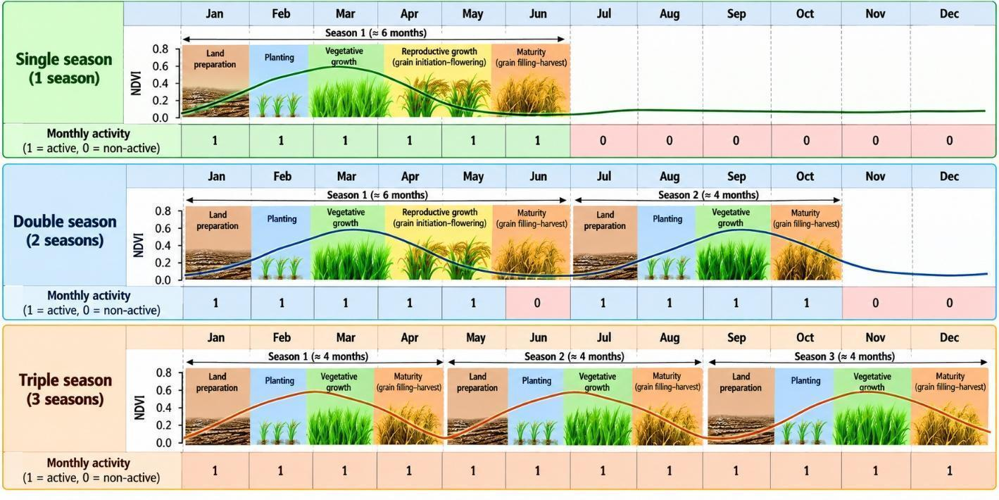

**Figure 2. Phenology and cropping-pattern schematic for Rice Pattern Units (RPUs). Illustrative NDVI temporal profiles for single-, double-, and triple-season rice systems, showing rice growth stages, season duration, and monthly rice activity. Monthly activity is coded as 1 for active cultivation and 0 for non-active periods. The identified seasonal patterns provide the basis for determining cropping intensity, seasonal calendars, and monthly CH₄ emission allocation.**

#### Cropping Intensity and Season Identification

Cropping intensity and rice-season identification are derived from the temporal phenological profiles of the Rice Pattern Units (RPUs) using a phenology-expert-based interpretation approach. For each RPU, the monthly temporal profile is visualized to identify recurrent rice-growing cycles based on characteristic changes in the spectral and SAR signals associated with rice development. The temporal profiles are interpreted according to the expected sequence of rice phenological stages, including land preparation, planting, vegetative growth, reproductive development, maturity, and harvest. The occurrence of a complete sequence of these phenological stages is considered evidence of an individual rice-growing cycle.

As illustrated in Figure 2, an RPU may exhibit one, two, or three distinct phenological cycles within a calendar year. A single pronounced cycle is interpreted as single-season rice, two distinct cycles as double-season rice, and three distinct cycles as triple-season rice. The identification of separate cycles is based on the temporal separation between successive cultivation periods, including the decline in the crop signal following harvest and the subsequent recovery associated with the establishment of a new crop. Thus, cropping intensity is determined from the number of phenologically identifiable rice-growing cycles within the annual temporal profile:

$`I_{i} = N_{season,i}`$ (1)

where i = pixel index, Ii is the annual cropping intensity and Nseason,i is the number of identifiable rice-growing cycles within the year.

Thus:

```math
I_{i} = \begin{cases} 1, & \text{single-season rice} \\ 2, & \text{double-season rice} \\ 3, & \text{triple-season rice} \end{cases} \qquad (2)
```

For each identified season s, the start and end of the active cultivation period are determined from the temporal phenology profile.

#### Rice Growth Stages and Identification of Monthly Rice Activity and Season Duration

The temporal profile of each Rice Pattern Unit (RPU) is interpreted using the characteristic sequence of rice growth stages, including land preparation, planting, vegetative growth, reproductive growth, and maturity or harvest. These phenological stages provide the basis for identifying the beginning and end of each rice-growing season and distinguishing successive cultivation cycles within the annual temporal profile. As illustrated in Figure 2, the temporal profiles also provide the corresponding monthly representation of rice activity, where a value of 1 indicates an active rice cultivation month and 0 indicates a non-active month. The resulting monthly activity sequence explicitly represents the timing and duration of each rice season and provides the temporal basis for subsequent CH₄ emission disaggregation.

For each identified rice season s, the active cultivation months are determined from the temporal growth-stage information:

```math
M_{i,s,m} = \begin{cases} 1, & \text{if season } s \text{ is active in month } m \\ 0, & \text{otherwise} \end{cases} \qquad (3)
```

This season-specific indicator preserves the identity of each rice season:

-   i = pixel index

-   s = season

-   m = month index, m=1,…,12

-   Mi,1,m = Season 1 activity

-   Mi,2,m = Season 2 activity

-   Mi,3,m = Season 3 activity

The duration of each rice-growing season was calculated as:

$`L_{i,s} = \sum_{m = 1}^{12}{}M_{i,s,m}`$ (4)

where Li,s represents the duration, in months, of rice season (s) for pixel (i).Thus, the temporal characterization provides three complementary pieces of information: the number of rice seasons (cropping intensity), the months in which each season is active, and the duration of each season. These parameters are subsequently used to allocate the season-specific CH₄ emission factor across the active months of each rice-growing season.

#### 2.3. CH₄ Emission Estimation and Monthly Disaggregation

Rice CH₄ emissions were estimated at the pixel level by integrating the mapped rice area, annual cropping intensity, season-specific emission factors, and the identified timing and duration of rice cultivation. Each rice pixel may contain up to three distinct rice-growing seasons within a calendar year. The annual emission calculation therefore accounts for the contribution of each identifiable rice season separately, allowing the emission factor to vary among seasons. The resulting annual pixel-level emissions are subsequently disaggregated to the monthly scale using the season-specific monthly activity indicators derived from the rice phenological profiles.

#### Seasonal Emission Factors

A season-specific emission factor (EFi,s) is assigned to each rice-growing season (s) for pixel (i). The emission factors used in the analysis are provided in Tables S2–S5. Here, (s) denotes the rice-season index, with a maximum of three seasons per pixel ((s=1,2,3)). The use of season-specific emission factors allows the annual emission estimate to account for differences among individual rice-growing cycles.

#### Annual Pixel-Level CH₄ Emission

For each rice pixel (i), annual CH₄ emissions are calculated as the sum of emissions from all identifiable rice-growing seasons:

$`E_{i,annual} = A_{i}\sum_{s = 1}^{I_{i}}{}\text{EF}_{i,s}`$ (5)

where:

-   Ei,annual = annual CH₄ emission from pixel i

-   Ai = area of pixel i

-   Ii = annual rice cropping intensity of pixel i, representing the number of rice-growing seasons per year

-   EFi,s = CH₄ emission factor for season s

-   i = pixel index

-   s = rice-season index, s=1,2,3

Thus, a single-season pixel contributes one seasonal emission factor, a double-season pixel contributes two, and a triple-season pixel contributes three. The formulation explicitly accounts for differences in emission factors among individual rice-growing seasons rather than applying a single annual emission factor to all cultivation cycles.

#### Monthly Disaggregation

The annual seasonal emissions are subsequently disaggregated to monthly values using the season-specific monthly activity indicator (Mi,s,m). For each active month, the seasonal emission factor is assumed to be distributed equally across the active cultivation months of that season. The monthly CH₄ emission for pixel (i) is therefore calculated as:

$`E_{i,m} = A_{i}\sum_{s = 1}^{I_{i}}{}\left( M_{i,s,m}\frac{\text{EF}_{i,s}}{L_{i,s}} \right)`$ (6)

where:

-   Ei,m = CH₄ emission from pixel i in month m

-   Mi,s,m = indicator of whether season s is active in month m

-   EFi,s/Li,s = monthly allocation of the seasonal emission factor

This formulation ensures that emissions are assigned only to months in which the corresponding rice season is active.

Under this assumption, the seasonal emission factor is allocated only to months identified as active for the corresponding rice season. Months classified as non-active receive no emission contribution from that season. For pixels containing multiple rice seasons, emissions from all active seasons are summed for each month. Consequently, the monthly emission profile reflects both cropping intensity and the temporal overlap or separation of individual rice-growing seasons.

The monthly formulation is consistent with the annual calculation because summing monthly emissions over the 12 months recovers the annual pixel-level emission, Eq (5). This ensures that the temporal disaggregation redistributes the annual seasonal emissions across months without changing the annual emission total.

#### Aggregation to administrative regions

Following the pixel-level monthly estimation, emissions are aggregated within each administrative region. For administrative region (r), monthly CH₄ emissions are calculated as:

$`E_{r,m} = \sum_{i \in r}{}A_{i}\sum_{s = 1}^{I_{i}}{}\left( M_{i,s,m}\frac{\text{EF}_{i,s}}{L_{i,s}} \right)`$ (7)

Where Er,m is the total CH₄ emission in administrative region (r) during month (m), and the summation includes all rice pixels located within the region. Annual administrative emissions are obtained by summing the monthly emissions:

$`E_{r,annual} = \sum_{m = 1}^{12}{}E_{r,m}`$ (8)

This procedure produces a spatially explicit inventory of monthly and annual rice CH₄ emissions, from the individual pixel level to administrative regions and ultimately to the global scale.

#### 2.4. Historical Reconstruction, Backfill, and Temporal Allocation

The satellite-based framework above produces native monthly estimates for the countries and years modeled at 10 m resolution (Table S1). Two additional processing steps extend the inventory to a complete 2015–2025 country-level series: reconstruction of earlier annual estimates, and, for years preceding native monthly modeling, allocation of annual totals across months. These steps address different gaps and carry different interpretive limits, and are described here so that users can distinguish satellite-derived estimates from statistical reconstructions and temporal allocations.

#### Historical reconstruction (2015–2020)

For the 27 countries with a continuous modeled series, annual emissions for 2015–2020 are reconstructed by indexing each country's modeled 2021 baseline to its national rice harvested-area trend from the Food and Agriculture Organization of the United Nations (FAO), so that the reconstructed series inherits the FAO year-to-year signal. Countries first modeled after 2021 are reconstructed over their pre-model years using the same FAO interannual change, anchored to each country's first modeled year. Countries not modeled by the Sentinel approach in any year are reported directly from the FAO rice-cultivation emissions inventory (release dated 28 October 2025) at annual resolution. These historical values are estimates reconstructed from agricultural activity data rather than independent satellite observations of rice cultivation or methane in each historical year. A national change in harvested area does not, by itself, establish that cultivation, water management, or methane emitted per unit of activity changed by the same amount within each reporting unit, and the reconstructed series should be interpreted within these limits.

#### Monthly allocation (2021–2024)

For reporting assets with a native 2025 monthly profile, each annual methane total for 2021–2024 is allocated across months using that asset's 2025 monthly distribution: the reference share for a month is that month's 2025 methane estimate divided by the 2025 annual total, and the historical annual total is multiplied by each monthly share. The allocation preserves the annual total and does not recover year-specific planting dates, flooding periods, or harvest timing for the earlier years; annual trends come from the annual emissions series, while within-year timing comes from the 2025 reference profile. Where an asset lacks a direct 2025 profile, the profile of a broader administrative unit in the same country is used. This temporal allocation is separate from the native monthly satellite processing described in Sections 1.3–1.4.

#### Non-modeled countries and the water-regime basis

The FAO rice-cultivation inventory used for non-modeled countries applies IPCC Tier-1 emission factors with water-regime scaling. This supersedes an earlier Climate TRACE approach that applied a single flooded-rice emission factor to all FAOSTAT harvested area without distinguishing upland or rainfed systems, which overstated emissions in countries where rice is predominantly upland or rainfed. Recent modelling and synthesis studies (for example, Chen et al., 2023; Nikolaisen et al., 2023) suggest that Tier-1 inventories may, in turn, under-estimate African rice emissions; reconciling these remains an open item for a future release.

Together, these steps yield a single 2015–2025 inventory in which each country-year is tagged by estimation method (Table S1): native 10 m monthly estimates for satellite-modeled country-years, a FAOSTAT harvested-area-indexed back-cast for earlier years of modeled countries, and direct FAOSTAT values for countries that are not independently modeled. Modeled and back-cast countries are reported at monthly resolution and non-modeled countries at annual resolution. The following section summarizes the 2025 results and the full monthly series.

#### 2.5 Incorporating ERS into model

The ERS strategy to apply to each asset was determined by satellite data supplemented with literature review. For countries in Southeast Asia, rice fields (assets) were identified as rainfed rice, irrigated rice, and/or deep-water rice. For countries outside of Southeast Asia, literature references provided the dominant type of rice production within each country. For assets and countries with &gt;50% of rice production area under irrigation, the alternative wetting and drying (AWD) strategy was applied, and for all other assets, the Balanced Fertilizer Composition strategy was applied.

#### 2.5.1 Alternate wetting and drying (AWD)

AWD was incorporated into the ERS dataset for rice cultivation after the emissions modeling process as an adjustment to the CH₄ emissions factor for each asset. The updated emissions factor is applied to some percentage of the harvested area (activity) within each grid cell, depending on whether that location is known to be partially or entirely irrigated.

The AWD strategy is estimated to reduce the combined GWP-adjusted emissions of N₂O + CH₄ by an average of 46.9% compared to continuous flooding, according to a 2024 meta-analysis of studies (this accounts for a reduction in CH₄ emissions and an increase in N₂O emissions) (Zhao et al., 2024). In order to ensure both impacts were represented despite having no quantified N₂O emissions in this subsector, we reduced the CH₄ emissions of each asset with the AWD strategy by 46.9%, resulting in a new-to-old ratio of CH₄ emissions of 0.531. To account for assets with different percentages of irrigated rice, we used the following structure:

-   Assets where the rice production area was observed or estimated to have been irrigated &gt;95% were assigned the *awd95pct* strategy. The methane emissions were reduced by 46.9%, and this reduction was applied to 95% of the harvested area in these assets.

-   Assets where the rice production area was observed or estimated to have been irrigated &gt;=50% but less than 95% were assigned the *awd50pct* strategy. The emissions were reduced by 46.9%, and this reduction was applied to 50% of the harvested area in these assets.

-   Assets where the rice production areas were observed or estimated to have been irrigated &lt;50% were assigned Balanced Fertilizer Composition ERSs, as explained in the next section.

#### 2.5.2 Balanced fertilizer composition

Balanced fertilizer composition was also incorporated after the emissions modeling process as an adjustment to the CH₄ emissions generated by the rice cultivation activity for each asset. This strategy is estimated by a 36-year field trial study to reduce CH₄ emissions by an average of 21.2% for early-season harvests and 28.6% for late-season harvests (Zhu et al., 2022). We have data on how many yearly harvests each rice production asset undergoes (either one, two, or three). Thus, we scaled these emissions reductions as follows:

-   Rice fields with a single yearly harvest (early-season) were assigned the *rfrearly* strategy, with CH₄ emissions reduced by 21.2%. These reductions were assigned to 100% of the rice harvest area in the asset.

-   Rice fields with two yearly harvests (early-season and late-season) were assigned the *rfrmiddle* strategy, with CH₄ emissions reduced by 24.9%, which is the average of early-season (21.2%) and late-season (28.6%) emissions reductions. These reductions were assigned to 100% of the rice harvest area in the asset.

-   Rice fields with three yearly harvests (early-season, middle-season, and late-season) were assigned the *rfrlate* strategy, with CH₄ emissions reduced by 26.1%. This emissions reduction was calculated by averaging the emissions reductions for one early season (21.2%) harvest and two late season harvests (2\*28.6%). These reductions were assigned to 100% of the rice harvest area in the asset.

#### 2.5.3 Calculating emissions after incorporating ERS

Rice cultivation emissions adjusted for ERSs are calculated as shown in Equations 2 and 3.

$`EF_{\text{ERS}}\  = EF\ *\ R_{\text{EF}}`$ (9)

where $`EF_{\text{ERS}}`$ is the methane emissions factor after implementing ERS,

$`\text{EF}`$ is the methane emissions factor before implementing ERS,

and $`R_{\text{EF}}`$ is the new-to-old emissions factor ratio.

$`\text{emission}s_{\text{ERS}}\  = EF_{\text{ERS}}*\lbrack A_{\max}*A\rbrack\  + \ EF*\lbrack(1 - A_{\max})*A\rbrack`$ (10)

Where $`\text{emission}s_{\text{ERS}}`$ is the adjusted annual methane emissions after implementing ERS,

$`A_{\max}`$ is the ratio of maximum activity affected by the ERS to total activity,

and $`A`$ is the annual activity of the asset.

#### 2.5.4 Verifying ERS estimates

The proposed rice cultivation ERSs are considered scenario-based: approaches that are shown (in limited deployment and studies) to reduce methane emissions, but are not fully implemented. In the future, methods to observe and verify AWD may be implemented using remote sensing tools. Time series wetness indices combined with in-situ moisture readings have been demonstrated to provide a prediction of AWD adoption (Lovell 2019). As these practices begin deployment within carbon offset projects, it is likely that several scalable remote sensing tools may be available to cost effectively monitor implementation, but given low current adoption rates of AWD, attempts to implement and validate remote sensing detection strategies in new geographies is challenging.

The composition of fertilizer applied to rice fields cannot be directly observed, though there may be opportunities to use independent evidence via fertilizer consumption data at a country or site specific scale that could provide insight into the adoption of fertilizer-based strategies.

#### 3. Results and Discussion

#### 3.1. Monthly Rice Activity

Figure 3 shows the monthly active rice area derived from the identified rice-growing seasons. The results reveal distinct seasonal patterns among major rice-producing regions. Here, the monthly active rice area does not represent the total rice-growing area or harvested area. Instead, monthly active rice area is defined as the area of rice fields that is actively under rice cultivation during a particular month, based on the identified season-specific phenological activity. Thus, a rice field contributes to the active rice area only during the months assigned as active for its corresponding rice-growing season.

In the subtropics of the Northern Hemisphere, including North India, Northeast China, Japan, South and North Korea, the United States, and Italy, single-season rice systems generally concentrate cultivation during the warmer months. Consequently, active rice areas increase markedly during the summer growing season and decline toward winter. In contrast, the seasonal pattern is reversed in the Southern Hemisphere, where the principal single-season cultivation period generally coincides with the austral summer. This pattern is particularly evident in countries such as Brazil, where active rice areas are concentrated during the latter part of the calendar year and extend into the early months of the following year.

In contrast, South and Southeast Asian rice-growing systems, particularly those represented by India, Bangladesh, Indonesia, Vietnam, and Thailand, exhibit more complex temporal patterns because rice cultivation can occur in multiple seasons within the same year. Single-, double-, and triple-season systems produce overlapping cultivation periods, resulting in rice activity that can extend through much or nearly all of the year. Consequently, these regions do not exhibit a simple summer–winter cycle; instead, the monthly active area reflects the combined phenological activity of multiple rice-growing seasons.

The patterns observed for Tanzania and Madagascar may be more strongly associated with regional rainfall seasonality, where rice cultivation is influenced by the timing of rainy seasons. Their monthly active-area profiles therefore show stronger seasonal concentration than areas where irrigation and multiple cropping enable rice cultivation throughout much of the year. Overall, the monthly active-area profiles demonstrate the importance of explicitly representing seasonal calendars and cropping intensity rather than assuming a single global rice-growing season.

<table><tbody><tr class="odd"><td><p>(a)</p><p>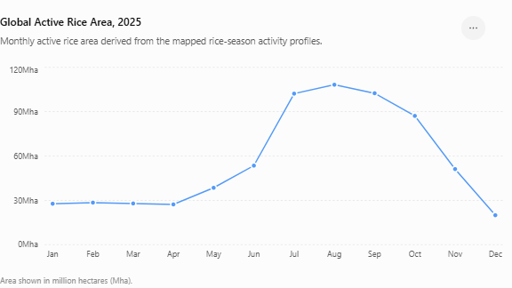</p></td></tr><tr class="even"><td><p>(b)</p><p>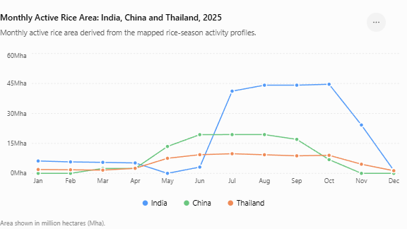</p></td></tr><tr class="odd"><td><p>(c)</p><p>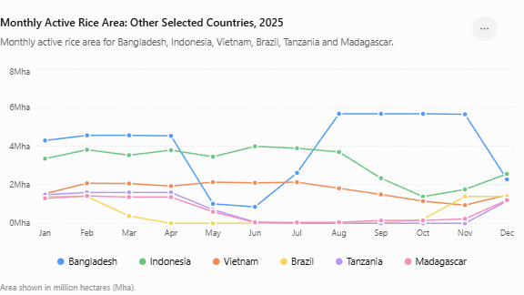</p></td></tr></tbody></table>

**Figure 3 continued**

**Figure 3. Monthly active rice area derived from the identified rice-growing seasons. (a) Global active rice area; (b) India, China, and Thailand; and (c) Bangladesh, Indonesia, Vietnam, Brazil, Tanzania, and Madagascar. The monthly profiles illustrate differences in rice-growing seasonality, cropping intensity, and hemispheric and rainfall-driven cultivation patterns. Complete monthly active rice-area data for all 58 countries with monthly estimates are provided in Table S6; Hungary and Malawi are reported at annual resolution only.**

#### 3.2. Monthly CH₄ emission

#### 3.2.1 Monthly CH₄ emission patterns

Figure 4 shows substantial temporal variation in rice-cultivation CH₄ emissions across the year. At the global scale, monthly emissions increased from 1.20 Mt CH₄ in January to 3.51 Mt CH₄ in August, followed by a gradual decline to 0.86 Mt CH₄ in December. This seasonal pattern broadly corresponds to the monthly active rice-area dynamics, which increased from 27.7 Mha in January to 108.2 Mha in August and subsequently declined toward December. The close correspondence indicates that the monthly inventory successfully transfers the temporal characteristics of rice cultivation into the emission estimates.

The relationship is not expected to be strictly proportional because the monthly emissions also depend on the season-specific emission factor (EFi,s) and the duration of each rice-growing season. Thus, two months with similar active rice areas can produce different CH₄ emissions when they contain rice seasons with different emission factors. The monthly estimates therefore represent the combined effect of where rice is actively cultivated, how many seasons are active, and the emission characteristics assigned to each season.

For India, China, and Thailand (Figure 4b), the results demonstrate contrasting seasonal patterns. India shows relatively low emissions during the first half of the year, followed by a sharp increase from July, reaching approximately 0.808 Mt CH₄ in October. This pattern is consistent with the strong increase in active rice area during the corresponding period. China shows a pronounced increase from May to August, with emissions reaching approximately 0.660 Mt CH₄ in July and August, before declining substantially toward October. Thailand maintains substantial emissions over a longer part of the year, with emissions increasing from May and remaining high through October. These patterns reflect differences in the timing and number of rice-growing seasons among the three countries.

The other countries shown in Figure 4c demonstrate additional examples of seasonal and multi-season rice systems. Bangladesh and Indonesia maintain substantial CH₄ emissions over much of the year, reflecting the presence of multiple rice-growing seasons and relatively prolonged rice activity. Indonesia, for example, maintains emissions above approximately 0.269 Mt CH₄ during January–August, with a subsequent decline before increasing again in December. Vietnam also exhibits relatively persistent emissions throughout the year, although the magnitude declines during September–November. These patterns are consistent with the broader temporal distribution of active rice cultivation in South and Southeast Asia.

In contrast, Brazil exhibits a more strongly seasonal pattern, with emissions concentrated during the beginning and end of the calendar year and little or no estimated emission during April–September. This reflects the seasonal nature of its dominant rice cultivation cycle and the Southern Hemisphere growing season. Tanzania and Madagascar similarly show stronger seasonal fluctuations, with their emission profiles consistent with cultivation periods associated with seasonal rainfall and local cropping calendars.

Overall, Figure 4 demonstrates that the proposed framework converts spatially mapped rice cropping patterns into a temporally explicit CH₄ emission inventory. Rather than distributing annual emissions uniformly across the 12 months, emissions are assigned to months in which rice cultivation is identified as active for each season. This preserves the spatial and seasonal heterogeneity of rice production and provides a more informative representation of the timing of rice-cultivation CH₄ emissions.

<table><tbody><tr class="odd"><td><p>(a)</p><p>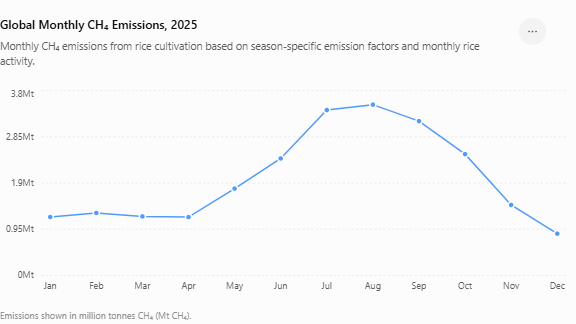</p></td></tr><tr class="even"><td><p>(b)</p><p>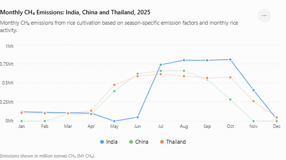</p></td></tr><tr class="odd"><td><p>(c)</p><p>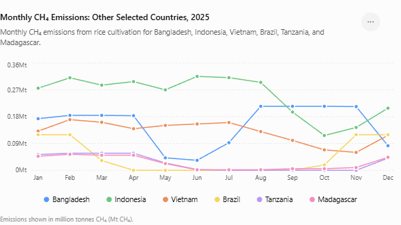</p></td></tr></tbody></table>

**Figure 4 continued**

**Figure 4. Monthly CH₄ emissions from rice cultivation in 2025. (a) Global monthly CH₄ emissions; (b) India, China, and Thailand; and (c) Bangladesh, Indonesia, Vietnam, Brazil, Tanzania, and Madagascar. The monthly emission profiles reflect the temporal distribution of active rice cultivation combined with season-specific CH₄ emission factors. Complete monthly CH₄ emission data for all 58 countries with monthly estimates are provided in Table S7; Hungary and Malawi are reported at annual resolution only.**

#### 3.2.2 Annual and Monthly CH₄ Emissions in 2025

The estimated global rice-cultivation CH₄ emission for 2025 was 23.97 million tonnes (Mt CH₄). The annual total was distributed unevenly throughout the year, with monthly emissions ranging from 0.86 Mt CH₄ in December to 3.51 Mt CH₄ in August. Emissions increased substantially from May onward, reaching the annual maximum in August, before declining toward the end of the year. This temporal pattern broadly follows the distribution of monthly active rice area, which also reached its maximum in August.

Globally, Thailand had the highest estimated annual emission at 4.17 Mt CH₄, followed by India (4.08 Mt), China (3.35 Mt), and Indonesia (3.03 Mt). Thailand rice production was harvested from less than a quarter of the acreage of India and half that of China, meaning that emissions are driven by high emissions factors in Thailand. In a subsequent release, we will be implementing a new emissions factor estimation method to help interrogate whether the regional and seasonal emissions factors models overestimate emissions in Thailand and make updates as appropriate. Bangladesh contributed 1.83 Mt CH₄, while Vietnam contributed 1.55 Mt CH₄. Brazil, Tanzania, and Madagascar had lower annual emissions of approximately 0.529, 0.293, and 0.294 Mt CH₄, respectively.

The country-level annual totals reflect both the spatial extent and temporal characteristics of rice cultivation. Countries with multiple rice-growing seasons can maintain active rice areas and associated emissions over much of the year, whereas countries dominated by a single seasonal crop show more concentrated emission periods.

Overall, the 2025 results demonstrate that the framework provides both a global annual CH₄ inventory (23.97 Mt CH₄) and a temporally explicit representation of when those emissions occur. The monthly estimates retain the seasonal information derived from the rice cropping patterns rather than treating annual rice emissions as uniformly distributed throughout the year.

#### 3.3 Validation

The rice extent, cropping-intensity and calendar maps underlying this inventory are validated in the peer-reviewed publications on which the method is based. Fatchurrachman et al. (2022) validated the 10 m Sentinel-1/-2 phenology-based mapping over Peninsular Malaysia against very-high-resolution and Google Street View reference points, reporting an overall accuracy of 95.95% and a kappa coefficient of 0.92, outperforming the NESEA-Rice10 product (90.27%, 0.80). Ginting et al. (2025) validated the LUCK-PALM cropping-intensity maps across nine Southeast Asian countries at the pixel level (n = 58,885), reporting an overall accuracy of 98.3%, a kappa of 0.870, and an F1 score of 0.879 for rice classification, with per-country overall accuracy exceeding 96% (Malaysia 99.7%, Thailand 96%) and strong agreement with national harvested-area statistics. Ginting et al. (2026) extend this validation to cropping pattern, calendar and ecosystem type. Ginting et al. (2025) benchmarked their satellite-derived harvested area against FAOSTAT: the national total (42.99 Mha) agreed with FAOSTAT 2021 (45.09 Mha) to within 4.3% (R² = 0.92), and sub-national comparisons against provincial and district agricultural statistics yielded R² values of 0.85–0.97**3.**

For external context, the 2025 global total of 23.97 Mt CH₄ is broadly consistent with independent estimates of global rice-cultivation methane, which span roughly 25–30 Mt CH₄ per year across inventories and atmospheric studies. It sits below FAOSTAT's Tier-1 global total, consistent with the satellite model's more conservative detection of harvested area in fragmented and smallholder landscapes (Ginting et al., 2025). A full country-by-country comparison against FAOSTAT and EDGAR is planned for a future release.

#### 4. Conclusion

This methodology produces a spatially explicit, monthly global inventory of methane emissions from rice cultivation spanning 2015–2025. The inventory covers 118 rice-producing countries, together representing approximately 98% of global rice production. For the 57 of these countries that are independently satellite-modeled — which account for roughly 97.6% of the inventory’s total rice-cultivation methane — rice extent, cropping intensity, and seasonal calendars are resolved directly from 10 m Sentinel-1 and Sentinel-2 observations. Earlier years, and countries not resolved by satellite, are completed with a FAOSTAT harvested-area-indexed back-cast and, where no modeling exists, with the FAOSTAT rice-cultivation inventory, so that the dataset forms a consistent 2015–2025 series while keeping the three estimation methods explicit (Table S1). Relative to national inventories, the approach adds sub-national spatial detail, native monthly timing, and emission factors that reflect flooded, rainfed, and upland systems. Known limitations remain—the reliance on activity-based reconstruction for historical years, the sensitivity of a few countries (notably Thailand) to regional emission factors, and the conservative treatment of African rice under Tier-1 factors—and these are the focus of planned refinements, including an updated emission-factor model and extension of direct satellite modeling to additional countries and years.

#### Supplementary materials

**Table S1** Data source for each modeled country and year. *10m* = Sentinel-1A/-2A/B modeling (independently modeled emissions). BC = a FAOSTAT harvested-area-indexed back-cast, anchored to each country's first 10 m-modeled year, used for the years preceding 10 m modeling. A country with “N/A” for a given year, or any country not shown, is reported directly from the FAOSTAT rice-cultivation inventory. The MODIS approach previously used for earlier years has been retired.

|                                             |          |          |          |          |          |          |          |          |          |          |          |
|---------------------------------------------|----------|----------|----------|----------|----------|----------|----------|----------|----------|----------|----------|
| **Country**                                 | **2015** | **2016** | **2017** | **2018** | **2019** | **2020** | **2021** | **2022** | **2023** | **2024** | **2025** |
| Bangladesh                                  | BC       | BC       | BC       | BC       | BC       | BC       | *10m*    | *10m*    | *10m*    | *10m*    | *10m*    |
| Bhutan                                      | BC       | BC       | BC       | BC       | BC       | BC       | BC       | BC       | BC       | *10m*    | *10m*    |
| Brazil                                      | BC       | BC       | BC       | BC       | BC       | BC       | *10m*    | *10m*    | *10m*    | *10m*    | *10m*    |
| Bulgaria                                    | BC       | BC       | BC       | BC       | BC       | BC       | BC       | BC       | BC       | BC       | *10m*    |
| Burkina Faso                                | BC       | BC       | BC       | BC       | BC       | BC       | BC       | BC       | BC       | BC       | *10m*    |
| Burundi                                     | BC       | BC       | BC       | BC       | BC       | BC       | BC       | BC       | BC       | BC       | *10m*    |
| Cambodia                                    | BC       | BC       | BC       | BC       | BC       | BC       | *10m*    | *10m*    | *10m*    | *10m*    | *10m*    |
| Cameroon                                    | BC       | BC       | BC       | BC       | BC       | BC       | BC       | BC       | BC       | BC       | *10m*    |
| China                                       | BC       | BC       | BC       | BC       | BC       | BC       | *10m*    | *10m*    | *10m*    | *10m*    | *10m*    |
| Ecuador                                     | BC       | BC       | BC       | BC       | BC       | BC       | BC       | BC       | *10m*    | *10m*    | *10m*    |
| Egypt                                       | BC       | BC       | BC       | BC       | BC       | BC       | BC       | *10m*    | *10m*    | *10m*    | *10m*    |
| Ethiopia                                    | BC       | BC       | BC       | BC       | BC       | BC       | BC       | *10m*    | *10m*    | *10m*    | *10m*    |
| France                                      | BC       | BC       | BC       | BC       | BC       | BC       | BC       | BC       | BC       | BC       | *10m*    |
| Gambia                                      | BC       | BC       | BC       | BC       | BC       | BC       | BC       | BC       | BC       | BC       | *10m*    |
| Greece                                      | BC       | BC       | BC       | BC       | BC       | BC       | BC       | BC       | BC       | BC       | *10m*    |
| Guinea                                      | BC       | BC       | BC       | BC       | BC       | BC       | BC       | BC       | BC       | BC       | *10m*    |
| Guinea-Bissau                               | BC       | BC       | BC       | BC       | BC       | BC       | BC       | BC       | BC       | BC       | *10m*    |
| Guyana                                      | BC       | BC       | BC       | BC       | BC       | BC       | BC       | BC       | *10m*    | *10m*    | *10m*    |
| India                                       | BC       | BC       | BC       | BC       | BC       | BC       | *10m*    | *10m*    | *10m*    | *10m*    | *10m*    |
| Indonesia                                   | BC       | BC       | BC       | BC       | BC       | BC       | *10m*    | *10m*    | *10m*    | *10m*    | *10m*    |
| Iran (Islamic Republic of)                  | BC       | BC       | BC       | BC       | BC       | BC       | *10m*    | *10m*    | *10m*    | *10m*    | *10m*    |
| Italy                                       | BC       | BC       | BC       | BC       | BC       | BC       | *10m*    | *10m*    | *10m*    | *10m*    | *10m*    |
| Japan                                       | BC       | BC       | BC       | BC       | BC       | BC       | *10m*    | *10m*    | *10m*    | *10m*    | *10m*    |
| Kenya                                       | BC       | BC       | BC       | BC       | BC       | BC       | BC       | BC       | BC       | BC       | *10m*    |
| Korea (the Democratic People's Republic of) | BC       | BC       | BC       | BC       | BC       | BC       | *10m*    | *10m*    | *10m*    | *10m*    | *10m*    |
| Korea (the Republic of)                     | BC       | BC       | BC       | BC       | BC       | BC       | *10m*    | *10m*    | *10m*    | *10m*    | *10m*    |
| Lao People's Democratic Republic (the)      | BC       | BC       | BC       | BC       | BC       | BC       | *10m*    | *10m*    | *10m*    | *10m*    | *10m*    |
| Madagascar                                  | BC       | BC       | BC       | BC       | BC       | BC       | *10m*    | *10m*    | *10m*    | *10m*    | *10m*    |
| Malaysia                                    | BC       | BC       | BC       | BC       | BC       | BC       | *10m*    | *10m*    | *10m*    | *10m*    | *10m*    |
| Mali                                        | BC       | BC       | BC       | BC       | BC       | BC       | *10m*    | *10m*    | *10m*    | *10m*    | *10m*    |
| Mauritania                                  | BC       | BC       | BC       | BC       | BC       | BC       | BC       | BC       | BC       | BC       | *10m*    |
| Mexico                                      | BC       | BC       | BC       | BC       | BC       | BC       | BC       | BC       | *10m*    | *10m*    | *10m*    |
| Morocco                                     | BC       | BC       | BC       | BC       | BC       | BC       | BC       | BC       | BC       | BC       | *10m*    |
| Myanmar                                     | BC       | BC       | BC       | BC       | BC       | BC       | *10m*    | *10m*    | *10m*    | *10m*    | *10m*    |
| Nepal                                       | BC       | BC       | BC       | BC       | BC       | BC       | *10m*    | *10m*    | *10m*    | *10m*    | *10m*    |
| Niger                                       | BC       | BC       | BC       | BC       | BC       | BC       | *10m*    | *10m*    | *10m*    | *10m*    | *10m*    |
| Nigeria                                     | BC       | BC       | BC       | BC       | BC       | BC       | *10m*    | *10m*    | *10m*    | *10m*    | *10m*    |
| Pakistan                                    | BC       | BC       | BC       | BC       | BC       | BC       | *10m*    | *10m*    | *10m*    | *10m*    | *10m*    |
| Peru                                        | BC       | BC       | BC       | BC       | BC       | BC       | BC       | BC       | *10m*    | *10m*    | *10m*    |
| Philippines (the)                           | BC       | BC       | BC       | BC       | BC       | BC       | *10m*    | *10m*    | *10m*    | *10m*    | *10m*    |
| Portugal                                    | BC       | BC       | BC       | BC       | BC       | BC       | BC       | BC       | BC       | BC       | *10m*    |
| Russia                                      | BC       | BC       | BC       | BC       | BC       | BC       | BC       | BC       | *10m*    | *10m*    | *10m*    |
| Rwanda                                      | BC       | BC       | BC       | BC       | BC       | BC       | BC       | BC       | BC       | BC       | *10m*    |
| Senegal                                     | BC       | BC       | BC       | BC       | BC       | BC       | BC       | BC       | BC       | BC       | *10m*    |
| Sierra Leone                                | BC       | BC       | BC       | BC       | BC       | BC       | BC       | BC       | BC       | BC       | *10m*    |
| Spain                                       | BC       | BC       | BC       | BC       | BC       | BC       | *10m*    | *10m*    | *10m*    | *10m*    | *10m*    |
| Sri Lanka                                   | BC       | BC       | BC       | BC       | BC       | BC       | *10m*    | *10m*    | *10m*    | *10m*    | *10m*    |
| Suriname                                    | BC       | BC       | BC       | BC       | BC       | BC       | BC       | BC       | *10m*    | *10m*    | *10m*    |
| Taiwan (Province of China)                  | BC       | BC       | BC       | BC       | BC       | BC       | *10m*    | *10m*    | *10m*    | *10m*    | *10m*    |
| Thailand                                    | BC       | BC       | BC       | BC       | BC       | BC       | *10m*    | *10m*    | *10m*    | *10m*    | *10m*    |
| Timor-Leste                                 | BC       | BC       | BC       | BC       | BC       | BC       | BC       | BC       | BC       | *10m*    | *10m*    |
| Turkey                                      | BC       | BC       | BC       | BC       | BC       | BC       | BC       | BC       | *10m*    | *10m*    | *10m*    |
| Uganda                                      | BC       | BC       | BC       | BC       | BC       | BC       | BC       | BC       | BC       | BC       | *10m*    |
| United Republic of Tanzania                 | BC       | BC       | BC       | BC       | BC       | BC       | *10m*    | *10m*    | *10m*    | *10m*    | *10m*    |
| United States of America (the)              | BC       | BC       | BC       | BC       | BC       | BC       | *10m*    | *10m*    | *10m*    | *10m*    | *10m*    |
| Uruguay                                     | BC       | BC       | BC       | BC       | BC       | BC       | BC       | BC       | *10m*    | *10m*    | *10m*    |
| Viet Nam                                    | BC       | BC       | BC       | BC       | BC       | BC       | *10m*    | *10m*    | *10m*    | *10m*    | *10m*    |

**Table S2** Seasonally integrated methane (CH4) emission factors (EFs) in various conditions and locations of the world that were used in this study. Mean emission factors and standard deviation (SD) are provided.

<table><tbody><tr class="odd"><td><strong>Country</strong></td><td><strong>ISO3 country</strong></td><td><p><strong>Mean CH<sub>4</sub> Emission</strong></p><p><strong>(kg CH<sub>4</sub>/ha/season)</strong></p></td><td><p><strong>SD CH<sub>4</sub> Emission</strong></p><p><strong>(kg CH<sub>4</sub>/ha/season)</strong></p></td><td><strong>References</strong></td></tr><tr class="even"><td></td><td></td><td></td><td></td><td></td></tr><tr class="odd"><td>Bangladesh</td><td>BGD</td><td>168.2</td><td>80.4</td><td>(Islam <em>et al.</em>, 2020)</td></tr><tr class="even"><td>Bhutan</td><td>BTN</td><td>81</td><td>42.5</td><td>India EF</td></tr><tr class="odd"><td>Brazil</td><td>BRA</td><td>430.1</td><td>149.6</td><td>(Camargo <em>et al.</em>, 2018; Zschornack <em>et al.</em>, 2018)</td></tr><tr class="even"><td>Bulgaria</td><td>BGR</td><td>292</td><td>116</td><td>Italy EF</td></tr><tr class="odd"><td>Burkina Faso</td><td>BFA</td><td>183.6</td><td>51.04</td><td>Africa EF (Mboyerwa, 2022)</td></tr><tr class="even"><td>Burundi</td><td>BDI</td><td>183.6</td><td>51.04</td><td>Africa EF (Mboyerwa, 2022)</td></tr><tr class="odd"><td>Cambodia</td><td>KHM</td><td>145.3</td><td>31</td><td>(Vibol and Towprayoon, 2010)</td></tr><tr class="even"><td>Cameroon</td><td>CMR</td><td>183.6</td><td>51.04</td><td>Africa EF (Mboyerwa, 2022)</td></tr><tr class="odd"><td>Ecuador</td><td>ECU</td><td>430.1</td><td>149.6</td><td>Brazil EF</td></tr><tr class="even"><td>Egypt</td><td>EGY</td><td>183.6</td><td>51.04</td><td>(Mboyerwa, 2022)</td></tr><tr class="odd"><td>Ethiopia</td><td>ETH</td><td>183.6</td><td>51.04</td><td>(Mboyerwa, 2022)</td></tr><tr class="even"><td>France</td><td>FRA</td><td>292</td><td>116</td><td>Italy EF</td></tr><tr class="odd"><td>Gambia</td><td>GMB</td><td>183.6</td><td>51.04</td><td>Africa EF (Mboyerwa, 2022)</td></tr><tr class="even"><td>Greece</td><td>GRC</td><td>292</td><td>116</td><td>Italy EF</td></tr><tr class="odd"><td>Guinea</td><td>GIN</td><td>183.6</td><td>51.04</td><td>Africa EF (Mboyerwa, 2022)</td></tr><tr class="even"><td>Guinea-Bissau</td><td>GNB</td><td>183.6</td><td>51.04</td><td>Africa EF (Mboyerwa, 2022)</td></tr><tr class="odd"><td>Guyana</td><td>GUY</td><td>430.1</td><td>149.6</td><td>Brazil EF</td></tr><tr class="even"><td>Hungary</td><td>HUN</td><td>292</td><td>116</td><td>Italy EF</td></tr><tr class="odd"><td>India</td><td>IND</td><td>81</td><td>42.5</td><td>(Bhatia <em>et al.</em>, 2005; Kritee <em>et al.</em>, 2018; Oo <em>et al.</em>, 2018)</td></tr><tr class="even"><td>Indonesia</td><td>IDN</td><td>339.8</td><td>102.1</td><td>(Setyanto <em>et al.</em>, 2018)</td></tr><tr class="odd"><td>Iran (Islamic Republic of)</td><td>IRN</td><td>81</td><td>42.5</td><td>India EF</td></tr><tr class="even"><td>Italy</td><td>ITA</td><td>292</td><td>116</td><td>(Lagomarsino <em>et al.</em>, 2016; Mazza <em>et al.</em>, 2016; Meijide <em>et al.</em>, 2017)</td></tr><tr class="odd"><td>Japan</td><td>JPN</td><td>469.8</td><td>302.4</td><td>(Camargo <em>et al.</em>, 2018; Toma <em>et al.</em>, 2019)</td></tr><tr class="even"><td>Kenya</td><td>KEN</td><td>183.6</td><td>51.04</td><td>Africa EF (Mboyerwa, 2022)</td></tr><tr class="odd"><td>Korea (the Democratic People's Republic of)</td><td>PRK</td><td>349.4</td><td>93</td><td>Korea (the Republic of) EF</td></tr><tr class="even"><td>Korea (the Republic of)</td><td>KOR</td><td>349.4</td><td>93</td><td>(Gutierrez, Kim and Kim, 2013; Lim <em>et al.</em>, 2021)</td></tr><tr class="odd"><td>Lao People's Democratic Republic (the)</td><td>LAO</td><td>78.3</td><td>31.6</td><td>(Maneepitak <em>et al.</em>, 2019)</td></tr><tr class="even"><td>Madagascar</td><td>MDG</td><td>183.6</td><td>51.04</td><td>Africa EF (Mboyerwa, 2022)</td></tr><tr class="odd"><td>Malawi</td><td>MWI</td><td>183.6</td><td>51.04</td><td>Africa EF (Mboyerwa, 2022)</td></tr><tr class="even"><td>Malaysia</td><td>MYS</td><td>178.3</td><td>118.5</td><td>(Fazli and Man, 2014)</td></tr><tr class="odd"><td>Mali</td><td>MLI</td><td>183.6</td><td>51.04</td><td>Africa EF (Mboyerwa, 2022)</td></tr><tr class="even"><td>Mauritania</td><td>MRT</td><td>183.6</td><td>51.04</td><td>Africa EF (Mboyerwa, 2022)</td></tr><tr class="odd"><td>Mexico</td><td>MEX</td><td>202</td><td>121.9</td><td>USA EF</td></tr><tr class="even"><td>Morocco</td><td>MAR</td><td>183.6</td><td>51.04</td><td>Africa EF (Mboyerwa, 2022)</td></tr><tr class="odd"><td>Myanmar</td><td>MMR</td><td>30.1</td><td>12.5</td><td>(Win <em>et al.</em>, 2020)</td></tr><tr class="even"><td>Nepal</td><td>NPL</td><td>81</td><td>42.5</td><td>India EF</td></tr><tr class="odd"><td>Niger</td><td>NER</td><td>183.6</td><td>51.04</td><td>Africa EF (Mboyerwa, 2022)</td></tr><tr class="even"><td>Nigeria</td><td>NGA</td><td>183.6</td><td>51.04</td><td>Africa EF (Mboyerwa, 2022)</td></tr><tr class="odd"><td>North Macedonia</td><td>MKD</td><td>292</td><td>116</td><td>Italy EF</td></tr><tr class="even"><td>Pakistan</td><td>PAK</td><td>81</td><td>42.5</td><td>India EF</td></tr><tr class="odd"><td>Peru</td><td>PER</td><td>430.1</td><td>149.6</td><td>Brazil EF</td></tr><tr class="even"><td>Philippines (the)</td><td>PHL</td><td>258</td><td>192.7</td><td>(Alberto <em>et al.</em>, 2014; Sander, Samson and Buresh, 2014; Sibayan <em>et al.</em>, 2018)</td></tr><tr class="odd"><td>Portugal</td><td>PRT</td><td>405.7</td><td>202.9</td><td>Spain EF</td></tr><tr class="even"><td>Russia</td><td>RUS</td><td>81</td><td>42.5</td><td>India EF</td></tr><tr class="odd"><td>Rwanda</td><td>RWA</td><td>183.6</td><td>51.04</td><td>Africa EF (Mboyerwa, 2022)</td></tr><tr class="even"><td>Senegal</td><td>SEN</td><td>183.6</td><td>51.04</td><td>Africa EF (Mboyerwa, 2022)</td></tr><tr class="odd"><td>Sierra Leone</td><td>SLE</td><td>183.6</td><td>51.04</td><td>Africa EF (Mboyerwa, 2022)</td></tr><tr class="even"><td>Spain</td><td>ESP</td><td>405.7</td><td>202.9</td><td><p>(Moreno-García, Guillén and Quílez, 2020;</p><p>Martínez-Eixarch <em>et al.</em>, 2021)</p></td></tr><tr class="odd"><td>Sri Lanka</td><td>LKA</td><td>81</td><td>42.5</td><td>India EF</td></tr><tr class="even"><td>Suriname</td><td>SUR</td><td>430.1</td><td>149.6</td><td>Brazil EF</td></tr><tr class="odd"><td>Taiwan (Province of China)</td><td>TWN</td><td>112</td><td>91.4</td><td>(Chang, 2001)</td></tr><tr class="even"><td>Timor-Leste</td><td>TLS</td><td>339.8</td><td>102.1</td><td>(Setyanto <em>et al.</em>, 2018)</td></tr><tr class="odd"><td>Turkey</td><td>TUR</td><td>81</td><td>42.5</td><td>India EF</td></tr><tr class="even"><td>Uganda</td><td>UGA</td><td>183.6</td><td>51.04</td><td>Africa EF (Mboyerwa, 2022)</td></tr><tr class="odd"><td>United Republic of Tanzania</td><td>TZA</td><td>183.6</td><td>51.04</td><td>Africa EF (Mboyerwa, 2022)</td></tr><tr class="even"><td>United States of America (the)</td><td>USA</td><td>202</td><td>121.9</td><td>(Hatala <em>et al.</em>, 2012; Humphreys <em>et al.</em>, 2019; Della Lunga <em>et al.</em>, 2021; Karki <em>et al.</em>, 2021)</td></tr><tr class="odd"><td>Uruguay</td><td>URY</td><td>430.1</td><td>149.6</td><td>Brazil EF</td></tr></tbody></table>

**Table S3** summarizes emissions factors and their standard deviation for five regions in China (Sun 2020). For regions where it is common to have multiple rice harvests, unique emissions factors were provided to help illustrate seasonal variation. These emissions factors were applied to modeled harvested area estimates to characterize annual methane emissions.

**Table S3** China subnational EFs reported in Sun (2020)

|                 |              |                      |                        |
|-----------------|--------------|----------------------|------------------------|
| **Region**      | **Season**   | **Mean (kg CH4/ha)** | **Standard Deviation** |
| South China     | Early Season | 50.5                 | 83.41                  |
|                 | Late-rice    | 182.3                | 156.65                 |
|                 | All Rice     | 116.4                | 146.14                 |
| Southwest China | Single Rice  | 244                  | 220.36                 |
|                 | All Rice     | 244                  | 220.36                 |
| Yangtze River   | Early Season | 99.2                 | 140.68                 |
|                 | Late-rice    | 224.8                | 224.03                 |
|                 | Single Rice  | 188.5                | 173.32                 |
|                 | All Rice     | 174                  | 188.75                 |
| Northeast       | Single Rice  | 74.4                 | 133.62                 |
| Huang-Huai-Hai  | Single Rice  | 43.2                 | 15.41                  |

**Table S4** Thailand subnational estimated seasonal rice field methane rates. Major and second refers to “wet season rice cropping” and “dry season rice cropping”, respectively (Katoh, 1999). Table modified from Katoh (1999). Blank cells indicate no value given. Asterisk with numbers refer to citations- \*1 = Yagi et al. (1994), \*2 = Katoh et al. (1999a), and \*3 = Katoh et al. (1999b). A season with a “N/A” indicates no value provided.

<table><tbody><tr class="odd"><td><strong>Site</strong></td><td><strong>Year</strong></td><td><p><strong>Rice</strong></p><p><strong>cultivation</strong></p></td><td><p><strong>Flooding period</strong></p><p><strong>(day)</strong></p></td><td><p><strong>CH4 flux</strong></p><p><strong>(mg m-2 hr-1)</strong></p></td><td><p><strong>Estimated seasonal</strong></p><p><strong>emission</strong></p><p><strong>(g m-2 season-1)</strong></p></td><td></td></tr><tr class="even"><td></td><td></td><td></td><td></td><td></td><td></td><td></td></tr><tr class="odd"><td></td><td></td><td></td><td></td><td></td><td></td><td></td></tr><tr class="even"><td></td><td></td><td></td><td></td><td></td><td></td><td></td></tr><tr class="odd"><td></td><td></td><td></td><td></td><td></td><td><strong>Second</strong></td><td><strong>Major</strong></td></tr><tr class="even"><td>Khon kaen</td><td>1991</td><td>Major *1</td><td>97</td><td>16.4</td><td>N/A</td><td>50.8</td></tr><tr class="odd"><td></td><td></td><td></td><td></td><td></td><td></td><td></td></tr><tr class="even"><td></td><td></td><td>Second *1</td><td>109</td><td>19.4</td><td>38.2</td><td>N/A</td></tr><tr class="odd"><td>Khlong Lugang</td><td>1991</td><td>Second *1</td><td>83</td><td>3.1</td><td>6.1</td><td>N/A</td></tr><tr class="even"><td>Chai Net</td><td>1991</td><td>Major *1</td><td>94</td><td>1.1</td><td>N/A</td><td>2.5</td></tr><tr class="odd"><td>Bang Khen</td><td>1992</td><td>Major *2</td><td>106</td><td>21.8</td><td>N/A</td><td>55.5</td></tr><tr class="even"><td></td><td></td><td>Second *2</td><td>120</td><td>4.3</td><td>12.4</td><td>N/A</td></tr><tr class="odd"><td></td><td>1994</td><td>Second</td><td>118</td><td>6.7</td><td>19</td><td>N/A</td></tr><tr class="even"><td>Phitsanulok</td><td>1992</td><td>Major *3</td><td>98</td><td>7.4</td><td>N/A</td><td>17.4</td></tr><tr class="odd"><td></td><td>1993</td><td>Second *3</td><td>113</td><td>6.6</td><td>17.9</td><td>N/A</td></tr><tr class="even"><td>San Pa Thong</td><td>1993</td><td>Major *3</td><td>103</td><td>16.1</td><td>N/A</td><td>39.8</td></tr><tr class="odd"><td></td><td>1994</td><td>Second *3</td><td>101</td><td>8.8</td><td>21.3</td><td>N/A</td></tr><tr class="even"><td>Phtae</td><td>1993</td><td>Major *3</td><td>128</td><td>22.2</td><td>N/A</td><td>68.2</td></tr><tr class="odd"><td></td><td>1994</td><td>Second *3</td><td>127</td><td>15.9</td><td>48.5</td><td>N/A</td></tr><tr class="even"><td>Khon Kaen</td><td>1994</td><td>Major *3</td><td>129</td><td>19.8</td><td>N/A</td><td>61.3</td></tr><tr class="odd"><td></td><td>1995</td><td>Second *3</td><td>96</td><td>15.1</td><td>34.8</td><td>N/A</td></tr><tr class="even"><td>Surin</td><td>1994</td><td>Major *3</td><td>123</td><td>13.3</td><td>N/A</td><td>39.3</td></tr><tr class="odd"><td></td><td>1995</td><td>Second*3</td><td>120</td><td>15.4</td><td>44.4</td><td>N/A</td></tr><tr class="even"><td><em><strong>Mean</strong></em></td><td><em><strong>26.9</strong></em></td><td><em><strong>41.8</strong></em></td><td></td><td></td><td></td><td></td></tr><tr class="odd"><td></td><td></td><td></td><td></td><td></td><td></td><td></td></tr></tbody></table>

**Table S5** Vietnam subnational emission factors reported in Vo et al. (2020). In each of these regions, rice production involved multiple harvests. Unique emissions factors were provided to help illustrate seasonal variation in emissions across successive harvests. These emissions factors were applied to modeled harvested area estimates to characterize annual methane emissions.

|                       |            |                                              |                        |
|-----------------------|------------|----------------------------------------------|------------------------|
| **Region of Vietnam** | **Season** | **Average emissions (kg CH4 ha−1 season−1)** | **Standard Deviation** |
| North                 | Early      | 271                                          | 150                    |
|                       | Late       | 404                                          | 173                    |
| Central               | Early      | 321                                          | 237                    |
|                       | Middle     | 321                                          | 237                    |
| South                 | Early      | 174                                          | 82                     |
|                       | Middle     | 277                                          | 116                    |
|                       | Late       | 356                                          | 481                    |

**Table S6** Monthly activity rice area (ha) for 2025.

|        |          |           |           |           |           |            |            |            |            |            |            |            |           |
|--------|----------|-----------|-----------|-----------|-----------|------------|------------|------------|------------|------------|------------|------------|-----------|
| **No** | **ISO3** | **Jan**   | **Feb**   | **Mar**   | **Apr**   | **May**    | **Jun**    | **Jul**    | **Aug**    | **Sep**    | **Oct**    | **Nov**    | **Dec**   |
| 1      | IND      | 6,191,981 | 5,727,079 | 5,497,200 | 5,208,417 | \-         | 3,133,684  | 41,161,348 | 44,149,033 | 44,149,033 | 44,613,935 | 24,205,994 | 1,468,474 |
| 2      | CHN      | 0         | 0         | 2,449,905 | 2,449,905 | 13,461,475 | 19,378,554 | 19,412,393 | 19,412,393 | 17,010,840 | 6,877,351  | 0          | 0         |
| 3      | THA      | 1,935,179 | 1,775,340 | 1,607,189 | 2,518,215 | 7,533,351  | 9,341,452  | 9,821,523  | 9,310,758  | 8,776,034  | 9,033,028  | 4,573,695  | 1,313,252 |
| 4      | BGD      | 4,292,375 | 4,557,626 | 4,557,626 | 4,532,882 | 1,010,698  | 852,659    | 2,613,780  | 5,676,942  | 5,676,942  | 5,676,942  | 5,650,873  | 2,278,356 |
| 5      | MMR      | 2,815,085 | 2,815,085 | 2,398,097 | 555,291   | 1,304,986  | 1,016,434  | 4,455,071  | 5,718,855  | 5,513,136  | 5,190,841  | 6,580,515  | 3,502,909 |
| 6      | IDN      | 3,350,940 | 3,811,862 | 3,530,552 | 3,792,086 | 3,450,072  | 3,988,961  | 3,890,971  | 3,694,463  | 2,336,844  | 1,382,711  | 1,755,588  | 2,561,625 |
| 7      | KHM      | 1,013,704 | 1,013,704 | 460,261   | 332,496   | 1,846,919  | 1,941,132  | 2,972,010  | 2,972,010  | 2,814,061  | 2,886,203  | 1,954,516  | 1,195,688 |
| 8      | VNM      | 1,536,001 | 2,076,799 | 2,060,603 | 1,928,650 | 2,134,926  | 2,095,697  | 2,133,889  | 1,815,105  | 1,495,946  | 1,146,680  | 942,000    | 1,468,997 |
| 9      | PAK      | 0         | 0         | 0         | 0         | 0          | 1,953,998  | 3,379,400  | 3,379,400  | 3,379,400  | 3,379,400  | 522,665    | 0         |
| 10     | PHL      | 1,163,181 | 1,011,034 | 793,863   | 579,606   | 415,958    | 1,130,209  | 2,145,911  | 2,054,159  | 1,970,471  | 1,597,422  | 573,204    | 869,586   |
| 11     | TZA      | 1,482,363 | 1,596,367 | 1,596,367 | 1,596,367 | 705,261    | 66,234     | 0          | 0          | 0          | 0          | 0          | 1,154,852 |
| 12     | MDG      | 1,294,762 | 1,419,935 | 1,360,232 | 1,360,232 | 595,026    | 47,773     | 47,773     | 51,062     | 147,124    | 147,124    | 232,103    | 1,203,293 |
| 13     | JPN      | 0         | 0         | 0         | 0         | 916,447    | 1,814,609  | 1,814,609  | 1,814,609  | 1,359,970  | 0          | 0          | 0         |
| 14     | BRA      | 1,389,334 | 1,389,334 | 380,803   | 0         | 0          | 0          | 0          | 0          | 0          | 209,859    | 1,389,334  | 1,389,334 |
| 15     | NPL      | 0         | 0         | 0         | 0         | 0          | 606,855    | 1,379,191  | 1,379,191  | 1,379,191  | 1,379,191  | 0          | 0         |
| 16     | LAO      | 50,404    | 50,404    | 50,404    | 50,404    | 309,061    | 718,041    | 1,072,514  | 1,072,514  | 1,072,514  | 1,072,514  | 407,040    | 50,404    |
| 17     | USA      | 0         | 0         | 0         | 228,592   | 1,097,120  | 1,097,120  | 1,097,120  | 915,581    | 868,528    | 0          | 0          | 0         |
| 18     | LKA      | 595,521   | 379,426   | 201,901   | 581,958   | 595,521    | 595,521    | 535,710    | 13,563     | 0          | 217,605    | 521,008    | 595,521   |
| 19     | NGA      | 78,615    | 162,696   | 204,123   | 282,738   | 282,738    | 376,758    | 708,767    | 662,911    | 662,911    | 662,911    | 484,810    | 78,615    |
| 20     | KOR      | 0         | 0         | 0         | 0         | 548,146    | 673,913    | 673,913    | 673,913    | 673,913    | 0          | 0          | 0         |
| 21     | IRN      | 0         | 0         | 0         | 474,863   | 325,038    | 474,863    | 474,863    | 474,863    | 149,825    | 149,825    | 0          | 0         |
| 22     | PRK      | 0         | 0         | 0         | 0         | 322,807    | 535,181    | 535,181    | 535,181    | 535,181    | 0          | 0          | 0         |
| 23     | MYS      | 197,700   | 167,162   | 102,263   | 106,184   | 168,686    | 222,718    | 229,039    | 212,491    | 215,660    | 122,307    | 222,641    | 209,115   |
| 24     | MLI      | 34,149    | 34,149    | 34,149    | 34,149    | 0          | 64,284     | 201,132    | 333,931    | 471,852    | 471,852    | 270,720    | 137,921   |
| 25     | EGY      | 0         | 0         | 0         | 41,594    | 313,612    | 313,612    | 313,612    | 313,612    | 313,612    | 0          | 0          | 0         |
| 26     | GIN      | 0         | 0         | 0         | 0         | 0          | 0          | 43,900     | 221,003    | 232,806    | 232,806    | 220,917    | 36,913    |
| 27     | PER      | 90,409    | 90,409    | 127,323   | 139,387   | 152,617    | 87,240     | 84,073     | 72,009     | 58,779     | 33,747     | 33,747     | 0         |
| 28     | TWN      | 0         | 0         | 137,646   | 146,922   | 145,968    | 99,305     | 37,394     | 98,807     | 104,275    | 104,275    | 76,157     | 5,468     |
| 29     | ECU      | 0         | 82,174    | 82,174    | 95,968    | 118,437    | 91,252     | 139,299    | 125,505    | 103,036    | 90,227     | 0          | 0         |
| 30     | ITA      | 0         | 0         | 0         | 8,718     | 179,504    | 179,650    | 179,650    | 179,650    | 170,932    | 146        | 0          | 0         |
| 31     | TUR      | 0         | 0         | 0         | 7,445     | 117,443    | 117,667    | 117,667    | 117,667    | 110,222    | 224        | 0          | 0         |
| 32     | GUY      | 73,519    | 73,519    | 37,422    | 0         | 36,097     | 73,519     | 73,519     | 73,519     | 37,422     | 0          | 36,097     | 73,519    |
| 33     | SEN      | 3,937     | 38,457    | 38,457    | 34,520    | 34,520     | 38,457     | 13,071     | 79,602     | 79,602     | 79,602     | 70,468     | 70,468    |
| 34     | MRT      | 3,412     | 42,543    | 42,543    | 39,130    | 39,130     | 42,543     | 8,439      | 67,816     | 67,816     | 67,816     | 62,789     | 62,789    |
| 35     | RUS      | 0         | 0         | 0         | 0         | 85,626     | 85,626     | 85,626     | 85,626     | 85,626     | 0          | 0          | 0         |
| 36     | ESP      | 0         | 0         | 0         | 358       | 67,625     | 67,743     | 67,743     | 67,743     | 67,385     | 118        | 0          | 0         |
| 37     | URY      | 63,944    | 63,944    | 55,125    | 0         | 0          | 0          | 0          | 0          | 0          | 8,819      | 63,944     | 63,944    |
| 38     | NER      | 8,551     | 11,595    | 11,595    | 11,595    | 5,128      | 0          | 11,398     | 43,530     | 56,378     | 56,378     | 54,231     | 23,157    |
| 39     | SLE      | 0         | 0         | 0         | 0         | 0          | 0          | 45,288     | 58,183     | 58,183     | 58,183     | 58,183     | 12,895    |
| 40     | UGA      | 12,006    | 12,006    | 12,006    | 30,402    | 30,402     | 21,850     | 30,402     | 30,402     | 30,402     | 26,949     | 23,801     | 18,396    |
| 41     | GNB      | 0         | 0         | 0         | 0         | 0          | 0          | 12,086     | 46,563     | 46,563     | 46,563     | 46,563     | 34,477    |
| 42     | GRC      | 0         | 0         | 0         | 15,025    | 38,940     | 38,951     | 38,951     | 38,951     | 23,926     | 12         | 0          | 0         |
| 43     | SUR      | 20,934    | 20,934    | 10,043    | 0         | 10,890     | 20,934     | 20,934     | 20,934     | 10,043     | 0          | 10,890     | 20,934    |
| 44     | ETH      | 0         | 0         | 0         | 0         | 0          | 0          | 10,451     | 28,976     | 28,976     | 28,976     | 28,976     | 18,525    |
| 45     | BFA      | 0         | 3,083     | 3,083     | 3,083     | 3,083      | 6,373      | 12,769     | 23,906     | 23,906     | 23,906     | 15,866     | 0         |
| 46     | PRT      | 0         | 0         | 0         | 241       | 23,210     | 23,263     | 23,263     | 23,263     | 23,023     | 53         | 0          | 0         |
| 47     | CMR      | 0         | 1,996     | 11,091    | 11,091    | 11,091     | 9,096      | 10,191     | 14,001     | 14,001     | 14,001     | 6,711      | 0         |
| 48     | KEN      | 799       | 5,616     | 5,616     | 5,616     | 5,616      | 5,616      | 10,357     | 11,396     | 11,396     | 12,195     | 12,195     | 1,838     |
| 49     | TLS      | 0         | 649       | 2,031     | 15,051    | 15,051     | 15,051     | 14,402     | 13,020     | 0          | 0          | 0          | 0         |
| 50     | BTN      | 0         | 0         | 0         | 14        | 0          | 4          | 14,258     | 14,506     | 14,120     | 14,121     | 14,117     | 4         |
| 51     | RWA      | 198       | 6,395     | 6,395     | 6,395     | 6,395      | 6,395      | 0          | 5,853      | 6,051      | 6,051      | 6,051      | 6,051     |
| 52     | BGR      | 0         | 0         | 0         | 3,992     | 12,263     | 12,264     | 12,264     | 12,264     | 8,272      | 0          | 0          | 0         |
| 53     | BDI      | 3,552     | 6,367     | 4,959     | 4,959     | 4,959      | 3,936      | 1,024      | 3,919      | 5,040      | 6,448      | 6,448      | 5,425     |
| 54     | MEX      | 4,493     | 7,293     | 7,293     | 7,293     | 5,967      | 3,328      | 4,097      | 4,097      | 4,097      | 4,097      | 3,569      | 1,326     |
| 55     | MKD      | 0         | 0         | 0         | 2,051     | 4,982      | 4,982      | 4,982      | 4,982      | 2,931      | 0          | 0          | 0         |
| 56     | GMB      | 0         | 0         | 0         | 0         | 0          | 0          | 740        | 3,988      | 3,988      | 3,988      | 3,988      | 0         |
| 57     | FRA      | 0         | 0         | 0         | 52        | 2,351      | 2,351      | 2,351      | 2,351      | 2,300      | 0          | 0          | 0         |
| 58     | MAR      | 0         | 0         | 0         | 0         | 935        | 935        | 935        | 935        | 35         | 0          | 0          | 0         |

**Table S7** Monthly Emission CH<sub>4</sub> (tonnes) from rice cultivation for 2025.

|                      |               |               |               |               |               |               |               |               |               |               |               |             |                |           |
|----------------------|---------------|---------------|---------------|---------------|---------------|---------------|---------------|---------------|---------------|---------------|---------------|-------------|----------------|-----------|
| **No**               | **ISO3**      | **Jan**       | **Feb**       | **Mar**       | **Apr**       | **May**       | **Jun**       | **Jul**       | **Aug**       | **Sep**       | **Oct**       | **Nov**     | **Dec**        | **Total** |
| 1                    | THA           | 107,547       | 103,693       | 102,158       | 136,149       | 476,515       | 588,264       | 615,988       | 589,374       | 565,624       | 572,584       | 260,046     | 48,641         | 4,166,582 |
| 2                    | IND           | 123,726       | 114,312       | 109,657       | 104,979       | 0             | 50,764        | 738,854       | 797,878       | 797,878       | 807,292       | 405,565     | 26,602         | 4,077,508 |
| 3                    | CHN           | 0             | 0             | 93,441        | 93,441        | 392,167       | 620,162       | 659,647       | 659,647       | 546,953       | 282,779       | 0           | 0              | 3,348,237 |
| 4                    | IDN           | 275,506       | 310,501       | 285,814       | 297,700       | 269,964       | 315,110       | 310,945       | 295,043       | 195,429       | 116,828       | 143,752     | 208,455        | 3,025,047 |
| 5                    | BGD           | 173,209       | 184,362       | 184,362       | 183,322       | 41,911        | 33,519        | 92,759        | 214,746       | 214,746       | 214,746       | 213,869     | 82,530         | 1,834,082 |
| 6                    | VNM           | 131,526       | 170,101       | 161,185       | 139,602       | 150,615       | 155,428       | 160,350       | 130,089       | 100,360       | 68,671        | 60,100      | 117,357        | 1,545,386 |
| 7                    | PHL           | 72,780        | 62,967        | 48,960        | 35,140        | 25,409        | 69,038        | 133,602       | 127,684       | 122,286       | 98,225        | 36,024      | 55,264         | 887,379   |
| 8                    | JPN           | 0             | 0             | 0             | 0             | 96,785        | 202,270       | 202,270       | 202,270       | 148,875       | 0             | 0           | 0              | 852,470   |
| 9                    | KHM           | 28,624        | 28,624        | 12,541        | 9,662         | 49,049        | 51,331        | 80,762        | 80,762        | 76,172        | 78,268        | 55,646      | 34,335         | 585,775   |
| 10                   | BRA           | 119,504       | 119,504       | 32,755        | 0             | 0             | 0             | 0             | 0             | 0             | 18,051        | 119,504     | 119,504        | 528,823   |
| 11                   | MDG           | 47,164        | 53,791        | 50,716        | 50,716        | 22,619        | 1,754         | 1,754         | 1,875         | 5,402         | 5,402         | 9,406       | 43,806         | 294,406   |
| 12                   | TZA           | 52,816        | 57,440        | 57,440        | 57,440        | 24,721        | 2,432         | 0             | 0             | 0             | 0             | 0           | 40,790         | 293,080   |
| 13                   | PAK           | 0             | 0             | 0             | 0             | 0             | 31,653        | 58,398        | 58,398        | 58,398        | 58,398        | 8,466       | 0              | 273,711   |
| 14                   | MMR           | 17,422        | 17,422        | 14,912        | 3,343         | 8,166         | 6,428         | 27,034        | 35,171        | 33,623        | 31,683        | 40,048      | 21,522         | 256,773   |
| 15                   | KOR           | 0             | 0             | 0             | 0             | 38,302        | 49,287        | 49,287        | 49,287        | 49,287        | 0             | 0           | 0              | 235,451   |
| 16                   | USA           | 0             | 0             | 0             | 11,068        | 46,155        | 46,155        | 46,155        | 36,987        | 35,087        | 0             | 0           | 0              | 221,607   |
| 17                   | PRK           | 0             | 0             | 0             | 0             | 22,557        | 41,107        | 41,107        | 41,107        | 41,107        | 0             | 0           | 0              | 186,984   |
| 18                   | NGA           | 2,405         | 6,263         | 8,946         | 11,832        | 11,832        | 14,511        | 26,019        | 24,336        | 23,855        | 23,855        | 17,317      | 2,405          | 173,575   |
| 19                   | NPL           | 0             | 0             | 0             | 0             | 0             | 9,830         | 25,469        | 25,469        | 25,469        | 25,469        | 0           | 0              | 111,707   |
| 20                   | LKA           | 12,053        | 7,677         | 3,815         | 11,510        | 11,785        | 11,785        | 10,574        | 275           | 0             | 4,400         | 10,544      | 12,053         | 96,469    |
| 21                   | ECU           | 0             | 7,928         | 7,928         | 9,411         | 11,827        | 8,904         | 14,978        | 13,494        | 11,079        | 9,701         | 0           | 0              | 95,252    |
| 22                   | MLI           | 1,567         | 1,567         | 1,567         | 1,567         | 0             | 2,360         | 8,641         | 14,735        | 21,065        | 21,065        | 12,424      | 6,330          | 92,889    |
| 23                   | PER           | 7,777         | 7,777         | 11,746        | 13,043        | 14,466        | 9,380         | 8,314         | 7,017         | 5,594         | 2,903         | 2,903       | 0              | 90,919    |
| 24                   | MYS           | 8,160         | 6,836         | 3,943         | 4,231         | 6,552         | 9,081         | 9,242         | 8,504         | 8,869         | 5,294         | 9,393       | 8,911          | 89,016    |
| 25                   | LAO           | 789           | 789           | 789           | 789           | 4,033         | 10,207        | 15,898        | 15,898        | 15,898        | 15,898        | 6,144       | 789            | 87,923    |
| 26                   | GUY           | 7,905         | 7,905         | 4,024         | 0             | 3,881         | 7,905         | 7,905         | 7,905         | 4,024         | 0             | 3,881       | 7,905          | 63,238    |
| 27                   | EGY           | 0             | 0             | 0             | 1,527         | 11,515        | 11,515        | 11,515        | 11,515        | 11,515        | 0             | 0           | 0              | 59,100    |
| 28                   | ITA           | 0             | 0             | 0             | 509           | 10,482        | 10,490        | 10,490        | 10,490        | 9,981         | 8             | 0           | 0              | 52,451    |
| 29                   | IRN           | 0             | 0             | 0             | 9,009         | 6,582         | 9,009         | 9,009         | 9,009         | 2,427         | 2,427         | 0           | 0              | 47,471    |
| 30                   | GIN           | 0             | 0             | 0             | 0             | 0             | 0             | 1,721         | 9,617         | 10,159        | 10,159        | 9,613       | 1,463          | 42,732    |
| 31                   | URY           | 5,500         | 5,500         | 4,742         | 0             | 0             | 0             | 0             | 0             | 0             | 759           | 5,500       | 5,500          | 27,501    |
| 32                   | ESP           | 0             | 0             | 0             | 29            | 5,487         | 5,496         | 5,496         | 5,496         | 5,467         | 10            | 0           | 0              | 27,482    |
| 33                   | TWN           | 0             | 0             | 3,807         | 4,067         | 4,040         | 2,734         | 1,047         | 2,766         | 2,920         | 2,920         | 2,132       | 153            | 26,586    |
| 34                   | SEN           | 145           | 1,412         | 1,412         | 1,267         | 1,267         | 1,412         | 564           | 3,006         | 3,006         | 3,006         | 2,587       | 2,587          | 21,672    |
| 35                   | MRT           | 125           | 1,562         | 1,562         | 1,437         | 1,437         | 1,562         | 356           | 2,536         | 2,536         | 2,536         | 2,305       | 2,305          | 20,260    |
| 36                   | SUR           | 2,251         | 2,251         | 1,080         | 0             | 1,171         | 2,251         | 2,251         | 2,251         | 1,080         | 0             | 1,171       | 2,251          | 18,007    |
| 37                   | NER           | 373           | 532           | 532           | 532           | 235           | 0             | 438           | 1,818         | 2,389         | 2,389         | 2,290       | 949            | 12,479    |
| 38                   | GRC           | 0             | 0             | 0             | 877           | 2,274         | 2,275         | 2,275         | 2,275         | 1,397         | 1             | 0           | 0              | 11,373    |
| 39                   | UGA           | 472           | 472           | 472           | 1,148         | 1,116         | 802           | 1,145         | 1,145         | 1,314         | 1,187         | 1,043       | 844            | 11,162    |
| 40                   | TUR           | 0             | 0             | 0             | 121           | 1,902         | 1,906         | 1,906         | 1,906         | 1,785         | 4             | 0           | 0              | 9,530     |
| 41                   | PRT           | 0             | 0             | 0             | 20            | 1,883         | 1,887         | 1,887         | 1,887         | 1,868         | 4             | 0           | 0              | 9,437     |
| 42                   | GNB           | 0             | 0             | 0             | 0             | 0             | 0             | 444           | 1,709         | 1,709         | 1,709         | 1,709       | 1,266          | 8,547     |
| 43                   | RUS           | 0             | 0             | 0             | 0             | 1,367         | 1,367         | 1,367         | 1,367         | 1,367         | 0             | 0           | 0              | 6,835     |
| 44                   | SLE           | 0             | 0             | 0             | 0             | 0             | 0             | 592           | 1,065         | 1,065         | 1,065         | 1,065       | 473            | 5,327     |
| 45                   | ETH           | 0             | 0             | 0             | 0             | 0             | 0             | 384           | 1,064         | 1,064         | 1,064         | 1,064       | 680            | 5,319     |
| 46                   | TLS           | 0             | 44            | 138           | 1,023         | 1,023         | 1,023         | 979           | 885           | 0             | 0             | 0           | 0              | 5,114     |
| 47                   | BFA           | 0             | 142           | 142           | 142           | 142           | 234           | 484           | 995           | 995           | 995           | 685         | 0              | 4,955     |
| 48                   | CMR           | 0             | 92            | 509           | 509           | 509           | 417           | 441           | 616           | 616           | 616           | 281         | 0              | 4,606     |
| 49                   | BGR           | 0             | 0             | 0             | 233           | 716           | 716           | 716           | 716           | 483           | 0             | 0           | 0              | 3,581     |
| 50                   | KEN           | 37            | 206           | 206           | 206           | 206           | 206           | 380           | 418           | 418           | 455           | 455         | 75             | 3,270     |
| 51                   | MEX           | 182           | 295           | 295           | 295           | 241           | 134           | 166           | 166           | 166           | 166           | 144         | 54             | 2,301     |
| 52                   | RWA           | 7             | 235           | 235           | 235           | 235           | 235           | 0             | 215           | 222           | 222           | 222         | 222            | 2,285     |
| 53                   | BDI           | 130           | 234           | 182           | 182           | 182           | 145           | 38            | 144           | 185           | 237           | 237         | 199            | 2,094     |
| 54                   | MKD           | 0             | 0             | 0             | 120           | 291           | 291           | 291           | 291           | 171           | 0             | 0           | 0              | 1,455     |
| 55                   | BTN           | 0             | 0             | 0             | 0             | 0             | 0             | 232           | 237           | 229           | 229           | 229         | 0              | 1,157     |
| 56                   | GMB           | 0             | 0             | 0             | 0             | 0             | 0             | 27            | 176           | 176           | 176           | 176         | 0              | 732       |
| 57                   | FRA           | 0             | 0             | 0             | 3             | 137           | 137           | 137           | 137           | 134           | 0             | 0           | 0              | 687       |
| 58                   | MAR           | 0             | 0             | 0             | 0             | 34            | 34            | 34            | 34            | 34            | 0             | 0           | 0              | 172       |
| **Monthly totals =** | **1,199,703** | **1,282,438** | **1,212,014** | **1,198,437** | **1,783,785** | **2,404,945** | **3,402,764** | **3,513,906** | **3,173,959** | **2,493,854** | **1,447,942** | **856,220** | **23,969,967** |           |

**Figure S1** illustrates spatial distribution of monthly active rice areas and CH₄ emission estimates in Thailand for 2025. In the active rice maps, red indicates active rice areas, whereas black indicates non-active rice areas.

<table><tbody><tr class="odd"><td><ol type="a"><li><p>Active rice area in Jan 2025</p></li></ol><p>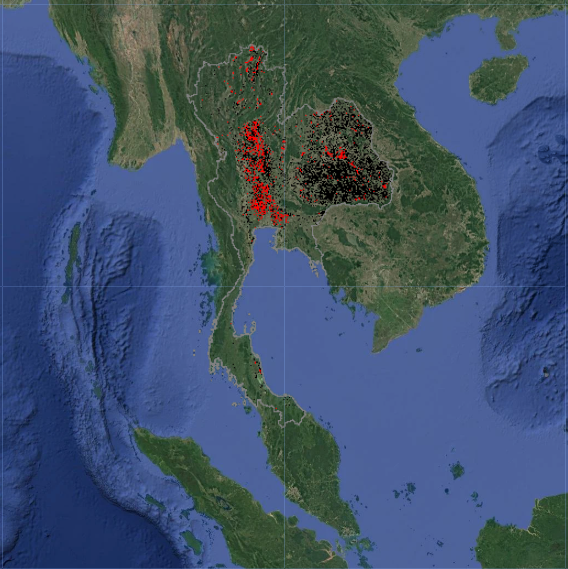</p></td><td><ol start="2" type="a"><li><p>CH4 emission in Jan 2025</p></li></ol><p>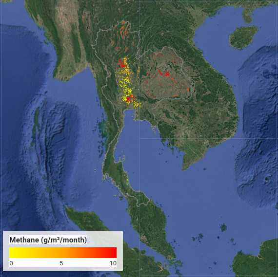</p></td></tr><tr class="even"><td><ol start="3" type="a"><li><p>Active rice area in Feb 2025</p></li></ol><p>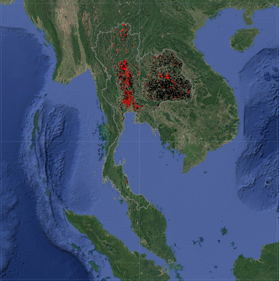</p></td><td><p>(d) CH4 emission in Feb 2025</p><p></p></td></tr><tr class="odd"><td><ol start="5" type="a"><li><p>Active rice area in Mar 2025</p></li></ol><p>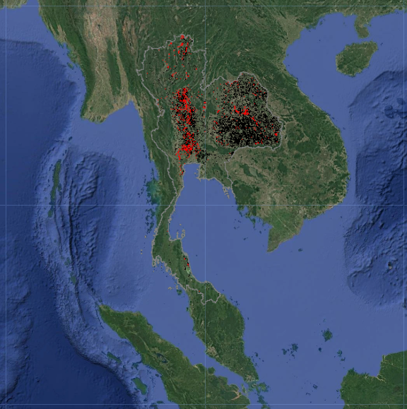</p></td><td><p>(f) CH4 emission in Mar 2025</p><p>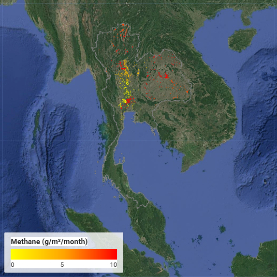</p></td></tr><tr class="even"><td><ol start="7" type="a"><li><p>Active rice area in Apr 2025</p></li></ol><p>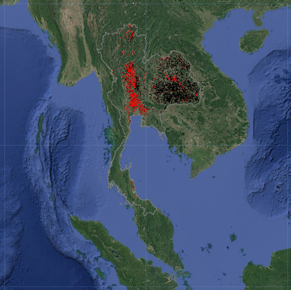</p></td><td><p>(h) CH4 emission in Apr 2025</p><p>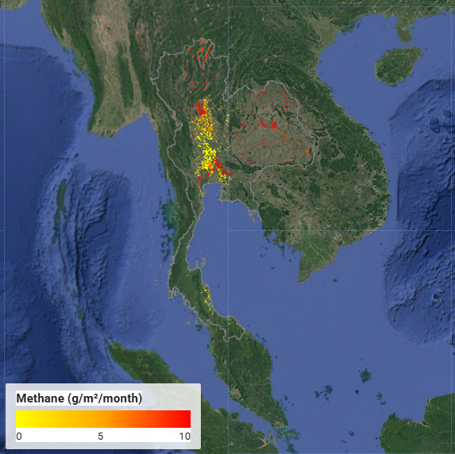</p></td></tr><tr class="odd"><td><ol start="9" type="a"><li><p>Active rice area in May 2025</p></li></ol><p>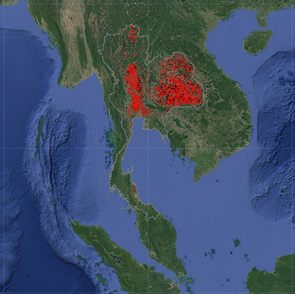</p></td><td><p>(j) CH4 emission in May 2025</p><p></p></td></tr><tr class="even"><td><ol start="11" type="a"><li><p>Active rice area in Jun 2025</p></li></ol><p>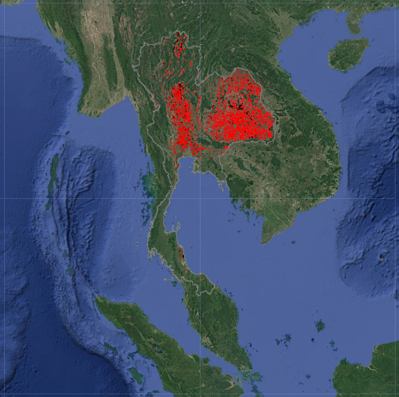</p></td><td><p>(l) CH4 emission in Jun 2025</p><p>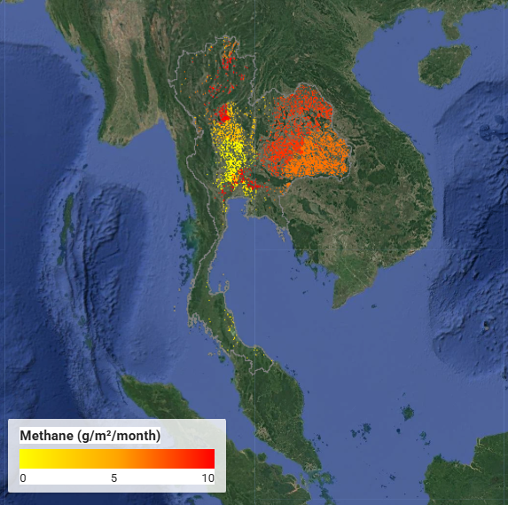</p></td></tr><tr class="odd"><td><ol start="13" type="a"><li><p>Active rice area in Jul 2025</p></li></ol><p>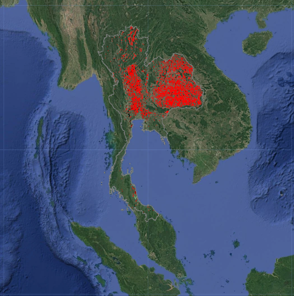</p></td><td><p>(n) CH4 emission in Jul 2025</p><p>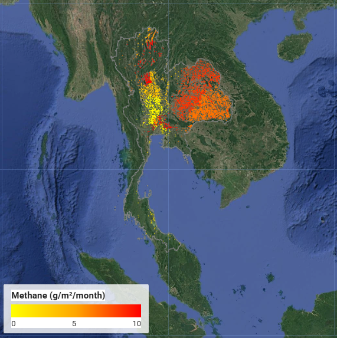</p></td></tr><tr class="even"><td><ol start="15" type="a"><li><p>Active rice area in Aug 2025</p></li></ol><p></p></td><td><p>(p) CH4 emission in Aug 2025</p><p>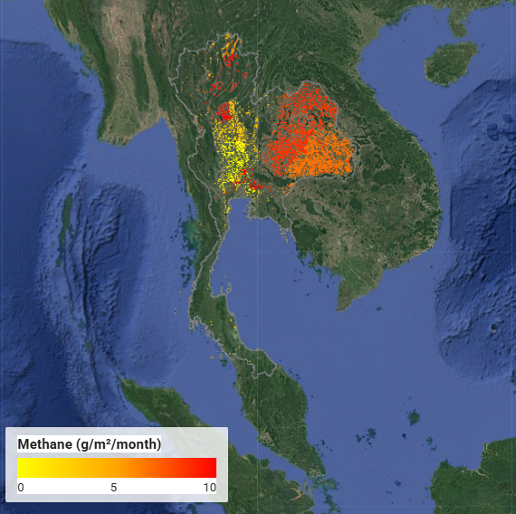</p></td></tr><tr class="odd"><td><ol start="17" type="a"><li><p>Active rice area in Sep 2025</p></li></ol><p>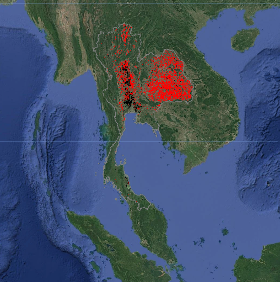</p></td><td><p>(r) CH4 emission in Sep 2025</p><p>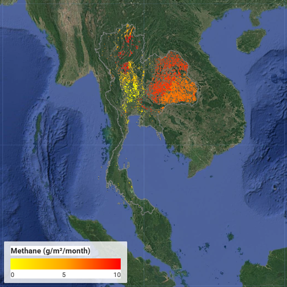</p></td></tr><tr class="even"><td><ol start="19" type="a"><li><p>Active rice area in Oct 2025</p></li></ol><p>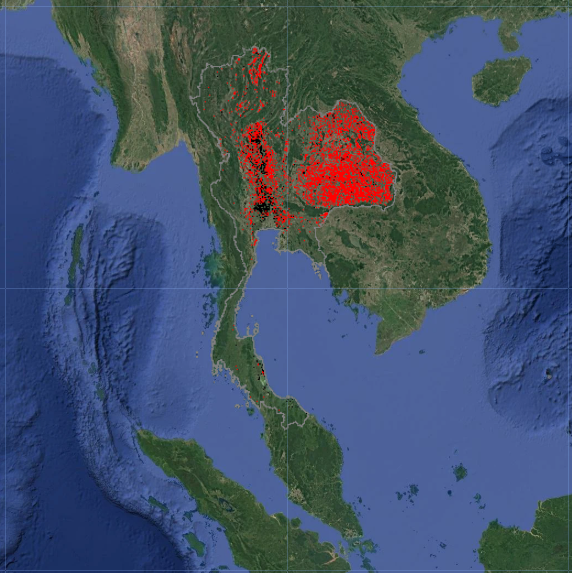</p></td><td><p>(t) CH4 emission in Oct 2025</p><p>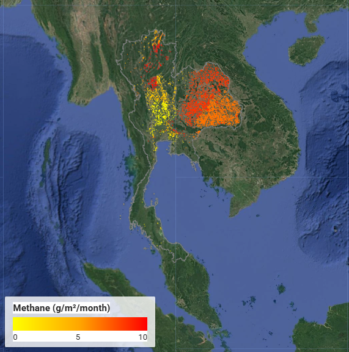</p></td></tr><tr class="odd"><td><ol start="21" type="a"><li><p>Active rice area in Nov 2025</p></li></ol><p>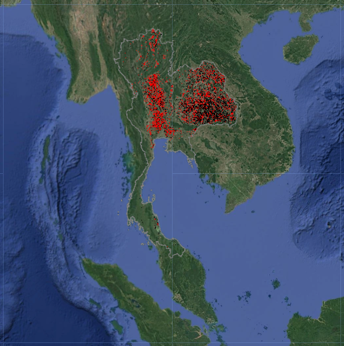</p></td><td><p>(v) CH4 emission in Nov 2025</p><p>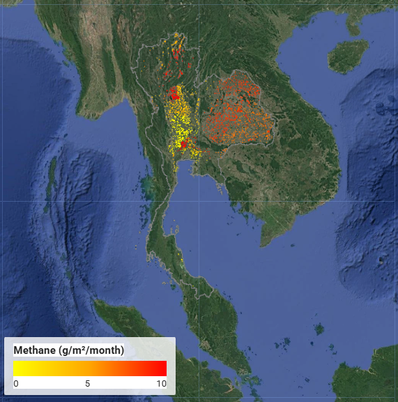</p></td></tr><tr class="even"><td><ol start="23" type="a"><li><p>Active rice area in Dec 2025</p></li></ol><p></p></td><td><p>(x) CH4 emission in Dec 2025</p><p>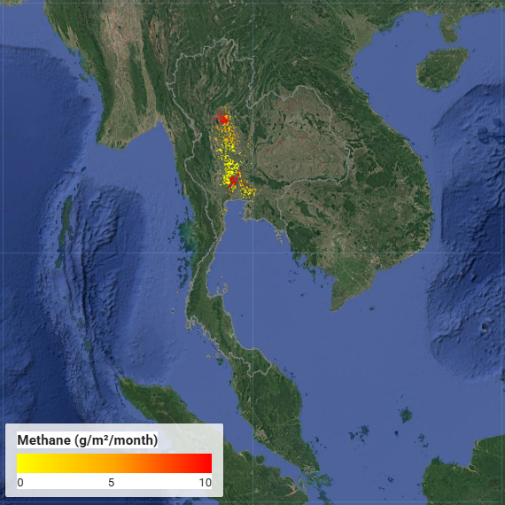</p></td></tr></tbody></table>

**Metadata**

The Agriculture sector: “Rice Cultivation Methane Emissions Estimated from Satellite, Statistical, and Inventory-Based Methods” reports the following data on the Climate TRACE website:

-   Country-level CH<sub>4</sub>, and 20 and 100 year GWPs emissions from rice cultivation.

Emissions estimates were reported for years 2015 to 2025, with earlier years provided by a FAOSTAT harvested-area-indexed back-cast for modeled countries, or directly from the FAOSTAT rice-cultivation inventory for countries not modeled (see Table S1). Other approaches to estimate rice emissions are in the [<span class="underline">Climate TRACE GitHub methodology repository</span>](https://github.com/climatetracecoalition/emissions-methodology/tree/main/Sector-Methodologies/1-Sectors/agriculture). The data generated here has been combined with the other approaches to estimate rice cultivation emissions globally. All data is freely available on the Climate TRACE website ([<span class="underline">https://climatetrace.org/</span>](https://climatetrace.org/)). A detailed description of what is available is described in Table S8. Note, uncertainty definitions are defined in Tables S2, S3, S4, and S5, the standard deviation associated with each country. Confidence definitions are in the tables below.

**Table S8** Metadata for Rice Cultivation Emissions Estimates.

|                                                                             |                                                                                                                                                                                                                                                                               |
|-----------------------------------------------------------------------------|-------------------------------------------------------------------------------------------------------------------------------------------------------------------------------------------------------------------------------------------------------------------------------|
| **General Description**                                                     | **Definition**                                                                                                                                                                                                                                                                |
| **Sector definition**                                                       | *Country-level rice cultivation emissions*                                                                                                                                                                                                                                    |
| **UNFCCC sector equivalent**                                                | *3.C.7 Rice Cultivation*                                                                                                                                                                                                                                                      |
| **Temporal Coverage**                                                       | *2015 – 2025 (see Table S1)*                                                                                                                                                                                                                                                  |
| **Temporal Resolution**                                                     | *Monthly (on website, see [<span class="underline">Temporal Disaggregation of Emissions Data for the Climate TRACE Inventory</span>](https://github.com/climatetracecoalition/emissions-methodology/tree/main/Sector-Methodologies/2-Cross-Cutting/temporal-disaggregation))* |
| **Data format**                                                             | *CSV*                                                                                                                                                                                                                                                                         |
| **Coordinate Reference System**                                             | *None. ISO3 country code provided*                                                                                                                                                                                                                                            |
| **Number of assets/countries available for download**                       | *60 countries (2025; see Table S1), of which 57 are modeled from satellite observation. The remaining countries use FAOSTAT data.*                                                                                                                                            |
| **Ownership**                                                               | *Country*                                                                                                                                                                                                                                                                     |
| **What emission factors were used?**                                        | *Country and subnational literature values (Tables S2–S5)*                                                                                                                                                                                                                    |
| **What is the difference between a “0” versus “NULL/none/nan” data field?** | *“0” values are for true non-existent emissions. If we know that the sector has emissions for that specific gas, but the gas was not modeled, this is represented by “NULL/none/nan”*                                                                                         |
| **total\_CO2e\_100yrGWP and total\_CO2e\_20yrGWP conversions**              | *Climate TRACE uses IPCC AR6 CO<sub>2</sub>e GWPs. CO<sub>2</sub>e conversion guidelines are here: <span class="underline">https://www.ipcc.ch/report/ar6/wg1/downloads/report/IPCC\_AR6\_WGI\_FullReport\_small.pdf</span>*                                                  |

Confidence values are based on the level of information detail used to estimate emissions, which is defined as the following:

-   Subgroup 1: 10m resolution, regional EF

-   Subgroup 2: 10m resolution, country level EF

-   Subgroup 3: 10m resolution, Tier 1 EF or EF from neighboring country

-   Subgroup 4: FAOSTAT-indexed back-cast, country level EF

-   Subgroup 5: FAOSTAT-indexed back-cast, Tier 1 EF or EF from neighboring country

-   Subgroup 6: backfilled by Climate TRACE

Low to very high confidence values for each group are shown in Table S9 and country specific confidences are shown in Table S10.

**Table S9** Confidence definitions for rice cultivation emissions by subgroup number.

<table><tbody><tr class="odd"><td><strong>Data attributes</strong></td><td><strong>Definitions</strong></td><td><p><strong>Subgroup</strong></p><p><strong>1</strong></p></td><td><p><strong>Subgroup</strong></p><p><strong>2</strong></p></td><td><p><strong>Subgroup</strong></p><p><strong>3</strong></p></td><td><p><strong>Subgroup</strong></p><p><strong>4</strong></p></td><td><p><strong>Subgroup</strong></p><p><strong>5</strong></p></td><td><p><strong>Subgroup</strong></p><p><strong>6</strong></p></td></tr><tr class="even"><td><strong>type</strong></td><td>Not used; NA</td><td></td><td></td><td></td><td></td><td></td><td></td></tr><tr class="odd"><td><strong>capacity_description</strong></td><td>Not used; NA</td><td></td><td></td><td></td><td></td><td></td><td></td></tr><tr class="even"><td><strong>capacity_factor_description</strong></td><td>Not used; NA</td><td></td><td></td><td></td><td></td><td></td><td></td></tr><tr class="odd"><td><strong>activity_description</strong></td><td>Rice field that cultivated by rice</td><td>High</td><td>High</td><td>High</td><td>Medium</td><td>Medium</td><td>Low</td></tr><tr class="even"><td><strong>CO2_emissions_factor</strong></td><td>Not used; NA</td><td></td><td></td><td></td><td></td><td></td><td></td></tr><tr class="odd"><td><strong>CH4_emissions_factor</strong></td><td>T CH<sub>4</sub> per harvested ha per length of season</td><td>High</td><td>Medium</td><td>Low</td><td>Medium</td><td>Low</td><td>Low</td></tr><tr class="even"><td><strong>N2O_emissions_factor</strong></td><td>Not used; NA</td><td></td><td></td><td></td><td></td><td></td><td></td></tr><tr class="odd"><td><strong>other_gas_emissions_factor</strong></td><td>Not used; NA</td><td></td><td></td><td></td><td></td><td></td><td></td></tr><tr class="even"><td><strong>CO2_emissions</strong></td><td>Not used; NA</td><td></td><td></td><td></td><td></td><td></td><td></td></tr><tr class="odd"><td><strong>CH4_emissions</strong></td><td>T CH<sub>4</sub></td><td>High</td><td>Medium</td><td>Medium</td><td>Medium</td><td>Medium</td><td>Low</td></tr><tr class="even"><td><strong>N2O_emissions</strong></td><td>Not used; NA</td><td></td><td></td><td></td><td></td><td></td><td></td></tr><tr class="odd"><td><strong>other_gas_emissions</strong></td><td>Not used; NA</td><td></td><td></td><td></td><td></td><td></td><td></td></tr><tr class="even"><td><strong>total_CO2e_100yrGWP</strong></td><td>Based on CH<sub>4</sub> emissions</td><td>High</td><td>High</td><td>High</td><td>Medium</td><td>Medium</td><td>Low</td></tr><tr class="odd"><td><strong>total_CO2e_20yrGWP</strong></td><td>Based on CH<sub>4</sub> emissions</td><td>High</td><td>High</td><td>High</td><td>Medium</td><td>Medium</td><td>Low</td></tr><tr class="even"><td><strong>other_1</strong></td><td>Area of single crop</td><td>Very High</td><td>Very High</td><td>Very High</td><td>Very High</td><td>Very High</td><td>Not used; NA</td></tr><tr class="odd"><td><strong>other_2</strong></td><td>Area of double crop</td><td>Very High</td><td>Very High</td><td>Very High</td><td>Very High</td><td>Very High</td><td>Not used; NA</td></tr><tr class="even"><td><strong>other_3</strong></td><td>Area of triple crop</td><td>Very High</td><td>Very High</td><td>Very High</td><td>Very High</td><td>Very High</td><td>Not used; NA</td></tr></tbody></table>

**Table S10** Country specific confidence definitions for rice cultivation emissions.

<table><tbody><tr class="odd"><td><strong>Country</strong></td><td><strong>ISO3</strong></td><td><p><strong>Sub</strong></p><p><strong>group</strong></p></td><td><strong>capacity</strong></td><td><p><strong>capactiy_</strong></p><p><strong>factor</strong></p></td><td><strong>activity</strong></td><td><p><strong>CO2_</strong></p><p><strong>emissions_</strong></p><p><strong>factor</strong></p></td><td><p><strong>CH4_</strong></p><p><strong>emissions_factor</strong></p></td><td><p><strong>N2O_</strong></p><p><strong>emissions_</strong></p><p><strong>factor</strong></p></td><td><p><strong>other_</strong></p><p><strong>gas_</strong></p><p><strong>emissions_</strong></p><p><strong>factor</strong></p></td><td><p><strong>CO2_</strong></p><p><strong>emissions</strong></p></td><td><p><strong>CH4_</strong></p><p><strong>emissions</strong></p></td><td><p><strong>N2O_</strong></p><p><strong>emissions</strong></p></td><td><p><strong>other_gas_</strong></p><p><strong>emissions</strong></p></td><td><strong>total_CO2e_100yrGWP</strong></td><td><strong>total_CO2e_20yrGWP</strong></td><td><p><strong>other_</strong></p><p><strong>1</strong></p></td><td><p><strong>other_</strong></p><p><strong>2</strong></p></td><td><p><strong>other_</strong></p><p><strong>3</strong></p></td></tr><tr class="even"><td>China</td><td>CHN</td><td>1</td><td>NA</td><td>NA</td><td>High</td><td>NA</td><td>High</td><td>NA</td><td>NA</td><td>NA</td><td>High</td><td>NA</td><td>NA</td><td>High</td><td>High</td><td>Very High</td><td>Very High</td><td>Very High</td></tr><tr class="odd"><td>Vietnam</td><td>VNM</td><td>1</td><td>NA</td><td>NA</td><td>High</td><td>NA</td><td>High</td><td>NA</td><td>NA</td><td>NA</td><td>High</td><td>NA</td><td>NA</td><td>High</td><td>High</td><td>Very High</td><td>Very High</td><td>Very High</td></tr><tr class="even"><td>Thailand</td><td>THA</td><td>1</td><td>NA</td><td>NA</td><td>High</td><td>NA</td><td>High</td><td>NA</td><td>NA</td><td>NA</td><td>High</td><td>NA</td><td>NA</td><td>High</td><td>High</td><td>Very High</td><td>Very High</td><td>Very High</td></tr><tr class="odd"><td>Bangladesh</td><td>BGD</td><td>2</td><td>NA</td><td>NA</td><td>High</td><td>NA</td><td>Medium</td><td>NA</td><td>NA</td><td>NA</td><td>Medium</td><td>NA</td><td>NA</td><td>High</td><td>High</td><td>Very High</td><td>Very High</td><td>Very High</td></tr><tr class="even"><td>Brazil</td><td>BRA</td><td>2</td><td>NA</td><td>NA</td><td>High</td><td>NA</td><td>Medium</td><td>NA</td><td>NA</td><td>NA</td><td>Medium</td><td>NA</td><td>NA</td><td>High</td><td>High</td><td>Very High</td><td>Very High</td><td>Very High</td></tr><tr class="odd"><td>Spain</td><td>ESP</td><td>2</td><td>NA</td><td>NA</td><td>High</td><td>NA</td><td>Medium</td><td>NA</td><td>NA</td><td>NA</td><td>Medium</td><td>NA</td><td>NA</td><td>High</td><td>High</td><td>Very High</td><td>Very High</td><td>Very High</td></tr><tr class="even"><td>Indonesia</td><td>IDN</td><td>2</td><td>NA</td><td>NA</td><td>High</td><td>NA</td><td>Medium</td><td>NA</td><td>NA</td><td>NA</td><td>Medium</td><td>NA</td><td>NA</td><td>High</td><td>High</td><td>Very High</td><td>Very High</td><td>Very High</td></tr><tr class="odd"><td>India</td><td>IND</td><td>2</td><td>NA</td><td>NA</td><td>High</td><td>NA</td><td>Medium</td><td>NA</td><td>NA</td><td>NA</td><td>Medium</td><td>NA</td><td>NA</td><td>High</td><td>High</td><td>Very High</td><td>Very High</td><td>Very High</td></tr><tr class="even"><td>Iran (Islamic Republic of)</td><td>IRN</td><td>3</td><td>NA</td><td>NA</td><td>High</td><td>NA</td><td>Low</td><td>NA</td><td>NA</td><td>NA</td><td>Medium</td><td>NA</td><td>NA</td><td>High</td><td>High</td><td>Very High</td><td>Very High</td><td>Very High</td></tr><tr class="odd"><td>Italy</td><td>ITA</td><td>2</td><td>NA</td><td>NA</td><td>High</td><td>NA</td><td>Medium</td><td>NA</td><td>NA</td><td>NA</td><td>Medium</td><td>NA</td><td>NA</td><td>High</td><td>High</td><td>Very High</td><td>Very High</td><td>Very High</td></tr><tr class="even"><td>Japan</td><td>JPN</td><td>2</td><td>NA</td><td>NA</td><td>High</td><td>NA</td><td>Medium</td><td>NA</td><td>NA</td><td>NA</td><td>Medium</td><td>NA</td><td>NA</td><td>High</td><td>High</td><td>Very High</td><td>Very High</td><td>Very High</td></tr><tr class="odd"><td>Cambodia</td><td>KHM</td><td>2</td><td>NA</td><td>NA</td><td>High</td><td>NA</td><td>Medium</td><td>NA</td><td>NA</td><td>NA</td><td>Medium</td><td>NA</td><td>NA</td><td>High</td><td>High</td><td>Very High</td><td>Very High</td><td>Very High</td></tr><tr class="even"><td>Korea (the Republic of)</td><td>KOR</td><td>2</td><td>NA</td><td>NA</td><td>High</td><td>NA</td><td>Medium</td><td>NA</td><td>NA</td><td>NA</td><td>Medium</td><td>NA</td><td>NA</td><td>High</td><td>High</td><td>Very High</td><td>Very High</td><td>Very High</td></tr><tr class="odd"><td>Lao People's Democratic Republic (the)</td><td>LAO</td><td>3</td><td>NA</td><td>NA</td><td>High</td><td>NA</td><td>Low</td><td>NA</td><td>NA</td><td>NA</td><td>Medium</td><td>NA</td><td>NA</td><td>High</td><td>High</td><td>Very High</td><td>Very High</td><td>Very High</td></tr><tr class="even"><td>Sri Lanka</td><td>LKA</td><td>3</td><td>NA</td><td>NA</td><td>High</td><td>NA</td><td>Low</td><td>NA</td><td>NA</td><td>NA</td><td>Medium</td><td>NA</td><td>NA</td><td>High</td><td>High</td><td>Very High</td><td>Very High</td><td>Very High</td></tr><tr class="odd"><td>Myanmar</td><td>MMR</td><td>2</td><td>NA</td><td>NA</td><td>High</td><td>NA</td><td>Medium</td><td>NA</td><td>NA</td><td>NA</td><td>Medium</td><td>NA</td><td>NA</td><td>High</td><td>High</td><td>Very High</td><td>Very High</td><td>Very High</td></tr><tr class="even"><td>Malaysia</td><td>MYS</td><td>2</td><td>NA</td><td>NA</td><td>High</td><td>NA</td><td>Medium</td><td>NA</td><td>NA</td><td>NA</td><td>Medium</td><td>NA</td><td>NA</td><td>High</td><td>High</td><td>Very High</td><td>Very High</td><td>Very High</td></tr><tr class="odd"><td>Nepal</td><td>NPL</td><td>3</td><td>NA</td><td>NA</td><td>High</td><td>NA</td><td>Low</td><td>NA</td><td>NA</td><td>NA</td><td>Medium</td><td>NA</td><td>NA</td><td>High</td><td>High</td><td>Very High</td><td>Very High</td><td>Very High</td></tr><tr class="even"><td>Pakistan</td><td>PAK</td><td>3</td><td>NA</td><td>NA</td><td>High</td><td>NA</td><td>Low</td><td>NA</td><td>NA</td><td>NA</td><td>Medium</td><td>NA</td><td>NA</td><td>High</td><td>High</td><td>Very High</td><td>Very High</td><td>Very High</td></tr><tr class="odd"><td>Philippines (the)</td><td>PHL</td><td>2</td><td>NA</td><td>NA</td><td>High</td><td>NA</td><td>Medium</td><td>NA</td><td>NA</td><td>NA</td><td>Medium</td><td>NA</td><td>NA</td><td>High</td><td>High</td><td>Very High</td><td>Very High</td><td>Very High</td></tr><tr class="even"><td>Korea (the Democratic People's Republic of)</td><td>PRK</td><td>3</td><td>NA</td><td>NA</td><td>High</td><td>NA</td><td>Low</td><td>NA</td><td>NA</td><td>NA</td><td>Medium</td><td>NA</td><td>NA</td><td>High</td><td>High</td><td>Very High</td><td>Very High</td><td>Very High</td></tr><tr class="odd"><td>Taiwan (Province of China)</td><td>TWN</td><td>2</td><td>NA</td><td>NA</td><td>High</td><td>NA</td><td>Medium</td><td>NA</td><td>NA</td><td>NA</td><td>Medium</td><td>NA</td><td>NA</td><td>High</td><td>High</td><td>Very High</td><td>Very High</td><td>Very High</td></tr><tr class="even"><td>United States of America (the)</td><td>USA</td><td>2</td><td>NA</td><td>NA</td><td>High</td><td>NA</td><td>Medium</td><td>NA</td><td>NA</td><td>NA</td><td>Medium</td><td>NA</td><td>NA</td><td>High</td><td>High</td><td>Very High</td><td>Very High</td><td>Very High</td></tr><tr class="odd"><td>Ethiopia</td><td>ETH</td><td>5</td><td>NA</td><td>NA</td><td>Medium</td><td>NA</td><td>Low</td><td>NA</td><td>NA</td><td>NA</td><td>Medium</td><td>NA</td><td>NA</td><td>Medium</td><td>Medium</td><td>Very High</td><td>Very High</td><td>Very High</td></tr><tr class="even"><td>Egypt</td><td>EGY</td><td>5</td><td>NA</td><td>NA</td><td>Medium</td><td>NA</td><td>Low</td><td>NA</td><td>NA</td><td>NA</td><td>Medium</td><td>NA</td><td>NA</td><td>Medium</td><td>Medium</td><td>Very High</td><td>Very High</td><td>Very High</td></tr><tr class="odd"><td>Turkey</td><td>TUR</td><td>3</td><td>NA</td><td>NA</td><td>High</td><td>NA</td><td>Low</td><td>NA</td><td>NA</td><td>NA</td><td>Medium</td><td>NA</td><td>NA</td><td>High</td><td>High</td><td>Very High</td><td>Very High</td><td>Very High</td></tr><tr class="even"><td>Madagascar</td><td>MDG</td><td>2</td><td>NA</td><td>NA</td><td>High</td><td>NA</td><td>Medium</td><td>NA</td><td>NA</td><td>NA</td><td>Medium</td><td>NA</td><td>NA</td><td>High</td><td>High</td><td>Very High</td><td>Very High</td><td>Very High</td></tr><tr class="odd"><td>Tanzania</td><td>TZA</td><td>2</td><td>NA</td><td>NA</td><td>High</td><td>NA</td><td>Medium</td><td>NA</td><td>NA</td><td>NA</td><td>Medium</td><td>NA</td><td>NA</td><td>High</td><td>High</td><td>Very High</td><td>Very High</td><td>Very High</td></tr><tr class="even"><td>Uruguay</td><td>URY</td><td>3</td><td>NA</td><td>NA</td><td>High</td><td>NA</td><td>Low</td><td>NA</td><td>NA</td><td>NA</td><td>Medium</td><td>NA</td><td>NA</td><td>High</td><td>High</td><td>Very High</td><td>Very High</td><td>Very High</td></tr><tr class="odd"><td>Suriname</td><td>SUR</td><td>3</td><td>NA</td><td>NA</td><td>High</td><td>NA</td><td>Low</td><td>NA</td><td>NA</td><td>NA</td><td>Medium</td><td>NA</td><td>NA</td><td>High</td><td>High</td><td>Very High</td><td>Very High</td><td>Very High</td></tr><tr class="even"><td>Peru</td><td>PER</td><td>3</td><td>NA</td><td>NA</td><td>High</td><td>NA</td><td>Low</td><td>NA</td><td>NA</td><td>NA</td><td>Medium</td><td>NA</td><td>NA</td><td>High</td><td>High</td><td>Very High</td><td>Very High</td><td>Very High</td></tr><tr class="odd"><td>Guyana</td><td>GUY</td><td>3</td><td>NA</td><td>NA</td><td>High</td><td>NA</td><td>Low</td><td>NA</td><td>NA</td><td>NA</td><td>Medium</td><td>NA</td><td>NA</td><td>High</td><td>High</td><td>Very High</td><td>Very High</td><td>Very High</td></tr><tr class="even"><td>Ecuador</td><td>ECU</td><td>3</td><td>NA</td><td>NA</td><td>High</td><td>NA</td><td>Low</td><td>NA</td><td>NA</td><td>NA</td><td>Medium</td><td>NA</td><td>NA</td><td>High</td><td>High</td><td>Very High</td><td>Very High</td><td>Very High</td></tr><tr class="odd"><td>Russia</td><td>RUS</td><td>3</td><td>NA</td><td>NA</td><td>High</td><td>NA</td><td>Low</td><td>NA</td><td>NA</td><td>NA</td><td>Medium</td><td>NA</td><td>NA</td><td>High</td><td>High</td><td>Very High</td><td>Very High</td><td>Very High</td></tr><tr class="even"><td>Mexico</td><td>MEX</td><td>3</td><td>NA</td><td>NA</td><td>High</td><td>NA</td><td>Low</td><td>NA</td><td>NA</td><td>NA</td><td>Medium</td><td>NA</td><td>NA</td><td>High</td><td>High</td><td>Very High</td><td>Very High</td><td>Very High</td></tr><tr class="odd"><td>Bhutan</td><td>BTN</td><td>3</td><td>NA</td><td>NA</td><td>High</td><td>NA</td><td>Low</td><td>NA</td><td>NA</td><td>NA</td><td>Medium</td><td>NA</td><td>NA</td><td>High</td><td>High</td><td>Very High</td><td>Very High</td><td>Very High</td></tr><tr class="even"><td>Bulgaria</td><td>BGR</td><td>3</td><td>NA</td><td>NA</td><td>High</td><td>NA</td><td>Low</td><td>NA</td><td>NA</td><td>NA</td><td>Medium</td><td>NA</td><td>NA</td><td>High</td><td>High</td><td>Very High</td><td>Very High</td><td>Very High</td></tr><tr class="odd"><td>Burkina Faso</td><td>BFA</td><td>3</td><td>NA</td><td>NA</td><td>High</td><td>NA</td><td>Low</td><td>NA</td><td>NA</td><td>NA</td><td>Medium</td><td>NA</td><td>NA</td><td>High</td><td>High</td><td>Very High</td><td>Very High</td><td>Very High</td></tr><tr class="even"><td>Burundi</td><td>BDI</td><td>3</td><td>NA</td><td>NA</td><td>High</td><td>NA</td><td>Low</td><td>NA</td><td>NA</td><td>NA</td><td>Medium</td><td>NA</td><td>NA</td><td>High</td><td>High</td><td>Very High</td><td>Very High</td><td>Very High</td></tr><tr class="odd"><td>Cameroon</td><td>CMR</td><td>3</td><td>NA</td><td>NA</td><td>High</td><td>NA</td><td>Low</td><td>NA</td><td>NA</td><td>NA</td><td>Medium</td><td>NA</td><td>NA</td><td>High</td><td>High</td><td>Very High</td><td>Very High</td><td>Very High</td></tr><tr class="even"><td>France</td><td>FRA</td><td>3</td><td>NA</td><td>NA</td><td>High</td><td>NA</td><td>Low</td><td>NA</td><td>NA</td><td>NA</td><td>Medium</td><td>NA</td><td>NA</td><td>High</td><td>High</td><td>Very High</td><td>Very High</td><td>Very High</td></tr><tr class="odd"><td>Gambia</td><td>GMB</td><td>3</td><td>NA</td><td>NA</td><td>High</td><td>NA</td><td>Low</td><td>NA</td><td>NA</td><td>NA</td><td>Medium</td><td>NA</td><td>NA</td><td>High</td><td>High</td><td>Very High</td><td>Very High</td><td>Very High</td></tr><tr class="even"><td>Greece</td><td>GRC</td><td>3</td><td>NA</td><td>NA</td><td>High</td><td>NA</td><td>Low</td><td>NA</td><td>NA</td><td>NA</td><td>Medium</td><td>NA</td><td>NA</td><td>High</td><td>High</td><td>Very High</td><td>Very High</td><td>Very High</td></tr><tr class="odd"><td>Guinea</td><td>GIN</td><td>3</td><td>NA</td><td>NA</td><td>High</td><td>NA</td><td>Low</td><td>NA</td><td>NA</td><td>NA</td><td>Medium</td><td>NA</td><td>NA</td><td>High</td><td>High</td><td>Very High</td><td>Very High</td><td>Very High</td></tr><tr class="even"><td>Guinea-Bissau</td><td>GNB</td><td>3</td><td>NA</td><td>NA</td><td>High</td><td>NA</td><td>Low</td><td>NA</td><td>NA</td><td>NA</td><td>Medium</td><td>NA</td><td>NA</td><td>High</td><td>High</td><td>Very High</td><td>Very High</td><td>Very High</td></tr><tr class="odd"><td>Hungary</td><td>HUN</td><td>3</td><td>NA</td><td>NA</td><td>High</td><td>NA</td><td>Low</td><td>NA</td><td>NA</td><td>NA</td><td>Medium</td><td>NA</td><td>NA</td><td>High</td><td>High</td><td>Very High</td><td>Very High</td><td>Very High</td></tr><tr class="even"><td>Kenya</td><td>KEN</td><td>3</td><td>NA</td><td>NA</td><td>High</td><td>NA</td><td>Low</td><td>NA</td><td>NA</td><td>NA</td><td>Medium</td><td>NA</td><td>NA</td><td>High</td><td>High</td><td>Very High</td><td>Very High</td><td>Very High</td></tr><tr class="odd"><td>Malawi</td><td>MWI</td><td>3</td><td>NA</td><td>NA</td><td>High</td><td>NA</td><td>Low</td><td>NA</td><td>NA</td><td>NA</td><td>Medium</td><td>NA</td><td>NA</td><td>High</td><td>High</td><td>Very High</td><td>Very High</td><td>Very High</td></tr><tr class="even"><td>Mali</td><td>MLI</td><td>3</td><td>NA</td><td>NA</td><td>High</td><td>NA</td><td>Low</td><td>NA</td><td>NA</td><td>NA</td><td>Medium</td><td>NA</td><td>NA</td><td>High</td><td>High</td><td>Very High</td><td>Very High</td><td>Very High</td></tr><tr class="odd"><td>Mauritania</td><td>MRT</td><td>3</td><td>NA</td><td>NA</td><td>High</td><td>NA</td><td>Low</td><td>NA</td><td>NA</td><td>NA</td><td>Medium</td><td>NA</td><td>NA</td><td>High</td><td>High</td><td>Very High</td><td>Very High</td><td>Very High</td></tr><tr class="even"><td>Morocco</td><td>MAR</td><td>3</td><td>NA</td><td>NA</td><td>High</td><td>NA</td><td>Low</td><td>NA</td><td>NA</td><td>NA</td><td>Medium</td><td>NA</td><td>NA</td><td>High</td><td>High</td><td>Very High</td><td>Very High</td><td>Very High</td></tr><tr class="odd"><td>Niger</td><td>NER</td><td>3</td><td>NA</td><td>NA</td><td>High</td><td>NA</td><td>Low</td><td>NA</td><td>NA</td><td>NA</td><td>Medium</td><td>NA</td><td>NA</td><td>High</td><td>High</td><td>Very High</td><td>Very High</td><td>Very High</td></tr><tr class="even"><td>Nigeria</td><td>NGA</td><td>3</td><td>NA</td><td>NA</td><td>High</td><td>NA</td><td>Low</td><td>NA</td><td>NA</td><td>NA</td><td>Medium</td><td>NA</td><td>NA</td><td>High</td><td>High</td><td>Very High</td><td>Very High</td><td>Very High</td></tr><tr class="odd"><td>North Macedonia</td><td>MKD</td><td>3</td><td>NA</td><td>NA</td><td>High</td><td>NA</td><td>Low</td><td>NA</td><td>NA</td><td>NA</td><td>Medium</td><td>NA</td><td>NA</td><td>High</td><td>High</td><td>Very High</td><td>Very High</td><td>Very High</td></tr><tr class="even"><td>Portugal</td><td>PRT</td><td>3</td><td>NA</td><td>NA</td><td>High</td><td>NA</td><td>Low</td><td>NA</td><td>NA</td><td>NA</td><td>Medium</td><td>NA</td><td>NA</td><td>High</td><td>High</td><td>Very High</td><td>Very High</td><td>Very High</td></tr><tr class="odd"><td>Rwanda</td><td>RWA</td><td>3</td><td>NA</td><td>NA</td><td>High</td><td>NA</td><td>Low</td><td>NA</td><td>NA</td><td>NA</td><td>Medium</td><td>NA</td><td>NA</td><td>High</td><td>High</td><td>Very High</td><td>Very High</td><td>Very High</td></tr><tr class="even"><td>Senegal</td><td>SEN</td><td>3</td><td>NA</td><td>NA</td><td>High</td><td>NA</td><td>Low</td><td>NA</td><td>NA</td><td>NA</td><td>Medium</td><td>NA</td><td>NA</td><td>High</td><td>High</td><td>Very High</td><td>Very High</td><td>Very High</td></tr><tr class="odd"><td>Sierra Leone</td><td>SLE</td><td>3</td><td>NA</td><td>NA</td><td>High</td><td>NA</td><td>Low</td><td>NA</td><td>NA</td><td>NA</td><td>Medium</td><td>NA</td><td>NA</td><td>High</td><td>High</td><td>Very High</td><td>Very High</td><td>Very High</td></tr><tr class="even"><td>Timor-Leste</td><td>TLS</td><td>3</td><td>NA</td><td>NA</td><td>High</td><td>NA</td><td>Low</td><td>NA</td><td>NA</td><td>NA</td><td>Medium</td><td>NA</td><td>NA</td><td>High</td><td>High</td><td>Very High</td><td>Very High</td><td>Very High</td></tr><tr class="odd"><td>Uganda</td><td>UGA</td><td>3</td><td>NA</td><td>NA</td><td>High</td><td>NA</td><td>Low</td><td>NA</td><td>NA</td><td>NA</td><td>Medium</td><td>NA</td><td>NA</td><td>High</td><td>High</td><td>Very High</td><td>Very High</td><td>Very High</td></tr><tr class="even"><td>Backfilled Countries</td><td></td><td>6</td><td>NA</td><td>NA</td><td>Low</td><td>NA</td><td>Low</td><td>NA</td><td>NA</td><td>NA</td><td>Low</td><td>NA</td><td>NA</td><td>Low</td><td>Low</td><td>NA</td><td>NA</td><td>NA</td></tr></tbody></table>

**Permissions and Use:** All Climate TRACE data is freely available under the Creative Commons Attribution 4.0 International Public License, unless otherwise noted below.

> **Citation format:** Rudiyanto, Hsu, M., Powell, V., and Schiller, S. (2026). *Agriculture sector: Rice Cultivation Methane Emissions Estimated from Satellite, Statistical, and Inventory-Based Methods.* Universiti Malaysia Terengganu, Malaysia, Climate TRACE Emissions Inventory. https://climatetrace.org \[Accessed date\]

**Geographic boundaries and names (iso3\_country data attribute):** The depiction and use of boundaries, geographic names and related data shown on maps and included in lists, tables, documents, and databases on Climate TRACE are generated from the Global Administrative Areas (GADM) project (Version 4.1 released on 16 July 2022) along with their corresponding ISO3 codes, and with the following adaptations:

-   HKG (China, Hong Kong Special Administrative Region) and MAC (China, Macao Special Administrative Region) are reported at GADM level 0 (country/national);

-   Kosovo has been assigned the ISO3 code ‘XKX’;

-   XCA (Caspian Sea) has been removed from GADM level 0 and the area assigned to countries based on the extent of their territorial waters;

-   XAD (Akrotiri and Dhekelia), XCL (Clipperton Island), XPI (Paracel Islands) and XSP (Spratly Islands) are not included in the Climate TRACE dataset;

-   ZNC name changed to ‘Turkish Republic of Northern Cyprus’ at GADM level 0;

-   The borders between India, Pakistan and China have been assigned to these countries based on GADM codes Z01 to Z09.

The above usage is not warranted to be error free and does not imply the expression of any opinion whatsoever on the part of Climate TRACE Coalition and its partners concerning the legal status of any country, area or territory or of its authorities, or concerning the delimitation of its borders.

**Disclaimer:** The emissions provided for this sector are our current best estimates of emissions, and we are committed to continually increasing the accuracy of the models on all levels. Please review our terms of use and the sector-specific methodology documentation before using the data. If you identify an error or would like to participate in our data validation process, please [<span class="underline">contact us</span>](mailto:coalition@climatetrace.org).

#### References

1.  Alberto, M.C.R., Wassmann, R., Buresh, R.J., Quilty, J.R., Correa, T.Q., Sandro, J.M., Centeno, C.A.R., 2014. Measuring methane flux from irrigated rice fields by eddy covariance method using open-path gas analyzer. Field Crops Research 160, 12–21. https://doi.org/10.1016/j.fcr.2014.02.008

2.  Bhatia, A., Pathak, H., Jain, N., Singh, P.K., Singh, A.K., 2005. Global warming potential of manure amended soils under rice-wheat system in the Indo-Gangetic plains. Atmospheric Environment 39, 6976–6984. https://doi.org/10.1016/j.atmosenv.2005.07.052

3.  Camargo, E.S., Pedroso, G.M., Minamikawa, K., Shiratori, Y., Bayer, C., 2018. Intercontinental comparison of greenhouse gas emissions from irrigated rice fields under feasible water management practices: Brazil and Japan. Soil Science and Plant Nutrition 64, 59–67. https://doi.org/10.1080/00380768.2017.1415660

4.  Chang, S.Y.H., 2001. Methane emission from paddy fields in Taiwan 157–165.

5.  Della Lunga, D., Brye, K.R., Slayden, J.M., Henry, C.G., Wood, L.S., 2021. Relationships among soil factors and greenhouse gas emissions from furrow-irrigated Rice in the mid-southern, USA. Geoderma Regional 24, e00365. https://doi.org/10.1016/j.geodrs.2021.e00365

6.  Fatchurrachman, Rudiyanto, Soh, N.C., Shah, R.M., Giap, S.G.E., Setiawan, B.I., Minasny, B., 2022. High-Resolution Mapping of Paddy Rice Extent and Growth Stages across Peninsular Malaysia Using a Fusion of Sentinel-1 and 2 Time Series Data in Google Earth Engine. Remote Sensing 14. https://doi.org/10.3390/rs14081875

7.  Fazli, P., Man, H.C., 2014. Comparison of Methane Emission from Conventional and Modified Paddy Cultivation in Malaysia. Agriculture and Agricultural Science Procedia 2, 272–279. [<span class="underline">https://doi.org/10.1016/j.aaspro.2014.11.039</span>](https://doi.org/10.1016/j.aaspro.2014.11.039)

8.  Ge, M., Friedrich, J. and Vigna, L. (2024). Where Do Emissions Come From? 4 Charts Explain Greenhouse Gas Emissions by Sector. World Resources Institute. \[online\] Available at: [<span class="underline">https://www.wri.org/insights/4-charts-explain-greenhouse-gas-emissions-countries-and-sectors</span>](https://www.wri.org/insights/4-charts-explain-greenhouse-gas-emissions-countries-and-sectors).

9.  Ginting, F.I., Rudiyanto, Fatchurrachman, Shah, R.M., Soh, N.C., Giap, S.G.E., Fiantis, D., Setiawan, B.I., Powell, V., Hsu, M., Schiller, S., Davitt, A., Minasny, B., 2026. High-resolution mapping of rice cropping pattern, intensity, calendar, and ecosystem type across Southeast Asia. Remote Sens. Appl. Soc. Environ. 43, 102143. https://doi.org/10.1016/j.rsase.2026.102143

10. Ginting, F.I., Rudiyanto, R., Fatchurrachman, Mohd Shah, R., Che Soh, N., Eng Giap, S.G., Fiantis, D., Setiawan, B.I., Schiller, S., Davitt, A., Minasny, B., 2025. High-resolution maps of rice cropping intensity across Southeast Asia. Sci. Data 12, 1408. https://doi.org/10.1038/s41597-025-05722-1

11. Gutierrez, J., Kim, S.Y., Kim, P.J., 2013. Effect of rice cultivar on CH4 emissions and productivity in Korean paddy soil. Field Crops Research 146, 16–24. https://doi.org/10.1016/j.fcr.2013.03.003

12. Hatala, J.A., Detto, M., Sonnentag, O., Deverel, S.J., Verfaillie, J., Baldocchi, D.D., 2012. Greenhouse gas (CO<sub>2</sub>, CH<sub>4</sub>, H<sub>2</sub>O) fluxes from drained and flooded agricultural peatlands in the Sacramento-San Joaquin Delta. Agriculture, Ecosystems and Environment 150, 1–18. https://doi.org/10.1016/j.agee.2012.01.009

13. Humphreys, J., Brye, K.R., Rector, C., Gbur, E.E., 2019. Methane emissions from rice across a soil organic matter gradient in Alfisols of Arkansas, USA. Geoderma Regional 16, e00200. https://doi.org/10.1016/j.geodrs.2018.e00200

14. IPCC, 1997. Revised 1996 IPCC Guidelines for National Greenhouse Gas Inventories. Paris.

15. Islam, S.M.M., Gaihre, Y.K., Islam, M.R., Akter, M., Al Mahmud, A., Singh, U., Sander, B.O., 2020. Effects of water management on greenhouse gas emissions from farmers’ rice fields in Bangladesh. Science of the Total Environment 734. https://doi.org/10.1016/j.scitotenv.2020.139382

16. Karki, S., Adviento-Borbe, M.A.A., Massey, J.H., Reba, M.L., 2021. Assessing seasonal methane and nitrous oxide emissions from furrow-irrigated rice with cover crops. Agriculture (Switzerland) 11, 1–15. [<span class="underline">https://doi.org/10.3390/agriculture11030261</span>](https://doi.org/10.3390/agriculture11030261)

17. Katoh, K., Chairoj, P., Yagi, K.,Tsuruta, H., Minami, K., and Cholitkul, W. (1999a). Diel and Seasonal Variations of Methane Flux from Bang Khen Paddy Field in Thailand. *JIRCAS\].* 7: 69-75.

18. Katoh, K., Chairoj, P., Yagi, K.,Tsuruta, H., Minami, K., and Cholitkul, W. (1999b). Methane emission from paddy field in Northern *Thailand.JIRCASJ.* 7: 77-85.

19. Kritee, K., Nair, D., Zavala-Araiza, D., Proville, J., Rudek, J., Adhya, T.K., Loecke, T., Esteves, T., Balireddygari, S., Dava, O., Ram, K., Abhilash, S.R., Madasamy, M., Dokka, R. V., Anandaraj, D., Athiyaman, D., Reddy, M., Ahuja, R., Hamburg, S.P., 2018. High nitrous oxide fluxes from rice indicate the need to manage water for both long- and short-term climate impacts. Proc Natl Acad Sci U S A 115, 9720–9725. https://doi.org/10.1073/pnas.1809276115

20. Lagomarsino, A., Agnelli, A.E., Linquist, B., Adviento-Borbe, M.A., Agnelli, A., Gavina, G., Ravaglia, S., Ferrara, R.M., 2016. Alternate Wetting and Drying of Rice Reduced CH4 Emissions but Triggered N2O Peaks in a Clayey Soil of Central Italy. Pedosphere 26, 533–548. https://doi.org/10.1016/S1002-0160(15)60063-7

21. Lim, J.Y., Cho, S.R., Kim, G.W., Kim, P.J., Jeong, S.T., 2021. Uncertainty of methane emissions coming from the physical volume of plant biomass inside the closed chamber was negligible during cropping period. PLoS ONE 16, 1–14. [<span class="underline">https://doi.org/10.1371/journal.pone.0256796</span>](https://doi.org/10.1371/journal.pone.0256796)

22. Maneepitak, S., Ullah, H., Datta, A., Shrestha, R.P., Shrestha, S., Kachenchart, B., 2019. Effects of water and rice straw management practices on water savings and greenhouse gas emissions from a double-rice paddy field in the Central Plain of Thailand. European Journal of Agronomy 107, 18–29. https://doi.org/10.1016/j.eja.2019.04.002

23. Martínez-Eixarch, M., Alcaraz, C., Viñas, M., Noguerol, J., Aranda, X., Prenafeta-Boldú, F.X., Català-Forner, M., Fennessy, M.S., Ibáñez, C., 2021. The main drivers of methane emissions differ in the growing and flooded fallow seasons in Mediterranean rice fields. Plant and Soil 460, 211–227. https://doi.org/10.1007/s11104-020-04809-5

24. Mazza, G., Agnelli, A.E., Orasen, G., Gennaro, M., Valè, G., Lagomarsino, A., 2016. Reduction of Global Warming Potential from rice under alternate wetting and drying practice in a sandy soil of northern Italy. Italian Journal of Agrometeorology 21, 35–44. [<span class="underline">https://doi.org/10.19199/2016.2.2038-5625.035</span>](https://doi.org/10.19199/2016.2.2038-5625.035)

25. Mboyerwa, P.A., Kibret, K., Mtakwa, P. and Aschalew, A., 2022. Greenhouse gas emissions in irrigated paddy rice as influenced by crop management practices and nitrogen fertilization rates in eastern Tanzania. *Frontiers in Sustainable Food Systems*, *6*, p.868479.

26. Meijide, A., Gruening, C., Goded, I., Seufert, G., Cescatti, A., 2017. Water management reduces greenhouse gas emissions in a Mediterranean rice paddy field. Agriculture, Ecosystems and Environment 238, 168–178. https://doi.org/10.1016/j.agee.2016.08.017

27. Nikolaisen, M., Hillier, J., Smith, P., Nayak, D., 2023. Modelling CH4 emission from rice ecosystem: A comparison between existing empirical models. Frontiers in Agronomy 4, 1058649. https://doi.org/10.3389/fagro.2022.1058649

28. Moreno-García, B., Guillén, M., Quílez, D., 2020. Greenhouse gas emissions as affected by fertilization type (Pig Slurry vs. Mineral) and soil management in mediterranean rice systems. Agronomy 10. [<span class="underline">https://doi.org/10.3390/agronomy10040493</span>](https://doi.org/10.3390/agronomy10040493)

29. Oo, A.Z., Sudo, S., Inubushi, K., Mano, M., Yamamoto, A., Ono, K., Osawa, T., Hayashida, S., Patra, P.K., Terao, Y., Elayakumar, P., Vanitha, K., Umamageswari, C., Jothimani, P., Ravi, V., 2018. Methane and nitrous oxide emissions from conventional and modified rice cultivation systems in South India. Agriculture, Ecosystems and Environment 252, 148–158. https://doi.org/10.1016/j.agee.2017.10.014

30. Rudiyanto, Minasny, B., Shah, R.M., Che Soh, N., Arif, C., Indra Setiawan, B., 2019. Automated Near-Real-Time Mapping and Monitoring of Rice Extent, Cropping Patterns, and Growth Stages in Southeast Asia Using Sentinel-1 Time Series on a Google Earth Engine Platform. Remote Sensing 11. https://doi.org/10.3390/rs11141666

31. Sander, B.O., Samson, M., Buresh, R.J., 2014. Methane and nitrous oxide emissions from flooded rice fields as affected by water and straw management between rice crops. Geoderma 235–236, 355–362. https://doi.org/10.1016/j.geoderma.2014.07.020

32. Setyanto, P., Pramono, A., Adriany, T.A., Susilawati, H.L., Tokida, T., Padre, A.T., Minamikawa, K., 2018. Alternate wetting and drying reduces methane emission from a rice paddy in Central Java, Indonesia without yield loss. Soil Science and Plant Nutrition 64, 23–30. https://doi.org/10.1080/00380768.2017.1409600

33. Sibayan, E.B., Samoy-Pascual, K., Grospe, F.S., Casil, M.E.D., Tokida, T., Padre, A.T., Minamikawa, K., 2018. Effects of alternate wetting and drying technique on greenhouse gas emissions from irrigated rice paddy in Central Luzon, Philippines. Soil Science and Plant Nutrition 64, 39–46. [<span class="underline">https://doi.org/10.1080/00380768.2017.1401906</span>](https://doi.org/10.1080/00380768.2017.1401906)

34. Sun, J., Wang, M., Xu, X., Cheng, K., Yue, Q., Pan, G., 2020. Re-estimating methane emissions from Chinese paddy fields based on a regional empirical model and high-spatial-resolution data. Environmental Pollution 265, Part A. [<span class="underline">https://doi.org/10.1016/j.envpol.2020.115017</span>](https://doi.org/10.1016/j.envpol.2020.115017)

35. Toma, Y., Sari, N.N., Akamatsu, K., Oomori, S., Nagata, O., Nishimura, S., Purwanto, B.H., Ueno, H., 2019. Effects of green manure application and prolonging mid-season drainage on greenhouse gas emission from paddy fields in Ehime, Southwestern Japan. Agriculture (Switzerland) 9, 1–17. https://doi.org/10.3390/agriculture9020029

36. Vibol, S., Towprayoon, S., 2010. Estimation of methane and nitrous oxide emissions from rice field with rice straw management in Cambodia. Environmental Monitoring and Assessment 161, 301–313. https://doi.org/10.1007/s10661-009-0747-6

37. Vo, T.B.T., Wassmann, R., Mai, V.T., Vu, D.Q., Bui, T.P.L., Vu, T.H., Dinh, Q.H., Yen, B.T., Asch, F., Sander, B.O., 2020. Methane emission factors from vietnamese rice production: Pooling data of 36 field sites for meta-analysis. Climate 8. https://doi.org/10.3390/CLI8060074

38. Win, E.P., Win, K.K., Bellingrath-Kimura, S.D., Oo, A.Z., 2020. Greenhouse gas emissions, grain yield and water productivity: a paddy rice field case study based in Myanmar. Greenhouse Gases: Science and Technology 10, 884–897. [<span class="underline">https://doi.org/10.1002/ghg.2011</span>](https://doi.org/10.1002/ghg.2011)

39. Yagi, K., Chairoj, P., Tsuruta, H., Cholitkul, W. and Minami, K. (1994). Methane emission from rice paddy fields in the central plain of Thailand. *Soil Sci. Plant Nutr.* 40: 29-37

40. Zschornack, T., da Rosa, C.M., dos Reis, C.E.S., Pedroso, G.M., Camargo, E.S., Dossantos, D.C., Boeni, M., Bayer, C., 2018. Soil CH4 and N2O emissions from rice paddy fields in southern Brazil as affected by crop management levels: A three-year field study. Revista Brasileira de Ciencia do Solo 42, 1–14. https://doi.org/10.1590/18069657rbcs20170306
