**Agriculture sector: Direct and Indirect Synthetic Fertilizer N₂O Emissions by Crop**

**Prateek Sharma\*1, Rajvi Trivedi1, Adity Manuraj1, Mukta Sharma1, Neville Millar1, Sam Schiller2, Mike Hsu2, Aaron Davitt3, Bruno Basso\*1**

*1) Department of Earth and Environmental Sciences,*

*Michigan State University, 2) Carbon Yield, 3) Climate TRACE*

*\*Corresponding Author: basso@msu,edu; sharm165@msu.edu*

**1. Introduction**

Nitrogen (N) management in agriculture, through its disruptive role in the global N cycle (Smil, 1999), creates reactive N pollution (Galloway et al. 2003) primarily through the inefficient application of synthetic N fertilizers (Erisman et al. 2013). Emissions of nitrous oxide (N2O), a long-lived (Prather et al. 2012), radiatively potent, transboundary (IPCC, 2021) greenhouse gas (GHG) and stratospheric ozone depletant (Ravishankara et al. 2009), are of great concern. Current concentrations of around 340 parts per billion (ppb) due to a rapid increase over the last few decades (Tian et al. 2024) are projected to continue, with greater than 400 ppb potentially by century’s end (De Sisto et al. 2024).

The production of N2O in the soil, primarily from the biological processes of nitrification and denitrification, is fundamentally tied to fertilizer N inputs through the size and availability of pools of inorganic N substrate (Robertson, 2014), with amounts added to agricultural systems across the world, ranging from inadequate to excessive (Vitousek et al. 2009). Beyond N management, the magnitude of emissions is also influenced among other factors by climate, soil moisture, soil temperature, and carbon availability. Globally, across cereal crops, nitrogen use efficiency (NUE), the fraction of N uptake by the crop compared to the N fertilizer applied, is estimated at only 35% (Omara et al. 2019), increasing to around 47% when all cropland is considered (Lassaletta et al., 2014).

Much work has been conducted to determine agricultural N2O emissions budgets at large scale. Two approaches commonly used are: 1) bottom-up (BU) methods that can be either a) empirical and use land surface emission rates and factors (EFs) and activity data or b) theoretical, process-based models, and 2) top-down (TD) inverse methods that use atmospheric mixing ratios and estimates of N2O sink-size. As scale increases, so does agreement between these approaches (Del Grosso et al., 2008), such that comparisons of global estimates are generally consistent (e.g., Thompson et al., 2019, Tian et al., 2020, Crutzen et al., 2008). However, regional-and smaller-scale estimates can diverge due to the strong spatial and temporal heterogeneity of the multiple environmental factors that impact emissions (Griffis et al., 2013, Chen et al. 2016). Indeed, at (sub) regional scales neither approach may be reliable for all scenarios (Reay et al., 2012).

Over the last three decades, many studies have determined global and regional agricultural N2O emissions using empirical and simulated BU approaches (e.g., Potter et al., 1996, Mosier et al., 1999, Galloway et al., 2004, Syakila and Kroeze, 2011, Wang et al., 2020, Tesfaye et al., 2021), and more recently TD or a BU-TD mix (e.g., Prather et al., 2012, Saikawa et al., 2014, Davidson and Kanter, 2014, Tian et al., 2020, 2024). Using a hybrid BU-TD approach, a recent global budget found direct and indirect agricultural emissions of N2O of 3.9 and 1.3 Tg N yr-1, respectively (Tian et al., 2024). However, there are large uncertainties in these individual estimates, particularly in regions with high fertilizer application rates and emissions. Differences between inventories also arise from not only the choice of modeling approach, but also varying definitions, activity and inventory data sources, spatial allocation procedures, and EF use and assumptions (e.g., Berdanier and Conant, 2012, Janssens-Maenhout et al., 2019, Winiwarter et al., 2018), all of which challenge direct comparison.

Here, we focus on synthetic fertilizer only as a source of N and N2O emissions attributable to this source, both direct and indirect. While accessible datasets (e.g., FAOSTAT, IFASTAT) provide national fertilizer totals, an important constraint on the overall amount of N fertilizer applied within each country, they do not indicate how that fertilizer is distributed between various agroecosystems (i.e., cropland and grassland), among individual crops, or across geographic regions within the country. In our approach, to ensure consistency with reported fertilizer consumption, and better represent the spatial variation in crop N demand and NUE, we retain the adjusted national fertilizer total as a cap but then disaggregate this total among in-country crops and finely resolved grid cells using spatial and crop-specific proxies, that include harvested area, crop production, and crop N uptake. Finally, national-level EFs are used to estimate direct N2O emissions from the allocated N inputs. This temporally resolved spatially explicit framework is applied across the globe to investigate 40 crop groups at 5-arc-minute resolution from 2015 to 2026.

We also conducted a preliminary investigation using literature values to quantify how much global emissions could be reduced due to the implementation of improved management practices, here termed emissions reduction solutions (ERS). The potential mitigation strategies that we initially report on are the use of enhanced efficiency fertilizers (EEFs) that include nitrification inhibitors, urease inhibitors, and slow- or controlled release fertilizers.

**2. Materials and Methods**

**2.1 Overview**

We estimated global nitrous oxide (N₂O) emissions from synthetic nitrogen (N) fertilizer application at country and gridded scales for 2015–2026. The initial crop database included 136 crop species across 174 countries, which were harmonized into 40 crop groups (Table S1). Nitrogen-fixing crops, identified with an asterisk in Table S1, were excluded from the synthetic N fertilizer analysis because their N requirements are largely supported through biological nitrogen fixation (Batista and Dixon 2019). Accordingly, these crops were assumed not to receive synthetic N fertilizer within the inventory framework, and synthetic fertilizer-related N₂O emissions were estimated only for non-N-fixing crops. Therefore, 33 crop groups were used to estimate N2O emissions.

Our framework estimates the crop-specific and spatial distribution of synthetic N fertilizer use by combining national fertilizer-consumption totals with crop production, productivity, harvested area, and crop-specific N demand. Crop production and harvested areas are therefore used as allocation proxies rather than as independent estimates of national fertilizer consumption (Supplementary Text S1). National synthetic N fertilizer use is retained as a country-level constraint, while datasets available at different spatial and temporal resolutions (Section 2.2) are integrated to distribute this total among individual crops and grid cells at 5-arc-minute resolution (Figure 1). This approach preserves consistency with reported national fertilizer use while providing crop-specific and spatially explicit estimates of fertilizer application and associated N₂O emissions.

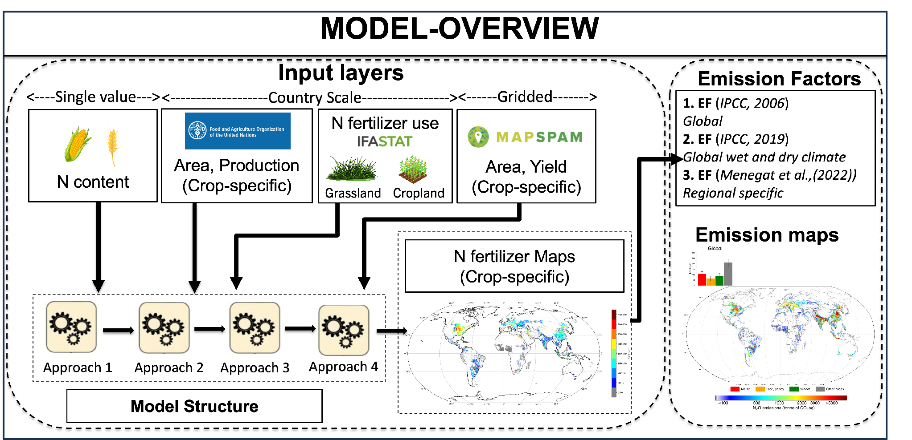

**Figure 1.** Overview of the methodological framework used to estimate crop-specific synthetic nitrogen fertilizer application and associated N₂O emissions at global scale.

**2.2 Data**
------------

The synthetic N fertilizer N₂O inventory integrates national crop statistics, gridded crop distributions, fertilizer-use data, crop N characteristics, emission factors, and monthly temporal profiles within a common 2015–2026 framework (Table 1). National crop production, harvested area, and yield were obtained from FAOSTAT for 2015–2024 and spatially distributed using SPAM 2020 at 5-arc-minute resolution. For 2025–2026, crop yield and harvested area were projected at the grid-cell level and combined to estimate crop production. Crop-specific harvested-biomass N contents from Lassaletta et al. (2014) were used to represent relative crop N demand in the fertilizer-allocation framework.

National synthetic N fertilizer consumption was obtained from IFASTAT for 2015–2023. These totals were adjusted to cropland-specific fertilizer use using the grassland fertilizer fraction derived from IFA Fertilizer Use by Crop surveys. National cropland fertilizer use for 2024–2026 was projected using the country-level fertilizer projection framework described below. The resulting national fertilizer totals constrain the spatial and crop-specific allocation so that gridded estimates remain consistent with country-level fertilizer use.

Direct N₂O emissions were estimated using country- and region-specific emission factors from Menegat et al. (2022), while indirect N₂O emissions from leaching and runoff followed the IPCC 2019 Refinement Tier 1 framework. Annual emissions were subsequently disaggregated to monthly estimates using the temporal distribution of agricultural N₂O emissions from EDGAR. EDGAR monthly information was available through 2023; therefore, the 2023 monthly distribution was held constant for 2024–2026.

**Table 1.** Summary of datasets, and reference years used in the synthetic N fertilizer N₂O inventory.

| **Dataset/source**                   | **Data represented**                                                       | **Native years**                 | **Years used in inventory**         |
|--------------------------------------|----------------------------------------------------------------------------|----------------------------------|-------------------------------------|
| FAOSTAT                              | Crop-specific national production, harvested area, and yield               | 1961-2024                        | 2015-2024                           |
| SPAM 2020 v2.0                       | Spatial distribution at 5 arc-minute of crop production and harvested area | 2020                             | 2020                                |
| Lassaletta et al. (2014)             | Crop-specific harvested-biomass N content                                  | Constant through time            | Constant through time               |
| Projected                            | Crop-specific yield, and harvest area at 5 arc-minute resolution           | 2025-2026                        | 2025-2026                           |
| IFASTAT                              | National synthetic N fertilizer consumption                                | 1973-2023                        | 2015-2023                           |
| IFA Fertilizer Use by Crop surveys   | Fraction of synthetic N fertilizer applied to grassland                    | 2006, 2007, 2010, 2014, and 2018 | 2018                                |
| Fertilizer projection                | National synthetic N fertilizer applied to cropland                        | 2024-2026                        | 2024-2026                           |
| Menegat et al. (2022)                | Country- and region-specific Tier 2 EFs                                    | Constant through time            | Constant through time               |
| IPCC 2019 Refinement, Vol. 4, Ch. 11 | Tier 1 EF₅ and leaching fraction                                           | Constant through time            | Constant through time               |
| EDGAR                                | Monthly seasonality of total agricultural N₂O                              | 2000-2023                        | 2015-2023; fixed 2023 for 2024-2026 |

**2.2.1 Crop specific production, harvest area and nitrogen content**

*National scale data*

FAOSTAT ([FAOSTAT](https://www.fao.org/faostat/en/#data)), the data center for the Food and Agriculture Organization (FAO) an agency of the United Nations, provides free access to food and agriculture statistics, including crop, livestock, and forestry sub-sectors, for some 245 countries, covering time periods from 1961 to, at the time of writing 2024. FAOSTAT compiles this dataset using annual questionnaires sent to country focal points within the national statistical systems. For our analysis we extracted crop-specific yield, production, and harvest area data for crops grown in each country, which totaled \~136 crop types (Table S1). However, 12 nitrogen-fixing crops were excluded as they obtain N from the atmosphere and typically receive little to no additional N inputs.

*Gridded scale data*

We used the Global Spatially Disaggregated Crop Production Statistics Data for 2020, version 2.0, release 2, developed by the International Food Policy Research Institute (IFPRI, 2026), hereafter referred to as SPAM, to represent the spatial distribution of crops at 5-arc-minute resolution. SPAM combines subnational crop production statistics with spatial information on cropland extent, crop suitability, irrigation, population density, and prior knowledge of crop distributions, and applies a cross-entropy allocation approach to estimate where individual crops are grown within administrative units. SPAM provides gridded estimates of physical area, harvested area, yield, and production for crop as mentioned in Table S1. For additional details on the SPAM dataset and its spatial allocation please refer to [methodology](https://www.mapspam.info/methodology/) documentation.

*Crop production prediction*

Globally consistent, crop-specific production data were unavailable for 2025–2026 from external sources. We therefore estimated crop yield using a Long Short-Term Memory (LSTM) neural network. The LSTM was implemented as a sequence-to-one regression model comprising two LSTM layers with 96 hidden units and a dropout rate of 0.15 to reduce overfitting. For each grid cell, the input sequence consisted of monthly weather variables over eight-time steps, static soil properties repeated across the sequence, and year-specific harvested area. The model target was annual crop yield, expressed in tonnes per hectare. More details can be found in Supplementary text S2.

*Crop nitrogen content*

Crop nitrogen (N) content data from Lassaletta et al (2014) was used to represent differences in N demand among crop groups. For each crop, the N content of harvested biomass was expressed as the amount of N contained per unit of harvested dry matter and was combined with crop production to estimate crop-specific N removal. These crop-specific N requirements were subsequently used as an allocation proxy when distributing national synthetic N fertilizer use among crops. Because N concentration differs substantially among crop types, using crop-specific N content allows the fertilizer allocation to reflect differences in physiological N demand rather than relying only on harvested area or production.

**2.2.2 Total synthetic nitrogen fertilizer applied to cropland**

*National scale data*

For 2015 to 2023, country-level synthetic N fertilizer consumption data were obtained from [IFASTAT](https://www.ifastat.org/), the statistical data platform of the International Fertilizer Association (IFA), a global fertilizer industry association representing organizations across the fertilizer value chain, including producers, traders, distributors, service providers, research organizations, and other stakeholders. These data are compiled through annual surveys distributed to national correspondents, including fertilizer associations, companies, consultants, technical experts, and university researchers.

The reported national fertilizer totals include N applied to both cropland and grassland. To estimate the cropland-specific share, we used country-specific information on the fraction of synthetic N fertilizer applied to grassland from the IFA Fertilizer Use by Crop (FUBC) surveys. Survey years 2014 and 2018 were used as the principal observational anchors because they explicitly report fertilizer use allocated to grassland. The grassland share was removed from the national total to derive the amount of synthetic N fertilizer attributed to cropland.

*Projection of country-scale synthetic nitrogen fertilizer*

Country-scale synthetic N fertilizer use was projected using a linear model ( Supplementary Text S3) for 2024–2026 to extend the available, observed fertilizer time series beyond the most recent reporting year. Projections were generated before spatial allocation and therefore represent annual national totals of synthetic N fertilizer applied to cropland.

National totals were adjusted to exclude the fraction of fertilizer applied to grassland, yielding cropland-specific fertilizer use for each country. Country-level crop production, harvested area, and aggregate yield from FAOSTAT were then used as predictors in a country-specific multi-model projection framework. Candidate models were evaluated separately for each country using recent-year validation, and the best-performing model was used to project fertilizer use for 2024–2026. Projected values were constrained by recent historical fertilizer-use behavior to reduce unrealistic extrapolation while preserving country-specific trends. Additional details are provided in Supplementary Text S3.

**2.2.3 Emission Factors**

Direct and indirect N₂O emissions from synthetic N fertilizer were estimated by applying emission factors (EFs) to the amount of fertilizer N allocated to each crop and grid cell. The EF framework has been progressively refined as more spatially resolved information became available. Earlier versions of the inventory used the IPCC Tier 1 global default EF of 1.0%, which assumes that 1% of applied N is emitted directly as N₂O–N irrespective of crop, climate, or geographic location. This was subsequently refined using the IPCC climate-specific Tier 1 EFs of 1.6% for wet climates and 0.5% for dry climates.

In the current version of the inventory for emissions, we further increased the geographic specificity of the estimates by using country- and region-specific EFs compiled by Menegat et al. (2022). These are IPCC Tier 2 emission factors that account for regional differences in fertilizer-induced N₂O emissions. Unlike the Tier 1 approach, which applies a constant default emission factor, Tier 2 emission factors vary spatially, allowing the same amount of applied synthetic N to result in different estimated direct N₂O emissions across locations. Indirect N₂O emissions from N leaching and runoff are estimated following the 2019 Refinement to the IPCC Guidelines (Volume 4, Chapter 11) Tier 1 methodology. For this pathway, the IPCC EF₅ of 1.1% is applied to the amount of N estimated to be lost through leaching and runoff, rather than directly to the amount of fertilizer N applied. The corresponding IPCC Tier 1 leaching fraction (0.24) is used to estimate the amount of applied N entering the leaching/runoff pathway.

**2.2.4 Monthly allocation of annual N2O emissions using EDGAR**

Annual synthetic fertilizer-induced N₂O emissions were disaggregated to monthly estimates using the temporal distribution of N₂O emissions from the Emissions Database for Global Atmospheric Research (EDGAR), EDGAR\_2024\_GHG release, using the 2023 monthly Agriculture-sector N₂O grid at 0.1° × 0.1° resolution, accessed 23 September 2024. We used EDGAR only to derive the monthly temporal distribution of agricultural N₂O emissions. The EDGAR Agriculture product reports total agricultural N₂O emissions and does not distinguish among synthetic fertilizer, manure, crop residues, and other agricultural sources. Therefore, EDGAR was not used to estimate the magnitude of synthetic fertilizer-induced N₂O emissions. Instead, for each year and spatial unit, the 12 monthly EDGAR N₂O emissions were first summed to obtain the corresponding annual EDGAR total. The fraction of annual emissions occurring in each month was then calculated as the monthly EDGAR N₂O emission divided by the annual EDGAR total. These monthly fractions, which sum to one for each year, were subsequently applied to the independently estimated annual synthetic fertilizer-induced N₂O emissions from our inventory. Because EDGAR and our crop-emission inventory have different spatial resolutions, the monthly EDGAR fractions were assigned to our crop grid using the nearest EDGAR grid cell.

This approach preserves the annual N₂O emission total estimated from our fertilizer activity data and emission-factor framework while introducing a monthly temporal distribution consistent with the seasonality represented in EDGAR. EDGAR was therefore used only to determine the intra-annual temporal allocation of emissions and not to determine the magnitude of annual synthetic fertilizer-induced N₂O emissions. EDGAR data provide monthly total N₂O emissions for agriculture soils including synthetic fertilizer, manure, residue etc.

**2.3 Crop-specific N fertilizer allocation**
---------------------------------------------

### **2.3.1 Country scale**

Country-level synthetic N fertilizer consumption reported by IFASTAT includes fertilizer applied to both cropland and managed grassland. Because our inventory estimates emissions specifically from synthetic N fertilizer applied to cropland, we removed the country-specific fraction attributed to grassland. To estimate the amount applied specifically to cropland, we used country-specific grassland fertilizer-use fractions from the 2018 IFA Fertilizer Use by Crop (FUBC) dataset (Ludemann et al., 2022). For countries represented in FUBC, the reported 2018 grassland fraction was applied to the national fertilizer total. For countries not represented in the FUBC dataset, the grassland fraction was set to zero, effectively assuming that all reported synthetic N fertilizer consumption was applied to cropland. The same 2018 country-specific grassland fraction was applied across the inventory years.

|     |                                                                                  |       |
|-----|----------------------------------------------------------------------------------|-------|
|     | $N_{fert,c,y}^{\text{cropland}} = N_{fert,c,y}^{\text{total}}\ (1 - G_{frac,c})$ | \(1\) |

Where,

$N_{fert,c,y}^{\text{cropland}}$ is the fertilizer applied to cropland only

$G_{frac,c}$ is the grassland fraction of total fertilizer applied.

### 

### **2.3.2 Grid scale**

Crop-specific synthetic N fertilizer application rates were derived using a sequential allocation framework that preserves national fertilizer-use totals while introducing spatial and crop-specific variation. First, crop production and harvested area from SPAM were harmonized with annual FAOSTAT statistics so that the spatial distribution from SPAM was retained while country-level crop totals matched FAOSTAT (Eq.2). Second, crop-specific harvested N was calculated from gridded crop production and crop N content to represent the relative N demand of individual crops (Eq. 3). Third, the national cropland synthetic N fertilizer total was distributed among 5-arc-minute grid cells according to each grid cell's share of the country's total harvested area (Eq. 4). This first allocation determines where the national fertilizer total is distributed spatially and, by construction, assumes the same aggregate fertilizer amount per unit of total harvested area within a country. Fourth, the fertilizer amount assigned to each grid cell was partitioned among the crops present in that cell according to their relative harvested-N contribution (Eq. 6). Finally, crop-specific fertilizer application rates were calculated by dividing the allocated fertilizer amount for each crop by its corresponding harvested area (Eq. 7).

*Step 1*

We harmonized annual (y), crop-specific (cro) SPAM and FAOSTAT data at the country level (c) by proportionally scaling grid-level (i,j) production and harvested area so that country total matched FAOSTAT:

|     |                                                                                                                       |       |
|-----|-----------------------------------------------------------------------------------------------------------------------|-------|
|     | $A_{cro,i,j,y} = A_{cro,i,j,y}^{\text{SPAM}}\  \times \ \frac{A_{cro,c,y}^{\text{FAO}}}{A_{cro,i,j,y}^{\text{SPAM}}}$ | \(2\) |

Where $A_{cro,i,j,y}$ is a harmonized production ($\text{Aprod}_{cro,i,j,y}$) or harvest area ($\text{Aharv}_{cro,i,j,y}$), preserving SPAM’s spatial pattern but forcing grid sums at country scale to equal FAOSTAT by crop and year. $A_{cro,c,y}^{\text{FAO}}$ is the national scale crop-specific production/harvest area, and $A_{cro,i,j,y}^{\text{SPAM}}$ is the gridded crop-specific production and harvest area for year 2020.

*Step 2*

Next, we calculated crop-specific harvested nitrogen ($N_{harv,cro,c,i,j,y}$) at the grid scale at 5-arc minute:

|     |                                                                                             |       |
|-----|---------------------------------------------------------------------------------------------|-------|
|     | $N_{harv,cro,i,j,y} = \ \text{Aprod}_{cro,i,j,y}\  \times \ \text{N\ content}_{\text{cro}}$ | \(3\) |

where $\text{Aprod}_{cro,i,j,y}$ is gridded crop-specific production, and $\text{N\ content}_{\text{cro}}$ is the crop-specific nitrogen content (Figure 2).

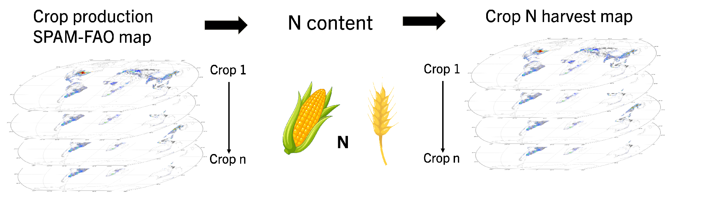

**Figure 2.** Conceptual framework for estimating crop-specific harvested N.

*Step 3*

We first allocated national cropland synthetic N fertilizer use among 5-arc-minute grid cells according to each grid cell's share of total harvested area within the country (Figure 3). This step determines the spatial distribution of the national fertilizer total but does not yet distinguish fertilizer use among individual crops:

|     | $N_{fert,i,j,y} = N_{fert,c,y}^{\text{cropland}}\  \times \ \frac{\text{Totalharv}_{i,j,y}}{\text{Totalharv}_{i,j,y}}$ | \(4\) |
|-----|------------------------------------------------------------------------------------------------------------------------|-------|
|     | $\text{Totalharv}_{i,j,y} = \ \text{Aharv}_{cro,i,j,y}$                                                                | \(5\) |

where $\text{Aharv}_{cro,i,j,y}$ is annual gridded harvest area for individual crop, and $\text{\ Totalharv}_{i,j,y}$ is the annual gridded harvest area combined for all the fertilized crops (n) in the grid, excluding N-fixing crops.

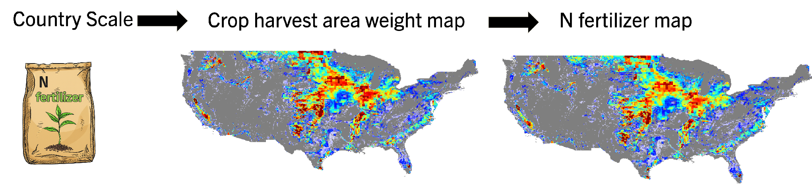

**Figure 3.** Example of the spatial allocation of country-level synthetic N fertilizer use to the gridded scale for the United States.

*Step 4*

We then distributed total N fertilizer applied within each grid cell ($N_{fert,i,j,y})$ between the growing crops (Figure 4). We apportion $N_{fert,i,j,y}$ across crop based on their N requirement ($N_{harv,cro,i,j,y}$) shares using following equation:

|     | $N_{fert,cro,\ i,j,y} = N_{fert,i,j,y}\  \times \ \frac{N_{harv,cro,i,j,y}}{N_{harv,cro,i,j,y}}$ | \(6\) |
|-----|--------------------------------------------------------------------------------------------------|-------|
|     |                                                                                                  |       |

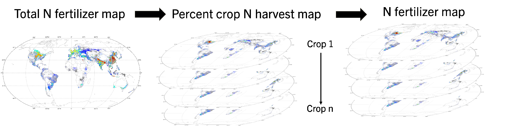

**Figure 4.** Allocation of gridded synthetic N fertilizer among individual crops using crop-specific N-harvest weights.

*Step 5*

We then derived crop-specific fertilizer application rates by dividing fertilizer amounts by the harvested area (Figure 5):

|     |                                                                                  |       |
|-----|----------------------------------------------------------------------------------|-------|
|     | $\text{Nrate}_{cro,i,j,y} = \frac{N_{fert,cro,i,j,y}}{\text{Aharv}_{cro,i,j,y}}$ | \(7\) |

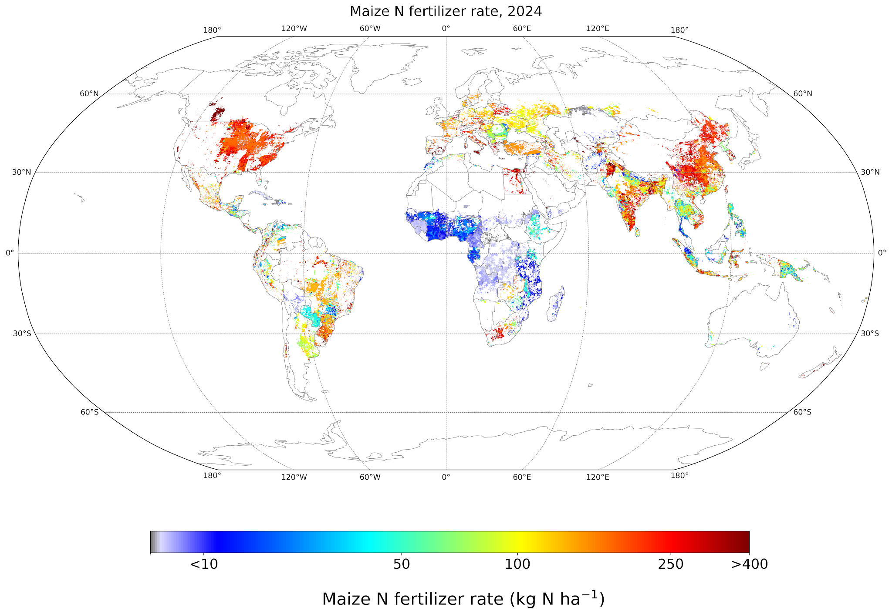

**Figure 5.** Example of the final gridded crop-specific synthetic N fertilizer application rate for maize in 2024.

**2.3.3 Evaluation against an independent N fertilizer dataset**

We evaluated the reconstructed crop-specific synthetic N fertilizer estimates for 2020 against NPKGRIDS (Nguyen et al., 2024), a global gridded dataset of synthetic N fertilizer application rates for 173 crops. Crop definitions were harmonized between datasets where possible. Because fertilizer-rate comparisons can be influenced by differences in harvested-area masks, NPKGRIDS rates were converted to applied N amounts using the 2020 harvested-area maps adopted in this study. The resulting estimates were aggregated and compared at country, first-level administrative, and second-level administrative scales (More detail is available in Supplementary Text S4).

**2.4 Nitrous oxide emission**

N2O fluxes in each grid cell (i,j), crop, and year y are calculated using the following formulas by applying the derived crop-specific fertilizer application rates, $\text{Nrate}$, for each emissions pathway.

Direct emissions:

|     |                                                                                           |       |
|-----|-------------------------------------------------------------------------------------------|-------|
|     | $\text{DEmission}_{cro,i,j,y} = \ \text{Nrate}_{cro,i,j,y}\  \times \ \text{EF}_{1i,j,y}$ | \(8\) |

Indirect emissions:

|     |                                                                                                                               |       |
|-----|-------------------------------------------------------------------------------------------------------------------------------|-------|
|     | $\text{IEmission}_{cro,i,j,y} = \ \text{Nrate}_{cro,i,j,y}\  \times \text{Frac}_{\text{leach}}\  \times \ \text{EF}_{5i,j,y}$ | \(9\) |

Total emissions:

|     |                                                                                                      |        |
|-----|------------------------------------------------------------------------------------------------------|--------|
|     | $\text{Emission}_{cro,i,j,y} = \ \ \text{DEmission}_{cro,i,j,y} + \text{IEmission}_{cro,i,j,y}$ $\ $ | \(10\) |

Where, $\text{Frac}_{\text{leach}}$ is fraction of applied N entering the leaching/runoff pathway (Section 2.2.3), $\text{EF}_{1i,j,y}$ is the direct N₂O emission factor, and $\text{EF}_{5i,j,y}$ is the indirect N₂O emission factor.

Because the EF datasets are at a country or regional-scale, we harmonized it to a 5-arc-minute modeling grid in two steps. First, auxiliary lookup rasters were generated so that every grid cell carries the ISO-3 country code required to link to the relevant tabulated EF. Second, the appropriate factor was assigned to each cell-crop combination: EF at country or regional values were joined via the identifier raster (country ISO-3 mask) to get $\text{EF}_{1i,j,y}$. $\text{EF}_{5i,j,y}\ $is a constant value applied at all grids (Section 2.2.3).

**2.5 Final synthetic N fertilizer and N₂O emission dataset**

The final dataset provides spatially explicit estimates of synthetic N fertilizer application and associated direct and indirect N₂O emissions for global cropland from 2015 to 2026. Outputs were generated for the harmonized 33 crop groups included in the analysis, with N-fixing crops excluded from the synthetic fertilizer inventory. The dataset covers 174 countries and is reported at both the country scale and 5-arc-minute gridded resolution.

For each crop and grid cell, the dataset includes the amount of synthetic N fertilizer applied and the corresponding fertilizer application rate. Fertilizer amount is reported as tonnes N yr⁻¹, while crop-specific fertilizer application rates are expressed as kg N ha⁻¹ yr⁻¹ using the corresponding harvested area. Country-level fertilizer totals are preserved during spatial and crop-specific allocation so that the sum of gridded crop estimates within each country remains consistent with the national cropland fertilizer total.

Annual direct N₂O emissions were calculated from crop-specific fertilizer N using the corresponding country- or region-specific emission factors, while indirect N₂O emissions from leaching and runoff were estimated using the IPCC Tier 1 framework. Emissions are available as N₂O expressed as CO₂-equivalent emissions using the selected global warming potential (273; IPCC 2019). Annual N₂O estimates were further disaggregated to monthly values using the monthly emission fractions derived from the Emissions Database for Global Atmospheric Research (EDGAR), while preserving the independently estimated annual emission total.

The 2015–2023 period is based on observed and reconstructed fertilizer-use data, whereas 2024–2026 values are based on projected country-level fertilizer use and projected crop-production inputs. The resulting dataset therefore provides internally consistent annual and monthly estimates of crop-specific fertilizer use and fertilizer-induced N₂O emissions across countries and grid cells.

**3. Emission Reduction Solutions (ERS)**

In Fall 2025 Climate TRACE introduced ERS – potential mitigation scenarios to reduce emissions, specific to individual sectors. For this methodology that targets N₂O emissions from synthetic fertilizer application, the ERS practices initially investigated are the use of enhanced efficiency fertilizers (EEFs). These include nitrification inhibitors, urease inhibitors, and slow- or controlled-release fertilizers. Briefly, these products are designed to increase NUE by slowing or altering N availability for the crop, or by modifying N transformations in the soil, reducing the conversion rate of N into forms that are more susceptible to loss from the field via nitrification and denitrification. In this manner EEFs offer the potential to reduce N2O emissions while maintaining crop productivity.

**3.1 Rationale and approach for estimating the impact of ERS**

Here, we consider our emissions quantification framework to represent the standard or ‘baseline’ emissions of N2O. For the mitigation strategies, our initial approach uses straightforward adjustments to the country-level emission factors, based on effect sizes for the mitigation strategies from the peer-reviewed literature. While there are several reviews and large-scale studies on the impacts of EEFs on N2O emissions, we have initially used results from the second-order meta-analysis conducted by Grados et al. (2022).

From Grados et al. (2022) on average, emissions of N2O were reduced for nitrification inhibitors (-44.1%), urease inhibitors (-22.5%), and combined slow-or controlled release fertilizers (-33.0%). These values were converted into factors (0.559, 0.775, and 0.67 for nitrification inhibitors, urease inhibitors, and combined slow-or controlled release fertilizers, respectively; Table 2) and applied to the country-level baseline emission factors, which in effect were adjusted downwards to reflect the influence of each mitigation strategy. For three emission-reduction solutions (ERS)—nitrification inhibitors, urease inhibitors, and slow- or controlled-release fertilizers—Grados et al. (2022) synthesized evidence from five meta-analyses, three with global coverage and two focused in China. Collectively, these meta-analyses reported 880 study records. Four of the studies provided explicit numbers of observations or treatment comparisons, totaling 2,318 observations/comparisons: 1,166 observations from 376 studies in Xia et al. (2017), 617 observations from 172 studies in Gao et al. (2021), and 234 observations from 89 studies in Wu et al. (2021). Li et al. (2018) included 203 studies conducted at more than 140 experimental sites across 18 countries; among these, 105 studies evaluated nitrification inhibitors. Because some primary experiments may have been included in more than one meta-analysis, these totals should be interpreted as the sum of reported study records rather than the number of unique independent studies.

**Table 2.** ERS practices employed for this methodology: nitrification inhibitors, urease inhibitors, and slow- and controlled-release fertilizers. The relative N₂O emission factors are derived from the literature (Grados et al. 2022) and represent the global mean ratio if each of the individual strategies were deployed across all global cropland systems.

| **ERS**                              | **Strategy**                                                                            | **Mechanism** | **Relative N₂O EF** | **Confidence** |
|--------------------------------------|-----------------------------------------------------------------------------------------|---------------|---------------------|----------------|
| Nitrification inhibitor              | Mixed/injected simultaneously with liquid based/anhydrous fertilizers.                  | retrofit      | 0.559               | Section 3.1.1  |
| Urease inhibitor                     | Coated with urea/urea-based fertilizers before/during application                       | retrofit      | 0.775               | Section 3.1.1  |
| Slow-/controlled-release fertilizers | Conventional urea is replaced with polymer-coated/other controlled-release fertilizers. | retrofit      | 0.67                | Section 3.1.1  |

**3.1.1 Confidence**

Across the five meta-analyses considered, the direction of the N₂O response was generally consistent, with all evaluated emission-reduction solutions (ERS) reducing N₂O emissions. Grados et al. (2022), for example, reported reductions across all three practices, with nitrification inhibitors showing the most constrained response, with a 95% confidence interval of approximately ±6%. The emission-reduction factors reported in Table 2 therefore represent mean effects derived across the available meta-analyses.

Although the consistency in the direction of change provides confidence that these practices can reduce N₂O emissions, the magnitude of the reduction should be interpreted with caution. A single global mean necessarily averages responses across different soils, climates, crops, fertilizer rates/types and management conditions, thereby masking potentially substantial spatial and management-specific variability. The reduction factors should therefore be considered generalized Tier 1–type estimates rather than site-specific predictions. This is conceptually similar to the use of the IPCC Tier 1 EF₁, where a common emission factor can be applied broadly when more detailed information is unavailable, but users should recognize that actual responses may differ considerably among locations and management systems.

In addition, the estimated mitigation potential represents the biophysical response assuming implementation of the practice and does not account for the feasibility or likelihood of adoption. Factors such as cost, input availability, farmer capacity, infrastructure, logistics, and regional management constraints may substantially limit implementation. Consequently, applying these reduction factors globally represents a technical mitigation potential rather than a prediction of the emissions reductions that would necessarily be achieved in practice.

**4. Results**

Cropland synthetic N fertilizer use was reconstructed for 174 countries. For 2015–2023 we used capped national fertilizer totals disaggregated using spatial and crop-specific proxies and for 2024–2026 we projected values using a linear model.

### 

### **4.1 Global synthetic N fertilizer use between 2015–2026**

National cropland synthetic N fertilizer use was reconstructed for 174 countries for 2015–2023 and projected for 2024–2026 using country-specific model selection based on crop production, harvested area, and yield-related covariates. The resulting national totals were subsequently used as constraints for allocating fertilizer among crops and grid cells. Therefore, the crop-specific and spatial estimates preserve the projected national fertilizer total rather than independently predicting additional fertilizer use.

Global cropland synthetic N fertilizer use increased from 97.85 Mt N in 2015 to 109.10 Mt N in 2026, representing an overall increase of 11.26 Mt N (+11.5%) across the study period (Figure 6A; Table X). Observed use increased from 97.85 Mt N in 2015 to 106.38 Mt N in 2023 (+8.53 Mt N; +8.7%), but the annual trajectory was not monotonic. Year-to-year changes included declines in 2016–2017 (-1.47%) and 2020–2021 (-2.81%), small increases in 2017–2018 (+0.32%) and 2021–2022 (+0.36%), and larger increases in 2018–2019 (+3.63%), 2019–2020 (+2.66%), and 2022–2023 (+4.88%). The projections for 2024–2026 showed a brief decline from 2023 to 2024 (-0.54 Mt N; -0.51%), followed by increases from 2024 to 2025 (+1.62 Mt N; +1.53%) and from 2025 to 2026 (+1.65 Mt N; +1.53%). These results indicate a net projected increase of 2.72 Mt N (+2.56%) from 2023 to 2026, while emphasizing that the long-term increase reflects variable annual changes rather than a steady linear rise.

### 

### **4.2 Country level synthetic N fertilizer use and global distribution between 2015-2026**

Global synthetic N fertilizer use remained concentrated among a small number of countries throughout the study period. The five largest national consumers accounted for 61.3% of global fertilizer use in 2015 and 59.3% in 2023. In 2023, China remained the largest consumer at 25.08 Mt N (23.6% of the global total), followed by India (18.62 Mt N; 17.5%), the United States (10.19 Mt N; 9.6%), Brazil (5.76 Mt N; 5.4%), and Pakistan (3.46 Mt N; 3.3%) (Figure 6B). Although the overall concentration of fertilizer use changed only modestly, the contribution of individual countries shifted. China’s share declined from 27.9% in 2015 to 23.6% in 2023, whereas India’s share increased from 16.2% to 17.5% and Brazil’s from 3.5% to 5.4%. In absolute terms, fertilizer use increased by 2.81 Mt N in India and 2.32 Mt N in Brazil over this period.

Projected national fertilizer use was evaluated from 2023 to 2026 because 2023 represents the final year of observed IFASTAT fertilizer data, while fertilizer use for 2024–2026 was projected. Crop activity also transitions to projected inputs during this period, with crop yield and harvested area projected for 2025–2026 and combined to estimate crop production. Over this projection window, global fertilizer use increased by 2.72 Mt N (+2.56%), but this net change masked larger and opposing country-level trajectories (Figure 6D). India showed the largest projected absolute increase (+2.09 Mt N; +11.2%), followed by Brazil (+0.83 Mt N; +14.4%) and the Russian Federation (+0.80 Mt N; +27.0%). Argentina and Pakistan also showed projected increases, bringing the combined increase among the five largest positive contributors to 4.36 Mt N. These gains were partially offset by projected declines in China, Viet Nam, Germany, Mexico, and France, which together decreased by 2.35 Mt N. China alone declined by 1.54 Mt N (−6.1%), the largest absolute reduction among countries. Thus, the modest increase in global fertilizer use conceals substantial redistribution in national fertilizer-use trajectories.

### **4.3 Distribution of synthetic N fertilizer use between individual crops**

Fertilizer use allocation was also strongly concentrated within a small number of crops throughout the period (Figure 6C). In 2023 for example, maize was the largest fertilizer-consuming crop, receiving an estimated 27.56 Mt N, accounting for 25.9% of global cropland use. Wheat was a close second, with 27.09 Mt N (25.5%), followed by rice with 18.46 Mt N (17.4%) (Figure 6C). Together, these three crops accounted for 68.7% of global N fertilizer use. The top five crops (that include sugarcane and barley) increased the cumulative contribution to 79.8%, and the top ten accounted for approximately 91.7%.

### 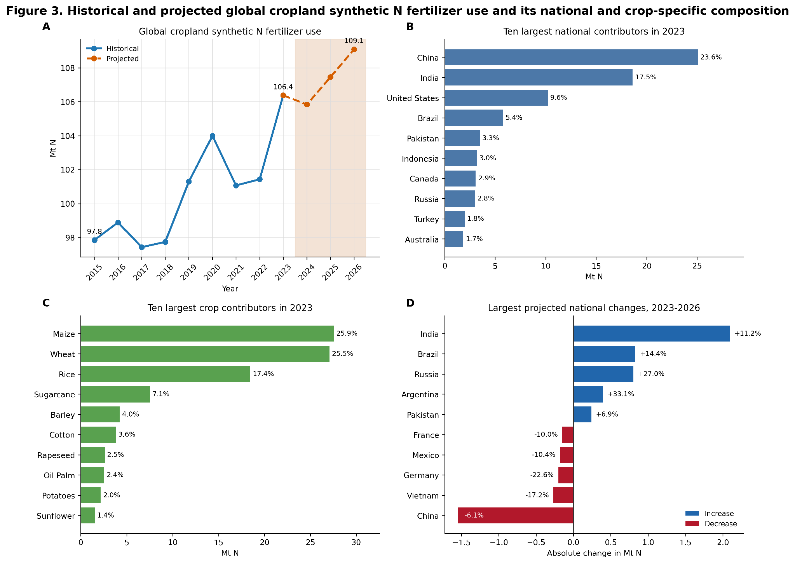

**Figure 6.** Historical and projected global cropland synthetic N fertilizer use and its national and crop-specific composition. (A) Global cropland synthetic N fertilizer used for 2015–2023 and projections for 2024–2026. (B) The ten largest national contributors in 2023. (C) The ten largest crop contributors in 2023. (D) Largest projected national increases and decreases between 2023 and 2026. National totals were constrained prior to allocation across crops and grid cells.

The dominance of these crops remained relatively stable over time, however their relative ranking changed. Wheat was the largest fertilizer-consuming crop in 2015, receiving 26.20 Mt N compared with 24.54 Mt N for maize. By 2023, maize had increased by 3.03 Mt N, or 12.3%, and became the largest crop-specific consumer. Over the same period, wheat increased by 0.89 Mt N, or 3.4%, and rice increased by 0.93 Mt N, or 5.3%. Among crops with smaller global totals, rapeseed exhibited one of the largest proportional changes, increasing from 1.26 Mt N in 2015 to 2.61 Mt N in 2023. Oil palm, sunflower, tea, cassava, and millet also increased, whereas fertilizer allocated to sorghum, barley, tobacco, sweet potatoes, and other oil crops decreased. These proportional changes should be interpreted alongside the corresponding absolute quantities, because a large percentage increase in a crop with relatively low fertilizer use can contribute less to the global total than a smaller percentage increase in a major fertilizer-consuming crop such as maize, wheat, or rice.

The projected crop composition remains comparatively stable throughout 2026. Maize, wheat, and rice are projected to account for 68.4% of global fertilizer use in 2026, very similar to their 2023 (68.7%) and 2015 (69.8%) share. Wheat has the largest projected absolute crop-level increase from 2023 to 2026 at 0.62 Mt N, followed by maize at 0.55 Mt N, rice at 0.38 Mt N, and sugarcane at 0.24 Mt N. The persistence of this crop hierarchy indicates that future changes in global fertilizer use, and associated N₂O emissions will remain strongly influenced by the major cereal-producing systems.

### 

### **4.4 Concentration of synthetic N fertilizer use within crop-country systems**

The leading fertilizer-consuming countries differed in the crops that contributed to this use (Table 3). In 2023, maize fertilizer use was dominated by China (34.4%), the USA (23.3%), and Brazil (9.7%), accounting for 67.4% of global fertilizer use for the crop. China also led for wheat (20.0%) and rice (32.3%) global fertilizer use, followed by India with 14.4% for wheat and 31.1% for rice, such that these two countries accounted for nearly two-thirds of the global fertilizer use for rice.

Different geographic patterns occurred for other crops. Sugarcane fertilizer use was concentrated in India and Brazil, which together accounted for 54.3% of the global crop total. Indonesia alone accounted for 62.5% of fertilizer allocated to oil palm, while India accounted for 36.4% of fertilizer allocated to cotton. These results show that global fertilizer consumption is controlled not simply by the largest countries or crops individually, but by a limited set of dominant crop-country combinations.

Identifying and quantifying these dominant crop-country fertilizer use ‘hot-spots’ is important for interpreting and reducing fertilizer-related N₂O emissions. Within a relatively small number of systems, such as maize in China and the USA, rice in China and India, wheat in China and India, sugarcane in India and Brazil, and oil palm in Indonesia, improvements in N-use efficiency that include the Emissions Reduction Solutions (ERS), could impact a substantial fraction of the global fertilizer total. Notwithstanding, N fertilizer management alone does not determine emissions, as the N₂O response also depends on the climate regime, soil conditions, and other management practices, as well as the choice of EF.

**Table 3.** Leading national contributors within major fertilizer-consuming crops in 2023. Values indicate each country’s percentage contribution to global synthetic N fertilizer use for the corresponding crop.

| Crop (2023 total N)  | Rank 1            | Rank 2                | Rank 3                | Rank 4             | Rank 5           |
|----------------------|-------------------|-----------------------|-----------------------|--------------------|------------------|
| Maize (27.6 Mt N)    | China – 34.4%     | United States – 23.3% | Brazil – 9.7%         | India – 6.0%       | Mexico – 3.6%    |
| Wheat (27.1 Mt N)    | China – 20.0%     | India – 14.4%         | United States – 8.3%  | Canada – 7.8%      | Russia – 6.7%    |
| Rice (18.5 Mt N)     | China – 32.3%     | India – 31.1%         | Bangladesh – 6.5%     | Vietnam – 5.7%     | Indonesia – 4.7% |
| Sugarcane (7.5 Mt N) | India – 29.8%     | Brazil – 24.5%        | China – 9.9%          | Pakistan – 9.8%    | Thailand – 5.1%  |
| Barley (4.2 Mt N)    | Canada – 12.0%    | Turkey – 11.1%        | Russia – 8.7%         | Australia – 8.2%   | Spain – 6.6%     |
| Cotton (3.8 Mt N)    | India – 36.4%     | China – 17.8%         | United States – 11.9% | Uzbekistan – 7.4%  | Pakistan – 6.8%  |
| Rapeseed (2.6 Mt N)  | India – 42.7%     | Australia – 12.8%     | France – 5.9%         | Germany – 5.2%     | Poland – 4.7%    |
| Oil palm (2.6 Mt N)  | Indonesia – 62.5% | Malaysia – 12.9%      | Thailand – 3.8%       | Nigeria – 3.6%     | Colombia – 2.9%  |
| Potatoes (2.2 Mt N)  | China – 37.8%     | India – 18.4%         | United States – 4.2%  | Netherlands – 2.7% | Ukraine – 2.4%   |
| Sunflower (1.5 Mt N) | Russia – 24.7%    | Ukraine – 15.8%       | Turkey – 9.0%         | China – 8.9%       | Argentina – 7.6% |

**4.5 Geospatial distribution of global synthetic N fertilizer use: maize case study**
--------------------------------------------------------------------------------------

Because maize accounted for the largest share of global synthetic N fertilizer use (Figure 6C), we used maize as a case study to illustrate the spatial variability in fertilizer application rates. The spatial distribution of maize N fertilizer application showed substantial heterogeneity across the study period. We highlight 2024 (Figure 5) because it represents the first transition year from the observed IFASTAT-based period (2015–2023) to the projected period (2024–2026). In 2024, high maize N fertilizer application rates were concentrated in the U.S. Midwest, parts of western and central Europe, northern India and the Indo-Gangetic Plain, and eastern China, corresponding broadly to major regions of intensive maize production. Additional high N input locations were also visible in regions of South America and southern Africa. In many of these areas, application rates exceeded 250 kg N ha⁻¹, with some grid cells surpassing 400 kg N ha⁻¹. These areas encompass highly intensified maize systems that use large fertilizer inputs to sustain high production. Intermediate application rates, generally between 50-250 kg N ha⁻¹, were distributed across broad portions of Latin America, southern and eastern Africa, South Asia, and Southeast Asia. These regions reflect areas of substantial fertilizer use but also include considerable within-region variability in fertilizer management intensity that likely reflects differences in yield targets, access to fertilizer, irrigation availability, soil fertility, and national agronomic practices. Low application rates, below 50 kg N ha⁻¹, were dominant in much of sub-Saharan Africa and occurred in scattered parts of Latin America, Southeast Asia, and Oceania. These low-input regions are consistent with maize systems in which synthetic fertilizer use remains limited, and crop production is often constrained by limited economic access to inputs or by lower management of intensity. The widespread occurrence of low rates in African maize-growing regions contrasts sharply with the highly intensified systems observed in North America, Europe, China, and India.

Overall, the spatial pattern confirms that global maize fertilizer use, as is the case with other crops, is unevenly distributed and concentrated in a small number of high-input production systems. In combination with our knowledge of crop-country fertilizer use, the gridded fertilizer use map provides a further spatially explicit foundation for identifying potential emission hotspots.

**4.6 Emissions of N2O from synthetic N fertilizer application**
---------------------------------------------------------------------------

Global N₂O total emissions, including direct and indirect from synthetic fertilizer application increased from 490.9 Mt CO₂e yr⁻¹ in 2015 to a projected 559.0 Mt CO₂e yr⁻¹ by the end of 2026, an absolute increase of 68.1 Mt CO₂e yr⁻¹ (13.9%) (Figure 7A). Expressed as N₂O mass, and using a GWP of 273, emissions increased from approximately 1.80 Mt N₂O yr⁻¹ in 2015 to 2.05 Mt N₂O yr⁻¹ in 2026.

The overall increase hid large interannual variability. Emissions rose between 2015-2016, remained relatively stable during 2017–2018, increased substantially between 2018-2020, then decreased between 2020-2022, before the largest observed annual increase (+6.6%) between 2022-2023. Similarly, projected emissions between 2024-2026 also reflect this interannual trend, decreasing slightly from 2023-2024 before increasing in 2025. The 2026 estimate of 559.0 Mt CO₂e yr⁻¹ was calculated by annualizing the available monthly estimates to date and should be treated as preliminary.

The N fertilizer trajectory therefore indicates continued growth in fertilizer-related N₂O emissions, with the modest global increase concealing larger and varying changes at the country-scale.

### **4.6.1 Country-scale distribution of N2O emissions**

As with N fertilizer use, and as expected, the national distribution of emissions was highly concentrated in specific countries throughout the study period. China was the largest contributor, accounting for 92.9 Mt CO₂e yr⁻¹ (17.1%) of global emissions in 2023 (Figure 7B). In the same year, India contributed 77.0 Mt CO₂e yr⁻¹ (14.1%), followed by the USA (50.9 Mt CO₂e yr⁻¹, 9.3%), Brazil (48.5 Mt CO₂e yr⁻¹, 8.9%), and Canada (21.8 Mt CO₂e yr⁻¹, 4.0%) Together, these five countries accounted for 53.5% of global emissions, while the ten largest contributors accounted for 68.2%.

Interannual changes in the projected distribution of emissions between 2023-2026 were again variable in magnitude and direction (Figure 7D). India showed the largest absolute increase (+8.5 Mt CO₂e yr⁻¹), followed by Brazil (+6.8 Mt CO₂e yr⁻¹), then Argentina (+4.5 Mt CO₂e yr⁻¹). Large emissions increases were also projected in the Russian Federation (+1.9 Mt CO₂e yr⁻¹) and Uruguay (+1.4 Mt CO₂e yr⁻¹). These increases were partly offset by projected declines in China, Viet Nam, Mexico, Indonesia, and Germany. China showed the largest decrease (-5.9 Mt CO₂e yr⁻¹), while emissions declined in Viet Nam (-2.2 Mt CO₂e yr⁻¹), and Mexico (-2.1 Mt CO₂e yr⁻¹).

The results reflect an ongoing ‘trade-off’ and emissions convergence-swap between the two largest national contributors. Emissions from China declined from 92.9 Mt CO₂e yr⁻¹ in 2023 to 87.1 Mt CO₂e yr⁻¹ in 2026, while India’s emissions increased from 77.0 Mt CO₂e yr⁻¹ to 85.5 Mt CO₂e yr⁻¹ during this time.

### **4.6.2 Individual crop contributions to N2O emissions**

Maize was the largest crop-specific source throughout the period. In 2023 it was responsible for 148.2 Mt CO₂e yr⁻¹ (27.2%) of global synthetic-fertilizer N₂O emissions, closely followed by wheat (129.6 Mt CO₂e yr⁻¹, 23.8%), then rice (85.1 Mt CO₂e yr⁻¹, 15.6%), and sugarcane (44.9 Mt CO₂e yr⁻¹, 8.2%) (Figure 7C). The top three account for 66.6% of global emissions, with the ten largest contributing 91.7%. Trends for increasing emissions and large contributions were projected for 2024-2026. Maize showed the largest absolute increase during this time (5.1 Mt CO₂e yr⁻¹), followed by wheat (2.1 Mt CO₂e yr⁻¹), sugarcane (1.6 Mt CO₂e yr⁻¹), oil palm (1.1 Mt CO₂e yr⁻¹), and cotton (1.1 Mt CO₂e yr⁻¹). Rice emissions increased more modestly (0.6 Mt CO₂e yr⁻¹).

These crop-level results show that past and projected global emissions growth distributed across several major fertilizer-consuming industries is driven primarily by maize. Because crop emissions were calculated using regional and country-specific emission factors, their relative contributions reflect both the amount of fertilizer allocated to each crop and the climatic and geographic conditions of the corresponding production regions. Emission factors, their relative contributions, reflect both the amount of fertilizer allocated to each crop and the climatic and geographic conditions of the corresponding production regions.

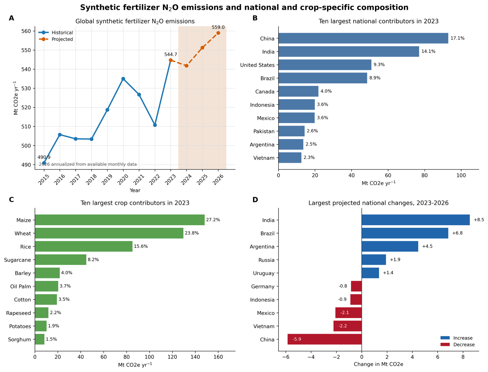

**Figure 7.** Global N₂O emissions from synthetic nitrogen fertilizer application and their national and crop-specific composition. (A) Historical global emissions for 2015–2023 and projected emissions for 2024–2026. The shaded area denotes the projection period. (B) The ten largest national contributors to global emissions in 2023. Percentages indicate each country’s share of the global total. (C) The ten largest crop contributors in 2023. (D) Largest projected national increases and decreases between 2023 and 2026. N₂O emissions were converted to CO₂ equivalents using a 100-year global warming potential of 273.

The major crop categories generally continued to increase throughout 2026. Maize produced the largest absolute increase between 2023 and 2026, rising by approximately 5.1 Mt CO₂e yr⁻¹. Wheat increased by approximately 2.1 Mt CO₂e yr⁻¹, sugarcane by 1.6 Mt CO₂e yr⁻¹, oil palm by 1.1 Mt CO₂e yr⁻¹, and cotton by 1.1 Mt CO₂e yr⁻¹. Rice emissions increased more modestly by approximately 0.6 Mt CO₂e yr⁻¹.

These crop-level results show that projected global growth is distributed across several major fertilizer-consuming crops but is driven primarily by maize. Because crop emissions were calculated using spatially differentiated emission factors, their relative contributions reflect both the amount of fertilizer allocated to each crop and the climatic and geographic conditions of the corresponding production regions.

### 

### **4.6.3 Dominant crop–country N2O emission systems**

Major national contributors to global crop-specific N2O emissions varied between crops (Table 4). In 2023, for maize, China accounted for 23.7% of global emissions, just ahead of the USA (21.6%) and Brazil (15.2%), together concentrating 60.5% of global maize emissions. In the same year, rice emissions were dominated by India (27.9%) and China (26.0%), contributing 53.9% of global emissions. Similarly, for sugarcane, emissions were concentrated in Brazil (34.6%) and India (20.6%), and more so for oil palm, where three quarters of global emissions were from Indonesia and Malaysia.

Wheat and barley showed different patterns, with emissions distributed more broadly among countries. The two largest wheat contributors, China and India, accounted for 28.0% of the global total, while Canada and Türkiye were the two largest contributors for barley. These different levels of emissions concentration indicate that mitigation strategies may need to be crop specific. Emission reductions in a small number of countries could affect a large share of global emissions from oil palm, rice, sugarcane, or maize, whereas reducing wheat and barley emissions would require changes across a broader set of national production systems.

**Table 4.** Leading national contributors to N₂O emissions within the major fertilizer-emitting crops in 2023. The first column reports the total global crop-specific emissions, and the remaining columns identify the five largest national contributors. Percentages represent each country’s contribution to global synthetic-fertilizer N₂O emissions for the corresponding crop.

| Crop (2023 total)        | Rank 1            | Rank 2                | Rank 3                | Rank 4               | Rank 5            |
|--------------------------|-------------------|-----------------------|-----------------------|----------------------|-------------------|
| Maize (148.2 Mt CO₂e)    | China – 23.7%     | United States – 21.6% | Brazil – 15.2%        | Mexico – 7.7%        | India – 4.6%      |
| Wheat (129.6 Mt CO₂e)    | China – 15.5%     | India – 12.5%         | Canada – 11.7%        | United States – 8.7% | Pakistan – 4.5%   |
| Rice (85.1 Mt CO₂e)      | India – 27.9%     | China – 26.0%         | Vietnam – 9.8%        | Indonesia – 6.4%     | Bangladesh – 5.8% |
| Sugarcane (44.9 Mt CO₂e) | Brazil – 34.6%    | India – 20.6%         | Pakistan – 6.8%       | Mexico – 6.7%        | China – 6.2%      |
| Barley (21.7 Mt CO₂e)    | Canada – 16.7%    | Turkey – 11.7%        | Australia – 8.6%      | France – 5.2%        | Argentina – 4.6%  |
| Oil palm (20.4 Mt CO₂e)  | Indonesia – 49.3% | Malaysia – 25.5%      | Colombia – 4.2%       | Costa Rica – 3.5%    | Ecuador – 2.4%    |
| Cotton (19.3 Mt CO₂e)    | India – 29.9%     | China – 13.1%         | United States – 11.8% | Uzbekistan – 11.7%   | Brazil – 11.2%    |
| Rapeseed (11.9 Mt CO₂e)  | India – 38.8%     | Australia – 15.3%     | France – 5.9%         | Germany – 4.7%       | Poland – 4.2%     |
| Potatoes (10.2 Mt CO₂e)  | China – 29.8%     | India – 16.2%         | United States – 4.4%  | Peru – 4.2%          | Ukraine – 4.1%    |
| Sorghum (8.3 Mt CO₂e)    | Mexico – 27.7%    | United States – 19.5% | India – 11.3%         | Brazil – 9.9%        | China – 5.6%      |

### 

The crop–country analysis also illustrates how emission factors modify the fertilizer-use allocation. For example, Brazil ranked third in maize fertilizer consumption but accounted for 15.2% of maize emissions, compared with 9.7% of fertilizer use. Brazil also overtook India as the largest contributor to sugarcane emissions. These shifts reflect the interaction between fertilizer quantities and the emission factors associated with the climates and locations in which individual crops are produced. Although sunflower ranked tenth in synthetic N fertilizer use in 2023 (Figure 6C), sorghum replaced it in the N₂O emissions ranking. Sorghum received slightly less fertilizer N than sunflower (1.42 versus 1.51 Mt N) but produced higher estimated emissions (8.32 versus 7.73 Mt CO₂e). This reversal reflects differences in the geographic distribution of fertilizer use and the corresponding country- and region-specific emission factors. The implied emission intensity for sorghum was 5.84 t CO₂e per t N, approximately 14.2% higher than that for sunflower (5.12 t CO₂e per t N). Sorghum fertilizer use was more concentrated in countries with relatively high emission intensities, whereas a larger share of sunflower fertilizer use occurred in countries with lower emission intensities. Thus, crop-level N₂O emissions depend not only on the total amount of fertilizer applied, but also on where that fertilizer is used. For example, Mexico accounted for 14.2% of sorghum fertilizer use but 27.7% of sorghum emissions, whereas Russia accounted for 24.7% of sunflower fertilizer use but only 11.7% of sunflower emissions.

### **4.6.4 Geospatial distribution of N₂O emissions**

N₂O emissions were spatially concentrated in intensively cultivated regions of the globe (Figure 8). Prominent areas include the central and eastern United States, southern Canada, Mexico, southern Brazil and northern Argentina, western and central Europe, the Indo-Gangetic Plain, eastern China, and parts of Southeast Asia and Indonesia. These regions combine substantial fertilizer application with large areas of intensive crop production, and, in many locations, climatic conditions conducive to high N₂O emission factors.

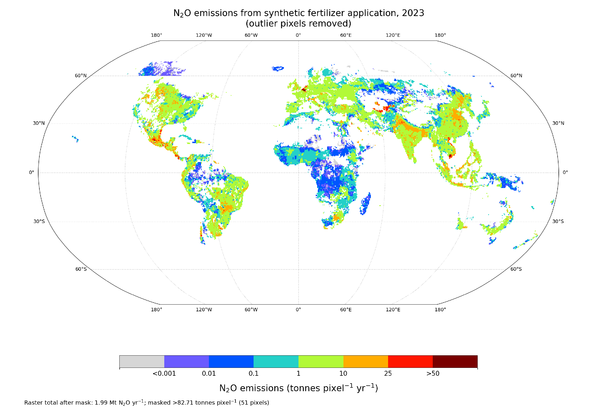
--------------------------------------------------------------------------

**Figure 8.** Global gridded distribution of N₂O direct and indirect emissions from synthetic nitrogen fertilizer application in 2023. Emissions are expressed as tonnes of N₂O per grid cell (pixel) per year and displayed on a logarithmic scale

Lower-level emissions at the grid scale were widespread across much of sub-Saharan Africa, central Asia, northern Canada, and sparsely cultivated parts of Australia and South America. However, localized hotspots were apparent in intensively managed agricultural areas within otherwise low-emission regions.

The spatial map represents total emissions per grid cell rather than emissions per unit of harvested area. Consequently, high-emission grids can result from a combination of high fertilizer application rates, large, harvested areas within the cell, and high emission factors. The map should therefore be interpreted as identifying locations where large amounts of N₂O are emitted, rather than areas solely with the highest fertilizer application rate or emissions rates. The gridded emissions map shows that the use of country-level emission factors modifies the magnitude and relative importance of individual crop–country systems, highlighting that fertilizer use alone is insufficient to identify emissions hotspots without considering the climatic and geographic context of fertilizer application.

**4.7 Comparison with the FAOSTAT Tier 1 inventory**

We compared our national synthetic-fertilizer N₂O estimates with the FAOSTAT Tier 1 inventory for 2015–2023 using the ten highest-emitting countries in each continent in 2023 where estimates from both datasets were available. The comparison included 55 countries and 495 country-year observations.

Both inventories were expressed as CO₂-equivalent emissions using a GWP₁₀₀ of 273. Across all country-year comparisons, the median difference relative to FAOSTAT was −4.6%, although the magnitude and direction of the differences varied substantially among regions (Table 5; Figure 9). 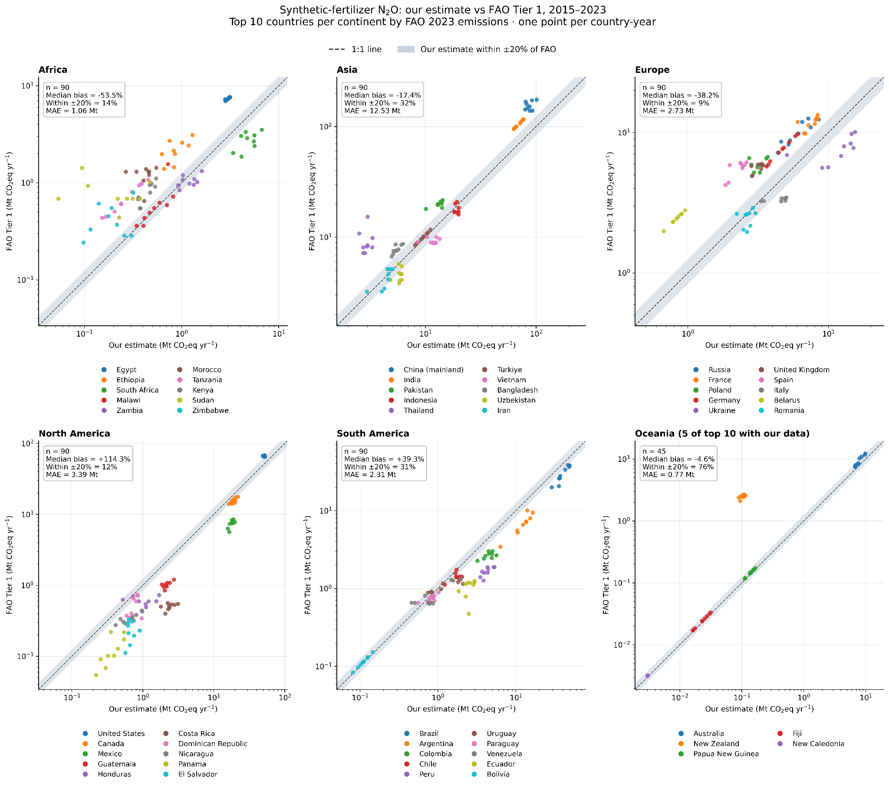

**Figure 9.** Comparison of national synthetic-fertilizer N₂O emissions estimated in this study and by the FAOSTAT Tier 1 inventory for 2015–2023. Each point represents one country-year for the highest-emitting countries within each continent where both estimates were available. Emissions are expressed as CO₂ equivalents using GWP₁₀₀ = 273. The dashed line indicates 1:1 agreement and the shaded region represents ±20% difference from FAOSTAT.

Differences between the two inventories are expected because they use different activity data and emission-calculation frameworks. FAOSTAT uses national agricultural synthetic-N use from its Fertilizers by Nutrient domain and applies the IPCC 2006 Tier 1 methodology for direct and indirect emissions. In contrast, our inventory primarily uses IFASTAT national fertilizer consumption, adjusts national totals to remove the estimated share applied to grassland before allocating fertilizer to cropland, and applies country- or region-specific direct emission factors from Menegat et al. (2022), with the IPCC Tier 1 default used where regional factors are unavailable. Menegat et al. showed that regional direct N₂O emission factors can differ substantially from the global IPCC default, including lower factors in several Asian and African regions and higher factors in parts of the Americas. Differences also arise from the treatment of indirect emissions, because FAOSTAT follows the IPCC 2006 Tier 1 volatilization and leaching pathways, whereas our inventory uses the updated leaching/runoff assumptions described in Section 2.2.3.

Accordingly, disagreement with FAOSTAT should not be interpreted by itself as evidence that either inventory is incorrect. Rather, the comparison illustrates the sensitivity of national N₂O estimates to three major components of the inventory framework: the national fertilizer activity data used, the adjustment of fertilizer use to cropland, and the choice of emission factors, with additional differences arising from the treatment of indirect N₂O pathways.

**Table 5.** Summary comparison of synthetic-fertilizer N₂O emissions estimated in this study and by the FAOSTAT Tier 1 inventory for 2015–2023. Percent difference is calculated relative to FAOSTAT.

| Region        | Countries included | Median difference from FAOSTAT (%) |
|---------------|--------------------|------------------------------------|
| Africa        | 10                 | -53.5                              |
| Asia          | 10                 | -17.4                              |
| Europe        | 10                 | -38.2                              |
| North America | 10                 | +114.3                             |
| South America | 10                 | 39.3                               |
| Oceania       | 5                  | -4.5                               |
| All regions   | 55                 | -4.6                               |

### 

**5 Conclusion**

Synthetic N fertilizer is essential for sustaining global crop production, but its use is also an important source of agricultural N₂O emissions. Quantifying these emissions at the crop and subnational scales remains challenging because fertilizer statistics are generally reported as national totals, while fertilizer demand, crop production, and associated N₂O emissions vary substantially within countries and among crops. This limits the ability of national inventories alone to identify where fertilizer-related emissions originate and where mitigation efforts may have the greatest effect.

Here, we address this gap by developing a spatially explicit framework that preserves reported national synthetic N fertilizer totals while distributing fertilizer use across crops and 5-arc-minute grid cells. The approach integrates national fertilizer consumption with spatially explicit harvested area, crop production, crop-specific N demand, and geographically resolved emission factors to generate annual crop-specific synthetic N fertilizer application rates and associated N₂O emissions. The resulting dataset covers more than 170 countries and 40 crop groups over 2015–2026, with recent years extended using projected fertilizer use and crop-production information. Annual N₂O emissions are additionally distributed to monthly time steps using the temporal seasonality represented by EDGAR, while preserving the independently estimated annual totals.

The results show that relatively modest changes in global synthetic N fertilizer use and associated N₂O emissions can mask substantial differences among years, countries, crops, and regions. Fertilizer use and emissions remain concentrated in a comparatively small number of major agricultural countries and crop systems, and these dominant country–crop combinations persist through time. This concentration has important implications for mitigation: improvements in nitrogen-use efficiency and adoption of effective emission-reduction strategies within high-input production systems could influence a disproportionate share of global fertilizer-related N₂O emissions. At the same time, the spatial heterogeneity revealed by the gridded estimates emphasizes that fertilizer use and emission responses should not be assumed to be uniform within or among countries.

The framework therefore provides a consistent basis for tracking synthetic N fertilizer use and fertilizer-induced N₂O emissions across countries, crops, space, and time, while retaining consistency with national fertilizer statistics. The dataset can support agricultural greenhouse-gas accounting, comparison among inventories, identification of major emission hotspots, and assessment of where mitigation strategies may have the greatest potential impact. Remaining uncertainty arises from national fertilizer statistics, projected fertilizer use and crop production, the proxies used to allocate national fertilizer among locations and crops, and the emission factors used to translate fertilizer inputs into N₂O emissions. Future development should therefore incorporate updated observations as they become available, improve representation of subnational fertilizer management and emission factors, quantify uncertainty across the full allocation framework, and continue evaluating the resulting estimates against independent fertilizer datasets, field measurements, and atmospheric constraints.

**6. Metadata Information**

Crop-specific N₂O emissions from synthetic fertilizer application are reported on the Climate TRACE platform at two spatial scales: country level and asset level for 40 aggregated crop groups. Emissions are provided using both 20-year and 100-year global warming potential. The dataset covers 2015–2026, with estimates for 2015–2023 based on historical fertilizer activity and estimates for 2024–2026 based on projected national fertilizer use. Emissions associated with synthetic nitrogen fertilizer applied to pastures and grasslands are excluded. All data are available under the Creative Commons Attribution 4.0 International license (CC BY 4.0).

**Table M1.** Metadata for Synthetic N fertilizer crop-specific N₂O emission sector

| **General description**  | **Definition**                                                           |
|--------------------------|--------------------------------------------------------------------------|
| Sector definition        | Synthetic N fertilizer crop-specific N₂O emission                        |
| UNFCCC sector equivalent | 3.D.1.1 Inorganic N fertilizers                                          |
| Crops covered            | 40 crop groups                                                           |
| Geographic coverage      | &gt;170 Countries                                                        |
| Spatial resolution       | 5 arc-minutes gridded; aggregated to GADM level 0 (GID0), country totals |
| Data format              | CSV                                                                      |
| Emission factors used    | IPCC Tier 2 (direct), IPCC Tier 1 (indirect)                             |
| GWP basis                | IPCC AR6 CO₂e (20- and 100-year)                                         |
| File name                | country-climate-trace\_synthetic-fertilizer-application.csv              |

**Table M2** Synthetic N metadata description for confidence and uncertainty for crop-specific N₂O emission

<table><thead><tr class="header"><th><strong>Data attribute</strong></th><th><strong>Confidence Definition</strong></th><th><strong>Uncertainty Definition</strong></th></tr></thead><tbody><tr class="odd"><td><strong>type</strong></td><td>
<em>Medium</em>: if estimate is modeled and not validated

<em>High</em>: if estimate type is modeled and validated
</td><td>Not used; N/A</td></tr><tr class="even"><td><strong>capacity_description</strong></td><td><em>Medium</em>: if estimate type was modeled based on published data</td><td>Given as an interval with an lower and upper bound of value</td></tr><tr class="odd"><td><strong>activity_description</strong></td><td>
<em>Medium</em>: if estimate is modeled and not validated

<em>High</em>: if estimate type is modeled and validated for crop-specific N fertilizer amount
</td><td>Given as an interval with an lower and upper bound of value</td></tr><tr class="even"><td><strong>CO2_emissions_factor</strong></td><td>Not used; N/A</td><td>Not used; N/A</td></tr><tr class="odd"><td><strong>CH4_emissions_factor</strong></td><td>Not used; N/A</td><td>Not used; N/A</td></tr><tr class="even"><td><strong>N2O_emissions_factor</strong></td><td><em>Medium</em>: based on IPCC emissions factors</td><td>IPCC uncertainty estimates, expressed as a percentage above or below the mean estimate (i.e. +/-XX%), or as an interval with an upper and lower bound of values.</td></tr><tr class="odd"><td><strong>other_gas_emissions_factor</strong></td><td>Not used; N/A</td><td>Not used; N/A</td></tr><tr class="even"><td><strong>CO2_emissions</strong></td><td>Not used; N/A</td><td>Not used; N/A</td></tr><tr class="odd"><td><strong>CH4_emissions</strong></td><td>Not used; N/A</td><td>Not used; N/A</td></tr><tr class="even"><td><strong>N2O_emissions</strong></td><td>
<em>Medium</em>: if estimate is modeled and not validated

<em>High</em>: if estimate type is modeled and validated total amount with UNFCCC
</td><td>Given as an interval with an lower and upper bound of value</td></tr><tr class="odd"><td><strong>other_gas_emissions</strong></td><td>Not used; N/A</td><td>Not used; N/A</td></tr><tr class="even"><td><strong>total_CO2e_100yrGWP</strong></td><td>
<em>Medium</em>: if estimate is modeled and not validated

<em>High</em>: if estimate type is modeled and validated total amount with UNFCCC
</td><td>Given as an interval with an lower and upper bound of value</td></tr><tr class="odd"><td><strong>total_CO2e_20yrGWP</strong></td><td>
<em>Medium</em>: if estimate is modeled and not validated

<em>High</em>: if estimate type is modeled and validated total amount with UNFCCC
</td><td>Given as an interval with an lower and upper bound of value</td></tr></tbody></table>

**Permissions and Use:** All Climate TRACE data is freely available under the Creative Commons Attribution 4.0 International Public License, unless otherwise noted below.

**Data citation format:** Sharma, P., Trivedi, R., Manuraj, A., Sharma, M., Millar, N., Schiller, S., Hsu M., Davitt, A., and Basso, B. (2026). Agriculture sector: *Direct and Indirect Synthetic Fertilizer N₂O Emissions by Crop.* Department of Earth and Environmental Sciences, Michigan State University, USA, Climate TRACE Emissions Inventory. https://climatetrace.org \[Accessed date\].

**Geographic boundaries and names (iso3\_country data attribute):** The depiction and use of boundaries, geographic names and related data shown on maps and included in lists, tables, documents, and databases on Climate TRACE are generated from the Global Administrative Areas (GADM) project (Version 4.1 released on 16 July 2022) along with their corresponding ISO3 codes, and with the following adaptations:

-   HKG (China, Hong Kong Special Administrative Region) and MAC (China, Macao Special Administrative Region) are reported at GADM level 0 (country/national);

-   Kosovo has been assigned the ISO3 code ‘XKX’;

-   XCA (Caspian Sea) has been removed from GADM level 0, and the area assigned to countries based on the extent of their territorial waters;

-   XAD (Akrotiri and Dhekelia), XCL (Clipperton Island), XPI (Paracel Islands), and XSP (Spratly Islands) are not included in the Climate TRACE dataset;

-   ZNC name changed to ‘Turkish Republic of Northern Cyprus’ at GADM level 0;

-   The borders between India, Pakistan, and China have been assigned to these countries based on GADM codes Z01 to Z09.

The above usage is not warranted to be error-free and does not imply the expression of any opinion whatsoever on the part of Climate TRACE Coalition and its partners concerning the legal status of any country, area, or territory or of its authorities, or concerning the delimitation of its borders.

**Disclaimer:** The emissions provided for this sector are our current best estimates, and we are committed to continually improving the accuracy of the models at all levels. Please review our terms of use and the sector-specific methodology documentation before using the data. If you identify an error or would like to participate in our data validation process, please [contact us](mailto:coalition@climatetrace.org).

**7. Supplementary Information**

**Table S1.** SPAM and FAO crop classification.

|                                     | SPAM Crop                                      | FAO Crop                                        |                                                                                                                                 |                                        |
|-------------------------------------|------------------------------------------------|-------------------------------------------------|---------------------------------------------------------------------------------------------------------------------------------|----------------------------------------|
| *ID* | ***Long Name*** | ***Short Name*** | ***Code***                                                                                       | *Group* |
| 1                                   | Wheat                                          | whea                                            | 15                                                                                                                              | Cereals                                |
| 2                                   | Rice                                           | rice                                            | 27                                                                                                                              | Cereals                                |
| 3                                   | Maize                                          | maiz                                            | 56                                                                                                                              | Cereals                                |
| 4                                   | Barley                                         | barl                                            | 44                                                                                                                              | Cereals                                |
| 5                                   | Millet                                         | mil                                             | 79                                                                                                                              | Cereals                                |
| 6                                   | Sorghum                                        | sorg                                            | 83                                                                                                                              | Cereals                                |
| 7                                   | Other Cereals                                  | ocer                                            | 71, 75, 89, 92, 94, 97, 101, 103, 108                                                                                           | Cereals                                |
| 8                                   | Potato                                         | pota                                            | 116                                                                                                                             | Roots & Tubers                         |
| 9                                   | Sweet Potato                                   | swpo                                            | 122                                                                                                                             | Roots & Tubers                         |
| 10                                  | Yams                                           | yams                                            | 137                                                                                                                             | Roots & Tubers                         |
| 11                                  | Cassava                                        | cass                                            | 125                                                                                                                             | Roots & Tubers                         |
| 12                                  | Other Roots                                    | orts                                            | 135, 136, 149                                                                                                                   | Roots & Tubers                         |
| 13                                  | Bean                                           | bean                                            | 176\*                                                                                                                           | Pulses                                 |
| 14                                  | Chickpea                                       | chic                                            | 191\*                                                                                                                           | Pulses                                 |
| 15                                  | Cowpea                                         | cowp                                            | 195\*                                                                                                                           | Pulses                                 |
| 16                                  | Pigeon Pea                                     | pige                                            | 197\*                                                                                                                           | Pulses                                 |
| 17                                  | Lentil                                         | lent                                            | 201\*                                                                                                                           | Pulses                                 |
| 18                                  | Other Pulses                                   | opul                                            | 181\*, 187\*, 203\*, 205\*, 210\*, 211\*                                                                                        | Pulses                                 |
| 19                                  | Soybean                                        | soyb                                            | 236\*                                                                                                                           | Oilcrops                               |
| 20                                  | Groundnut                                      | grou                                            | 242                                                                                                                             | Oilcrops                               |
| 21                                  | Coconut                                        | cnut                                            | 249                                                                                                                             | Oilcrops                               |
| 22                                  | Oilpalm                                        | oilp                                            | 254                                                                                                                             | Oilcrops                               |
| 23                                  | Sunflower                                      | sunf                                            | 267                                                                                                                             | Oilcrops                               |
| 24                                  | Rapeseed                                       | rape                                            | 270, 292                                                                                                                        | Oilcrops                               |
| 25                                  | Sesame Seed                                    | sesa                                            | 289                                                                                                                             | Oilcrops                               |
| 26                                  | Other Oil Crops                                | ooil                                            | 260, 263, 265, 275, 280, 296, 299,333, 336, 339                                                                                 | Oilcrops                               |
| 27                                  | Sugarcane                                      | sugc                                            | 156                                                                                                                             | Sugar Crops                            |
| 28                                  | Sugarbeet                                      | sugb                                            | 157                                                                                                                             | Sugar Crops                            |
| 29                                  | Cotton                                         | cott                                            | 328                                                                                                                             | Fibres                                 |
| 30                                  | Other Fibre Crops                              | ofib                                            | 773,777, 780, 782, 788, 789, 800, 809, 821                                                                                      | Fibres                                 |
| 31                                  | Coffee                                         | acof                                            | 656                                                                                                                             | Stimulants                             |
| 32                                  | Cocoa                                          | coco                                            | 661                                                                                                                             | Stimulants                             |
| 33                                  | Tea                                            | teas                                            | 667                                                                                                                             | Stimulants                             |
| 34                                  | Tobacco                                        | toba                                            | 826                                                                                                                             | Stimulants                             |
| 35                                  | Banana                                         | bana                                            | 486                                                                                                                             | Fruits                                 |
| 36                                  | Plantain                                       | plnt                                            | 489                                                                                                                             | Fruits                                 |
| 37                                  | Tropical Fruit                                 | trof                                            | 490, 495, 497, 507, 512, 567, 568, 569, 571, 572, 574, 577, 587, 591, 600, 603                                                  | Fruits                                 |
| 38                                  | Temperate Fruit                                | temf                                            | 515, 521, 523, 526, 530, 531, 534, 536, 541, 542, 544, 547, 549, 550, 552, 554, 558, 560, 592, 619                              | Fruits                                 |
| 39                                  | Vegetables                                     | vege                                            | 358, 366, 367, 372, 373, 388, 393, 394, 397, 399, 401, 402, 406, 407, 414, 417, 420, 423, 426, 430, 446, 449, 459, 461, 463     | Vegetables                             |
| 40                                  | Rest Of Crops                                  | rest                                            | 161,216, 217, 220, 221, 222, 223, 224, 225, 226, 234, 671, 677, 687, 689, 692, 693, 698, 702, 711, 720, 723, 748, 754, 836, 839 | Spice, Tree nuts etc.                  |

\*N-fixing crops (soybean, bean, chickpea, cowpea, pigeon pea, lentil, other pulses)

**Supplementary Text S1. Evaluation of crop productivity as a synthetic fertilizer allocation proxy**

Crop productivity was evaluated as an indicator for allocating national synthetic nitrogen (N) fertilizer use. We selected representative high-, upper-middle-, lower-middle-, and low-income countries based on the World Bank income categories from UN World Economic Situation and Prospects (UNESCAP, 2020). For each country and year, we obtained crop production and harvested-area data for the primary crops reported by FAOSTAT for 1961–2023.

Aggregate crop productivity was calculated by dividing total annual crop production by the corresponding total harvested area. We then compared annual productivity with FAOSTAT estimates of N₂O emissions from synthetic fertilizer application over their common period of record using Pearson correlation coefficients.

Strong positive relationships were observed in several major fertilizer-consuming countries. Correlation coefficients exceeded 0.90 for China, India, Argentina, Brazil, and Pakistan, which were classified as upper-middle- or lower-middle-income countries during the assessment period (Figure S1 and Table S2). Among high-income countries, the United States, one of the world’s largest fertilizer users, had a correlation coefficient of 0.82. Weaker relationships were observed in countries with low fertilizer application rates, including Uganda and Tanzania, where crop production may be controlled more strongly by factors other than synthetic nitrogen inputs. Germany also exhibited a comparatively weak relationship, suggesting that productivity alone may not consistently capture temporal changes in fertilizer use across all intensive agricultural systems.

China, India, the United States, Brazil, Pakistan, France, and Australia together accounted for approximately 66% of global synthetic fertilizer use (FAOSTAT, 2019). The generally strong relationships observed for these major fertilizer-consuming countries support the use of crop productivity as one component of the allocation procedure. However, because productivity is also influenced by climate, irrigation, crop genetics, soil conditions, and management practices, it was not used as the sole predictor of fertilizer application or N₂O emissions. Instead, it was combined with harvested area, crop production, and crop-specific nitrogen uptake to disaggregate national fertilizer totals among crops and grid cells while ensuring that the allocated fertilizer did not exceed the adjusted country-level total.

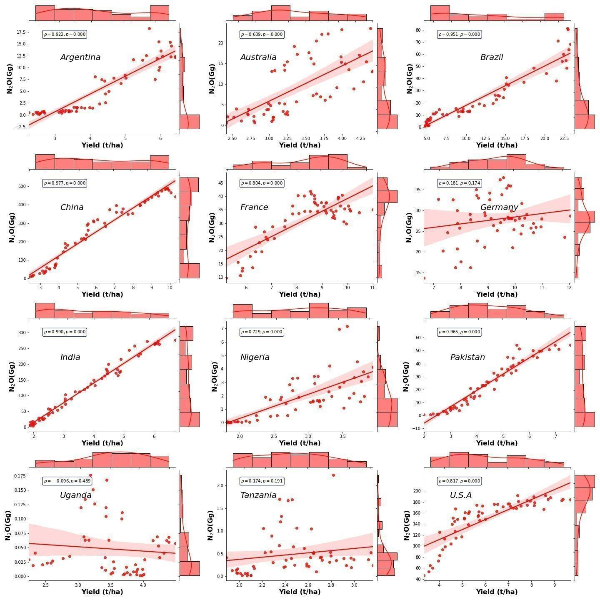

**Figure S1.** Correlation graph between country-level N2O emissions due to synthetic N fertilizer and crop yield using FAOSTAT data from 1961 to 2023. (Units- y-axis: gigagram, x-axis: tonnes/ha).

**Table S2**. Pearson correlation coefficients (ρ) between average crop productivity and N₂O emissions by country. Asterisks denote statistical significance (p &lt; 0.01).

| **GNI level**       | **Country** | **Correlation coefficient (ρ)** |
|---------------------|-------------|---------------------------------|
| High-income         | Australia   | 0.69\*                          |
| High-income         | France      | 0.80\*                          |
| High-income         | Germany     | 0.18                            |
| High-income         | U.S.A.      | 0.82\*                          |
| Upper-middle-income | Argentina   | 0.92\*                          |
| Upper-middle-income | China       | 0.97\*                          |
| Upper-middle-income | Brazil      | 0.95\*                          |
| Lower-middle-income | India       | 0.99\*                          |
| Lower-middle-income | Nigeria     | 0.73\*                          |
| Lower-middle-income | Pakistan    | 0.96\*                          |
| Low-income          | Uganda      | -0.09                           |
| Low-income          | Tanzania    | 0.17                            |

**Supplementary Text S2. LSTM-based crop-yield prediction for 2025–2026**

Globally consistent, crop-specific production data were unavailable for 2025–2026. We therefore estimated annual crop yield using a Long Short-Term Memory (LSTM) neural network and subsequently calculated crop production by combining predicted yield with year-specific harvested area.

**S2.1 Input data**

The LSTM model used a combination of dynamic weather variables, static soil properties, and year-specific harvested areas. All predictor datasets were harmonized to a common spatial grid before model training and prediction.

**S2.1.1 Weather data from Google Earth Engine**

To obtain daily climate and surface variables, we utilized the ECMWF ERA5-Land Daily Aggregated (version 1) dataset (ECMWF/ERA5\_LAND/DAILY\_AGGR), accessed and processed via the cloud-based Google Earth Engine (GEE) platform. GEE is a cloud-based geospatial analysis platform that provides access to large collections of satellite and environmental datasets and supports large-scale spatial processing. This dataset is a downscaled and optimized derivative of the global ERA5-Land climate reanalysis model produced by the European Centre for Medium-RangeWeather Forecasts (ECMWF) under the Copernicus Climate Change Service (C3S).

The dataset provides a continuous, globally gridded record at a spatial resolution of 0.1° × 0.1° (\~11.1 km). Raw hourly fields are aggregated by Google into daily timesteps based on variable characteristics: state/non-flux parameters (e.g., 2-meter air temperature, soil moisture) are processed as daily means, while flux and accumulated parameters (e.g., total precipitation, surface runoff) are calculated as total daily sums. Weather Forecasts (ECMWF) under the Copernicus Climate Change Service (C3S).

Monthly minimum, maximum, and mean 2-m air temperature and total precipitation were extracted for each grid cell. Daily ERA5-Land observations were aggregated to monthly values, with temperature converted to degrees Celsius and precipitation expressed in millimetres. For the 2026 projection, eight monthly time steps were used because these represented the months of ERA5-Land data available when the projection was generated. The same temporal window was applied across all grid cells rather than defining crop- and location-specific growing-season windows. Consequently, the 2026 projection may not fully represent weather conditions affecting crops whose growing seasons extend beyond the available weather period, particularly in the Southern Hemisphere and in multi-season cropping systems.

**S2.1.2 Soil information**

Static soil properties were obtained from SoilGrids (Poggio et al., 2021), a global digital soil-mapping system that uses machine-learning methods and soil-profile observations to predict soil properties at 250-m spatial resolution and at multiple standardized soil depths.

The soil variables used as predictors in the LSTM model included silt, clay, and sand content, pH, bulk density, and soil organic carbon. SoilGrids layers were processed and aggregated to an approximately 10-km spatial resolution (5 arc-minute) to match the spatial framework used for crop-yield prediction. Because these soil properties were treated as static predictors, the same values were repeated across all time steps of the LSTM input sequence for each grid cell.

Additional information on SoilGrids and its underlying methodology is available from the ISRIC SoilGrids [website](https://isric.org/explore/soilgrids/).

**S2.1.3 Harvested area**

Year-specific harvested area was included as an additional predictor to represent temporal changes in the spatial extent of crop production. Rather than assuming that the spatial distribution or extent of harvested area remained fixed at the SPAM 2020 pattern, harvested area was allowed to vary through time at the individual 5-arc-minute grid-cell level.

For 2025 and 2026, harvested area was projected independently for each crop and grid cell by fitting a linear trend to the historical harvested-area time series and extrapolating that trend to the corresponding projection year. This approach preserves spatial differences in historical area trajectories, allowing harvested area to increase, decrease, or remain relatively stable depending on the trend observed within each grid cell.

The projected harvested-area layers were subsequently aligned to the same spatial resolution, geographic extent, coordinate system, and pixel grid as the weather and soil inputs. Year-specific harvested area was then included as an input to the LSTM model together with the dynamic weather variables and static soil properties. In this way, the yield model could account not only for weather and soil conditions but also for changes in the spatial extent of crop production.

After crop yield was predicted by the LSTM, annual crop production for each grid cell was calculated by multiplying the predicted yield by the corresponding projected harvested area. The resulting production and harvested-area layers were then used as inputs to the subsequent fertilizer-allocation and emissions-estimation workflows.

**S2.2 LSTM model architecture**

Crop yield was predicted to be using a sequence-to-one LSTM regression model. The model consisted of two LSTM layers with 96 hidden units and a dropout rate of 0.15 to reduce overfitting. For each grid cell, the model received a sequence containing eight monthly time steps.

At each time step, the predictor set included the dynamic weather variables together with the static soil properties and year-specific harvested-area information. The output of the sequence was a single annual crop-yield estimate expressed in tonnes per hectare.

**S2.3 Data preprocessing and model scaling**

Before model training, all predictor variables were standardized using z-scores calculated from the training-period data. Annual crop-yield targets were also standardized before model fitting. The same scaling parameters derived from the training data were subsequently applied during prediction for 2025–2026 to prevent information leakage between the training and prediction periods.

All spatial inputs were reprojected, resampled, and aligned to a common WGS 84 geographic coordinate system (EPSG:4326). Raster extent, spatial resolution, and pixel alignment were standardized to ensure consistency among weather, soil, harvested-area, and crop-yield datasets.

**S2.4 Yield prediction and crop-production estimation**

The trained LSTM model was applied independently to each grid cell to estimate annual crop yield for 2025 and 2026. Predicted yields were exported as GeoTIFF rasters using the spatial extent, resolution, and alignment of the reference crop-production grid.

Annual crop production was then calculated by combining the predicted yield with the corresponding year-specific harvested area for each grid cell. These predicted production estimates were subsequently used in the crop-specific synthetic N fertilizer allocation framework for 2025–2026.

**Supplementary Text S3. Projection of country-level synthetic N fertilizer use**

Country-scale synthetic N fertilizer use was projected using a country-year tabular dataset rather than gridded observations. Each record represented one country in one year and combined cropland synthetic N fertilizer use with country-level agricultural predictors derived from FAOSTAT. The projection was performed before spatial allocation; therefore, the model output represents national cropland synthetic N fertilizer use in tonnes N country⁻¹ yr⁻¹.

The projection framework was applied to 174 countries with complete cropland-adjusted fertilizer records. The model fitting and validation period used in this projection run was 2015–2023, corresponding to the period for which harmonized country-level crop production predictors were available. The fitted country-specific models were subsequently used to project cropland synthetic N fertilizer use for 2024 and 2025.

**S3.1 Target variable and observed fertilizer dataset**

The target variable was annual cropland synthetic N fertilizer use, expressed as tonnes N country⁻¹ yr⁻¹. Observed national fertilizer consumption was obtained primarily from IFASTAT, with FAOSTAT fertilizer statistics used as a fallback where IFASTAT observations were unavailable (Table S3). Country identifiers were harmonized using ISO3 codes, and fertilizer quantities were converted to consistent N units. Because the analysis focused specifically on cropland, national fertilizer totals were adjusted to remove the fraction of synthetic N fertilizer applied to grassland (Section 2.3.1). The resulting dataset therefore represented annual synthetic N fertilizer use attributable to cropland for each country.

**S3.2 Predictor variables**

The predictor used in the final projection model was total crop production at the country-year scale. Crop production was aggregated across the crop groups included in the crop-harmonization framework to obtain one national production total for each country and year. This variable was used as an indicator of the scale of agricultural activity and crop demand that may influence national fertilizer use.

In addition to crop production, the model framework included temporal information and recent fertilizer-use behavior. These components allowed the projection to account for both production-driven changes and recent country-specific fertilizer-use trajectories.

**S3.4 Candidate projection models**

For each country, three candidate models were evaluated. The models were intentionally simple and country-specific because fertilizer-use trajectories differ among countries due to differences in crop mix, fertilizer policy, agricultural intensity, input prices, and long-term development trends.

The first candidate model was a log-scale ridge regression model using total crop production and year as predictors. For each country, cropland synthetic N fertilizer use and total crop production were transformed using a log-plus-one transformation before model fitting. This transformation reduced the influence of very large values and helped stabilize variance across years. The model included total crop production as an indicator of agricultural scale and year as a temporal trend term. The year variable was standardized within each country before model fitting. Ridge regression was used with an L2 penalty to reduce unstable coefficient estimates, particularly for countries with short or noisy time series. The ridge penalty parameter was set to alpha = 1.0. After prediction, model outputs were back-transformed from the log scale to tonnes N. Negative back-transformed predictions were not allowed and were set to zero.

The second candidate model was a recent fertilizer-intensity model based on fertilizer use per unit of crop production. For each target year, this model calculated the average recent fertilizer intensity using up to the five most recent available training years with valid fertilizer and production data. At least three valid years were required. The recent average fertilizer intensity was then multiplied by total crop production in the target year to estimate cropland synthetic N fertilizer use. This model assumes that recent fertilizer use per unit of crop production provides a reasonable near-term estimate of national fertilizer demand.

The third candidate model was a recent temporal trend model. For each country, this model fitted a linear trend to the log-transformed fertilizer-use time series using up to the eight most recent available training years. At least three valid years were required. The fitted recent trend was then used to estimate fertilizer use for the target year, and predictions were back-transformed from the log scale to tonnes N. This model captures recent national fertilizer-use trajectories independent of production changes.

**S3.4 Country-specific model selection and validation**

For each country and validation year, predictions were generated from the three candidate models. Model performance was evaluated using weighted absolute percentage error (WAPE). This metric was calculated as the sum of absolute prediction errors across the validation years divided by the sum of observed fertilizer use across the same validation years, expressed as a percentage. This weighting gives greater importance to errors in country-years with larger fertilizer use.

In addition to the three base models, a country-specific weighted ensemble was calculated. Ensemble weights were based on validation performance, with lower-error models receiving higher weights and higher-error models receiving lower weights. The inverse-error weighting used validation WAPE expressed as a fraction, with a stabilizing term equivalent to five percentage points added to avoid overly large weights when validation error was very small. The normalized weights were then applied to the three base-model predictions to generate the ensemble prediction.

For each country, the final projection model was selected as the model with the lowest validation WAPE among the three base models and the weighted ensemble. This produced a country-specific “best-any” model selection. Across the 174 countries, the recent fertilizer-intensity model was selected for 61 countries, the weighted ensemble for 57 countries, the log-ridge production-year model for 40 countries, and the recent trend model for 16 countries.

The validation dataset contained 1,044 country-year predictions, corresponding to 174 countries over six validation years from 2018 to 2023. The country-best model selection improved validation performance compared with any single candidate model applied universally. Across all validation records, the country-best model produced a global WAPE of 7.15%, a global bias of −0.42%, an RMSE of 161,987 tonnes N, and an R² of 0.995. The median country-level WAPE was 15.86%, and 106 of 174 countries had country-level WAPE values below 20%.

For the largest fertilizer-consuming countries, validation performance was generally stronger than for smaller countries. Among the ten countries with the highest mean fertilizer use during 2018–2023, the fertilizer-weighted WAPE of the selected country-best model was 5.10%. The selected model for the largest countries was most often the weighted ensemble or the log-ridge production-year model, reflecting the greater stability of fertilizer-use trajectories in major fertilizer-consuming countries.

**S3.6 Projection**

After validation and model selection, the selected country-specific model was refit using the available observed period from 2015 to 2023 and applied to crop production predictors for 2024-2026. For each country, the final model generated raw projected values for cropland synthetic N fertilizer use.

To reduce implausible extrapolation beyond the observed period, projected values were constrained using country-specific recent fertilizer-use behavior. For 2024, raw model predictions were constrained to remain between 50% and 150% of the observed 2023 cropland synthetic N fertilizer value for each country. For 2025, the same constraint was applied relative to the capped 2024 projection. In other words, the 2025 value was constrained to remain between 50% and 150% of the final capped 2024 value, and so on.

This cap was used as a guardrail to prevent abrupt increases or decreases caused by model extrapolation while still allowing fertilizer use to change substantially where supported by the model.

The final capped country-level projections were merged with the observed cropland-adjusted fertilizer dataset to create a continuous country-year time series from 2015 to 2026.

**Table S3.** Country-level data sources for synthetic nitrogen fertilizer consumption, 2015–2023.

| **Source** | **Country**                                                                                                                                                                                                                                                                                                                                                                                                                                                                                                                                                                                                                                                                                                                                                                                                                                                                                                                                                                                                                                                                                                                                                                                                                                                                                                                                                                                                                                                         |
|------------|---------------------------------------------------------------------------------------------------------------------------------------------------------------------------------------------------------------------------------------------------------------------------------------------------------------------------------------------------------------------------------------------------------------------------------------------------------------------------------------------------------------------------------------------------------------------------------------------------------------------------------------------------------------------------------------------------------------------------------------------------------------------------------------------------------------------------------------------------------------------------------------------------------------------------------------------------------------------------------------------------------------------------------------------------------------------------------------------------------------------------------------------------------------------------------------------------------------------------------------------------------------------------------------------------------------------------------------------------------------------------------------------------------------------------------------------------------------------|
| IFASTAT    | Afghanistan, Albania, Algeria, Argentina, Armenia, Australia, Austria, Azerbaijan, Bangladesh, Belarus, Belgium, Belize, Benin, Bosnia and Herzegovina, Brazil, Bulgaria, Burkina Faso, Cambodia, Cameroon, Canada, Chile, China, Colombia, Costa Rica, Croatia, Cuba, Cyprus, Czechia, Côte d'Ivoire, Denmark, Dominican Republic, Ecuador, Egypt, El Salvador, Estonia, Ethiopia, Finland, France, Georgia, Germany, Ghana, Greece, Guatemala, Guyana, Honduras, Hungary, Iceland, India, Indonesia, Iran, Islamic Republic of, Iraq, Ireland, Israel, Italy, Jamaica, Japan, Jordan, Kazakhstan, Kenya, Korea, Democratic People's Republic of, Korea, Republic of, Kuwait, Kyrgyzstan, Latvia, Lebanon, Libya, Lithuania, Madagascar, Malawi, Malaysia, Mali, Mauritius, Mexico, Moldova, Republic of, Mongolia, Morocco, Myanmar, Nepal, Netherlands, New Zealand, Nicaragua, Nigeria, North Macedonia, Norway, Pakistan, Panama, Paraguay, Peru, Philippines, Poland, Portugal, Puerto Rico, Qatar, Romania, Russian Federation, Rwanda, Saudi Arabia, Senegal, Serbia, Slovakia, Slovenia, South Africa, Spain, Sri Lanka, Sudan, Suriname, Sweden, Switzerland, Syrian Arab Republic, Taiwan, Province of China, Tajikistan, Tanzania, United Republic of, Thailand, Trinidad and Tobago, Tunisia, Turkmenistan, Türkiye, Ukraine, United Kingdom, United States, Uruguay, Uzbekistan, Venezuela, Bolivarian Republic of, Viet Nam, Yemen, Zambia, Zimbabwe |
| FAOSTAT    | Angola, Antigua and Barbuda, Barbados, Benin, Bhutan, Bolivia, Plurinational State of, Botswana, Brunei Darussalam, Burkina Faso, Burundi, Central African Republic, Chad, Congo, Congo, The Democratic Republic of the, Djibouti, Dominica, Equatorial Guinea, Eritrea, Eswatini, Fiji, Gabon, Gambia, Grenada, Guinea, Guinea-Bissau, Haiti, Lao People's Democratic Republic, Lesotho, Liberia, Luxembourg, Malawi, Malta, Mauritania, Montenegro, Mozambique, Namibia, New Caledonia, Niger, Oman, Papua New Guinea, Rwanda, Saint Kitts and Nevis, Saint Lucia, Saint Vincent and the Grenadines, Sao Tome and Principe, Sierra Leone, Solomon Islands, Togo, Uganda, United Arab Emirates, Vanuatu                                                                                                                                                                                                                                                                                                                                                                                                                                                                                                                                                                                                                                                                                                                                                            |

**Supplementary Text S4. Evaluation of reconstructed fertilizer allocation**

The reconstructed crop-specific synthetic N fertilizer estimates were evaluated against the NPKGRIDS dataset of Nguyen et al. (2024) for 2020 at GADM level 1 and GADM level 2. Agreement was quantified using the coefficient of determination (R²) and mean absolute error (MAE) after removing observations above the 99th percentile on either comparison axis (Figures S2 and S3). Because administrative units become substantially smaller from GADM level 1 to level 2, MAE values between the two spatial scales should not be compared directly as a measure of improvement or deterioration in model performance.

At GADM level 1, agreement was generally strong for the major fertilizer-consuming crops (Figure S2). R² values were 0.88 for maize, 0.87 for wheat, and 0.93 for rice, with corresponding MAEs of 1.78, 2.28, and 1.60 Gg N yr⁻¹ per administrative unit. Oil palm showed the highest agreement among the evaluated crops (R² = 0.96; MAE = 0.80 Gg N yr⁻¹), while sugarcane, sugarbeet, rapeseed, and sunflower showed intermediate-to-strong agreement, with R² values of 0.75, 0.75, 0.77, and 0.73, respectively. Agreement was lower for cotton (R² = 0.59), potatoes (R² = 0.65), sorghum (R² = 0.65), and particularly millet (R² = 0.32).

At GADM level 2, the reconstructed allocation continued to reproduce much of the spatial variability represented by NPKGRIDS, although the strength of agreement varied among crops (Figure S3). Maize retained an R² of 0.88, while wheat and rice had R² values of 0.84 and 0.80, respectively. Sugarcane showed an R² of 0.83, sugarbeet 0.81, rapeseed 0.77, sunflower 0.73, and oil palm 0.90. Corresponding MAEs were 0.16 Gg N yr⁻¹ for maize, 0.21 for wheat, 0.26 for rice, 0.10 for sugarcane, and 0.15 for oil palm. Lower agreement was observed for potatoes (R² = 0.61), sorghum (R² = 0.52), and millet (R² = 0.34). Thus, agreement did not uniformly decrease at the finer administrative scale: R² declined for crops such as rice, wheat, oil palm, potatoes, and sorghum, remained nearly unchanged for maize, rapeseed, and sunflower, and increased for sugarcane, sugarbeet, and cotton.

The spatial comparison further showed that the reconstructed estimates reproduced the major fertilizer-use hotspots represented by NPKGRIDS (Figure S4). For maize, both datasets identified high fertilizer inputs across the U.S. Corn Belt, eastern China, parts of Europe, and major producing regions of South America. Wheat fertilizer use was concentrated across Europe, northern India, eastern China, and other major wheat-producing regions, while rice fertilizer inputs were strongly concentrated across South and Southeast Asia and eastern China. Although local differences in magnitude and spatial extent remain, the combination of the administrative-unit statistics and spatial maps indicates that the reconstruction captures the dominant large-scale distribution of crop-specific synthetic N fertilizer use.

Overall, the comparison provides an independent benchmark of the fertilizer-allocation framework, with particularly strong agreement for several major crops while also identifying crops and regions where uncertainties in crop distributions, harmonization, and spatial allocation remain larger.

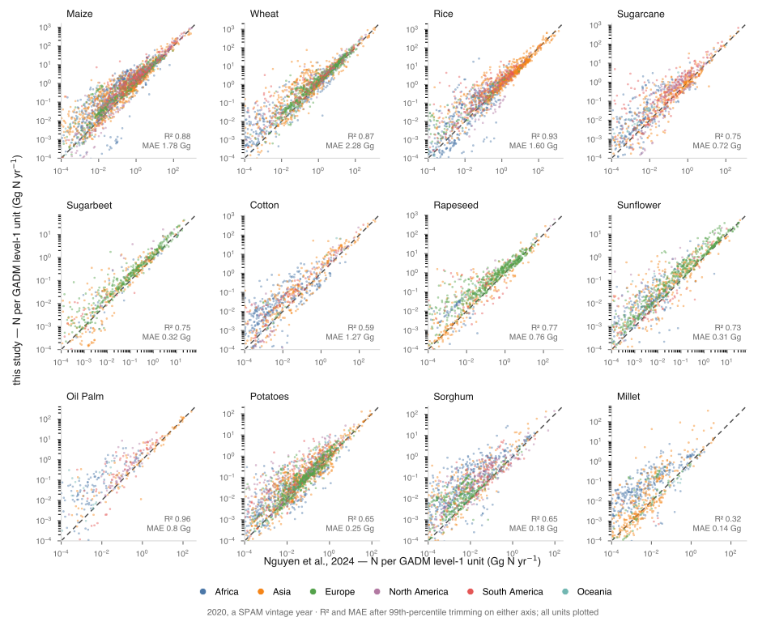
-------------------------------------------------------------------------

**Figure S2.** First-level administrative-unit validation of crop-specific synthetic N fertilizer inputs in 2020. Comparison of synthetic N fertilizer amounts estimated in this study with NPKGRIDS (Nguyen et al., 2024) at first-level administrative units (e.g., states or provinces) for 2020.

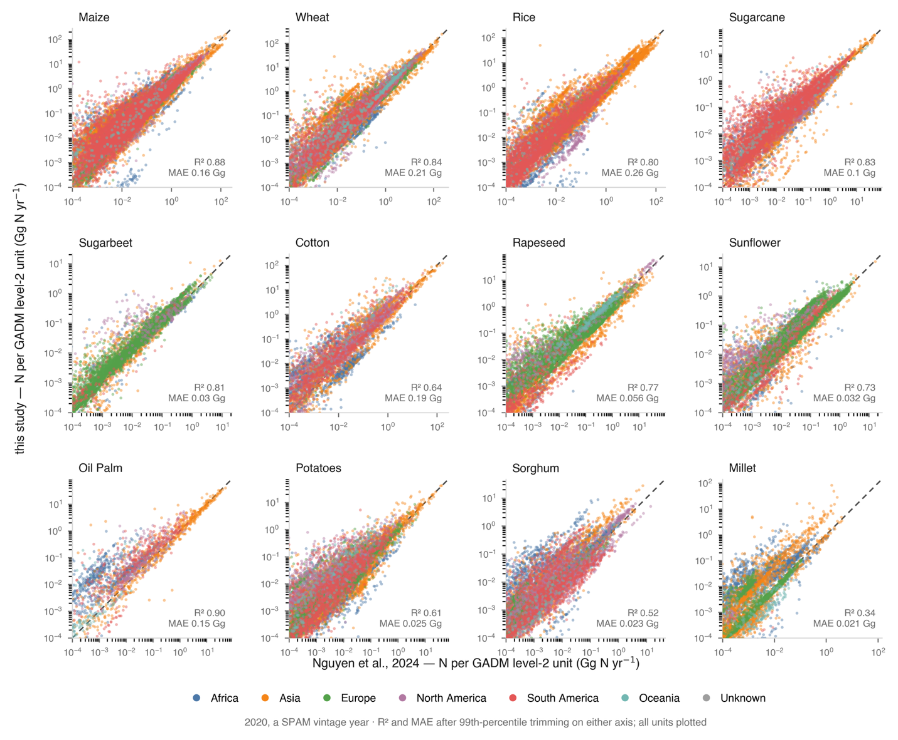

**Figure S3.** Second-level administrative-unit validation of crop-specific synthetic N fertilizer inputs in 2020. Comparison of synthetic N fertilizer amounts estimated in this study with NPKGRIDS (Nguyen et al., 2024) at second-level administrative units (e.g., counties, districts or comparable subdivisions) for 2020.

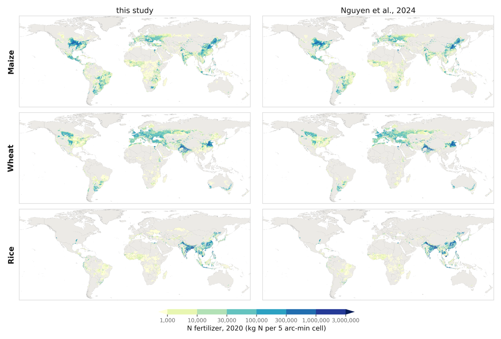

**Figure S4.** Grid-scale spatial comparison of maize, wheat and rice synthetic N fertilizer inputs in 2020. Global maps compare the spatial distribution of synthetic N fertilizer estimated in this study with NPKGRIDS (Nguyen et al., 2024) for maize, wheat and rice at the grid-cell level.

**References**

1.  Batista, M.B. and Dixon, R., 2019. Manipulating nitrogen regulation in diazotrophic bacteria for agronomic benefit. *Biochemical Society Transactions*, *47*(2), p.603. DOI: [https://doi.org/10.1042/BST20180342](https://doi.org/10.1042/BST20180342).

2.  Berdanier, A.B. and Conant, R.T., 2012. Regionally differentiated estimates of cropland N2O emissions reduce uncertainty in global calculations. *Global Change Biology*, *18*(3), pp.928-935. DOI: [https://doi.org/10.1111/j.1365-2486.2011.02554.x](https://doi.org/10.1111/j.1365-2486.2011.02554.x).

3.  Chen, Z., Griffis, T.J., Millet, D.B., Wood, J.D., Lee, X., Baker, J.M., Xiao, K., Turner, P.A., Chen, M., Zobitz, J. and Wells, K.C., 2016. Partitioning N2O emissions within the US Corn Belt using an inverse modeling approach. *Global Biogeochemical Cycles*, *30*(8), pp.1192-1205. DOI: [https://doi.org/10.1002/2015GB005313](https://doi.org/10.1002/2015GB005313).

4.  Crutzen, P.J., Mosier, A.R., Smith, K.A. and Winiwarter, W., 2016. N2O release from agro-biofuel production negates global warming reduction by replacing fossil fuels. *Paul J. Crutzen: A pioneer on atmospheric chemistry and climate change in the anthropocene*, pp.227-238. DOI: [https://doi.org/10.5194/acp-8-389-2008](https://doi.org/10.5194/acp-8-389-2008).

5.  Davidson, E.A. and Kanter, D., 2014. Inventories and scenarios of nitrous oxide emissions. *Environmental Research Letters*, *9*(10), p.105012. DOI: 10.1088/1748-9326/9/10/105012.

6.  De Sisto, M., Somes, C., Landolfi, A. and MacDougall, A.H., 2024. Projecting atmospheric N2O rise until the end of the 21st century: an Earth System Model study. *Environmental Research Letters*, *19*(12), p.124036. DOI: 10.1088/1748-9326/ad8c6c.

7.  Erisman, J.W., Galloway, J.N., Seitzinger, S., Bleeker, A., Dise, N.B., Petrescu, A.R., Leach, A.M. and de Vries, W., 2013. Consequences of human modification of the global nitrogen cycle. *Philosophical Transactions of the Royal Society B: Biological Sciences*, *368*(1621), p.20130116. DOI: [https://doi.org/10.1098/rstb.2013.0116](https://doi.org/10.1098/rstb.2013.0116)

8.  FAO 2019, FAOSTAT statistical database. Rome: Food and Agriculture Organization of the United Nations. Available at: <http://faostat.fao.org> (Accessed: \[date\]).

9.  Galloway, J.N., Aber, J.D., Erisman, J.W., Seitzinger, S.P., Howarth, R.W., Cowling, E.B. and Cosby, B.J., 2003. The nitrogen cascade. *Bioscience*, *53*(4), pp.341-356. DOI: [https://doi.org/10.1641/0006-3568(2003)053\[0341:TNC\]2.0.CO;2](https://doi.org/10.1641/0006-3568(2003)053%5b0341:TNC%5d2.0.CO;2)

10. Gao, J., Luo, J., Lindsey, S., Shi, Y., Sun, Z., Wei, Z. and Wang, L., 2021. Benefits and risks for the environment and crop production with application of nitrification inhibitors in China. *Journal of soil science and plant nutrition*, *21*(1), pp.497-512. DOI: [https://doi.org/10.1007/s42729-020-00378-9](https://doi.org/10.1007/s42729-020-00378-9).

11. Grados, D., Butterbach-Bahl, K., Chen, J., Jan van Groenigen, K., Olesen, J.E., Willem van Groenigen, J. and Abalos, D., 2022. Synthesizing the evidence of nitrous oxide mitigation practices in agroecosystems. Environmental Research Letters, 17(11), p.114024. DOI:10.1088/1748-9326/ac9b50.

12. Griffis, T.J., Lee, X., Baker, J.M., Russelle, M.P., Zhang, X., Venterea, R. and Millet, D.B., 2013. Reconciling the differences between top‐down and bottom‐up estimates of nitrous oxide emissions for the US Corn Belt. *Global Biogeochemical Cycles*, *27*(3), pp.746-754. DOI: [https://doi.org/10.1002/gbc.20066](https://doi.org/10.1002/gbc.20066).

13. IFA (2022) IFASTAT statistical database. Paris: International Fertilizer Association. Available at: <https://www.ifastat.org> (Accessed: \[date\]).

14. International Food Policy Research Institute (IFPRI) (2026) Global spatially disaggregated crop production statistics data for 2020, version 2.0, release 2. Harvard Dataverse, V6. doi:10.7910/DVN/SWPENT.

15. Janssens-Maenhout, G., Crippa, M., Guizzardi, D., Muntean, M., Schaaf, E., Dentener, F., Bergamaschi, P., Pagliari, V., Olivier, J.G., Peters, J.A. and Van Aardenne, J.A., 2019. EDGAR v4. 3.2 Global Atlas of the three major greenhouse gas emissions for the period 1970–2012. Earth System Science Data, 11(3), pp.959-1002. DOI: [https://doi.org/10.5194/essd-11-959-2019](https://doi.org/10.5194/essd-11-959-2019)

16. Lassaletta, L., Billen, G., Grizzetti, B., Anglade, J. and Garnier, J., 2014. 50 year trends in nitrogen use efficiency of world cropping systems: the relationship between yield and nitrogen input to cropland. Environmental Research Letters, 9(10), p.105011. DOI: 10.1088/1748-9326/9/10/105011.

17. Li, T., Zhang, W., Yin, J., Chadwick, D., Norse, D., Lu, Y., Liu, X., Chen, X., Zhang, F., Powlson, D. and Dou, Z., 2018. Enhanced‐efficiency fertilizers are not a panacea for resolving the nitrogen problem. *Global Change Biology*, *24*(2), pp.e511-e521. DOI:  [https://doi.org/10.1111/gcb.13918](https://doi.org/10.1111/gcb.13918).

18. Ludemann, C.I., Gruere, A., Heffer, P. and Dobermann, A., 2022. Global data on fertilizer use by crop and by country. *Scientific data*, *9*(1), p.501. DOI: [https://doi.org/10.1038/s41597-022-01592-z](https://doi.org/10.1038/s41597-022-01592-z).

19. Nguyen, T.H., Tang, F.H., Conchedda, G., Casse, L., Obli-Laryea, G., Tubiello, F.N. and Maggi, F., 2024. NPKGRIDS: a global georeferenced dataset of N, P2O5, and K2O fertilizer application rates for 173 crops. *Scientific Data*, *11*(1), p.1179. DOI: [https://doi.org/10.1038/s41597-024-04030-4](https://doi.org/10.1038/s41597-024-04030-4).

20. Menegat, S., Ledo, A. and Tirado, R., 2022. Greenhouse gas emissions from global production and use of nitrogen synthetic fertilisers in agriculture. *Scientific Reports*, *12*(1), p.14490. DOI: [https://doi.org/10.1038/s41598-022-18773-w](https://doi.org/10.1038/s41598-022-18773-w).

21. Mosier, A., Kroeze, C., Nevison, C., Oenema, O., Seitzinger, S. and van Cleemput, O., 1999. An overview of the revised 1996 IPCC guidelines for national greenhouse gas inventory methodology for nitrous oxide from agriculture. *Environmental Science & Policy*, *2*(3), pp.325-333. DOI:

22. Omara, P., Aula, L., Oyebiyi, F. and Raun, W.R., 2019. World cereal nitrogen use efficiency trends: review and current knowledge. *Agrosystems, Geosciences & Environment*, *2*(1), pp.1-8. DOI: [https://doi.org/10.2134/age2018.10.0045](https://doi.org/10.2134/age2018.10.0045).

23. Potter, C.S., Matson, P.A., Vitousek, P.M. and Davidson, E.A., 1996. Process modeling of controls on nitrogen trace gas emissions from soils worldwide. *Journal of Geophysical Research: Atmospheres*, *101*(D1), pp.1361-1377. DOI: [https://doi.org/10.1029/95JD02028](https://doi.org/10.1029/95JD02028).

24. Prather, M.J., Holmes, C.D. and Hsu, J., 2012. Reactive greenhouse gas scenarios: Systematic exploration of uncertainties and the role of atmospheric chemistry. *Geophysical Research Letters*, *39*(9). DOI: [https://doi.org/10.1029/2012GL051440](https://doi.org/10.1029/2012GL051440).

25. Poggio, L., De Sousa, L.M., Batjes, N.H., Heuvelink, G., Kempen, B., Ribeiro, E. and Rossiter, D., 2021. SoilGrids 2.0: producing soil information for the globe with quantified spatial uncertainty. *Soil*, *7*(1), pp.217-240. DOI: [https://doi.org/10.5194/soil-7-217-2021](https://doi.org/10.5194/soil-7-217-2021).

26. Robertson, G.P., Gross, K.L., Hamilton, S.K., Landis, D.A., Schmidt, T.M., Snapp, S.S. and Swinton, S.M., 2014. Farming for ecosystem services: An ecological approach to production agriculture. *BioScience*, *64*(5), pp.404-415. DOI: <https://doi.org/10.1093/biosci/biu037>.

27. Ravishankara, A.R., Daniel, J.S. and Portmann, R.W., 2009. Nitrous oxide (N2O): the dominant ozone-depleting substance emitted in the 21st century. *science*, *326*(5949), pp.123-125. DOI: 0.1126/science.1176758.

28. Reay, D.S., Davidson, E.A., Smith, K.A., Smith, P., Melillo, J.M., Dentener, F. and Crutzen, P.J., 2012. Global agriculture and nitrous oxide emissions. *Nature climate change*, *2*(6), pp.410-416. DOI: [https://doi.org/10.1002/gbc.20066](https://doi.org/10.1002/gbc.20066).

29. Saikawa, E., Prinn, R.G., Dlugokencky, E., Ishijima, K., Dutton, G.S., Hall, B.D., Langenfelds, R., Tohjima, Y., Machida, T., Manizza, M. and Rigby, M., 2014. Global and regional emissions estimates for N 2 O. *Atmospheric Chemistry and Physics*, *14*(9), pp.4617-4641. DOI: [https://doi.org/10.5194/acp-14-4617-2014](https://doi.org/10.5194/acp-14-4617-2014).

30. Smil, V., 1999. Nitrogen in crop production: An account of global flows. *Global biogeochemical cycles*, *13*(2), pp.647-662. DOI: <https://doi.org/10.1029/1999GB900015>.

31. Syakila, A. and Kroeze, C., 2011. The global nitrous oxide budget revisited. Greenhouse gas measurement and management, 1(1), pp.17-26. DOI: <https://doi.org/10.3763/ghgmm.2010.0007>.

32. Tesfaye, K., Takele, R., Sapkota, T.B., Khatri-Chhetri, A., Solomon, D., Stirling, C. and Albanito, F., 2021. Model comparison and quantification of nitrous oxide emission and mitigation potential from maize and wheat fields at a global scale. *Science of the Total Environment*, *782*, p.146696. DOI: [10.1016/j.scitotenv.2021.146696](https://doi.org/10.1016/j.scitotenv.2021.146696).

33. Thompson, R.L., Lassaletta, L., Patra, P.K., Wilson, C., Wells, K.C., Gressent, A., Koffi, E.N., Chipperfield, M.P., Winiwarter, W., Davidson, E.A. and Tian, H., 2019. Acceleration of global N2O emissions seen from two decades of atmospheric inversion. Nature Climate Change, 9(12), pp.993-998. DOI: [https://doi.org/10.1038/s41558-019-0613-7](https://doi.org/10.1038/s41558-019-0613-7).

34. Tian, H., Xu, R., Canadell, J.G., Thompson, R.L., Winiwarter, W., Suntharalingam, P., Davidson, E.A., Ciais, P., Jackson, R.B., Janssens-Maenhout, G. and Prather, M.J., 2020. A comprehensive quantification of global nitrous oxide sources and sinks. Nature, 586(7828), pp.248-256. DOI: [https://doi.org/10.1038/s41586-020-2780-0](https://doi.org/10.1038/s41586-020-2780-0).

35. Tian, H., Pan, N., Thompson, R.L., Canadell, J.G., Suntharalingam, P., Regnier, P., Davidson, E.A., Prather, M., Ciais, P., Muntean, M. and Pan, S., 2024. Global nitrous oxide budget (1980–2020). *Earth System Science Data*, *16*, pp.2543-2604. DOI: [https://doi.org/10.5194/essd-16-2543-2024](https://doi.org/10.5194/essd-16-2543-2024).

36. United Nations World Economic Situation and Prospects 2020. New York: United Nations (Department of Economic and Social Affairs, in collaboration with UNCTAD and the regional commissions ESCAP, ECA, ECE, ECLAC and ESCWA).

37. Vitousek, P.M., Naylor, R., Crews, T., David, M.B., Drinkwater, L.E., Holland, E., Johnes, P.J., Katzenberger, J., Martinelli, L.A., Matson, P.A. and Nziguheba, G., 2009. Nutrient imbalances in agricultural development. *Science*, *324*(5934), pp.1519-1520. DOI: [10.1126/science.1170261](https://doi.org/10.1126/science.1170261).

38. Wang, Q., Zhou, F., Shang, Z., Ciais, P., Winiwarter, W., Jackson, R.B., Tubiello, F.N., Janssens-Maenhout, G., Tian, H., Cui, X. and Canadell, J.G., 2020. Data-driven estimates of global nitrous oxide emissions from croplands. *National science review*, *7*(2), pp.441-452. DOI: [https://doi.org/10.1093/nsr/nwz087](https://doi.org/10.1093/nsr/nwz087).

39. Winiwarter, W., Höglund-Isaksson, L., Klimont, Z., Schöpp, W. and Amann, M., 2018. Technical opportunities to reduce global anthropogenic emissions of nitrous oxide. Environmental Research Letters, 13(1), p.014011. DOI:10.1088/1748-9326/aa9ec9.

40. Wu, D., Zhang, Y., Dong, G., Du, Z., Wu, W., Chadwick, D. and Bol, R., 2021. The importance of ammonia volatilization in estimating the efficacy of nitrification inhibitors to reduce N2O emissions: A global meta-analysis. *Environmental pollution*, *271*, p.116365. DOI: 10.1016/j.envpol.2020.116365.

41. Xia, L., Lam, S.K., Chen, D., Wang, J., Tang, Q. and Yan, X., 2017. Can knowledge‐based N management produce more staple grain with lower greenhouse gas emission and reactive nitrogen pollution? A meta‐analysis. *Global change biology*, *23*(5), pp.1917-1925. DOI: [https://doi.org/10.1111/gcb.13455](https://doi.org/10.1111/gcb.13455).

42. Yang, T., Li, F., Zhou, X., Xu, C., Feng, J. and Fang, F., 2019. Impact of nitrogen fertilizer, greenhouse, and crop species on yield-scaled nitrous oxide emission from vegetable crops: A meta-analysis. *Ecological Indicators*, *105*, pp.717-726. DOI: [10.1016/j.ecolind.2019.02.001](https://doi.org/10.1016/j.ecolind.2019.02.001).
