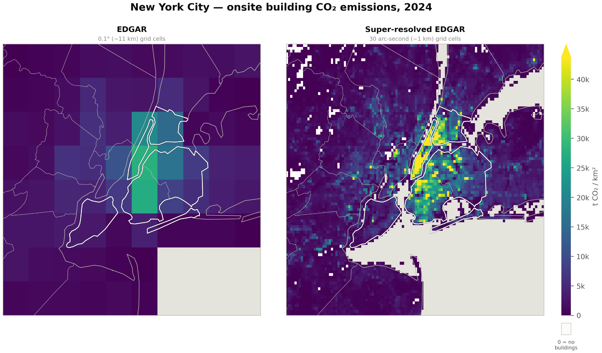
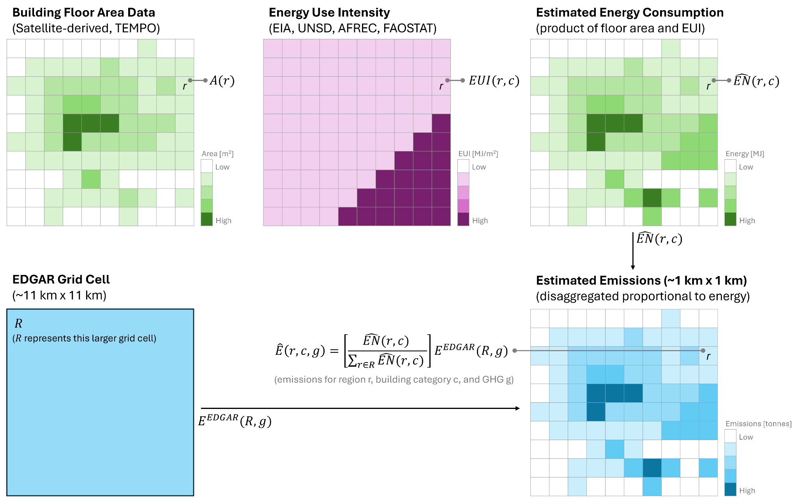
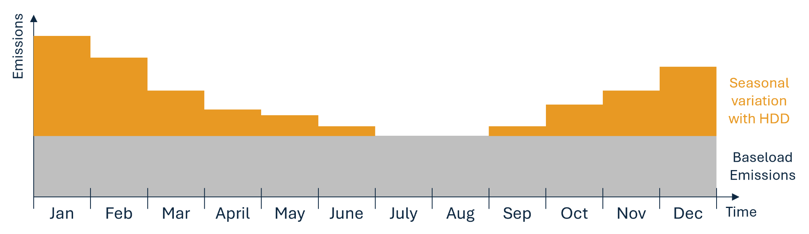
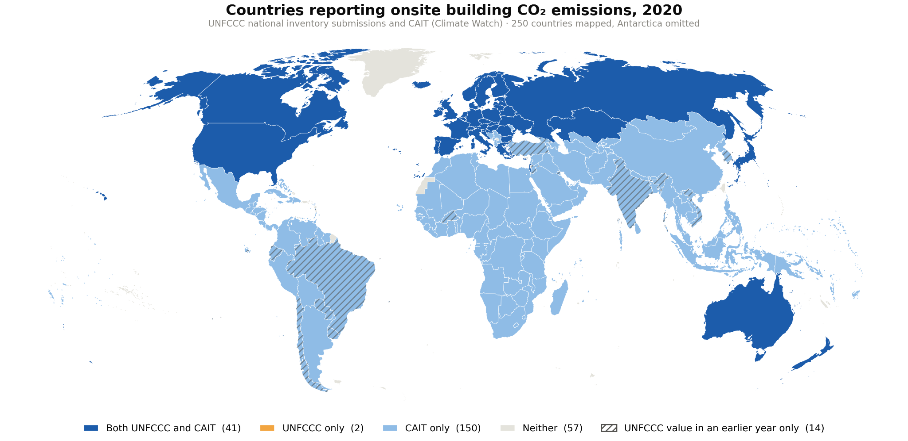
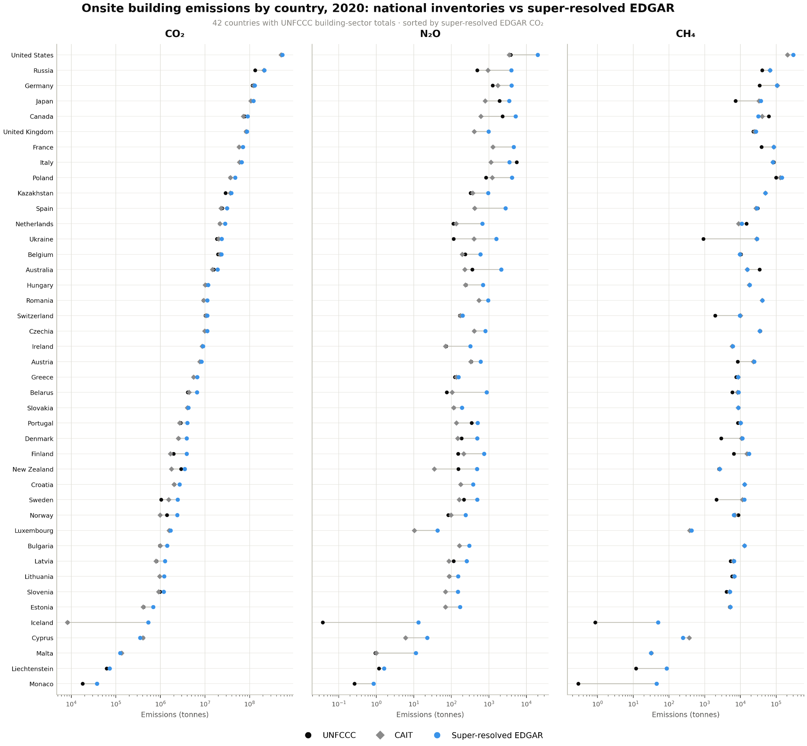
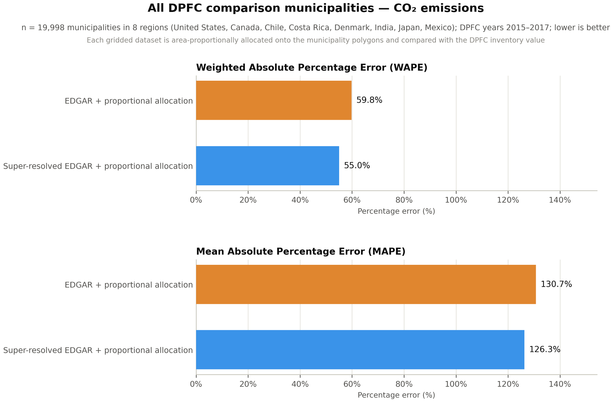
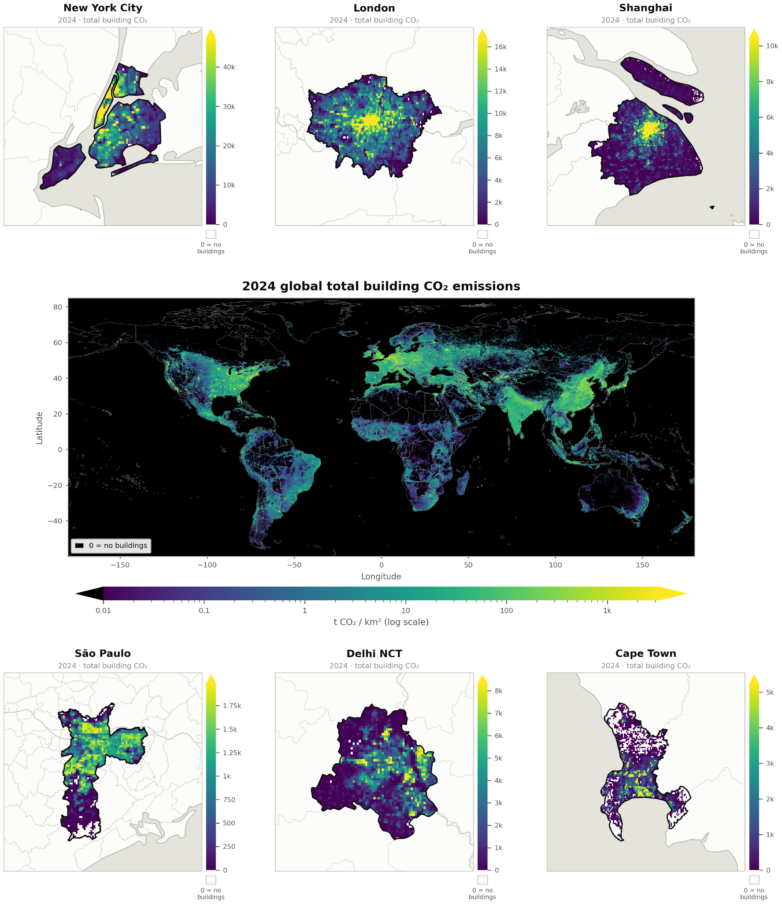
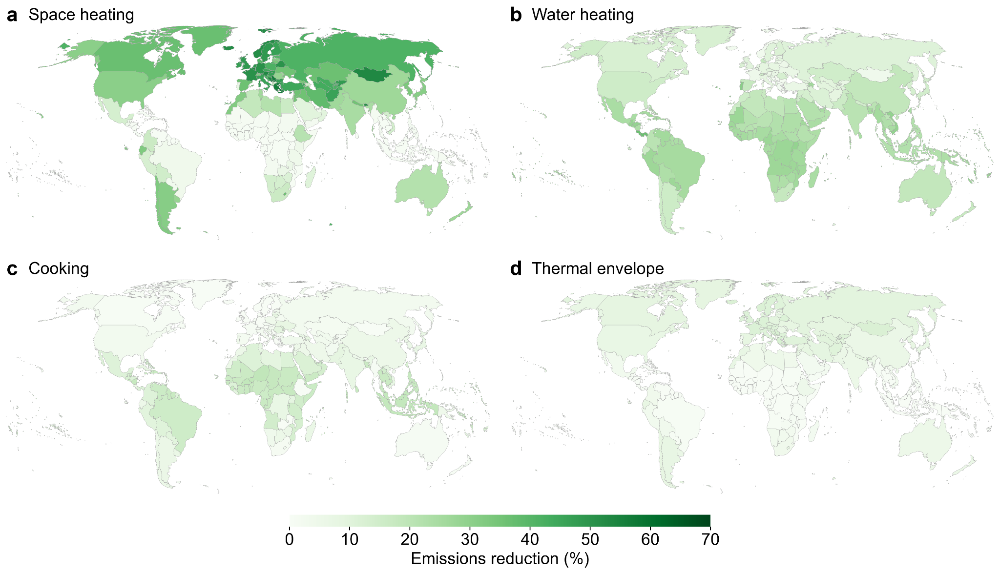
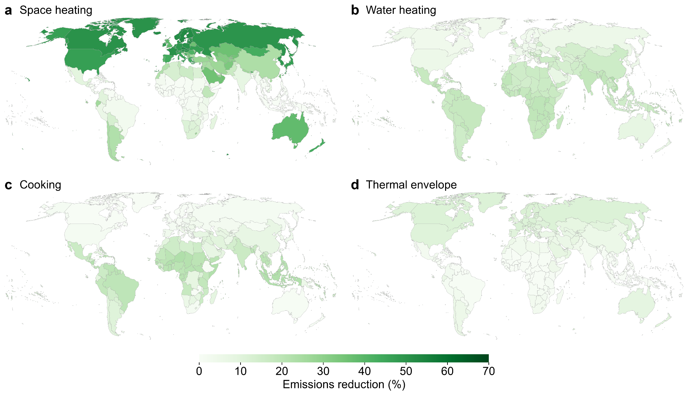

**Building sector:**

**Estimating Global, High-resolution Onsite Building Emissions**

Brittany Lancellotti1,4, Trey M. Gowdy1,4, Paul Markakis1,2,4, Saad Lahrichi3,4, Zion Sheng3,4, Jordan M. Malof3,4, and Kyle Bradbury1,2,4
=======================================================================================================================================================================================================================

*1. Nicholas Institute for Energy, Environment & Sustainability, Duke University; 2. Dept. of Electrical & Computer Engineering, Duke University; 3. Dept. of Electrical Engineering and Computer Science, University of Missouri; 4. Climate TRACE*

Abstract
========

Globally, buildings account for approximately 26% of energy sector greenhouse gas (GHG) emissions by end-use and 8% of all direct emissions (International Energy Agency). Yet, the building sector lacks high spatial and temporal resolution emissions estimates which could help drive action by informing planning at the local and subnational level through emissions inventories. We present a methodology that super-resolves the gridded EDGAR dataset’s building emissions estimates from a spatial resolution of approximately 11km-by-11km down to a 1km-by-1km resolution: a level that enables building data to be included in comprehensive municipal-level emissions inventories. We perform this disaggregation of the higher resolution EDGAR emissions data using building floor area as a spatial proxy and subdivide emissions data into residential and non-residential subsectors, based on satellite-derived data products from Microsoft's TEMPO and PlanetScope satellite data as well as the European Commission’s Global Human Settlement Layer. Lastly, these data are provided monthly using heating degree days to allocate the time-varying portion of emissions. These data are provided from 2015 through 2026. We also estimate the potential reduction of building emissions based on building envelope improvements and the replacement of fossil-based heating and cooking systems with higher-efficiency technologies.

1. Introduction
===============

1.1 Existing emissions inventories are inadequate
-------------------------------------------------

Accurate and up-to-date greenhouse gas (GHG) emissions inventories are a valuable tool for climate change mitigation and emissions reduction goal-setting; for example, such inventories underpin the effectiveness of the Paris Agreement (Umemiya and White 2024). However, multiple studies have found the state of emissions inventories at the national and subnational levels to be wanting (Umemiya and White 2024, Luers et al. 2022). Luers et al. went as far as to state that the “existing patchwork of greenhouse-gas inventories is woefully inadequate. From governments to businesses, information on these emissions is inconsistent, incomplete, and unreliable” (Luers et al. 2022). In many cases, emissions inventories at the national level are outdated, with a gap of 10 years not being uncommon (Pearce 2024). In other cases, the reliability of those inventories has come under scrutiny, and in a study evaluating promptness, accuracy, and consistency, 69 countries were deemed to be struggling in one or more of those three categories, representing roughly half of developing countries (Umemiya and White 2024).

1.2 The buildings sector GHG share is substantial and hard to estimate accurately
---------------------------------------------------------------------------------

For a GHG emissions inventory to be valuable, each sector included needs to be accurately represented so that priorities for GHG emissions reduction targets can be accurately set. Additionally, the resolution of the information has to be sufficiently high for establishing actionable emissions mitigation plans. The buildings sector accounts for approximately 8% of direct global emissions and an additional 18% of indirect emissions from the production of electricity and heat used in buildings (International Energy Agency n.d.); a substantial component, globally. This sector’s emissions are perniciously difficult to estimate accurately, however, due to the highly distributed nature of building energy consumption and the general lack of ground truth for model calibration.

Some existing GHG inventory approaches include building sector information, but those approaches have limitations around spatial resolution and the availability of subsector information. Existing inventories include IEA’s energy consumption data (which can be translated into emissions), the Open-source Data Inventory for Anthropogenic CO2 (ODIAC) (Oda et al. 2018), the Community Emissions Data System (CEDS) (McDuffie et al. 2020), the Emissions Database for Global Atmospheric Research (EDGAR) (Crippa et al. 2024), the Global Carbon Grid (Tong et al. 2018), and the Global Gridded Daily CO2 Emissions Dataset (GRACED) (Dou et al. 2022). The highest spatial resolution of these datasets are EDGAR and GRACED, which are available at a resolution of about 11 km x 11 km (0.1 degree by 0.1 degree), which for context means about 3 data points for all of the Island of Manhattan (as shown in Figure 1): an insufficient resolution for local decision-making, planning, and monitoring. Similarly, there is limited subsector information, with most inventories grouping all of the building subsectors into one category rather than breaking down the estimates into, for example, residential and non-residential buildings.

**Figure 1***. Visualization of EDGAR (left subplot), 0.1 degree by 0.1 degree (\~11km-by-11km at the equator) building CO2 emissions data centered on New York City and the island of Manhattan. In contrast, super-resolved EDGAR (right subplot) is provided at the 30 arc second (\~1km-by-1km at the equator) resolution.*

To make building sector information more actionable, the ability to identify larger sources of emissions is important. Commercial buildings vary greatly in terms of their energy use intensity (i.e., energy use per unit area), and therefore, emissions. Yet it is not possible to distinguish between residential and non-residential building emissions using existing datasets. Furthermore, hospitals, grocery stores, and restaurants may consume 2 to 8 times as much energy as residential facilities (Energy Star 2023), but current data do not provide sufficient detail for distinguishing between types of non-residential buildings. Therefore, providing higher resolution information separately for residential and non-residential buildings, would make these building sector data more directly actionable.

Direct (a.k.a. Scope 1) emissions from residential and commercial buildings result from onsite fuel use such as natural gas, oil, and kerosene consumption. Residential buildings primarily use these fuels for space and water heating, cooking, and other equipment and appliances; in commercial buildings, space and water heating consume the most energy. The magnitude of these end uses is correlated with, for example: building size, climate conditions, and the number of occupants (Gonzalez et al. 2022). However, timely and accessible high-spatial-resolution data on these are limited.

Existing activity-based methods to estimate emissions leverage data typically not accessible at scale, such as information on a building's insulation, appliances in a building, and information on occupant behavior (Kavgic et al. 2010). These approaches may rely on building physics (DOE, 2014) or statistical approaches, but the data requirements for these approaches prevent them from being scaled globally.

Some activity-based approaches use spatial disaggregation techniques to reallocate emissions estimates to finer (i.e., sub-national) scales. Inventories that use these techniques include the Open-source Data Inventory for Anthropogenic CO2 (Oda et al. 2018), the Community Emissions Data System (McDuffie et al. 2020), the Emissions Database for Global Atmospheric Research (EDGAR) (Crippa et al. 2024), the Global Carbon Grid (Tong et al. 2018), and the Global Gridded Daily CO2 Emissions Dataset (GRACED) (Dou et al. 2022). While GRACED data are published near-monthly, most other key data are produced with a year or more of latency. Additionally, the highest resolution of these data is 0.1 decimal degrees or roughly 11 km near the equator. Lastly, few of these models break down emissions into residential and commercial subsectors as well as separate emissions estimates into individual greenhouse gasses. These differences are summarized in Table 1. The lack of spatial resolution in these existing approaches makes it difficult to attribute emissions to building sources with the specificity required to inform prioritization at the local level that would ultimately drive global emissions reduction actions.

**Table 1***. Summary of building emissions data sources.*

| **Emissions Data Source**     | **Spatial Resolution** | **Aggregated Residential and Non-Residential** | **GHGs Covered**                 | **Update Frequency** |
|-------------------------------|------------------------|------------------------------------------------|----------------------------------|----------------------|
| UNFCCC                        | Country-Level          | Disaggregated                                  | CO2, N2O, CH4                    | Annual               |
| Climate Watch (formerly CAIT) | Country-Level          | Aggregated                                     | CO2, N2O, CH4                    | Annual               |
| IEA energy statistics         | Country-Level          | Disaggregated                                  | Energy only (convertible to GHG) | Annual               |
| ODIAC                         | 1 km x 1 km            | No sector detail provided                      | CO2                              | Annual               |
| CEDS                          | 0.5 deg x 0.5 deg      | Disaggregated                                  | CO2, N2O, CH4 (+ air pollutants) | Annual               |
| EDGAR                         | 0.1 deg x 0.1 deg      | Aggregated                                     | CO2, N2O, CH4 (+ air pollutants) | Annual               |
| Global Carbon Grid            | 0.1 deg x 0.1 deg      | Aggregated                                     | CO2                              | 2019-only            |
| GRACED                        | 0.1 deg x 0.1 deg      | Aggregated                                     | CO2                              | Monthly              |

Here, we present a methodology for increasing the spatial and temporal resolution and sectoral detail of existing building emissions data to enhance its actionability. Furthermore, we describe a method for estimating potential building emissions reductions under high-efficiency technology and building envelope retrofit scenarios.

2. Materials and Methods 
========================

Our approach increases the spatial and temporal resolution and sectoral detail of building emissions data by: (1) disaggregating each \~11km-by-11km EDGAR grid cell for each GHG (CO2, CH4, and N2O) into \~1km-by-1km grid cells by using an estimate of building energy consumption, (2) further decomposing each grid cell into residential and non-residential emissions using a combination of TEMPO building volume data and Global Human Settlement Layer building type classifications, and (3) allocating the time-varying component of annual GHG emissions to 12 months of the year based on heating degree days derived from Copernicus ERA5 globally gridded temperature data. At the time of publication, EDGAR country-level and gridded GHG emissions data are available through 2024. EDGAR country-level and gridded emissions data for most air pollutants are available through 2022. We therefore use backed-out emissions factors from the most recently available year for each emissions data type combined with extrapolated building area data to estimate emissions covering periods beginning in 2025 for the GHGs, NOx and PM2.5, and 2023 for the other pollutants.

In this section, we introduce the datasets used for both building emissions estimation and the high-efficiency energy system retrofits approach, and then describe the steps of each process in detail.

2.1 Datasets employed for building emissions estimation 
-------------------------------------------------------

### 2.1.1 Energy and emissions datasets 

**EDGAR:** EDGAR 2025 uses spatial data on global human presence and air temperature to allocate country-level residential and non-residential building emissions estimates to a 0.1° by 0.1° resolution global grid. These datasets include the GHSL and data on heating degree days from the ERA5 climate reanalysis (Crippa et al., 2023). In this work, we super-resolve the EDGAR building emissions dataset from the provided resolution of 0.1-degree-by-0.1-degree which near the equator is close to 11km by 11km onto a 30 arc second (\~1km-by-1km) grid using the TEMPO building volume dataset. To accomplish this, for every nonzero EDGAR estimate of CO2, CH4, and N2O, we allocate those emissions proportional to the fraction of activity data in each 1km-by-1km grid cell region (which is building floor area times energy use intensity). This ensures the sum of the original EDGAR data is nearly equivalent to the super-resolved dataset at a global and national level, while providing additional resolution to enable municipal-level inventories more effectively.

**Energy Use Intensity:** Energy Use Intensity (EUI) is an indicator of energy use relative to building size. We derive separate country-level EUI estimates by building type (residential and non-residential) and fuel category (fossil fuel and biomass). At this granularity, our EUI estimates reflect both regional variability in energy consumption and the fuel mix for buildings in the region.

To prepare these data, we derive country-level EUI values by dividing country-level energy consumption data that is fuel- and building-specific by country-level building area estimates, to get country-level averages. EIA International energy use data (US EIA 2026) are the basis of the energy dataset, and the United Nations Energy Statistics Database (UNSD, n.d.), African Energy Balance (AFREC) (AFREC 2025), and Food and Agriculture Organization of the United Nations (FAOSTAT 2026) are used to fill data gaps, in that order of preference. Gridded building volume data (TEMPO) (Glazer et al. 2025) are aggregated to the country-level and converted to building area based on an assumed average story height of 3m.

Energy data are assembled one time series at a time, where a series is a single country, building type, and fuel across years (2015-2023). Where more than one dataset covers a timeseries, the highest-priority dataset reporting any year supplies the entire series. Remaining gaps are resolved by inserting data in the fixed order described above. When no dataset reports a country, building type, and fuel in any year, the gap is resolved in one of three ways. First, a proxy: if the region is inhabited and a manual proxy has been assigned, the donor’s intensity is used. Otherwise, it is treated as a zero: if that same country-building type reports at least one other fuel, the timeseries is published as a zero. The value is otherwise left unresolved, but no timeseries currently falls into this category.

Manual proxies were assigned based on geographical proximity and socioeconomic similarity to the target country. For example, the manually-assigned proxy country for Åland Islands is Finland, as it’s an autonomous region of Finland located approximately 370 km away. Within a timeseries, missing years falling between two observed years (e.g., if 2016 to 2019 are covered but 2017 and 2018 are missing) are interpolated linearly. Missing years falling before or after the observed period are held constant at the nearest observed year rather than projected forward. For example, if the timeseries only covers 2017-2020, we fill 2015 to 2017 with the 2017 value and 2020 to 2025 with the 2020 value. All gap filling operates on intensity rather than on absolute energy: an EUI is copied or interpolated and then multiplied by the target's own, independently measured building area. Only observed data are transferable, which means an interpolated or proxied value is never borrowed by a second country.

Finally, we treat any year-to-year change in EUI greater than 50% as anomalous (accounting for approximately 5% of all observations). Of the two years spanning such a step, we replace the year that deviates further from that series' median with whichever of its neighboring years sits closer to the median, repeating until no step exceeds the threshold.

Two conventions govern the edge cases. Where the building area layer detects no buildings for a country and building type, EUI is set to 0, meaning "no buildings detected" rather than a measured value; any energy reported for those cases is kept as reported, so EUI × area does not reproduce it. Territories identified as uninhabited are assigned an EUI of 0 by definition, even if building area was detected.

EUI is derived independently for each year from 2015 to 2023, the period the energy datasets cover. For 2024 to 2026 we hold the 2023 EUI constant and pair it with each year's own building area, so that energy in those years fluctuates only with the building stock.

### 2.1.2 Remote sensing datasets

**Building Area:** We use two datasets relevant for building area: the TEMPO dataset (for building volume) and the Global Human Settlement Layer (GHSL) for building type classification as residential or nonresidential.

TEMPO is a global building density and height estimation dataset produced by Microsoft (Glazer 2025). It provides quarterly maps of building density and height at 77 m/px resolution, which are derived from global mosaics of PlanetScope RGB imagery (Planet 2026). Similar to GHSL, TEMPO represents buildings as gridded rasters, and uses machine learning to jointly predict per-pixel building density and height using existing building footprint and height datasets including Google Open Buildings 2.5D and Overture as weak supervision. At the time of writing, the two publicly available releases are 2020 Q4 and 2023 Q4. Additional details about the TEMPO data collection and processing can be found in the original publication (Glazer 2025).

Since the TEMPO is distributed as disjoint tiles, each representing one Planet L15 quad, we stitch all tiles into one global mosaic. We then multiply together the building density, building height, and true pixel area (projected pixel area in square meters times the squared cosine of the latitude) to derive the estimated physical building volume. Finally, assuming a floor height of 3m, we convert the volume estimate into a total floor area estimate.

The TEMPO data does not classify building area or volume as residential or nonresidential. We rely on the Global Human Settlement Layer (GHSL) for that information. GHSL is provided openly by the European Commission’s Joint Research Centre (European Commission 2023) and we use this as our source of building subsector classification to determine what fraction of building floor area in a given region are residential or nonresidential. These data are derived from Landsat and Sentinel 2 satellite imagery and use machine learning to infer various building-related attributes from multiple distinct sources of satellite imagery collected across the entire surface of the earth. Additional detail on the GHSL data and methodology is available via GHSL (European Commission 2023, Pesaresi et al. 2024).

Using the built-up volume area data product, BUILT-V (Pesaresi et al. 2013), at 30 arc second resolution (\~1km-by-1km at the equator), allows us to create an estimate of building type classification for classifying building area as residential or non-residential buildings. GHSL offers select years of data including 2015 and 2020. For the remaining years, we linearly interpolate and extrapolate at a grid-cell level to estimate building floor area for 2016-2019, and 2021-2026. These data are used to fractionally assign the TEMPO data as either residential or nonresidential.

**Copernicus ERA5 2m temperature data:** The European Commission’s Copernicus program provides gridded climate reanalysis data through its suite of ERA5 data products (Hersbach et al. 2023). We use ERA5 2m temperature data as our primary source of hourly temperature for computing heating degree days to allocate emissions monthly and assume a thermal setpoint of 18.33 degrees C (65 degrees F) for computing heating degree days. These data provide a highly accurate temperature estimate at an hourly cadence, globally. The data are available on a lat-lon grid with 0.25deg x 0.25deg spatial resolution.

### 2.1.3 Comparison data 

True ground truth of building emissions data would be measurements of the emissions emitted from individual buildings or groups of buildings. While there are measurements of *energy* consumed by individual buildings, there are not, to our knowledge, any known measurements of actual emissions from individual buildings or neighborhoods of buildings, and certainly none that we are aware of at a wider scale. At the national level, there are emissions inventories from the United Nations Framework Convention on Climate Change (UNFCCC) (UNFCCC, 2024) and the latest version of the Climate Action Indicators Tool (CAIT) curated by the World Resources Institute (World Resources Institute 2024). However, these two data sources both rely upon member nations to respond to surveys related to energy consumption and emissions so we do not treat them as empirical ground truth. At the municipality level, we rely upon region-specific estimates of building sector emissions data at the municipality level from the Data Portal for Cities (DPFC) tool as aggregated by the Global Covenant of Mayors for Climate & Energy (Global Covenant of Mayors for Climate & Energy 2019). While also not empirically measured ground truth, since these estimates are performed at the municipality-level, we use the DPFC data as a source of local comparison and evaluation for our estimates at a high spatial resolution. These comparisons are further described in Section 2.4.

### 2.1.4 Emissions reducing solutions: High-efficiency building energy system retrofits data

In addition to providing emissions data with enhanced resolution and sectoral detail, we estimate potential building emissions reductions from implementing technology or building envelope retrofits. These include replacing inefficient building envelopes and carbon-intensive space heating, water heating, and cooking technologies with newer, more efficient alternatives. There are numerous examples from homes to large commercial buildings installing the high efficiency building technologies outlined in our emission reduction solutions. This includes a library in Alaska installing a heat pump water heater (National Renewable Energy Laboratory 2024). In the United States alone, 4.2 million heat pumps were sold in a 12-month span between 2023-2024 (RMI 2025). The European Commission calls heat pumps “key to enabling the clean energy transition” (European Commission n.d.). The International Energy Agency notes that in some countries (such as Norway), a majority of buildings have heat pumps installed (IEA 2025) and that “China continues to be the largest market for new sales” (IEA 2022). Electric cookstoves (i.e. stove) are a common cooking appliance, installed in homes and commercial buildings for well over a century (National MagLab, n.d.). Electrification of cooking, such as from gas to electric stoves, is a well-established emission reduction solution - such as in Ecuador, where more than 750,000 households made the transition from gas to electric cooking (in this case induction stoves) between 2015 and 2021 (Gould et al. 2023).

We use EUI from the CURB Tool dataset and Eurostat (Eurostat 2026) to estimate the share of total building energy demand attributable to space heating, water heating, and cooking, separately for residential (houses and apartments/flats) and non-residential buildings (hotels, retail spaces, offices, hospitals, and warehouses). We use the World Health Organization Household Energy Database (WHO n.d.) to estimate the share of traditional cooking technologies that are eligible for retrofit. We do this by calculating the proportion of the population with primary reliance on fossil-based cooking technologies.

2.2 Models
----------

Activity-based approaches for estimating building emissions generally follow the 2006 Intergovernmental Panel on Climate Change (IPCC) guidelines, which combine information on energy consumption and emissions factors for a given region (IPCC, 2006). Of course, neither energy consumption nor emissions at the individual or neighborhood level are directly observable at scale. What is observable, however, are buildings themselves, and we leverage this to create a three-part activity based model which combines building floor area (in square meters), or $A$; building energy use intensity (Joules per square meter), or $\text{EUI}$; and emissions factors (tonnes of gas per Joule), or $\text{EF}$. If each of these quantities is accurate in a given region, we can estimate tonnes of emissions, $E,$ as $E = (A)(EUI)(EF)$.

Since this work is focused on super-resolving EDGAR’s gridded emissions estimates to a higher spatial and temporal resolution, we assume a regional (country-level) value of EUI and assume that regionally (within a \~11km-by-11km EDGAR grid cell), that emissions factors are approximately constant. Therefore the variation of emissions is due to the differences in building energy consumption; that assumption we can use for disaggregating the emissions.

The TEMPO building area data combined with the GHSL data for building type classification provides an estimate of total floor area for both residential and non-residential classes. We use the classifications from the GHSL data and adopt the same definition of residential buildings as the GHSL, which is the European Commission’s INSPIRE definition (European Commission 2024) of the residential sector:

**Residential**: “Areas used dominantly for housing of people. The forms of housing vary significantly between, and through, residential areas. These areas include single family housing, multi-family residential, or mobile homes in cities, towns and rural districts if they are not linked to primary production. It permits high density land use and low density uses. This class also includes residential areas mixed with other non-conflicting uses and other residential areas.” (European Commission 2024)

While an explicit definition of non-residential is not provided, we define it as follows to be mutually exclusive and collectively exhaustive of buildings and assume that the emissions from non-residential buildings are any direct building emissions not included within the residential sector and include emissions from commercial and municipal buildings.

One challenge with the definition of residential is that it will encompass some commercial building activity by including mixed-use and other building types that happen to exist within an area of predominantly residential buildings. This will lead to an overestimation of residential building emissions and an underestimation of non-residential emissions.

2.3 Methods 
-----------

### 2.3.1 Building emissions estimation 

The process we use for generating the emissions estimates involves estimating activity data (energy consumption), disaggregating EDGAR emissions to a higher spatial resolution using the activity data, allocating emissions into residential and non-residential categories, extrapolating data to estimate future year emissions, and generating higher temporal estimates of the data by allocating the variable component of emissions using heating degree days.

This disaggregation process is used on both gridded EDGAR data and country-level EDGAR data. For country-level EDGAR data, national totals are allocated to grid cells in proportion to each cell's share of national building energy within the country's boundaries, with border cells shared between countries by area overlap. We provide monthly emissions estimates using EDGAR gridded data as the source for the primary GHGs: CO2, N2O, and CH4. We are also able to use EDGAR gridded data to provide monthly emissions estimates for the CO2 biomass contributions (a.k.a., CO2bio). We rely on country-level EDGAR data for estimating biomass emissions from N2O and CH4. We also provide monthly emissions estimates for various air pollutants – NMVOC, CO, NOx, PM10, PM2.5 (including a separate estimate of biomass contributions), and SO2 - using the EDGAR country-level data for those air pollutants. See the Supplementary materials for further detail related to inclusion and exclusion of biomass in individual data products as we generally follow the IPCC convention where CO2 is fossil-only (biogenic CO2 is separate), while CH4, N2O and the air pollutants combine fossil + biomass.

Before we begin detailing the steps of this methodology, we will include some definitions that we use for describing the emissions estimation procedure. In Table 2, we introduce the key indices that we use to reference our variables, and in Table 3 introduce the variables themselves.

**Table 2***. Definition of key indices used in the methodology.*

| **Variable** | **Definition**                                                                                                                                     | **Possible values**                                                                                                                                                                                                                                                           |
|--------------|----------------------------------------------------------------------------------------------------------------------------------------------------|-------------------------------------------------------------------------------------------------------------------------------------------------------------------------------------------------------------------------------------------------------------------------------|
| *r*          | A region in space, as represented by the index of any grid cell in the output emissions dataset (representing a \~1km x 1km region at the equator) | The index of a grid cell in the output emissions dataset                                                                                                                                                                                                                      |
| *R*          | The region covered by an EDGAR grid cell (e.g., representing a \~11km x 11km region at the equator)                                                | The index of a grid cell in the EDGAR emissions gridded dataset                                                                                                                                                                                                               |
| *c*          | Building type category                                                                                                                             | residential (res), non-residential (nres)                                                                                                                                                                                                                                     |
| *g*          | Greenhouse gas or other pollutant                                                                                                                  | Carbon dioxide (CO2), methane (CH4), nitrous oxide (N2O), nitrogen oxides (NOx), particulate matter (PM2.5,PM10), volatile organic compounds (NMVOC), sulfur dioxide (SO2), carbon monoxide (CO) |

**Table 3***. Definition of key variables used in the model.*

<table><thead><tr class="header"><th><strong>Variable</strong></th><th><strong>Units</strong></th><th><strong>Description</strong></th></tr></thead><tbody><tr class="odd"><td><em>A</em>(<em>r</em>)</td><td>m2</td><td>
Building floor area

<em>Source: TEMPO data</em>
</td></tr><tr class="even"><td><em>F</em>(<em>r</em>, <em>c</em>)</td><td><em>unitless</em></td><td>
Fraction of building type

<em>Source: Global Human Settlement Layer, Building Volume data (BUILD-V)</em>
</td></tr><tr class="odd"><td><em>E</em><em>U</em><em>I</em>(<em>r</em>, <em>c</em>)</td><td>MJ/m2</td><td>
Energy use intensity

<em>Source: EIA, UNSD, AFREC, FAOSTAT</em>
</td></tr><tr class="even"><td>$\widehat{\text{EF}}(r,c,g)\ $</td><td>tonnes/MJ</td><td>Emissions factor 
<em>Computed: backed out from emissions and area data or extrapolated</em></td></tr><tr class="odd"><td>$\widehat{\text{EN}}(r,c)$</td><td>MJ</td><td>Energy 
<em>Computed: product of building area times EUI</em></td></tr><tr class="even"><td><em>E</em>EDGAR(<em>R</em>, <em>g</em>)</td><td>tonnes</td><td>
EDGAR emissions

<em>Source: EDGAR 2025</em>
</td></tr><tr class="odd"><td><em>Ê</em>(<em>r</em>, <em>c</em>, <em>g</em>)</td><td>tonnes</td><td>Super-resolved emissions</td></tr></tbody></table>

**Step 1. Calculate the activity data.**

Here, we calculate the product of building floor area data from TEMPO (converted from building volume assuming 3m floor heights), $A(r)$, dividing it up into residential and non-residential floor area based on GHSL BUILT-V data classifications, $F(r,c)$, and multiply that product by the EUI value for the given region and building type $EUI(r,c)$, which are unique for each country. Additional assumptions and processing for the EUI data can be found in the supplementary materials. This process yields estimates of energy consumption for every \~1km-by-1km region of the world and by building type category (residential, non-residential), $\widehat{\text{EN}}(r,c)$.

$\widehat{\text{EN}}(r,c) = A(r)F(r,c)EUI(r,c)$

This process is shown in Figure 2A.

**Step 2. Disaggregate emissions.**

Using the activity data, the EDGAR data, $E^{\text{EDGAR}}(R,g)$, are allocated proportionally based on the fraction of energy (activity) in each grid cell. The energy used as the allocation weight is the most appropriate fuel basis, so fossil activity estimates are used to disaggregate fossil emissions, while biomass activity estimates are used to disaggregate biomass emissions. Fossil and biomass emissions remain separate throughout this process; only when the data are prepared for delivery are they combined according to IPCC reporting conventions. In that way, CO2 is reported from fossil fuels only (biogenic CO2 is excluded), while all other gases and pollutants are reported as the sum of their fossil and biomass components. This estimation process is completed for each gas and each category of buildings:

$\widehat{E}(r,c,g) = \left\lbrack \frac{\widehat{\text{EN}}(r,c)}{\widehat{\text{EN}}(r,c)} \right\rbrack E^{\text{EDGAR}}(R,g)$

This process is shown in Figure 2B using gridded EDGAR data as the source R.

**Figure 2***. EDGAR disaggregation methodology.*

**Step 3. Back out emissions factors.**

Through steps 1 and 2, we do not need emission factors to calculate the disaggregated emissions. However, EDGAR generally has a latency of more than a year, therefore, we back out emissions factors for each year so that we can use them for extrapolating emissions estimates to future years. Our estimates of emissions factors are the emissions estimates divided by the energy estimates for each building category and GHG:

$\widehat{\text{EF}}(r,c,g) = \frac{\widehat{E}(r,c,g)}{\widehat{\text{EN}}(r,c)}$

**Step 4. Extrapolate to future years.**

The annual building-area series is built from only two TEMPO snapshots in 2020 and 2023. For years 2021–2022 a per-cell linear interpolation was applied between the 2020 and 2023 snapshots. For years outside that window (2015–2019, 2024–2026), the TEMPO data are extrapolated by scaling the nearest TEMPO snapshot by GHSL's per-cell growth ratio (from the 2015 and 2020 BUILT-V epochs). Using the extrapolated building floor area, we can calculate emissions as the product of the extrapolated building floor area, EUI (which we assume is unchanged from the most recently-available year), and the emissions factors in Step 3 which we estimated from the most recently-available building emissions data.

**Step 5. Estimate monthly emissions.**

As space heating is a major driver of energy consumption in buildings, we make the assumption that heating needs are the primary driver of variable energy consumption in buildings. Globally, variable loads (loads that change seasonally, space heating and cooling) represent around 37.8% of consumption (International Energy Agency 2021). We allocate 37.8% of load based on heating degree days for a given month, $HDD(m)$. Emissions for a given month, which we represent as $\widehat{E}(r,c,g,m)$ are then allocated according to the relationship:

$\widehat{E}(r,c,g,m) = \alpha\left\lbrack \frac{HDD(m)}{HDD(m)} \right\rbrack\widehat{E}(r,c,g) + \left( 1 - \alpha \right)\left\lbrack \frac{\widehat{E}(r,c,g)}{12} \right\rbrack$

Here, $\alpha = 0.378$, which is the fraction of variable load. This concept is demonstrated in Figure 3. The grey, baseload emissions are constant throughout the year and are approximately$\left( 1 - \alpha \right)\frac{\widehat{E}(r,c,g)}{12}$ each month (the actual value takes into account the number of days in each month relative to the year including leap years). The variable load emissions (the fraction represented by $\alpha$) are distributed proportionally to the quantity of HDDs that occurred that month relative to the total for the year: $\left\lbrack \frac{HDD(m)}{HDD(m)} \right\rbrack\widehat{E}(r,c,g)$.

**Figure 3***. Monthly emissions allocation.*

Regions for which there are few HDDs per year may result in unrealistic estimates. For example, if a region only has 1 HDD per year, 37.8% of annual emissions would be shifted in full to the month containing that HDD. To prevent this outcome, we linearly scale up $\alpha$ from 0 to 0.378 based on the total number of HDDs. The value of 0.378 results if there are 1000 HDDs or more for a given region.

### 2.3.2 Emissions Reductions Solutions: High-efficiency building energy system retrofits 

We estimate the potential reduction in building emissions achievable through energy system retrofits through fuel/technology switching and/or weatherization. Because space heating, water heating, and cooking are among the largest sources of direct building emissions, the scenario we model focuses on reducing emissions intensity for these three end uses at the regional level. The retrofit strategies involve replacing fossil-based systems with more efficient technologies:

1.  **Space heating**: replacing fossil-fuel (gas or propane) heating systems with high-efficiency heat pumps, improving efficiency from \~75–100% to \~250% (Ciolkosz & Chahal, n.d.).

2.  **Water heating**: replacing fossil-based or electric resistance systems with high-efficiency heat pumps, improving efficiency from \~50–95% to \~175% (Ciolkosz & Chahal, n.d.).

3.  **Cooking**: replacing fossil-fuel cookstoves with electric resistance systems, improving efficiency from \~45–60% to \~75–90% (Ayub et al., 2021).

4.  **Building envelope**: improving the building envelope through air sealing, insulation upgrades, window and door replacements, etc., which are assumed to reduce space heating energy demand by 15% (ACEE, 2023).

This retrofit approach is implemented as a percentage reduction in emission factors, representing a decrease in emissions-generating activity. We calculate the resulting fractional decrease in emission factors separately, across space heating, water heating, and cooking for each region as follows, with variable definitions and data sources shown below in Table 4:

%20%5Cright%5D#0)

For each end use, only the portion of technologies eligible for retrofitting (i.e., buildings that do not already have high-efficiency systems) contributes to a reduction in the emission factor. The remaining share retains the existing regional emission factor. Our retrofit scenario models the potential reduction in direct building emissions from switching to higher-efficiency cooking and heating technologies and for improving the building envelope. It does not factor in the potential change in emissions associated with additional electricity demand, in lieu of on-site combustible fuels, that would result from these technology retrofits. On-site combustible fuels (e.g. natural gas, oil, biomass) often have higher emissions factors than grid-supplied electricity, so factoring in fuel switching would likely increase emissions reductions estimates further, but this is dependent on local electricity generation sources. This analysis is planned as a future release.

**Combining emissions reducing strategies**. Strategies are combined according to whether they act on the same share of building activity. Strategies that act on different end uses draw on separate shares of activity (*si,r*) and have their own market shares of pre-retrofit technologies (*mi,r*). Their remaining emissions are therefore summed. A combination of strategies that act on the same end use share both (*si,r*) and (*mi,r*). Their remaining fractions are therefore multiplied before summing. Space heating is the only end use with more than one strategy: heat pump replacement and building envelope retrofits both reduce emissions from the same space heating demand, and both apply to households still using pre-retrofit technologies. The fraction of emissions remaining across all end uses is:

%20%2B%20m_%7Bi%2Cr%7D%20%5CBig(%20%5Cprod_%7Bj%20%5Cin%20%5Cmathcal%7BJ%7D_i%7D%20e_%7Bj%7D%20%5CBig)%20%5CBig%5D%2C%20%5Cqquad%20i%20%5Cin%20%5C%7B%5Ctext%7Bspace%20heating%2C%20water%20heating%2C%20cooking%7D%5C%7D#0)

**Table 4***. Definitions of variables used in the high-efficiency building energy system retrofits approach.*

<table><thead><tr class="header"><th><strong>Symbol</strong></th><th><strong>Definition</strong></th><th><strong>Notes</strong></th><th><strong>Data source(s)</strong></th></tr></thead><tbody><tr class="odd"><td></td><td>Subscript denoting end uses</td><td>Examples include space heating, water heating, and cooking</td><td></td></tr><tr class="even"><td><em>r</em></td><td>Subscript denoting a specific region</td><td></td><td></td></tr><tr class="odd"><td><em>si, r</em></td><td>Share of activity for end use <em>i</em> in region <em>r</em></td><td>These sum to 1 for each region and range from 0 to 1</td><td><a href="https://datacatalog.worldbank.org/search/dataset/0042029/curb-climate-action-for-urban-sustainability">World Bank CURB Tool 2019</a></td></tr><tr class="even"><td><em>j</em></td><td>Subscript denoting a retrofit strategy</td><td>Heat pump, heat-pump water heater, electric resistance cooking, and building envelope improvement</td><td></td></tr><tr class="odd"><td>
<em>𝒥i</em>

<em>​</em>
</td><td>Set of retrofit strategies deployed for end use <em>i</em></td><td>Space heating: {heat pump, building envelope}; water heating: {heat-pump water heater}; cooking: {electric resistance cooking}. When an end use has more than one strategy, their effects are multiplied.</td><td></td></tr><tr class="even"><td><em>mi, r</em></td><td>Market share of traditional technologies for end use  (the fraction of end use that could be retrofitted)</td><td>These values will range from 0 to 1</td><td>Heating: <a href="https://www.iea.org/energy-system/buildings/heat-pumps#tracking">IEA 2024</a> Water Heating: <a href="https://www.rewiringamerica.org/research/pace-of-progress-home-electrification-transition">Rewiring America</a>, <a href="https://rmi.org/insight/tracking-the-heat-pump-water-heater-market-in-the-united-states/">RMI</a>, Cooking: <a href="https://www.who.int/data/gho/data/indicators/indicator-details/GHO/proportion-of-population-with-primary-reliance-on-fuels-and-technologies-for-cooking-by-fuel-type">World Health Organization Household Energy Database 2022,</a> <a href="https://ec.europa.eu/eurostat/databrowser/view/nrg_d_hhq__custom_12191915/default/table">Eurostat 2022</a>, <a href="https://www.eia.gov/consumption/residential/data/2020/hc/pdf/HC%201.1.pdf">EIA RECS 2020</a>, <a href="https://www150.statcan.gc.ca/n1/pub/63-224-x/2007000/5006566-eng.htm">Statistics Canada 2006</a></td></tr><tr class="odd"><td><em>εold, j</em></td><td>The energy efficiency of the incumbent technology replaced by strategy <em>j</em></td><td>The units are output energy per unit of input energy. These values will be greater than 0, but could be above 1</td><td>Space Heating: <a href="https://extension.psu.edu/online-annual-heating-energy-cost-analyzer">Penn State Extension n.d.(a)</a>, Water Heating: <a href="https://www.e-education.psu.edu/egee102/node/2009">PennStateExtension n.d. (b)</a>, Cookstoves: <a href="https://www.sciencepublishinggroup.com/article/10.11648/j.ajee.20210901.11">Ayub et. al 2021</a></td></tr><tr class="even"><td><em>ε new, j</em></td><td>The energy efficiency of the more efficient technology for strategy <em>j</em></td><td>The units are output energy per unit of input energy. These values will be greater than 0, but could be above 1</td><td>Space Heating: <a href="https://extension.psu.edu/online-annual-heating-energy-cost-analyzer">Penn State Extension n.d.(a)</a>, Water Heating: <a href="https://www.e-education.psu.edu/egee102/node/2009">PennStateExtension n.d. (b)</a>, Cookstoves: <a href="https://www.sciencepublishinggroup.com/article/10.11648/j.ajee.20210901.11">Ayub et. al 2021</a></td></tr><tr class="odd"><td><em>Dnew​/Dold</em></td><td>Space heating energy demand after building envelope improvement, relative to demand before</td><td>0.85, a 15% reduction in space heating demand</td><td>ACEE, 2023</td></tr><tr class="even"><td>
<em>ej</em>

<em>​</em>
</td><td>Fraction of pre-retrofit energy use remaining for a household that adopts strategy <em>j</em></td><td>
εold,<em>j</em> /εnew,<em>j</em> for technology replacements;

𝐷new/𝐷old for envelope improvement. These values range from 0 to 1
</td><td></td></tr><tr class="odd"><td><em>αi, r</em></td><td>Share of region <em>r</em>’s building emissions remaining from end use <em>i</em> after retrofit</td><td>These values will range from 0 to 1</td><td></td></tr><tr class="even"><td><em>αtotal, r</em></td><td>Fraction of building emissions remaining in region <em>r</em> after all deployed strategies</td><td>These values range from 0 to 1. A value of 1 means no reduction</td><td></td></tr></tbody></table>

Our approach makes several assumptions to conduct this approach globally, several of which are intended to make up for a lack of higher resolution regional data:

1.  The proportion of activity for each end use that results in direct emissions (space heating, water heating, and cooking appliances) is assumed to be constant across the country. For example, for Norway, 14% of onsite building energy demand is attributable to cooking appliances.

2.  All building systems that can be retrofitted are retrofitted, so there is a 100% conversion to the more energy-efficient technology.

3.  The market penetration of incumbent versus more efficient technologies is constant, globally.

4.  The energy efficiency of traditional technologies can be represented as an average across several common technology types and is constant globally.

5.  Several of the technology approaches also involve a switch to electricity as the fuel source. We do not factor in the electrification aspect of that switch; we limit these estimates to the potential reduction in emissions due to the increased efficiency of end-use technologies themselves, regardless of fuel source.

6.  The emissions factors associated with the GHGs in a region are impacted equally (same reduction factor for all three GHGs).

7.  We do not consider retrofits to biomass-based systems, we only consider retrofitting fossil fuel- and less efficient electric-based technologies for space heating, water heating, and cooking to high-efficiency heat pumps (space heating, water heating) and electric resistance stoves (cooking).

*Note: Emissions reducing strategies that reduce less than 5% of a country’s end use-specific emissions are excluded. Additionally, if a country allocates zero energy to a particular end use, the corresponding emissions reducing strategy is excluded.*

2.4 Evaluating modeled emissions estimates
------------------------------------------

### 2.4.1 Building emissions estimates 

A major contribution of this work is the ability to provide sufficiently finely-resolved data to be useful not only at the national level, which several existing datasets accomplish, but particularly at the subnational and municipal level (Markakis et al., 2026). In this section, we describe the process used to conduct evaluation of our super-resolved emissions estimates and original EDGAR data compared with independent municipal-level emissions estimates.

As there is no global sensor-measured empirical ground truth for direct onsite building emissions estimates, we instead compare our modeled emissions estimates to existing inventories at municipality level, where we compare the estimates to 19,998 individual municipality-level estimates across 8 countries from Data Portal for Cities to evaluate the efficacy of the disaggregation process as compared to the original EDGAR data. At the national level, our estimates are identical to those of EDGAR since this process super-resolves the EDGAR data.

For our municipality-level analysis, we aggregate our modeled emissions by municipality and compare them against emissions data from DPFC. We first collect the raw emissions data for each municipality in DPFC, and align those emissions with a geographic boundary associated with each municipality. Because DPFC does not include any building emissions data contributed from biofuels, we used a disaggregated version of EDGAR gridded data for CO2 and a disaggregated version of EDGAR country-level fossil fuel only data for N2O, and CH4 for municipality-level comparison. Additional detail related to our method for the inclusion or exclusion of emissions from biofuels is included in Section S.2.2.

One challenge is that both the EDGAR data and our super-resolved data are gridded data, however, we need to allocate those raster emissions data to vector polygon municipal boundaries. We compute all aggregate emissions using proportional aggregation. For example, if a grid cell has a 10% overlap with a portion of a municipality’s boundary, the relative emissions contribution from that portion of the municipality boundary is inferred to be 10% of that grid cell’s emissions. We repeat this process for all overlapping grid cells across the entirety of the municipality, and assign the sum total of all such component-wise emissions as the total emissions attributed to that municipality from the gridded data.

At the country level we compare our super-resolved EDGAR emissions against both UNFCCC and CAIT for “total” buildings (i.e., aggregated residential and non-residential buildings). Figure 4 maps the presence of building-related emissions data at the country level for UNFCCC and CAIT, respectively, in the year 2020. Here we compare to CAIT and UNFCCC data acquired in 2023, newer data may be available for those resources.

|                                                          |
|-----------------------------------------------------------------------------------------------------------------------------------|
| **Figure 4***. The two maps above show the countries containing 2020 onsite direct building emissions data from UNFCCC and CAIT.* |

3. Results 
==========

3.1 Emissions Comparison Results 
--------------------------------

At the country level, we are able to compare all three primary GHGs (CO2, N2O, and CH4) as well as for two different years (2015 and 2020) at the country-level. It is important to note that while the original EDGAR and our super-resolved EDGAR data are generally identical at the country-level, there are some smaller countries (e.g., Monaco) for which the original EDGAR data and the super-resolved variant differ due to aggregation artifacts. The comparisons for 2020 are shown in Figure 5.

|                                                                                                                                                                                                                                                                                                                                                     |
|----------------------------------------------------------------------------------------------------------------------------------------------------------------------------------------------------------------------------------------------------------------------------------------------------------------------------------------------------------------------------------------------------------------------------|
| **Figure 5***. We compare the quantity of direct onsite building emissions (in tonnes) across each of the countries included in the UNFCCC inventory for 2020. We include emissions inventory data from UNFCCC and CAIT for each such country, as well as emissions estimates from our model’s super-resolved version of EDGAR. We show this emissions comparison for CO2, N2O, and CH4.* |

For municipality-level model comparison as compared to the DPFC data, we focus on measuring the quality of our modeled emissions estimates using the Weighted Absolute Percentage Error (WAPE) and Mean Absolute Percentage Error (MAPE) metrics. While the WAPE metric weights error in regions that have a greater magnitude of emissions more heavily than in regions with fewer emissions (e.g., percentage error estimating municipality-level emissions in New York City would be weighted more heavily than error estimating municipality-level emissions in a small, low-emitting town), MAPE considers error across all comparisons as equally important (and will be subject to small municipalities that are outliers in the data skewing the results). These two metrics each consider error differently, and collectively provide a more comprehensive understanding of estimation model error than by using either metric on its own.

Because DPFC does not contain data related to biofuels, we are unable to evaluate super-resolved EDGAR gridded data for CH4 and N2O – since both of these datasets contain both fossil fuels and biofuels emissions data – so we limit our municipality-level comparison exclusively to a comparison of CO2 emissions. Our comparison is between DPFC, EDGAR gridded emissions data at 0.1-degree-by-0.1-degree spatial resolution, and our super-resolved EDGAR gridded emissions data at 30-arcsecond-by-30-arcsecond spatial resolution. We compare two approaches to estimating municipal-level emissions.

1.  EDGAR + Proportional Allocation: Using original EDGAR gridded data with proportional allocation to the municipal level.

2.  Super-Resolved EDGAR + Proportional Allocation: Using our super-resolved emissions estimates with proportional allocation to the municipal level.

The DPFC data are themselves, estimates, and therefore should be considered uncertain. When comparing the approaches above across all DPFC validation municipalities for CO2 emissions, we observe that the super-resolved EDGAR data generally results in lower error than the lower-spatial-resolution EDGAR data for a given municipality. This summary is shown in Figure 6 below.

|                                                                                                                                                                                                                                              |
|-----------------------------------------------------------------------------------------------------------------------------------------------------------------------------------------------------------------------------------------------------------------------------------------------------------------------|
| **Figure 6***. We summarize the Weighted Absolute Percentage Error (WAPE), top, and Mean Absolute Percentage Error (MAPE), bottom, across all municipalities in DPFC for CO2 emissions. Our comparison contains both gridded emissions datasets under consideration (EDGAR and our Super-Resolved EDGAR).* |

3.2 Visualization of emissions
------------------------------

**Figure 7***. Global and city-level CO2 emission heatmap. The value of each grid cell is the estimated CO2 emission from the total building area in that 1km by 1km region in 2024 given by super-resolved EDGAR (unit: metric tonnes). As a shorthand, we use “Total CO2” in the plots to denote the whole-year CO2 emission from the total buildings (the sum of residential and non-residential buildings). From the top left to bottom right, selected cities are NYC, London, Shanghai, Sao Paulo, Delhi, and Cape Town. Places with zero building area (zero building-generated CO2 emission) are colored in black in the global image and are transparent in the city-level images.*

The approach presented here, which super-resolves EDGAR using high resolution building floor area data, provides global greenhouse gas emissions estimates at a higher spatial resolution (\~1km by 1km) than any previous inventory for building emissions. The data shown in Figure 7 include both a global map of total building emissions and city-level data for six major cities across the globe.

The global plots show, as expected, the density of building emissions in some of the most populated regions of the world including the eastern United States, Europe, China, and India. What is new and different about this dataset is the ability to show differences within cities themselves. Emissions from Manhattan stick out clearly in New York, while the coastal regions of Cape Town clearly show a higher concentration of emissions. This level of spatial granularity enables prioritization in local and regional planning and decision-making when paired with other emissions sectors.

3.3 Results of the high-efficiency retrofit analysis 
----------------------------------------------------

Here, we include results from our high-efficiency retrofit analysis (see section 2.1.4), which estimates potential emissions reductions resulting from a variety of building envelope and energy system retrofits.

**Water heating**: Water heating accounts for approximately 17% of both residential and non-residential energy consumption and commonly relies on fossil fuels, therefore representing a key decarbonization opportunity. For example, natural gas supplies about 39% of domestic hot water energy in Europe (Panão et al., 2025), and about 48% of U.S. households rely on natural gas-powered water heaters (Appliance Standards Awareness Project, n.d.). Our analysis revealed that replacing old, inefficient water heating systems with heat pump water heaters could reduce 59% of water-heating-related emissions from both residential and non-residential buildings. This corresponds to a reduction of 15% and 8% of total residential and non-residential building emissions, respectively. Potential reductions depend on water heating demand and retrofit eligibility (Figures 8 and 9).

**Space heating**: Space heating accounts for the majority of residential and non-residential building energy consumption (about 79% and 57%, respectively), driven by widespread reliance on fossil-fuel-powered boilers and furnaces. Space heating emissions could therefore be reduced by replacing inefficient fossil fuel space heating systems near the end of their useful life with electric heat pumps. We found that applying this technique could reduce total residential building emissions by 43% and total non-residential building emissions by 48% in countries with the highest (top 25%) heating demand (Figures 8 and 9). This corresponds to a 59% reduction in space-heating-related residential and non-residential building emissions.

**Thermal envelope:** In regions with space heating demand, reducing the amount of heat lost through poorly insulated walls, roofs, windows, and floors could reduce space heating emissions. A potentially effective solution for reducing space heating demand is to retrofit the building envelope through insulation upgrades, window replacement, and air sealing. Our results show that applying this technique has the potential, on average, to reduce a country’s total direct emissions from both residential and non-residential buildings by 12% in countries with the highest (top 25%) heating demand (Figures 8 and 9). This corresponds to a 14% reduction in space-heating-related residential and non-residential building emissions.

**Cooking**: Electric resistance stoves can be 30% more efficient than natural gas-powered ones, using less fuel to deliver the same amount of cooking energy. Replacing natural gas stoves with electric resistance ones can therefore be an effective way to reduce direct building emissions. Our results show that this technology switch has the potential to reduce a country’s residential and non-residential cooking-related direct emissions by an average of 23% and 20%, respectively, depending on cooking energy demand. This equates to a reduction of about 5% of total direct residential emissions (Figures 8 and 9).

**Figure 8***. Global maps of country-level potential emissions reductions from separately implementing each **residential** building retrofit: (a) space heating, (b) water heating, (c) cooking, and (d) building envelope improvements.*

**Figure 9***. Global maps of country-level potential emissions reductions from separately implementing each **non-residential** building retrofit: (a) space heating, (b) water heating, (c) cooking, and (d) building envelope improvements.*

4. Discussion
=============

4.1 Contributions
-----------------

The model presented here produces high-spatial-resolution global emissions for CO2, N2O, and CH4. These emissions from our model are further disaggregated into residential and non-residential building subsectors and each year’s emissions are reflected monthly. Using activity data to spatially super-resolve the data from EDGAR into 30-arcsec grid cells (roughly 1km x 1km grid cells) not only provides a two-order-of-magnitude increase in the information content for each 0.1 deg x 0.1 deg (roughly 11km x 11km) grid cell from the original EDGAR data, but it proportionally allocates the EDGAR emissions based on the underlying activity data most representative of where emissions are concentrated within each region. This work also provides gridded data disaggregated into residential and non-residential subsectors. Finally, using temperature data, this work provides gridded data monthly enabling the EDGAR emissions to be allocated temporally based on changing space heating needs.

While the resulting emissions at the national level are the same as EDGAR at the national level, there were municipal-level improvements in the resolution of CO2 estimates for the municipal level.

4.2 Limitations
---------------

*Comparison rather than validation*. Although there are clear benefits to our model’s temporal and spatial resolution improvements as compared to existing models, a significant challenge is the limited data available for validation to quantify model performance. In fact, there is no true ground truth data for building emissions, so we rely on comparisons to other inventories at the national and municipal level. UNFCCC and CAIT emissions data are both only available with annual values at a country level; these are insufficient to fully measure performance at subnational levels. While DPFC emissions estimate data are available at the municipality-level and thus can be used for sub-country-level analysis, they are only included in the source data for a subset of municipalities represented by eight countries in the world and only exist for a single year and annual set of emissions.

*Building area extrapolation*. Our building floor area estimates rest on two global TEMPO observations, taken in late 2020 and late 2023. Between these two snapshots, per-cell building floor area is interpolated linearly; for all other years (2015–2019 and 2024 onward), the floor area from the nearer snapshot is carried over and scaled by the relative growth observed in the GHSL multitemporal built-up volume product, with a cap on the implied annual rate of change. As a result, the building-area series is best constrained for 2020–2023 and becomes progressively more uncertain toward both ends of the 2015–2026 period.

*Monthly emissions estimates*. We currently do not have data available for validating or comparing monthly emissions estimates.

*Residential and non-residential definitions don’t perfectly align with other inventories*. By adopting the definitions of residential regions including the GHSL data, which categorizes all regions whose primary purpose is the housing of people as residential (this includes all mixed-use regions), more regions and buildings will be categorized as residential. This means the estimates for residential emissions will be somewhat higher and non-residential somewhat lower, than if alternative definitions of residential and non-residential buildings are used.

*Emissions factor discrepancies*. Because emissions factors are back-calculated as the ratio of disaggregated EDGAR emissions to our estimated building energy, they inherit any disagreement between those two datasets, and in some locations they fall outside the typical range of published combustion emissions factors. These values should therefore be interpreted as effective, model-derived rates rather than measured fuel properties.

Each of these limitations has led to areas of active research to overcome these challenges in future iterations of this work.

4.3 High-efficiency retrofit analysis 
-------------------------------------

Our high-efficiency building retrofit analysis provides insight into potential emissions reductions from global adoption of higher-efficiency technologies targeting the most energy-intensive building activities. While these retrofits are infeasible to occur all at once, due to the long lifespans of building heating and cooking systems, our analysis estimates potential reductions as older systems are replaced and/or with efforts to accelerate retrofits (e.g. increased financial incentives or policies).

While our analysis demonstrates that substantial emissions reductions could be achieved through building energy system retrofits from appliance-level energy efficiency improvements and building envelope upgrades, several challenges may limit adoption. For example, high upfront costs for retrofits may slow adoption despite long-term energy savings. Subsidies or financing mechanisms could accelerate uptake. Additionally, there is uncertainty around the actual efficiency gains achievable in diverse building types or countries, which may affect the realized reduction potential.

We estimate the change in direct building emissions that would result from heating and cooking technology retrofits. Replacing fossil-based space or water heating systems with heat pumps or switching to electric cooking technologies increases electricity demand, but our estimated emissions reductions do not account for this increased electricity demand, yet, as this will be addressed in a future release. The emissions associated with operating a heat pump depend on the emissions intensity of the electricity used to power it. Even with the current electricity generation mix, the switch to heat pumps for space heating markedly reduces GHG emissions in all major heating markets (IEA, 2022). Furthermore, under a moderately decarbonized grid scenario, the switch to heat pumps is projected to yield substantial reductions in space heating emissions in the U.S., even within the first year after installation (RMI, 2023). Since they do not directly emit air pollutants (Reeg et al., 2025), heat pump retrofits can also reduce indoor and outdoor air pollutant emissions (e.g., nitrogen oxides, carbon monoxide, and particulate matter), representing a significant public health benefit. For example, heat pump retrofits have been projected to significantly reduce emissions in urban areas, like Rome, Italy (Carella & D'Orazio, 2021). There are also indoor air quality benefits for switching to electric stoves from fossil fuel options, resulting in improved public health outcomes related to reduced nitrogen dioxide exposure (Kashtan et al. 2024) and reduced methane and nitrous oxide leaks (Lebel et al. 2022).

Our higher-efficiency retrofit scenarios are grounded in real-world adoption trends, such as the marked increase in global heat pump sales from 2020-2022 (IEA, 2025). Although heat pump sales have decreased since 2023, likely due to household budget constraints resulting from higher borrowing costs and inflation (IEA, 2025), this trend demonstrates both the practicality of our retrofit scenario and the economic and policy challenges that may shape its implementation.

**4.4 Confidence** 
------------------

For our primary emissions estimates, our confidence is very low (for emissions factors and other quantities) to low (for emissions estimates). Following Climate TRACE standards on confidence, low confidence is assigned to estimates generated from a disaggregation model and very low when it is estimated with a lack of verification options.

We have medium confidence in our emission reduction strategies. While the systems we suggest to transition to are existing products on the market, there is variability in regional end use activity, existing technology market share, and specific efficiency improvements that partially depend on building characteristics and occupant behavior. While the technology readiness is high, these variable regional factors require several assumptions that are necessary to make to estimate the emissions reductions.

4.5 Uncertainty
---------------

Our uncertainty estimation procedure utilizes a two-step strategy. In step 1 we rely upon available measurement data to estimate the uncertainty of several key quantities: E, A, and EUI at the grid cell level. Following IPCC 2006 guidelines, we assume normality of each quantity of interest, and we quantify its uncertainty using a standard deviation, which we denote as $u_{X}$ for variable $X$ (e.g., $X$ may be E, A, or EUI). In step 2 we then utilize the uncertainty of these quantities to deduce the uncertainty of remaining needed quantities: EN and EF. We describe these two steps in more detail next.

In Step 1 we assign all grid cell estimates of E, A, and EUI to the *county (or comparable region)* to which they belong. Within each county, the uncertainty for a given variable is set to be the standard deviation of the observed values for that variable in that county (e.g., $u_{A}$ is set to be the standard deviation of all settings of $A$ within that county). The resulting uncertainty estimate is then assigned to all individual values in that county. This estimation procedure follows from making conservative statistical assumptions, chosen to reduce the probability of making optimistic uncertainty estimates.

In Step 2 the uncertainty estimates obtained from Step 1 can then be used to deduce the uncertainty of the remaining quantities of interest: namely EF and E, at a grid cell level. This can be done using the equations from Sec. 2.3 that we utilize to compute the values of EF and E (i.e., their values, not their uncertainty) from E, A, and EUI. The uncertainty of E, A, and EUI can be “propagated” through these equations, using well-established properties of random variables (e.g., see IPCC 2006 guidelines), and yielding the uncertainty of EF and E.

5. Conclusion 
=============

This work introduced a methodology that builds on EDGAR by using high-resolution building data derived from satellite imagery to create the highest resolution estimates of building emissions presently available. This work also provides subsector disaggregation for residential and non-residential buildings and monthly emissions estimates. The data are compared at the national level to other global emissions inventories and, for the first time, to municipal-level estimates.

The data at the national level is equivalent to EDGAR since the super-resolution process disaggregates the gridded EDGAR data. The super-resolved EDGAR data, however, is closer to municipal emissions estimates from Data Portal for Cities emissions values for 5 of 8 countries included in the data across the major metrics of comparison for CO2 data, with one additional country being approximately the same as EDGAR for a comparison with DPFC. While there are greater disparities for CH4 and N2O, this is likely because EDGAR contains aggregated fossil fuels and biofuels emissions estimates for CH4 and N2O, whereas DPFC only contains data for fossil fuels; because biofuels have disproportionately larger emissions factors for CH4 and N2O as compared to fossil fuel emissions factors, the discrepancy between these data sources is the likely cause of our performance for CH4 and N2O. Ongoing research is focused on overcoming this challenge.

These high-resolution data are the first to enable municipal-level building emissions inventories at a global scale. These data can also enable the development of a building emissions inventory for any arbitrarily defined region. We hope that these data can be an additional tool to guide planning and prioritization for climate change mitigation strategies at several organizational levels.

We estimated potential reductions in building emissions from retrofitting energy systems and building envelopes. We found that these retrofits could result in marked emissions reductions, with the highest potential reductions observed from replacing less efficient fossil fuel water heating systems with heat pump water heaters, targeted for the appliance’s end of life, instead of a status quo replacement. Our results show this retrofit could, on average, reduce 59% of a country’s water-heating-related emissions in both residential and non-residential buildings. Additionally, our results show that combining space heating and building envelope retrofits can reduce space-heating-related emissions by 65% in both residential and non-residential buildings.

Our results show that cooking system retrofits have the potential to reduce a country’s residential and non-residential cooking-related emissions by an average of 23% and 20%, respectively. These estimates only take into account the energy efficiency gains, additional emissions benefits are expected when factoring in reduced emission factors of the fuel switching. Though higher-efficiency technologies are being adopted, our modeled emissions reductions would realistically take several years, as these technologies have long lifespans. Their adoption also depends on current policies, economics, technology awareness, and likely other building-specific considerations.

6. Acknowledgments
==================

The authors would like to thank the Climate TRACE coalition for its organizational support, and Climate TRACE's funders for their financial support. For a full list of funders, please visit the Climate TRACE website: [https://climatetrace.org/team](https://climatetrace.org/team).

We thank Microsoft and Planet for sharing public versions of the TEMPO building area and volume datasets. We also thank the following students who have assisted with this project: Osama Ahmed, Pablo Salazar Armella, Lawson Garner, Ya-Yun Huang, Julia Kourelakos, Pragya Raghuvanshi, Nicholas Sommer, Nicholas Sorokin, Kedar Vaidya, Weilin Wang, Yuanjing Zhu.

**Statement on AI use**

Generative AI tools were used to assist with code development, figure preparation, data searches, literature reviews, and the exploration and critical evaluation of methodological ideas. All outputs were independently reviewed and validated by the authors.
================================================================================================================================================================================================================================================================

Published methodology
=====================

A previous iteration of the methods described here has been peer reviewed:
==========================================================================

Markakis, P.J., Gowdy, T.M., Malof, J.M., Sheng, Z., Lancellotti, B., Collins, L., Davitt, A. and Bradbury, K., 2026. Estimating global, high-resolution onsite building greenhouse gas emissions. *npj Urban Sustainability*. https://doi.org/10.1038/s42949-026-00433-x 
=========================================================================================================================================================================================================================================================================

S. Supplementary materials 
==========================

S.1. End use proportion data used for emissions reducing solutions 
------------------------------------------------------------------

We also use data from the World Bank CURB Tool, a climate action planning model, to estimate the proportion of building energy allocated to different end uses (i.e., space heating, cooking, and water heating) (CURB Tool 2019). The CURB Tool was released in 2016 and provides building-level energy consumption data by building type (13 types) and end use (14 types) for 490 cities in 159 countries. We calculate end-use shares as averages across building types and cities, weighted by each one's combined space heating, water heating and cooking energy use intensity (kWh/m²/yr). Inputs to the CURB Tool include the United States Energy Information Administration’s Commercial Building Energy Consumption Survey (CBECS) (U.S. Energy Information Administration 2022) and the Residential Energy Consumption Survey (RECS) (U.S. Energy Information Administration 2023). For residential buildings in the 38 European countries covered by Eurostat (Eurostat 2026), we instead calculate end-use shares as each end use’s proportion of national household fossil fuel consumption, excluding electricity and biomass. Countries without data from either source are assigned the end-use shares of a climate-matched donor country.

S.2. Other known issues
-----------------------

### S.2.1. Final Estimates

In the Democratic Republic of the Congo, we are aware of possible missing data from the EDGAR data that impacts our estimates and may lead to underestimation in this location in the EDGAR super-resolved version of the model.

**S.2.2. Inclusion/Exclusion of Biomass**

Biofuels (e.g., wood) are a fuel type used across the building energy sector and – particularly for N2O and CH4 – has a disproportionately large emissions factor as compared to other fuel types. However, biofuels are not consistently included (or excluded) by default in various inventories and emissions estimation models. IPCC standards (IPCC 2019) dictate that for accounting purposes, CO2 biofuel-related emissions from harvested wood biomass used directly as energy feedstocks, to include harvested wood biomass burnt directly as fuel wood on a residential, commercial, or industrial scale, as part of the Agriculture, Forestry, and Other Land Use (AFOLU) sector (IPCC 2019) whereas N2O and CH4 biofuel-related emissions are accounted for within the energy sector alongside fossil fuel-related emissions. As some sources (e.g., UNFCCC and CAIT) follow this IPCC convention in a non-separable way, we cannot choose to entirely exclude biofuels by default – nor can we add it to sources such as DPFC that contain no biofuels-related data. We thus use the following variations of our modeling approach to overcome differences across comparison data related to the inclusion or exclusion of biomass.

Where possible, we use the EDGAR gridded data (with 0.1degree-by-0.1degree spatial resolution) as our source of EDGAR data against which we apply our super-resolution method. However, to isolate the emissions contributions from onsite biofuels for N2O and CH4 we instead apply our super-resolution method to the EDGAR country-level data; we thereafter compute the difference between the super-resolved gridded data reflecting all onsite combusted fuels and super-resolved country-level data reflecting onsite biofuels to reflect the emissions contributions from onsite fossil fuels. These data sources are shown in Table S.1.

**Table S.1***. Sources of EDGAR data, by GHG/pollutant and fuel type.*

<table><thead><tr class="header"><th><em><strong>GHG</strong></em></th><th><em><strong>All Onsite Combusted Fuels 
</strong>(fossil + biomass)</em></th><th><em><strong>Onsite Fossil Fuels</strong></em></th><th><em><strong>Onsite Biofuels</strong></em></th></tr></thead><tbody><tr class="odd"><td>CO2</td><td>*Computed</td><td>EDGAR Gridded Data (0.1degree-by-0.1degree)</td><td>EDGAR Gridded Data (0.1degree-by-0.1degree)</td></tr><tr class="even"><td>N2O</td><td>EDGAR Gridded Data (0.1degree-by-0.1degree)</td><td><em>**Computed</em></td><td>EDGAR Country Data</td></tr><tr class="odd"><td>CH4</td><td>EDGAR Gridded Data (0.1degree-by-0.1degree)</td><td><em>**Computed</em></td><td>EDGAR Country Data</td></tr><tr class="even"><td>NOx</td><td>EDGAR Country Data</td><td><em>N/A</em></td><td><em>N/A</em></td></tr><tr class="odd"><td>PM2.5</td><td>EDGAR Country Data</td><td><em>**Computed</em></td><td>EDGAR Country Data</td></tr><tr class="even"><td>PM10</td><td>EDGAR Country Data</td><td><em>N/A</em></td><td><em>N/A</em></td></tr><tr class="odd"><td>NMVOC</td><td>EDGAR Country Data</td><td><em>N/A</em></td><td><em>N/A</em></td></tr><tr class="even"><td>CO</td><td>EDGAR Country Data</td><td><em>N/A</em></td><td><em>N/A</em></td></tr><tr class="odd"><td>SO2</td><td>EDGAR Country Data</td><td><em>N/A</em></td><td><em>N/A</em></td></tr><tr class="even"><td>
<em>*Computed as the sum of the fossil and biofuel components</em>

<em>**Computed as the difference between super-resolved gridded data for all onsite combusted fuels and super-resolved country-level data for onsite country-level biofuels.</em>
</td><td></td><td></td><td></td></tr></tbody></table>

### S.3. Verifying modeled emissions estimates 

EDGAR’s buildings data includes not only residential and commercial buildings. As EDGAR’s Energy for Buildings data uses data from the IPCC’s 1996 (1A4) and 2006 codes (1A4+1A5) on ‘Other Sectors,’ this includes agricultural off-road vehicles (1.A.4.c.ii), fishing (1.A.4.c.iii), and marine vessels (1.A.5.b) that do not exactly align with our data estimates. From our review, these are small values that have a minor impact on estimates, but are noteworthy as we compare our model to EDGAR.

### S.3.1. Municipal-Level ComparisonBoundary Summary

For municipal-level comparison, we discovered that there is not a consistent set of geospatial boundaries from a common source at a corresponding municipality level. GADM is an open-source project that “wants to map the administrative areas of all countries, at all levels of sub-division” (GADM, 2024) and our primary source for country-level boundaries represented by GADM Level 0. While GADM tends to have near-complete global coverage within their data at the Level 0 administrative subdivision representing each nation, their data was not globally comprehensive at the municipality level. For example, the GADM Level 2 boundaries for the United States were not consistent with the size of each municipality contained within the United States DPFC data, and GADM does not contain municipality-level boundaries for the United States at a level corresponding to a more detailed subdivision.

To conduct our model comparison at the municipal level, we identified distinct geospatial boundary files for each municipal region under consideration using authoritative data sources for each region. We found that GADM boundaries were sufficient for Chile, Canada, Costa Rica, and Denmark. For Mexico, Japan, and India, we identified corresponding municipality-level boundaries from the Humanitarian Data Exchange (The Humanitarian Data Exchange, 2024). In the United States, we were required to identify a boundary file independently for each of the 50 states in the country from authoritative state government websites. Table S.2 below summarizes the source for each such set of boundaries.

**Table S.2***. Boundary source data used for municipal comparison by country.*

| **Country**   | **Level for municipalities** | **Boundary Source**         |
|---------------|------------------------------|-----------------------------|
| Mexico        | Level 2                      | Humanitarian Data Exchange  |
| Japan         | Level 2                      | Humanitarian Data Exchange  |
| Chile         | Level 3                      | GADM                        |
| Canada        | Level 3                      | GADM                        |
| Costa Rica    | Level 2                      | GADM                        |
| India         | Level 5                      | Humanitarian Data Exchange  |
| Denmark       | Level 2                      | GADM                        |
| United States | N/A                          | State Government Boundaries |

### S.4. Strategy ERS Table

We provide emissions estimates for four distinct retrofit strategies (replacing fossil fuel space heating with heat pumps, improving the thermal envelope, heat-pump water heating, and high-efficiency electric cooking), as well as every combination of them, as a separate strategy for residential and non-residential buildings. All together, we provide 15 different strategies (four single strategies (space heating, water heating, cooking, and building envelope retrofits), six paired strategies (e.g., space heating + water heating retrofits), four triplets (e.g., space heating + building envelope + water heating retrofits), and one strategy combining all four retrofits. We exclude retrofits that do not result in meaningful emissions reductions (&lt; 5% reduction).

**Table S.3***. Strategy ERS Table. The table describes the general format shared by several strategy types. We model four retrofit measures (replacing fossil fuel space heating with heat pumps, improving the thermal envelope, heat-pump water heating, and high-efficiency electric cooking) and each strategy, as well as every combination of them, as a separate strategy for residential and non-residential buildings (excluding cases that do not result in meaningful emissions reductions). Fields that differ between strategies are the strategy name and description, the max\_activity\_affected\_ratio, and the emissions factor ratios.*

| **Field Name**                                 | **Definitions**                                                                                                                 |
|------------------------------------------------|---------------------------------------------------------------------------------------------------------------------------------|
| strategy\_name                                 | Technology retrofit                                                                                                             |
| strategy\_description                          | Retrofit traditional building systems with high-efficiency technologies for space heating, water heating, and food preparation. |
| mechanism                                      | Retrofit                                                                                                                        |
| asset\_type\_new                               | NA                                                                                                                              |
| max\_activity\_affected\_absolute              | NA                                                                                                                              |
| max\_activity\_affected\_ratio                 | 1                                                                                                                               |
| co2\_emissions\_factor\_new\_absolute          | NA                                                                                                                              |
| co2\_emissions\_factor\_new\_to\_old\_ratio    | Varies by country from 0.32-0.78 for residential buildings and from 0.41-0.88 for non-residential buildings.                    |
| ch4\_emissions\_factor\_new\_absolute          | NA                                                                                                                              |
| ch4\_emissions\_factor\_new\_to\_old\_ratio    | Varies by country from 0.32-0.78 for residential buildings and from 0.41-0.88 for non-residential buildings.                    |
| n2o\_emissions\_factor\_new\_absolute          | NA                                                                                                                              |
| n2o\_emissions\_factor\_new\_to\_old\_ratio    | Varies by country from 0.32-0.78 for residential buildings and from 0.41-0.88 for non-residential buildings.                    |
| confidence                                     | Medium                                                                                                                          |
| exponential\_decay\_emissions\_factor          | NA                                                                                                                              |
| exponential\_decay\_activity                   | NA                                                                                                                              |
| induced\_sector\_1                             | NA                                                                                                                              |
| induced\_sector\_1\_activity\_conversion\_rate | NA                                                                                                                              |
| induced\_sector\_2                             | NA                                                                                                                              |
| induced\_sector\_2\_activity\_conversion\_rate | NA                                                                                                                              |
| induced\_sector\_3                             | NA                                                                                                                              |
| induced\_sector\_3\_activity\_conversion\_rate | NA                                                                                                                              |
| benchmark\_asset\_id                           | NA                                                                                                                              |

**S.5. Metadata**

This section provides the metadata for the buildings sector as of September 2026 (v202609.1), which is delivered as two subsectors: residential onsite fuel usage and non-residential onsite fuel usage. Unless noted otherwise, the descriptions below apply equally to both subsectors.

**Table S.4***. Metadata for this sector. Definitions of key terms include: Capacity = total building floor area (including all floors in a building); Capacity factor = energy use intensity (EUI), the onsite fuel combustion energy used per unit of floor area per year; Activity = total onsite fuel combustion energy. Note, Capacity x Capacity factor = Activity.*

| **General Description**                                                     | **Definition**                                                                                                                                                                                                                                                                                                                                                                                                                                                                                                                                                                           |
|-----------------------------------------------------------------------------|------------------------------------------------------------------------------------------------------------------------------------------------------------------------------------------------------------------------------------------------------------------------------------------------------------------------------------------------------------------------------------------------------------------------------------------------------------------------------------------------------------------------------------------------------------------------------------------|
| **Sector definition**                                                       | Onsite fuel combustion in buildings: greenhouse gas and air pollutant emissions from fuels (e.g., natural gas, petroleum fuels, coal, and biomass) burned onsite within buildings for end uses such as space heating, water heating, and cooking. Two subsectors are delivered: residential onsite fuel usage and non-residential onsite fuel usage. Emissions from purchased electricity and district heat are excluded (these are covered by other sectors).                                                                                                                           |
| **UNFCCC sector equivalent**                                                | 1.A.4.b Residential (residential subsector); 1.A.4.a Commercial/Institutional (non-residential subsector).                                                                                                                                                                                                                                                                                                                                                                                                                                                                               |
| **Temporal Coverage**                                                       | 2015 – 2026. The current release at writing covers January 2015 through July 2026.                                                                                                                                                                                                                                                                                                                                                                                                                                                                                                       |
| **Temporal Resolution**                                                     | Monthly. Annual energy and emissions are disaggregated to months.                                                                                                                                                                                                                                                                                                                                                                                                                                                                                                                        |
| **Data format**                                                             | Gridded GeoTIFF rasters for each data attribute (building area, energy use intensity, energy, emissions factors, and emissions)                                                                                                                                                                                                                                                                                                                                                                                                                                                          |
| **Coordinate Reference System**                                             | EPSG:4326 (WGS 84). Gridded data are delivered on a global 30 arc-second grid (0.008333°, approximately 1 km at the equator).                                                                                                                                                                                                                                                                                                                                                                                                                                                            |
| **Ownership**                                                               | None                                                                                                                                                                                                                                                                                                                                                                                                                                                                                                                                                                                     |
| **What emission factors were used?**                                        | Effective emissions factors are back-calculated for each grid cell and month as disaggregated EDGAR emissions divided by modeled onsite fuel combustion energy, rather than taken from fuel-specific lookup tables. EDGAR greenhouse gas data extend through 2023 and EDGAR air pollutant data through 2022; for later years, the most recent available year's emissions factors are carried forward and applied to that year's building activity. Biomass emissions factors (other4–other7) are denominated in biomass energy; all other factors are denominated in fossil fuel energy. |
| **What is the difference between a “0” versus “NULL/none/nan” data field?** | “0” values indicate the gas is modeled but no emissions are estimated for that location and month. “NULL” or blanks represent no data.                                                                                                                                                                                                                                                                                                                                                                                                                                                   |
| **total\_CO2e\_100yrGWP and total\_CO2e\_20yrGWP conversions**              | Climate TRACE uses IPCC AR6 CO₂e GWPs. CO₂e conversion guidelines are here: https://www.ipcc.ch/report/ar6/wg1/downloads/report/IPCC\_AR6\_WGI\_FullReport\_small.pdf                                                                                                                                                                                                                                                                                                                                                                                                                    |

**Table S.5.** *Building sector metadata description for confidence and uncertainty for the residential and non-residential onsite fuel usage subsectors. Definitions apply to both subsectors unless noted. The standard deviation is represented by σ; uncertainties are reported as one σ for each sub-national reporting boundary.*

<table><thead><tr class="header"><th><strong>Data attributes</strong></th><th><strong>Confidence Definitions</strong></th><th><strong>Uncertainty Definitions</strong></th></tr></thead><tbody><tr class="odd"><td>
<strong>capacity</strong>

<em>Building area (m²)</em>
</td><td>
Low: Relies on data derived from a computer vision model applied to satellite imagery data. Building floor area is derived from remotely sensed building volume (Microsoft TEMPO) divided by an assumed floor height. This has been validated (Lahrichi et al. 2026). The floor area data is then split between residential and non-residential buildings using the Global Human Settlement Layer (GHSL) classification, and extrapolated using GHSL growth rates for years TEMPO does not observe.

Please see Section 4.4 Confidence for more information.
</td><td>Please see Section 4.5 Uncertainty</td></tr><tr class="even"><td>
<strong>capacity_factor</strong>

<em>Energy intensity (J/m²)</em>
</td><td>
Very low: Based on regional statistics. Energy use intensity (EUI) is a country-level annual average for each subsector and fuel (fossil and biomass), computed from national energy statistics (EIA, UNSD, AFREC, FAOSTAT) divided by national floor area, and applied uniformly to every grid cell in the country.

Please see Section 4.4 Confidence for more information.
</td><td>Please see Section 4.5 Uncertainty</td></tr><tr class="odd"><td>
<strong>activity</strong>

<em>Total onsite fuel combustion energy (MJ)</em>
</td><td>
Very low: Activity is the product of the two modeled quantities above (Capacity × Capacity factor) and inherits the strengths and limitations of both; it is not based on metered fuel consumption. The delivered activity covers fossil fuels only; biomass energy is delivered separately as other8.

Please see Section 4.4 Confidence for more information.
</td><td>Please see Section 4.5 Uncertainty</td></tr><tr class="even"><td>
<strong>CO2_EF</strong>

<em>Emissions factor (tonnes CO₂ / MJ)</em>
</td><td>
Very low: Back-calculated quantities. An effective emissions factor back-calculated as disaggregated EDGAR fossil CO₂ emissions divided by modeled fossil fuel energy, rather than a fuel-specific measured factor.

Please see Section 4.4 Confidence for more information.
</td><td>Please see Section 4.5 Uncertainty</td></tr><tr class="odd"><td>
<strong>CH4_EF, N2O_EF</strong>

<em>Emissions factors (tonnes / MJ)</em>
</td><td>
Very low: Back-calculated quantities. Same conditions as for CO2_EF, with one addition: following IPCC convention the numerator includes emissions from all fuel types (fossil and biomass) while the denominator is fossil fuel energy only, so values can substantially exceed fossil fuel specific factors where the biomass share of building energy is large (common in the residential subsector). The biomass factors (other5, other6) together with biomass activity (other8) can be used to separate the fossil and biomass contributions.

Please see Section 4.4 Confidence for more information.
</td><td>Please see Section 4.5 Uncertainty</td></tr><tr class="even"><td>
<strong>CO2_emissions</strong>

<em>Emissions from fossil fuels only (tonnes)</em>
</td><td>
Low: Disaggregated emissions. EDGAR building emissions (0.1° gridded and country-level) are disaggregated to the ~1 km grid in proportion to modeled building energy, so national totals track EDGAR while sub-national placement depends on the activity model. Years after the most recent EDGAR release (2023 for greenhouse gases) are extrapolated by carrying the latest emissions factors forward onto modeled building activity.

Please see Section 4.4 Confidence for more information.
</td><td>Please see Section 4.5 Uncertainty</td></tr><tr class="odd"><td>
<strong>CH4_emissions, N2O_emissions</strong>

<em>Emissions from all fuel types (tonnes)</em>
</td><td>
Low: Disaggregated emissions. Same conditions as for CO2_emissions, and per IPCC convention these totals include both fossil and biomass combustion. The biomass contribution is isolated by super-resolving the EDGAR country-level biofuel (bio) emissions with the same method used for the gridded data.

Please see Section 4.4 Confidence for more information.
</td><td>Please see Section 4.5 Uncertainty</td></tr><tr class="even"><td>
<strong>CO2e_20yr_emissions, CO2e_100yr_emissions</strong>

<em>Emissions (tonnes CO₂e)</em>
</td><td>
Low: Combines fossil CO₂ with CH₄ and N₂O from all fuel types using IPCC AR6 global warming potentials (GWPs) and inherits their confidence.

Please see Section 4.4 Confidence for more information.
</td><td>Please see Section 4.5 Uncertainty</td></tr><tr class="odd"><td>
<strong>VOCS_emissions, CO_emissions, NOX_emissions, PM10_emissions, PM2_5_emissions, SO2_emissions</strong>

<em>NMVOC, CO, NOₓ, PM₁₀, PM₂.₅, and SO₂ emissions from all fuel types (tonnes)</em>
</td><td>
Low: Disaggregated emissions. Estimated with the same disaggregation approach applied to the EDGAR air pollutant data, which extend through 2022; later years are extrapolated by carrying the 2022 emissions factors forward onto modeled building activity. Totals include both fossil and biomass combustion.

Please see Section 4.4 Confidence for more information.
</td><td>Please see Section 4.5 Uncertainty</td></tr><tr class="even"><td>
<strong>other4, other5, other6</strong>

<em>Biomass CO₂ / CH₄ / N₂O emissions factors (tonnes / MJ)</em>
</td><td>
Very low: Back-calculated quantities. Disaggregated EDGAR biofuel (bio) emissions divided by modeled biomass energy. Only the emissions factors are delivered for the biomass gases; biomass emissions can be reconstructed as the factor × biomass activity (other8).

Please see Section 4.4 Confidence for more information.
</td><td>Please see Section 4.5 Uncertainty</td></tr><tr class="odd"><td>
<strong>other7</strong>

<em>Biomass PM₂.₅ emissions factor (tonnes / MJ)</em>
</td><td>
Very low: Back-calculated quantities. As for other4–other6, using the EDGAR air pollutant biofuel data, which extend through 2022 with later years extrapolated.

Please see Section 4.4 Confidence for more information.
</td><td>Please see Section 4.5 Uncertainty</td></tr><tr class="even"><td>
<strong>other8</strong>

<em>Biomass activity (MJ)</em>
</td><td>
Very low: Product of two quantities, inherits the lower confidence. Modeled as Capacity × biomass EUI, exactly as the fossil activity, with the additional assumption that national biomass statistics (UNSD, FAOSTAT, and related sources) fully capture informal fuel use such as gathered fuelwood.

Please see Section 4.4 Confidence for more information.
</td><td>Please see Section 4.5 Uncertainty</td></tr></tbody></table>

References 
==========

1.  African Energy Commission (AFREC). *Africa Energy Balance 2025*. Algiers: African Union / AFREC, 2026. [https://au-afrec.org/sites/default/files/2026-02/1%20-%20Energy%20Balance%202025%20(EN).pdf](https://au-afrec.org/sites/default/files/2026-02/1%20-%20Energy%20Balance%202025%20(EN).pdf)

2.  American Council for an Energy-Efficient Economy (ACEEE). (2023). Empowering electrification through building envelope improvements (Report). ACEEE. Accessed October 3, 2025 via [https://www.aceee.org/sites/default/files/pdfs/empowering\_electrification\_through\_building\_envelope\_improvements\_-\_encrypt.pdf](https://www.aceee.org/sites/default/files/pdfs/empowering_electrification_through_building_envelope_improvements_-_encrypt.pdf)

3.  Appliance Standards Awareness Project. (n.d.). *Water heaters*. Retrieved September 22, 2026, from [https://appliance-standards.org/product/water-heaters](https://appliance-standards.org/product/water-heaters)

4.  Ayub, H. R., Ambusso, W. J., Manene, F. M., & Nyaanga, D. M. (2021). A review of cooking systems and energy efficiencies. *American Journal of Energy Engineering*, *9*(1), 1-7.

5.  Carella, A., & D'Orazio, A. (2021). The heat pumps for better urban air quality. Sustainable Cities and Society, 75, 103314.

6.  Ciolkosz, D., & Chahal, A. (n.d.). Online annual heating energy cost analyzer. Penn State Extension. Accessed October 3, 2025 via [https://extension.psu.edu/online-annual-heating-energy-cost-analyzer](https://extension.psu.edu/online-annual-heating-energy-cost-analyzer)

7.  Crippa, M., Guizzardi, D., Pagani, F., Schiavina, M., Melchiorri, M., Pisoni, E., Graziosi, F., Muntean, M., Maes, J., Dijkstra, L. and Van Damme, M., 2024. Insights into the spatial distribution of global, national, and subnational greenhouse gas emissions in the Emissions Database for Global Atmospheric Research (EDGAR v8. 0). Earth System Science Data, 16(6), pp.2811-2830.

8.  Dou, X., Wang, Y., Ciais, P., Chevallier, F., Davis, S.J., Crippa, M., Janssens-Maenhout, G., Guizzardi, D., Solazzo, E., Yan, F. and Huo, D., 2022. Near-real-time global gridded daily CO2 emissions. The Innovation, 3(1).

9.  Energy Star, 2023. U.S. Energy Use Intensity by Property Type. https://portfoliomanager.energystar.gov/pdf/reference/US%20National%20Median%20Table.pdf

10. Eurostat. *Disaggregated final energy consumption in households: quantities* \[data set\]. Luxembourg: Statistical Office of the European Union, 2026. [https://doi.org/10.2908/NRG\_D\_HHQ](https://doi.org/10.2908/NRG_D_HHQ) (accessed 18 September 2026).

11. European Commission (n.d.). Energy, Climate Change Environment: Heat pumps. [https://energy.ec.europa.eu/topics/energy-efficiency/heat-pumps\_en](https://energy.ec.europa.eu/topics/energy-efficiency/heat-pumps_en) (Accessed 3 October 2025).

12. European Commission: Joint Research Centre, GHSL data package 2023, Publications Office of the European Union, 2023, https://data.europa.eu/doi/10.2760/098587

13. European Commission Joint Research Centre T1 Unit (2024) INSPIRE Registry. Available at: https://inspire.ec.europa.eu/codelist/HILUCSValue/5\_ResidentialUse:1 (Accessed: 30 October 2024).

14. Food and Agriculture Organization of the United Nations. FAOSTAT: Land, Inputs and Sustainability: Bioenergy (domain BE) \[data set\]. Rome: FAO, 2026 release (May 2026). https://www.fao.org/faostat/en/\#data/BE. Licensed CC BY 4.0. Accessed 17 August 2026.

15. GADM maps and Data (2024) GADM. Available at: https://gadm.org/ (Accessed: 30 October 2024).

16. Glazer, T., Hacheme, G. Q., Zaytar, A., Marotti, L., Michaels, A., Tadesse, G. A., ... & Robinson, C. (2025). TEMPO: Global Temporal Building Density and Height Estimation from Satellite Imagery. arXiv preprint arXiv:2511.12104.

17. Global Covenant of Mayors for Climate & Energy, “Data Portal for Cities.” Accessed: Sep. 28, 2023. \[Online\]. Available: [https://dataportalforcities.org/](https://dataportalforcities.org/)

18. González-Torres, M., Pérez-Lombard, L., Coronel, J.F., Maestre, I.R. and Yan, D., 2022. A review on buildings energy information: Trends, end-uses, fuels and drivers. Energy Reports, 8, pp.626-637.

19. C.F. Gould, M.L. Bejarano, B. De La Cuesta, D.W. Jack, S.B. Schlesinger, A. Valarezo, & M. Burke, Climate and health benefits of a transition from gas to electric cooking, Proc. Natl. Acad. Sci. U.S.A. 120 (34) e2301061120, https://doi.org/10.1073/pnas.2301061120 (2023).

20. Hersbach, H., Comyn-Platt, E., Bell, B., Berrisford, P., Biavati, G., Horányi, A., Muñoz Sabater, J., Nicolas, J., Peubey, C., Radu, R., Rozum, I., Schepers, D., Simmons, A., Soci, C., Dee, D., Thépaut, J-N., Cagnazo, C., Cucchi, M. (2023): ERA5 post-processed daily-statistics on pressure levels from 1940 to present. Copernicus Climate Change Service (C3S) Climate Data Store (CDS), DOI: [10.24381/cds.4991cf48](https://doi.org/10.24381/cds.4991cf48) (Accessed on 10-10-2025)

21. Intergovernmental Panel on Climate Change (IPCC). 2006. 2006 IPCC Guidelines for National Greenhouse Gas Inventories: Volume 2, Energy: Chapter 2, Stationary Combustion. Prepared by Gómez, D.R., Watterson, J.D., Americano, B.B., Ha, C., Marland, G., Matsika, E., Namayanga, L.N., Osman-Elasha, B., Kalenga Saka, J.D., and Treanton, K. IGES, Japan.

22. International Energy Agency (no date) Buildings - Energy System, IEA. Available at: https://www.iea.org/energy-system/buildings (Accessed: 30 October 2024).

23. International Energy Agency (2021) Net Zero by 2050: Net Zero by 2050 Scenario - Data product - IEA; as modified by Duke University. https://www.iea.org/data-and-statistics/data-product/net-zero-by-2050-scenario\#overview

24. International Energy Agency (2022), The Future of Heat Pumps, IEA, Paris https://www.iea.org/reports/the-future-of-heat-pumps, Licence: CC BY 4.0

25. International Energy Agency. (2025). Heat pumps - Web page. IEA. Accessed October 3, 2025 via [https://www.iea.org/energy-system/buildings/heat-pumps](https://www.iea.org/energy-system/buildings/heat-pumps)

26. Kashtan, Y., Nicholson, M., Finnegan, C. J., Ouyang, Z., Garg, A., Lebel, E. D., ... & Jackson, R. B. (2024). Nitrogen dioxide exposure, health outcomes, and associated demographic disparities due to gas and propane combustion by US stoves. Science Advances, 10(18), eadm8680.

27. Kavgic, M., Mavrogianni, A., Mumovic, D., Summerfield, A., Stevanovic, Z. and Djurovic-Petrovic, M., 2010. A review of bottom-up building stock models for energy consumption in the residential sector. *Building and environment*, 45(7), pp.1683-1697.

28. Lahrichi, S., Allabadi, D., Bradbury, K. and Malof, J., 2026. Global Building Area Estimation Products: How Accurate Are They?. arXiv preprint arXiv:2607.19766.

29. Lebel, E. D., Finnegan, C. J., Ouyang, Z., & Jackson, R. B. (2022). Methane and NO x emissions from natural gas stoves, cooktops, and ovens in residential homes. Environmental science & technology, 56(4), 2529-2539.

30. Luers, A., Yona, L., Field, C.B., Jackson, R.B., Mach, K.J., Cashore, B.W., Elliott, C., Gifford, L., Honigsberg, C., Klaassen, L. and Matthews, H.D., 2022. Make greenhouse-gas accounting reliable—build interoperable systems. nature, 607(7920), pp.653-656.

31. Markakis, P.J., Gowdy, T.M., Malof, J.M., Sheng, Z., Lancellotti, B., Collins, L., Davitt, A. and Bradbury, K., 2026. Estimating global, high-resolution onsite building greenhouse gas emissions. *npj Urban Sustainability*. https://doi.org/10.1038/s42949-026-00433-x

32. McDuffie, E.E., Smith, S.J., O'Rourke, P., Tibrewal, K., Venkataraman, C., Marais, E.A., Zheng, B., Crippa, M., Brauer, M. and Martin, R.V., 2020. A global anthropogenic emission inventory of atmospheric pollutants from sector-and fuel-specific sources (1970–2017): an application of the Community Emissions Data System (CEDS). Earth System Science Data, 12(4), pp.3413-3442.

33. National MagLab. (n.d.). Electric Range – 1892. https://nationalmaglab.org/magnet-academy/history-of-electricity-magnetism/museum/electric-range-1892 (Accessed 03 October 2025).

34. National Renewable Energy Laboratory, “Decarbonizing Building Thermal Systems: A How-to Guide for Heat Pump Systems and Beyond.” 2024. https://betterbuildingssolutioncenter.energy.gov/sites/default/files/attachments/87812.pdf

35. Oda, T., Maksyutov, S. and Andres, R.J., 2018. The Open-source Data Inventory for Anthropogenic CO 2, version 2016 (ODIAC2016): a global monthly fossil fuel CO 2 gridded emissions data product for tracer transport simulations and surface flux inversions. Earth System Science Data, 10(1), pp.87-107.

36. Panão, M. J. O., & Figueira, M. V. (2025). Decarbonizing residential water heating: pathways to cost-competitive energy solutions in the European context. Energy and Buildings, 116269.

37. Pearce, F., 2024. Nations Are Undercounting Emissions, Putting UN Goals at Risk. Yale Environment 360.

38. Pesaresi, M., Huadong, G., Blaes, X., Ehrlich, D., Ferri, S., Gueguen, L., Halkia, M., Kauffmann, M., Kemper, T., Lu, L. and Marin-Herrera, M.A., 2013. A global human settlement layer from optical HR/VHR RS data: Concept and first results. IEEE Journal of Selected Topics in Applied Earth Observations and Remote Sensing, 6(5), pp.2102-2131.

39. Pesaresi, M., Schiavina, M., Politis, P., Freire, S., Krasnodębska, K., Uhl, J.H., Carioli, A., Corbane, C., Dijkstra, L., Florio, P. and Friedrich, H.K., 2024. Advances on the Global Human Settlement Layer by joint assessment of Earth Observation and population survey data. International Journal of Digital Earth, 17(1), p.2390454.

40. Planetscope \| Planet documentation. (2026, June 17). https://docs.planet.com/data/imagery/planetscope/

41. Reeg, L., Shea, R., & Tang, J. (2025). Lower bills, cleaner air: Heat pump benefits for homes relying on delivered fuels. Rocky Mountain Institute. [https://rmi.org/lower-bills-cleaner-air-heat-pump-benefits-for-homes-relying-on-delivered-fuels/](https://rmi.org/lower-bills-cleaner-air-heat-pump-benefits-for-homes-relying-on-delivered-fuels/). Accessed 9 October 2025.

42. RMI, “Tracking the Heat Pump & Water Heater Market in the United States.” 2025. https://rmi.org/insight/tracking-the-heat-pump-water-heater-market-in-the-united-states/

43. The Humanitarian Data Exchange (2024) Welcome - Humanitarian Data Exchange. Available at: https://data.humdata.org/ (Accessed: 30 October 2024).

44. Shah, A.. Now is the time to go all-in on heat pumps. Rocky Mountain Institute. (2023). [https://rmi.org/now-is-the-time-to-go-all-in-on-heat-pumps/](https://rmi.org/now-is-the-time-to-go-all-in-on-heat-pumps/). Accessed 9 October 2025.

45. Tong, D., Zhang, Q., Davis, S.J., Liu, F., Zheng, B., Geng, G., Xue, T., Li, M., Hong, C., Lu, Z. and Streets, D.G., 2018. Targeted emission reductions from global super-polluting power plant units. Nature Sustainability, 1(1), pp.59-68.

46. U.S. Energy Information Administration, 2026. International energy end-use consumption \[data set\]. Washington, DC: U.S. Department of Energy, released 24 March 2026. https://www.eia.gov/international/data/world

47. U.S. Energy Information Administration, 2023. 2020 Residential Energy Consumption Survey (RECS). https://www.eia.gov/consumption/residential/.

48. U.S. Energy Information Administration (2022). 2018 Commercial Building Energy Consumption Survey (CBECS). Accessed 2023. https://www.eia.gov/consumption/commercial/.

49. Umemiya, C. and White, M.K., 2024. National GHG inventory capacity in developing countries–a global assessment of progress. Climate Policy, 24(2), pp.164-176.

50. United Nations Energy Statistics Database (UNSD). (n.d.) [https://unstats.un.org/unsd/energystats/data/](https://unstats.un.org/unsd/energystats/data/) (Accessed 01 July 2025).

51. UNFCCC, “GHG data from UNFCCC \| UNFCCC.” Accessed: Jun. 26, 2024. \[Online\]. Available: https://unfccc.int/topics/mitigation/resources/registry-and-data/ghg-data-from-unfccc

52. Washington, DC: World Resources Institute, “Climate Watch.” 2024. Accessed: Jun. 26, 2024. \[Online\]. Available: https://www.climatewatchdata.org

53. World Bank (2019). CURB: Climate Action for Urban Sustainability tool. Accessed 2023. https://datacatalog.worldbank.org/search/dataset/0042029.

54. World Health Organization (WHO). (n.d.). Cooking fuels: population with primary reliance on fuels and technologies for cooking, by fuel type, proportion (%). Global Health Observatory. Accessed October 3, 2025 via https://www.who.int/data/gho/data/indicators/indicator-details/GHO/proportion-of-population-with-primary-reliance-on-fuels-and-technologies-for-cooking-by-fuel-type
