### Forestry and Land Use Sector: Net Carbon Stock Change, Emissions, and Removals in Forests, Grasslands, and Wetlands

**Yan Yang, Wentao Lin, and Sassan Saatchi**

*All authors affiliated with [CTrees.org](http://ctrees.org) and Climate TRACE*

V5.12.0, Nov. 2026

#### 1. Introduction

Changes in terrestrial carbon storage directly affect atmospheric CO₂ concentrations, as ecosystems either release carbon (acting as a source) or remove it (acting as a sink). Current global carbon budget estimates suggest that terrestrial ecosystems, particularly forests, account for 10–20% of net global CO₂ emissions each year while absorbing approximately 30% of annual anthropogenic CO₂ emissions. These estimates carry large uncertainties (Friedlingstein et al., 2022), mainly because many countries lack reliable, standardized greenhouse gas (GHG) inventory systems for the land sector, and because countries use inconsistent approaches to assess and report land-sector emissions and removals to the United Nations Framework Convention on Climate Change (UNFCCC). Assessing net CO₂ emissions from land-use change, and the role of land in climate mitigation, therefore remains a major challenge (Friedlingstein et al., 2022; Grassi et al., 2017).

As climate policy moves from pledges to implementation, the uncertainty of land-use, land-use change, and forestry (LULUCF) emission estimates must be reduced, and standardized, observation-based GHG inventory systems are needed. These improvements will support the global stocktake and help countries assess progress toward their targets under the Paris Agreement.

Forests are the main component of land–atmosphere carbon exchange, contributing more than 80% of the land carbon flux (Xu et al., 2021). They store large amounts of carbon in above-ground and below-ground biomass and are central to the global carbon cycle (Malhi et al., 2009; Saatchi et al., 2011). Forests are therefore a focal point of Natural Climate Solutions (NCS), actions that protect, manage, and restore natural ecosystems to reduce GHG emissions and sequester carbon. NCS can reduce emissions from deforestation and forest degradation and can increase carbon sequestration through improved land management, afforestation, reforestation, and revegetation (Griscom et al., 2017; Cook-Patton et al., 2021; Seddon et al., 2021). Forests take up anthropogenic CO₂ through photosynthesis and through recovery from natural disturbance, and conservation and management can strengthen this uptake (Luyssaert et al., 2008; Pan et al., 2011; Xu et al., 2021).

CTrees has developed a bottom-up approach to the global GHG inventory of the land sector (Figure 1), estimating emissions and removals from forests and natural non-forest ecosystems worldwide. CTrees is a nonprofit organization dedicated to tracking the carbon in every tree on Earth and providing science-based geospatial data for natural climate solutions at all scales ([https://ctrees.org/](https://ctrees.org/)). Its annual assessments of land-sector carbon stocks and fluxes are delivered to Climate TRACE for integration with emissions from other sectors. The dataset provides annual estimates of stocks and fluxes for 2015–2025, globally at 1-km resolution, with quarterly updates from 2023 Q1 onward, to inform national policies and strengthen global emissions tracking; the underlying methods are described in Xu et al. (2021). Results are reported for 251 countries and special territories (GADM level 0), 3,660 states or provinces (GADM level 1), and 47,218 districts (GADM level 2). This document summarizes the methodology. Section 2 describes how the datasets are generated: live biomass carbon stocks (Section 2.1), activity data and emissions (Section 2.2), and carbon stocks and emissions by land-cover type (Section 2.3). Section 3 summarizes the jurisdictional statistics reported to Climate TRACE. Section 4 outlines the Emission Reduction Solutions (ERS) methodology, which estimates how much emissions could be reduced and carbon could be removed under different management strategies.

#### 2. Dataset Methods

The following sections describe how each dataset is generated.

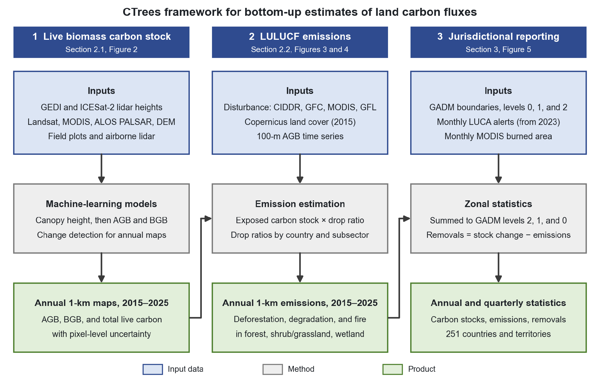

**Figure 1.** CTrees standardized framework for bottom-up estimates of land carbon fluxes from ground and remote sensing data and machine learning, for the Climate TRACE GHG inventory (2015–2025). The framework has three main components: annual 1-km maps of live biomass carbon stocks with pixel-level uncertainty (Section 2.1; Figure 2), annual 1-km LULUCF emissions split by deforestation, degradation, and fire (Section 2.2; Figures 3–4), and annual and quarterly jurisdictional LULUCF emissions and removals for 251 countries and special territories at GADM levels 0–2 (Section 3; Figure 5). Final geospatial products are at 1-km spatial resolution.

#### 2.1 Estimates of Live Biomass Carbon Stocks and Net Changes

This dataset provides annual estimates of live above-ground biomass (AGB), below-ground biomass (BGB), and total live carbon (TLC), the carbon in AGB and BGB combined, across global vegetation (Figure 2). AGB is derived from measurements of vegetation vertical structure made by two spaceborne lidar missions: the Global Ecosystem Dynamics Investigation (GEDI) aboard the International Space Station (ISS) and ICESat-2 (Ice, Cloud, and land Elevation Satellite-2). Using machine learning (ML), the lidar waveform metrics were converted into global maps of vegetation structure (height metrics) across forested and non-forested areas, including savanna woodlands, shrublands, and grasslands. Each 1-km grid cell was required to contain more than 50 GEDI and ICESat-2 samples to ensure reliable estimates of vegetation structure, and hence of AGB, across ecoregions; the number of valid samples increases markedly away from the tropics because of the orbit of the ISS. To obtain height metrics with full global coverage, ICESat-2 heights were converted into GEDI-equivalent heights with a machine-learning model trained between 47°N and 51.6°N, where the forest types are most similar.

A separate ML model was developed for each ecoregion (more than 700 models in total) using the satellite layers listed in Table 1; the ecoregion-specific models improve height estimates and reduce large-scale overfitting and systematic errors. Airborne lidar data collected across the tropics were used to fine-tune and validate the models. Input layers were aggregated to 1 km using the median and the 25th and 75th percentiles to capture spatial variability, together with the growing-season temporal standard deviation to capture temporal variability. The relative-height metrics RH50, RH75, RH90, and RH98 were then used as predictors in the AGB models, providing the vertical-structure information that improves AGB prediction accuracy.

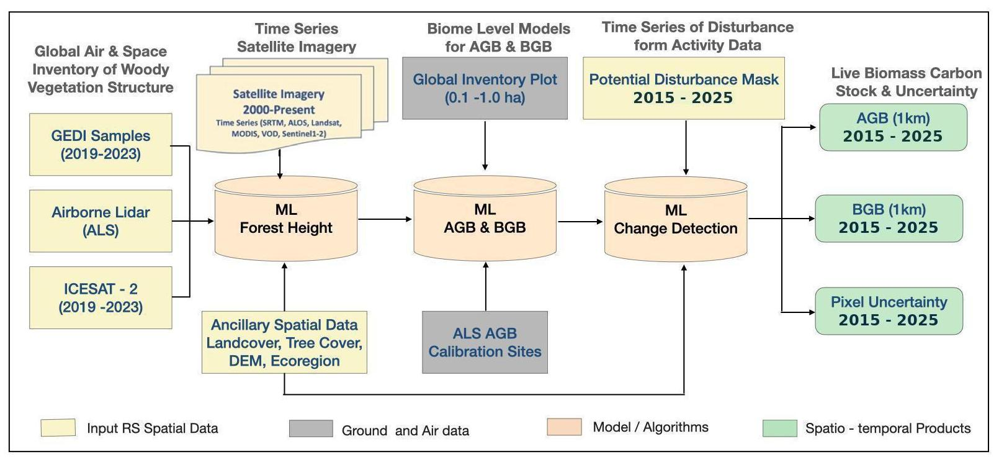

**Figure 2.** Mapping of the spatial and temporal variation of global live biomass carbon stocks from satellite remote sensing, ground and airborne inventory samples, and machine learning for vegetation structure, biomass density, and change detection (Xu et al., 2021).

Before being used to predict AGB, the height maps were validated and refined to reduce spatial uncertainty and artifacts. The AGB training set combined height metrics coincident with plots of known AGB and a large number of ALS-based AGB estimates derived from height-based allometric models. In total, the AGB model was trained with more than 300,000 reference samples from diverse sources, including national forest inventory (NFI) data, research plots distributed across ecoregions worldwide, and biomass estimates from a network of airborne laser scanning (ALS) surveys.

All forest inventory and ALS training data are smaller than a 1-km pixel, so the ML model was trained with higher-resolution remote sensing data at a resolution close to the plot size and then applied to coarser-resolution data, with AGB estimates adjusted proportionally to the 1-km pixel size. The model was trained on GEDI data from 2019–2023 and applied to 2020 imagery to make a 1-km biomass map for 2020. This 2020 map is the reference for the time series.

Annual AGB maps at 1-km resolution for 2015–2025 were then produced with a change-detection ML model (Xu et al., 2021; Yang Y. et al., 2026), which can be extended as new data become available. The model relies on an annual disturbance mask that combines all disturbances in the activity data (e.g., forest cover change and fire) with additional disturbance and growth signals identified from significant annual changes in satellite reflectance and vegetation indices. A buffer around these areas excludes edge pixels, so that only stable pixels are treated as undisturbed. The model constrains large year-to-year anomalies in undisturbed areas and leaves predictions unconstrained in disturbed areas. The 2020 AGB map is the reference for training the change-detection model, which then predicts AGB for every year of the 2015–2025 series.

As part of the change-detection approach, AGB estimates are further refined with a productivity model developed by CTrees. Using a space-for-time approach that combines global disturbance data with AGB estimates, the model improves carbon removal estimates in all ecoregions where vegetation has remained stable over the full disturbance history (Heinrich et al., 2023). It applies annual adjustments in dense forests where AGB is stable but uncertain, capturing biomass gains from gradual vegetation recovery; the increment depends on the biomass level, which is used as a proxy for the local growth stage.

BGB was estimated from AGB using established models for different forest types and default values from the Intergovernmental Panel on Climate Change (IPCC, 2006) guidelines. Total live carbon was then calculated as:

|     |                                   |       |
|-----|-----------------------------------|-------|
|     | 𝑇𝐿𝐶 = (𝐴𝐺𝐵 + 𝐵𝐺𝐵) × FC | \(1\) |

where AGB and BGB are in tonnes of dry biomass per hectare (t/ha), TLC is in tonnes of carbon per hectare (tC/ha), and FC is the carbon fraction of vegetation, which ranges from 0.47 to 0.51 depending on forest type (about 0.5 on average). Carbon stocks (TLC) are converted to tonnes of CO₂ per hectare (tCO₂/ha) by multiplying by 44/12 before delivery to Climate TRACE. Only CO₂ is estimated, so all emissions and removals in this document are in tCO₂. These TLC maps provide the carbon stock used to estimate emissions in Section 2.2.

**Table 1.** Datasets used for mapping vegetation structure and biomass.

|                                                  |                         |                |                                                                                     |
|--------------------------------------------------|-------------------------|----------------|-------------------------------------------------------------------------------------|
| **Dataset**                                      | **Resolution**          | **Period**     | **Role in the product**                                                             |
| Landsat surface reflectance (EROS Center, 2020)  | 30 m                    | 2015–2025      | Optical predictor for the annual 1-km AGB series                                    |
| MODIS surface reflectance (NASA MODIS Land Team) | 500 m                   | 2015–2025      | Optical predictor time series for the annual 1-km AGB model                         |
| ALOS PALSAR-1/2 (L-band SAR) (JAXA EORC)         | 25 m                    | 2015–2025      | L-band backscatter predictor, sensitive to woody structure                          |
| Copernicus DEM (Copernicus Data Space Ecosystem) | 30 m                    | Static         | Topographic predictors (elevation, slope, aspect)                                   |
| GEDI (L2A relative height) (NASA Earthdata)      | 25-m footprints         | 2019–2023      | Canopy-structure metrics aggregated to 1 km                                         |
| ICESat-2 (ATL08) (NASA ICESat-2 Mission)         | 100-m segments          | 2019–2023      | Same role as GEDI, extending coverage beyond GEDI’s latitude limit of 51.6°N–51.6°S |
| Forest inventory plots                           | Plot scale (\~0.1–1 ha) | Multiple years | Training labels, including mangrove AGB samples from coastal regions                |
| Airborne lidar (ALS)                             | \~1 ha                  | Multiple years | Training labels for the ML model                                                    |

**Table 2.** Input datasets and their roles in calculating carbon stocks, emissions, and net fluxes at the jurisdictional level. Note: CIDDR = CTrees Integrated Deforestation, Degradation, and Regeneration product; LUCA = CTrees Land Use Change Alert.

|                                                |                                                  |                |                                                                                  |
|------------------------------------------------|--------------------------------------------------|----------------|----------------------------------------------------------------------------------|
| **Dataset**                                    | **Resolution**                                   | **Period**     | **Role in the product**                                                          |
| CTrees AGB time series (Table 1)               | 1 km (calibrated with the 100-m AGB time series) | 2014–2025      | Annual carbon stocks (TLC)                                                       |
| CTrees AGB time series (Yang Y. et al., 2026)  | 100 m                                            | 2014–2025      | Calibration of the 1-km AGB time series and the AGB used to estimate drop ratios |
| CIDDR v1.1 (CTrees)                            | 30 m                                             | Annual         | Deforestation and degradation masks within the tropical forest domain            |
| GFL fire product (University of Maryland GLAD) | 30 m                                             | Annual         | Complementary Landsat-based burned-area layer                                    |
| MODIS MCD64A1 burned area (NASA LAADS DAAC)    | 500 m                                            | Monthly        | Primary fire layer; quarterly timing for fires                                   |
| Hansen GFC (NASA LCLUC Program)                | 30 m                                             | Annual         | Forest loss outside the tropical forest domain                                   |
| Copernicus Global Land Cover                   | 100 m                                            | 2015 reference | Land-cover stratification and fixed reference class areas                        |
| LUCA (Sentinel-1 SAR (ESA), CTrees)            | \~10 m                                           | Monthly        | Quarterly timing for deforestation and degradation                               |
| GADM v4.1 boundaries                           | Vector                                           | Static         | Administrative reporting units (levels 0/1/2)                                    |
| Urban boundaries                               | Vector                                           | Static         | Urban shapefiles used for city-level zonal statistics alongside GADM units       |

#### 2.2 Estimates of Global Emissions

Committed carbon emissions from deforestation, forest degradation, and fire are calculated by combining satellite-derived disturbance products with CTrees’ annual carbon stock maps from Section 2.1 (Figure 2) and emission factors, also called drop ratios in this document, derived from the 100-m AGB time series for 2014–2025 (Yang Y. et al., 2026); the input datasets are listed in Table 2. The workflow has three main steps shown in Figure 3:

**(1) Disturbance mapping and attribution.** Disturbance data at 30 m from multiple satellite sources are post-processed into annual, per-sector disturbance masks at 100-m resolution. Deforestation and degradation within the tropical forest domain come from CIDDR v1.1, and the Global Forest Change dataset (Hansen et al., 2013) provides forest loss outside it. The burned area comes from the MODIS MCD64A1 burned-area product (Giglio et al., 2021), combined with Landsat-based global fire mapping (GFL; Tyukavina et al., 2022) to capture additional small fires in forest regions. The disturbance categories are kept mutually exclusive so that emissions are not double-counted, and fires are further stratified with the Copernicus land-cover map (Buchhorn et al., 2020a,b) into closed-forest, open-forest, shrub/grassland, and wetland fire.

**(2) Emission estimation.** The disturbance masks are aggregated to 1 km as per-sector disturbed-area fractions. These are combined with the 1-km TLC maps and the drop ratios (the fraction of carbon stock released by each disturbance type) to calculate committed emissions from deforestation, degradation, and fire for each 1-km pixel from 2015 to 2025.

**(3) Sub-annual reporting.** From 2023 onward, the annual emissions of each jurisdiction are split into quarters: monthly LUCA detections set the quarterly timing for deforestation and degradation, and monthly MODIS burned area sets it for forest, shrub/grassland, and wetland fires (Section 3.2). Earlier years (2015–2022) are reported annually only since LUCA detections are available from 2023 onward.

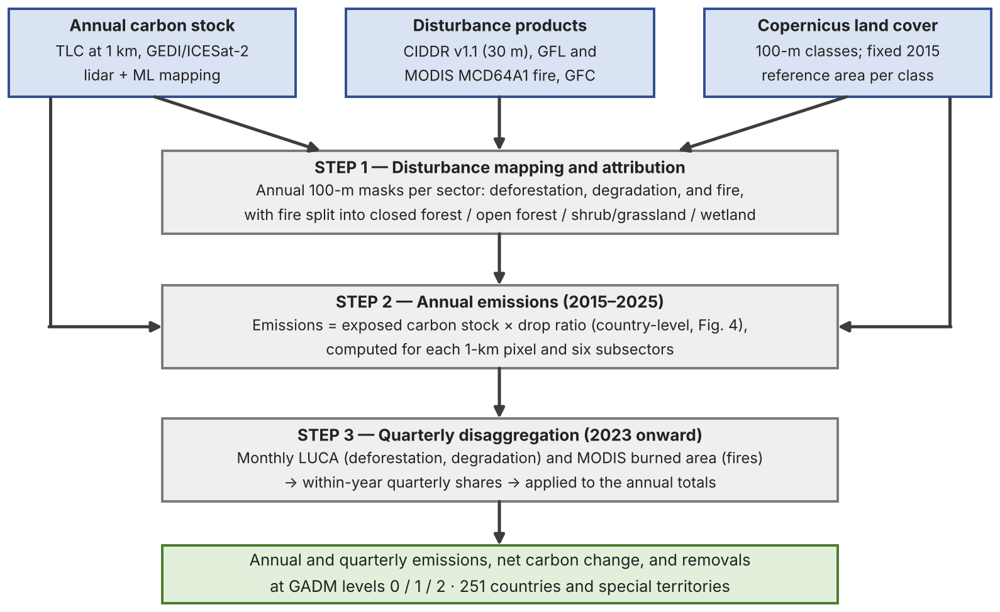

**Figure 3.** Overview of the emission estimation workflow. Satellite disturbance products, annual carbon stock maps (Figure 2), and the 2015 Copernicus land-cover map feed three processing steps that produce annual (2015–2025) and quarterly (2023 onward) emissions for six subsectors, reported at three GADM administrative levels. See Figure 4 for a further breakdown of step 2.

Emissions are calculated as the carbon stock exposed to a disturbance (deforestation, degradation, or fire) multiplied by the drop ratio of that disturbance:

|     |                                                 |       |
|-----|-------------------------------------------------|-------|
|     | Ed = Cexp × rd | \(2\) |

where Ed is the emissions (tCO2) from disturbance d and rd is the drop ratio (unitless), the fraction of that carbon stock lost to the disturbance d (Figure 4). Cexp is calculated from the 1-km carbon stock maps (Eqs. 3–5) and rd is estimated from the 100-m AGB time series (Eq. 6). The exposed carbon stock, Cexp (tCO2), is the carbon stock in the disturbed area of a 1-km pixel prior to the disturbance:

|     |                                                 |       |
|-----|-------------------------------------------------|-------|
|     | Cexp = Dk × Ad | \(3\) |

where Ad is the disturbed area (ha) of the subsector in the pixel, from the 100-m disturbance masks aggregated to 1 km, and Dk is the carbon density (tCO2/ha) of land-cover class k. Deforestation, degradation, and both forest-fire subsectors use the forest carbon density; shrub/grassland and wetland fires use the densities of their own classes. Total forest fire is reported as the sum of the closed-forest and open-forest fire subsectors. The carbon density Dk is computed as:

|     |                                                               |       |
|-----|---------------------------------------------------------------|-------|
|     | Dk = Cadj, k, t / Aref, k | \(4\) |

where Aref, k is the area (ha) of class k in the pixel in the 2015 Copernicus land-cover map. The reference area, Aref, k , is held fixed at 2015 to keep the denominator constant over the time series, so that trends in emissions reflect disturbance and carbon stock dynamics rather than year-to-year reclassification of land cover. Cadj, k, t is the adjusted carbon stock of class k in year t:

|     |                                                                         |       |
|-----|-------------------------------------------------------------------------|-------|
|     | Cadj, k, t = max\[Ck, t-1, Ck, t\] | \(5\) |

where Ck, t is the total live carbon of class k in the pixel in year t (Section 2.3). The AGB maps represent the growing season, while the disturbance data cover the full year, so a disturbance may occur before or after the growing season. If a disturbance occurs before the growing season, the year-t AGB map already shows the reduced carbon. Using that map would understate the carbon present before the disturbance. Taking the larger of the two years uses the pre-disturbance value in either case and removes spurious year-to-year dips caused by noise in the biomass product. Actual carbon losses are accounted for through the disturbance activity data rather than through declines in the stock series. This adjustment applies to all subsectors and the adjusted stock is used only to calculate emissions, while the net stock change in Section 3.1 uses the original unadjusted values.

The drop ratio of each subsector is the fraction of the carbon stock lost when the disturbance occurs. Rather than adopting fixed values from the literature, drop ratios are estimated from the 100-m AGB time series and the disturbance masks: a drop ratio is computed for every pure disturbance pixel, and the pixel values are averaged within each country (GADM0; Section 3.1) for each disturbance type and land-cover class (Figure 4). Three estimation methods are used (Table 3).

For deforestation, degradation, and closed-forest fire, the drop ratio is measured on pure pixels (pixels fully covered by a single disturbance type during 2015–2025) as the relative loss of AGB:

|     |                                                                               |       |
|-----|-------------------------------------------------------------------------------|-------|
|     | rd = (AGBpre − AGBpost ) / AGBpre | \(6\) |

Because the disturbance layer and the AGB product can disagree by a year on the timing of an event, AGBpre is taken as max\[AGBt-1, AGBt\] and AGBpost as min\[AGBt, AGBt+1\] for year t. For deforestation in the tropics, AGBpre is instead the maximum AGB over the five years up to the event, because tropical forests are often degraded for several years before final clearing, and using only the year before clearing would understate the loss. Quality filters on pre- and post-disturbance AGB exclude unrealistic samples, and for closed-forest fire the edges of burn scars are eroded so that the ratio reflects the core of the burned forest rather than mixed edge pixels. The ratio is computed for each year and averaged over the period, and missing values are filled with the average of nearby regions.

Pure burned pixels are too scarce in open forest for this before/after approach. For open-forest fires, the drop ratio is calculated as the ratio of mean shrub/grassland AGB to mean open-forest AGB. GEDI showed that RH98 did not change while RH25 and RH50 decreased, which suggests that the fires mainly burned the understory, with biomass similar to shrub/grassland. Wetland and shrub/grassland fires use fixed drop ratios of 0.30 and 0.527, respectively, consistent with combustion completeness values reported for these vegetation types (Xu et al., 2021).

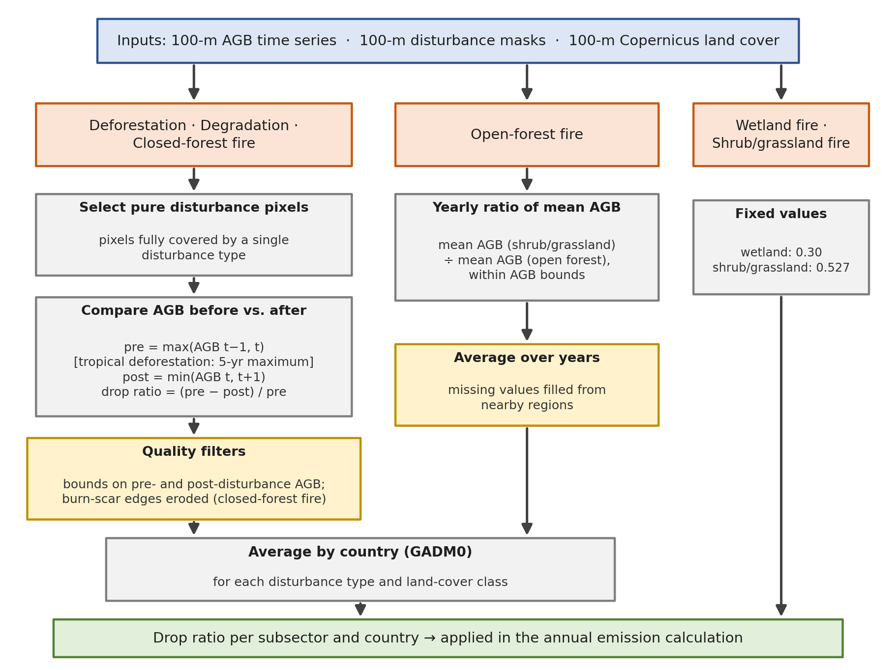

**Figure 4.** Breakdown of step 2. Estimation of the subsector emission factors (drop ratios). Deforestation, degradation, and closed-forest fire are estimated from pure disturbance pixels by comparing AGB before and after the event, and open-forest fire from the AGB contrast between open forest and shrub/grassland; both are averaged by country (GADM0). Wetland and shrub/grassland fires use fixed values.

**Table 3.** Drop-ratio estimation by subsector.

|                      |                          |                                                                                       |
|----------------------|--------------------------|---------------------------------------------------------------------------------------|
| **Subsector**        | **Drop ratio**           | **Estimation method**                                                                 |
| Deforestation        | Country-specific (GADM0) | Pure-pixel AGB before/after comparison; 5-year pre-disturbance maximum in the tropics |
| Degradation          | Country-specific (GADM0) | Pure-pixel AGB before/after comparison                                                |
| Closed-forest fire   | Country-specific (GADM0) | Pure-pixel AGB before/after comparison on edge-eroded burn scars                      |
| Open-forest fire     | Country-specific (GADM0) | Ratio of mean shrub/grassland AGB to mean open-forest AGB, averaged over years        |
| Shrub/grassland fire | 0.527 (fixed)            | Fixed value                                                                           |
| Wetland fire         | 0.30 (fixed)             | Fixed value                                                                           |

The net annual change in total live carbon of each 1-km pixel is:

|     |                                                        |       |
|-----|--------------------------------------------------------|-------|
|     | ΔCnet, t = Ct-1 – Ct | \(7\) |

where Ct-1 and Ct are the total carbon stocks (tCO₂) of a pixel in the previous and current year, taken directly from the biomass product (not the adjusted carbon stock in Eq. 5), and ΔCnet, t is the net change in the current year. A positive value indicates a net loss of living biomass (a carbon source to the atmosphere), and a negative value a net gain (a carbon sink). This net change is the sum of the emissions from deforestation (EDF), degradation (EDG), and fire (EFire), which are positive, and the carbon removed by vegetation growth (Cremoval), which is negative. Removals are therefore estimated as the residual between the net stock change and the disturbance emissions:

|     |                                                                                                     |       |
|-----|-----------------------------------------------------------------------------------------------------|-------|
|     | Cremoval = ΔCnet – EDF – EDG – EFire | \(8\) |

Further details of the data-processing framework and the spatio-temporal ML implementation are given in Xu et al. (2021).

#### 2.3 Estimates of Carbon Stocks and Emissions by Land Cover Type

CTrees provides annual estimates of total live carbon (TLC) in three major land-cover types: forests/mangroves, shrub/grasslands, and wetlands. The disaggregation combines the global 1-km TLC maps (Section 2.1), the 100-m Copernicus Global Land Service (CGLS) land-cover map, and a high-resolution 100-m TLC map.

CGLS classes are grouped into three layers (forest/mangroves, shrub/grasslands, and wetlands) and averaged from 100 m to 1 km to obtain three land-cover fractions per pixel. Combining these layers with the 100-m TLC map gives the fraction of the pixel’s carbon stock, *R*, held by each of the three land-cover classes in every 1-km pixel: *Rf = CF/C*; *Rsg = CSG/C*; *Rw = CW/C*, where *CF*, *CSG*, and *CW* are the carbon stocks of the forest/mangrove, shrub/grassland, and wetland classes in the pixel and C is the total carbon stock of the pixel. The carbon stock (tCO₂) of each land-cover class in pixel i (Ck,t in Eq. 5) is then:

|     |                                                        |        |
|-----|--------------------------------------------------------|--------|
|     | $`C_{F,i} = D_{i} \times R_{f} \times A_{i}`$          | \(9\)  |
|     | $`C_{SG,i} = D_{i} \times R_{\text{sg}} \times A_{i}`$ | \(10\) |
|     | $`C_{W,i} = D_{i} \times R_{w} \times A_{i}`$          | \(11\) |

where Di is the total carbon density (tCO2/ha) of pixel i in a given year and Ai is the pixel area (ha). For the emission calculations in Section 2.2, the 2015 CGLS land-cover map provides the fixed reference area of each class, and the forest class is further split into closed and open forest for the fire stratification, because fire behaves differently in the two.

#### 2.4 Confidence Level

Confidence ratings are assigned to each record (administrative unit, year, and subsector) for carbon density, disturbed area, exposed carbon stock, emission factor, and CO2 emissions (corresponding to the Climate TRACE fields capacity, capacity factor, activity, emission factor, and CO2 emissions), based on the annual totals of each unit. The quarters of a year carry that year’s rating.

Ratings are derived from the relative uncertainty (in percent) of each quantity, propagated with the IPCC Approach 1 rules (IPCC, 2006). Approach 1 assumes small, independent uncertainties, so uE above about 60% is approximate. Emissions are the sum over disturbed pixels of disturbed area × carbon density × drop ratio (Section 2.2), so the relative uncertainty of a unit’s annual emissions, uE, is the square root of the sum of squares of its three components:

|     |                                                                   |        |
|-----|-------------------------------------------------------------------|--------|
|     | uE² = uA² + uD² + ur² | \(12\) |

-   **Disturbed area:** uA² = pA²/Neff + sA², where pA is the per-pixel error of the disturbance product from its published accuracy assessment, Neff = (Σ Ai)²/Σ Ai² is the effective number of disturbed pixels, and sA (5–10%) is the product bias, which does not shrink with area.

-   **Carbon density:** uD is the relative uncertainty of the unit’s carbon stock. Carbon stock uncertainty is quantified at pixel and regional scales with a bootstrap-based, model-based inference approach that accounts for residual variance, parameter uncertainty, and spatial covariance.

-   **Drop ratio:** ur² = (CVr/√nr)² + sr², where CVr and nr are the coefficient of variation and the number of pure pixels behind the country mean (Section 2.2), and sr covers the timing and edge effects described there. The fixed wetland and shrub/grassland drop ratios are assigned ur = 30%.

Carbon density is rated from uD, disturbed area from uA, the exposed carbon stock from uA and uD combined, the emissions factor (drop ratio) from ur, and CO2 emissions from uE, using fixed bands so that ratings are comparable across units, years, and subsectors. In years without annual disturbance data (currently 2026), all records are rated very low. Units outside the coverage of a disturbance product are marked not assessed.

#### 3. Climate TRACE Reporting

#### 3.1 Annual Reporting

The pixel-level estimates of emissions and removals are summarized as zonal statistics for Climate TRACE reporting. The Climate TRACE platform reports total carbon stocks, emissions, and removals for forests, shrub/grasslands, and wetlands at three administrative levels of the Database of Global Administrative Areas (GADM; [https://gadm.org](https://gadm.org)): GADM0 (countries and special territories), GADM1 (states, provinces, or regions), and GADM2 (counties, districts, and municipalities). Zonal statistics are computed first at GADM2 from the 1-km pixels and then summed to GADM1 and GADM0, so the three levels are consistent and no separate national data source or adjustment is used at the country level. Over 2015–2025, about 35% of reported emissions use inputs other than country-specific drop ratios and CIDDR disturbance data. Fixed drop ratios are used for shrub/grassland fires (0.527) and wetland fires (0.30), which account for 25.7% and 0.6% of total emissions (15.03 GtCO2 per year), respectively. Deforestation outside the CIDDR tropical domain is mapped with Hansen GFC and accounts for at least 9.0% of total emissions (43% of deforestation emissions). Drop ratios filled from nearby regions affect less than 0.1% of total emissions. This small fraction is expected, because the nearby-region average is used only when a region does not have enough pure disturbance pixels. Coverage spans 251 countries and special territories, and carbon stocks and fluxes are reported by land-cover type at every level.

The net change in living biomass for 2015–2025 is calculated for each sector as the change in total live carbon (TLC) between consecutive years as shown in Eq. 7 (Section 2.2). Following Section 2.2, removals are reported as the residual that reconciles the net stock change with the disturbance emissions (Eq. 8).

The following datasets are available for download via the Climate TRACE website: annual carbon stocks; emissions from forest-land clearing, forest-land degradation, and forest-land fires; emissions from shrub/grassland and wetland fires; and residual removals for forests, shrub/grasslands, and wetlands. CTrees also provides uncertainty and confidence levels for all zonal statistics. General dataset information is given in Table S1, and the data attributes with their confidence and uncertainty definitions in Table S3.

#### 3.2 Quarterly Reporting

For emissions from 2023 onward, the annual totals are split into quarters (Q1 = January–March, Q2 = April–June, Q3 = July–September, Q4 = October–December). Monthly satellite detections provide the within-year timing of disturbance, and this timing, not the magnitude, distributes each annual total across the four quarters (Figure 5). Because the quarterly fractions sum to one, the quarters add up exactly to the annual value, so the quarterly and annual totals are consistent by construction.

For the three fire subsectors (forest, shrub/grassland, and wetland), the timing comes from the MODIS MCD64A1 monthly burned-area product (Giglio et al., 2021), summed to quarters for each GADM unit, with burned area assigned to land-cover types using the same CGLS classification as the annual estimates. For deforestation and degradation, the timing comes from the CTrees Land Use Change Alert (LUCA) system, a Sentinel-1 SAR-based land-use change product at 10-m resolution that is updated biweekly and works in all weather conditions (Mullissa et al., 2024), aggregated to monthly series, with fire-driven detections removed using the MODIS burned area.

For each administrative unit, year, and subsector, the quarterly emissions are:

|     |                                                                                                 |        |
|-----|-------------------------------------------------------------------------------------------------|--------|
|     | Eq = Et × Fq                                                   | \(13\) |
|     | Fq = Aq / (A1 + A2 + A3 + A4) | \(14\) |

where Eq is the emissions (tCO2) in quarter q (q = 1, 2, 3, 4), Et is the annual emissions (tCO2) in year t (Eq. 2), Fq is the fraction of the year’s detected disturbance area that falls in quarter q, and Aq is the disturbed area (ha) detected in quarter q. When no disturbance is detected in any quarter of the year, the denominator is zero and the fallback sequence described below is used. An annual value of zero is written as zero in all four quarters. Quarterly disturbance areas are split in the same way, and the quarterly exposed carbon stock is back-calculated as emissions divided by the drop ratio, so that the three quantities stay consistent. Quarters of the current year (2026), for which annual disturbance data are not yet available, are projected from the previous year and are rated very low in confidence (Section 2.4).

Not every unit produces a usable monthly signal every year; heavy snow cover or very sparse forest, for example, can leave LUCA without detections despite non-zero annual emissions. Each unit’s quarterly fractions are therefore resolved in a fixed order of precedence (Figure 5): the unit’s own data at the deepest available level (district, then state, then country); the same country’s fractions in an adjacent year; the average of neighboring countries; and, as a last resort, zero. Over 2023–2025, 99.97% of annual emissions use the unit’s own data: 97.6% from the GADM2 unit itself, 0.8% from its GADM1 unit, and 1.6% from its GADM0 unit. The adjacent-year and neighboring-country branches cover only 0.03%, and the zero branch has zero annual emissions. The rule used is recorded in a provenance flag on every quarterly record, so users can filter by the strength of the seasonality evidence.

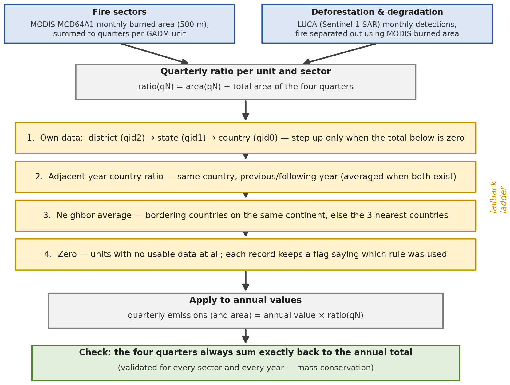

**Figure 5.** Quarterly disaggregation. Monthly MODIS burned area (fires) and LUCA detections (deforestation and degradation) provide within-year quarterly fractions; a four-step fallback sequence fills units that lack a usable signal of their own; the fractions are applied to the annual values, and the quarterly sums are checked against the annual totals.

#### 3.3 Validation and Consistency Checks

For every product year and subsector, the pipeline checks that the four quarterly values sum to the annual value within numerical tolerance, that no missing values remain, and that any emissions assigned to zero-filled units are accounted for. All six subsectors passed these checks in the most recent production cycle.

The product is also compared with published global estimates. Total emissions of about 15.03 GtCO₂ per year over 2015–2025 are within about 11% of the 16.82 GtCO₂ per year derived from the biomass-change analysis of Xu et al. (2021) for 2000–2019. The two are not directly comparable, because they cover different periods and use different spatial resolutions and forest definitions. Fire emissions track the Global Fire Emissions Database (GFED v5.1; van der Werf et al., 2025) from year to year, with a mean bias of +0.05 GtCO₂ (GFED minus CTrees), an RMSE of 0.61 GtCO₂, and an MAE of 0.50 GtCO₂ (Figure 6). National forest carbon stocks follow FAOSTAT (Tubiello et al., 2021) more closely for Annex I countries than for non-Annex I countries, where self-reported inventories vary widely in method and update frequency (Figure 7). CTrees carbon stocks are higher than FAOSTAT in both groups, with a mean bias of 1,286 MtCO₂ (14% of the mean FAOSTAT stock) for Annex I and 1,426 MtCO₂ (29%) for non-Annex I countries. Forest-land net change over the overlapping 2015–2020 period is consistent with published net carbon flux estimates (Grassi et al., 2022). When all land-cover types are included, the net change of –1.87 GtCO₂ per year over 2015–2025 is similar to the –1.83 GtCO₂ per year reported by Yang H. et al. (2023) for 2010–2019 from satellite microwave data.

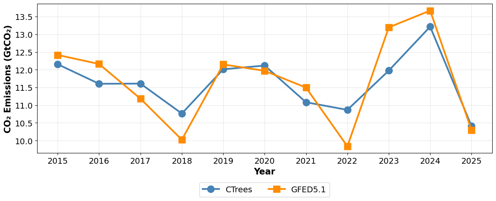

**Figure 6.** Annual global fire emissions from CTrees and the Global Fire Emissions Database (GFED v5.1), 2015–2025. CTrees estimates include only forest, shrubland/grassland, and wetland fires; fires on other land-cover types (e.g., cropland, urban, and bare land) are excluded. GFED values are total fire emissions, which cover all land-cover types and also include burning of peat and soil carbon.

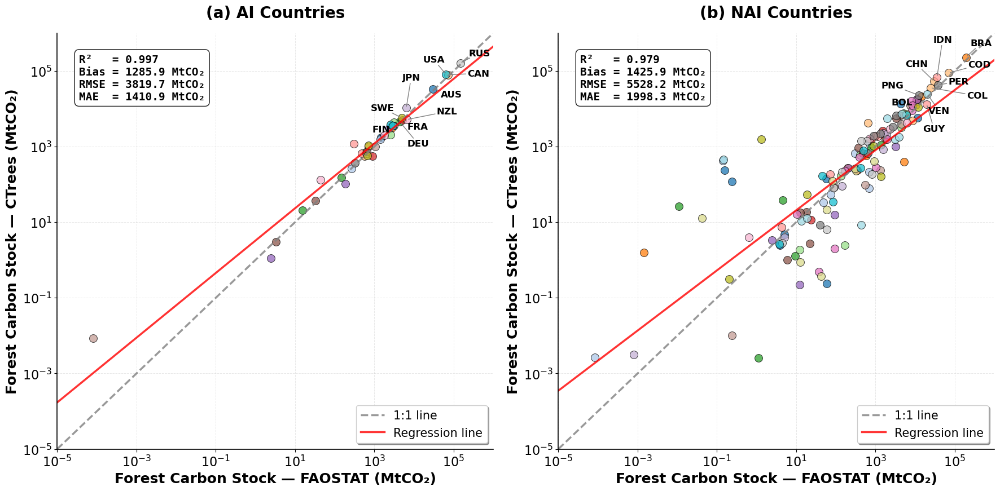

**Figure 7.** National forest carbon stocks from CTrees versus FAOSTAT (average 2015–2020) for (a) Annex I (AI) countries, such as RUS, USA, CAN, AUS, and JPN, and (b) non-Annex I (NAI) countries, such as BRA, COD, IDN, CHN, and PER.

#### 4. Emission Reduction Solutions Methodology – Forestry

#### 4.1 ERS – Introduction

Emission Reduction Solutions (ERS) for the forest sector target the disturbances that contribute most to land-sector emissions: deforestation, forest degradation, and uncontrolled fire, across forests, carbon-rich wetlands, and shrub/grasslands. ERS helps governments and partner organizations (local agencies, Indigenous communities, non-governmental organizations, and private operators) choose interventions matched to the local drivers of emissions and achieve verifiable reductions in CO₂ emissions (tCO₂) within the areas they manage.

#### 4.1.1 Typical Strategy Pathways for Emission Reduction

ERS includes several strategy pathways, each targeting specific emission sources:

-   Limit Deforestation

-   Reduce Degradation

-   Mitigate Fire Risk

-   Protect Wetlands/Peat by reducing fire activity

-   Enable Restoration through natural regeneration and plantation management

Further details on each pathway are provided in Appendix A1.

#### 4.1.2 Proposed Approach to Quantify Emission Reduction Solutions

ERS reductions are quantified in three steps:

1.  Establish the Baseline and ERS Scenario

2.  Estimate Reduced Emissions Based on Affected Areas

3.  Estimate Confidence Intervals for Each Strategy

The full methodology for each step is described in Appendix A2.

#### 4.1.3 Enabling Factors for Effectiveness

The effectiveness of the ERS strategies depends on the following enabling conditions:

-   Governance and Enforcement Capacity

-   Tenure Clarity

-   Durable Finance

-   Community Co-management

-   Climate Exposure

Each enabling factor is described further in Appendix A3.

#### 4.2 ERS – Materials and Methods

#### 4.2.1 Datasets Employed

The ERS analysis combines emissions data with disturbance layers for forests, wetlands (including peatlands), and shrub/grassland systems to assess emissions and their reduction potential. All input datasets are aligned in space and time so that baseline emissions and ERS scenarios can be calculated for the jurisdictions defined by the GADM boundaries.

**Core Datasets:**

-   CTrees emissions (1 km, 2015–2025)

-   Disturbance area rasters (1 km, 2015–2025)

-   Administrative boundaries

Each dataset and its role in the ERS analysis are described in Appendix B1.

**Key Variables and Units for ERS Analysis:**

-   Emissions:

-   Gridded format: tCO₂ per km²

-   Aggregated scale: tCO₂

-   Disturbance Area:

-   Hectares per year (ha yr⁻¹)

-   Jurisdictional Boundaries:

-   Jurisdiction IDs

The variables and units are described further in Appendix B2.

#### 4.2.2 Nature-Based Emission Reduction and Removal Scenarios

ERS scenarios build on policy and market mechanisms that are already reducing land-sector emissions and financing removals. Brazil has led global efforts to reduce emissions from deforestation and forest degradation (REDD+). The country implemented comprehensive REDD+ policies between 2006 and 2016 and, after a period of reduced focus, resumed this leadership in 2023 under President Lula’s administration. Its strategy centers on the Brazilian Forest Policy, which aims for near-zero deforestation emissions in line with the country’s net-zero commitment.

Other countries have adopted similar strategies. Indonesia, for example, has substantially reduced deforestation over the past five to ten years through targeted interventions, improved governance, and well-funded REDD+ programs, showing that well-designed policies and international cooperation can curb forest loss.

Carbon-market incentives have accelerated the growth of REDD+, driving the expansion of jurisdictional programs in which entire national or sub-national regions take part in carbon-credit schemes. A main driver is the ART/TREES standard (Architecture for REDD+ Transactions / The REDD+ Environmental Excellence Standard; ART, 2021), which has been adopted by national and sub-national governments across the Global South. More than 25 jurisdictions have declared their readiness to reduce emissions from deforestation and degradation under this standard, securing funding for their conservation efforts.

Monitoring the performance of jurisdictional REDD+ programs underpins their integrity. CTrees has developed performance-monitoring systems compatible with both the ART/TREES and Verra methodologies and, through them, helps scale up emission-reduction policies across the tropics. Interest from major carbon-market investors, including Amazon, Mercuria, Shell, and TotalEnergies, along with several leading financial institutions, reflects market confidence in jurisdictional REDD+.

Beyond avoided deforestation, forest restoration removes carbon from the atmosphere. The market finances restoration through Afforestation, Reforestation, and Revegetation (ARR) projects, which span forest and non-forest land, and through Improved Forest Management (IFM). A growing number of registry projects focus on carbon removal and on restoring forest and wetland ecosystems, supported by investments from technology companies such as Meta, Microsoft, Netflix, and Google and from energy companies such as Shell and TotalEnergies.

Financing for emission reductions carries social and ethical safeguards, notably requirements on Indigenous rights, so that investments support the livelihoods of local communities and address the underlying drivers of deforestation.

Most emission-reduction programs, including REDD+, ARR, and IFM, are also designed to deliver co-benefits beyond carbon, with specific requirements and financing mechanisms for biodiversity conservation, water quality, and other ecological benefits. A rapidly growing market for biodiversity credits reflects recognition of these co-benefits, which are increasingly built into market and policy frameworks.

#### 4.2.3 Emission-Reduction Strategy (Forests & Related Land Systems)

The six ERS strategies below refine the five pathways of Section 4.1.1. The fire-risk pathway is applied separately to forest and to shrub/grassland fires, so five strategies target the disturbance and land-class combinations in the emission baseline (Table S2), and forest restoration targets carbon removals. Together they aim to increase forest area and carbon stocks, strengthening the land’s natural capacity to absorb and store carbon, while preventing emissions from land-use change and disturbances such as fire:

-   **Forest Restoration**: Restores degraded or deforested ecosystems to recover ecological function. Forest restoration is split into **natural regeneration** (unmanaged regrowth) and **plantation management** (actively managed regrowth).

-   **Mitigate Forest Fire Risk:** Reduces wildfire likelihood, intensity, and impacts through preventive measures.

-   **Limit Deforestation:** Prevents the permanent loss of forest cover.

-   **Reduce Degradation:** Minimizes declines in forest health and productivity from human or natural causes.

-   **Reduce Grassland Fire Activity:** Lowers ignition risk and fire spread in grassland ecosystems.

-   **Reduce Wetland Fire Activity:** Reduces occurrence and severity of fires in peat and other wetland systems.

The parameters of each strategy are summarized in Table 4. Forest restoration is delivered as two strategy records, natural regeneration and plantation management, so the table has seven rows. For the five disturbance strategies, 10% of the baseline disturbed area is avoided and the drop ratios are unchanged, which corresponds to a new-to-old activity ratio of 0.9 and a new-to-old emission factor ratio of 1.0. Key approaches and expected outcomes for each strategy are described in Appendix B3.

**Table 4**. ERS strategies, mechanism, and parameters.

|                                |                  |               |                                |                |                  |
|--------------------------------|------------------|---------------|--------------------------------|----------------|------------------|
| **Strategy**                   | **strategy\_id** | **Mechanism** | **Activity affected**          | **Confidence** | **Target**       |
| Limit Deforestation            | DEF1             | Subtract      | 10%                            | High           | Deforestation    |
| Reduce Degradation             | DEG1             | Subtract      | 10%                            | Medium         | Degradation      |
| Mitigate Forest Fire Risk      | FLF1             | Subtract      | 10%                            | Low            | Forest Fire      |
| Reduce Grassland Fire Activity | SGF1             | Subtract      | 10%                            | Low            | Shrub/Grass Fire |
| Reduce Wetland Fire Activity   | WLF1             | Subtract      | 10%                            | Low            | Wetland Fire     |
| Natural Regeneration           | NRG-{GADM ID}    | Add           | Restoration area per unit (ha) | Very high      | Removals         |
| Plantation Management          | PTM-{GADM ID}    | Add           | Restoration area per unit (ha) | Very high      | Removals         |

#### 4.2.4 Methodology in Practice

#### 4.2.4.1 Baseline Period

The ERS baseline period is 2015–2025. Baseline emissions are quantified at GADM2 (counties, groups of counties, and municipalities) and broken down by disturbance category (deforestation, degradation, and fire) and land class (forest, wetland, and shrub/grassland), with all calculations performed at 1-km resolution (Figure 8).

The analysis relies on two input layers covering 2015–2025, the global time series of emission maps and the disturbance datasets, which allow emissions to be attributed to specific disturbance types and land classes.

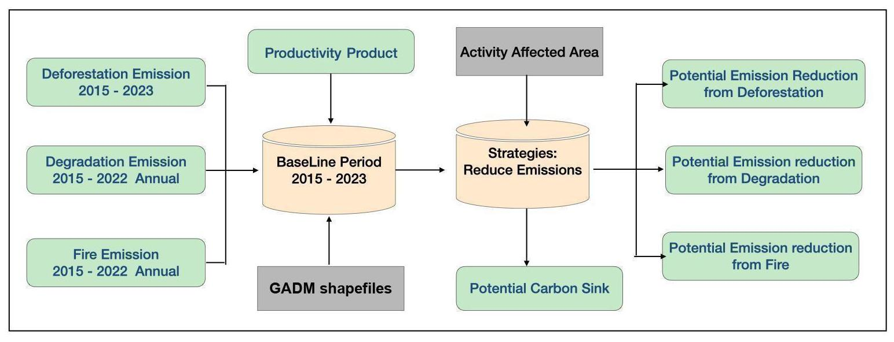

**Figure 8.** ERS workflow. Green boxes are input and output datasets (the emission datasets produced by CTrees), gray boxes are ancillary inputs, and orange cylinders are the methods and strategies applied.

#### 4.2.4.2 Processing Steps

Emission reductions are calculated by quantifying how each ERS strategy changes disturbance-related emissions over a defined period, in four steps:

1.  Baseline Establishment

2.  Emission Reduction Calculation

3.  Scenario Development and Evaluation

4.  Continuous Monitoring and Improvement

Each step is described in detail in Appendix B4.

#### 4.2.4.3 Forest Restoration and Disturbance Activities

Forest restoration expands forest area, rebuilds carbon stocks, and removes CO₂ from the atmosphere by returning non-forest land to forest. Its most direct and measurable benefit is the gain in above-ground biomass (AGB), a direct indicator of carbon sequestration.

As Figure 9 illustrates, a typical successful transition from non-forest to forest can add approximately 150 Mg/ha of AGB, equivalent to roughly 350 tCO₂/ha sequestered over 25 years. Scaled over large suitable areas, restoration is a large carbon sink and also benefits biodiversity, water quality, soil protection, and local livelihoods.

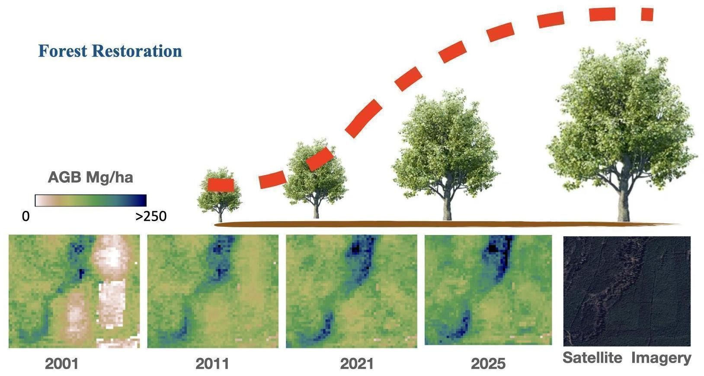

**Figure 9.** Two aspects of forest restoration: the upper panel shows the forest regrowth curve (red dashed line), and the lower panels show AGB change between 2001 and 2025 alongside satellite imagery. Lighter colors indicate lower AGB and darker colors higher AGB.

Restoration removals are delivered through two complementary pathways.

***Natural regeneration***

Under natural regeneration, forest re-establishes by natural means (seed dispersal, coppice regrowth, or root suckers) and the regrowing stands are left unmanaged; naturally regenerating forests make up roughly 92% of global forest area (FAO, 2025).

***Plantation management***

Under plantation management, planted stands are established on degraded or non-forest land and actively managed through fertilization, competing-vegetation control, thinning, and timed harvest to accelerate carbon sequestration alongside timber, pulp, or fiber production; planted forests cover approximately 312 million hectares, about 8% of global forest area (FAO, 2025).

The two pathways trade speed against permanence and cost. Natural regeneration accumulates carbon more slowly (removal rates peak at stand ages of about 20–40 years and vary roughly 200-fold across locations), but because the biomass is never harvested, the stored carbon is more permanent and the input costs are near zero. If 800 Mha of restorable land began regenerating in 2025, up to \~74 GtCO₂ could be removed by 2050 (Robinson et al., 2025). Protecting regrowth already under way matters as much as starting new regrowth, because young secondary forests are frequently re-cleared before they reach peak removal. Managed plantations sequester carbon faster (management intensity can more than double sequestration rates; Maier & Johnsen, 2010), but their on-site carbon is less permanent because biomass is periodically harvested, and the management inputs carry their own emissions.

Across 138 low- and middle-income countries, cost-effective restoration offers a 30-year, time-discounted abatement potential of 31.4 GtCO₂ below \$50/tCO₂, with natural regeneration the lower-cost method on about 46% of suitable land and planting on the remaining 54% (Busch et al., 2024). Both pathways are mature (TRL 9) and are credited under ARR methodologies such as Verra VM0047 (Verra, 2025b), the Climate Action Reserve (CAR; Climate Action Reserve, 2023), and Gold Standard (Gold Standard Foundation, 2024), with MRV based on satellite imagery, lidar, and field sampling. Strategy descriptions, adoption context, and caveats for both pathways are given in Appendix B3.1.

Conversely, disturbances (deforestation, forest degradation, and natural or anthropogenic fire) transfer CO₂ from terrestrial ecosystems back to the atmosphere (definitions in Appendix B5).

As Figure 10 shows, these disturbances cause a marked drop in AGB between the years before and after the event, directly reducing forest carbon stocks and adding to GHG emissions.

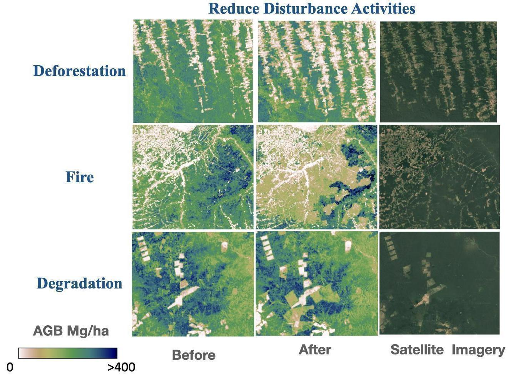

**Figure 10.** AGB loss caused by deforestation, fire, and degradation. For each disturbance, the panels show AGB before (left) and after (center) the event and the corresponding satellite imagery (right). Lighter colors indicate lower AGB and darker colors higher AGB.

Curbing these disturbances (preventing deforestation, reducing degradation, and managing fire risk) therefore lowers GHG emissions and preserves existing carbon sinks. Restoration and the prevention of disturbance are complementary parts of a mitigation strategy.

#### 4.2.5 Verifying ERS Estimates

**Countries Demonstrating Recent Reductions in Deforestation**

Several countries have made measurable progress in curbing deforestation through stronger enforcement, policy implementation, and supply-chain initiatives; their documented reductions provide reference points for the modeled ERS reductions:

-   Brazil (Amazon, 2023)

-   Indonesia (Multi-Year)

-   Malaysia (Multi-Year)

Each country’s actions and verified outcomes are described in Appendix B6.

#### 4.3 ERS – Results

#### 4.3.1 Disturbance Reduction

Implementing ERS across the managed regions could markedly reduce land-sector emissions. Under a hypothetical scenario that reduces disturbance emissions by 10% per year, global land-sector emissions fall by 1,502.78 MtCO₂ in the first year, from a baseline of 15,027.68 MtCO₂ per year (Table S2). Most of this reduction comes from deforestation controls and fire-risk mitigation, which address the two largest baseline sources when fire is combined across land classes.

In Brazil (Figure 11), the ERS scenario reduces emissions by an additional 10% of the 2015–2025 mean baseline each year from 2026, reaching 50% below the baseline in 2030. Annual deforestation emissions fall from the baseline of 479 MtCO₂ to 239 MtCO₂ in 2030, and degradation emissions from 66 MtCO₂ to 33 MtCO₂. Summed over 2026–2030, the reduction is about 718 MtCO₂ for deforestation and 99 MtCO₂ for degradation. This reduction is based on the assumed treatment area, disturbance rates, and country-specific emission factors. Actual outcomes will vary with enforcement capacity, the availability and allocation of finance, and climate variability.

Table S2 breaks the reduction down by disturbance type and land class. In Figure 11, the red line shows the baseline derived from Brazil’s deforestation and degradation emissions over 2015–2025, and the black line shows the projected emissions after ERS implementation, well below the baseline.

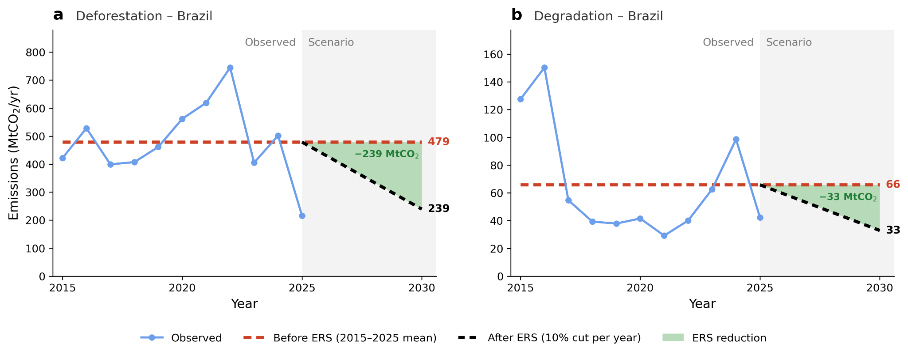

**Figure 11**. Brazil’s (a) deforestation and (b) degradation emissions, observed for 2015–2025 and under a hypothetical ERS scenario for 2026–2030 (gray area). The blue line shows observed emissions and the red dashed line shows the baseline (2015–2025 mean). The black dashed line shows emissions under the ERS scenario, which starts from the baseline in 2025 and decreases by 10% of the baseline each year, reaching 50% below the baseline in 2030. The green labels give the reduction in annual emissions reached in 2030.

#### 4.3.2 Carbon Removals

Forest restoration complements disturbance reduction by removing CO₂ from the atmosphere. The two restoration strategies were assessed by multiplying the area available for restoration in each asset by an annual carbon accumulation rate. The restoration area came from the Atlas of Forest and Landscape Restoration Opportunities, which groups land into wide-scale, mosaic, and remote restoration areas (Potapov et al., 2011). Wide-scale areas have fewer than 10 people per km² and were once closed forest, so they can be restored to closed forest. Mosaic areas have 10 to 100 people per km², so trees are mixed with other land uses such as farms and settlements. Remote areas are unpopulated lands far from people, such as northern Canada and Siberia, where forests were thinned mainly by fire and pests and are costly to restore (World Resources Institute, 2014). For natural regeneration, all three groups were used and the accumulation rate was taken from CTrees’ regrowth curves (Robinson et al., 2025). For plantation management, only the wide-scale and mosaic groups were used and the accumulation rate was taken from the Spatial Database of Planted Trees (Richter et al., 2024), which is based on published studies. Globally, natural regeneration could remove 8.74 GtCO₂ per year across 2,496 Mha, and plantation management 23.17 GtCO₂ per year across 1,383 Mha. The two strategies overlap on much of the same land, so the two estimates are alternatives and should not be added.

In Brazil (Figure 12), natural regeneration could remove approximately 1,291 MtCO₂ per year across 315.0 Mha of restoration opportunity, an average of 4.1 tCO₂ per hectare per year. Plantation management could remove approximately 8,299 MtCO₂ per year across 222.7 Mha, an average of 37.3 tCO₂ per hectare per year. The plantation area is smaller for two reasons: it excludes remote restoration areas, which are sparsely populated and costly to restore (World Resources Institute, 2014), and it is limited to assets where the Spatial Database of Planted Trees records existing plantations. The much higher rate per hectare reflects the faster growth of managed species compared with unassisted regrowth. The Brazilian rate is about twice the global mean of 16.8 tCO₂ per hectare per year. The growth rates that the Spatial Database of Planted Trees assigns to planted forests in Brazil, which are mostly short-rotation eucalyptus, reach 11.1 t of aboveground carbon per hectare per year (about 41 tCO₂ per hectare per year; Richter et al., 2024), compared with the 8–18 tCO₂ per hectare per year of loblolly pine in the U.S. Southeast (Appendix B3.1). These estimates are technical potentials based on the assumed restoration area and accumulation rates. Actual removals will depend on land tenure, competing land uses, finance, species choice and management, and climate effects on growth and mortality.

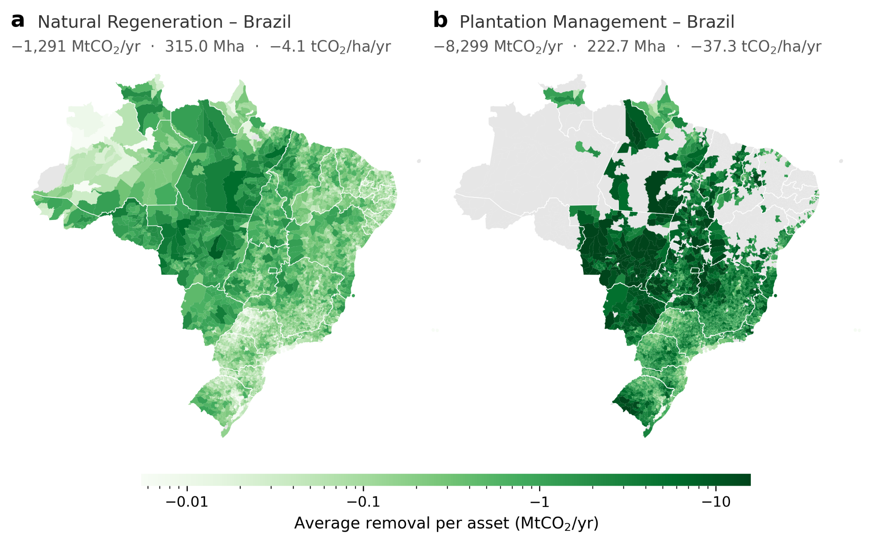

**Figure 12.** Annual carbon removal potential from forest restoration in Brazil by asset (GADM2). (a) Natural regeneration (b) Plantation management. Grey assets have no restoration area or no plantation growth data.

#### 4.4 ERS – Discussion

The ERS analysis quantifies the technical potential for reducing disturbance-driven emissions under one simplifying assumption: no implementation barriers limit the treatable area. The results are therefore an upper bound on achievable abatement. In practice, outcomes will depend on policy frameworks, financial resources, institutional and human capacity, social acceptance, and the biophysical constraints of each landscape.

**Cross-cutting Assumptions and Limitations**

The following assumptions and limitations should be considered when interpreting the ERS results and planning implementation:

-   Activity Feasibility & Access

-   Cost and Funding Durability

-   Governance & Enforcement

-   Leakage and Rebound Effects

-   Permanence & Climate Variability

-   MRV and Uncertainty

Each assumption and limitation is described in Appendix C1.

#### 4.5 ERS – Conclusion

The ERS assessment identifies a large technical potential for reducing GHG emissions from deforestation, forest degradation, and uncontrolled fire. Over 2015–2025, these disturbances emitted an average of 15.03 GtCO2 per year, with fire (11.62 GtCO2 per year, 77%) and deforestation (3.14 GtCO2 per year, 21%) making up 98% of the total (Table S2). Under the hypothetical 10% ERS scenario, emissions would fall by 1.50 GtCO2 in the first year. Realizable reductions, however, depend on establishing and sustaining the necessary enabling conditions.

In the near term, the most reliable gains are expected from two interventions. The first intervention is jurisdiction-wide deforestation control that combines legal frameworks, effective enforcement, and alternative livelihoods for communities that depend on forest clearing. A 10% reduction in deforestation emissions would avoid about 0.31 GtCO2 in the first year (Table S2). The second intervention is targeted fire-risk mitigation in high-hazard landscapes, including carbon-rich peatlands, through early warning systems, community-based fire prevention and suppression, and the restoration of fire-resilient ecosystems. A 10% reduction in fire emissions would avoid about 1.16 GtCO2 in the first year (Table S2).

Over the longer term, credible restoration initiatives that secure the long-term survival of planted and regenerating trees and ongoing care can add large carbon removals. Globally, natural regeneration could remove up to 8.74 GtCO2 per year across 2,496 Mha, while plantation management could remove up to 23.17 GtCO2 per year across 1,383 Mha (Section 4.3.2). These estimates are alternatives and should not be added together.

Turning this technical potential into verifiable outcomes requires focusing interventions where their impact and durability are greatest and providing multi-year finance that goes beyond short-term project cycles. Transparent Measurement, Reporting, and Verification (MRV) systems are also needed to report uncertainty, track reductions and removals, and support adaptive management over time.

Pursued together, these strategies can deliver durable, verifiable reductions in CO2 emissions, with co-benefits for biodiversity, water security, and community livelihoods that support sustainable development goals.

#### 5. Conclusions and Limitations

This document describes the CTrees method for estimating carbon stocks, emissions, and removals from forests, shrub/grasslands, and wetlands for the Climate TRACE inventory. Total live carbon is mapped every year from 2015 to 2025 at 1-km resolution. Committed emissions from deforestation, forest degradation, and fire are calculated as the exposed carbon stock multiplied by a drop ratio, which is country-specific for forest disturbances and fixed for shrub/grassland and wetland fires. Removals are the residual between the net stock change and these emissions. All quantities are reported for 251 countries and special territories at GADM levels 0 to 2, annually for 2015–2025 and quarterly from 2023 onward, each with a confidence rating. Over 2015–2025, the three disturbances emitted about 15.0 GtCO₂ per year, of which fire contributed 77% and deforestation 21%.

The estimates have several limitations. They cover living biomass only, so emissions from soil carbon, peat, dead wood, and litter are not included, and all emissions are counted in the year of the disturbance. Degradation is mapped only within the tropical forest domain. Outside this domain, deforestation is mapped with Global Forest Change and accounts for about 43% of deforestation emissions. Shrub/grassland and wetland fires use fixed drop ratios, and the country-level drop ratios do not capture variation within a country. Removals are a residual, so they carry the uncertainties of both the stock change and the emissions. Independent data for a like-for-like check of deforestation and degradation emissions, and of the drop ratios themselves, are not yet available. The ERS results are technical potentials under a hypothetical scenario and represent an upper bound on what can be achieved.

CTrees will update the dataset each year as new satellite data become available and continue the quarterly releases. The priorities for the next versions are to replace the fixed drop ratios for shrub/grassland and wetland fires with measured values and to validate the drop ratios against airborne lidar and field data. CTrees also plans to use the 100-m biomass time series more directly, so that emissions can be reported at a finer resolution.

#### 6. Supplemental Data

Table S1. General dataset information for Estimates of Carbon Storage, Emissions, and Removals from Forestry and Land Use Sector.

|                                                                                |                                                                                                                                                                                                                                                    |
|--------------------------------------------------------------------------------|----------------------------------------------------------------------------------------------------------------------------------------------------------------------------------------------------------------------------------------------------|
| **General Description**                                                        | **Definition**                                                                                                                                                                                                                                     |
| **Sector definition**                                                          | *Net Forest & Mangrove, Net Grassland, and Net Wetland Carbon Stock Change – Living Biomass*                                                                                                                                                       |
| **UNFCCC sector equivalent**                                                   | *4.A Forest Land; 4.C Grassland; 4.D.1.a Peat Extraction Remaining Peat Extraction; 4.D.1.c Other Wetlands Remaining Other Wetlands; 4.D.2 Land Converted to Wetlands*                                                                             |
| **Temporal Coverage**                                                          | *2015–2025 (Annual), 2023–2026 (Quarterly)*                                                                                                                                                                                                        |
| **Temporal Resolution**                                                        | *Annual; quarterly from 2023 (monthly values on the Climate TRACE website; see Temporal Disaggregation of Emissions Data for the Climate TRACE Inventory)*                                                                                         |
| **Data format(s)**                                                             | *GeoTIFF at 1-km spatial resolution*                                                                                                                                                                                                               |
| **Coordinate Reference System**                                                | *Geographic coordinates in degrees*                                                                                                                                                                                                                |
| **Number of countries**                                                        | *251*                                                                                                                                                                                                                                              |
| **Ownership**                                                                  | *Country*                                                                                                                                                                                                                                          |
| **What emission factors were used?**                                           | *See Section 2.2 (drop ratios)*                                                                                                                                                                                                                    |
| **What is the difference between a “NULL / none / nan” and a “0” data field?** | *“0” marks emissions that truly do not exist. “NULL / none / nan” marks emissions that exist for the sector but were not modeled for that gas.*                                                                                                    |
| **Total CO**₂**e (100-year and 20-year GWP) conversions**                      | *This sector reports CO₂ only, so no GWP conversion is applied to its emissions. Climate TRACE uses IPCC AR6 CO*₂*e GWPs. CO*₂*e conversion guidelines: https://www.ipcc.ch/report/ar6/wg1/downloads/report/IPCC\_AR6\_WGI\_FullReport\_small.pdf* |

Table S2. Global ERS reductions by disturbance type and land class.

|                              |                               |                                    |                    |
|------------------------------|-------------------------------|------------------------------------|--------------------|
| **Disturbance – land class** | **Baseline (MtCO₂ per year)** | **Reduction after 1 year (MtCO₂)** | **Reduction rate** |
| Deforestation                | 3,144.58                      | 314.46                             | 10% per year       |
| Degradation                  | 263.89                        | 26.39                              | 10% per year       |
| Fire – forest                | 7,669.36                      | 766.94                             | 10% per year       |
| Fire – wetland               | 92.39                         | 9.24                               | 10% per year       |
| Fire – shrub/grassland       | 3,857.46                      | 385.75                             | 10% per year       |
| Total                        | 15,027.68                     | 1,502.78                           | 10% per year       |

Table S3. Metadata Description information for Estimates of Carbon Storage, Emissions, and Removals from Forestry and Land Use Sector.

|                            |                                                                                                           |                                                                                                                |                                                                                                             |
|----------------------------|-----------------------------------------------------------------------------------------------------------|----------------------------------------------------------------------------------------------------------------|-------------------------------------------------------------------------------------------------------------|
| **Data attributes**        | **Description**                                                                                           | **Confidence Definitions**                                                                                     | **Uncertainty Definition**                                                                                  |
| **type**                   | Dominant land cover type based on 2015 100-m Copernicus Global Land Cover                                 | N/A                                                                                                            | N/A                                                                                                         |
| **capacity**               | Annual carbon density represented in tCO2 per ha                                               | Rated from the relative uncertainty of carbon density uD.                                           | uD; See Section 2.4.                                                                             |
| **capacity\_factor**       | Disturbed area in the sub-sector in hectare                                                               | Rated from the relative uncertainty of disturbed area uA.                                           | uA; See Section 2.4.                                                                             |
| **activity**               | Exposed carbon stock, the pre-disturbance carbon stock in disturbed region represented in tCO2 | Rated from the combined relative uncertainty of disturbed area uA and carbon density uD. | Combines the uncertainty of disturbed area uA and carbon density uD; See Section 2.4. |
| **CO2\_emissions\_factor** | Drop ratio: the fraction of the exposed carbon stock that is emitted (unitless, 0–1)                      | Rated from the relative uncertainty of drop ratio ur.                                               | ur ; See Section 2.4.                                                                            |
| **CO2\_emissions**         | Total emissions in disturbed region represented in tCO2                                        | Rated from the relative uncertainty of emissions uE.                                                | uE; See Section 2.4.                                                                             |

#### Permissions and Use

All Climate TRACE data are freely available under the Creative Commons Attribution 4.0 International Public License, unless otherwise noted below.

> **Data citation format:** Yang, Y., Lin, W., and Saatchi, S. (2026). Estimates of Carbon Storage, Emissions, and Removals from Forestry and Land Use Sector. CTrees, USA. Climate TRACE Emissions Inventory. https://climatetrace.org \[accessed date\].

#### Geographic Boundaries and Names (iso3\_country data attribute)

The boundaries, geographic names, and related data shown on maps and included in lists, tables, documents, and databases on Climate TRACE are derived from the Database of Global Administrative Areas (GADM, version 4.1, released 16 July 2022) and its ISO3 codes, with the following adaptations:

-   HKG (China, Hong Kong Special Administrative Region) and MAC (China, Macao Special Administrative Region) are reported at GADM0 (country level);

-   Kosovo has been assigned the ISO3 code ‘XKX’;

-   XCA (Caspian Sea) has been removed from GADM0 and the area assigned to countries based on the extent of their territorial waters;

-   XAD (Akrotiri and Dhekelia), XCL (Clipperton Island), XPI (Paracel Islands), and XSP (Spratly Islands) are not included in the Climate TRACE dataset;

-   ZNC has been renamed ‘Turkish Republic of Northern Cyprus’ at GADM0;

-   The borders between India, Pakistan, and China have been assigned to these countries based on GADM codes Z01 to Z09.

The above usage is not warranted to be error-free and does not imply the expression of any opinion whatsoever on the part of the Climate TRACE Coalition and its partners concerning the legal status of any country, area, or territory or of its authorities, or concerning the delimitation of its borders.

#### Disclaimer

The emissions provided for this sector are our current best estimates, and we are committed to continually improving the accuracy of the models at all levels. Please review our terms of use and the sector-specific methodology documentation before using the data. If you identify an error or would like to participate in our data validation process, please contact us.

#### 7. Appendices

#### Appendix A1. Typical ERS Strategy Pathways

This appendix describes the main interventions for each strategy pathway.

-   **Limit Deforestation:** This pathway prevents the permanent conversion of forest land to other uses. Key interventions include:

-   **Real-time monitoring tied to enforcement**: Using satellite imagery and ground-based surveillance to detect and respond promptly to deforestation, backed by legal and administrative enforcement.

-   **Tenure security**: Clarifying and securing land and resource rights for local communities and Indigenous Peoples, which helps them protect their forests.

-   **Deforestation-free supply chains**: Promoting and requiring supply-chain practices that keep agricultural and timber products from recently deforested land out of the market, reducing demand for unsustainable land use.

-   **Incentive programs for conservation**: Providing financial or other benefits to landowners and communities who actively conserve their forests (GFOI, 2020).

-   **Reduce Degradation:** This pathway addresses declines in forest health and carbon stocks that fall short of outright deforestation. Critical actions include:

-   **Improved logging practices**: Applying reduced-impact logging (RIL) techniques that minimize damage to the residual forest, preserve biodiversity, and maintain ecosystem functions.

-   **Edge and understory fire prevention**: Managing vegetation and fuel loads at forest edges and within the understory to prevent the spread of ground fires, which degrade forest health and carbon stocks.

-   **Grazing management**: Applying sustainable grazing practices in forest-adjacent areas to prevent overgrazing, soil compaction, and increased fire risk.

-   **Performance-based incentives**: Rewarding sustainable forest management practices through mechanisms such as payments for ecosystem services (GFOI, 2020).

-   **Mitigate Fire Risk:** This pathway prevents and manages uncontrolled wildfires, a major source of emissions. Strategies include:

-   **Fuel management**: Systematically reducing flammable biomass through techniques such as controlled thinning and deadwood removal.

-   **Prescribed burning in safe windows**: Intentionally setting low-intensity fires under controlled conditions during periods of low fire risk to reduce fuel loads and promote forest health.

-   **Firebreak maintenance**: Creating and maintaining breaks in vegetation to halt the spread of fires.

-   **Rapid response capacity**: Maintaining well-equipped firefighting teams and rapid-deployment systems to contain new fires quickly.

-   **Post-fire recovery**: Supporting the regeneration of burnt areas, for example by planting native species and controlling erosion (GFOI, 2020).

-   **Protect Wetlands/Peat:** Wetlands and peatlands are major carbon stores, and protecting them avoids large emissions. Key actions include:

-   **Water-table management (rewetting):** Restoring hydrological regimes in degraded wetlands, particularly peatlands, to prevent the decomposition of deep carbon stores.

-   **Vegetation control**: Managing invasive species or excessive vegetation growth that can alter the hydrology or increase fire risk in wetlands.

-   **Specialized fire suppression**: Using techniques designed for wetland fires, which often smolder underground in peat layers, to avoid large losses of deep carbon (GFOI, 2020).

-   **Enable Restoration:** This pathway actively restores degraded forest land and ecosystems. Strategies include:

-   **Native species reforestation/assisted regeneration**: Planting tree species native to the region and assisting the natural regrowth of existing vegetation.

-   **Survival monitoring**: Regularly assessing the health and survival rates of planted or naturally regenerated vegetation.

-   **Community co-management**: Involving local communities in the planning, implementation, and long-term stewardship of restoration projects, drawing on their traditional knowledge and distributing benefits equitably (IPCC, 2019).

#### Appendix A2. Proposed Approach to Quantify Emission Reductions

This appendix describes each of the three steps in detail:

1.  **Baseline and ERS Scenario Development**

This step assesses historical and current emissions. Disturbance maps delineating areas affected by deforestation, degradation, and fire are combined with country-specific emission factors (the drop ratios of Section 2.2) to quantify baseline emissions, in tCO₂ with an associated uncertainty range, for each GADM unit. The baseline is the reference against which the effectiveness of ERS strategies is measured. An ERS scenario is developed alongside it, projecting future emissions under the chosen strategies.

1.  **Emission Reduction Estimation**

Building on the baseline and ERS scenario, this step projects emissions under the planned interventions. By identifying the areas each strategy will affect, the expected reduction relative to the baseline can be quantified, modeling the avoided deforestation, reduced degradation, or mitigated fire events and their carbon impacts.

1.  **Uncertainty and Confidence Intervals**

Confidence intervals are estimated for each ERS strategy to quantify the uncertainty of the reduction estimates, accounting for data variability, model assumptions, and the complexity of ecological systems. Reporting confidence intervals indicates the range within which the true value is likely to fall.

#### Appendix A3. Enabling Factors for ERS Effectiveness

This appendix provides further context on each enabling factor.

-   **Governance and Enforcement Capacity:** Transparent, accountable governance and effective enforcement are needed to prevent the illegal activities that drive emissions and to ensure compliance with conservation policies.

-   **Tenure Clarity:** Clearly defined and legally recognized land and resource tenure rights reduce conflicts, reward long-term sustainable management, and enable local communities to protect their territories.

-   **Durable Finance:** Secure, long-term financial commitments are needed to fund ERS implementation, including monitoring, enforcement, capacity building, and incentive programs.

-   **Community Co-management:** Involving local communities, particularly Indigenous Peoples with deep ecological knowledge, supports sustainable practices and an equitable distribution of benefits.

-   **Climate Exposure:** External climate factors can strongly influence ERS effectiveness. Prolonged droughts, for example, lengthen and intensify fire seasons and make fire mitigation harder. Adapting to these climate factors is a condition for the long-term success of ERS initiatives.

#### Appendix B1. Core Datasets and Their Role in ERS Analysis

This appendix describes each core dataset in detail:

-   **CTrees Emissions (1 km, 2015–2025):**

-   **Description:** This dataset provides annual emissions in tonnes of CO₂ (tCO₂) per square kilometer for deforestation, forest degradation, and fire across land classes (forest, wetland, and shrub/grassland fires).

-   **Format:** GeoTIFF files at 1-km resolution with global coverage.

-   **Use in ERS:** This is the primary dataset for establishing baseline emissions by disturbance type, and the basis for calculating the long-term mean emissions used to characterize historical trends and project future scenarios.

-   **Disturbance Area Rasters (1 km, 2015–2025):**

-   **Description:** This dataset quantifies the annual disturbed area for each land-use change: deforestation (forest loss), forest degradation, and burned area in forests, wetlands, and shrub/grasslands. It refines and replaces earlier inputs such as TMF (Tropical Moist Forests; Vancutsem et al., 2021) and GABAM (Global Annual Burned Area Maps; Long et al., 2019); GFC (Global Forest Change) continues to provide forest loss outside the tropical forest domain (Section 2.2).

-   **Use in ERS:** This dataset defines the activity data (AD) of the ERS framework, that is, the treatable or affected area for each disturbance type and land class. It enables emission-reduction strategies to be targeted precisely and potential reductions to be scaled by the extent of the affected area.

-   **Administrative Boundaries:**

-   **Source:** The administrative boundaries are derived from the Climate TRACE-modified GADM shapefile (see Geographic Boundaries and Names).

-   **Dataset:** Jurisdictional boundaries at three levels: GADM0 (country), GADM1 (state/province), and GADM2 (city/district).

-   **Use in ERS:** These boundaries are used to aggregate, report, and attribute baseline emissions and the results of reduction efforts by jurisdiction.

#### Appendix B2. Key Variables and Units for ERS Analysis

This appendix describes each variable and its unit:

-   **Emissions:**

-   In gridded form (e.g., on a map), emissions are expressed in tCO₂ per km².

-   When aggregated to a larger unit (e.g., a country or state), emissions are expressed in tCO₂, the total for that area.

-   **Disturbance Area:**

-   The annual disturbance area is expressed in hectares per year (ha yr⁻¹) and broken down by disturbance type (e.g., deforestation, fire) and land class (e.g., forest, wetland).

-   **Jurisdictional Boundaries:**

-   Jurisdictions are identified by unique IDs for each administrative unit (country, state, city) in the GADM framework.

#### Appendix B3. Strategies and Expected Impacts for Emission Reduction Solutions

#### Appendix B3.1 Forest Restoration

Forest restoration focuses on the recovery of degraded or deforested ecosystems. It aims to re-establish ecological functions, increase biodiversity, and improve the resilience of forest systems by expanding forest area, planting trees where they are needed, and increasing biomass carbon and forest productivity. Restoration mechanisms are diverse and depend on geographic context, forest type, and land-use priorities.

**Key Mechanisms:**

-   **Natural Regeneration:** Allowing forests to regrow on their own. This requires protecting degraded and abandoned land from further disturbance, including fire, illegal logging, and overgrazing, and supports the natural transition of deforested areas to fallow land and secondary forest, where ecological succession gradually restores forest cover.

-   **Restoration with Native Species:** Where natural recovery is unlikely or too slow, active planting of diverse native tree species re-establishes forests that are suited to local conditions and support native biodiversity.

-   **Agroforestry and Mixed Land Use:** Integrating trees with crops and livestock restores tree cover and associated ecosystem services while supporting rural livelihoods; agroforestry systems can also improve soil fertility and water retention and provide diverse economic benefits.

-   **Community Forest Landscape Restoration:** A participatory approach that engages Indigenous Peoples and local communities (IPLCs) in restoring entire landscapes, balancing ecological integrity with human needs and drawing on local knowledge and stewardship.

**Delivery pathways and quantified evidence:**

**Natural regeneration (unmanaged):** Stands regenerate by natural means (seed dispersal, coppice regrowth, or root suckers) without planting or seeding, and are left unmanaged (no fertilization, competing-vegetation control, thinning, or harvest). Global \~1-km growth curves built from 109,708 field estimates give a spatially explicit basis for targeting where regeneration removes the most carbon (Robinson et al., 2025): removal rates vary \~200-fold across locations and peak at stand ages of \~20–40 years, and protecting existing young secondary forests can deliver up to eight times more removal per hectare than starting new regrowth. Growth in unmanaged stands also appears to be accelerating: 55 unmanaged temperate deciduous plots accumulated \~6.2 tCO₂/ha/yr more than their expected age-based trajectory, which was attributed to rising CO₂, warming, and longer growing seasons (McMahon et al., 2010). Unmanaged growth is slower than growth under intensive silviculture (untreated planted ponderosa pine stored \~63–342 tCO₂/ha at age 20 from poor to rich sites, versus up to \~235–547 tCO₂/ha with fertilization and vegetation control; Zhang et al., 2021), but the unmanaged pathway trades speed for permanence and near-zero cost: there are no fertilizer, herbicide, or harvest emissions, and all carbon remains standing.

Natural regeneration is how most forest returns worldwide, yet it is poorly protected: tropical regrowth persists on average only \~7.5 years before being re-cleared, and only \~6% reaches 20 years, the age of peak removal (Robinson et al., 2025). It is increasingly financed through area-based ARR methodologies such as Verra VM0047, which accommodate unplanted regeneration. Caveats: early accumulation is slow, so near-term removals are modest; regeneration can fail on severely degraded or seed-limited sites; establishing forest on native grasslands or drained peatlands can release more soil carbon than the trees store; and albedo warming, fire and drought reversals, and uncertain additionality further reduce the creditable benefit. Technology readiness: TRL 9. **Sources:** FAO (2025); Robinson et al. (2025); Busch et al. (2024); McMahon et al. (2010); Zhang et al. (2021); Verra (2025b); ctrees.org.

**Plantation management (actively managed):** Planted stands, typically one or a few fast-growing species (e.g., Eucalyptus, Acacia, pine) at regular spacing, are established on degraded or non-forest land and managed through a rotation with fertilization, competing-vegetation control, thinning, and timed harvest, accelerating carbon sequestration alongside timber, pulp, or fiber production. Planted forests cover approximately 312 million hectares, about 8% of global forest area; roughly half is intensively managed, concentrated in commercial forestry regions, with the largest planted area in Asia (\~146 million ha) (FAO, 2025). Management intensity is the main lever on sequestration rate: in the U.S. Southeast, loblolly pine accumulates roughly 8 tCO₂/ha/yr without treatment versus roughly 18 tCO₂/ha/yr with fertilization and weed control over a 20-year rotation (Maier & Johnsen, 2010), and extending rotations stores roughly 16–67 tCO₂e/ha more carbon in harvested wood products (Nepal et al., 2012). The net climate benefit depends on the accounting boundary (on-site biomass, wood-product storage, and material and energy substitution) set against the emissions of management itself (fertilizer, herbicide, thinning, harvest, and haulage).

New establishment is financed through ARR methodologies such as Verra VM0047, which excludes land previously managed for wood products and leaves practice change on existing plantations to improved-forest-management accounting. Caveats: establishment on the wrong land (drained peatlands, native grasslands) can cancel the gain outright; the inputs that produce high growth rates carry their own emissions; because stands are harvested, gross sequestration overstates the net benefit, and on-site carbon is only as durable as the products it becomes; substitution credits are routinely overstated; and additionality is hard to establish on land already under commercial forestry. Durable mitigation requires long-lived products, sustained replanting, and no conversion of natural forest. Technology readiness: TRL 9. **Sources:** FAO (2025); Busch et al. (2024); Maier & Johnsen (2010); Nepal et al. (2012); Verra (2025b); ctrees.org.

**Expected Outcomes and Impacts:**

Restoration typically takes 5 to 10 years to produce measurable effects on ecosystem health. Standards that guide and verify restoration include ARR methodologies such as Verra’s VM0047 and Improved Forest Management (IFM) methodologies such as Verra’s VM0045 (Verra, 2025a); the Climate Action Reserve (CAR) and Gold Standard (GS) frameworks also apply.

-   **Increased Forest Area:** Up to 1,000,000 hectares.

-   **Increased Biomass Carbon Stocks:** Up to 300–500 tCO₂/ha.

-   **Increased Carbon Removal:** Up to 5–10 tCO₂/ha/yr.

-   **Removal Rates by Pathway:** Actively managed plantations roughly 8–18 tCO₂/ha/yr, depending on management intensity (Maier & Johnsen, 2010); unmanaged natural regeneration is slower in early years, with removal rates peaking at stand ages of \~20–40 years (Robinson et al., 2025).

Absolute values vary considerably by jurisdiction and geographic context. CO₂ emission factors are expected to remain unchanged, because restoration increases carbon sequestration rather than reducing emissions from combustion.

#### Appendix B3.2 Mitigate Forest Fire Risk

This strategy reduces the likelihood, intensity, and impact of wildfires in forest ecosystems through effective land management, specialized fire-management techniques, and continuous monitoring.

**Key Management Approaches:**

-   **Fuel Load Reduction:** Actively reducing combustible material in forests (dry leaves, deadwood, and understory vegetation) lowers the risk of ignition and the spread of high-intensity fires.

-   **Fire-Resilient Forest Management:** Increasing a forest’s inherent resistance to fire and minimizing post-fire carbon loss, for example through selective thinning to create more open stands, retaining larger and more fire-resistant trees, and extending harvest rotations in managed forests to develop mature, less flammable stand structures.

-   **Landscape-Level Fire Planning and Zoning:** Managing fire across large areas by breaking fuel continuity with fuel breaks and green buffers and by protecting high-value zones such as communities, critical infrastructure, and sensitive ecological areas.

-   **Restoration of Fire-Adaptive Ecosystems:** Many ecosystems evolved with frequent, low-intensity fire. Restoring natural fire regimes and ecological processes in these areas can involve reintroducing controlled fire cycles and planting native, fire-adapted species that better withstand and recover from fire.

-   **Post-Fire Recovery and Emission Mitigation:** After a fire, minimizing long-term emissions and restoring the ecosystem’s sequestration capacity through reforestation with resilient species, soil stabilization to prevent erosion and further carbon loss, and cautious salvage logging to limit decay emissions from burnt timber.

**Expected Outcomes and Impacts:**

Wildfire impacts vary greatly with annual climate and drought intensity.

-   **Maximum Area Affected by Wildfires:** 1,000 to 100,000 hectares in a given year.

-   **CO**₂ **Emission Factors:** May increase by 10–30% relative to their original values because of fire impacts, which makes prevention and mitigation a priority.

This approach protects ecosystems from the immediate impacts of wildfire while strengthening their long-term resilience and reducing the associated GHG emissions.

#### Appendix B3.3 Limit Deforestation

This strategy avoids the outright loss of forest cover. Effective measures combine conservation, national policy, market-based incentives, and enforcement.

**Key Approaches:**

-   **Forest Protection and Law Enforcement:** Strengthening the enforcement of existing forest laws to prevent the illegal logging, illicit mining, and land grabbing that directly cause deforestation, typically through increased surveillance, improved legal frameworks, and effective prosecution.

-   **Securing Indigenous and Community Land Rights:** Empowering local forest stewards, particularly Indigenous Peoples and local communities (IPLCs), is a highly effective deterrent to deforestation. This involves legally recognizing customary and Indigenous territories, supporting participatory land-use planning, and strengthening community forestry institutions and benefit-distribution arrangements that reward conservation.

-   **Spatial Planning and Forest Zoning:** Strategic land-use planning directs development away from high-conservation-value forests by balancing conservation with development priorities, designating protected areas and conservation corridors, and establishing buffer zones and ecological restoration in vulnerable areas.

-   **Performance-Based Finance:** Financial incentives for countries or communities that demonstrate measurable reductions in deforestation below an agreed reference level, delivered through voluntary or compliance carbon markets and multilateral climate finance.

-   **Supply Chain and Market-Based Interventions:** Addressing the economic drivers of deforestation through supply-chain interventions for commodities linked to extensive forest loss, such as soy, beef, and palm oil, including certification schemes, consumer awareness campaigns, and corporate deforestation-free commitments.

**Expected Outcomes and Impacts:**

The primary goals are to maintain existing forest cover and preserve carbon stocks.

-   **Maintain Forest Area:** Sustain existing forest cover and enhance the long-term resilience of forest ecosystems.

-   **CO**₂ **Emission Factors:** CO₂ emission factors remain unchanged; the aim is to prevent the release of stored carbon by avoiding deforestation, preserving the carbon storage of existing forests.

Together, these approaches reduce deforestation and protect biodiversity.

#### Appendix B3.4 Reduce Degradation

This strategy minimizes the loss of ecosystem quality, productivity, and function caused by human activities and natural disturbances, with a focus on reducing biomass loss within forests. Unlike deforestation, which removes forest cover completely, degradation often proceeds through subtler processes such as selective logging, recurring fire, overgrazing, unsustainable fuelwood collection, and poorly planned infrastructure. The mechanisms range from improved management to prevention and enforcement.

**Key Mechanisms:**

-   **Improved Forest Management (IFM):** Improving forest management for timber and other uses to reduce damage to vegetation and soils, through Reduced Impact Logging (RIL), which minimizes disturbance during harvesting; longer rotations, which allow trees to grow larger and forests to mature; and the retention of key habitat structures such as seed trees, snags (standing dead trees), and riparian buffers, all of which support ecological health and carbon storage.

-   **Fire Prevention and Control:** Preventing or limiting forest fires, a major cause of degradation, particularly in drier forests and previously logged areas, through public awareness campaigns, early detection systems, and rapid response.

-   **Controlling Illegal Logging and Fuelwood Extraction:** Reducing unregulated extraction to prevent the depletion of forest carbon stocks and the deterioration of ecosystem quality, through effective monitoring, law enforcement, and sustainable alternatives for local communities.

-   **Livestock and Grazing Management:** Mitigating degradation from overgrazing, soil compaction, and trampling by zoning livestock out of sensitive forest areas and promoting agroforestry or silvopasture systems that integrate trees and livestock sustainably.

-   **Financial Incentives and Market Mechanisms:** Using economic tools such as payments for ecosystem services (PES), REDD+ (Reducing Emissions from Deforestation and Forest Degradation) sub-national or project-level payments for reduced degradation, and sustainable financing for protected-area management.

**Expected Outcomes and Impacts:**

Reducing degradation brings large environmental and climate benefits.

-   **Increased Biomass Carbon Stocks:** Potential increases of 100–300 tCO₂/ha.

-   **Increased Carbon Removal:** Expected increases of 5–10 tCO₂/ha/yr.

Absolute values vary by jurisdiction and geographic context. CO₂ emission factors are expected to remain unchanged, because the focus is on maintaining and increasing existing carbon stocks rather than reducing emissions from combustion.

These strategies reduce forest degradation and strengthen ecosystem resilience.

#### Appendix B3.5 Reduce Grassland Fire Activity

This strategy lowers the likelihood of ignition, slows fire spread, and reduces fire intensity in grassland ecosystems by managing fine fuels (dry grass and brush), creating breaks in fuel continuity, and adjusting land use to keep risk low throughout fire-prone seasons.

**Key Management Approaches:**

-   **Removing Dry Grass and Brush (Fuel Reduction):** Reducing fine fuels through mowing, brush-cutting, and biomass removal; targeted grazing can control flammable invasive species, followed by reseeding with native plants to stabilize ground cover and reduce flammability.

-   **Creating Firebreaks:** Establishing mowed or mechanically cleared strips, typically 3–10 m wide (wider on slopes), and green or irrigated corridors around assets and along roads, fence lines, and long fuel runs, positioned to break fuel continuity and to counter prevailing winds and slopes. Regular re-mowing or re-grazing, combined with clearing ladder fuels (vegetation that lets fire climb from the ground into tree canopies), keeps the breaks effective.

-   **Land Management for Long-Term Risk Reduction:** Keeping risk low over time through rotational or rest-rotation grazing, cool-season prescribed burns, and reseeding or restoration, which keep fuel loads below critical thresholds and raise live-fuel moisture. Maintained water points and access routes, and coordination with neighboring landowners and right-of-way managers, prevent fuels from reconnecting across property lines.

**Expected Outcomes and Impacts:**

These strategies are expected to reduce the impact of grassland fires.

-   **Emission Reduction:** Potential 30–50% decrease in fire frequency and associated emissions.

-   **CO**₂ **Emission Factors:** CO₂ emission factors are expected to remain unchanged, because the focus is on preventing biomass combustion rather than altering the emission characteristics of burning.

These strategies reduce grassland fire risk and strengthen the long-term resilience of these ecosystems.

#### Appendix B3.6 Reduce Wetland Fire Activity

This strategy reduces the likelihood and severity of wetland fires, particularly in peat, sedge, and cattail systems, by breaking fuel continuity, restoring and maintaining high water tables, and managing vegetation along wetland margins. The priorities are to keep peat saturated, interrupt fire spread at upland–wetland interfaces, and minimize the conditions for smoldering, deep-burning fires that can release large amounts of stored carbon.

**Key Management Approaches:**

-   **Create Firebreaks and Restore Hydrology:** Maintaining saturated peat and breaking fuel continuity, especially at wetland edges, with wet or green firebreaks, targeted mowing, brush control, and prescribed fire applied only under specific conditions to limit spread. Continuous water-table monitoring and close coordination with neighbors help manage flooding while protecting habitat and carbon stocks; drainage blocking is described below.

-   **Land Management for Hydrological Control and Vegetation Management:** Keeping water tables close to the surface with structures such as weirs and seasonal back-watering, and replacing flammable invasive species with native, less flammable vegetation. Prescribed burns, if used, must be applied only under cool, moist conditions to reduce surface fuels, while protecting peat soils by limiting heavy equipment and stabilizing disturbed margins.

-   **Block Wetland Drainage:** Reversing historical drainage with ditch blocks, low-head weirs, backfilled drainage channels, and retrofitted culverts; beaver-style structures can also retain water and re-wet peat. Reconnecting floodplains to rivers sustains moisture over the long term, and early permitting and collaboration with neighboring landowners help address flooding and access concerns.

**Expected Outcomes and Impacts:**

These strategies are expected to reduce the impact of wetland fires.

-   **Emission Reduction:** Potential 30–50% decrease in fire frequency and associated emissions.

-   **CO**₂ **Emission Factors:** CO₂ emission factors are expected to remain unchanged; the aim is to prevent the combustion of carbon-rich wetland fuels, especially peat, and so avoid the release of stored carbon, rather than to alter emission characteristics.

These strategies reduce wetland fire risk and protect these carbon-rich ecosystems from further degradation.

#### Appendix B4. ERS Processing Steps

1.  **Baseline Establishment**

-   **Disturbance Emissions Aggregation:** Disturbance emissions are aggregated over 2015–2025. This eleven-year baseline characterizes historical emissions from deforestation, degradation, and fire across forest, wetland, and shrub/grassland.

-   **Geographic Scope:** The analysis uses GADM2 boundaries to define the areas for which emissions are calculated and reductions estimated, so that localized ERS impacts are captured.

<!-- -->

1.  **Emission Reduction Calculation**

The emission reduction (tCO₂) from each ERS strategy s is calculated as:

|     |                                                |        |
|-----|------------------------------------------------|--------|
|     | ERs = Ed × PA | \(15\) |

where ERs (tCO2) is the CO2 emissions avoided or removed as a direct result of the ERS strategy s. Ed (tCO2) is the mean baseline emission (2015–2025) from disturbance type d associated with the strategy s (see Table 4) within each GADM2 unit, derived from the aggregated baseline data. PA is the percentage of the baseline disturbed area in the GADM2 unit that the ERS avoids each year (10% in the published scenario; Table 4); a higher value indicates a broader impact.

1.  **Scenario Development and Evaluation**

-   **Reduction Scenarios:** The calculated reductions, based on the baseline and the proposed activity affected percent for each ERS, form the basis of reduction scenarios that project future reductions under different levels of implementation and effectiveness.

-   **Confidence Level Assessment:** A confidence level is assessed for each strategy, considering the reliability of the input data, the soundness of the method, the feasibility of implementation, and the likelihood of achieving the targeted activity affected percent; a higher level indicates greater certainty in the projected reductions.

<!-- -->

1.  **Continuous Monitoring and Improvement**

-   The methodology is iterative: as new data become available and the effectiveness of ERS is observed, the activity affected percent can be refined, improving the reduction estimates and the understanding of the overall impact of ERS interventions.

#### Appendix B5. Definition of Forest Disturbances

-   **Deforestation:** The permanent removal of forest cover to convert land to other uses, such as agriculture, urban development, or infrastructure. It is a complete loss of carbon sequestration potential and a major release of stored carbon.

-   **Forest Degradation:** A process that reduces a forest’s capacity to provide goods and ecosystem services without removing the forest cover. It can result from unsustainable logging, overgrazing, or recurrent low-intensity fires, which diminish forest structure and carbon stocks.

-   **Natural or Anthropogenic Fires:** Both naturally occurring wildfires (often intensified by climate change) and human-ignited fires can rapidly release large quantities of stored carbon into the atmosphere. These events destroy existing biomass and damage soil organic matter, adding to emissions and slowing future carbon uptake.

#### Appendix B6. Verified Emission Reductions from Deforestation

This appendix details the recent deforestation reductions in Brazil, Indonesia, and Malaysia.

-   **Brazil (Amazon, 2023): A Turnaround in the Amazon**

Deforestation in the Brazilian Amazon fell markedly in 2023. The PRODES monitoring system of Brazil’s National Institute for Space Research (INPE) reported approximately 9,001 km² of clearing, about 22% less than in 2022, and independent analyses by the European Commission’s Joint Research Centre (JRC) also showed steep declines in mid-2023. The reductions are largely attributed to stronger enforcement by the Brazilian government. (European Commission, Joint Research Centre, 2024; Mongabay, 2023)

-   **Indonesia (Multi-Year): Sustained Progress in Primary Forest Conservation**

Indonesia’s primary forest loss has declined over several years, reaching near-record lows: loss in 2020–2022 was approximately 64% lower than in 2015–2017. The decline is attributed to comprehensive conservation measures, including moratoria on new forest concessions and the widespread adoption of No Deforestation, No Peat, No Exploitation (NDPE) policies, which aim to eliminate deforestation from the production and sourcing of agricultural commodities. (Global Forest Watch, 2023; World Economic Forum, 2023)

-   **Malaysia (Multi-Year): Mirroring Indonesia’s Success in Forest Protection**

Malaysia has followed a similar trajectory: primary forest loss in 2020–2022 was approximately 57% lower than in 2015–2017. As in Indonesia, this progress is linked to stronger government oversight and growing corporate responsibility in key industries. (Global Forest Watch, 2023; World Economic Forum, 2023)

#### Appendix C1. Cross-cutting Assumptions and Limitations

-   **Activity Feasibility & Access:** The theoretical treatable area assumes unrestricted access, adequate logistics, and adequate safety. In many regions, particularly remote or protected areas, these factors limit where reduction strategies can be deployed, for example because of missing permits, difficult terrain, inadequate infrastructure for moving personnel and equipment, or security concerns.

-   **Cost and Funding Durability:** Many strategies require substantial up-front investment and consistent recurrent costs, such as enforcement patrols, fuel management, and monitoring. Short-term or inconsistent funding creates a risk of reversal: without durable, predictable multi-year support, initial gains can erode quickly as disturbances resume.

-   **Governance & Enforcement:** Deterrence and compliance depend on effective governance and enforcement, including clear mandates for responsible agencies, low corruption, and consistently applied sanctions. Weak or compromised governance greatly reduces the impact of even well-designed strategies.

-   **Leakage and Rebound Effects:** Suppressing disturbance in one area can shift the pressure elsewhere; if logging is restricted in one forest, for example, illegal logging may move to an unprotected area nearby. Policies must therefore be jurisdiction-wide, and traceable supply chains are needed so that demand does not simply move to less regulated sources.

-   **Permanence & Climate Variability:** The permanence of emission reductions is uncertain in the face of climate variability and socio-economic pressures. Extreme events such as prolonged droughts and heat waves make ecosystems more susceptible to disturbance (e.g., fire), and commodity booms strengthen the incentives for destructive activities. Adaptive management and ecological and social buffers are needed to keep the benefits durable.

-   **MRV and Uncertainty:** Credible quantification of emission reductions relies on Measurement, Reporting, and Verification (MRV) systems. It depends on the quality and availability of activity data (e.g., area treated and type of intervention), reliable emission factors (e.g., CO₂ released per unit of disturbance), and appropriate counterfactual scenarios (what would have happened without the intervention). MRV systems that report uncertainty bounds are needed for credibility and accountability.

#### 8. References

1.  Architecture for REDD+ Transactions (ART). (2021). The REDD+ Environmental Excellence Standard (TREES), Version 2.0. ART Secretariat, Winrock International. https://www.artredd.org/wp-content/uploads/2021/12/TREES-2.0-August-2021-Clean.pdf

2.  Buchhorn, M., Lesiv, M., Tsendbazar, N.-E., Herold, M., Bertels, L., and Smets, B. (2020a). Copernicus Global Land Cover layers — Collection 2. *Remote Sensing*, 12(6):1044.

3.  Buchhorn, M., Smets, B., Bertels, L., De Roo, B., Lesiv, M., Tsendbazar, N.-E., Herold, M., and Fritz, S. (2020b). Copernicus Global Land Service: Land Cover 100m: Collection 3: Epoch 2015: Globe. Version V3.0.1 \[Data set\]. Zenodo. https://doi.org/10.5281/zenodo.3939038

4.  Busch, J., Bukoski, J. J., Cook-Patton, S. C., Griscom, B., Kaczan, D., Potts, M. D., Yi, Y., & Vincent, J. R. (2024). Cost-effectiveness of natural forest regeneration and plantations for climate mitigation. Nature Climate Change, 14(9), 996–1002. https://doi.org/10.1038/s41558-024-02068-1

5.  Climate Action Reserve. (2023). U.S. Forest Protocol, Version 5.1. https://climateactionreserve.org/how/protocols/ncs/forest/

6.  Cook-Patton, S. C., Drever, C. R., Griscom, B. W., Hamrick, K., Hardman, H., Kroeger, T., … & Ellis, P. W. (2021). Protect, manage and then restore lands for climate mitigation. *Nature Climate Change*, 11(12), 1027–1034.

7.  Copernicus Data Space Ecosystem. Copernicus DEM (COP-DEM) collection description. https://dataspace.copernicus.eu/explore-data/data-collections/copernicus-contributing-missions/collections-description/COP-DEM

8.

9.  EROS Center. (2020). Landsat 8-9 Operational Land Imager/Thermal Infrared Sensor Level-2, Collection 2 \[Data set\]. U.S. Geological Survey. https://doi.org/10.5066/P9OGBGM6

10. European Commission, Joint Research Centre. (2024, Feb 28). The Amazon region in 2022 and 2023: Deforestation, forest degradation and risk from growing soy production. [JRC: EU Science Hub](https://joint-research-centre.ec.europa.eu/jrc-news-and-updates/amazon-region-2022-and-2023-deforestation-forest-degradation-and-risk-growing-soy-production-2024-02-28_en)

11. European Space Agency (ESA). Copernicus Sentinel-1. https://sentinels.copernicus.eu/copernicus/sentinel-1

12.

13. FAO. (2025). Global Forest Resources Assessment 2025. Rome: FAO. https://doi.org/10.4060/cd6709en

14. Friedlingstein, P., Jones, M. W., O'Sullivan, M., Andrew, R. M., Bakker, D. C., Hauck, J., … & Zeng, J. (2022). Global carbon budget 2021. *Earth System Science Data*, 14(4), 1917–2005.

15. GFOI (2020). *Methods and Guidance Document (MGD 3.x)*: integrating remote sensing & ground data for MRV. [reddcompass.org](https://www.reddcompass.org/mgd/resources/GFOI-MGD-3.1-en.pdf)

16. Giglio, L., Justice, C., Boschetti, L., & Roy, D. (2021). MODIS/Terra+Aqua Burned Area Monthly L3 Global 500m SIN Grid V061. NASA EOSDIS Land Processes DAAC.

17. Global Forest Watch. (2023, Jun 27). *Tropical primary forest loss worsened in 2022.* (contains Indonesia/Malaysia multi-year comparisons). [Global Forest Watch](https://www.globalforestwatch.org/blog/forest-insights/global-tree-cover-loss-data-2022/)

18. Gold Standard Foundation. (2024). Methodology for Afforestation/Reforestation (A/R) GHGs Emission Reduction & Sequestration, Version 2.1. https://globalgoals.goldstandard.org/standards/403\_V2.1\_LUF\_AR-Methodology-GHGs-emission-reduction-and-Sequestration-Methodology.pdf

19. Grassi, G., House, J., Dentener, F., Federici, S., den Elzen, M., & Penman, J. (2017). The key role of forests in meeting climate targets requires science for credible mitigation. *Nature Climate Change*, 7(3), 220–226.

20. Grassi, G., Conchedda, G., Federici, S., Abad Viñas, R., Korosuo, A., Melo, J., Rossi, S., Sandker, M., Somogyi, Z., Vizzarri, M., and Tubiello, F. N. (2022). Carbon fluxes from land 2000–2020: bringing clarity to countries’ reporting. *Earth System Science Data*, 14(10):4643–4666.

21. Griscom, B. W., Adams, J., Ellis, P. W., Houghton, R. A., Lomax, G., Miteva, D. A., … & Fargione, J. (2017). Natural climate solutions. Proceedings of the National Academy of Sciences, 114(44), 11645–11650.

22. Hansen, M. C., Potapov, P. V., Moore, R., Hancher, M., Turubanova, S. A., Tyukavina, A., … & Townshend, J. R. (2013). High-resolution global maps of 21st-century forest cover change. *Science*, 342(6160), 850–853.

23. Heinrich, V. H., Vancutsem, C., Dalagnol, R., Rosan, T. M., Fawcett, D., Silva-Junior, C. H., ... & Aragão, L. E. (2023). The carbon sink of secondary and degraded humid tropical forests. *Nature*, 615(7952), 436–442.

24. IPCC (2006). 2006 IPCC Guidelines for National Greenhouse Gas Inventories, Volume 4: Agriculture, Forestry and Other Land Use. Eggleston, H. S., Buendia, L., Miwa, K., Ngara, T., & Tanabe, K. (eds.). IGES, Japan.

25. IPCC (2019). *Refinement to the 2006 IPCC Guidelines for National GHG Inventories (AFOLU)*. Method updates, uncertainty, QA/QC. [IPCC NGGIP](https://www.ipcc-nggip.iges.or.jp/public/2019rf/index.html)

26. Japan Aerospace Exploration Agency (JAXA), Earth Observation Research Center (EORC). ALOS-2 data. https://www.eorc.jaxa.jp/ALOS/en/alos-2/a2\_data\_e.htm

27. Long, T., Zhang, Z., He, G., Jiao, W., Tang, C., Wu, B., Zhang, X., Wang, G., & Yin, R. (2019). 30 m resolution global annual burned area mapping based on Landsat images and Google Earth Engine. Remote Sensing, 11(5), 489. https://doi.org/10.3390/rs11050489

28. Luyssaert, S., Schulze, E. D., Börner, A., Knohl, A., Hessenmöller, D., Law, B. E., ... & Grace, J. (2008). Old-growth forests as global carbon sinks. *Nature*, 455(7210), 213–215.

29. Maier, C. A., & Johnsen, K. H. (2010). Quantifying carbon sequestration in forest plantations by modeling the dynamics of above and below ground carbon pools. In J. A. Stanturf (Ed.), Proceedings of the 14th Biennial Southern Silvicultural Research Conference (Gen. Tech. Rep. SRS-121, pp. 3–8). Asheville, NC: USDA Forest Service, Southern Research Station.

30. Malhi, Y., Saatchi, S., Girardin, C., & Aragão, L. E. (2009). The production, storage, and flow of carbon in Amazonian forests. *Amazonia and Global Change*, 186, 355–372.

31. McMahon, S. M., Parker, G. G., & Miller, D. R. (2010). Evidence for a recent increase in forest growth. Proceedings of the National Academy of Sciences, 107(8), 3611–3615.

32. Mongabay. (2023, Nov 11). *Deforestation in the Brazilian Amazon falls 22% in 2023.* (summarizes INPE/PRODES). [Mongabay](https://news.mongabay.com/2023/11/deforestation-in-the-brazilian-amazon-falls-22-in-2023/)

33. Mullissa, A., Saatchi, S., Dalagnol, R., Erickson, T., Provost, N., Osborn, F., Ashary, A., Moon, V., & Melling, D. (2024). LUCA: A Sentinel-1 SAR-based global forest land use change alert. *Remote Sensing*, 16(12), 2151. [https://doi.org/10.3390/rs16122151](https://doi.org/10.3390/rs16122151)

34. NASA Earthdata. Global Ecosystem Dynamics Investigation (GEDI). https://www.earthdata.nasa.gov/data/projects/gedi

35. NASA ICESat-2 Mission. ICESat-2: Ice, Cloud and land Elevation Satellite-2. https://icesat-2.gsfc.nasa.gov/

36. NASA LAADS DAAC. MCD64A1: MODIS/Terra+Aqua burned area monthly L3 global 500 m. https://ladsweb.modaps.eosdis.nasa.gov/missions-and-measurements/products/MCD64A1

37. NASA LCLUC Program. Global Forest Change dataset metadata. https://lcluc.umd.edu/metadata/global-forest-change

38. NASA MODIS Land Team. MODIS land surface reflectance. https://modis-land.gsfc.nasa.gov/surfrad.html

39. Nepal, P., Grala, R. K., & Grebner, D. L. (2012). Financial feasibility of increasing carbon sequestration in harvested wood products in Mississippi. Forest Policy and Economics, 14(1), 99–106.

40.

41. Pan, Y., Birdsey, R. A., Fang, J., Houghton, R., Kauppi, P. E., Kurz, W. A., ... & Hayes, D. (2011). A large and persistent carbon sink in the world’s forests. *Science*, 333(6045), 988–993.

42. Potapov, P., Laestadius, L., & Minnemeyer, S. (2011). Global map of forest landscape restoration opportunities. World Resources Institute. [www.wri.org/forest-restoration-atlas](http://www.wri.org/forest-restoration-atlas)

43. Richter, J., Goldman, E., Harris, N., Gibbs, D., Rose, M., Peyer, S., Richardson, S., & Velappan, H. (2024). Spatial Database of Planted Trees (SDPT Version 2.0). Technical Note. Washington, DC: World Resources Institute. https://doi.org/10.46830/writn.23.00073

44. Robinson, N., Drever, C. R., Gibbs, D. A., Lister, K., Esquivel-Muelbert, A., Heinrich, V., Ciais, P., Silva-Junior, C. H. L., Liu, Z., Pugh, T. A. M., & Saatchi, S. (2025). Protect young secondary forests for optimum carbon removal. Nature Climate Change, 15(7), 793–800. https://doi.org/10.1038/s41558-025-02355-5

45. Saatchi, S. S., Harris, N. L., Brown, S., Lefsky, M., Mitchard, E. T., Salas, W., ... & Morel, A. (2011). Benchmark map of forest carbon stocks in tropical regions across three continents. *Proceedings of the National Academy of Sciences*, 108(24), 9899–9904.

46. Seddon, N., Smith, A., Smith, P., Key, I., Chausson, A., Girardin, C., ... & Turner, B. (2021). Getting the message right on nature‐based solutions to climate change. *Global Change Biology*, 27(8), 1518–1546.

47.

48. Tubiello, F. N., Conchedda, G., Wanner, N., Federici, S., Rossi, S., & Grassi, G. (2021). Carbon emissions and removals from forests: new estimates, 1990–2020. Earth System Science Data, 13(4), 1681–1691. https://doi.org/10.5194/essd-13-1681-2021

49. Tyukavina, A., Potapov, P., Hansen, M. C., Pickens, A., Stehman, S., Turubanova, S., Parker, D., Zalles, V., Lima, A., Kommareddy, I., Song, X.-P., Wang, L., and Harris, N. (2022). Global trends of forest loss due to fire from 2001 to 2019. *Frontiers in Remote Sensing*, 3:825190.

50. University of Maryland GLAD. Global forest loss due to fire (GFL) dataset. https://glad.umd.edu/dataset/Fire\_GFL

51. van der Werf, G. R., Randerson, J. T., van Wees, D., Chen, Y., Giglio, L., Hall, J., Vernooij, R., Mu, M., Binte Shahid, S., Barsanti, K. C., Yokelson, R., & Morton, D. C. (2025). Landscape fire emissions from the 5th version of the Global Fire Emissions Database (GFED5). Scientific Data, 12, 1870. https://doi.org/10.1038/s41597-025-06127-w

52. Vancutsem, C., Achard, F., Pekel, J.-F., Vieilledent, G., Carboni, S., Simonetti, D., Gallego, J., Aragão, L. E. O. C., & Nasi, R. (2021). Long-term (1990–2019) monitoring of forest cover changes in the humid tropics. *Science Advances*, 7(10), eabe1603. https://doi.org/10.1126/sciadv.abe1603

53.

54. Verra. (2025a). VM0045 Improved Forest Management Using Dynamic Matched Baselines from National Forest Inventories, Version 1.2. Verified Carbon Standard. https://verra.org/methodologies/vm0045-improved-forest-management-using-dynamic-matched-baselines-from-national-forest-inventories-v1-2/

55. Verra. (2025b). VM0047 Afforestation, Reforestation, and Revegetation, Version 1.1. Verified Carbon Standard. https://verra.org/methodologies/vm0047-afforestation-reforestation-and-revegetation/

56. World Economic Forum. (2023, Jul 7). *Deforestation falls to near record lows in Indonesia and Malaysia*. [World Economic Forum](https://www.weforum.org/stories/2023/07/indonesia-malaysia-successfully-reducing-deforestation/)

57. World Resources Institute. (2014, May 12). Methodology & data: Atlas of forest landscape restoration opportunity.

[https://www.wri.org/data/methodology-data-atlas-forest-landscape-restoration-opportunity](https://www.wri.org/data/methodology-data-atlas-forest-landscape-restoration-opportunity)

1.  Xu, L., Saatchi, S. S., Yang, Y., Yu, Y., Pongratz, J., Bloom, A. A., Bowman, K., Worden, J., Liu, J., Yin, Y., & Domke, G. (2021). Changes in global terrestrial live biomass over the 21st century. *Science Advances*, 7(27), eabe9829.

2.  Yang, H., Ciais, P., Frappart, F., Li, X., Brandt, M., Fensholt, R., Fan, L., Saatchi, S., Besnard, S., Deng, Z., Bowring, S., and Wigneron, J.-P. (2023). Global increase in biomass carbon stock dominated by growth of northern young forests over past decade. *Nature Geoscience*, 16(10):886–892.

3.  Yang, Y., Dalagnol, R., Lin, W., Kwon, N., Liu, Z., Saatchi, S., & Sagang, L. B. (2026). From snapshot maps to continuous monitoring of global forest carbon at 100 m resolution (2000–2025). EarthArXiv preprint. https://doi.org/10.31223/X5KJ4Q

4.  Zhang, J., Fiddler, G. O., Young, D. H., Shestak, C., & Carlson, R. (2021). Allometry of tree biomass and carbon partitioning in ponderosa pine plantations grown under diverse conditions. Forest Ecology and Management, 497, 119526. https://doi.org/10.1016/j.foreco.2021.119526
