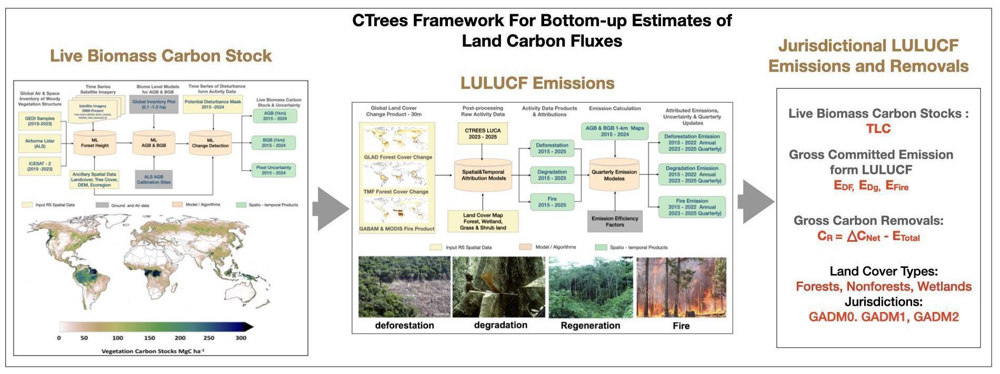
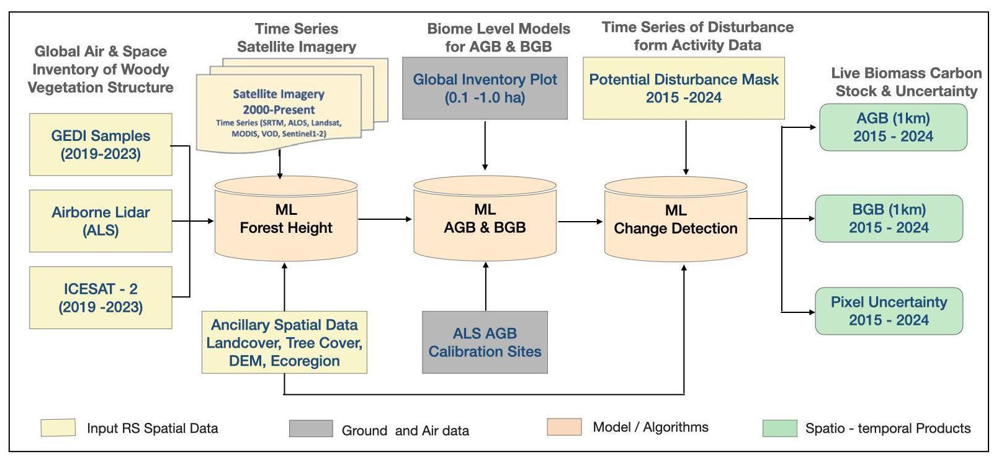
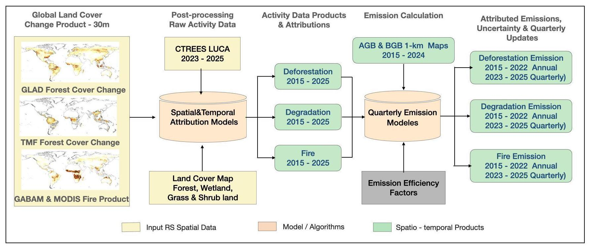
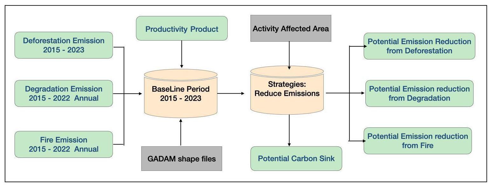
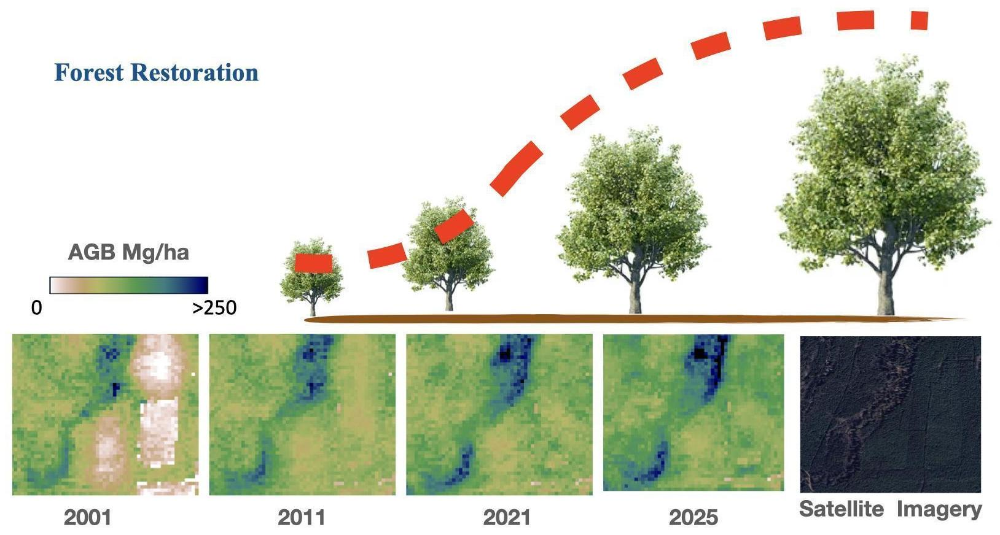
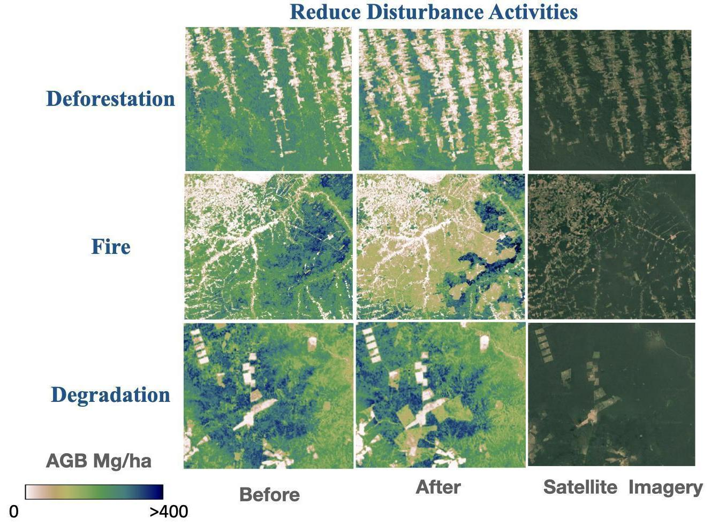
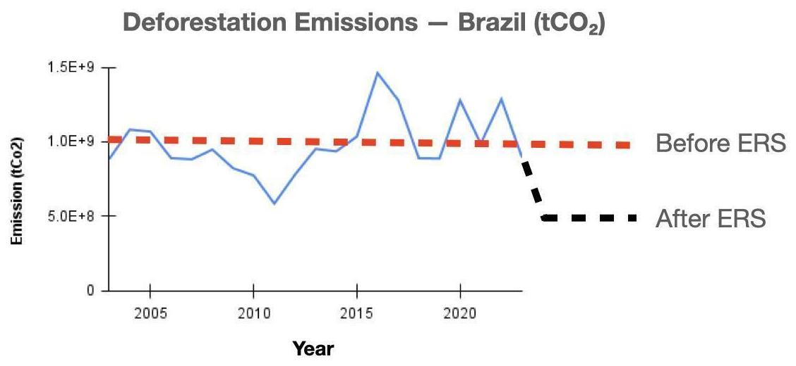

### Forestry and Land Use Change Sector: Net Forest & Mangrove, Net Grassland, and Net Wetland Carbon Stock Change - Living Biomass

**Sassan Saatchi, Yan Yang, and Wentao Lin**

*All authors affiliated with [CTrees.org](http://ctrees.org) and Climate TRACE*

V5.11.0, Sept. 2026

#### 1. Introduction

Changes in terrestrial ecosystem carbon storage immediately impact global atmospheric CO₂ concentrations by releasing (as a source) or removing (as a sink) carbon. Current estimates of the global carbon budget suggest that terrestrial ecosystems, particularly forests, account for 10-20% of net global CO₂ emissions to the atmosphere annually while sequestering approximately 30% of annual CO₂ emissions. However, these estimates involve large uncertainties (Friedlingstein et al., 2022), primarily due to the lack of reliable and standardized greenhouse gas (GHG) inventory systems for the land sector in many countries, as well as inconsistencies in inventory approaches used by countries to assess and report land-sector emissions and removals to the United Nations Framework Convention on Climate Change (UNFCCC). Accurate assessment of net CO₂ emissions from global land-use change, along with understanding the role of land in climate mitigation, remains a critical challenge (Friedlingstein et al., 2022; Grassi et al., 2017).

As climate policy moves from pledges to tangible implementation, there is an urgent need to reduce uncertainties in land-use, land-use change, and forestry (LULUCF) emissions estimates and to develop standardized, observation-based GHG inventory systems. These improvements will help refine the global stocktake and enhance countries’ capacities to assess compliance with their climate targets under the Paris Agreement.

Forests are the primary component of land-atmosphere carbon exchanges, contributing over 80%

of the land carbon flux (Xu et al., 2021). They store substantial amounts of carbon in aboveground and belowground biomass and are central to the global carbon cycle (Saatchi et al., 2011; Malhi et al., 2009). Consequently, forests are a focal point in the design and implementation of Natural Climate Solutions (NCS) for addressing climate change. NCS refers to actions aimed at protecting, managing, and restoring natural ecosystems to reduce GHG emissions and sequester carbon. These solutions are recognized for their potential to provide immediate, cost-effective pathways to mitigate climate change by reducing emissions from deforestation and forest degradation, and by enhancing carbon sequestration through improved land management, afforestation, reforestation, and revegetation (Seddon et al., 2021; Cook-Patton et al., 2021; Griscom et al., 2017). Forests play a significant role in NCS due to their ability to absorb anthropogenic CO₂ emissions through ecological processes such as photosynthesis, gross primary production, natural disturbance and recovery, and conservation and management practices (Luyssaert et al., 2008; Pan et al., 2011; Xu et al., 2021).

CTrees has developed a systematic, bottom-up approach (**Figure 1**) for global GHG inventorying of the land sector, focusing on estimating emissions and removals from forests and natural non-forest ecosystems worldwide. CTrees is a nonprofit organization dedicated to tracking carbon in every tree globally, providing science-based geospatial data to enable natural climate solutions at all scales ([https://ctrees.org/](https://ctrees.org/)). CTrees’ annual assessments of global carbon stocks and fluxes in the land sector are shared with Climate TRACE for integration with other trace gas fluxes across sectors. The dataset provides annual estimates of stocks and fluxes from 2015 to 2025, updated quarterly, to inform national policies and enhance global emissions tracking. The methods and techniques applied are detailed in Xu et al. (2021). This document presents a high-level summary of the methodology and approaches used to generate the datasets described in Section 2 for the three components of the CTrees standardized framework including live biomass carbon, activity data and emissions, and emissions based on land cover types. Section 3 will provide a summary of jurisdictional zonal statistics for emissions and removals. Section 4 will outline the methodology for the Emission Reduction Solutions (ERS).

#### 2. Dataset methods

Each section below provides an overview on the approach to generate each dataset in order to estimate emissions.

**Figure 1**. CTrees standardized framework for bottom-up estimates of land carbon fluxes using ground and remote sensing data and AI, providing GHG inventory and LULUCF emissions from 2015-2025. The framework consists of three main components of the live biomass carbon stock changes (discussed in section 2.1), LULUCF emissions (discussed in section 2.2), and jurisdictional level LULUCF emissions for 195 countries. Final geospatial maps and products are at 1-km spatial resolution.

#### 2.1 Estimates of Live Biomass Carbon Stocks and Changes

This dataset provides annual estimates of live above-ground biomass (AGB), below-ground

biomass (BGB), and total carbon (TLC) as the combined AGB and BGB across global vegetation (**Figure 2**). AGB estimates were derived from measurements of vegetation vertical structure using data from two satellite lidar sensors: the Global Ecosystem Dynamics Investigation (GEDI) mission aboard the International Space Station (ISS) and the ICESat-2 (Ice, Cloud, and land Elevation Satellite). These lidar-derived waveform metrics enabled the development of global vegetation structure (height metrics) maps across forested and non-forested areas, including savanna woodlands and shrublands, using machine learning (ML) algorithms. The number of GEDI and ICESAT-2 samples used in each 1-km grid cell was set to be greater than 50 to allow reliable estimates of vegetation structure and later AGB across different ecoregions globally. The valid number of samples increased significantly away from tropical regions thanks to the unique satellite orbit of the International Space Station hosting the GEDI sensor. A comprehensive set of airborne lidar data collected across the tropics was used to calibrate and validate the ML models. To create these structural maps, we developed over 700 ML models tailored to different ecoregions worldwide, improving height estimates and reducing large-scale overfitting and potential systematic errors.

**Figure 2.** Schematic showing the development of spatial and temporal variations of the global live biomass carbon stocks and changes using a combination of satellite remote sensing observations, ground and air inventory samples, and machine learning techniques, for vegetation structure, biomass density, and change detection (Xu et al., 2021).

The height maps were validated and refined to reduce spatial uncertainty and artifacts before being used in an ML model to predict above-ground biomass (AGB). We used the height metrics coincident with plots with AGB values a large number of ALS based estimates of AGB from height-based allometric models to develop a large number of AGB training samples for mapping live biomass density. This model was trained using over 300,000 inventory plots from diverse sources, including national forest inventory (NFI) data, globally distributed research plots in different ecoregion, and biomass estimates from a network of airborne lidar scanning (ALS).

All training data from forest inventories and ALS were smaller than 1-km pixels and were combined with higher-resolution remote sensing data to train the ML model at a resolution close to plot size. The trained model was then applied to coarser-resolution remote sensing data to provide AGB estimates that were adjusted to align proportionally with 1-km pixel sizes. The biomass maps were developed at a 1-km spatial resolution, with 2019 and 2020 as the reference years.

The next step involved developing a change-detection ML model (Xu et al., 2021) for annual AGB mapping at 1-km resolution from 2015 to 2024, with potential for future carbon density updates. This model relies on an annual disturbance mask, incorporating all disturbances from activity data (e.g., forest cover change and fire) and additional disturbances identified through significant annual reflectance changes in satellite imagery. The change-detection model predicts AGB changes by constraining large year-to-year anomalies in undisturbed areas while allowing unrestricted predictions in disturbed areas. The 2020 AGB map serves as a reference dataset to train the change-detection model, enabling annual AGB predictions across the entire time series (2015–2024).

AGB values were used to estimate BGB using existing models developed for different forest types and the Intergovernmental Panel on Climate Change (IPCC) guidelines for default values. Total carbon was calculated by using the following relation:

𝑇𝐿𝐶 = (𝐴𝐺𝐵 + 𝐵𝐺𝐵) × 𝐶𝐹

Where TLC is total live carbon in vegetation, and CF is the carbon fraction of vegetation ranging

from 0.47-0.51 depending on different forest types with the average value of about 0.5. Live

biomass carbon stocks are converted to tons (Mg) of CO2e per hectare (tCO2e/ha) before

delivering to Climate Trace.

As part of the change-detection approach, we further enhance AGB estimates using a productivity model developed by the CTrees team. This model employs a space-for-time approach, combining global disturbance data with AGB estimates to improve carbon removal

estimates across all ecoregions with stable vegetation over the complete disturbance history

Heinrich et al. 2023). The productivity model enables annual adjustments in areas of dense forest

biomass where AGB values remain stable but may have high uncertainty, capturing biomass

increases from gradual vegetation recovery. Biomass increases are applied to different biomass

levels, representing local vegetation growth stages as a proxy.

Datasets used for mapping vegetation structure and biomass includes:

-   Microwave radar measurements from Phased Array type L-band Synthetic Aperture Radar (PALSAR) on Advanced Land Observation Satellite (ALOS) and PALSAR-2 ALOS-2 at the 25 m spatial resolution

-   Thematic Mapper on Landsat 5, Operational Land Imager on Landsat 8 provided at the 30 m spatial resolution

-   Moderate Resolution Imaging Spectroradiometer (MODIS) on Aqua and Terra Satellites at 250 to 500 m spatial resolutions

-   Copernicus Digital elevation model (30 m spatial resolution) and land cover products (100m resolution)

-   Annual disturbance masks at 30 m spatial resolution derived from globally available land cover and land use change data, forest cover change, burned area, and additional remote sensing based metrics.

-   Ancillary data such as global land cover and tree cover maps at 100 m resolution to separate forests, from nonforests (shrublands and grasslands) and wetlands. LUCA at 10m resolution.

#### 2.2 Estimates of LULUCF Emissions

To calculate the committed carbon emissions from deforestation, fire, and degradation events, we

utilized a combination of satellite-derived products on forest cover change, fire disturbances, and

CTrees' monitoring of land use change activities. The methodology includes three main steps (**Figure 3**):

1.  Post-process 30-m disturbance data from multiple sources and land cover maps to estimate land use changes, attributing deforestation, forest clearing, degradation across tropical regions, and burned areas due to fires.

2.  Aggregate land use change activity data to 1-km resolution, reflecting percentages of non-overlapping land use activities, and combine it with 1-km carbon density estimates to calculate committed emissions from deforestation, degradation, and fire from 2015 to 2024, with plans to extend for future years.

3.  Integrate and calibrate CTrees' land use change activity alert (LUCA) data with global deforestation, degradation, and fire data to provide quarterly LULUCF emission estimates starting in 2023. These quarterly estimates enable sub-annual emission assessments, supporting emission reduction policy enforcement and harmonization with emissions from other sectors reported by Climate TRACE.

To calculate emissions, we used estimates of area of land use change and burned areas in forests,

and wetlands, with emission factors derived by the biomass change, and an emission efficiency

factor (*fD*) as given below:

$`E_{\text{DF}} = C_{i}\  \times \ PDA_{i}\  \times \ f_{D}`$

$`E_{\text{Fire}} = C_{i}\  \times \ PBA_{i}\  \times \ f_{B}`$

$`E_{\text{DG}} = C_{i}\  \times \ PDgA_{i}\  \times \ f_{\text{Dg}}`$

Where 𝐶𝑖 is the total live carbon derived from annual TLC mapping for pixel 𝑖, and *EDF* (or *EFire*, *EDG*) represents emissions from deforestation, fire, and degradation respectively for the corresponding year. $`\text{PDA}`$, $`\text{PBA}`$, and $`\text{PDgA}`$ represent the percent deforested areas, percent burnt

area, and percent degraded area, respectively within the 1-km grid cells.

The emission efficiency factor for deforestation was assumed $`f_{D} = 1`$ to allow total clearing of

forest with a nonforest land use such as agriculture or pasture. Depending on the type of clearing,

there may be variations for deforestation $`f_{D}`$ that can be used for uncertainty estimates. For fire

burned areas the efficiency factor or combustion factor $`f_{B}`$ vary with land cover types, suggesting different factors used for forest types and shrub and grasslands in boreal, temperate, and tropical wet and dry ecoregions (Xu et al. 2021). For degradation in tropical forests, we assume a fixed factor ($`f_{\text{Dg}}`$ = 0.15) in our analysis, which is an average number derived from various publications (e.g. Pearson et al. 2014). The total emissions from deforestation (*EDF*), fire (*EFire*), and degradation (*EDG*) were then estimated using the bottom-up modeling approximation (Xu et al., 2021).

Fire events at 1-km resolution can occur in both forest and non-forest regions, which may introduce a mixed-pixel effect when calculating emissions. To address this, each 1-km pixel was

divided into two fractions—forest and non-forest—based on annual forest cover maps. The carbon in each fraction was designated as forest TLC CFCF (forest) or non-forest TLC CNFCNF (non-forest). The annual forest cover maps were created using Global Forest Change (GFC) tree cover datasets, with the data averaged at a 100-m resolution and then aggregated to 1-km resolution using a 20% threshold to generate annual forest cover classifications. Degradation events additionally accounted for forest edge emissions. The choice of a 20% threshold for global calculations was informed by a review of national reporting practices, which vary between 10-30% tree or canopy cover in defining forests and reflects the significant uncertainties in data types used for country-level estimations.

**Figure 3.** Schematic showing the process of developing land use change activity data from peer-reviewed existing satellite data products along with CTrees carbon stock changes and emission factors to estimate LULUCF emissions including deforestation, degradation, and fire for all forest and nonforests areas globally.

The datasets used to develop emissions for land use change activities include:

-   The Global Forest Change (GFC) product at 30m spatial resolution from the University of Maryland GLAD data covering annual estimates of global forest change without attributions (Hansen et al. 2013).

-   Global Annual Burned Area Maps (GABAM) at 30m spatial resolution (Long et al. 2019 Tropical Moist Forest Product (TMF) developed by Joint Research Center (JRC) at 30m spatial resolution (Vancutsem et al. 2020) providing estimates of forest cover change attributable to deforestation and degradation.

-   Ancillary data including tree cover estimates from Landsat and land cover types separating forests, nonforests, and wetlands.

Emissions for land cover types will only include fire in forest, grass/shrubland, and wetlands that

were calculated by using the proportion of the burned area in each land cover type and the emission factor. The emission factor for fires is the biomass multiplied by the combustion factors in each land cover category. Emission estimates are provided in total tons of CO2e per 1-km resolution, globally for years 2015 to 2025.

The net annual carbon flux at each pixel (*Cne*t) in the 1-km grid cells denotes the difference between the potential vegetation carbon uptake (*Cremoval*) and the emissions from deforestation (*EDF*), fire (*EFire*) and degradation (*EDG*). Therefore, the removal term is the residual of the estimated carbon stock change, and emissions from deforestation, fire and degradation terms in equation:

$$ $`C_{\text{removal}} = \Delta C_{\text{net}} - E_{\text{DF}} - E_{\text{Fire}} - E_{\text{DG}}`$

For more details on the overall methodology, refer to Xu et al. (2021) for the overall framework of data processing and spatio-temporal machine learning model implementations.

#### 2.3 Estimates of Emissions from Land Cover Type

CTrees data provides annual estimates of total live biomass carbon (TLC) stored in three major land cover types: forests/mangroves, shrub/grasslands, and wetlands. The following datasets were used to calculate the carbon stocks:

-   Total live biomass carbon stocks (e.g., CTrees global TLC; see section 2.1)

-   Land cover map from Copernicus Global Land Cover (CGLS) at 100 m spatial resolution in 2019.

-   High resolution – 100m resolutions TLC map generated for 2020 (unpublished but publicly available data).

We combined CGLS land cover types into three separate land cover layers: all forest types (forest and mangroves), grasslands and shrublands (shrub-grassland), and wetland types (wetland). Each layer was averaged from 100m to 1-km spatial resolution, and we obtained three land cover fractions – forest/mangrove, shrub/grassland, and wetland. In each 1-km spatial resolution, each land cover fraction CO2 was denoted as *CF*, *CSG*, or *CW* representing forest, shrub-grassland, and wetland land cover classes, respectively. A ratio was obtained for the following: *Rf = CF/C*; *Rsg = CSG/C*; *Rw = CW/C* using the CGLS layers and the existing high-resolution (100m) global TLC map. With the knowledge of CO2 estimates (𝐶𝑖) for the 1-km pixel *i* in each year, the following equations were used:

$`C_{F,i\ } = C_{i}\  \times \ R_{f}\  \times \text{\ A}_{i}`$

$`C_{SG,i\ } = C_{i}\  \times \ R_{\text{sg}}\  \times \text{\ A}_{i}`$

$`C_{W,i\ } = C_{i}\  \times \ R_{w}\  \times \text{\ A}_{i}`$

Where *CF, i*, *CSG, i*, *CW, i* represent the total CO2 of forest/mangroves, shrub/grassland, and wetland in each pixel *i*, respectively, and *𝐴* is the area of pixel *i*.

#### 3. Climate TRACE Reporting

#### 3.1 Annual Reporting

The spatially developed estimates of emissions and removals are used to generate zonal statistics for Climate TRACE reporting. The Climate TRACE platform reports total carbon stocks, emissions, and removals across forests/mangroves, shrub/grasslands, and wetlands at three levels of administrative units (GADM). These levels, GADM0, GADM1, and GADM2, refer to different administrative boundary tiers within the Global Administrative Areas Database (GADM) ([https://gadm.org/about.html](https://gadm.org/about.html)), which provides detailed geographic boundaries for regions worldwide. Specifically, GADM0 corresponds to national boundaries encompassing entire countries, GADM1 refers to subnational units such as provinces, states, or regions (depending on a country's administrative structure), and GADM2 represents divisions at the level of counties, districts, or municipalities. These designations allow researchers and policymakers to analyze data across various administrative levels and granularities.

To calculate the zonal statistics at these GADM levels, we use 1-km pixel-level estimates of carbon stocks and emissions/removals within each GADM boundary, formatted accordingly for Climate TRACE reporting. The net change in living biomass from 2015 to 2024 is calculated for each sector by assessing the change in total carbon (TLC) between years, as follows:

$`\Delta C_{net,\ yr2} = C_{yr1} - C_{yr2}`$

where *Cyr1* represents the previous year's carbon stock and *Cyr2* the current year's stock, resulting in *ΔCnet,yr2* , the net change in living biomass carbon stock.

For consistent reporting across levels, we first calculate zonal statistics at GADM2, then aggregate the data to GADM1 and GADM0. These estimates are available on the Climate TRACE website for display and download at all three GADM levels. Additionally, for each administrative level, carbon stocks and fluxes are separated by land cover types.

The following datasets are available for download: Annual carbon stocks, emissions from forest-land fires, forest-land clearing, forest-land degradation, emissions from shrub/grassland fires, wetland fires, and residual removals from forest, shrub/grasslands, and wetlands. Additionally, CTrees provide uncertainty and confidence level for all zonal statistics.

#### 3.2 Quarterly Reporting

To estimate emissions for quarterly reporting, we use the CTrees LUCA (Land Use Change Activity) platform, which provides global land use change estimates with 10-meter spatial resolution, updated biweekly for both global and forest-specific areas (Mulissa et al. 2024). Beginning in 2023, we aggregated LUCA estimates to a 1-km spatial resolution and compared them with similar datasets derived from Landsat-based products used for land use activity data.

Since the current version of LUCA does not attribute specific land use activities to each change, we calibrated emission factors at each pixel to ensure that total emissions calculated quarterly align closely with annual emissions from all land use activities. This adjustment enables LUCA data to be utilized effectively for calculating and reporting emissions on a quarterly basis (see **Figure 3**). At the end of each year, we will reconcile quarterly estimates with annual totals obtained from Landsat data and emission factors for each activity type, ensuring consistency between quarterly and annual emissions reports.

#### 4. Emission Reduction Solution Methodology - Forestry

#### 4.1 ERS - Introduction

ERS (Emission Reduction Solutions) for the forest sector offers a comprehensive and strategically targeted approach to mitigating greenhouse gas emissions. These solutions are specifically designed to address key disturbance types that significantly contribute to carbon emissions: deforestation, forest degradation, and uncontrolled fires. Furthermore, ERS strategies are tailored to be effective across diverse land classes, including critical forest ecosystems, carbon-rich wetlands, and extensive grass-shrublands. The core principle of ERS is to enable governments and a broad range of partner organizations—such as local agencies, indigenous communities, non-governmental organizations (NGOs), and private operators—to implement region-specific interventions. By carefully selecting and applying the most appropriate strategy for each region and its unique drivers of emissions, these entities can achieve verifiable and quantifiable reductions in carbon dioxide equivalent (tCO₂e) within their managed areas. This systematic approach ensures that efforts are not only impactful but also measurable and reportable, providing a clear pathway towards climate change mitigation.

*Note: Only rank 1 strategies are provided on the Climate TRACE website and additional strategies will be made available in future releases.*

#### 4.1.1 Typical Strategy Pathways for Emission Reduction

ERS encompasses a range of well-defined strategy pathways, each designed to tackle specific emission sources:

-   Limit Deforestation

-   Reduce Degradation

-   Mitigate Fire Risk

-   Protect Wetlands/Peat

-   Enable Restoration

Further details on each ERS strategy pathway are provided in [**Appendix A1**](#appendix-a1-typical-ers-strategy-pathways).

#### 4.1.2 Proposed Approach to Quantify Emission Reduction Solutions

Our proposed approach for implementing and quantifying ERS through targeted strategies involves a robust three-step process:

1.  Establish the Baseline and ERS Scenario

2.  Estimate Reduced Emissions Based on Affected Areas

3.  Estimate Confidence Intervals for Each Strategy

A full methodological description for this three-step process is available in [**Appendix A2**](#appendix-a2-proposed-approach-to-quantify-emission-reductions).

#### 4.1.3 Enabling Factors for Effectiveness

While the ERS strategies themselves are scientifically grounded, their ultimate effectiveness is heavily dependent on a suite of crucial enabling factors. These factors create the necessary environment for successful implementation and sustained impact:

-   Governance and Enforcement Capacity

-   Tenure Clarity

-   Durable Finance

-   Community Co-management

-   Climate Exposure

Further detail on each enabling factor is provided in [**Appendix A3**](#appendix-a3-enabling-factors-for-ers-effectiveness).

#### 4.2 ERS - Materials and Methods

#### 4.2.1 Datasets employed

The ERS (Emissions Reduction Solution) analysis provides a comprehensive framework for assessing and modeling greenhouse gas emissions and their reduction potential across various terrestrial ecosystems. This integrated approach combines detailed emissions data with disturbance layers, spanning forests, wetlands (including peatlands), and grass-shrub systems. A key aspect of the ERS methodology is the meticulous spatial and temporal alignment of all input datasets. This alignment is crucial for accurately calculating both baseline emissions and for simulating various ERS scenarios at different administrative or jurisdictional levels, specifically leveraging GADM (Global Administrative Areas) boundaries.

**Core Datasets:**

The ERS framework relies on several critical datasets, each contributing unique insights into emissions, land-use change, and administrative structures:

-   CTREES Emissions (1 km, 2015–2023)

-   Disturbance Area Rasters (1km, 2015–2023)

-   Administrative Boundaries

Further information for each dataset and their role in ERS analysis is available in **[Appendix B1](#appendix-b1-core-datasets-and-their-role-in-ers-analysis).**

**Key Variables and Units for ERS Analysis:**

To ensure consistency and clarity in the analysis, specific variables and units are employed:

-   Emissions:

-   Gridded format: tCO₂e per km²

-   Aggregated scale: tCO₂e

-   Disturbance Area:

-   hectares per year (ha yr⁻¹)

-   Jurisdictional Boundaries:

-   jurisdiction IDs

Further breakdown on the variables and units is available in **[Appendix B2](#appendix-b2-key-variables-and-units-for-ers-analysis).**

By integrating these datasets and adhering to these standardized variables and units, the ERS methodology provides a robust and transparent approach to understanding and addressing greenhouse gas emissions from land-use change and disturbances globally.

#### 4.2.2 Nature-Based Emission Reduction and Removal Scenarios

Brazil has emerged as a crucial leader in the global efforts to reduce emissions from deforestation and forest degradation (REDD+). The country initially implemented comprehensive REDD+ policies between 2006 and 2016, demonstrating early commitment to these initiatives. Following a period of reduced focus, Brazil resumed its leadership in 2023 under President Lula's administration, reiterating its dedication to environmental conservation. A cornerstone of Brazil's strategy is its ambitious Brazilian Forest Policy, which aims to achieve near-zero deforestation emissions, aligning with the nation's broader commitment to a net-zero economy. This renewed focus underscores Brazil's understanding of the critical role its vast Amazon rainforest plays in global climate regulation and biodiversity.

The success of REDD+ policies extends beyond Brazil, with other nations adopting similar strategies. Indonesia, for example, stands out as another prominent success story. Over the past five to ten years, Indonesia has significantly reduced its deforestation rates through a combination of targeted interventions, improved governance, and the implementation of robust REDD+ programs. These efforts highlight the effectiveness of well-designed policies and international cooperation in combating climate change and preserving vital ecosystems.

The growth of REDD+ activities has been significantly propelled by the introduction of carbon market incentives. These incentives have stimulated the rapid expansion of jurisdictional REDD+ activities, where entire national or sub-national regions participate in carbon credit schemes. A key driver of this growth is the ART/TREES methodology (Architecture for REDD+ Transactions/The REDD+ Environmental Excellency Standard), which has been widely embraced by numerous national and sub-national governments across the Global South. Currently, over 25 jurisdictions have declared their readiness to reduce emissions from deforestation and degradation under this methodology, successfully securing vital funding for their conservation efforts. This widespread adoption underscores the methodology's credibility and its effectiveness in mobilizing financial resources for climate action.

Monitoring the performance of these jurisdictional REDD+ initiatives is crucial for ensuring their integrity and effectiveness. CTrees has played a pivotal role in this regard, developing sophisticated performance monitoring systems compatible with both the ART/TREES and Verra methodologies. Through these systems, CTrees actively contributes to scaling up emission reduction policies across tropical regions worldwide. The significant interest from major carbon market investors further highlights the financial viability and environmental impact of jurisdictional REDD+ projects. Notable investors include global energy giants such as Amazon, Mercuria, Shell, and Total Energies, alongside several leading financial institutions, demonstrating a strong market confidence in these initiatives.

Beyond preventing deforestation, forest restoration also plays a vital role in carbon removal. The market has incentivized forest restoration through Afforestation, Reforestation, and Revegetation (ARR) projects, which encompass both forest and non-forest sectors, as well as Improved Forest Management (IFM) activities. A growing number of carbon registry projects are dedicated to carbon removal and the restoration of forest and wetland ecosystems. This growing interest is further evidenced by significant investments from major companies and sustainability programs, including tech giants like Meta, Microsoft, Netflix, and Google, as well as energy companies such as Shell and Total Energies, all committing resources to ARR and IFM initiatives. These investments underscore a broader corporate commitment to achieving sustainability goals and mitigating climate change.

The financing of emission reductions, driven by robust market and policy incentives, is designed with strong social and ethical considerations. A crucial aspect of these programs is the stringent requirement concerning indigenous rights. These requirements ensure that investments not only support the livelihoods of local communities but also directly address the underlying drivers of deforestation. By prioritizing indigenous rights and community well-being, these programs foster a more equitable and sustainable approach to forest conservation.

Furthermore, most emission reduction programs, including REDD+, ARR, and IFM, are designed to deliver significant co-benefits beyond carbon sequestration. These programs incorporate specific requirements and financing mechanisms to promote biodiversity conservation and improve water quality, among other ecological advantages. There is a rapidly emerging market for biodiversity credits and other co-benefits, indicating a growing recognition of the holistic value of these environmental initiatives. These co-benefits are increasingly being integrated into both market and policy frameworks, paving the way for a more comprehensive and multi-faceted approach to environmental stewardship and sustainable development.

#### 4.2.3 Emission-Reduction Strategy (Forests & Related Land Systems)

Below is a comprehensive strategy for emission reduction solutions, designed to increase forest area and carbon stocks, and prevent losses from land-use change and disturbance.

**Emission Reduction Solutions Strategies**

The overarching goal of these strategies is to enhance the Earth's natural capacity to absorb and store carbon while simultaneously mitigating the release of greenhouse gases from land-use changes and disturbances such as fires.

-   **Forest Restoration**: Restores degraded or deforested ecosystems to recover ecological function.

-   **Mitigate Forest Fire Risk:** Reduces wildfire likelihood, intensity, and impacts through preventive measures.

-   **Limit Deforestation:** Prevents the permanent loss of forest cover.

-   **Reduce Degradation:** Minimizes declines in forest health and productivity from human or natural causes.

-   **Reduce Grassland Fire Activity:** Lowers ignition risk and fire spread in grassland ecosystems.

-   **Reduce Wetland Fire Activity:** Reduces occurrence and severity of fires in peat and other wetland systems.

Detailed descriptions of key approaches and expected outcomes for each strategy are provided in [**Appendix B3**](#appendix-b3-strategies-and-expected-impacts-for-emission-reduction-solutions). *Note: Only rank 1 strategies are provided for assets on the Climate TRACE website and additional strategies will be made available in future releases.*

#### 4.2.4 Methodology in practice

#### 4.2.4.1 Baseline period

Our comprehensive analysis establishes a baseline period from 2015 to 2023 for emissions calculations. During this period, we meticulously quantified emissions values at the GADAM level 2, encompassing counties, groups of counties, and municipalities. Our methodology disaggregates these emissions across three primary disturbance categories: deforestation, degradation, and fire. Furthermore, these categories are broken down by land class, specifically distinguishing between forest, wetland, and grass/scrubland areas. All calculations are performed at a high resolution of 1km, as visually represented in **Figure 4**.

The foundation of our analysis relies on two critical input layers: global time series emission maps and comprehensive disturbance datasets, both spanning the period from 2015 to 2023. These datasets provide the granular information necessary to accurately assess and attribute emissions to specific disturbance types and land classifications.

**Figure 4.** EMR flowchart: This diagram illustrates the inputs and methodology of the EMR system. The green rectangle represents the input/output datasets, which are the emission datasets generated by CTrees. The orange cylinder signifies the methods or strategies employed.

#### 4.2.4.2 Processing Steps

**Emission Reduction Methodology for Environmental Restoration Strategies**

This methodology outlines the process for calculating emission reductions resulting from various Environmental Restoration Strategies. The core principle involves quantifying the impact of these strategies on disturbance-related emissions over a defined period.

1.  Baseline Establishment

2.  Emission Reduction Calculation

3.  Scenario Development and Evaluation

4.  Continuous Monitoring and Improvement

Full breakdown of the steps is available in **[Appendix B4](#appendix-b4-ers-processing-steps).**

#### 4.2.4.3 Forest Restoration and disturbance activities

Forest restoration is a pivotal ecological undertaking aimed at not only expanding forested areas but also at rebuilding vital carbon stocks and actively removing atmospheric carbon dioxide (CO₂). This intricate process involves the deliberate conversion of land that is not currently forested back into thriving, biodiverse forest ecosystems. A primary and quantifiable benefit of this conversion is the significant increase in above-ground biomass (AGB), which serves as a direct and measurable indicator of carbon sequestration.

As illustrated in **Figure 5** below, a typical and successful transition from non-forest to forest land can result in an increase of approximately 150 Mg/ha in AGB. This substantial accumulation of biomass is not merely an aesthetic change; it is quantitatively equivalent to roughly 350 tCO₂/ha sequestered over a 25-year period. The implications of this are profound: when this process is scaled across large, geographically suitable areas, forest restoration emerges as a substantial and globally significant carbon sink. Its capacity to absorb and store such vast quantities of carbon makes it a crucial component in mitigating the escalating challenges of climate change. Beyond carbon sequestration, forest restoration also provides numerous co-benefits, including enhancing biodiversity, improving water quality, preventing soil erosion, and supporting local communities through sustainable resource management.

**Figure 5.** Illustration of two aspects of forest restoration: the upper panel depicts the forest regrowth curve (red dashed line), while the lower panel displays the changes in Aboveground Biomass (AGB) between 2001 and 2025. Warmer/lighter colors = lower AGB and cooler colors = higher AGB.

Conversely, a range of disturbance activities contribute significantly to the transfer of CO₂ from terrestrial ecosystems back into the atmosphere, exacerbating climate change. These disturbances encompass deforestation, forest degradation, natural or anthropogenic fires. More detail is available in [**Appendix B5**](#appendix-b5-definition-of-forest-disturbances).

As visually depicted in **Figure 6** below, these disturbances consistently lead to a marked reduction in AGB, both immediately before and after their occurrence, directly diminishing the carbon stocks within the affected forest. This loss of carbon represents a significant contribution to greenhouse gas emissions.

**Figure 6.** Illustration of Aboveground Biomass (AGB) loss resulting from various disturbances, including deforestation, fire, and degradation. The figure presents three panels: the left panel depicts AGB prior to the disturbance, the center panel shows AGB after the disturbance, and the right panel displays corresponding satellite imagery. Warmer/lighter colors = lower AGB and cooler colors = higher AGB.

Therefore, implementing effective and robust strategies to curb these destructive activities is paramount. By preventing deforestation, mitigating forest degradation, and managing fire risks, we can substantially lower greenhouse gas emissions into the atmosphere. Crucially, these preventative measures also play a vital role in preserving existing carbon sinks and preventing further global warming. In conclusion, both proactive forest restoration and the diligent prevention of disturbances are not isolated actions but rather essential, interconnected components of a comprehensive, multi-faceted climate change mitigation strategy. Their combined impact is indispensable for achieving global climate goals and fostering a more sustainable future.

#### 4.2.5 Verifying modeled emissions estimates

**Countries Demonstrating Recent Reductions in Deforestation**

Several countries have shown promising progress in curbing deforestation, primarily through a combination of enhanced enforcement, policy implementation, and supply-chain initiatives. These efforts are crucial in the global fight against climate change and biodiversity loss.

-   Brazil (Amazon, 2023)

-   Indonesia (Multi-Year)

-   Malaysia (Multi-Year)

More information regarding each country’s specific actions, methodologies, and verified outcomes is provided in [**Appendix B6**](#appendix-b6-verified-emissions-reductions-from-deforestation).

#### 4.3 ERS - Results

The implementation of the Emissions Reduction Strategy (ERS) across the managed regions can lead to a substantial reduction in land-sector emissions. Under a scenario using a hypothetical 50% ERS cut, land-sector emissions are projected to fall by 15,604.18 Mt CO₂e relative to the baseline. This achievement is primarily attributable to two key interventions: stringent deforestation controls and targeted fire-risk mitigation measures.

For instance, using Brazil as a compelling example (as illustrated in **Figure 7**), the application of ERS measures is projected to reduce deforestation-related emissions by approximately 0.5 Pg CO₂ over the projection period, relative to the established baseline. This estimate is carefully derived by considering several critical factors, including the assumed treatment area, anticipated disturbance rates, and biome-specific emission factors within the projection window. It is important to note that actual outcomes are subject to a degree of variability, contingent upon factors such as the effectiveness of enforcement capacity, the availability and allocation of financing, and the unpredictable influence of climate variability.

**Table S2** illustrates a consistent 50% reduction across all major disturbance categories, encompassing deforestation, degradation, and various types of fire (forest, wetland, and grass-shrub). This uniform reduction highlights the broad and impactful nature of the ERS implementation. The variation in Brazil's deforestation emissions between 2001 and 2023 defines the ERS baseline in red (**Figure 7**), while the black line depicts the projected emissions after the successful implementation of ERS, demonstrating a clear and significant reduction relative to the baseline. This graphical representation underscores the tangible positive impact of the ERS on mitigating deforestation-related emissions in Brazil. The data collectively demonstrates the efficacy of the ERS in achieving substantial emissions reductions within the land sector, driven by strategic interventions in deforestation control and fire-risk management.

**Figure 7.** Brazil’s deforestation emissions from 2001 to 2023. The red line denotes the baseline emissions trajectory. The black line illustrates the projected emissions under a hypothetical 50% ERS implementation scenario. Instances where the observations (blue line) lie above the red line indicate higher emissions relative to the baseline.

#### 4.4 ERS - Discussion

Our comprehensive ERS strategies analysis rigorously quantifies the technical potential for mitigating disturbance-driven emissions. This assessment operates under a crucial simplifying assumption: that no implementation barriers exist to limit the treatable area, thereby providing an upper-bound estimate of achievable abatement. In practical application, however, the actual realized outcomes will be intrinsically linked to a complex interplay of various factors, including prevailing policy frameworks, available financial resources, institutional and human capacity, levels of social acceptance, and inherent biophysical constraints of the landscapes in question. The following sections provide a detailed summary of the major factors that significantly influence the effectiveness of each proposed strategy.

**Cross-cutting Assumptions and Limitations**

Several overarching assumptions and limitations are critical to consider when interpreting the results of our RMS analysis and planning for real-world implementation:

-   Activity Feasibility & Access

-   Cost and Funding Durability

-   Governance & Enforcement

-   Leakage and Rebound Effects

-   Permanence & Climate Variability

-   MRV and Uncertainty

More detailed information on each assumption and limitation is provided in [**Appendix C1**](#appendix-c1-cross-cutting-assumptions-and-limitations).

#### 4.5 ERS - Conclusion

Our comprehensive Risk Management System (RMS) assessment has unequivocally identified a substantial technical potential for mitigating greenhouse gas emissions stemming from deforestation, forest degradation, and uncontrolled fires. However, it is crucial to recognize that the actual, realizable reductions are critically dependent on the establishment and sustained presence of essential enabling conditions.

The most reliable and impactful gains in the near term are projected to emerge from a multi-pronged strategy. Firstly, the implementation of robust, jurisdiction-wide controls on deforestation is paramount. This involves not only legal frameworks but also effective enforcement mechanisms and alternative livelihood opportunities for communities historically reliant on forest clearing. Secondly, targeted fire-risk mitigation efforts are indispensable, particularly in high-hazard landscapes, including the highly vulnerable and carbon-rich peatland systems. These efforts should encompass early warning systems, community-based fire prevention and suppression, and the restoration of fire-resilient ecosystems. Lastly, credible and sustainable restoration initiatives, where the long-term survival of planted species and ongoing stewardship are assured, will contribute significantly to carbon sequestration and ecosystem recovery.

To effectively convert this identified technical potential into verifiable and tangible outcomes, a strategic and integrated approach is required. This involves the implementation of a prioritized portfolio of interventions, focusing resources on areas with the greatest potential for impact and sustained success. Furthermore, securing multi-year, predictable financing is absolutely critical to ensure the longevity and effectiveness of these programs, moving beyond short-term, project-based funding cycles. Concurrently, the institutionalization of transparent and robust Measurement, Reporting, and Verification (MRV) systems, coupled with effective uncertainty management, is essential for demonstrating accountability and building trust among stakeholders. Such systems will allow for accurate tracking of emissions reductions and removals, providing the necessary data for reporting and adaptive management.

By diligently pursuing these strategies, we can deliver durable and verifiable reductions in carbon dioxide equivalent (tCO₂e). Beyond climate benefits, these efforts are anticipated to yield significant co-benefits, including the reinforcement of biodiversity conservation, enhancement of water security for both human and ecological systems, and the strengthening of community livelihoods through sustainable resource management and alternative economic opportunities. This holistic approach ensures that climate action contributes to broader sustainable development goals.

#### 5. Supplemental Data

#### Table S1 General dataset information for Net Forest & Mangrove, Net Grassland, and Net Wetland Carbon Stock Change - Living Biomass.

<table><thead><tr class="header"><th><strong>General Description</strong></th><th><strong>Definition</strong></th></tr></thead><tbody><tr class="odd"><td><strong>Sector definition</strong></td><td><em>Net Forest &amp; Mangrove, Net Grassland, and Net Wetland Carbon Stock Change -Living Biomass.</em></td></tr><tr class="even"><td><strong>UNFCCC sector equivalent</strong></td><td><em>4.A Forest Land; 4.C Grassland; 4.D.1.a Peat Extraction Remaining Peat Extraction; 4.D.1.c Other Wetlands Remaining Other Wetlands; 4.D.2 Land Converted to Wetlands</em></td></tr><tr class="odd"><td><strong>Temporal Coverage</strong></td><td><em>2015 – 2025</em></td></tr><tr class="even"><td><strong>Temporal Resolution</strong></td><td><em>Quarterly; Monthly (on website, see Temporal Disaggregation of Emissions Data for the Climate TRACE Inventory)</em></td></tr><tr class="odd"><td><strong>Data format(s)</strong></td><td><em>GeoTIFF at 1-km spatial resolution</em></td></tr><tr class="even"><td><strong>Coordinate Reference System</strong></td><td><em>Coordinates of each reservoir given in degrees</em></td></tr><tr class="odd"><td><strong>Number of countries</strong></td><td><em>195 countries</em></td></tr><tr class="even"><td><strong>Ownership</strong></td><td><em>Country</em></td></tr><tr class="odd"><td><strong>What emission factors were used?</strong></td><td><em>See section 2.2 Estimates of LULUCF Emissions</em></td></tr><tr class="even"><td>
<strong>What is the difference</strong>

<strong>between a “NULL / none / nan” versus “0” data field?</strong>
</td><td><em>“0” values are for true non-existent emissions. If we know that the sector has emissions for that specific gas, but the gas was not modeled, this is represented by“NULL/none/nan</em></td></tr><tr class="odd"><td><strong>total CO2e 100yrGWP and total CO2e 20yrGWP conversions</strong></td><td>
<em>Climate TRACE uses IPCC AR6 CO2e GWPs. CO2e conversion guidelines are here: <a href="https://www.ipcc.ch/report/ar6/wg1/downloads/report/IPCC_AR6_WGI">https://www.ipcc.ch/report/ar6/wg1/downloads/report/IPCC_AR6_WGI</a></em>

<a href="https://www.ipcc.ch/report/ar6/wg1/downloads/report/IPCC_AR6_WGI"><em>_FullReport_small.pdf</em></a>
</td></tr></tbody></table>

###

###

###

Table S2 A detailed breakdown of the ERS reductions by disturbance type and land class globally. *Note: Only rank 1 strategies are provided for assets on the Climate TRACE website and additional strategies will be made available in future releases.*

| **Disturbance - land class** | **Baseline (Mt CO₂e)** | **ERS (Mt CO₂e)** | **Reduction (%)** |
|------------------------------|------------------------|-------------------|-------------------|
| Deforestation                | 6545.65                | 3272.825          | 50                |
| Degradation                  | 388.23                 | 194.115           | 50                |
| Fire - forest                | 5714.71                | 2857.355          | 50                |
| Fire - wetland               | 74.92                  | 37.46             | 50                |
| Fire (grass–shrub)           | 2880.66                | 1440.33           | 50                |
| Total                        | 15604.18               | 7802.09           | 50                |

#### Permissions and Use

All Climate TRACE data is freely available under the Creative Commons Attribution 4.0 International Public License, unless otherwise noted below.

> **Data citation format:** Saatchi, S., Yang, Y., and Lin, W. (2025). *Forestry and Land Use Change sector- Net Forest & Mangrove, Net Grassland, and Net Wetland Carbon Stock Change - Living Biomass*. CTress, USA, Climate TRACE Emissions Inventory. https://climatetrace.org \[Accessed date\]

#### Geographic boundaries and names (iso3\_country data attribute):

The depiction and use of boundaries, geographic names and related data shown on maps and included in lists, tables, documents, and databases on Climate TRACE are generated from the Global Administrative Areas (GADM) project (Version 4.1 released on 16 July 2022) along with their corresponding ISO3 codes, and with the following adaptations:

-   HKG (China, Hong Kong Special Administrative Region) and MAC (China, Macao Special Administrative Region) are reported at GADM level 0 (country/national); Kosovo has been assigned the ISO3 code ‘XKX’;

-   XCA (Caspian Sea) has been removed from GADM level 0 and the area assigned to countries based on the extent of their territorial waters;

-   XAD (Akrotiri and Dhekelia), XCL (Clipperton Island), XPI (Paracel Islands) and XSP (Spratly Islands) are not included in the Climate TRACE dataset;

-   ZNC name changed to ‘Turkish Republic of Northern Cyprus’ at GADM level 0;

-   The borders between India, Pakistan and China have been assigned to these countries based on GADM codes Z01 to Z09.

The above usage is not warranted to be error free and does not imply the expression of any

opinion whatsoever on the part of Climate TRACE Coalition and its partners concerning the

legal status of any country, area or territory or of its authorities, or concerning the delimitation of

its borders.

#### Disclaimer

The emissions provided for this sector are our current best estimates of emissions, and we are committed to continually increasing the accuracy of the models on all levels. Please review our terms of use and the sector-specific methodology documentation before using the data. If you identify an error or would like to participate in our data validation process, please contact us.

#### 6. Appendices

#### Appendix A1. Typical ERS Strategy Pathways

Expand on the key interventions for each pathway.

-   **Limit Deforestation:** This pathway focuses on preventing the permanent conversion of forest land to other uses. Key interventions include:

-   **Real-time monitoring tied to enforcement**: Utilizing advanced satellite imagery and ground-based surveillance to detect and respond to deforestation activities promptly, coupled with robust legal and administrative enforcement mechanisms.

-   **Tenure security**: Clarifying and securing land and resource rights for local communities and indigenous peoples, which often empowers them to protect their forests more effectively.

-   **Deforestation-free supply chains**: Promoting and requiring supply chain practices that ensure agricultural and timber products are not sourced from recently deforested areas, thus reducing market demand for unsustainable land use.

-   **Incentive programs for conservation**: Implementing financial or other benefits for landowners and communities who actively conserve their forests (GFOI (2020)).

-   **Reduce Degradation:** This strategy addresses the reduction in forest health and carbon stock without outright deforestation. Critical actions include:

-   **Improved logging practices**: Implementing reduced-impact logging (RIL) techniques that minimize damage to the residual forest, preserve biodiversity, and maintain ecosystem functions.

-   **Edge and understory fire prevention**: Managing vegetation and fuel loads at forest edges and within the understory to prevent the spread of ground fires, which can significantly degrade forest health and carbon stocks.

-   **Grazing management**: Implementing sustainable grazing practices in forest-adjacent areas to prevent overgrazing, soil compaction, and increased fire risk.

-   **Performance-based incentives**: Rewarding sustainable forest management practices through mechanisms such as payments for ecosystem services (GFOI (2020)).

-   **Mitigate Fire Risk:** This pathway is crucial for preventing and managing uncontrolled wildfires, which are major sources of emissions. Strategies include:

-   **Fuel management**: Systematically reducing flammable biomass through techniques like controlled thinning and removal of deadwood.

-   **Prescribed burning in safe windows**: Intentionally setting low-intensity fires under controlled conditions during periods of low fire risk to reduce fuel loads and promote forest health.

-   **Firebreak maintenance**: Creating and maintaining strategic breaks in vegetation to halt the spread of fires.

-   **Rapid response capacity**: Developing and maintaining well-equipped fire-fighting teams and rapid deployment systems to contain nascent fires quickly.

-   **Post-fire recovery**: Implementing measures to aid the regeneration of burnt areas, such as planting native species and controlling erosion (GFOI (2020)).

-   **Protect Wetlands/Peat:** These ecosystems are significant carbon sinks, and their protection is vital. Key actions include:

-   **Water-table management (rewetting):** Restoring hydrological regimes in degraded wetlands, particularly peatlands, to prevent the decomposition of deep carbon stores.

-   **Vegetation control**: Managing invasive species or excessive vegetation growth that can alter the hydrology or increase fire risk in wetlands.

-   **Specialized fire suppression**: Employing techniques specifically designed for wetland fires, which often burn underground in peat layers, to avoid massive deep-carbon losses (GFOI (2020)).

-   **Enable Restoration:** This pathway focuses on actively restoring degraded forest lands and ecosystems. Strategies include:

-   **Native species reforestation/assisted regeneration**: Planting tree species indigenous to the region and facilitating the natural regrowth of existing vegetation.

-   **Survival monitoring**: Regularly assessing the health and survival rates of planted or naturally regenerated vegetation to ensure the success of restoration efforts.

-   **Community co-management**: Involving local communities in the planning, implementation, and long-term stewardship of restoration projects, leveraging their traditional knowledge and ensuring equitable benefits (IPCC (2019)).

#### Appendix A2. Proposed Approach to Quantify Emission Reductions

Expand on the three-step methodology:

1.  **Baseline and ERS Scenario Development**

This initial step involves a detailed assessment of historical and current emissions. It requires the use of accurate disturbance maps, which delineate areas affected by deforestation, degradation, and fire. These maps are then combined with biome/stratum-specific emission factors, which represent the amount of carbon released per unit of disturbance in a particular ecosystem type. This data allows for the quantification of baseline emissions for each GADM (Global Administrative Unit Layers) region, reported in tCO₂e with an associated uncertainty range. The baseline serves as a critical reference point against which the effectiveness of ERS strategies will be measured. Concurrently, an ERS scenario is developed, projecting future emissions under the implementation of the chosen strategies.

1.  **Emission Reduction Estimation**

Building on the baseline and ERS scenarios, this step involves projecting the emissions under the planned ERS interventions. By identifying the specific areas that will be positively impacted by each ERS strategy, the expected reduction in emissions relative to the established baseline can be quantified. This involves modeling the avoided deforestation, reduced degradation, or mitigated fire events and their corresponding carbon impacts.

1.  **Uncertainty and Confidence Intervals**

To ensure the scientific rigor and robustness of the projected emission reductions, confidence intervals are estimated for each ERS strategy. This statistical analysis assesses the level of uncertainty associated with the emission reduction estimates, taking into account data variability, model assumptions, and the inherent complexities of ecological systems. Providing confidence intervals enhances the credibility and transparency of the reported tCO₂e reductions, indicating the range within which the true value is likely to fall.

#### Appendix A3. Enabling Factors for ERS Effectiveness

Provide deeper context on the factors.

-   **Governance and Enforcement Capacity:** Strong, transparent, and accountable governance structures, coupled with effective enforcement mechanisms, are essential to prevent illegal activities that drive emissions and to ensure compliance with conservation policies.

-   **Tenure Clarity:** Clearly defined and legally recognized land and resource tenure rights reduce conflicts, incentivize long-term sustainable management, and empower local communities to protect their territories.

-   **Durable Finance:** Secure and long-term financial commitments are critical to fund the implementation of ERS strategies, including monitoring, enforcement, capacity building, and incentive programs.

-   **Community Co-management:** Active involvement and empowerment of local communities, particularly indigenous peoples who often have deep ecological knowledge, foster sustainable practices and ensure the equitable distribution of benefits.

-   **Climate Exposure:** The effectiveness of ERS strategies can be significantly influenced by external climate factors. For instance, regions experiencing increased climate exposure, such as prolonged droughts, can amplify fire seasons, making fire mitigation strategies more challenging but even more critical. Understanding and adapting to these climatic variables is paramount for the long-term success of ERS initiatives.

#### Appendix B1. Core Datasets and Their Role in ERS Analysis

Full information on each core dataset:

-   **CTREES Emissions (1 km, 2015–2023):**

-   **Description:** This dataset provides annual emissions data, quantified in tonnes of carbon dioxide equivalent (tCO₂e) per square kilometer. It covers a range of disturbance types, including deforestation, forest degradation, and fires across various land classes (forest fires, wetland fires, and grass-shrub fires).

-   **Format:** The data is provided as geotiff files, offering a 1 km resolution and global coverage, ensuring a consistent and detailed spatial representation of emissions.

-   **Use in ERS:** This dataset is fundamental to the ERS analysis, serving as the primary source for establishing baseline emissions, categorized by the specific disturbance type. Furthermore, it forms the basis for calculating long-term mean emissions, which are essential for understanding historical trends and projecting future scenarios.

-   **Disturbance Area Rasters (1km, 2015–2023):**

-   **Description:** This dataset quantifies the annual disturbed area for various land-use changes. It includes deforestation (or forest loss), forest degradation, and areas burned across forest, wetland, and grass and shrub lands. It represents a refinement and retirement of previous datasets such as TMF (Tropical Moist Forest), GFC (Global Forest Change), and GABAM (Global Above-Ground Biomass and Carbon Mapping).

-   **Use in ERS:** This dataset is crucial for defining the "activity data" (AD) within the ERS framework. Activity data represents the treatable or affected area for each disturbance type and land class. By providing this spatial information, the disturbance area rasters enable the precise targeting of emissions reduction strategies and facilitate the scaling of potential reductions based on the extent of affected areas.

-   **Administrative Boundaries:**

-   **Source:** The administrative boundaries used in the ERS analysis are derived from a Climate Trace-modified GADM (Global Administrative Areas) shapefile. Climate Trace often refines and updates existing data to suit its specific analytical needs.

-   **Dataset:** This dataset encompasses jurisdictional boundaries at various levels: GADM0 (country level), GADM1 (state/province level), and GADM2 (city/district level).

-   **Use in ERS:** These boundaries are indispensable for the aggregation, reporting, and attribution of both baseline emissions and the results of reduction efforts. They allow for the precise reporting of emissions and reductions by specific jurisdictional entities, which is vital for policy implementation, accountability, and international reporting requirements.

#### Appendix B2. Key Variables and Units for ERS Analysis:

Breakdown on each variable and respective unit:

-   **Emissions:**

-   When represented in a gridded format (e.g., across a map), emissions are measured in **tCO₂e per km²**. This allows for a granular understanding of emission intensity across different areas.

-   When aggregated to a larger scale (e.g., for a country or state), emissions are expressed simply as **tCO₂e**, providing a total sum for the defined area.

-   **Disturbance Area:**

-   The annual disturbance area is quantified in **hectares per year (ha yr⁻¹)**. This metric is further broken down by specific disturbance type (e.g., deforestation, fire) and by land class (e.g., forest, wetland), allowing for a detailed understanding of the drivers of land-use change.

-   **Jurisdictional Boundaries:**

-   These are represented by **jurisdiction IDs**, which are unique identifiers for each administrative unit (country, state, city) within the GADM framework, facilitating accurate data linking and reporting.

#### Appendix B3. Strategies and Expected Impacts for Emission Reduction Solutions

#### Appendix B3.1 Forest Restoration

Forest restoration is a critical process focused on the recovery of degraded or deforested ecosystems. Its primary aims are to re-establish ecological functions, boost biodiversity, and improve the overall resilience of forest systems. This is achieved through an increase in forest area, strategic tree planting, and a significant enhancement of biomass carbon and forest productivity. Restoration mechanisms are diverse and are typically tailored to specific geographical contexts, forest types, and land-use priorities.

**Key Mechanisms:**

-   **Natural Regeneration:** This involves allowing forests to regrow autonomously. It necessitates the protection of degraded and abandoned lands from further disturbances, including fires, illegal logging, and overgrazing. Additionally, it supports the natural transition of deforested areas into fallow lands and secondary forests, where ecological succession can gradually restore forest cover.

-   **Restoration with Native Species:** In areas where natural recovery is unlikely or too slow, active intervention through the planting of diverse native tree species is crucial. This approach ensures that the re-established forest ecosystems are ecologically appropriate, resilient to local conditions, and supportive of indigenous biodiversity.

-   **Agroforestry and Mixed Land Use:** This innovative approach integrates trees with agricultural crops and livestock systems. It serves a dual purpose: restoring tree cover and associated ecosystem services while simultaneously supporting the livelihoods of rural communities. Agroforestry systems can enhance soil fertility, improve water retention, and provide diverse economic benefits.

-   **Community Forest Landscape Restoration:** This mechanism emphasizes a participatory approach, actively engaging Indigenous Peoples and local communities (IPLCs) in the restoration of entire landscapes. It seeks to balance ecological integrity with human needs, recognizing the deep knowledge and stewardship capacity of local populations.

**Expected Outcomes and Impacts:**

The restoration process, while vital, often requires patience, typically taking 5 to 10 years to yield significant and measurable impacts on ecosystem health. Key nature-based solution standards that guide and verify these efforts include Afforestation, Reforestation, and Revegetation (ARR) methodologies, such as Verra's VM0047, and Improved Forest Management (IFM) methodologies, like Verra's VM0045. Frameworks from the Climate Action Reserve (CAR) and Gold Standard (GS) also provide robust guidelines.

-   **Increased Forest Area:** Up to 1,000,000 hectares.

-   **Increased Biomass Carbon Stocks:** Up to 300-500 tCO2/ha.

-   **Increased Carbon Removal:** Up to 5-10 tCO2/ha/year.

It is important to note that the absolute values for these outcomes may vary significantly depending on the specific jurisdiction and geographical context. Crucially, CO2 emission factors are expected to remain unchanged throughout this restoration process, as the focus is on carbon sequestration rather than direct emission reduction from combustion.

#### Appendix B3.2 Mitigate Forest Fire Risk

This strategy focuses on implementing proactive measures to reduce the likelihood, intensity, and overall impact of wildfires on forest ecosystems. It involves a multi-faceted approach encompassing effective land management, specialized fire management techniques, and continuous monitoring.

**Key Management Approaches:**

-   **Fuel Load Reduction:** This involves actively decreasing the amount of combustible material present in forests. This includes dry leaves, deadwood, and understory vegetation. By minimizing these "fuels," the risk of ignition and the spread of high-intensity fires are significantly reduced.

-   **Fire-Resilient Forest Management:** This approach aims to enhance the forest's inherent resistance to fire and minimize post-fire carbon loss. Practices include selective thinning to create more open stands, maintaining larger and more fire-resistant tree species, and extending harvest rotations in managed ecosystems to allow for the development of mature, less flammable forest structures.

-   **Landscape-Level Fire Planning and Zoning:** This involves strategically managing fire across large geographical areas. The goal is to disrupt fuel continuity through the creation of fuel breaks and green buffers, and to protect high-value zones such as communities, critical infrastructure, and sensitive ecological areas.

-   **Restoration of Fire-Adaptive Ecosystems:** Many ecosystems have historically adapted to frequent, low-intensity fires. This approach focuses on restoring natural fire regimes and ecological processes in such areas. This can involve the reintroduction of controlled natural fire cycles and the planting of native, fire-adapted species that can better withstand and recover from fires.

-   **Post-Fire Recovery and Emission Mitigation:** Following a fire, efforts are directed at minimizing long-term emissions and restoring the ecosystem's carbon sequestration potential. This includes reforestation with resilient species, soil stabilization to prevent erosion and further carbon release, and cautious salvage logging to prevent decay-related emissions from burnt timber.

**Expected Outcomes and Impacts:**

Wildfire impacts can be highly variable, depending on annual climatic conditions and drought intensity.

-   **Maximum Area Affected by Wildfires:** Can range between 1,000 to 100,000 hectares in a given year.

-   **CO2 Emission Factors:** May increase by 10-30% compared to original values due to fire impacts, highlighting the importance of prevention and mitigation.

This comprehensive approach is designed not only to protect ecosystems from the immediate devastations of wildfires but also to enhance their long-term resilience and mitigate the associated greenhouse gas emissions.

#### Appendix B3.3 Limit Deforestation

This strategy is fundamental to preserving biodiversity, protecting nature, and combating climate change. It specifically focuses on avoiding the outright loss of forest cover. Effective mechanisms for reducing deforestation rely on a combination of conservation strategies, robust national policies, market-based incentives, and rigorous enforcement measures.

**Key Approaches:**

-   **Forest Protection and Law Enforcement:** Strengthening the enforcement of existing forest laws is paramount to preventing illegal logging, illicit mining activities, and land grabbing that directly lead to deforestation. This often requires increased surveillance, improved legal frameworks, and effective prosecution.

-   **Securing Indigenous and Community Land Rights:** Empowering local forest stewards, particularly Indigenous Peoples and local communities (IPLCs), is a highly effective deforestation deterrent. This involves legally recognizing customary and Indigenous territories, supporting participatory land-use planning processes, and enhancing community forestry institutions and benefit-sharing arrangements that incentivize conservation.

-   **Spatial Planning and Forest Zoning:** Strategic land-use planning is essential to direct development activities away from high-conservation-value forests. This includes creating comprehensive land-use plans that carefully balance conservation needs with development priorities, designating protected areas or conservation corridors, and establishing buffer zones alongside ecological restoration initiatives in vulnerable areas.

-   **Performance-Based Finance:** This approach offers financial incentives to countries or communities that demonstrate measurable reductions in deforestation below an agreed-upon reference level. This can be achieved through participation in voluntary or compliance carbon markets and through climate finance mechanisms provided by multilateral programs.

-   **Supply Chain and Market-Based Interventions:** Addressing the economic drivers of deforestation is crucial. This involves implementing interventions throughout supply chains to mitigate the impact of commodities such as soy, beef, and palm oil production, which are often linked to extensive forest loss. This can include certification schemes, consumer awareness campaigns, and corporate commitments to deforestation-free supply chains.

**Expected Outcomes and Impacts:**

The primary goals of limiting deforestation are the maintenance of existing forest cover and the preservation of carbon stocks.

-   **Maintain Forest Area:** These strategies are designed to sustain existing forest cover and enhance the long-term resilience of forest ecosystems.

-   **CO2 Emission Factors:** It is critical to recognize that CO2 emission factors remain unchanged through these efforts. The focus here is on preventing the release of stored carbon by avoiding deforestation, thereby preserving the carbon storage potential inherent in existing forests.

By implementing these comprehensive approaches, we can effectively combat deforestation, making a significant contribution to climate change mitigation while simultaneously supporting vital biodiversity conservation efforts.

#### Appendix B3.4 Reduce Degradation

This strategy aims to minimize the loss of ecosystem quality, productivity, and functionality that results from human activities and natural disturbances. A key focus is on reducing biomass loss within forests. Unlike deforestation, which involves the complete removal of forest cover, degradation often manifests through more subtle processes such as selective logging, recurring fires, overgrazing, unsustainable fuelwood collection, and poorly planned infrastructure development. The mechanisms for achieving this range from improved management strategies to proactive prevention and rigorous enforcement.

**Key Mechanisms:**

-   **Improved Forest Management (IFM):** This involves enhancing existing forest management practices for timber production and other uses, specifically to reduce damage to vegetation and soils. Techniques include Reduced Impact Logging (RIL), which minimizes disturbance during harvesting; extended rotation lengths, allowing trees to grow larger and forests to mature; and the retention of key habitat structures like seed trees, snags (standing dead trees), and riparian buffers along waterways, all of which contribute to ecological health and carbon storage.

-   **Fire Prevention and Control:** Implementing robust strategies to prevent or limit forest fires is essential, as fires are a major cause of degradation, particularly in drier forests or areas previously impacted by logging. This includes public awareness campaigns, early detection systems, and rapid response capabilities.

-   **Controlling Illegal Logging and Fuelwood Extraction:** Reducing unregulated extraction activities is crucial to prevent the depletion of forest carbon stocks and the overall deterioration of ecosystem quality. This requires effective monitoring, law enforcement, and providing sustainable alternatives for local communities.

-   **Livestock and Grazing Management:** Degradation caused by overgrazing, soil compaction, and trampling in forested areas can be mitigated through careful livestock management. This involves zoning to exclude or limit livestock from sensitive forest zones and promoting agroforestry or silvopasture systems that sustainably integrate trees and livestock, creating mutually beneficial land uses.

-   **Financial Incentives and Market Mechanisms:** Utilizing economic tools such as payments for ecosystem services (PES) can encourage conservation efforts. This also includes REDD+ (Reducing Emissions from Deforestation and Forest Degradation) subnational or project-level payments specifically for reduced degradation, and establishing sustainable financing mechanisms for protected area management.

**Expected Outcomes & Impacts:**

Reducing degradation leads to significant environmental and climatic benefits.

-   **Increased Biomass Carbon Stocks:** Potential increases of 100-300 tCO2/ha.

-   **Increased Carbon Removal:** Expected increases of 5-10 tCO2/ha/year.

It is important to acknowledge that absolute values for these outcomes will vary depending on the specific jurisdiction and geographical context. Moreover, CO2 emission factors are expected to remain unchanged through these interventions, as the focus is on maintaining and increasing existing carbon stocks rather than direct emission reduction from combustion.

By implementing these strategies, we can effectively combat forest degradation, enhance the resilience of ecosystems, and make a substantial contribution to climate change mitigation while simultaneously preserving biodiversity.

#### Appendix B3.5 Reduce Grassland Fire Activity

This strategy is dedicated to implementing practices that effectively lower the likelihood of ignition, slow the spread of fires, and reduce fire intensity specifically in grassland ecosystems. The emphasis is on proactive management of fine fuels (such as dry grass and brush), creating strategic discontinuities in fuel loads, and adjusting land-use practices to maintain low-risk conditions throughout fire-prone seasons.

**Key Management Approaches:**

-   **Removing Dry Grass and Brush (Fuel Reduction):** This involves actively reducing fine fuels through various methods, including mechanical mowing, brush-cutting, and biomass removal. Targeted grazing can be effectively utilized to manage flammable invasive species, followed by reseeding with native plants to stabilize ground cover and reduce flammability.

-   **Creating Firebreaks:** Establishing physical barriers to fire spread is crucial. This involves creating mowed or mechanically cleared strips, typically 3–10 meters wide (and wider on slopes), and establishing green or irrigated corridors. These firebreaks should be strategically placed around assets, roads, fence lines, and along long fuel runs. They must effectively disrupt fuel continuity and be positioned to counter prevailing winds and slopes. Regular re-mowing or re-grazing of these areas, combined with clearing ladder fuels (vegetation that allows fire to climb from the ground into tree canopies), is essential to maintain their effectiveness.

-   **Land Management for Long-Term Risk Reduction:** Sustaining low-risk conditions over time requires ongoing land management practices. This includes implementing rotational or rest-rotation grazing systems, conducting cool-season prescribed burns to manage fuel loads under controlled conditions, and undertaking reseeding or restoration efforts. These practices help keep fuel loads below critical thresholds and promote higher live-fuel moisture content, making the landscape less susceptible to fire. Additionally, ensuring maintained water points and access routes, and coordinating schedules with neighboring landowners and right-of-way managers, is vital to prevent the reconnection of fuel sources across property lines.

**Expected Outcomes & Impacts:**

Implementing these strategies is expected to significantly reduce the impact of grassland fires.

-   **Emission Reduction:** Potential decrease in fire frequency and associated fire emissions by 30-50%.

-   **CO2 Emission Factors:** It is important to note that CO2 emission factors are expected to remain unchanged through these interventions, as the focus is on preventing the combustion of biomass rather than altering the emission characteristics of burning materials.

By adopting these comprehensive strategies, we aim to enhance grassland management, substantially reduce fire risks, and promote the long-term resilience of these vital ecosystems.

#### Appendix B3.6 Reduce Wetland Fire Activity

This strategy is specifically designed to reduce the likelihood and severity of wetland fires, with a particular focus on peat, sedge, and cattail systems. The core principles involve breaking fuel continuity, restoring and meticulously maintaining high water tables, and managing vegetation along wetland margins. Key strategies prioritize keeping peat saturated, interrupting fire spread at the upland-wetland interfaces, and minimizing conditions that are conducive to smoldering, deep-burning fires that can release vast amounts of stored carbon.

**Key Management Approaches:**

-   **Create Firebreaks and Restore Hydrology:** Mitigating wetland fire risk requires maintaining saturated peat and creating breaks in fuel continuity, especially at wetland edges. This can be achieved through the use of wet or green firebreaks, targeted mowing, brush control, and the careful application of prescribed fire under very specific conditions to limit spread. Crucially, restoring and maintaining wetland hydrology is paramount. This involves actions such as blocking drains, raising water levels with weirs and ditch blocks, and reconnecting floodplains. Continuous monitoring of water tables and close coordination with neighbors are essential to manage potential flooding while simultaneously protecting critical habitat and carbon stocks.

-   **Land Management for Hydrological Control and Vegetation Management:** Effective land management includes actively managing hydrology to keep water tables consistently close to the surface, often using structures like weirs and seasonal back-watering. Controlling flammable invasive species is also vital; this involves removing biomass and restoring native, less-flammable vegetation. If prescribed burns are used, they must be implemented only under cool, moist conditions to reduce surface fuels and meticulously protect peat soils by limiting heavy equipment use and stabilizing disturbed margins.

-   **Block Wetland Drainage:** Restoring natural wetland hydrology often necessitates reversing historical drainage efforts. This can be achieved through ditch blocks, installing low-head weirs, backfilling old drainage channels, and retrofitting culverts. Utilizing beaver-style structures can also effectively retain water and re-wet peat soils. Reconnecting floodplains to natural river systems is crucial for sustaining moisture levels over the long term. Early coordination for permits and collaborative efforts with neighboring landowners are essential to address potential flooding and access concerns.

**Expected Outcomes & Impacts:**

These strategies are expected to significantly reduce the devastating effects of wetland fires.

-   **Emission Reduction:** Potential decrease in fire frequency and associated fire emissions by 30-50%.

-   **CO2 Emission Factors:** It is important to note that CO2 emission factors are expected to remain unchanged through these interventions. The primary goal is to prevent the combustion of high-carbon wetland fuels (especially peat), thereby avoiding the release of vast amounts of stored carbon rather than altering emission characteristics.

By implementing these sophisticated strategies, we aim to significantly enhance wetland resilience, reduce the risks posed by fires, and protect these vital and carbon-rich ecosystems from further degradation.

#### Appendix B4. ERS Processing Steps

1.  **Baseline Establishment:**

-   **Disturbance Emissions Aggregation:** We begin by aggregating disturbance emissions for the period spanning 2015 to 2023. This nine-year period serves as our baseline, providing a comprehensive understanding of historical emission levels due to various disturbances. These disturbances typically include deforestation, degradation, and fire across diverse land cover types such as forest, wetland, and grass & shrubland.

-   **Geographic Scope:** The analysis will utilize GADM-level 2 boundaries to accurately define and delineate the geographical areas for which emissions are calculated and reductions are estimated. This granular level of detail ensures that localized impacts of ERS are adequately captured.

2.  **Emission Reduction Calculation**

The reduction in emissions (tCO₂e) due to the implementation of each ERS is calculated using the following equation:

**Emission Reduction (tCO₂e) = Emissions (tCO₂e) by disturbance type × Activity Affected Percent**

Where:

-   **Emission Reduction (tCO₂e):** This represents the quantified amount of carbon dioxide equivalent emissions that are prevented or removed as a direct result of the ERS.

-   **Emissions (tCO₂e) by disturbance type:** This refers to the mean emission from the identified disturbance types (deforestation, degradation, and fire) across the various land cover types (forest, wetland, grass & shrubland) within the GADM-level 2 boundaries. This value is derived from the aggregated baseline data.

-   **Activity Affected Percent:** This crucial parameter represents the percentage of the disturbed area that is directly impacted and positively influenced by the implemented ERS. It quantifies the effectiveness of the strategy in reducing or reversing the impacts of disturbances. A higher activity affected percent indicates a broader and more significant impact of the strategy.

1.  **Scenario Development and Evaluation**

-   **Reduction Scenarios:** The calculated emission reductions, using the established baseline and the proposed activity affected percent for each ERS, will serve as the basis for developing various reduction scenarios. These scenarios will project the potential future emission reductions under different implementation levels and effectiveness of the ERS.

-   **Confidence Level Assessment:** For each developed strategy, a confidence level will be evaluated. This assessment will consider factors such as the reliability of input data, the robustness of the methodology, the feasibility of implementation, and the potential for achieving the targeted activity affected percent. A higher confidence level signifies a greater certainty in the projected emission reductions.

2.  **Continuous Monitoring and Improvement**

-   This methodology is designed to be iterative, allowing for continuous monitoring and improvement. As new data becomes available and the effectiveness of ERS is observed, the activity affected percent can be refined, leading to more accurate emission reduction estimates and a better understanding of the overall impact of the environmental restoration efforts.

#### Appendix B5. Definition of Forest Disturbances

-   **Deforestation:** The permanent removal of forest cover to convert land for other uses, such as agriculture, urban development, or infrastructure projects. This represents a complete loss of carbon sequestration potential and a major release of stored carbon.

-   **Forest Degradation:** A more subtle but equally damaging process that involves the reduction in the capacity of a forest to provide essential ecosystem services and goods. This can result from unsustainable logging practices, overgrazing, or recurrent, low-intensity fires, leading to a diminished forest structure and reduced carbon stocks.

-   **Natural or Anthropogenic Fires:** Both naturally occurring wildfires (often intensified by climate change) and human-ignited fires can rapidly release large quantities of stored carbon into the atmosphere. These events not only destroy existing biomass but also damage soil organic matter, further contributing to emissions and hindering future carbon uptake.

#### Appendix B6. Verified Emissions Reductions from Deforestation

Expands on the example regarding Brazil, Indonesia, and Malaysia.

-   **Brazil (Amazon, 2023): A Turnaround in the Amazon**

In a significant development, Brazil's Amazon region experienced a notable reduction in deforestation during 2023. The National Institute for Space Research (INPE), through its PRODES monitoring system, reported approximately 9,001 km² of cleared land. This figure represents a substantial decrease of about 22% compared to the deforestation rates observed in 2022. This positive trend was further corroborated by independent analyses, with the European Union's Joint Research Centre (JRC) also highlighting steep declines in mid-2023. These reductions are largely attributed to more robust enforcement measures implemented by the Brazilian government, signaling a renewed commitment to environmental protection in the Amazon. (Source: European Commission, Mongabay)

-   **Indonesia (Multi-Year): Sustained Progress in Primary Forest Conservation**

Indonesia has demonstrated a multi-year trajectory of declining primary forest loss, reaching near record lows in recent years. Between 2020 and 2022, primary forest loss was approximately 64% lower when compared to the period of 2015 to 2017. This significant achievement is a direct result of comprehensive conservation strategies, including the enforcement of moratoria on new forest concessions and the widespread adoption of No Deforestation, No Peat, No Exploitation (NDPE) policies within supply chains. These policies, which are increasingly embraced by major industries, aim to eliminate deforestation from the production and sourcing of agricultural commodities. (Source: Global Forest Watch, World Economic Forum)

-   **Malaysia (Multi-Year): mirroring Indonesia's Success in Forest Protection**

Malaysia has followed a similar positive trajectory to Indonesia, exhibiting substantial reductions in primary forest loss over the past several years. When comparing the period of 2020-2022 to 2015-2017, primary forest loss in Malaysia decreased by approximately 57%. This progress underscores the effectiveness of sustained efforts in forest conservation and management across the region. Like Indonesia, Malaysia's achievements can be linked to enhanced government oversight and increasing corporate responsibility within its key industries, contributing to the protection of its vital natural ecosystems. (Source: Global Forest Watch, World Economic Forum)

#### Appendix C1. Cross-cutting Assumptions and Limitations

-   **Activity Feasibility & Access:** The theoretical treatable area, as estimated in our analysis, presumes unfettered access permissions, robust logistical support, and adequate safety protocols. In many regions, particularly those with remote or protected areas, these factors can become significant and binding constraints, severely limiting the actual extent to which reduction strategies can be deployed. Challenges can include a lack of necessary permits, difficult terrain, insufficient infrastructure for transporting personnel and equipment, and security concerns.

-   **Cost and Funding Durability:** The successful implementation and long-term sustainability of many reduction strategies necessitate both substantial up-front investments and consistent recurrent costs. These recurrent expenses can encompass a wide range of activities, such as ongoing patrols for enforcement, sustained fuel management operations, and continuous monitoring efforts. A critical limitation is the risk of reversal if funding cycles are short-term or inconsistent. Without durable and predictable financial support over multiple years, initial gains can be quickly eroded, leading to a resurgence of disturbances and a loss of previously achieved emission reductions.

-   **Governance & Enforcement:** The efficacy of deterrence measures and the achievement of widespread compliance with reduction strategies are fundamentally dependent on robust governance structures and effective enforcement mechanisms. This requires clear and unambiguous mandates for responsible agencies, a low prevalence of corruption within the relevant institutions, and the consistent application of effective sanctions for non-compliance. Weak or compromised governance significantly diminishes the realized impact of even well-designed strategies, as the absence of accountability can undermine efforts to prevent and control disturbances.

-   **Leakage and Rebound Effects:** A significant challenge in disturbance reduction is the potential for "leakage" and "rebound" effects. Suppressing disturbance activities in one geographical area can, unintentionally, shift that pressure to an adjacent or alternative location. For instance, if logging is restricted in one forest, illegal logging might simply move to an unprotected area nearby. To counteract this, policies must be jurisdiction-wide in scope, addressing the problem comprehensively rather than in isolated pockets. Furthermore, establishing traceable supply chains is crucial to ensure that demand for resources does not simply find alternative, less regulated sources, thereby negating the benefits achieved in the initial target area.

-   **Permanence & Climate Variability:** The long-term permanence of achieved gains in emission reduction is subject to considerable uncertainty, particularly in the face of climate variability and external socio-economic pressures. Extreme weather events such as prolonged droughts and intense heat waves can increase the susceptibility of ecosystems to disturbance (e.g., increased fire risk), potentially eroding previous gains. Similarly, external factors like commodity booms can heighten economic incentives for destructive activities, placing renewed pressure on natural resources. To ensure the durability of benefits, adaptive management strategies are essential, allowing for flexibility and adjustments in response to changing conditions. Additionally, establishing robust ecological and social "buffers" can enhance resilience against these erosive forces.

-   **MRV and Uncertainty:** Accurate and credible quantification of emissions reductions is paramount. This relies heavily on robust Measurement, Reporting, and Verification (MRV) systems. The calculation of emissions reductions is influenced by the quality and availability of activity data (e.g., area treated, type of intervention), reliable emission factors (e.g., CO2 released per unit of disturbance), and the establishment of appropriate counterfactual scenarios (i.e., what would have happened in the absence of the intervention). The development and implementation of transparent MRV systems, which explicitly incorporate and communicate uncertainty bounds, are essential for ensuring the credibility and accountability of reduction efforts.

#### 7. References

1.  AP News / Al Jazeera. (2024, Jul 8). *Colombia deforestation fell to historic low last year (−36%).*

2.  ART-TREES (2021/2023). Jurisdictional REDD+ crediting standard (v2; v3 draft). [ART Architecture for REDD+ Transactions](https://www.artredd.org/wp-content/uploads/2021/12/TREES-2.0-August-2021-Clean.pdf).

3.  Beuchle, R., Carreiras, J., Heinrich, V., & Achard, F. (2024). *Update for year 2023 and assessment of humid forest regrowth (TMF)*. JRC Technical Report. [JRC Publications](https://publications.jrc.ec.europa.eu/repository/bitstream/JRC140548/JRC140548_01.pdf)

4.  Cook-Patton, S. C., Drever, C. R., Griscom, B. W., Hamrick, K., Hardman, H., Kroeger, T., … & Ellis, P. W. (2021). Protect, manage and then restore lands for climate mitigation. *Nature Climate Change*, 11(12), 1027-1034.

5.  European Commission, Joint Research Centre. (2024, Feb 28). The Amazon region in 2022 and 2023: Deforestation, forest degradation and risk from growing soy production. [JRC: EU Science Hub](https://joint-research-centre.ec.europa.eu/jrc-news-and-updates/amazon-region-2022-and-2023-deforestation-forest-degradation-and-risk-growing-soy-production-2024-02-28_en)

6.  Friedlingstein, P., Jones, M. W., O'sullivan, M., Andrew, R. M., Bakker, D. C., Hauck, J., … & Zeng, J. (2022). Global carbon budget 2021. *Earth System Science Data*, 14(4), 1917-2005.

7.  GFOI (2020). *Methods and Guidance Document (MGD 3.x)*—integrating remote sensing & ground data for MRV. [reddcompass.org](https://www.reddcompass.org/mgd/resources/GFOI-MGD-3.1-en.pdf)

8.  Global Forest Watch. (n.d.). *Indonesia—Deforestation rates & statistics*. Retrieved 2025. [Global Forest Watch](https://www.globalforestwatch.org/dashboards/country/IDN/)

9.  Global Forest Watch. (2023, Jun 27). *Tropical primary forest loss worsened in 2022.* (contains Indonesia/Malaysia multi-year comparisons). [Global Forest Watch](https://www.globalforestwatch.org/blog/forest-insights/global-tree-cover-loss-data-2022/)

10. Grassi, G., House, J., Dentener, F., Federici, S., den Elzen, M., & Penman, J. (2017). The key role of forests in meeting climate targets requires science for credible mitigation. *Nature Climate Change*, 7(3), 220-226.

11. Hansen, M. C., Potapov, P. V ., Moore, R., Hancher, M., Turubanova, S. A., Tyukavina, A., … & Townshend, J. R. (2013). High-resolution global maps of 21st-century forest cover change. *Science*, 342(6160), 850-853.

12. Heinrich, V . H., Vancutsem, C., Dalagnol, R., Rosan, T. M., Fawcett, D., Silva-Junior, C. H., ... & Aragão, L. E. (2023). The carbon sink of secondary and degraded humid tropical forests. *Nature*, 615(7952), 436-442.

13. IPCC (2019). *Refinement to the 2006 IPCC Guidelines for National GHG Inventories (AFOLU)*. Method updates, uncertainty, QA/QC. [IPCC NGGIP](https://www.ipcc-nggip.iges.or.jp/public/2019rf/index.html)

14. Long, T., Zhang, Z., He, G., Jiao, W., Tang, C., Wu, B., ... & Yin, R. (2019). 30 m resolution global annual burned area mapping based on Landsat Images and Google Earth Engine. *Remote Sensing*, 11(5), 489.

15. Luyssaert, S., Schulze, E. D., Börner, A., Knohl, A., Hessenmöller, D., Law, B. E., ... & Grace, J. (2008). Old-growth forests as global carbon sinks. *Nature*, 455(7210), 213-215.

16. Malhi, Y ., Saatchi, S., Girardin, C., & Aragão, L. E. (2009). The production, storage, and flow of carbon in Amazonian forests. *Amazonia and Global Change*, 186, 355-372.

17. Mongabay. (2023, Nov 11). *Deforestation in the Brazilian Amazon falls 22% in 2023.* (summarizes INPE/PRODES). [Mongabay](https://news.mongabay.com/2023/11/deforestation-in-the-brazilian-amazon-falls-22-in-2023/)

18. Mullissa, A.; Saatchi, S.; Dalagnol, R.; Erickson, T.; Provost, N.; Osborn, F.; Ashary, A.; Moon, V.; Melling, D. LUCA: A Sentinel-1 SAR-Based Global Forest Land Use Change Alert. *Remote Sensing*. 2024, 16, 2151. [https://doi.org/10.3390/rs16122151](https://doi.org/10.3390/rs16122151)

19. Pan, Y ., Birdsey, R. A., Fang, J., Houghton, R., Kauppi, P. E., Kurz, W. A., ... & Hayes, D. (2011). A large and persistent carbon sink in the world’s forests. *Science*, 333(6045), 988-993.

20. Pearson, T. R., Brown, S., & Casarim, F. M. (2014). Carbon emissions from tropical forest degradation caused by logging. *Environmental Research Letters*, 9(3), 034017.

21. Saatchi, S. S., Harris, N. L., Brown, S., Lefsky, M., Mitchard, E. T., Salas, W., ... & Morel, A. (2011). Benchmark map of forest carbon stocks in tropical regions across three continents. *Proceedings of the National Academy of Sciences*, 108(24), 9899-9904.

22. Seddon, N., Smith, A., Smith, P., Key, I., Chausson, A., Girardin, C., ... & Turner, B. (2021). Getting the message right on nature‐based solutions to climate change. *Global Change Biology*, 27(8), 1518-1546.

23. UNFCCC (Warsaw Framework & REDD+ resources). Rulebook for FREL/FRL, technical assessment, results-based payments. [redd.unfccc.int](https://redd.unfccc.int/fact-sheets/warsaw-framework-for-redd.html)

24. Vancutsem, C., Achard, F., Pekel, J. F., Vieilledent, G., Carboni, S., Simonetti, D., ... & Nasi, R. (2020). Long-term (1990-2019) monitoring of tropical moist forests dynamics. *BioRxiv*, 2020-09.

25. Verra (2023). VM0048 (and legacy VM0007)—REDD+ accounting with jurisdictional baselines/nesting. See also independent assessments. [Verra](https://verra.org/methodologies/vm0048-reducing-emissions-from-deforestation-and-forest-degradation-v1-0/)

26. World Economic Forum. (2023, Jul 7). *Deforestation falls to near record lows in Indonesia and Malaysia*. [World Economic Forum](https://www.weforum.org/stories/2023/07/indonesia-malaysia-successfully-reducing-deforestation/)

27. Xu, L., Saatchi, S.S., Yang, Y ., Yu, Y ., Pongratz, J., Bloom, A.A., Bowman, K., Worden, J., Liu, J., Yin, Y . and Domke, G., 2021. Changes in global terrestrial live biomass over the 21st century. *Science Advances*, 7(27), p.eabe9829.
