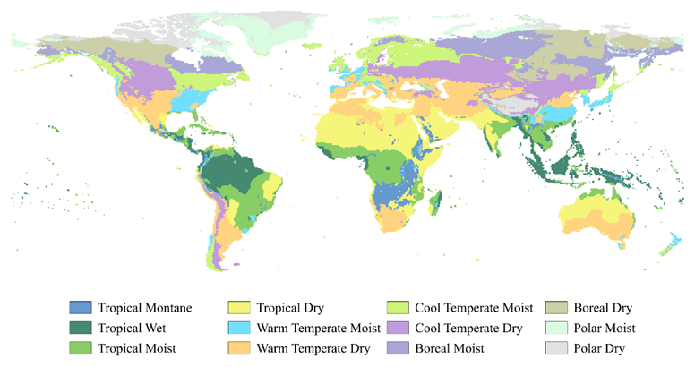
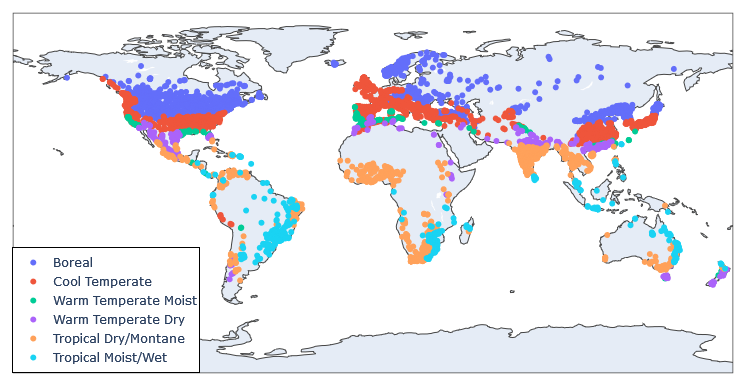
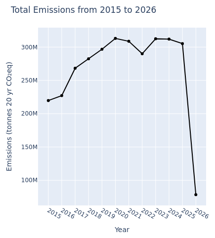
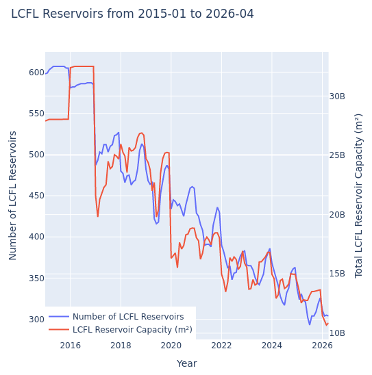
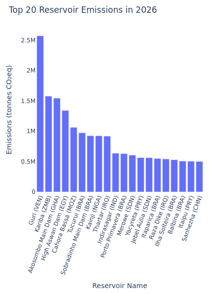
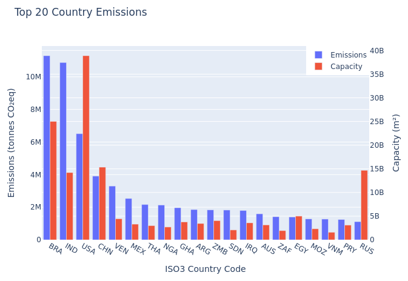
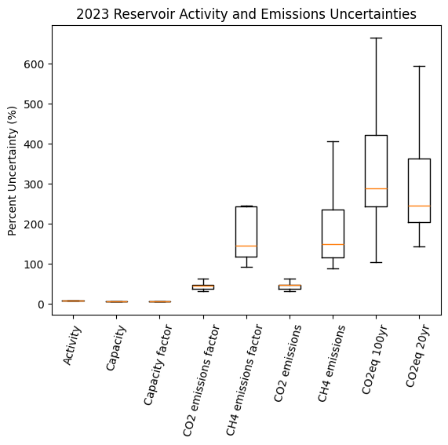
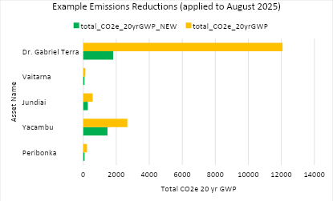

### Forestry and Land Use Change sector: Reservoirs Emissions

**Heather Hunter1,3, Michael Robinette1,3, Nicole Brown1,3, Lekha Sridhar2,3, Christy Lewis2,3, Christine Piatko1,3, and Elizabeth Reilly1,3**

*1) The Johns Hopkins University Applied Physics Laboratory, 2) WattTime, 3) Climate TRACE*

V5.8.0, June 2026

#### 1. Introduction

#### 1.1 Background

Water reservoirs play an important role in supporting human populations, providing hydroelectric power and supplying water for drinking and irrigation. However, they have also been large sources of anthropogenic greenhouse gas (GHG) emissions, emitting carbon and methane gasses generated by the breakdown of organic material in water. In 2019, the Intergovernmental Panel on Climate Change (IPCC) divided reservoirs into two categories of wetlands (Buendia *et al.*, 2019):

1.  Land converted to flooded land (LCFL): reservoirs no more than 20 years old that were formed by flooding dry land or by expanding an existing smaller waterbody

2.  Flooded land remaining flooded (FLRF): reservoirs that have been flooded for at least 20 years

Throughout literature, there have been some differences in the exact definition of reservoir. Frequently, the term has been used interchangeably to refer to both completely human-made water bodies that were previously unflooded and to natural water bodies with dams, dikes, or other forms of artificial water regulation. For the calculation of anthropogenic emissions, the IPCC has historically only considered the subset of reservoirs “excluding areas that were unmanaged water bodies (lakes and rivers) or unmanaged wetlands prior to flooding” (Buendia *et al.*, 2019). In 2023, following this definition, only completely human-made water bodies were considered reservoirs for these emissions calculations. As such, this influenced how countries report reservoir emissions, which may not capture all the emissions stemming from LCFL and FLRF. In 2024, regulated natural lakes with control structures were added to emissions calculations to generate more comprehensive emissions estimates.

Reservoir emissions are the sum of carbon dioxide (CO2) gases released by the breakdown of submerged organic matter and methane (CH4) gases escaping from sediment and aquatic plants. Recently, there have been several advancements in the methods used to estimate reservoir emissions where direct measurements cannot easily be made. Many studies have focused on quantifying correlations between geographic and environmental variables and greenhouse gas fluxes in order to create equations to estimate emissions. The work of Deemer et al. (2016), for instance, examined variables such as reservoir age and chlorophyll concentrations and their relationship to directly measured fluxes. Additionally, Prairie et al. (2021) developed the G-res model, a multiple linear regression model that considers several more reservoir attributes, in order to generate per-reservoir emissions estimates. However, the importance and correlation of each variable with emissions are currently open research topics. As such, emissions estimates across previous studies have varied by over a factor of ten, between 0.32 to 6.6 billion metric tonnes CO2 equivalent (CO2eq) (Harrison *et al.*, 2021).

Because methodology and resulting reservoir emissions estimates have had such a large variance, the Climate TRACE coalition has developed a methodology that follows IPCC’s guidelines to create a robust approach to estimate reservoir emissions globally. The approach developed here continues to be employed, allowing for consistency in monitoring reservoir emissions. To continue to improve upon this approach, this sector now includes emission reduction solutions (ERSs) to identify and measure the potential impact a solution can have in mitigating reservoir GHG emissions.

#### 1.2 Emissions Reductions Solutions (ERS)

Water reservoir emissions are closely linked to how they are managed. Operational decisions such as withdrawal depth, flow control, and water quality interventions directly shape the production and release of greenhouse gases. The Emissions Reduction Solutions (ERSs) discussed in this document therefore represent specific management practices that, while originally designed for purposes such as managing water supply, hydropower, or ecosystem health, also have the potential to substantially reduce methane and, in some cases, carbon dioxide. Although these approaches remain tested in limited contexts, they illustrate how targeted changes in reservoir management could be leveraged to mitigate emissions.

Importantly, the relative contribution of CH4 and CO2 to a reservoir’s overall warming potential influences which strategies are most effective. Because CH4 emissions are often driven by ebullition from sediments, management actions that limit the release of CH4-rich bubbles, such as avoiding or reducing summer drawdowns, can substantially reduce methane but have little effect on CO2. By contrast, actions that reduce nutrient inputs and eutrophication may lower both CH4 and CO2 emissions. The choice of which ERS strategy to prioritize should therefore also consider the GHG accounting horizon being used, since CH4 dominates short-term warming while CO2 has greater importance over longer timeframes (Beaulieu et al., 2018; Harrison et al., 2017; Deemer et al., 2016; Beaulieu et al., 2019).

In this document, four ERS are introduced - Aeration and oxygenation, Flow control, Withdrawal Height Adjustment, and Reservoir Shutdown - as illustrative strategies with potential for reducing reservoir emissions. Each of these operates through distinct mechanisms, from decommissioning entire reservoirs, to altering how water is withdrawn or oxygenated. As a result, the GHG emissions reduced can vary in amount and species impacted. The feasibility of each approach varies widely by climate zone, trophic state, and infrastructure constraints (Mercier-Blais, 2023).

#### 2. Materials and Methods

The Climate TRACE coalition estimated CO2, CH4, and CO2eq emissions for every month between January 2015 and April 2026 for 7,034 reservoirs from the Global Reservoir and Dam (GRanD) dataset (Lehner *et al.*, 2011) using the IPCC’s 2019 refinement guidelines for Tier 1 emissions from wetlands (Buendia *et al.*, 2019). For each reservoir, emissions were estimated by multiplying a climate zone-specific emissions factor (EF) by the reservoir’s surface area for each reservoir within a country, then the estimates were aggregated together to calculate the country’s total emissions. While N2O is also emitted by water reservoirs, the IPCC has assigned these emissions to other sectors to avoid double counting. With the approach described here, N2O was not reported.

#### 2.1 Datasets employed

#### 2.1.1 Reservoir Characteristics, Remote Sensing, and Climate Data

Generating emissions required aggregating data across several datasets: reservoir attributes were taken from HydroLAKES v1.0 (https://www.hydrosheds.org/products/hydrolakes; Messager *et al.*, 2016), GRanD v1.3 (https://www.globaldamwatch.org/grand/; Lehner *et al.*, 2011), and GOODD ([https://www.globaldamwatch.org/goodd](https://www.globaldamwatch.org/goodd); Mulligan *et al*., 2020), climate zone and weather information were taken from the Climatic Research Unit gridded Time Series v4.07 (CRU TS) (https://crudata.uea.ac.uk/cru/data/hrg/; Harris *et al.*, 2020), EFs were taken from the IPCC (Buendia *et al.*, 2019), and elevation data were taken from the Tropospheric Emission Monitoring Internet Service (TEMIS) 0.5-degree version of GMTED2010 (https://www.temis.nl/data/gmted2010.html; Geffen, 2023).

HydroLAKES is a global dataset of all lakes with a surface area of at least 0.1 km2 (Messager *et al.*, 2016). GRanD is included within HydroLAKES and consists of 7,320 dams with reservoirs more than 0.1 km3 in volume (Lehner *et al.*, 2011). In 2019, it was estimated to represent 75 percent of the total surface area of all reservoirs and was one of the few datasets that contained georeferenced reservoirs with detailed attribute information (Buendia *et al.*, 2019). HydroLAKES has labeled each waterbody in its dataset as a “lake”, “reservoir”, or a “lake control/natural lake with regulation structure”. As of 2024, all reservoirs in GRanD that were part of the lake control category were included for anthropogenic emissions calculations. In addition, reservoirs from GOODD cross-listed as a “lake” in HydroLAKES were classified as regulated lakes and included for emissions estimates purposes. GOODD is a comprehensive global dataset consisting of over 38,000 dams (Mulligan *et al*., 2020). Reservoirs that had no estimated completion year, or that were listed as under construction, destroyed, or removed as of 2023 were also omitted from our dataset, leaving 7,034 reservoirs, 418 of which were classified as regulated natural lakes. Previously, GRanD’s “Area\_skm” column was used as the surface area (i.e., capacity) for each reservoir, and the reservoir’s type was taken from the “Main\_use” column. These data are static and represent surface areas at a single point in time. To support the expansion of emissions estimates to a monthly cadence in 2024, reservoir surface areas were derived from satellite imagery. Using up-to-date data enabled Climate TRACE to track surface area variability over time for better emissions estimates. To that end, surface areas were derived for all reservoirs in GRanD using a combination of Landsat and Sentinel-2 multispectral imagery acquired from Microsoft’s Planetary Computer (https://planetarycomputer.microsoft.com/api/stac/v1) and Element84 (https://earth-search.aws.element84.com/), respectively, via the SpatioTemporal Asset Catalog (STAC) API. These two satellite missions represent the most widely and freely accessible multispectral satellite data at resolutions of 30-m and 10-m, respectively. When combined, data from Landsat and Sentinel-2 provide observations of every point on the globe every 2-3 days. Landsat is a series of joint NASA/USGS missions that has provided a continuous space-based record of Earth’s surface since 1972. Sentinel-2, on the other hand, is a European Space Agency (ESA) mission that consists of two satellites which have been observing the Earth’s surface continuously since 2015.

Emissions factors for reservoirs from the IPCC were provided separately for LCFL and FLRF in six different climate zones, aggregated from the 12 original zones listed in Table 1 (Buendia *et al.*, 2019). Climate zones were assigned to each reservoir based on temperature (TMP), frost day frequency (FRS), potential evapotranspiration (PET), and precipitation (PRE) from CRU TS in conjunction with elevation from GMTED2010. GMTED2010 is a global elevation model that combines data from various radar and satellite sources. The CRU TS is a global dataset of daily weather-related data from 1901 to 2023, and it was used by the IPCC to create their global map of climate zones (Buendia *et al.*, 2019).

**Table 1.** IPCC climate zones and their aggregations for January 2026. The “j” column represents the numerical identifier for each aggregated climate zone type. The “n” column denotes the number of reservoirs in our dataset for each climate zone based on the month of January 2025.

| **IPCC Climate Zones** | **Aggregated Climate Zones** | **j** | **n** |
|------------------------|------------------------------|-------|-------|
| Boreal dry             | Boreal                       | 1     | 2,341 |
| Boreal moist           |                              |       |       |
| Polar dry              |                              |       |       |
| Polar moist            |                              |       |       |
| Cool temperate dry     | Cool temperate               | 2     | 2,486 |
| Cool temperate moist   |                              |       |       |
| Warm temperate dry     | Warm temperate dry           | 3     | 447   |
| Warm temperate moist   | Warm temperate moist         | 4     | 205   |
| Tropical dry           | Tropical dry                 | 5     | 1,132 |
| Tropical montane       |                              |       |       |
| Tropical moist         | Tropical moist/wet           | 6     | 423   |
| Tropical wet           |                              |       |       |

#### 2.1.2 Emissions Reductions Solutions

The selection of the four ERS strategies employed for this sector was not based on a single, standardized dataset, but on a combination of expert discussions and a review of scientific literature; in particular, discussions with researchers from the United States Geological Survey (USGS) whose work has focused extensively on greenhouse gas emissions from reservoirs (B. Deemer, personal communication, April, 2025).The potential emissions reductions estimates for each ERS were drawn from published studies, rather than large-scale operational datasets, as most of these approaches remain at the research or pilot stage. For example, reservoir shutdown has been evaluated in studies of dam decommissioning and reservoir drawdown (Soued and Prairie, 2020; Amani et al., 2022; Liang et al, 2024); withdrawal height adjustment is supported by case studies of outlet depth and methane degassing (Harrison et al., 2021; Soued and Prairie, 2020); flow control is informed by recent hydrological modeling of water-level fluctuations (Chung et al., 2022); and aeration and oxygenation have long been applied for water quality improvement, with greenhouse gas implications discussed in lake management literature (Moore et al., 2015). While none of these strategies yet have large-scale operational datasets specifically targeting emissions reductions, they are supported by a body of peer-reviewed studies and expert recommendations that suggest their potential climate benefits when applied in the appropriate context.

Reservoir shutdown involves the decommissioning of dams and draining of reservoirs. Although this process initially increases emissions as sediments and organic matter are exposed, it has been shown to produce long-term reductions in CO2 and CH4 (Soued and Prairie, 2020; Amani et al., 2022; Liang et al, 2024). The adjustment of a reservoir’s withdrawal height, on the other hand, focuses on changing the depth at which water is released from the reservoir. This is sometimes referred to as selective withdrawal. Because methane concentrations are typically greatest in deep, oxygen-poor layers, shifting release toward the surface can significantly reduce methane emissions (Jager et al., 2023).

Flow control strategies aim to moderate both the timing and magnitude of water drawdowns to avoid exposing sediments that drive methane production. By managing water levels in this way, both CO2 and CH4 emissions can be reduced, though the precise impact per asset depends on local climate (Xu et al., 2023). Finally, aeration and oxygenation involve the addition of air or oxygen to reservoir waters, suppressing the anaerobic conditions that promote methane formation (Moore et al., 2015). While overall CO2 is likely to remain unchanged, CH4 emissions may be significantly reduced, with the greatest benefits in cooler, stratified reservoirs. Importantly, aeration and oxygenation are already common water-quality management techniques, meaning their emissions-related benefits can be considered secondary co-benefits of established practices.

#### 2.2 Methods

#### 2.2.1 Deriving Climate Zones

To determine the set of emissions factors to use, each reservoir was first mapped to its climate zone using its latitude and longitude found in GRanD. To assign this climate zone, we created an updated version of the IPCC's global mapping using the decision tree shown in the 1st Corrigenda to the 2019 guidelines (Federici, 2021). While the IPCC used CRU TS data averaged across 1985 to 2015 to derive climate zones, our version used more recent data from 1993 to 2022. The decision tree required estimates for FRS, elevation, mean monthly temperature (MMT), mean annual temperature (MAT), mean annual precipitation (MAP), and mean annual precipitation to potential evapotranspiration ratio (MAP:PET). MMT, which is the same as TMP, and elevation were taken directly from CRU TS and GMTED2010, respectively. MAT and MAP were derived from 30-year averages of TMP and PRE, respectively. MAP:PET was simply calculated as MAP divided by PET. Because this data was all available at 0.5-degree resolution, the resulting map was also generated at this resolution, shown in Figure 1. Although climate remains relatively consistent over long periods of time, there were some notable differences over the IPCC version of the map, such as larger polar moist regions in Alaska and more tropical dry regions across the Sahara. The number of reservoirs in our dataset in each climate zone is shown in Table 1.

**Figure 1.** Recreated map of IPCC climate zones, with climate data from 1993-2022.

After being assigned a climate zone, reservoirs were labeled as FLRF or LCFL for each month from 2015 to April 2026. All reservoirs with a completion date (i.e., the “Year” column in GRanD) no more than 20 years prior to the year of the emissions estimate were considered LCFL. All other reservoirs greater than 20 years old at the time of the estimate were considered FLRF. Note that FLRF and LCFL labels are year-specific. For instance, a reservoir built in 1996 would have been considered LCFL for 2015 emissions estimates and would have used LCFL-specific EFs, but in 2022, the same reservoir would have been considered FLRF and would have used FLRF EFs in that year.

#### 2.2.2 Deriving Reservoir Surface Area

Reservoir surface areas for previous emissions estimates were calculated using Normalized Difference Water Index (NDWI) images derived from Landsat or Sentinel-2's green and near-infrared bands. For this model version, and moving forward, we are instead leveraging Sentinel-2's Scene Classification Layer (SCL) ([https://registry.opendata.aws/sentinel-2/](https://registry.opendata.aws/sentinel-2/)), which is a pixel-level map that categorizes land cover and surface features in combined Sentinel-2A and Sentinel-2B data. It is produced by a rigorous, validated algorithm employed by the European Space Agency (ESA) to atmospherically correct those data. This algorithm takes into account different types of clouds, terrain shadow effects, and snow and ice cover, and has very good error handling. SCL provides the best, well-tested pixel-level classification with far less uncertainty than using NDWI, and provides not only water pixel classifications, but also snow and ice cover, which are important parameters for properly estimating GHGs from water reservoirs.

For a given reservoir, we obtain SCL data from Element84 using the STAC API for all images with &lt; 20% cloud cover over a 3-month period. Using that data stack, we produce 2 artifacts: 1) water mask (a given pixel is water if it was ever water), and 2) snow/ice mask (a given pixel is snow/ice if it was classified that way &gt; 50% of the time. If the number of water pixels &gt; the number of snow/ice pixels (indicating that the reservoir was free of snow/ice more often than not), then that reservoir is considered free of snow/ice. This solution provides a balance between 1) properly estimating water pixels and 2) accounting for persistent snow/ice coverage in very high latitudes.

Prior to June 2026, surface area estimates for artificial reservoirs were calculated using incorrect pixel sizes. As of June 2026, the correct pixel sizes have been applied to the full historical record of reservoirs’ emissions estimates.

In cases where persistent cloud cover or other limitations prevent reliable satellite-derived surface area estimates, a reservoir may have a reported surface area of zero or a missing value (NA) for a given month. However, zero values may also represent legitimate observations of reservoirs covered by snow or ice, for which emissions are assumed to be zero. To distinguish these cases, we apply a series of gap-filling rules to the monthly surface area estimates. First, zero surface area values for reservoirs in boreal climate zones are retained under the assumption that they represent ice-covered conditions, while zero values for reservoirs in all other climate zones are converted to missing values. Next, for reservoirs with no non-zero satellite-derived surface area estimates during a given year, all monthly values are replaced with the default surface area reported in GRanD, resulting in a static surface area estimate for that year. For reservoirs with at least one valid satellite-derived surface area estimate, remaining missing values are filled using the most recent available surface area estimate from a preceding month. Consequently, some reservoirs may have identical surface area estimates across consecutive months when satellite observations are unavailable. This approach maintains continuity in monthly emissions estimates while preserving zero-emission periods associated with presumed ice cover in boreal reservoirs.

#### 2.2.3 Estimating Reservoir Emissions

Estimating the anthropogenic emissions of regulated natural lakes required the estimation of the proportion of the lake that was man-made. To accomplish this, the difference between the surface area prior to the construction of the control structure was subtracted from present day surface area. Because the surface area prior to construction was unknown for most of these lakes, historical satellite imagery was collected to provide these estimates. While Landsat is the best source of global historical satellite imagery, its global record at 30-m spatial resolution only dates back to 1982. Thus, Climate TRACE selected lakes whose control structures were built after 1982. Landsat imagery was queried over a 6-month period prior to the construction date of the control structure. Given the resulting 6-month median image, the surface area of the lake (or river, in some cases) was calculated by summing water pixels identified by the NDWI. This surface area was then subtracted from the corresponding monthly surface areas estimated from 2015 to April 2026. In total, 418 regulated natural lakes were identified in the GRanD database. For CO2, emissions for each reservoir were estimated only for LCFL. Because CO2 emissions were found to taper off after about a decade, the IPCC only provides guidelines for estimating CO2 for recently flooded areas; reservoirs more than 20 years old were assumed to have no CO2 emissions (Buendia *et al.*, 2019). Equation 4 was used to calculate CO2 emissions per reservoir, denoted as $`\text{LCF}L_{CO_{2}}`$, using the EFs shown in Table 2, converted to tonnes m-2 y-1 from the IPCC (Buendia *et al.*, 2019). As shown in Equation 4, these EFs were multiplied by a decay parameter, $`\delta`$, which was calculated using Equation 5 and derived from Prairie *et al*., 2021. This decay parameter estimates the proportion of CO2 emissions that changed since the reservoir was first created (initialized at $`t = 0.5`$ years). It is a time-varying value that considers the steady decrease in CO2 emissions from LCFL from 0 years of age to 20 years of age. Its calculation is dependent on the mean annual air temperatures for each climate zone as well as the soil organic carbon content of a given reservoir, in addition to the reservoir’s age, surface area, and total phosphorus (TP) content. At this time, due to the lack of time-varying measurements of TP and soil organic carbon content in reservoirs across the globe, these values were set to static values; as a result, because Equation 4 represents a division of exponents, these values are removed, and only the time-varying components (i.e., age, surface area) contribute to $`\delta`$.

**Equation 4.** Total CO2 emissions for LCFL. *A* is the surface area of the reservoir*,* and $`EF_{\text{LCFL\ C}O_{2},\ j}`$ is the emissions factor in Table 2, for the reservoir’s climate zone*, j*, from Table 1*.*

$`\text{LCF}L_{CO_{2}} = A*\delta*EF_{\text{LCFL\ C}O_{2},\ j}`$

**Equation 5.** CO2 emissions decay parameter. *Y* is the age of the reservoir in years, $`T_{\text{eff}}^{\text{CO}_{2}}`$ is the effective air temperature in degrees Celsius, *A* is the surface area of the reservoir, *C* is the reservoir surface soil carbon content, and *TP* is the total phosphorus content.

$`\delta\left( t \right) = \frac{\text{EM}\left( t = 0.5 \right)}{\text{EM}\left( t \right)}`$

$`\text{EM}\left( t \right) = 10^{y}`$

$`y = 1.860 - 0.330Y\  + 0.332T_{\text{eff}}^{\text{CO}_{2}} + 0.0799A\  + 0.0155\ C + 0.2263\left( \text{TP} \right)`$

**Table 2.** CO2 emissions factors for LCFL based on the climate zone. The “n” column denotes the number of reservoirs used to calculate the standard deviation using Equation 5.

| **Climate Zones**    | **j** | **LCFL Emissions Factors, tonnes CO2 m-2 y-1** | **Standard Deviation** | **n** |
|----------------------|-------|---------------------------------------------------------------------------------|------------------------|-------|
| Boreal               | 1     | 0.00035                                                                         | 0.00021                | 118   |
| Cool temperate       | 2     | 0.00037                                                                         | 0.00017                | 2,103 |
| Warm temperate dry   | 3     | 0.00062                                                                         | 0.00022                | 679   |
| Warm temperate moist | 4     | 0.00054                                                                         | 0.00017                | 2,095 |
| Tropical dry/montane | 5     | 0.0011                                                                          | 0.00051                | 902   |
| Tropical moist/wet   | 6     | 0.0010                                                                          | 0.00037                | 920   |

CH4 emissions estimates were calculated for both LCFL, in Equation 6, and FLRL, in Equation 7. The equations are identical except for differences in their EFs, shown in Table 3 and Table 4, respectively. Note that CH4 emissions are influenced by the trophic state of the reservoir, which determines the value of $`\alpha`$, the EF adjustment variable, which increases as a reservoir undergoes eutrophication. For our methodology, this value was always 1.0, based on the IPCC’s default value for Tier 1 emissions. CH4 emissions in areas directly downstream of a reservoir were also considered in these equations. The variable $`R_{d}`$ represents the ratio of downstream CH4 emissions to the flux of CH4 from the reservoir itself. Again, the default value of 0.09 was used for this ratio (Buendia *et al.*, 2019). Note that in our reported Climate TRACE data for the reservoirs sector, the CH4 EFs column accounts for downstream emissions so that those EFs are 1.09 times higher than the values in Tables 2 and 3. Therefore, in the reported data, CH4 emissions are simply the product of the EF and capacity columns.

Because emissions are reported at a monthly temporal resolution, the annual CO₂ and CH₄ emissions factors provided by the IPCC are converted to monthly values by dividing by 12. Specifically, the annual emissions factors, expressed in tonnes CO₂ m⁻² yr⁻¹ and tonnes CH₄ m⁻² yr⁻¹, respectively, are divided by 12 to obtain monthly emissions factors in tonnes m⁻² month⁻¹. Monthly emissions are then calculated by multiplying the corresponding monthly emissions factor by the reservoir's estimated surface area for that month, with the appropriate adjustments for CO₂ emissions decay and downstream CH₄ emissions. This approach assumes a constant baseline emissions rate throughout the year, with monthly variability driven primarily by changes in reservoir surface area, including periods of ice cover.

**Equation 6.** Total CH4 emissions for LCFL. *A* is the surface area of the reservoir*,* $`EF_{\text{LCFL\ C}H_{4},\ j}`$ is the EF in Table 3 for the reservoir’s climate zone*, j*, $`\alpha`$ is the emissions factor adjustment for trophic state, equal to 1.0, and $`R_{d}`$ is the ratio of downstream CH4 emissions to the flux of CH4 from the reservoir, equal to 0.09.

$`\text{LCF}L_{CH_{4}} = LCFL_{CH_{4},\ res} + LCFL_{CH_{4},\ downstream}`$

$`\text{LCF}L_{CH_{4},\ res} = \alpha\left( A*EF_{\text{LCFL\ C}H_{4},\ j} \right)`$

$`\text{LCF}L_{CH_{4},\ downstream} = \alpha\left( A*EF_{\text{LCFL\ C}H_{4},\ j} \right)*R_{d}`$

**Table 3.** CH4 emissions factors for LCFL based on the climate zone. The “n” column denotes the number of reservoirs used to calculate the standard deviation using Equation 5.

| **Climate Zones**    | **j** | **LCFL Emissions Factors, tonnes CH4 m-2 y-1** | **Standard Deviation**  | **n** |
|----------------------|-------|---------------------------------------------------------------------------------|-------------------------|-------|
| Boreal               | 1     | 2.77 \* 10-6                                                         | 3.47 \* 10-6 | 96    |
| Cool temperate       | 2     | 8.47 \* 10-6                                                         | 1.30 \* 10-5 | 1,879 |
| Warm temperate dry   | 3     | 1.96 \* 10-5                                                         | 2.32 \* 10-5 | 578   |
| Warm temperate moist | 4     | 1.28 \* 10-5                                                         | 1.34 \* 10-5 | 1946  |
| Tropical dry/montane | 5     | 3.92 \* 10-5                                                         | 3.48 \* 10-5 | 710   |
| Tropical moist/wet   | 6     | 2.52 \* 10-5                                                         | 2.18 \* 10-5 | 805   |

**Equation 7.** Total CH4 emissions for FLRF. *A* is the surface area of the reservoir*,* $`EF_{\text{FLRL\ C}H_{4},\ j}`$ is the emissions factor in Table 4 for the reservoir’s climate zone*, j*, $`\alpha`$ is the emissions factor adjustment for trophic state, equal to 1.0, and $`R_{d}`$ is the ratio of downstream CH4 emissions to the flux of CH4 from the reservoir, equal to 0.09.

$`\text{FLR}F_{CH_{4}} = FLRF_{CH_{4},\ res} + FLRF_{CH_{4},\ downstream}`$

$`\text{FLR}F_{CH_{4},\ res} = \alpha\left( A*EF_{\text{FLRF\ C}H_{4},\ j} \right)`$

$`\text{FLR}F_{CH_{4},\ downstream} = \alpha\left( A*EF_{\text{FLRF\ C}H_{4},\ j} \right)*R_{d}`$

**Table 4.** CH4 emissions factors for FLRF based on the climate zone. The “n” column denotes the number of reservoirs used to calculate the standard deviation using Equation 5.

| **Climate Zones**    | **j** | **FLRF Emissions Factors, tonnes CH4 m-2 y-1** | **Standard Deviation**  | **n** |
|----------------------|-------|---------------------------------------------------------------------------------|-------------------------|-------|
| Boreal               | 1     | 1.36 \* 10-6                                                         | 3.15 \* 10-6 | 96    |
| Cool temperate       | 2     | 5.40 \* 10-6                                                         | 1.24 \* 10-5 | 1879  |
| Warm temperate dry   | 3     | 1.51 \* 10-5                                                         | 2.13 \* 10-5 | 578   |
| Warm temperate moist | 4     | 8.03 \* 10-6                                                         | 1.35 \* 10-5 | 1946  |
| Tropical dry/montane | 5     | 2.84 \* 10-5                                                         | 2.98 \* 10-5 | 710   |
| Tropical moist/wet   | 6     | 1.41 \* 10-5                                                         | 1.56 \* 10-5 | 805   |

From CO2 and CH4 emissions, CO2eq was calculated for each reservoir using Equation 8. The 20-year and 100-year global warming potentials (GWP) for CH4 were taken from the IPCC’s Sixth Assessment Report (2023).

**Equation 8.** CO2 equivalents for 20-year and 100-year GWPs. $`\text{GW}P_{CH_{4}20yr}`$ is equal to 80.8 and $`\text{GW}P_{CH_{4}100yr}`$ is equal to 27.2.

$`CO_{2}eq_{20yr} = CO_{2} + GWP_{CH_{4}20yr}*CH_{4}`$

$`CO_{2}eq_{100yr} = CO_{2} + GWP_{CH_{4}100yr}*CH_{4}`$

Uncertainty, reported as a standard deviation, was also estimated for each reservoir’s surface area and for CO2, CH4, and for CO2eq emissions and EFs. For reservoirs using the default GRanD surface area, the uncertainty was calculated as the standard deviation between the “Area\_poly”, “Area\_rep”, “Area\_max”, and “Area\_min” columns in GRanD; if only one column had a reported value, the standard deviation was taken as the “Area\_skm” value multiplied by the average percent standard deviation across the rest of the reservoirs. For reservoirs with satellite-derived surface areas, uncertainty was set to 5%, which accounts for the average 3% radiometric uncertainty of reflectance measurements of the sensors from which the surface area is derived. For CO2 and CH4 EFs, the standard deviations shown in Tables 2, 3, and 4 were calculated using Equation 7 to convert from the confidence intervals reported by the IPCC (Higgins, Li and Deeks, 2023). For CO2 EFs, $`n`$ was not directly reported by the IPCC and was assumed to be the same as those reported for tier 2 CO2 scaling factors, since both seem to have been derived from the same model.

**Equation 9.** Standard deviation derived from confidence intervals. $`CI_{\text{upper}}`$ and $`\text{CI}_{\text{lower}}`$ are the upper and lower bounds of the confidence intervals for the value of interest. $`n`$ is the number of values used to estimate the value of interest, assuming it is an average of several measurements. $`z`$ is the z-score for a particular confidence interval, 1.96 for a 95% CI and 1.645 for a 90% CI.

$`\sigma = \frac{\left\lbrack CI_{\text{upper}} - \ CI_{\text{lower}} \right\rbrack}{2z}*`$

**Table 5.** Constants and their uncertainties. The “n” column denotes the value used to calculate the standard deviation using Equation 5.

| **Constant Name**          | **Value** | **Standard Deviation** | **n** |
|----------------------------|-----------|------------------------|-------|
| $`R_{d}`$                    | 0.09      | 0.26                   | 36    |
| $`\text{GW}P_{CH_{4}20yr}`$  | 80.8      | 85.9                   | 30    |
| $`\text{GW}P_{CH_{4}100yr}`$ | 27.2      | 36.6                   | 30    |

Uncertainty for CO2, CH4, and CO2eq emissions values were estimated using 1 million Monte Carlo simulations. For CO2eq, this required estimating the standard deviation for the GWP values using Equation 9, with $`n`$ assumed to be 30. Because $`R_{d}`$ was included in the reported CH4 EFs, the Climate TRACE uncertainty data for CH4 EFs also included the uncertainty of $`R_{d}`$. The same Monte Carlo method was used to combine these uncertainties using the standard deviations in Table 5.

Confidence for capacity, type, and all emissions and EFs were reported per-reservoir on a 5-point scale: very low, low, medium, high, very high. For capacity and capacity factor, if a reservoir’s surface areas were the default GRanD surface areas, the confidence was set to “low”. If a reservoir’s surface area was satellite-derived, the capacity and capacity factor confidence were set to “medium”. All EFs were assigned a medium confidence, Climate TRACE’s default value for IPCC Tier 1 EFs. For CO2, CH4, and CO2eq emissions values, the confidence was medium, unless capacity had a lower confidence, in which case, that confidence value was used.

#### 2.2.3 Incorporating ERS into the Model

To estimate the potential emissions reductions from the four ERS strategies - Aeration and oxygenation, Flow control, Withdrawal Height Adjustment, and Reservoir Shutdown - we applied a simplified method that draws directly from literature estimates rather than from an established global dataset. In particular, the potential emissions reductions associated with each ERS were identified from peer-reviewed studies (e.g., Deemer et al., 2016; Soued et al., 2022; Harrison et al., 2021; Prairie et al., 2021), as well as discussions with USGS personnel (B. Deemer, personal communication, April, 2025).

The decision as to which ERS to apply to a given reservoir was based on a limited set of attributes: the main use of the reservoir, its age, and its climate zone. These factors were chosen because they are readily available across the majority of reservoirs in our dataset and strongly influence both emissions pathways and the practical feasibility of an ERS. In some cases, however, a given ERS is an appropriate solution for all reservoir types. For example, shutdown is typically only considered as the ERS of choice for older hydropower reservoirs (&gt;20 years old) where decommissioning is more plausible. However, for this work, it is included as an option for all reservoir types, regardless of main use, age, or climate zone to show potential emissions reduced. On the other hand, withdrawal height adjustment is more relevant for younger reservoirs in tropical zones where outlet configurations significantly affect methane degassing. Climate zone, in particular, was used to differentiate the magnitude of potential reductions, since literature suggests ERS performance varies between boreal, temperate, and tropical systems.

Although reservoir geometry, size, and trophic state are also important determinants of both emissions and ERS effectiveness, these attributes were not fully incorporated in this version of the model. Trophic state, for example, is a critical factor in determining methane production, but at the time of model development we had not yet completed trophic state classification for our dataset. This will be included in a future iteration. Likewise, no adjustments were made for reservoir surface area because no existing studies provide robust scaling rules to link ERS effectiveness to geometry at the global level.

Overall, the incorporation of ERS into the model should be considered a first-order approximation: reductions were applied using percentage ranges drawn from the literature, with simplified rules based on reservoir purpose, age, and climate zone. While this approach introduces uncertainty, it provides a transparent and replicable framework for testing the potential magnitude of ERS impacts on reservoir emissions and establishes a foundation for refinement in future versions of the model. See Table S4-1 to S4-4 discussing each strategy and the potential emission reduction associated with each.

#### 2.3 Verifying modeled emissions estimates

At the time of this writing, there were few other publications that used the IPCC’s methodology for calculating Tier 1 reservoir emissions. As such, it was difficult to find direct comparisons for validation. The IPCC emissions estimates seemed to be lower than previously reported values. However, there were a few case studies that used the same EFs with similar results; work from Sánchez-Carrillo *et al.* (2022) and Chung *et al.* (2022), for example, contained estimates within the same magnitude as the ones presented here.

#### 2.4 ERS Observability and Verification

At present, none of the four ERS strategies considered in this methodology (reservoir shutdown, the adjustment of withdrawal height, flow control, and aeration and oxygenation) were directly observable. Unlike surface area, which can be monitored using satellite imagery, these ERS are operational or management practices that cannot be consistently detected through remote sensing.

However, in principle, certain ERS could be partially observable and verifiable under specific conditions. For example, reservoir shutdown may be documented in public records, government reports, or local media, and such events are observable in multispectral satellite imagery over time, as the water levels are drawn down. Similarly, aeration and oxygenation might be reported by local water management agencies, but not be observable via remote sensing. The adjustment of withdrawal height and the implementation of flow control practices are even less observable, as they involve operational decisions about outlet structures and release schedules that require direct access to operator data. However, as with drawdown, changes in water quality and nutrient loading impacted by these practices are visible from multispectral satellite imagery at certain concentrations. While it is not possible to directly observe the implementation of flow control practices (or aeration and oxygenation), it is possible to observe changes in water quality before and after these practices are implemented.

Consequently, verification of ERS implementation will rely primarily on secondary sources, such as project reports, scientific studies, or government documentation, and cannot be systematically confirmed for all assets at the global level. In the future, verification could be improved by linking reported adoption of ERS at specific facilities to modeled emissions reductions by incorporating targeted case studies where detailed management records are available. For now, however, the modeled impacts of the ERS should be considered literature-based estimates, not empirically verified outcomes.

#### 3. Results

#### 3.1 Emissions Estimates

Out of the 7,034 reservoirs in our dataset, about half are in temperate climate zones, depending on the time of year. A lower percentage of our reservoirs are assigned to tropical climate zones, compared with the IPCC’s dataset. The global distribution of reservoirs is shown in Figure 2. Through the current month, 265 reservoirs in our dataset are labeled as LCFL while the rest are FLRF, meaning that the vast majority of emissions are driven by CH4 alone.

Summing across all reservoirs from January 2026 through April 2026, the total emissions for this sector, at the time of this writing, are 78,485,700 tonnes CO2eq20yr, composed of 961,531 tonnes of CH4 and 794,010 tonnes of CO2. Over time, reservoir emissions seem to be trending upward, with some variability. Note the distinctly high capacities from 2015 to 2017. Sentinel-2A was launched in July 2015, providing limited coverage, primarily over Europe, until November 2016. After November 2016, Sentinel-2A began providing global coverage with a revisit rate of about 10 days, which was reduced to 5 days after the launch of Sentinel-2B in March 2017. Because the current surface area algorithm relies on Sentinel-2's Scene Classification Layer (SCL) to identify water, snow, and ice pixels in a given scene, the updated algorithm cannot be applied over most regions of the world prior to December 2016. As a result, at this time, reservoir surface areas between January 2015 and December 2016 are calculated using the previous algorithm (based on the normalized difference water index, or NDWI) as applied to Landsat imagery over that time period. Because the NDWI approach is prone to over-estimating water surface areas, particularly in the presence of snow, ice, or clouds, the emissions estimates from 2015-2016 appear higher than those from 2017-2025. In the future, we will correct this over-estimation.

**Figure 2.** Locations of reservoirs in our dataset, with climate zones color-coded.

**Figure 3.** Total global $`CO_{2}eq_{20yr}`$ emissions from all reservoirs from 2015 to 2026. Each data point represents the total emissions for the year; as the 2026 data only goes through April 2026 at the time of this writing, the 2026 data point is significantly lower.

**Figure 4.** Number and capacity of LCFL-labeled reservoirs from 2015 through April 2026.

Many of the reservoirs with the highest emissions through the current month, shown in Figure 5, are from tropical climate zones where EFs were largest. Lake Nasser, for instance, is located in Egypt in a tropical dry zone; it is created by High Aswan Dam and is the largest reservoir in the dataset by surface area. Lake Kariba, the largest artificial lake in the world by volume, located in Zimbabwe, is also in a tropical dry zone. Both of these reservoirs have no CO2 emissions this year; however, their large capacity and CH4 EFs mean that they have the highest total emissions. The countries with the highest emissions often also contain the largest combined reservoir capacities, although countries in cooler climate zones often have lower overall emissions, despite having large capacities, shown in Figure 6. For instance, Canada lies primarily in cool and boreal climate zones, which have lower EFs than warm and tropical zones. In contrast, the USA, which has a more even mix of reservoirs across warm and cold climate zones, has slightly less capacity but the third highest resulting emissions.

**Figure 5.** 2026 (through the current month) top 20 reservoir emissions in million tonnes CO2eq20yr.

**Figure 6.** Comparison of the top 20 country emissions (left; units in millions of tonnes) and reservoir capacities (right; units in billions of squared meters) for 2026 through the current month.

Uncertainties for emissions values, shown in Figure 7, are generally high, driven primarily by large discrepancies in CH4 emissions and EFs. Large standard deviations for constants and EFs also contribute to high overall uncertainty. CH4 EFs have a much higher uncertainty than CO2 EFs, partially due to the inclusion of the $`R_{d}`$ value’s uncertainty in its calculation. In addition, the addition of the decay parameter described by Equation 3 drives the CO2 EF lower overall. Once converted to standard deviations, both CO2 and CH4 EFs have uncertainties of similar magnitude to the values themselves. The IPCC states that EFs “represent global averages and have large uncertainties due to variability in climate and management practices” (Buendia *et al.*, 2019).

**Figure 7.** 2026 reservoir activity and emissions uncertainties, presented as percent standard deviations.

#### 3.2 ERS Estimates

As few of the ERS strategies have yet been systematically implemented at scale or monitored in a way that produces direct before and after emissions datasets, the results presented in this section are illustrative estimates derived from literature. These results represent site-specific observations that can not necessarily be generalized, but do provide rough guidelines regarding the potential order-of-magnitude impact of certain ERS.

For example, observed case studies of dam decommissioning provide insight into the potential impact of reservoir shut down as an ERS. At the Enobieta Reservoir in Spain, Amani et al (2022) found that the first 10 months after reservoir drawdown exposed sediments and produced a temporary surge in CO2 emissions where the exposed sediment contributed to more than 90% of total CO2 fluxes. Methane fluxes, however, declined over time as sediments were oxygenated, suggesting a long-term shift toward lower overall GHG emissions. Liang et al (2024) observed a similar pattern for the Wolongquan Reservoir in Inner Mongolia, China, where methane emissions in the drawdown zone decreased by almost 100% after drainage, while CO2 fluxes increased. Despite this increase, the decline in methane over time resulted in an overall reduction in emissions, with average CO2eq fluxes dropping by approximately 70%. Together, these studies demonstrate that reservoir shutdown can achieve substantial long-term emissions reductions.

A key example for withdrawal height adjustment is the Batang Ai Reservoir in Malaysia, where Soued and Prairie (2020) conducted one of the most comprehensive assessments of GHG dynamics to date. Their study found that the vast majority of emissions were released downstream of the dam, as methane-rich water was discharged from deep layers in the reservoir. By modeling alternative operational configurations, they showed that raising the depth of water withdrawal by just 3 to 5 meters could (in theory) reduce emissions by 92 to 100% and carbon dioxide emissions by roughly 20%.

Figure 8 visualizes the potential ERS achievable with each strategy presented in this document. The first example on the chart, Dr. Gabriel Terra Dam, is a hydroelectric dam built in 1946 in a tropical climate zone. Due to the reservoir’s age and its use as a hydroelectric dam, it is a candidate for the shutdown strategy. As discussed previously, according to existing literature, decommissioning a dam has the potential to reduce CH4 emissions by up to 85% and CO2 emissions up to 50%. This is reflected in Figure 8, where the total emissions, as measured by the CO2 equivalent GWP (20 year), is reduced dramatically.

**Figure 8.** Examples of potential reductions in emissions (measured by CO2e 20GWP) for select assets. Assets employing specific strategies in this figure don’t necessarily match what is employed on the Climate TRACE website.

The second example in Figure 8, Vaitarna, is a reservoir that is primarily used for irrigation purposes in a tropical climate zone. Reservoirs that are used primarily for irrigation are candidates for the flow control strategy. As previously discussed, depending on climate zone, total emissions reductions using this strategy are not as dramatic as those observed with reservoir shutdown. This is observable in Figure 8, which shows only a small decrease in overall CO2 equivalent GWP.

The third and fourth examples on the chart, Jundiai and Yacambu, are reservoirs that are primarily used for water supply in tropical climate zones; therefore, both reservoirs are candidates for the aeration and oxygenation strategy. While this approach does not have an effect on CO2 emissions, it can have a strong impact on CH4 emissions. This may be particularly true for eutrophic reservoirs, or those with poor water quality; however, our current ERS methodology does not yet take into account water quality or trophic status.

The final example, Peribonka, is a reservoir with a hydroelectric dam built in 2008 in a temperate climate zone. Although it is a hydroelectric dam, due to its relatively young age and location in a temperature climate zone, it is a candidate for the withdrawal height adjustment strategy. In this scenario, if it is possible for the dam to perform selective withdrawal, it is possible to decrease CH4 emissions by at least 60%.

#### 4. Discussion

#### 4.1 Emissions

The emissions estimates calculated here are very conservative compared to other published estimates, shown in Table 6, despite using updated, satellite-derived surface areas as well as EF estimates that are similar in magnitude to other studies. There are a few improvements that could be made to increase accuracy and to include potential missing sources of anthropogenic emissions. Soued et al. (2022) were able to use the IPCC’s EFs in the G-res model to create a total estimate of over 1 billion tonnes CO2eq in 2020 with a similar set of reservoirs. Given this, it may be that the equations, rather than the EFs, for Tier 1 emissions produce conservative numbers. For example, the vast majority of reservoirs have no CO2 emissions in 2024 since they are labeled FLRF. It could be the case that these reservoirs do have lower, but non-zero emissions after 20 years, and it may be more accurate to gradually decrease emissions beyond 20 years. While we do implement a CO2 emissions decay equation for years 0 through 20, we will consider implementing it for later years as well. For CH4, the default values used in Equations 2 and 3 could be adjusted per-reservoir, especially $`\alpha`$. Eutrophic reservoirs, for instance, could have around 14 times the emissions of oligotrophic reservoirs due to a larger $`\alpha`$ value (Buendia *et al.*, 2019). It may also be more accurate to use the IPCC’s original equations for CO2 diffusive emissions and CH4 diffusive and bubbling emissions, from which the EFs are derived (Buendia *et al.*, 2019). However, this would require collecting additional information such as solar irradiance and soil organic carbon for each reservoir.

**Table 6.** Emissions factors and annual estimates across previous studies, derived from Table 3 from Harrison et al. (2021). Values on this table are for the year 2020. We report our minimum and maximum EFs over the year.

| **Study**              | **Surface Area Considered (m2)** | **CO2 EF, tonnes CO2 m-2 y-1** | **CH4 EF, tonnes CH4 m-2 y-1** | **Estimated Emissions, tonnes CO2eq20yr** |
|------------------------|---------------------------------------------|----------------------------------------------------------------------------|----------------------------------------------------------------------------|-----------------------------------------------------------------|
| Harrison et al. (2021) | 3.50 \* 1011                     | 0.00094                                                                    | 6.29 \* 10-5                                                    | 2,106,000,000                                                   |
| Deemer et al. (2016)   | 3.11 \* 1011                     | 0.00044                                                                    | 5.73 \* 10-5                                                    | 1,575,000,000                                                   |
| Hertwich (2013)        | 3.30 \* 1011                     | 0.00085                                                                    | 2.95 \* 10-5                                                    | 1,066,000,000                                                   |
| Basviken et al. (2011) | 3.40 \* 1011                     | Not reported                                                               | 1.18 \* 10-5                                                    | 323,200,000                                                     |
| Barros et al. (2011)   | 5.00 \* 1011                     | 0.00035                                                                    | 4.00 \* 10-5                                                    | 1,792,000,000                                                   |
| St-Louis et al. (2000) | 1.50 \* 1012                     | 0.00067                                                                    | 4.67 \* 10-5                                                    | 6,656,000,000                                                   |
| Ours                   | 2.98 \* 1012                     | (0, 0.00059)                                                               | (1.24 \* 10-7, 3.56 \*10-6 )                         | 313,043,483                                                     |

Another consideration is the dataset used. GRanD is often used for reservoir emissions estimates as its attribute data is complete and it includes the majority of large reservoirs. However, more extensive alternatives to GRanD, like the GOODD dataset (Mulligan, Soesbergen, and Sáenz, 2020), could be used to produce more extensive estimates, if missing attribute data could be estimated. The IPCC also notes that, while many reservoirs that are formed from natural lakes would be excluded from anthropogenic emissions calculations, those reservoirs with significant changes in hydrology due to man-made activity should still be considered (Buendia *et al.*, 2019). While we began to consider these reservoirs here, in future iterations of this dataset we hope to expand the number of these regulated natural lakes.

#### 4.2 ERS

**Reservoir Shutdown**

Reservoir shutdown is the most effective ERS because it eliminates the long-term methane production associated with reservoir sediments. As previously discussed, studies of decommissioned systems show that methane emissions decline to near zero after drainage, even if short-term carbon dioxide spikes occur during the drawdown phase (Amani et al., 2022; Liang et al., 2024). The major challenge is that shutdown may remove critical services such as hydropower, irrigation, or water supply, making it a solution to be considered under specific circumstances and in conjunction with other sectors. The effectiveness of shutdown as a mitigation strategy is clear, but its application may remain limited to cases where reservoirs are no longer needed for their original purpose.

**Withdrawal Height Adjustment**

Withdrawal height adjustment offers an engineering-based intervention to significantly reduce methane emissions. As discussed, methane accumulates in deep, oxygen-poor waters, so shifting intakes closer to the surface can drastically cut degassing during water release (Soued & Prairie, 2020). Unlike shutdown, this strategy does not eliminate the reservoir’s utility, making it a scalable option; however, it requires careful planning and, potentially, costly infrastructure modifications. While outlet depth adjustments have been implemented in certain facilities for water-quality management, they are rarely applied explicitly to reduce GHG emissions. This ERS therefore represents one of the most promising areas for future adoption, particularly in tropical and subtropical reservoirs where methane fluxes are highest.

**Flow Control**

Flow control strategies aim to minimize emissions by adjusting the timing and magnitude of drawdowns to reduce sediment exposure and methane degassing. Conceptual models and recent studies suggest methane reductions of 30–40% may be possible under optimal flow management, with smaller reductions in carbon dioxide (Chung et al., 2022). The caveat is that methane emissions are highly variable across seasons and climates, making results site-specific and difficult to generalize. Flow control has not yet been widely adopted as a climate mitigation measure, though it overlaps with flood-control and ecological flow management practices. Future adoption will likely depend on integrating emissions considerations into existing water management frameworks.

**Aeration and Oxygenation**

Aeration and oxygenation are established techniques for improving water quality by preventing hypoxia and algal blooms. By adding oxygen to deep waters, these interventions can suppress methane production and promote methane oxidation, leading to significant reductions in methane fluxes. While this process tends to shift emissions toward carbon dioxide rather than methane, the overall warming potential (CO₂eq) is still reduced (Wu et al., 2022). Carbon dioxide emissions are less affected, since CO₂ is more evenly distributed throughout the water column. The primary challenge is that aeration systems require ongoing energy and maintenance, and their effectiveness varies with reservoir size and stratification. Adoption is already common globally for water-quality purposes. For example, SolarBee units are solar-powered mixers that improve water quality by suppressing algal blooms and preventing hypoxia. While their primary purpose is not emissions reduction, these systems illustrate that large-scale aeration is feasible and has been adopted in some locations for other management goals (Pennsylvania Department of Environmental Protection, 2004; Ixom Watercare, 2023), but rarely with the explicit goal of greenhouse gas mitigation. In this sense, aeration is an ERS with strong co-benefits: existing applications could be reframed as dual-purpose strategies for both water quality and emissions reduction.

#### 5. Conclusion

The approach presented was an application of the IPCC’s methodology to calculate anthropogenic GHG emissions and to estimate uncertainty for an extensive dataset of reservoirs. Water reservoirs emit both natural and anthropogenic GHG emissions; however, few open-source tools were available for separating these two emissions types. Critically, we include both fully artificial reservoirs and regulated natural lakes in our dataset. Emissions from the artificial reservoirs estimates were low, although comparable in magnitude to those made by previous studies using the same EFs (Sánchez-Carrillo *et al.*, 2022; Chung *et al.*, 2022). Our results were also comparable to estimates created by Basviken et al., which only considered CH4 emissions (2011). This highlighted an interesting side effect of the lower EFs used for FLRF reservoirs — because of the high number of FLRF reservoirs, many reservoirs had no CO2 emissions between 2015 and the current month using this methodology. CH4 was the predominant gas contributing to emissions estimates, and as the rate of reservoir construction slows, it is likely that reservoir emissions will continue to decrease over time as existing reservoirs age into the FLRL category. The work of Soued et al. also showed decreasing reservoir emissions from 2017 onward, although the rate and magnitude of this decrease is an open research topic (2022).

The uncertainties in our emissions estimates were high, driven primarily by uncertainties in CH4 emissions factors. The current methodology uses global averages for EFs, while ideally, future estimates would calculate EFs and net anthropogenic emissions by considering each reservoir’s geographic and environmental attributes separately. As discussed, a reservoir’s trophic state, climate zone, and soil organic carbon content, among other variables, can considerably change its greenhouse gas emissions. We plan to improve future estimates by using methodologies that take more reservoir attributes into consideration, such as the IPCC’s tier 2 emissions equations, or a linear regression model that can generate equations based on correlations between several reservoir attributes and real-world emissions measurements. We also plan to create more complete capacity estimates by including smaller reservoirs and partially-natural reservoirs with their own EFs, separate from those used by fully human-made reservoirs.

The key to reducing emissions from water reservoirs lies in implementing sound management practices, such as adjusting withdrawal height, controlling flows, or employing aeration and oxygenation, that can directly suppress CH4 or CO2 formation and release. Reservoir shutdown, while less common, also demonstrates the potential for long-term reductions, though it requires balancing climate benefits against the loss of water storage, energy, or ecological services. More broadly, the ERS described in this document illustrate how operational choices in reservoir management can be reframed as climate mitigation tools. Ultimately, effective emissions reductions from reservoirs depend not only on technology and management but also on carefully weighing the benefits of the reservoir against their environmental and social costs.

#### 6. Supplemental section metadata

Water reservoirs’ emissions are reported for CH4, CO2, and 20- and 100-year CO2eq for 7,034 sources for years 2015 through April 2026 along with associated confidences and uncertainties. Country-level emissions for 251 countries are also available, created by summing emissions for all reservoirs within each country. Note that water reservoirs that are both fully human-made and those that are created by modifying natural lakes with regulation structures, like dams, are included in these estimates. More detailed information on emissions and EFs for included reservoirs is available in Tables S1, S2, and S3. All of the data in these tables is available on the Climate TRACE website.

**Table S1** General dataset information for reservoirs.

| **General Description**                                                                                  | **Definition**                                                                                                                                                                                                              |
|----------------------------------------------------------------------------------------------------------|-----------------------------------------------------------------------------------------------------------------------------------------------------------------------------------------------------------------------------|
| **Sector definition**                                                                                    | ***Water reservoirs***                                                                                                                                                                                                      |
| **UNFCCC sector equivalent**                                                                             | ***4.D.1.b., 4.D.2.b.***                                                                                                                                                                                                    |
| **Temporal Coverage**                                                                                    | *January 2015 – April 2026*                                                                                                                                                                                                 |
| **Temporal Resolution**                                                                                  | *Monthly*                                                                                                                                                                                                                   |
| **Data format(s)**                                                                                       | *CSV*                                                                                                                                                                                                                       |
| **Coordinate Reference System**                                                                          | *Coordinates of each reservoir given in degrees*                                                                                                                                                                            |
| **Number of countries/sources available for download and percent of global emissions (as of June 2026)** | *251 countries total, representing 7,034 individual water reservoirs globally.*                                                                                                                                             |
| **Ownership**                                                                                            | *Country*                                                                                                                                                                                                                   |
| **What emission factors were used?**                                                                     | *IPCC Tier 1 EFs, Volume 4, CH.7, 2019rf*                                                                                                                                                                                   |
| **What is the difference between a “NULL / none / nan” versus “0” data field?**                          | *“0” values are for true non-existent emissions. If we know that the sector has emissions for that specific gas, but the gas was not modeled, this is represented by “NULL/none/nan”*                                       |
| **total\_CO2e\_100yrGWP and total\_CO2e\_20yrGWP conversions**                                           | *Climate TRACE uses IPCC AR6 CO2e GWPs. CO2e conversion guidelines are here:https://www.ipcc.ch/report/ar6/wg1/downloads/report/IPCC\_AR6\_WGI\_FullReport\_small.pdf* |

**Table S2** Source level metadata description for reservoirs.

| **Data attribute**                | **Definition**                                                                                                                       |
|-----------------------------------|--------------------------------------------------------------------------------------------------------------------------------------|
| **sector**                        | **water-reservoirs**                                                                                                                 |
| **source\_sub-sector\_name**      | **N/A**                                                                                                                              |
| **source definition**             | Individual water reservoir                                                                                                           |
| **start\_date**                   | Inclusive date of the emissions inventory. (YYYY-MM-DD)                                                                              |
| **end\_date**                     | Inclusive date of the emissions inventory. (YYYY-MM-DD)                                                                              |
| **source\_identifier**            | Internal identifier of the water reservoir. Same as GRanD ID                                                                         |
| **source\_name**                  | Dam name according to GRanD. Reservoir name used where dam name was not available. If neither available, listed as “Water reservoir” |
| **iso3\_country**                 | Iso3 country code, according to GRanD                                                                                                |
| **location**                      | WKT\_point\_location of the water reservoir, derived from centroid coordinates listed in GRanD                                       |
| **type**                          | Reservoir main purpose, according to GRanD. If not available, listed as “other”                                                      |
| **capacity\_description**         | Reservoir surface area                                                                                                               |
| **capacity\_units**               | m2                                                                                                                        |
| **capacity\_factor\_description** | Constant with value 1 to match other sector definitions                                                                              |
| **capacity\_factor\_units**       | N/A                                                                                                                                  |
| **activity\_description**         | Copy of capacity column to match other sector definitions                                                                            |
| **activity\_units**               | m2                                                                                                                        |
| **CO2\_emissions\_factor**        | IPCC Tier 1 carbon EF, specific to reservoir climate zone and age, tonnes CO2 m-2 mo-1              |
| **CH4\_emissions\_factor**        | 1.09 times IPCC Tier 1 methane EF, specific to reservoir climate zone and age, tonnes CH4 m-2 mo-1  |
| **N2O\_emissions\_factor**        | N/A                                                                                                                                  |
| **other\_gas\_emissions\_factor** | N/A                                                                                                                                  |
| **CO2\_emissions**                | Estimated carbon emissions in tonnes CO2                                                                                  |
| **CH4\_emissions**                | Estimated methane emissions in tonnes CH4                                                                                 |
| **N2O\_emissions**                | N/A                                                                                                                                  |
| **other\_gas\_emissions**         | N/A                                                                                                                                  |
| **total\_CO2e\_100yrGWP**         | Total CO2e in tonnes using the CO2e 100yr GWP conversion guidelines                                                       |
| **total\_CO2e\_20yrGWP**          | Total CO2e in tonnes using the CO2e 20yr GWP conversion guidelines                                                        |

**Table S3** Source level metadata description confidence and uncertainty for reservoirs.

<table><thead><tr class="header"><th><strong>Data attribute</strong></th><th><strong>Confidence Definition</strong></th><th><strong>Uncertainty Definition</strong></th></tr></thead><tbody><tr class="odd"><td><strong>type</strong></td><td>
Converted from GRanD’s quality score for the reservoir as follows:

Very high: Verified (location and data have been verified)

High: Good (location and data seem good but have not all been verified)

Medium: Fair (some data discrepancies; missing data; or uncertainties)

Low: Poor (significant data discrepancies of various kinds that indicate errors)

Very low: Unreliable (severe data discrepancies without reasonable explanation)
</td><td>N/A </td></tr><tr class="even"><td><strong>capacity_description</strong></td><td>Mirrors value for type. If the capacity is satellite-derived, confidence is <em>medium</em>. Otherwise, <em>low</em>.</td><td>If no satellite-derived surface area estimate exists: standard deviation between following columns in GRanD: “Area_poly”, “Area_rep”, “Area_max”, “Area_min”. If only one of these columns is not null, product of “Area_skm” and the average percent standard deviation across all other reservoirs. For satellite-derived surface areas, uncertainty is set to ±5%.</td></tr><tr class="odd"><td><strong>capacity_units</strong></td><td> m2</td><td>m2</td></tr><tr class="even"><td><strong>capacity_factor_description</strong></td><td> N/A</td><td>N/A</td></tr><tr class="odd"><td><strong>capacity_factor_units</strong></td><td> N/A</td><td>N/A</td></tr><tr class="even"><td><strong>activity_description</strong></td><td> Mirrors value for capacity</td><td>Mirrors value for capacity</td></tr><tr class="odd"><td><strong>activity_units</strong></td><td> N/A</td><td>m2</td></tr><tr class="even"><td><strong>CO2_emissions_factor</strong></td><td><em>Medium</em>: based on IPCC emissions factors</td><td>Taken from IPCC uncertainty estimates, converted to a standard deviation</td></tr><tr class="odd"><td><strong>CH4_emissions_factor</strong></td><td><em>Medium</em>: based on IPCC emissions factors</td><td>Combination of IPCC CH4 EF and Rd uncertainty, expressed as a standard deviation</td></tr><tr class="even"><td><strong>N2O_emissions_factor</strong></td><td>N/A </td><td>N/A</td></tr><tr class="odd"><td><strong>other_gas_emissions_factor</strong></td><td>N/A</td><td>N/A</td></tr><tr class="even"><td><strong>CO2_emissions</strong></td><td><em>Medium</em>, unless source capacity is lower, in which case, same as capacity</td><td>Combination of IPCC CO2 EF and capacity uncertainties, expressed as a standard deviation</td></tr><tr class="odd"><td><strong>CH4_emissions</strong></td><td><em>Medium</em>, unless source capacity is lower, in which case, same as capacity</td><td>Combination of IPCC CH4 EF and capacity uncertainties, expressed as a standard deviation</td></tr><tr class="even"><td><strong>N2O_emissions</strong></td><td>N/A</td><td>N/A</td></tr><tr class="odd"><td><strong>other_gas_emissions</strong></td><td>N/A </td><td>N/A</td></tr><tr class="even"><td><strong>total_CO2e_100yrGWP</strong></td><td><em>Medium</em>, unless source capacity is lower, in which case, same as capacity</td><td>Combination of CO2 EF, CH4 EF, GWP and capacity uncertainties, expressed as a standard deviation</td></tr><tr class="odd"><td><strong>total_CO2e_20yrGWP</strong></td><td><em>Medium</em>, unless source capacity is lower, in which case, same as capacity</td><td>Combination of CO2 EF, CH4 EF, GWP and capacity uncertainties, expressed as a standard deviation</td></tr></tbody></table>

Tables S4-1 to S4-4 provide descriptions for each ERS strategy.

**Table S4-1** ERS Strategy Table – Reservoir Shutdown.

| **strategy\_id**                                   | **Definitions**                                                                     |
|----------------------------------------------------|-------------------------------------------------------------------------------------|
| **strategy\_name**                                 | Reservoir Shutdown                                                                  |
| **strategy\_description**                          | Final phase of reservoir decommissioning (after the first 12 months post shut-down) |
| **mechanism**                                      | Subtract                                                                            |
| **asset\_type\_new**                               | N/A                                                                                 |
| **max\_activity\_affected\_absolute**              | N/A                                                                                 |
| **max\_activity\_affected\_ratio**                 | 1.0                                                                                 |
| **co2\_emissions\_factor\_new\_absolute**          | N/A                                                                                 |
| **co2\_emissions\_factor\_new\_to\_old\_ratio**    | Tropical Climate: 0.50, Temperate Climate: 0.55, Boreal Climate: 0.30               |
| **ch4\_emissions\_factor\_new\_absolute**          | N/A                                                                                 |
| **ch4\_emissions\_factor\_new\_to\_old\_ratio**    | Tropical Climate: 0.15, Temperate Climate: 0.10, Boreal Climate: 0.20               |
| **n2o\_emissions\_factor\_new\_absolute**          | N/A                                                                                 |
| **n2o\_emissions\_factor\_new\_to\_old\_ratio**    | N/A                                                                                 |
| **confidence**                                     | Low                                                                                 |
| **exponential\_decay\_emissions\_factor**          | TRUE                                                                                |
| **exponential\_decay\_activity**                   | FALSE                                                                               |
| **induced\_sector\_1**                             | electricity-generation                                                              |
| **induced\_sector\_1\_activity\_conversion\_rate** | Tropical Climate: 8,760, Temperate Climate: 8,760, Boreal Climate: 8,760            |
| **induced\_sector\_2**                             | N/A                                                                                 |
| **induced\_sector\_2\_activity\_conversion\_rate** | N/A                                                                                 |
| **induced\_sector\_3**                             | N/A                                                                                 |
| **induced\_sector\_3\_activity\_conversion\_rate** | N/A                                                                                 |
| **benchmark\_asset\_id**                           | N/A                                                                                 |

**Table S4-2** ERS Strategy Table – Withdrawal Height Adjustment.

| **strategy\_id**                                   | **Definitions**                                                       |
|----------------------------------------------------|-----------------------------------------------------------------------|
| **strategy\_name**                                 | Withdrawal Height Adjustment                                          |
| **strategy\_description**                          | Withdraw water from the upper part of the water column                |
| **mechanism**                                      | Retrofit                                                              |
| **asset\_type\_new**                               | N/A                                                                   |
| **max\_activity\_affected\_absolute**              | N/A                                                                   |
| **max\_activity\_affected\_ratio**                 | 1.0                                                                   |
| **co2\_emissions\_factor\_new\_absolute**          | N/A                                                                   |
| **co2\_emissions\_factor\_new\_to\_old\_ratio**    | Tropical Climate: 0.85, Temperate Climate: 0.90, Boreal Climate: 0.95 |
| **ch4\_emissions\_factor\_new\_absolute**          | N/A                                                                   |
| **ch4\_emissions\_factor\_new\_to\_old\_ratio**    | Tropical Climate: 0.10, Temperate Climate: 0.40, Boreal Climate: 0.50 |
| **n2o\_emissions\_factor\_new\_absolute**          | N/A                                                                   |
| **n2o\_emissions\_factor\_new\_to\_old\_ratio**    | N/A                                                                   |
| **confidence**                                     | Medium                                                                |
| **exponential\_decay\_emissions\_factor**          | N/A                                                                   |
| **exponential\_decay\_activity**                   | N/A                                                                   |
| **induced\_sector\_1**                             | N/A                                                                   |
| **induced\_sector\_1\_activity\_conversion\_rate** | N/A                                                                   |
| **induced\_sector\_2**                             | N/A                                                                   |
| **induced\_sector\_2\_activity\_conversion\_rate** | N/A                                                                   |
| **induced\_sector\_3**                             | N/A                                                                   |
| **induced\_sector\_3\_activity\_conversion\_rate** | N/A                                                                   |
| **benchmark\_asset\_id**                           | N/A                                                                   |

**Table S4-3** ERS Strategy Table – Flow Control.

| **strategy\_id**                                   | **Definitions**                                                       |
|----------------------------------------------------|-----------------------------------------------------------------------|
| **strategy\_name**                                 | Flow control                                                          |
| **strategy\_description**                          | Adjust flow regimens to control water levels of the reservoir         |
| **mechanism**                                      | Retrofit                                                              |
| **asset\_type\_new**                               | N/A                                                                   |
| **max\_activity\_affected\_absolute**              | N/A                                                                   |
| **max\_activity\_affected\_ratio**                 | 1.0                                                                   |
| **co2\_emissions\_factor\_new\_absolute**          | N/A                                                                   |
| **co2\_emissions\_factor\_new\_to\_old\_ratio**    | Tropical Climate: 0.80, Temperate Climate: 0.85, Boreal Climate: 0.90 |
| **ch4\_emissions\_factor\_new\_absolute**          | N/A                                                                   |
| **ch4\_emissions\_factor\_new\_to\_old\_ratio**    | Tropical Climate: 0.60, Temperate Climate: 0.65, Boreal Climate: 0.70 |
| **n2o\_emissions\_factor\_new\_absolute**          | N/A                                                                   |
| **n2o\_emissions\_factor\_new\_to\_old\_ratio**    | N/A                                                                   |
| **confidence**                                     | Medium                                                                |
| **exponential\_decay\_emissions\_factor**          | N/A                                                                   |
| **exponential\_decay\_activity**                   | N/A                                                                   |
| **induced\_sector\_1**                             | N/A                                                                   |
| **induced\_sector\_1\_activity\_conversion\_rate** | N/A                                                                   |
| **induced\_sector\_2**                             | N/A                                                                   |
| **induced\_sector\_2\_activity\_conversion\_rate** | N/A                                                                   |
| **induced\_sector\_3**                             | N/A                                                                   |
| **induced\_sector\_3\_activity\_conversion\_rate** | N/A                                                                   |
| **benchmark\_asset\_id**                           | N/A                                                                   |

**Table S4-4** ERS Strategy Table – Aeration and Oxygenation.

| **strategy\_id**                                   | **Definitions**                                                            |
|----------------------------------------------------|----------------------------------------------------------------------------|
| **strategy\_name**                                 | Aeration and oxygenation                                                   |
| **strategy\_description**                          | Introduce oxygen into the water to improve oxygen levels and water quality |
| **mechanism**                                      | Retrofit                                                                   |
| **asset\_type\_new**                               | N/A                                                                        |
| **max\_activity\_affected\_absolute**              | N/A                                                                        |
| **max\_activity\_affected\_ratio**                 | 1.0                                                                        |
| **co2\_emissions\_factor\_new\_absolute**          | N/A                                                                        |
| **co2\_emissions\_factor\_new\_to\_old\_ratio**    | Tropical Climate: 1.0, Temperate Climate: 1.0, Boreal Climate: 1.0         |
| **ch4\_emissions\_factor\_new\_absolute**          | N/A                                                                        |
| **ch4\_emissions\_factor\_new\_to\_old\_ratio**    | Tropical Climate: 0.55, Temperate Climate: 0.50, Boreal Climate: 0.40      |
| **n2o\_emissions\_factor\_new\_absolute**          | N/A                                                                        |
| **n2o\_emissions\_factor\_new\_to\_old\_ratio**    | N/A                                                                        |
| **confidence**                                     | Medium                                                                     |
| **exponential\_decay\_emissions\_factor**          | N/A                                                                        |
| **exponential\_decay\_activity**                   | N/A                                                                        |
| **induced\_sector\_1**                             | N/A                                                                        |
| **induced\_sector\_1\_activity\_conversion\_rate** | N/A                                                                        |
| **induced\_sector\_2**                             | N/A                                                                        |
| **induced\_sector\_2\_activity\_conversion\_rate** | N/A                                                                        |
| **induced\_sector\_3**                             | N/A                                                                        |
| **induced\_sector\_3\_activity\_conversion\_rate** | N/A                                                                        |
| **benchmark\_asset\_id**                           | N/A                                                                        |

**Permissions and Use:** All Climate TRACE data is freely available under the Creative Commons Attribution 4.0 International Public License, unless otherwise noted below.

> **Data citation format:** Hunter, H., Robinette, M., Brown, N., Sridhar, L., Lewis, C., Piatko, C., Reilly, E. (2026). *Forestry and Land Use Change sector- Emissions from Reservoirs.* The Johns Hopkins University Applied Physics Laboratory (JHU/APL), USA, WattTime, USA, Climate TRACE Emissions Inventory. https://climatetrace.org \[Accessed date\]

**Geographic boundaries and names (iso3\_country data attribute):** The depiction and use of boundaries, geographic names and related data shown on maps and included in lists, tables, documents, and databases on Climate TRACE are generated from the Global Administrative Areas (GADM) project (Version 4.1 released on 16 July 2022) along with their corresponding ISO3 codes, and with the following adaptations:

-   HKG (China, Hong Kong Special Administrative Region) and MAC (China, Macao Special Administrative Region) are reported at GADM level 0 (country/national);

-   Kosovo has been assigned the ISO3 code ‘XKX’;

-   XCA (Caspian Sea) has been removed from GADM level 0 and the area assigned to countries based on the extent of their territorial waters;

-   XAD (Akrotiri and Dhekelia), XCL (Clipperton Island), XPI (Paracel Islands) and XSP (Spratly Islands) are not included in the Climate TRACE dataset;

-   ZNC name changed to ‘Turkish Republic of Northern Cyprus’ at GADM level 0;

-   The borders between India, Pakistan and China have been assigned to these countries based on GADM codes Z01 to Z09.

The above usage is not warranted to be error free and does not imply the expression of any opinion whatsoever on the part of Climate TRACE Coalition and its partners concerning the legal status of any country, area or territory or of its authorities, or concerning the delimitation of its borders.

**Disclaimer:** The emissions provided for this sector are our current best estimates of emissions, and we are committed to continually increasing the accuracy of the models on all levels. Please review our terms of use and the sector-specific methodology documentation before using the data. If you identify an error or would like to participate in our data validation process, please [contact us](mailto:coalition@climatetrace.org).

#### References

1.  Amani, M., von Schiller, D., Suárez, I., Atristain, M., Elosegi, A., Marcé, R., García-Baquero, G. and Obrador, B., 2022. The drawdown phase of dam decommissioning is a hot moment of gaseous carbon emissions from a temperate reservoir. Inland Waters, 12(4), pp.451-462.

2.  Barros, N. *et al.* (2011) ‘Carbon emission from hydroelectric reservoirs linked to reservoir age and latitude’, *Nature Geoscience*, 4(9), pp. 593–596. Available at: https://doi.org/10.1038/ngeo1211.

3.  Bastviken, D. *et al.* (2011) ‘Freshwater Methane Emissions Offset the Continental Carbon Sink’, *Science*, 331(6013), pp. 50–50. Available at: [https://doi.org/10.1126/science.1196808](https://doi.org/10.1126/science.1196808).

4.  Beaulieu JJ, Balz DA, Birchfield MK, Harrison JA, Nietch CT, Platz MC, et al. (2018). Effects of an experimental water-level drawdown on methane emissions from a eutrophic reservoir. Ecosystems, 21(4), 657–674. 10.1007/s10021-017-0176-2

5.  Buendia, E. *et al.* (2019) *2019 Refinement to the 2006 IPCC Guidelines for National Greenhouse Gas Inventories*. The Intergovernmental Panel on Climate Change. Available at: https://www.ipcc-nggip.iges.or.jp/public/2019rf/pdf/4\_Volume4/19R\_V4\_Ch07\_Wetlands.pdf (Accessed: 31 October 2023).

6.  Chung, Y., Paik, C. and Kim, Y.J. (2022) ‘Estimation of Methane Emissions from Reservoirs Based on Country-Specific Trophic State Assessment in Korea’, *Water*, 14(4), p. 562. Available at: https://doi.org/10.3390/w14040562.

7.  Deemer, B.R. *et al.* (2016) ‘Greenhouse Gas Emissions from Reservoir Water Surfaces: A New Global Synthesis’, *BioScience*, 66(11), pp. 949–964. Available at: https://doi.org/10.1093/biosci/biw117.

8.  Federici, S. (2021) *1st Corrigenda to the 2019 Refinement to the 2006 IPCC Guidelines for National Greenhouse Gas Inventories*. Available at: https://www.ipcc-nggip.iges.or.jp/public/2019rf/corrigenda1.html (Accessed: 31 October 2023).

9.  Geffen, J. van (2023) *TEMIS -- GMTED2010 elevation data at different resolutions*. Available at: https://www.temis.nl/data/gmted2010/ (Accessed: 31 October 2023).

10. Harris, I. *et al.* (2020) ‘Version 4 of the CRU TS monthly high-resolution gridded multivariate climate dataset’, *Scientific Data*, 7(1), p. 109. Available at: [https://doi.org/10.1038/s41597-020-0453-3](https://doi.org/10.1038/s41597-020-0453-3).

11. Harrison JA, Deemer BR, Birchfield MK, & O'Malley MT (2017). Reservoir water-level drawdowns accelerate and amplify methane emission. Environmental Science & Technology, 51(3), 1267–1277. 10.1021/acs.est.6b03185

12. Harrison, J.A. *et al.* (2021) ‘Year-2020 Global Distribution and Pathways of Reservoir Methane and Carbon Dioxide Emissions According to the Greenhouse Gas From Reservoirs (G-res) Model’, *Global Biogeochemical Cycles*, 35(6), p. e2020GB006888. Available at: https://doi.org/10.1029/2020GB006888.

13. Hertwich, E.G. (2013) ‘Addressing Biogenic Greenhouse Gas Emissions from Hydropower in LCA’, *Environmental Science & Technology*, 47(17), pp. 9604–9611. Available at: https://doi.org/10.1021/es401820p.

14. Higgins, J.PT., Li, T. and Deeks, J.J. (2023) *Cochrane Handbook for Systematic Reviews of Interventions version 6.4*, *Chapter 6: Choosing effect measures and computing estimates of effect*. Available at: https://training.cochrane.org/handbook/current/chapter-06 (Accessed: 31 October 2023).

15. Intergovernmental Panel on Climate Change (IPCC) (2023) *Climate Change 2021 – The Physical Science Basis: Working Group I Contribution to the Sixth Assessment Report of the Intergovernmental Panel on Climate Change*. Cambridge: Cambridge University Press. Available at: [https://doi.org/10.1017/9781009157896](https://doi.org/10.1017/9781009157896).

16. Ixom Water Care (2023), https://www.environmental-expert.com/articles/solarbee-technical-bulletin-12704

17. Jager, H.I., Pilla, R.M., Hansen, C.H., Matson, P.G., Iftikhar, B. and Griffiths, N.A., 2023. Understanding how reservoir operations influence methane emissions: A conceptual model. Water, 15(23), p.4112.

18. Lehner, B. *et al.* (2011) ‘High-resolution mapping of the world’s reservoirs and dams for sustainable river-flow management’, *Frontiers in Ecology and the Environment*, 9(9), pp. 494–502. Available at: https://doi.org/10.1890/100125.

19. Liang, W., Liu, X., Lu, X., Yu, R., Qi, Z. and Xue, H., 2024. Impact of dam decommissioning on greenhouse gas emissions from a reservoir: An example from the Inner Mongolia grassland region, China. Journal of Hydrology, 631, p.130750.

20. Mercier-Blais, S (2023, January 17) ‘New study sheds light on reservoir emissions over a long time period,’ Hydropower.org. https://www.hydropower.org/blog/new-study-sheds-light-on-reservoir-emissions-over-a-long-time-period

21. Messager, M.L. *et al.* (2016) ‘Estimating the volume and age of water stored in global lakes using a geo-statistical approach’, *Nature Communications*, 7(1), p. 13603. Available at: [https://doi.org/10.1038/ncomms13603](https://doi.org/10.1038/ncomms13603).

22. Moore, B., et al (2015) ‘Aeration and Oxygenation Methods for Stratified Lakes and Reservoirs,’ North American Lake Management Society (NALMS), [https://www.nalms.org/wp-content/uploads/LakeLine/35-1/Articles/35-1-4.pdf](https://www.nalms.org/wp-content/uploads/LakeLine/35-1/Articles/35-1-4.pdf)

23. Mulligan, M., Soesbergen, A. van and Sáenz, L. (2020) ‘GOODD, a global dataset of more than 38,000 georeferenced dams’, *Scientific Data*, 7(1), p. 31. Available at: [https://doi.org/10.1038/s41597-020-0362-5](https://doi.org/10.1038/s41597-020-0362-5).Pennsylvania Department of Environmental Protection (2004) ‘The SolarBee® solar powered water circulator: An Innovative Water Reservoir Treatment Process’, https://files.dep.state.pa.us/water/Drinking%20Water%20and%20Facility%20Regulation/lib/watersupply/solarbee.pdf

24. Prairie, Y.T. *et al.* (2021) ‘A new modelling framework to assess biogenic GHG emissions from reservoirs: The G-res tool’, *Environmental Modelling & Software*, 143, p. 105117. Available at: https://doi.org/10.1016/j.envsoft.2021.105117.

25. Sánchez-Carrillo, S. *et al.* (2022) ‘Greenhouse gas emissions from Mexican inland waters: first estimation and uncertainty using an upscaling approach’, *Inland Waters*, 12(2), pp. 294–310. Available at: https://doi.org/10.1080/20442041.2021.2009310.

26. Soued, C. and Prairie, Y (2020) ‘The carbon footprint of a Malaysian tropical reservoir: Measured versus modelled estimates highlight the underestimated key role of downstream processes’. Biogeosciences, 17(2), pp.515-527.

27. Soued, C. *et al.* (2022) ‘Reservoir CO2 and CH4 emissions and their climate impact over the period 1900–2060’, *Nature Geoscience*, 15(9), pp. 700–705. Available at: https://doi.org/10.1038/s41561-022-01004-2.

28. St. Louis, V.L. *et al.* (2000) ‘Reservoir Surfaces as Sources of Greenhouse Gases to the Atmosphere: A Global Estimate: Reservoirs are sources of greenhouse gases to the atmosphere, and their surface areas have increased to the point where they should be included in global inventories of anthropogenic emissions of greenhouse gases’, *BioScience*, 50(9), pp. 766–775. Available at: [https://doi.org/10.1641/0006-3568(2000)050\[0766:RSASOG\]2.0.CO;2](https://doi.org/10.1641/0006-3568(2000)050%5B0766:RSASOG%5D2.0.CO;2).

29. McFeeters, S. K. (1996). The use of the Normalized Difference Water Index (NDWI) in the delineation of open water features. International Journal of Remote Sensing, 17(7), 1425–1432. [https://doi.org/10.1080/01431169608948714](https://doi.org/10.1080/01431169608948714)

30. Xu, Z., Li, Y., Cai, X., Cai, Y. and Yang, Z., 2023. Impact of reservoir operation policies on spatiotemporal dynamics of sediment methane production and release in a large reservoir. Water Resources Research, 59(12), p.e2023WR035072.
