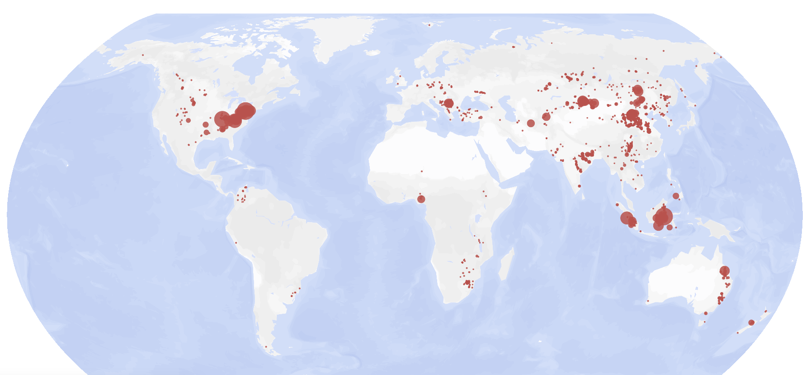
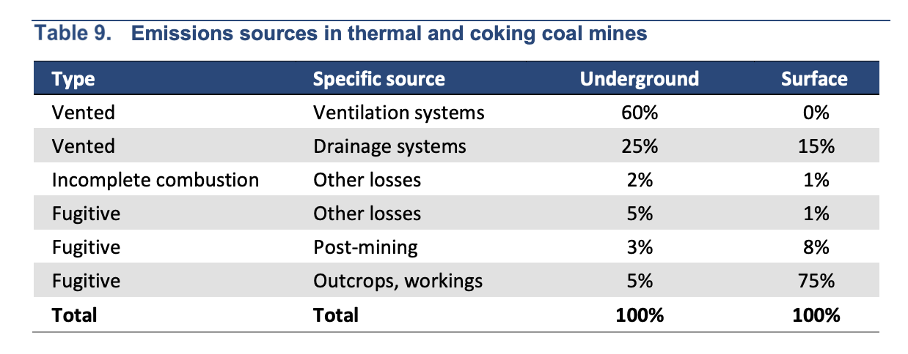
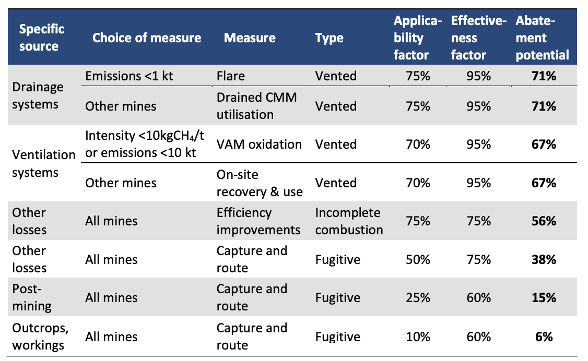

### Fossil Fuel Operations Sector: Coal Mining Emissions

**Amy Piscopo<sup>1,3</sup>, Ryan Driskell Tate<sup>2,3</sup>, Dorothy Lan Mei<sup>2,3</sup>, and Christy Lewis<sup>1,3</sup>**

*1) WattTime, 2) Global Energy Monitor, 3) Climate TRACE*

#### 1. Introduction

The geological processes that produce coal also produce the potent greenhouse gas (GHG), methane (CH<sub>4</sub>), which remains trapped in underground coal seams until the coal is mined. During coal mining, methane is released into the atmosphere, and it may continue to diffuse from abandoned mines long after mining operations have ceased \[1\]. Carbon dioxide (CO<sub>2</sub>) is also emitted during mining when coal seams containing sulfide minerals yield sulfuric acid that then reacts with carbonate rocks. As such, coal mine emissions are classified by the Intergovernmental Panel on Climate Change (IPCC) under *1.B Fugitive Emissions from Fuels.*

In addition to coal’s fugitive emissions, various excavation and transport processes during coal mining operations also yield GHG emissions. Diesel excavators, loaders, and haul trucks combust fuel, producing primarily carbon dioxide, but also methane and nitrous oxide (N<sub>2</sub>O). These combustion emissions are a smaller fraction of total emissions than fugitive emissions, but still significant.

Given the global scale of coal mining operations, efforts to quantify emissions from this sector are valuable, as this data can help inform opportunities to abate emissions and mitigate impacts of global warming.

Global Energy Monitor’s Global Coal Mine Tracker (GCMT; [<span class="underline">https://globalenergymonitor.org/projects/global-coal-mine-tracker/</span>](https://globalenergymonitor.org/projects/global-coal-mine-tracker/)) is an extensive coal mine inventory, with production and capacity data for 4,803 coal mines globally (see Figure 1 for locations). The methane gas content of each mine is also estimated and made available by GCMT. By leveraging these datasets along with mine capacity factors from literature as needed, Climate TRACE estimated annual emissions for every individual coal mine (asset). Note, in Climate TRACE’s 2026 asset-level data release, only methane emissions for only active mines were estimated; emissions from abandoned coal mines were not included.



***Figure 1.** Coal mines as reported by Global Energy Monitor’s Coal Mine Tracker (from GEM website). The relative size of the dot scales are related to coal mine production.*

Climate TRACE’s comprehensive inventory of asset-level emissions provides the foundation for assessing pathways to reduce emissions from coal mining worldwide. For fugitive emissions, the reduction in emissions, or abatement, for this sector can broadly be described as either transforming methane into a less potent greenhouse gas (e.g., CO<sub>2</sub>) or using methane nearby as an energy source. For combustion emissions, abatement takes the form of electrifying equipment. For each mine in our database, Climate TRACE has compiled “emissions reducing solutions” (ERSs) as catalogued by the International Energy Agency (IEA) to evaluate possible emissions reductions from the coal mining sector. Details on ERS and their effectiveness by mine type and methane release source are discussed in Section 2.

#### 2. Materials and Methods

Estimating GHG emissions from coal mining and the associated reductions in emissions from implementing abatement strategies would not be possible without extensive datasets from organizations including Global Energy Monitor, International Energy Agency, and the United Nations Framework Convention on Climate Change. With these datasets, Climate TRACE is able to produce emissions (and reductions) estimates for years 2015-2025 at 4,803 coal mines globally.

#### 2.1 Datasets

#### 2.1.1 Global Energy Monitor \| Global Coal Mine Tracker (GCMT)

The Global Energy Monitor’s Global Coal Mine Tracker (GCMT) is a worldwide dataset of coal mines and proposed projects. The tracker is updated annually and provides source level details on ownership structure, development stage and status, coal type, production at operating mines, capacity at proposed mines, workforce size, reserves and resources, geolocation, and other categories.

The tracker includes data from publicly available sources: (1) government data, including national energy and resource plans, environmental permits and applications; and national datasets; (2) reports by state-owned and private mining companies, including quarterly and annual reports; (3) news and media reports, including local, international, and trade outlets; (4) local non-governmental organizations (NGOS) monitoring companies, mining activity, and developments; (5) on the ground contacts who can provide first-hand information.

The information was collected by an international team of researchers, with fluencies in Chinese, Russian, Spanish, and Turkish. Whenever possible, Global Energy Monitor circulates data for vetting and review to researchers familiar with local mining conditions. Input data from this tracker was used to estimate emissions, described in the sections below.

#### 2.1.2 International Energy Agency \| Global Methane Tracker

The International Energy Agency’s (IEA) Global Methane Tracker offers country and regional estimates of fugitive methane emissions and ERS across various sectors, including coal mining. These estimates are updated annually and developed within the framework of the IEA’s Global Energy and Climate Model (GEC) \[2\]. The underlying data used in the GEC Model is drawn from IEA’s own energy databases, collaborators, and external sources, as documented in \[2\]. Climate TRACE leveraged the IEA’s ERS options and associated metadata for the coal mining sector in combination with our asset-level emissions estimates to calculate the total potential for methane reductions from the coal mining sector worldwide.

#### 2.1.3 United Nations Framework Convention on Climate Change \| National Inventory Data

Under the Paris Agreement, specifically its Enhanced Transparency framework, participating countries submit inventories of their GHGemissions every two years, according to the reporting framework described in [<span class="underline">https://unfccc.int/first-biennial-transparency-reports</span>](https://unfccc.int/first-biennial-transparency-reports). The reporting framework requires detailing quantities of fuel consumption by fuel type (solid, liquid, gas). Climate Trace uses this information, along with coal mining production data to estimate emissions from fuel combustion.

#### 2.2 Metadata

#### 2.2.1 Mine Metadata

*Coal Mine Data*

Coal mine location, name, country, and owner are all based on the dataset provided by Global Energy Monitor in their GCMT. In order to create a temporally comprehensive dataset (2015-20243), GEM collected historical production data for 4,803 mines. These datasets were used to identify mines that were open previously, and closed, or to identify past activity for mines that are currently open.

*Capacity Factor*

The capacity factor represents the coal mine utilization as a fraction of the mine’s capacity, where capacity represents the maximum amount of coal that a mine can produce in a year. Capacity factor values were gathered from relevant literature for specific regions in China and the U.S. For all remaining regions, a global average capacity factor was used based on China and the U.S.

For Chinese coal mines, Yangpin Ju, et al. (2019) used a stochastic model to estimate the regional capacity utilization for 15 years in China \[3\]. For U.S. coal mines, the U.S. Energy and Information Administration (EIA) provides state level, annual capacity factors \[4\]. Climate TRACE used these capacity factors for Chinese and U.S. mines using the following rules:

1.  If a mine was in a state or province provided in either of the papers above, and we were estimating emissions for a year provided in either of the papers above, the exact capacity factor was used.

2.  If a mine was in a state or province provided in either of the papers above, and we were estimating emissions for a year not provided, the mean across all 15 years for that state was used.

3.  If a mine was not in a state or province provided, but we were estimating for a year provided, the mean across all states for that year was used.

4.  Finally, if a mine was not in a state, and we were not estimating emissions for a year in the table, the mean of the entire table was used.

All other locations: For all other coal mine locations and years, an average of all U.S. and Chinese capacity factors was applied, as this is the best available approximation.

*Production*

Production represents the coal yield from a given mine. Production from a mine should always be less than or equal to the mine’s capacity. GEM’s GCMT includes either production and / or capacity information for each mine, including historical production data (back to 2017) for almost half of the operating mines. If both production and capacity values were available, Climate TRACE used the production data. For mines where only capacity was available, production was calculated from capacity using the capacity factors described above.

In some cases production (or capacity) data was only available for a subset of the years modeled. Of these cases, when the missing years of data were *prior* to the year of the earliest data available, the earliest estimate available was used to backfill the missing data. If data was missing for years *between* years with data, an average of the ‘nearest’ data available was used to estimate the missing data.

*Capacity*

For mines where only capacity was provided, Climate TRACE used the capacity as provided. If production was provided in GEM’s GCMT, capacity was calculated by dividing the production by the capacity factors described above. Capacity values were backfilled to the year that the mine opened.

#### 2.2.2 Emissions Factor

The emissions factor for each mine, *Coal EF*, represents the amount of greenhouse gases (GHGs) released during mining per amount of coal produced. The GHGs originate either a) as naturally occurring methane directly from the mine shaft and coal seams and pillars, and b) from the combustion of fuel to power excavators and hauling equipment used during the mining process. For simplicity Climate TRACE will refer to (a) as fugitive emissions and (b) as combustion emissions. Each type of emissions has an associated emissions factor, *Coal EF fugitive* and *Coal EF combustion,* which when combined, reflect the total emissions per unit coal production for a mine.

$`\ \text{\ Coal\ EF}_{mine,\ gas\ type} = \text{Coal\ EF\ fugitive}_{mine,\ gas\ type}\  + \text{Coal\ EF\ combustion}_{mine,\ gas\ type}\text{\ \ }`$

(Eq. 1)

#### 2.2.2.1 Emissions Factor for Fugitive Methane

Climate TRACE represents the emissions factor for fugitive emissions as *Coal EF fugitive* (tonnes of emissions emitted per tonnes of coal produced). *Coal EF fugitive* depends on the methane gas of the mined coal and the methane from adjacent coal seams and pillars. The methane gas of the mined coal is directly estimated, whereas the methane from adjacent coal seams and pillars is estimated by applying an *emission factor coefficient*.

*Methane gas content*: The methane gas content released from coal depends primarily on the depth at which it was mined and the coal rank (e.g., anthracite, bituminous, and subbituminous), a measure of the carbon content of the coal that dictates whether it is used for metallurgy (e.g., steel-making) or heating. GEM estimated the methane gas content of each mine using the approach described in *Global methane emissions from coal mining to continue growing even with declining coal production* \[5\]. GEM provided the value in cubic meters of methane gas per tonne of coal produced (m<sup>3</sup> of CH<sub>4</sub>/tonne of coal) and Climate TRACE converted the numerator from m<sup>3</sup> of CH<sub>4</sub> to tonnes of CH<sub>4</sub>, using a conversion factor from the EPA \[6\] shown in the divisor of Equation 1 .

*Emission factor coefficient*: Emissions from coal seams and pillars in the vicinity of the mined coal also contribute to total methane emissions. These additional emissions are assumed to be proportional to the emissions released from the mined coal; as such, a multiplier (emission factor coefficient) is used to approximate the total methane emissions. Ju et al. (2016) reported that this coefficient range is 1.3 to 2.0 \[7\].

The methane gas content multiplied by the emissions factor coefficient yields the fugitive emissions factor for each mine, as given by Equation 2:

$`\text{Coal\ EF\ fugitive}_{\text{mine}} = (\ \text{Methane\ gas\ content\ per\ tonne\ of\ coal}_{\text{mine}}\ /\ 1.4703e3)\  \times`$ $`\text{Emissions\ factor\ coefficient}`$

(Eq. 2)

Where the emissions factor coefficient used in this work is 1.65, the average of the coefficient range from Ju et al (2016) \[7\].

#### 2.2.2.2 Emissions Factor for GHGs from Combustion

Excavators and hauling equipment used during mining are powered by fuel combustion, which results in carbon dioxide, methane, and nitrous oxide emissions. Climate TRACE refers to the emissions factor for these combustion emissions as *Coal EF combustion*.

The following metadata was used to estimate carbon dioxide, methane, and nitrous oxide emission factors for gas, liquid, and solid fuels combusted during coal mining. Using UNFCCC Biennial Transparency Report data on GHG emissions or the IPCC sector, 1.A.1.c.i. Manufacture of solid fuels, Climate TRACE determined the ratio of fuel combusted to coal produced for countries with coal mining, in units of tonnes of fuel combusted to tonnes of coal produced (Equation 3). For countries without fuel type data, the median ratio of all countries was used.

$`{Ratio\ of\ fuel\ :coal\ }_{country,\ fuel\ type} = \text{Fuel\ combusted\ }_{country,\ fuel\ type}\ /\text{\ Coal\ produced}_{country,\ fuel\ type}`$ (Eq. 3)

The emissions factor of the fuel is specific to the fuel type combusted and the gas type emitted, as indicated by the subscripts in Equation 4. The units for the *Fuel EF* are tonnes of CH<sub>4</sub>, CO<sub>2</sub>, or N<sub>2</sub>O : tonnes of fuel.

$`\text{Fuel\ EF}_{gas\ type,\ fuel\ type} = \text{Emissions\ }_{\text{gas\ type}}\ /{\ \text{Fuel\ combusted\ }_{\text{fuel\ type}}}`$

(Eq. 4)

The product of Equations 3 and 4 yield the emissions factor for emissions from fuel combustion during coal mining, referred to as *Coal EF combustion*. Like *Coal EF fugitive*, *Coal EF combustion* has units of tonnes of CH<sub>4</sub>, CO<sub>2</sub>, or N<sub>2</sub>O emitted per tonnes of coal produced.

$`\text{Coal\ EF\ combustion}_{country,\ gas\ type,\ fuel\ type} = \ {{Ratio\ of\ fuel\ :coal\ }_{country,\ fuel\ type}\ }`$ $`\ {\times \text{\ \ }\text{Fuel\ EF}_{gas\ type,\ fuel\ type}}`$

(Eq. 5)

#### 2.2.3 Emissions Reducing Solutions

The following metadata was used to estimate the abatement potential for individual ERS strategies in the coal mining sector. *Note: Only rank 1 strategies are provided for assets on the Climate TRACE website and additional strategies will be made available in future releases.*

*Release Mechanisms and Specific Sources of CMM*

Coal Mine Methane (CMM) is released from a mine as either vented methane, methane from incomplete combustion, or fugitive methane emissions. Each release mechanism stems from distinct operational activities, as outlined below.

-   Vented CMM occurs as an intentional release of methane during mining operations to keep methane concentrations below explosive levels. Vented methane comes from ventilation systems, which clear methane from the main airways of the mine, or drainage systems, i.e., borehores or pipelines installed to release methane before it enters the main airways.

-   CMM from incomplete combustion can be released as methane slips during the oxidation or flaring activities that occur during coal mining to dilute methane concentrations in active mines.

-   Fugitive emissions represent a diffuse loss of CMM either through openings in the subsurface created by mining, outcrops containing methane, or other losses.

The proportion of the total CMM released fugitively or via venting or incomplete combustion varies for underground or surface mines. Table 1, from the IEA Global Methane Tracker Documentation, shows the composition of total CMM by specific release source for an average underground and an average surface mine \[8\]. For the assumptions used to allocate emissions percentages to these release sources by underground and surface mines, refer to pages 25 and 26 in the [<span class="underline">IEA report</span>](https://iea.blob.core.windows.net/assets/451af9a0-8736-40dc-b843-69275d6fdb07/GlobalMethaneTracker2025Documentation.pdf) \[8\].

*Table 1: Emissions sources in coal mines IEA’s Global Methane Tracker Documentation \[8\]*



*Technologies*

The IEA has evaluated various ERS to reduce emissions from coal mining operations. Table 2, from IEA, shows applicability factors and effectiveness factors for each ERS (see “Measure” column in Table 2). The applicability factor indicates the share of emissions for which ERS could be deployed. The effectiveness factor reflects the efficiency of the ERS(e.g., 95% of methane is combusted during flaring). For a given ERS strategy applied to a specific source of methane, the product of the applicability and the effectiveness factors yields the abatement potential of that measure for that source (as percent emissions abated), as shown in the “Abatement potential” column of Table 2.

The strategy is tailored to the type of methane gas release and its specific source. The “Choice of measure” column in Table 2 specifies methane thresholds that dictate whether the ERS is suitable. For example, for methane vented from drainage systems, flaring is appropriate for mines with low methane concentrations, whereas utilization systems (using methane for energy on-site or nearby) are worthwhile for mines with high methane concentrations. Using the parameters in Table 2, Climate TRACE proposed different ERS for each mine in the GEM database.

*Table 2: Abatement potential of different ERS strategies \[8\]*



The applicable emissions (percent of total) for each category of mine (from Table 1, *T1*) and the effectiveness factor of the technology (from Table 2, *T2*), were used to arrive at an *Emissions Factor Scaling Ratio* for each ERS strategy, *s*, as shown in Equation 6. The *Emissions Factor Scaling Ratios* can be applied to relevant mines to calculate the potential emissions reduction.

```math
\text{Emissions Factor Scaling Ratio}_{s} = 1 - \left( \%\ \text{of total emissions for CH4 source}_{T1} \times \%\ \text{abatement potential for ERS}_{T2,s} \right)
```

(Eq. 6)

For example, if the strategy VAM Oxidation (strategy\_id: vam001) is applied to underground mines, the emissions factor scaling ratio for this solution would be:

$`\text{Emissions\ Factor\ Scaling\ Ratio}_{vam001}\  = \ 1\  - \ (0.60*0.67)\  = \ 0.598`$

(Eq. 7)

where, $`{\%\ of\ total\ emissions\ for\ CH4\ source}_{T1}`$= 0.60 (from the “Specific Source” row for ventilation systems in the “Underground” column of Table 1) and $`{\%\ \text{abatement\ potential\ for\ ERS}}_{T2,s}`$= 0.67 (from the “Abatement Potential” column in Table 2).

For mines that are associated with the ‘vam001’ strategy\_id, one can then multiply the CH<sub>4</sub> emissions factor by 0.60 in order to arrive at the new potential emissions factor if this mitigation strategy was applied at this mine.

#### 2.3 Model

#### 2.3.1 Emissions

Climate TRACE calculated emissions for each asset (mine) by multiplying the production for a given mine (in tonnes of coal) by the emissions factor for that mine (in tonnes CH<sub>4</sub>, CO<sub>2</sub>, or N<sub>2</sub>O per tonne of coal). The result is emissions (tonnes of CH<sub>4</sub>, CO<sub>2</sub>, or N<sub>2</sub>O) per mine, as shown in Equation 8.

$`\ \text{Emissions}_{mine,\ gas\ type} = \text{\ Coal\ EF}_{mine,\ gas\ type}\  \times \ \text{Production}_{\text{mine}}`$

(Eq. 8)

Equation 8 was applied to 4,803 coal mines globally to estimate their emissions for years 2015 to 2025. To convert annual values to monthly values, refer to the Climate TRACE methodology “*Temporal Disaggregation of Emissions Data for the Climate TRACE Inventory*” in the GitHub repository [<span class="underline">Post Processing for Global Emissions and Metadata Completeness</span>](https://github.com/climatetracecoalition/methodology-documents/tree/main/2025/Post%20Processing%20for%20Global%20Emissions%20and%20Metadata%20Completeness).

#### 2.3.2 Emissions Reductions

Climate TRACE calculated the potential methane emissions reductions for each asset (mine) by multiplying the emissions for a given mine by the emissions factor scaling ratio for the appropriate ERS. The result is emissions reduced (tonnes of CH<sub>4</sub>, CO<sub>2</sub>, or N<sub>2</sub>O emissions per mine), as shown in Equation 9.

$`\ \text{Reductions}_{mine,\ gas\ type} = \text{Emissions}_{mine,\ gas\ type}\  \times \ \text{Emissions\ Factor\ Scaling\ Ratio}_{s,\ gas\ type}`$

(Eq. 9)

#### 3. Climate TRACE Reporting of Emissions

Coal mining emissions data for this sector is hosted in the Climate TRACE website: [<span class="underline">https://climatetrace.org/</span>](https://climatetrace.org/). Emissions for CH<sub>4</sub>, CO<sub>2</sub>, and N<sub>2</sub>O were estimated for each of the 4,803 coal mines identified globally for years 2015 to 2025. This emissions sector is equivalent to the United Nations Framework Convention on Climate Change (UNFCCC) sector “Fossil Fuel Operations 1.B.1.a - Coal Mining and Handling”. Climate TRACE default emissions values were reported as CH<sub>4</sub>, and CO<sub>2</sub> equivalent 20- and 100-year global warming potential (CO<sub>2</sub>e 20yr and 100yr GWP).

#### 4. Results

Asset level GHG emissions were estimated for 4,803 coal mines for years 2015 through 2025, as discussed in Section 3. In prior versions of ClimateTRACE data, emissions from fuel combustion during mining operations were not incorporated. Since their inclusion in V5.9.0 of the ClimateTRACE data, our dataset represents a more complete representation of GHG emissions in this sector.

Coal mining is one of the top emitting sectors globally with nearly 2.4 billion tonnes of CO<sub>2</sub>e 100yr GWP emitted in 2025. The vast majority of these emissions (65%) come from China, trailed by India and the United States of America (both around 6% of global totals). By applying emissions reducing solutions, such as on-site recovery and reuse and VAM oxidation, up to 900M tonnes of CO<sub>2</sub>e 100yr GWP could be mitigated per year.

#### 5. Supplementary Metadata

This dataset provides emissions estimates for active coal mines. Metadata information is provided in the tables below.

**Table S1:** *General dataset information*

| **General Description**                                                         | **Definition**                                                                                                                                                                                                                                                                                                                                                                                                             |
|---------------------------------------------------------------------------------|----------------------------------------------------------------------------------------------------------------------------------------------------------------------------------------------------------------------------------------------------------------------------------------------------------------------------------------------------------------------------------------------------------------------------|
| **Sector definition**                                                           | *Fugitive methane emissions from coal mining, and post-mining activities of commercially operating mines and carbon dioxide emissions from on-site fuel combustion for coal extraction, handling, and logistics.*                                                                                                                                                                                                          |
| **UNFCCC sector equivalent**                                                    | *1.B.1.a Coal Mining and Handling*                                                                                                                                                                                                                                                                                                                                                                                         |
| **Temporal Coverage**                                                           | *2015 – 2025*                                                                                                                                                                                                                                                                                                                                                                                                              |
| **Temporal Resolution**                                                         | *Annual (original); Monthly (on website, see [<span class="underline">Temporal Disaggregation of Emissions Data for the Climate TRACE Inventory</span>](https://github.com/climatetracecoalition/methodology-documents/blob/main/2024/Post%20Processing%20for%20Global%20Emissions%20and%20Metadata%20Completeness/Temporal%20Disaggregation%20of%20Emissions%20Data%20for%20the%20Climate%20TRACE%20Inventory.docx.pdf))* |
| **Data format(s)**                                                              | *CSV*                                                                                                                                                                                                                                                                                                                                                                                                                      |
| **Coordinate Reference System**                                                 | *EPSG:4326, decimal degrees*                                                                                                                                                                                                                                                                                                                                                                                               |
| **Number of assets**                                                            | *4,803 assets*                                                                                                                                                                                                                                                                                                                                                                                                             |
| **What emission factors were used?**                                            | *Industry emission factors from Global Energy Monitor*                                                                                                                                                                                                                                                                                                                                                                     |
| **What is the difference between a “NULL / none / nan” versus “0” data field?** | *“0” values are for true non-existent emissions. If we know that the sector has emissions for that specific gas, but the gas was not modeled, this is represented by “NULL/none/nan”*                                                                                                                                                                                                                                      |
| **total\_CO2e\_100yrGWP and total\_CO2e\_20yrGWP conversions**                  | Climate TRACE uses IPCC AR6 CO<sub>2</sub>e GWPs. CO<sub>2</sub>e conversion guidelines are here:<span class="underline">https://www.ipcc.ch/report/ar6/wg1/downloads/report/IPCC\_AR6\_WGI\_FullReport\_small.pdf</span>                                                                                                                                                                                                  |

**Table S2:** *Asset level metadata description*

| **Data attribute**                | **Definition**                                                         |
|-----------------------------------|------------------------------------------------------------------------|
| **sector**                        | Fossil Fuel Operations                                                 |
| **asset\_sub-sector\_name**       | N/A                                                                    |
| **asset definition**              | N/A                                                                    |
| **start\_date**                   | Start date for time period of emissions estimation (YYYY-MM-DD format) |
| **end\_date**                     | End date for time period of emissions estimation (YYYY-MM-DD format)   |
| **asset\_identifier**             | Internal, unique ID for mining asset and mineral type                  |
| **asset\_name**                   | Mining asset                                                           |
| **iso3\_country**                 | ISO 3166-1 alpha-3 country code for asset location                     |
| **location**                      | Point location of approximate mine centre                              |
| **type**                          | Coal Mine classification                                               |
| **capacity\_description**         | Coal Mine Capacity                                                     |
| **capacity\_units**               | Tonnes                                                                 |
| **capacity\_factor\_description** | Proportion of capacity accounted for by activity (production)          |
| **capacity\_factor\_units**       | N/A                                                                    |
| **activity\_description**         | t Coal extracted                                                       |
| **activity\_units**               | Tonnes                                                                 |
| **CO2\_emissions\_factor**        | Tonnes CO<sub>2</sub> / Tonne coal                                     |
| **CH4\_emissions\_factor**        | Tonnes CH<sub>4</sub> / Tonne coal                                     |
| **N2O\_emissions\_factor**        | Tonnes N<sub>2</sub>O / Tonne coal                                     |
| **other\_gas\_emissions\_factor** | N/A                                                                    |
| **CO2\_emissions**                | Tonnes CO<sub>2</sub>                                                  |
| **CH4\_emissions**                | Tonnes CH<sub>4</sub>                                                  |
| **N2O\_emissions**                | Tonnes N<sub>2</sub>O                                                  |
| **other\_gas\_emissions**         | N/A                                                                    |
| **total\_CO2e\_100yrGWP**         | Tonnes CO<sub>2</sub>e                                                 |
| **total\_CO2e\_20yrGWP**          | Tonnes CO<sub>2</sub>e                                                 |
| **other1\_description**           | Coal Type                                                              |
| **other1\_units**                 | N/A                                                                    |
| **other2\_description**           | Coal Grade                                                             |
| **other2\_units**                 | N/A                                                                    |
| **other3\_description**           | Total Reserves (Proven and Probable)                                   |
| **other3\_units**                 | Million Tonnes                                                         |
| **other4\_description**           | Primary Consumer, Destination Name                                     |
| **other4\_units**                 | N/A                                                                    |
| **other5\_description**           | Mine Depth (m)                                                         |
| **other5\_units**                 | meters                                                                 |
| **other6\_description**           | Mine Size (Km2)                                                        |
| **other6\_units**                 | square km                                                              |
| **other7\_description**           | GEM Wiki Page (ENG)                                                    |
| **other7\_units**                 | hyperlink                                                              |
| **other8\_description**           | CH4 Emissions from fuel combustion                                     |
| **other8\_units**                 | Tonnes CH<sub>4</sub>                                                  |
| **other9\_description**           | N2O Emissions from fuel combustion                                     |
| **other9\_units**                 | Tonnes N<sub>2</sub>O                                                  |
| **other10\_description**          | CO2 Emissions from fuel combustion                                     |
| **other10\_units**                | Tonnes CO<sub>2</sub>                                                  |

**Table S3** Source level metadata description confidence and uncertainty

<table><thead><tr class="header"><th><strong>Data attribute</strong></th><th><strong>Confidence Definition</strong></th><th><strong>Uncertainty Definition</strong></th></tr></thead><tbody><tr class="odd"><td><strong>type</strong></td><td><em>Very high</em></td><td>NA</td></tr><tr class="even"><td><strong>capacity_description</strong></td><td>Capacity-based rows: <em>very high</em> if the start date is 2022-01-01, otherwise <em>high</em>. All other mines are assigned the same capacity confidence as the capacity factor confidence.</td><td>0 for capacity-based rows, otherwise capacity × capacity factor uncertainty.</td></tr><tr class="odd"><td><strong>capacity_factor_description</strong></td><td>China → <em>medium</em>, United States → <em>high</em>, everywhere else → <em>very low</em></td><td>For China or the USA, the uncertainty is the standard deviation of the state-level utilization rates. Other countries use the standard deviation of the China and USA rates pooled together.</td></tr><tr class="even"><td><strong>capacity_factor_units</strong></td><td>Unitless</td><td>Unitless</td></tr><tr class="odd"><td><strong>activity_description</strong></td><td><em>Very high</em> for mines with production reported from GEM.<br />
<br />
Mines with only capacity are assigned the same confidence level for activity as for the capacity factor confidence.<br />
<br />
Anything filled in (backfilled, forward-filled, interpolated, etc.) → <em>medium</em></td><td><p>Activity uncertainty is 0 for mines with direct GEM production.</p><p>For mines with only capacity, the activity uncertainty is calculated as the capacity × capacity factor uncertainty.</p><p>Otherwise activity uncertainty is the absolute value of a mine's mean year-over-year production change.</p><p>Activity uncertainty is set to 0 for pre-opening, post-closure and post-cancellation years.</p></td></tr><tr class="even"><td><strong>CO2_emissions_factor</strong></td><td><em>Low</em></td><td>70% of the emissions factor</td></tr><tr class="odd"><td><strong>CH4_emissions_factor</strong></td><td><em>Low</em></td><td></td></tr><tr class="even"><td><strong>N2O_emissions_factor</strong></td><td><em>Low</em></td><td></td></tr><tr class="odd"><td><strong>other_gas_emissions_factor</strong></td><td>NaN </td><td>NaN</td></tr><tr class="even"><td><strong>CO2_emissions</strong></td><td><em>Low</em></td><td><p>Lower bound = (activity − mean_act) × (EF − mean_EF)</p><p>Upper bound = (activity + mean_act) × (EF + mean_EF)</p></td></tr><tr class="odd"><td><strong>CH4_emissions</strong></td><td><em>Low</em></td><td></td></tr><tr class="even"><td><strong>N2O_emissions</strong></td><td><em>Low</em></td><td></td></tr><tr class="odd"><td><strong>other_gas_emissions</strong></td><td>NaN</td><td>NaN</td></tr><tr class="even"><td><strong>total_CO2e_100yrGWP</strong></td><td><em>Low</em></td><td>CH4, CO2, and N2O emissions uncertainties multiplied by their respective GWPs</td></tr><tr class="odd"><td><strong>total_CO2e_20yrGWP</strong></td><td><em>Low</em></td><td></td></tr></tbody></table>

**Table S3:** ERS *parameters, one table per strategy* *for a total of 11 strategies. Note: Only the top ranked strategy for each asset, according to maximum reduction potential, are provided for assets on the Climate TRACE website. Additional strategies will be made available in future releases.*

| **native\_strategy\_id**              | **Definitions**                                                                                     |
|---------------------------------------|-----------------------------------------------------------------------------------------------------|
| native\_strategy\_id                  | benchmark\_co2e10pct\_coal-mining\_output\_coal                                                     |
| strategy\_name                        | Benchmark-based retrofits                                                                           |
| strategy\_description                 | Retrofit facility to match emissions intensity of the 10th percentile of facilities in this sector. |
| mechanism                             | retrofit                                                                                            |
| co2\_emissions\_factor\_new\_absolute | 0.0175                                                                                              |
| ch4\_emissions\_factor\_new\_absolute | 0.0009                                                                                              |
| n2o\_emissions\_factor\_new\_absolute | 0                                                                                                   |

| **native\_strategy\_id**                    | **Definitions**                                                                                                                                                                     |
|---------------------------------------------|-------------------------------------------------------------------------------------------------------------------------------------------------------------------------------------|
| native\_strategy\_id                        | capsurf001                                                                                                                                                                          |
| strategy\_name                              | Capture and route fugitive methane in surface mines                                                                                                                                 |
| strategy\_description                       | Capture methane from fugitive sources such as outcrops and fractured ground in surface mines. Direct the captured methane to drainage of Ventilation Air Methane oxidation systems. |
| mechanism                                   | retrofit                                                                                                                                                                            |
| ch4\_emissions\_factor\_new\_to\_old\_ratio | 0.895                                                                                                                                                                               |

| **native\_strategy\_id**                    | **Definitions**                                                                                                                                                                         |
|---------------------------------------------|-----------------------------------------------------------------------------------------------------------------------------------------------------------------------------------------|
| native\_strategy\_id                        | capund001                                                                                                                                                                               |
| strategy\_name                              | Capture and route fugitive methane in underground mines                                                                                                                                 |
| strategy\_description                       | Capture methane from fugitive sources such as outcrops and fractured ground in underground mines. Direct the captured methane to drainage of Ventilation Air Methane oxidation systems. |
| mechanism                                   | retrofit                                                                                                                                                                                |
| ch4\_emissions\_factor\_new\_to\_old\_ratio | 0.412                                                                                                                                                                                   |

| **native\_strategy\_id**                    | **Definitions**                                                           |
|---------------------------------------------|---------------------------------------------------------------------------|
| native\_strategy\_id                        | flaresurf001                                                              |
| strategy\_name                              | Flare surface mine methane                                                |
| strategy\_description                       | Combust drained methane to reduce global warming potential of leaked gas. |
| mechanism                                   | retrofit                                                                  |
| ch4\_emissions\_factor\_new\_to\_old\_ratio | 0.8575                                                                    |

| **native\_strategy\_id**                    | **Definitions**                                                           |
|---------------------------------------------|---------------------------------------------------------------------------|
| native\_strategy\_id                        | flareund001                                                               |
| strategy\_name                              | Flare underground mine methane                                            |
| strategy\_description                       | Combust drained methane to reduce global warming potential of leaked gas. |
| mechanism                                   | retrofit                                                                  |
| ch4\_emissions\_factor\_new\_to\_old\_ratio | 0.7625                                                                    |

| **native\_strategy\_id**                    | **Definitions**                                                                                               |
|---------------------------------------------|---------------------------------------------------------------------------------------------------------------|
| native\_strategy\_id                        | osu00                                                                                                         |
| strategy\_name                              | On-site recovery and use                                                                                      |
| strategy\_description                       | If methane concentrations are high enough, ventilated methane can be used for heat recovery and used on-site. |
| mechanism                                   | retrofit                                                                                                      |
| ch4\_emissions\_factor\_new\_to\_old\_ratio | 0.430                                                                                                         |

| **native\_strategy\_id**                    | **Definitions**                                            |
|---------------------------------------------|------------------------------------------------------------|
| native\_strategy\_id                        | efficiency\_0.1\_coal-mining                               |
| strategy\_name                              | Unspecified solution                                       |
| strategy\_description                       | Reduce emissions by a factor of 0.1 via unspecified means. |
| mechanism                                   | retrofit                                                   |
| co2\_emissions\_factor\_new\_to\_old\_ratio | 0.9                                                        |
| ch4\_emissions\_factor\_new\_to\_old\_ratio | 0.9                                                        |
| n2o\_emissions\_factor\_new\_to\_old\_ratio | 0.9                                                        |

| **native\_strategy\_id**                    | **Definitions**                                                                                                                       |
|---------------------------------------------|---------------------------------------------------------------------------------------------------------------------------------------|
| native\_strategy\_id                        | cmmsurf001                                                                                                                            |
| strategy\_name                              | Utilize surface mine methane                                                                                                          |
| strategy\_description                       | Utilization of drained coal mine methane either on site, or in nearby markets. This strategy is best applied before a mine is opened. |
| mechanism                                   | retrofit                                                                                                                              |
| ch4\_emissions\_factor\_new\_to\_old\_ratio | 0.8575                                                                                                                                |

| **native\_strategy\_id**                    | **Definitions**                                                                                                                       |
|---------------------------------------------|---------------------------------------------------------------------------------------------------------------------------------------|
| native\_strategy\_id                        | cmmund001                                                                                                                             |
| strategy\_name                              | Utilize underground mine methane                                                                                                      |
| strategy\_description                       | Utilization of drained coal mine methane either on site, or in nearby markets. This strategy is best applied before a mine is opened. |
| mechanism                                   | retrofit                                                                                                                              |
| ch4\_emissions\_factor\_new\_to\_old\_ratio | 0.7625                                                                                                                                |

| **native\_strategy\_id**                    | **Definitions**                                           |
|---------------------------------------------|-----------------------------------------------------------|
| native\_strategy\_id                        | vam001                                                    |
| strategy\_name                              | VAM Oxidation                                             |
| strategy\_description                       | Thermal or catalytic oxidation of ventilated air methane. |
| mechanism                                   | retrofit                                                  |
| ch4\_emissions\_factor\_new\_to\_old\_ratio | 0.598                                                     |

| **native\_strategy\_id**                    | **Definitions**                                                              |
|---------------------------------------------|------------------------------------------------------------------------------|
| native\_strategy\_id                        | omq001                                                                       |
| strategy\_name                              | Electrification of mobile equipment                                          |
| strategy\_description                       | Convert haulage fleets to EVs and electrify diesel-powered mobile equipment. |
| mechanism                                   | retrofit                                                                     |
| co2\_emissions\_factor\_new\_to\_old\_ratio | 0.369                                                                        |
| ch4\_emissions\_factor\_new\_to\_old\_ratio | 0.999                                                                        |
| n2o\_emissions\_factor\_new\_to\_old\_ratio | 0.050                                                                        |

**Permissions and Use:** All Climate TRACE data is freely available under the Creative Commons Attribution 4.0 International Public License, unless otherwise noted below.

**Data citation format:** Piscopo, A., Tate, R.D., Mei, D.L., and Lewis, C. (2026). *Fossil Fuel Operations Sector- Coal Mining Emissions.* WattTime and Global Energy Monitor, USA, Climate TRACE Emissions Inventory. https://climatetrace.org \[Accessed date\]

**Geographic boundaries and names (iso3\_country data attribute):** The depiction and use of boundaries, geographic names and related data shown on maps and included in lists, tables, documents, and databases on Climate TRACE are generated from the Global Administrative Areas (GADM) project (Version 4.1 released on 16 July 2022) along with their corresponding ISO3 codes, and with the following adaptations:

-   HKG (China, Hong Kong Special Administrative Region) and MAC (China, Macao Special Administrative Region) are reported at GADM level 0 (country/national);

-   Kosovo has been assigned the ISO3 code ‘XKX’;

-   XCA (Caspian Sea) has been removed from GADM level 0 and the area assigned to countries based on the extent of their territorial waters;

-   XAD (Akrotiri and Dhekelia), XCL (Clipperton Island), XPI (Paracel Islands) and XSP (Spratly Islands) are not included in the Climate TRACE dataset;

-   ZNC name changed to ‘Turkish Republic of Northern Cyprus’ at GADM level 0;

-   The borders between India, Pakistan and China have been assigned to these countries based on GADM codes Z01 to Z09.

The above usage is not warranted to be error free and does not imply the expression of any opinion whatsoever on the part of Climate TRACE Coalition and its partners concerning the legal status of any country, area or territory or of its authorities, or concerning the delimitation of its borders.

> **Disclaimer:** The emissions provided for this sector are our current best estimates of emissions, and we are committed to continually increasing the accuracy of the models on all levels. Please review our terms of use and the sector-specific methodology documentation before using the data. If you identify an error or would like to participate in our data validation process, please [<span class="underline">contact us</span>](mailto:coalition@climatetrace.org).

#### References

1.  Boettcher, C., Garg A., Mbuthi, P., Oliver, S.J., Quadrelli, R., Randles, C.A., Rodrigues de Souza, R., Singh, A., Strogies, M., Tadlya, K., Uvarova, N., Watterson, J.D., Weitz M., Yamba, F.,, Yu, S., and Zhu, S., 2019. *Refinement to the 2006 IPCC Guidelines for National Greenhouse Gas Inventories. Chapter 4, Fugitive Emissions.* [<span class="underline">https://www.ipcc-nggip.iges.or.jp/public/2019rf/pdf/2\_Volume2/19R\_V2\_4\_Ch04\_Fugitive\_Emissions.pdf</span>](https://www.ipcc-nggip.iges.or.jp/public/2019rf/pdf/2_Volume2/19R_V2_4_Ch04_Fugitive_Emissions.pdf)

2.  International Energy Agency. (2024, October). *Global Energy and Climate Model Documentation – 2024*. [<span class="underline">https://iea.blob.core.windows.net/assets/89a1aa9a-e1bd-4803-b37b-59d6e7fba1e9/GlobalEnergyandClimateModelDocumentation2024.pdf</span>](https://iea.blob.core.windows.net/assets/89a1aa9a-e1bd-4803-b37b-59d6e7fba1e9/GlobalEnergyandClimateModelDocumentation2024.pdf?utm_source=chatgpt.com)

3.  Ju, Y. and Wang, X., 2019. Understanding the capacity utilization rate and overcapacity of China’s coal industry and interprovincial heterogeneity. *IEEE Access*, *7*, pp.111375-111386. DOI: 10.1109/ACCESS.2019.2933948

4.  EIA, 2023. *Annual Coal Report.* Available at: [<span class="underline">https://www.eia.gov/coal/annual/</span>](https://www.eia.gov/coal/annual/). Accessed 01 October 2023.

5.  Kholod, N., Evans, M., Pilcher, R.C., Roshchanka, V., Ruiz, F., Coté, M. and Collings, R., 2020. Global methane emissions from coal mining to continue growing even with declining coal production. *Journal of Cleaner Production*, *256*, p.120489. [<span class="underline">https://www.sciencedirect.com/science/article/pii/S0959652620305369</span>](https://www.sciencedirect.com/science/article/pii/S0959652620305369)

6.  Environmental Protection Agency (EPA). *Updated Coal Mine Methane Units Converter Available at:* [<span class="underline">https://www.epa.gov/cmop/coal-mine-methane-units-converter</span>](https://www.epa.gov/cmop/coal-mine-methane-units-converter). Accessed: 01 September 2023.

7.  Ju, Y., Sun, Y., Sa, Z., Pan, J., Wang, J., Hou, Q., Li, Q., Yan, Z. and Liu, J., 2016. A new approach to estimate fugitive methane emissions from coal mining in China. *Science of the Total Environment*, *543*, pp.514-523. [<span class="underline">https://doi.org/10.1016/j.scitotenv.2015.11.024</span>](https://doi.org/10.1016/j.scitotenv.2015.11.024)

8.  IEA, 2025. *Global Methane Tracker Documentation, 2025 Version.* Available at: [<span class="underline">https://iea.blob.core.windows.net/assets/451af9a0-8736-40dc-b843-69275d6fdb07/GlobalMethaneTracker2025Documentation.pdf</span>](https://iea.blob.core.windows.net/assets/451af9a0-8736-40dc-b843-69275d6fdb07/GlobalMethaneTracker2025Documentation.pdf). Accessed on 01 July 2025.
