### Fossil Fuel Operations Sector: Oil and Gas Production and Transport Emissions

**Lauren Schmeisser, Carmela Chaney, Adrienne Tecza, Jake Stanger, Sasha Bylsma, Marissa DeLang, Kevin Gauthier, and Deborah Gordon**

*All authors affiliated with RMI and Climate TRACE*

V5.7.0, May 2026

#### 1. Introduction

The petroleum resources that are extracted and transformed into usable products for today’s economy are not equal. In reality, their characteristics, production methods, operational stewardship—and thus, their climate impacts—vary widely (Gordon et al., 2022). By treating oil and gas as homogeneous, we miss opportunities to reduce greenhouse gas (GHG) emissions from the sector. Taken together, emissions from production, refining, and transportation of oil and gas represent more than 15 percent of global anthropogenic emissions. Therefore, these are critical sectors to mitigate to limit global temperature rise below 1.5 degrees C.

Numerous approaches—bottom-up, top-down, and hybrid methods—exist today to evaluate emissions from petroleum systems. Top-down methods typically record emissions via tower-based measuring stations, drive-by detection, and fly-over techniques, including satellites, aircraft, and drones. Meanwhile, bottom-up methods assess emissions from the ground-up, often estimating emissions based on equipment counts and component-specific emission factors for leaks during the production process. No single method of emissions accounting is entirely decisive. A hybrid ecosystem including systems modeling, remote sensing, and direct measurements is necessary to provide information that better facilitates widespread reductions across the sector.

Recent studies suggest that methane from oil and gas systems has traditionally been undercounted in corporate- and country-level reporting systems (Alvarez et al., 2018; Yu et al., 2022). In part, this is due to difficulty quantifying methane resulting from the burning off of unwanted natural gas during oil extraction, a process known as flaring (Plant et al., 2022). More substantially, methane is undercounted because bottom-up methodologies are unable to capture stochastic, large emission events–referred to as “super emitters”– where massive quantities of methane leak into the atmosphere (Rutherford et al., 2021). Super-emitters can comprise less than 5 percent of discrete, individual sources, yet represent more than 50 percent of total emissions (Brandt et al., 2016). In the last few years, the deployment of top-down, remote sensing technologies has captured the effects of super-emitter events at the regional level. Findings suggest these events account for as much as 20 to 60 percent of regional methane emissions (Cusworth et al., 2022). The message is clear: improving detection, measurement, and quantification of super-emitting methane sources is critical for improving emissions estimation and mitigation.

The Climate TRACE emissions estimates for the oil and gas production and transport sectors rely on methodology established by the Oil Climate Index + Gas (OCI+) tool. The OCI+ tool is built on three underlying models that estimate emissions from the oil and gas supply chain: (1) the Oil Production Greenhouse Gas Emissions Estimator (OPGEE) assesses the upstream (production and some transport) portions of the petroleum lifecycle, (2) the Petroleum Refinery Life Cycle Emissions Model (PRELIM) assess emissions from midstream oil refining, and (3) the Oil Products Emissions Model (OPEM) quantifies downstream end use transport and consumption emissions from oil and gas products. More information on the OCI+ tool can be found here: [https://ociplus.rmi.org/](https://ociplus.rmi.org/). The OPGEE model is explained further below, the PRELIM model is explained in the TRACE refining sector methodology, and OPEM is not used for emissions estimates from TRACE oil and gas sectors, since end use is encompassed by other TRACE sectors. OPGEE was developed by a team from the California Air Resources Board and Stanford University (Brandt et al., 2021). OPGEE has been peer-reviewed and used internationally by policymakers (Masnadi et al., 2018). Through the use of novel analyses of remote sensing data to generate inputs for OPGEE, Climate TRACE provides critical insight into global sources of GHG emissions from the oil and gas sector.

Given the significant share of emissions attributed to oil and gas production, the industry has a substantial opportunity to reduce its greenhouse gas emissions. In this newly released dataset, several emission reduction strategies (ERS) were explored, including shutting down high-emission production sites, eliminating venting, improving flare efficiency, injecting native CO₂, and electrifying on-site energy needs. If implemented, these strategies offer practical and effective pathways to lower emissions associated with the production and transportation of oil and gas.

#### 2. Materials and Methods

The OCI+ is an open-source, hybrid systems tool that quantifies emissions from oil and gas production, processing, refining, shipping, and end uses. OCI+’s upstream component, OPGEE, covers emissions from all operations that are involved in producing and transporting crude hydrocarbons to the refinery gate, as well as gas molecules to the point of end use consumption. OPGEE is the foundational model to estimate emissions for this TRACE sector. Figure 1 provides a flowchart of the OCI+ models and how their inputs and outputs feed into each other.

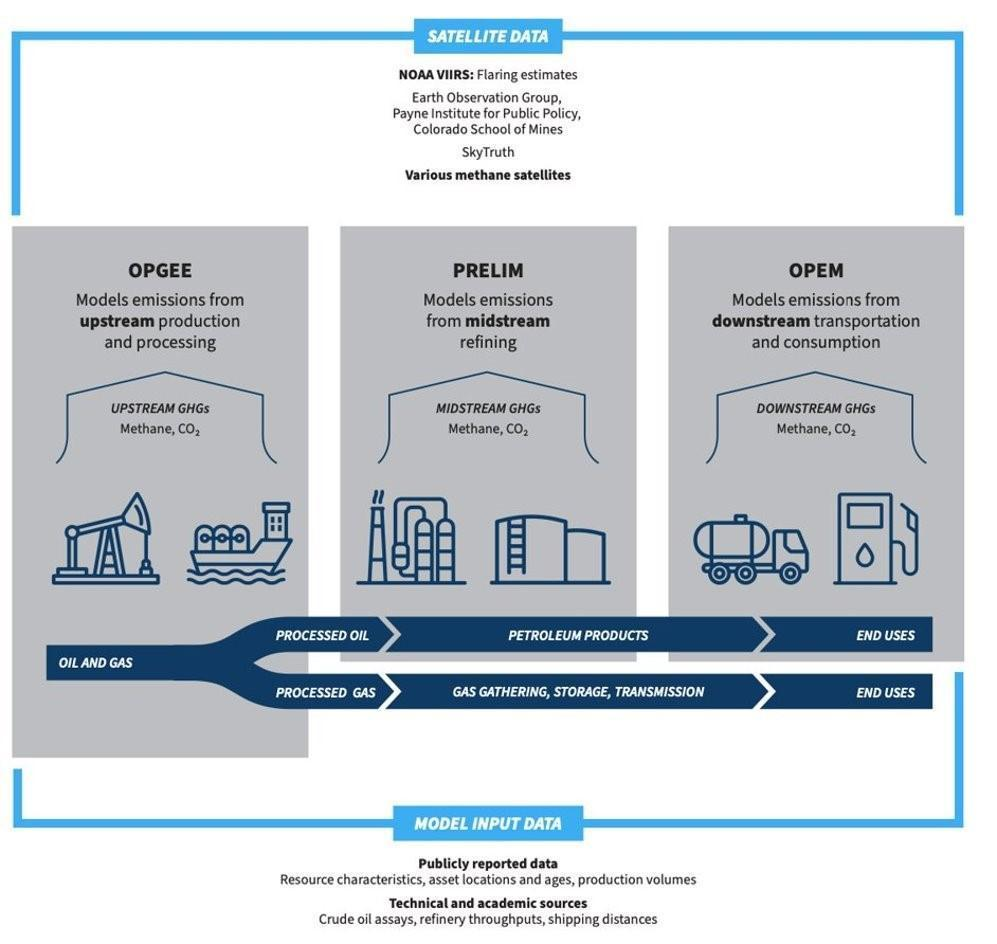

**Figure 1.** The OCI+ quantifies GHGs from the upstream, midstream, and downstream components of the petroleum lifecycle. The upstream and midstream portions, OPGEE and PRELIM, were used in Climate TRACE’s models for oil and gas production and transport, and refining (TRACE refining is in a separate methodology document). Here, “upstream” refers to drilling, extraction, pre-processing, and transport of crude oil and natural gas. “Midstream” refers to oil refining. The “downstream” components of the life cycle – transportation of refined products and consumption by end users – are not discussed here.

Climate TRACE production estimates used OPGEE to model global oil and gas fields, hereafter identified as “assets”. These results were aggregated to both asset groups and country-level emissions. Climate TRACE relied on both bottom-up reported data and activity data, as well as novel analyses of remote sensing data, to provide inputs for models.

The OPGEE approach to estimate oil and gas production and transport emissions is provided in the following subsections . OPGEE modeling results are described in section 3.

#### 2.1 Datasets employed

#### 2.1.1 OPGEE input data

Many publicly reported, technical, and academic sources served as ground truth and activity data for OPGEE. These include industry-specific journals, scientific studies, government agency websites, and reputable news sources. Additional upstream activity data come from four different proprietary data providers (however, only derivative products are published). Other than privately procured data and some journal data, which require subscriptions, all sources are openly available. Table 1 summarizes key input data sources for OPGEE.

**Table 1.** Data used as inputs to OPGEE

| **OPGEE Model Inputs for Oil and Gas Production and Transport** |                                                                                                                        |                                                                                          |
|-----------------------------------------------------------------|------------------------------------------------------------------------------------------------------------------------|------------------------------------------------------------------------------------------|
| **Input**                                                       | **Source**                                                                                                             | **Critical Regions & Field Types**                                                       |
| Field age                                                       | Derived from proprietary data providers                                                                                | All global fields                                                                        |
| Field depth                                                     | Technical industry references & publicly reported sources (e.g., Science Direct)                                       | Brazil, China, Offshore assets                                                           |
| Gas-to-oil ratio                                                | Derived from proprietary data providers                                                                                | All global fields                                                                        |
| Production volumes                                              | Derived from proprietary data providers                                                                                | All global fields                                                                        |
| Gas composition                                                 | Technical industry references & publicly reported sources                                                              | Coal bed methane assets, sour and acid gas assets (high sulfur, methane, or CO2 content) |
| API gravity                                                     | Derived from proprietary data providers & publicly reported sources (e.g., One Petro)                                  | Global oil fields                                                                        |
| Injection characteristics                                       | Technical industry references (e.g., Oil and Gas Journal) & publicly reported sources                                  | Canadian oil sands, extra heavy oils, high water content fields                          |
| Production methods                                              | Derived from proprietary data providers & publicly reported sources (e.g., Offshore Technology)                        | Fracked fields, enhanced oil recovery fields                                             |
| Transport means and distances                                   | Public databases (IEA Sankey, BP Statistical Review of World Energy, Global Energy Monitor Gas Infrastructure Tracker) | All global fields                                                                        |

#### 2.1.2 Remote sensing datasets

In addition to ground truthing and using activity data, Climate TRACE incorporated remote sensing data to estimate flaring at oil and gas fields, as well as methane leakage factors for OPGEE.

#### 2.1.2.1 Asset, infrastructure and remote sensing data

To estimate flaring volumes, we used the Visible Infrared Imaging Radiometer Suite (VIIRS) derived Gas Flaring product. VIIRS detects global gas flaring at 750 m resolution every 24 hours. The National Oceanic and Atmospheric Administration’s (NOAA) VIIRS instrument, flying on the Suomi National Polar Partnership (SNPP) satellite, is uniquely designed to detect a heat signature produced when unwanted facility gas is burned off. The product is derived from detection at shortwave- and infrared bands (M10 and M11 bands) of 1.6 and 2.2 µm. At night, these bands are indicators of combustion sources and are thus ideally suited for finding flares. Flares were distinguished from wildfires by temperature (flares are designated at T &gt; 1,400K) and persistence (wildfires are typically not persistent beyond a few days, while flares are). Figure 2 highlights VIIRS flaring locations for 2023 from the World Bank Global Gas Flaring Data. Data are accessed through the World Bank data portal ([https://www.worldbank.org/en/programs/gasflaringreduction/global-flaring-data](https://www.worldbank.org/en/programs/gasflaringreduction/global-flaring-data)) or through the Earth Observation Group, Payne Institute for Public Policy, Colorado School of Mines (<https://eogdata.mines.edu/products/vnf/>).

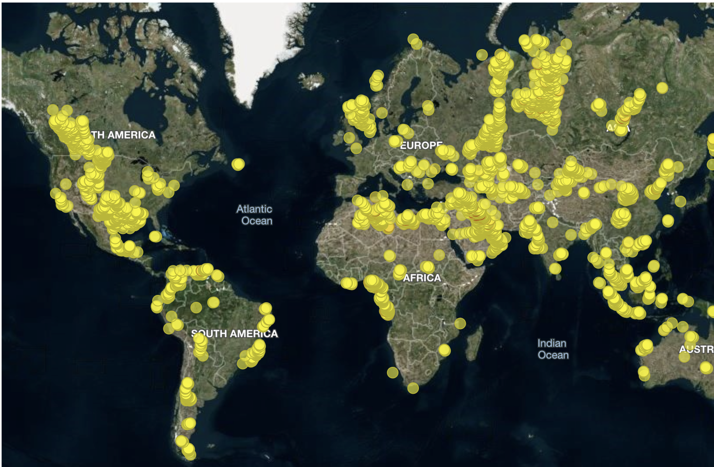

**Figure 2.** 2023 VIIRS flaring locations represented by yellow dots. Figure from World Bank Global Flaring and Methane Reduction Partnership (https://www.worldbank.org/en/programs/gasflaringreduction/global-flaring-data).

To assign flares to fields, we use two methodologies and different associated data, depending on whether the asset is within the U.S. or not.

-   Within the U.S., flares are assigned by matching VIIRS geolocated flares to the nearest piece of oil and gas infrastructure and matching the piece of infrastructure to an oil and gas field. Infrastructure and operator information was compiled by individual state oil and gas agencies (e.g., Colorado Oil and Gas Conservation Commission)- these state-level records were compiled by FracTracker in their ‘National Well Report’ and the Global Oil and Gas Infrastructures (GOGI) database.

-   Outside the U.S., flares are assigned by matching VIIRS geolocated flares that fall within a field boundary. The field boundary polygons are provided by proprietary data vendors, and a buffer is added around the field to account for uncertainties in both polygon locations and VIIRS flare locations, to capture flares that are attributed to the oil and gas production of that asset.

#### 2.1.2.2 Flaring Integration

While flaring can occur all along the oil and gas supply chain, the VIIRS gas flaring product has observed that 90% of the flaring occurs in upstream production areas, while only 8% occurs at refineries, and 2% at LNG transport facilities (Elvidge et al., 2015). This flaring process produces both CO2 and CH4 (uncombusted gas ‘slip’), and thus is essential in getting accurate GHG emissions estimates from the oil and gas sector. Using VIIRS nightfire flaring data, RMI quantified these emissions and produced a derived modeling metric, the flaring-oil-ratio (FOR, units of standard-cubic-feet per barrel-of-oil-equivalent or scf/bbl), which relates flaring to oil production at a field. FOR was computed by dividing the VIIRS variable flr\_volume (volume of flared gas in billions of cubic meters, converted to standard cubic feet) by a field’s oil production. A high FOR indicates a large amount of flaring per barrel of oil produced at a given field, and vice versa for a low FOR. It is worth noting that associated gas venting, which can come from malfunctioning flares, was modeled as a separate emissions source in OPGEE.

As mentioned above, an important part of deriving the FOR variable was assigning the satellite-observed flares to the correct oil or gas asset. To do this, RMI performed geolocation matching using all available oil and gas field polygon shapefiles. A buffer was added around the polygons to account for uncertainties in the flare or field boundary locations. Any flares that fell within the available polygon buffered boundaries were assigned to that oil or gas asset. If a flare fell within two overlapping polygons, the flare was assigned to a field based both on distance to centroid and oil production as equal weights. For fields without polygon files (most fields modeled in the U.S.), a flare that fell within a radius of 10 miles (\~16 km) of the field was assigned to that asset (a self-defined threshold choice). The exception was in the significantly larger Permian TX field, for which the distance threshold used was 50 miles (\~80 km). Where oil and gas asset field polygons are not available, flares were matched to the closest field centroid.

#### 2.1.2.3 Super-emitter methane detection with remote sensing

RMI’s modeling approach incorporated results from several recent scientific studies on methane super-emitters. First, findings from Cusworth et al. (2021), which deployed aircraft surveys over the Permian Basin and attributed detected plumes to specific types of infrastructure, were used to inform RMI’s model for fugitive loss rates for specific types of equipment, including storage tanks, wellheads, gathering and boosting stations, and processing equipment in Permian TX and Permian NM assets. In addition, Lauvaux et al. (2022) identified that extra-large super-emitters, or ultra-emitters, represent as much as 12 percent of global methane emissions. In their study, the TROPOspheric Monitoring Instrument (TROPOMI) on board the Copernicus Sentinel-5 Precursor satellite detected over 1000 super-emitters over the Middle East, Russia, Algeria, and Turkmenistan. By aligning the location of some of these detections with modeled assets, RMI adjusted OPGEE’s default estimates for the fugitive loss rates for upstream equipment components in Algeria’s Hassi R’Mel and Tin Fouye fields (Figure 3). Similarly, gas transmission pipeline fugitive loss rates were adjusted for the Permian basins in the USA, as well as all assets in Russia and Turkmenistan. Locations that did not have aligned detections had their defaults left as is.

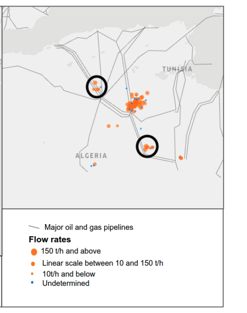

**Figure 3.** Methane emission detections (orange dots) over Algeria, from Lauvaux et al. (2022), overlaid with approximate locations of Hassi R’Mel and Tin Fouye fields (black circles).

Figure 4 shows the effect on methane emissions results from adjusting OPGEE’s fugitive methane loss rates for three assets in Algeria, Turkmenistan, and the U.S.. In the case of Permian NM, our adjustments to upstream fugitive methane brought our overall result into close alignment from a recent study of the New Mexico Permian between October 2018 and January 2020 that found overall site loss to be about 194 tonnes per hour (+72/-68, 95% CI) (Chen et al., 2022).

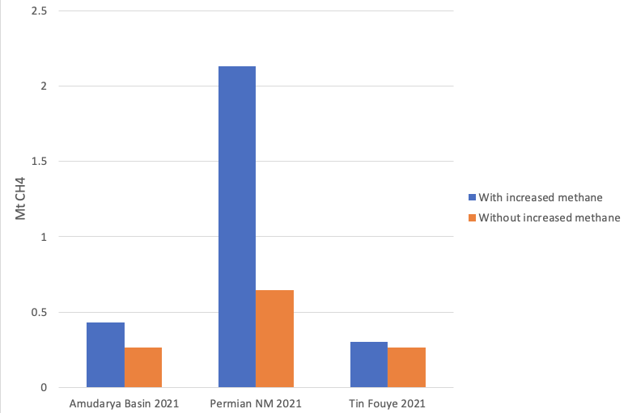

**Figure 4.** 2021 methane estimates from three assets - Amudarya Basin, Permian NM, and Tin Fouye - before (orange) and after (blue) adjusting OPGEE’s inputs for fugitive methane loss.

#### 2.1.3 Emissions Reduction Solutions (ERSs) Data

Emission Reduction Solutions (ERSs) for oil and gas production and transportation are generally based on fundamental principles of oil and gas operations, though some are informed by modifications to the inputs used in the OPGEE (Oil Production Greenhouse Gas Emissions Estimator) model. OPGEE outputs are disaggregated into specific processes, allowing emissions from certain activities to be subtracted to reflect the impact of reduction strategies. When direct subtraction is not feasible, the model's flexibility—offering a wide range of input variables—enables us to adjust operating conditions and simulate the effects of different ERS.

When applying individual ERS strategies (see Table S4 and S5) within the OPGEE framework, assumptions are grounded in values from published literature. The flare efficiency improvement strategy, for example, is based on average flare efficiency values reported by Plant et al. (2022) and the upper bound of feasible efficiency demonstrated by Cain, Seebold, and Young (2002). Venting estimates are sourced from the International Energy Agency (IEA). The IEA's *Global Methane Tracker* (2024) informs upstream venting assumptions, while its methane abatement model provides insight into the potential for reducing venting in transport operations.

Each strategy considered has been implemented in the field to some degree, although public documentation varies. The results section will provide more detail on these case studies, which include strategies adopted specifically for emissions reduction as well as those driven by other operational or regulatory factors. Major oil and gas companies—such as Shell, BP, Chevron, and Petrobras—have all engaged with these strategies across different global regions. Where operator disclosures are limited, service and technology providers like Cook Compression and Solar Turbines illustrate the availability of commercial solutions that support ERS implementation.

#### 2.2 Models: OPGEE - Oil and Gas Production and Transport Emissions

#### 2.2.1 Asset Definition

#### 2.2.1.1 Overview

Oil and gas production and transport emissions are modeled in OPGEE at the most granular level possible in order to get outputs that reflect customized operations at individual oil and gas fields. OPGEE is a lifecycle engineering model, meaning it includes emissions for each asset based on all extraction sites, wells, storage facilities, gathering stations, boosting stations, crude oil pipelines, gas compression stations, and gas transmission lines associated with the asset. Results from modeling are then aggregated into larger groups in order to protect sensitive location and operation information at each oil and gas site.

Emissions were generated for nearly 3,500 individual oil and gas fields globally, representing over 99% of global production, then aggregated to nearly 850 grouped assets that are reported in the Climate TRACE data. The assets are located in 97 countries. Fields were geolocated by their coordinates as provided by four different proprietary data vendors and/or from publicly available sources such as Global Energy Monitor ([https://globalenergymonitor.org/projects/global-oil-gas-extraction-tracker/](https://globalenergymonitor.org/projects/global-oil-gas-extraction-tracker/)). Fields are aggregated by country, basin, and type, and matched to basins for geographic display.

#### 2.2.1.2 Basin Mapping

Due to the ownership sensitivity of oil and gas sites, emissions cannot be attributed to each individual well or field location. Instead, wells and fields are aggregated to geographic “basins” representing the area in which there is oil and gas infrastructure. Basin, play, subplay, and other geographic/geologic shapefiles were aggregated from public sources to create a global map of “basins” with similar geologic features and conditions for oil and gas production. These public sources include the EIA, NETL, and USGS and were combined to optimize geographic granularity even with overlaps. The names of assets were made consistent with these “basins”, to make matching easier. Emissions are mapped onto the geographic areas that the “basins” cover to distribute emissions across all involved geography while continuing necessary ambiguity.

#### 2.2.2 OPGEE Model

#### 2.2.2.1 Emissions Sources

The OPGEE model is divided into modules and broken up by major production stages. Over 100 emission sources were classified across all process stages. For a full and detailed accounting of all the OPGEE modules, stages, and processes, see Brandt et al. (2021). For the current discussion, this section provides a broad overview of the emissions sources covered by OPGEE, the gases included in the current analysis, and the parameters required as model inputs to estimate emissions. Emissions sources included:

-   **Flaring.** Combustion of natural gas as a means of depressurizing an extraction or processing site. Flaring predominantly generates CO2 and CH4 emissions.

-   **Venting.** Leaking of natural gas as a means of depressurizing an extraction, processing, or transmission site. Venting predominantly generates CH4 emissions.

-   **Fugitive losses.** Natural gas leaks originating from the equipment used in the production, processing, compression, and transmission of crude hydrocarbons.

-   **Super-emitter events.** Large natural gas leaks (emissions rate generally 25 kilograms of methane per hour or greater), intentional or otherwise, that occur in the production, processing, compression, and transmission of crude hydrocarbons.

-   **On-site fuel usage.** Combustion of fuels on-site to power vehicles, drilling rigs, and other equipment.

-   **Biogenic emissions.** Emissions caused by changes to the ecosystem at the extraction site, either as a result of deliberate site preparations (combustion and/or clearing of biomass) or indirect impacts on the local environment.

-   **Embodied emissions.** Emissions associated with the manufacture of the materials used at the extraction site (cement, casings, etc.). Emissions associated with the consumption of electricity at the site.

#### 2.2.2.2 Gases

It should be noted that, in addition to CO2 and CH4, OPGEE also assesses volatile organic compounds, carbon monoxide, and nitrous oxide. However, absolute volumes of these trace gases were not modeled this year but will likely be available in future data updates.

#### 2.2.2.3 Key Inputs

To estimate total emissions from all the sources and gases listed above, OPGEE requires some key inputs to establish the parameters of the model. Prior research has demonstrated emissions results to be sensitive to these inputs. Key inputs included:

-   **Field age**. The number of years since the first year of production for the field. Age can be an indicator of depletion and predict greater energy expenditure per unit of production.

-   **Field depth.** The depth of drilling operations. Deeper fields may be more energy intensive.

-   **Oil, gas, and water production volumes**. Larger hydrocarbon production volumes indicate more emissions-generating activities. A high water-to-oil or gas-to-oil ratio can predict higher energy expenditure for the processes of separating fluids and extracting products.

-   **Gas composition.** The ratio of different gas species in the reservoir. For instance, dry gas fields tend to have high (&gt;90%) CH4 content compared to wet gas fields, which have higher C2-C5 components.

-   **Injection characteristics.** Gas, steam, and/or water may be injected into extraction sites to increase the flow of oil to wells, or manage the pressure at a site. The substance, volume, and methods of injection can all impact the emissions generated during production.

-   **Well characteristics.** The number, type, depth, diameter, and production volume of wells impact the energy expenditure for a unit of production from a field.

-   **Reservoir characteristics.** The pressure and temperature at the depth of the drilling operation.

-   **Crude API gravity.** The inverse of the density of a petroleum liquid relative to water. Oils with higher API gravities are lighter and lower API gravities are heavier.

-   **Production methods.** The extraction methods and emissions management techniques implemented at sites within a field. For instance, fracking is often associated with higher emissions.

-   **Means and distance of transport.** The pipelines, transmission lines, vehicles, and management practices associated with transporting product from a field. For instance, gas may be distributed regionally from the point of production via pipeline, or liquefied and transported over ocean via tanker. See note in **Liquefied natural gas (LNG), oil and gas transport distances** section about the need for careful analysis when it comes to attributing transport emissions.

-   **Flaring volumes and efficiency.** Higher flaring volumes generate more emissions. Flare efficiency determines the ratio of combusted and uncombusted gas products that are generated.

-   **Super-emitter events.** Large and/or frequent super-emitter events generate more emissions.

While the list above serves as a general summary, OPGEE can ingest more than 150 data inputs to estimate emissions. However, for most fields, a complete dataset containing every key input was not available. In these cases, OPGEE used the available inputs to generate reasonable estimates for the missing parameters. For instance, if the water-to-oil ratio for a field is unknown, OPGEE can estimate this parameter based on API gravity and field age. The default estimates OPGEE uses for missing parameters were based on a body of historical datasets tracking thousands of global oil and gas fields. See Brandt et al. (2021) for detailed information.

#### 2.2.3 OPGEE Settings

Within OPGEE, there are a variety of settings that users can select to customize implementation of the model. This section describes several key settings that were selected for this analysis.

#### 2.2.3.1 General Settings

**Product-specific boundaries.** OPGEE users can set boundaries for which stages of the upstream hydrocarbon production process should be included in the model’s emissions estimates for a given asset. For the oil and gas production sector, emissions are reported for all activities occurring within a field boundary. For the oil and gas production sector, emissions are reported for all emissions occurring after the oil and/or gas product leaves a field. For oil, transport includes emissions after the oil leaves the field and before it arrives at the refinery gates. For gas, transport emissions include after the gas leaves the field and before it is distributed to users.

**Methane venting, fugitives and flaring.** The methane venting and fugitives (VF) portion of the model requires a “component” or “site” level analysis to be selected. Site-level methods for estimating VF emissions leveraged empirical data from site-level emissions measurement campaigns, typically performed at or beyond the facility fence-line. Component-level methods for estimating fugitive emissions start with a list of components present at a site and estimate leakage by component. The model authors recommended the component-level method to be used in Climate TRACE analysis. All fields and sub-fields are modeled at the component level except for in Norway, where fields are run at site level to accommodate the representation of onshore renewables used to power offshore extraction platforms.

Flare slip, also called “methane slip”, is another source of methane due to flaring. Flare slip occurs when a flare malfunctions and excess methane is not burned off and thus is not converted to CO2 (remains as methane). For most assets, methane combustion efficiency for flares was set to 91%. A handful of assets and regions with enforced efficiency regulation were set to 98%, such as those in Norway.

**Model outputs and barrel of oil equivalency (BOE).** Oil and gas field inputs were specified based on the datasets in section 3.3. The model was run to calculate GHG emissions outputs for each oil and gas asset. Under California regulations, OPGEE reports GHG-emissions outputs in units of grams of CO2 equivalent per megajoule (gCO2e/MJ) of petroleum products generated. CO2 equivalent was calculated using both 100-year and 20-year global warming potential for all gases. These outputs were converted into emissions per barrel of oil equivalent (kgCO2e/boe) by multiplying them by the weighted lower heating value of all processed oil and gas products (lower heating value is an energy density metric measured in megajoules per barrel of oil equivalent), which is output in OPGEE’s Energy Summary tab.

#### 2.2.3.2 Settings for Special Cases

OPGEE offers numerous settings to best reflect real-world production and transport operations specific to individual fields.

**Liquefied natural gas (LNG), oil and gas transport distances.** Gas fields where a significant portion of the gas product feeds into an LNG plant, as determined through proprietary data providers, were run with the LNG setting “on”. All other fields transmit and distribute gas via pipelines only and do not generate liquefaction, LNG transport, or regasification emissions.

Distances for LNG transport (tanker), crude oil transport (tanker), and gas transmission (pipeline) were established from proprietary data providers where available, and were established at the country-level and used for all assets in those countries where information was not available at the asset level. The sole exception is Cook Inlet, Alaska, which was assigned its own distance to reflect local gas consumption instead of using U.S. country values. All distances were calculated by first determining whether produced oil and gas was primarily consumed in-country or exported to a main off-taking nation (IEA 2019; BP 2022). If products were primarily consumed in-country, we used publicly available oil and gas pipeline datasets to calculate the distance from production sites to the country’s largest city, where large-scale refining and gas consumption was likely to occur (e.g., gas production in southern Argentina to Buenos Aires) (Global Energy Monitor 2022). If products were primarily exported, we used a combination of publicly available cross-border pipeline datasets and shipping routes to calculate the distance from the area of production to the main offtaker (e.g. offshore Norway oil and gas production to Paris).

Careful attribution is needed when considering oil and gas transport emissions. This is especially true for gas transport emissions, which can be a significant portion of emissions from a gas supply chain. While oil and gas are transported around the world, it is very difficult to track the actual path and destination for any given set of produced molecules. The OPGEE model accounts for emissions that occur as a result of moving crude oil and natural gas via general modes, such as pipelines and ocean and LNG tankers. In the Climate TRACE transport sector dataset, these emissions are linked back to the field of origin, even though the actual emissions may have occurred outside of those bounds. For example, Algeria exports gas to Europe and it may travel hundreds of miles to get there, such as via the Trans-Mediterranean Pipeline, shown in Figure 5. The pipeline spans 2,475 km and links Algeria to Italy ([source: GEM](https://www.gem.wiki/Trans-Mediterranean_Gas_Pipeline)). Various pipeline sections are owned and operated by Sonatrach (Algeria), Sotugat (Tunisia), and ENI (Italy). When modeling a gas field in Algeria, pipeline transport emissions are estimated and linked back to the Algerian gas field from which they originated even though they may actually be occurring over Tunisian or Italian-owned areas.

Our emissions for transport reflect the emissions that the atmosphere ‘sees’ given the oil and gas produced from that asset and/or in that country.

**Figure 5.** The Trans-Mediterranean Pipeline that links Algeria to Italy.

**Coal bed methane.** In some fields, natural gas was extracted from underground coal beds. These fields were assigned specific gas composition percentages H2S (2%), methane (93%), CO2 (5%), field depth (800 ft), reservoir pressure (329 psi) and temperatures (84oF). Water reinjection practice was turned on, and water-to-oil-ratio (WOR) was calculated by dividing the gas-to-oil-ratio (GOR) by 2000.

**Additional special cases.** For Norwegian fields Gudrun, Johan Sverdrup, Gjoa, and Troll, natural gas-fired equipment, such as reinjection compressors, were substituted to instead be powered by renewable electricity. Snohvit, Shah, In Salah, Sleipner West, and Greater Gorgon fields, which have high CO2 content, were run with carbon capture and sequestration parameters “on”, instead of the default which assumes that purged CO2 is vented into the atmosphere. Assets located in California were assigned land carbon richness and development intensity inputs to align with those from California Air Resources Board analysis (CARB 2021).

#### 2.3 Emissions Reductions Solutions

Emission Reduction Solutions (ERSs) are built on a combination of theoretical modeling and real-world data. Some ERS strategies are applied using generalized assumptions, while others are tailored to the unique characteristics of individual assets. The OPGEE (Oil Production Greenhouse Gas Emissions Estimator) model plays a central role, incorporating both empirical studies and customizable inputs to reflect various operating conditions. This hybrid approach allows ERS to simulate realistic reductions while maintaining methodological rigor. A list of strategies are provided below and in Table S4 and S5. *Note: Only rank 1 strategies are provided for assets on the Climate TRACE website and additional strategies will be made available in future releases.*

-   **Shutdown of High-Emissions Assets**  
    > The shutdown strategy is based on the principle that certain oil and gas assets are so emissions-intensive that they should be retired entirely. By shutting down these "dirty" assets, their direct emissions are completely eliminated. However, the model accounts for the fact that production and transport may shift to other assets, potentially offsetting some of the reductions. To reflect this, we use the global average emissions intensity for production and transport. For example, if an asset producing *Y* barrels of oil equivalent per year is shut down, and the global average intensity is *X* tonnes CO₂e/boe, the resulting emissions shift is calculated as *X × Y* tonnes CO₂e.

-   **Flare Efficiency Improvement**  
    > This strategy focuses on improving the combustion efficiency of flaring operations. Based on existing literature, we assume a baseline flare efficiency of 91% and increase it to 99%. This 8% improvement significantly reduces methane emissions by ensuring that more methane is fully combusted into CO₂—a less potent greenhouse gas. In the model, this adjustment translates into a direct reduction in the methane portion of flared volumes.

-   **Elimination of Venting**  
    > Stopping venting involves removing intentional methane releases into the atmosphere. Venting values are based on country-level averages provided by the International Energy Agency (IEA). Under this strategy, we eliminate the portion of methane attributed to venting, while still accounting for emissions from fugitives and flaring. This results in a net reduction in methane emissions for assets where venting is currently practiced.

-   **CO2 Injection**  
    > Some oil and gas fields have the capacity to reinject CO₂ that is separated from the produced gas stream. This practice, already in use in several projects globally, reduces emissions by preventing the release of CO₂ into the atmosphere. Within OPGEE, this option can be toggled on, enabling the model to reflect the lower emissions profile of operations that incorporate CO₂ reinjection.

-   **Upstream Electrification**  
    > In many oil and gas fields, operations such as drilling, pumping, or processing are powered by the very hydrocarbons being extracted. Electrifying these processes removes their associated on-site combustion emissions. OPGEE allows for these processes to be modeled as electrified, shifting the energy demand to the electrical grid. While this removes local emissions, it assumes additional emissions are incurred elsewhere in the energy system, depending on the grid's carbon intensity.

-   **Reduce Venting from Compressors**  
    > This strategy targets methane leaks and emissions from compressors in both upstream and midstream operations. Based on literature (IEA, Methane Abatement Model) and internal data, we assume a 24% reduction in methane emissions from this sector. This percentage is applied across all selected assets, leading to a consistent and measurable reduction in emissions related to compression equipment.

-   **Transport Electrification**  
    > Transport-related emissions primarily arise from the combustion of fuels used to power compressors and other equipment along pipelines. Full electrification of transport operations—such as switching to electric-driven compressors—eliminates these direct CO₂ emissions. However, similar to upstream electrification, this shift induces emissions from electricity generation, which are modeled accordingly in OPGEE.

#### 2.4 Country-level estimation

Since 100% of oil and gas assets were modeled this year, country-level estimates for methane, CO2, and CO2 equivalencies were generated by summing emissions from field-level results in each country.

#### 2.5 Confidence and Uncertainty

Confidence levels for the oil and gas production and transport sector were determined based on three things: (1) the number of known inputs provided to the OPGEE model to estimate emissions, (2) limitations of the model, and (3) comparability with other emissions inventories. The more inputs known about an asset’s operations, the higher the confidence.

The original version of the OPGEE model was built to assess emissions from oil fields, and more recently has been expanded to include modeling of gas fields. The confidence in modeling oil fields is higher than modeling gas fields, so the confidence has universally been set to low for all gas fields given the model limitations around these field types.

Third, if TRACE country-level CO2 and CH4 estimates of oil and gas emissions were largely different from the IEA inventory *and* not easily explained by differing methodological approaches, Climate TRACE set the assets in that country to low confidence.

Uncertainty numbers were computed by running 50 realizations of the OPGEE model and taking the statistical results of output emissions. Since the model is stochastic and includes many Monte Carlo simulations for processes including fugitive methane loss rates, each realization produces slightly different emissions results. The uncertainty number presented shows the standard deviation of the emissions population from the 50 model runs for each field.

#### 3. Results: Oil and Gas Production and Transport

One of the most important findings from the oil and gas production and transport sectors is that there is a very large range of emissions intensities (emissions per barrel of oil equivalent). Emissions can vary by 10x to extract the same oil or gas, depending on reservoir characteristics, operational practices, equipment maintenance, and more. Figure 7 shows a box and whisker plot of carbon dioxide emissions intensity from oil and gas assets in the United States alone, with an interquartile range of 8x. Prioritizing use of oil and gas resources with the lowest emissions intensity, ideally below the 25th percentile,during the energy transition would mean less emissions to the atmosphere in the long run.

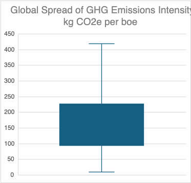

**Figure 7** Box and whisker plot showing 5th, 25th, 50th, 75th, and 95th percentile of 2024 CO2e emissions intensities (kg CO2e/boe) from all modeled oil and gas assets globally using a 20-year GWP.

Figure 8a shows the top 10 countries with highest emissions from the oil and gas production sector. The United States has become the largest emitting country in oil and gas production in the year 2023, emitting \~1.07 billion tonnes of CO2e (20yr GWP). The next highest emitting countries for production are as follows: Iran, Russia, Canada, Saudi Arabia, China, Iraq, Venezuela, Qatar, and Algeria. Figure 8b shows the top 10 countries with highest emissions from the oil and gas transport sector. Russia is by far the largest emitter for oil and gas transport, in large part due to its vast geographical size, meaning resources must be transported far distance both for domestic use and international export; however, perhaps more importantly, Russia has high methane leakage rates from deteriorating pipeline infrastructure, which greatly increases its CO2e emissions. The next highest emitting countries for oil and gas transport after Russia are as follows: the United States, Algeria, China, Saudi Arabia, Australia, Argentina, Canada, Iran, and Turkmenistan.

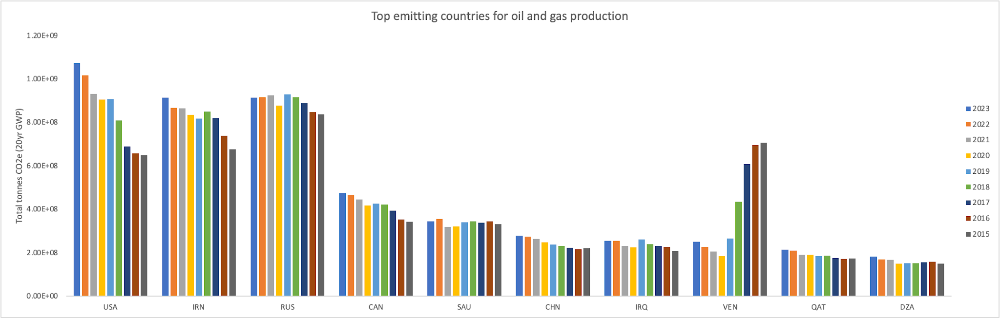

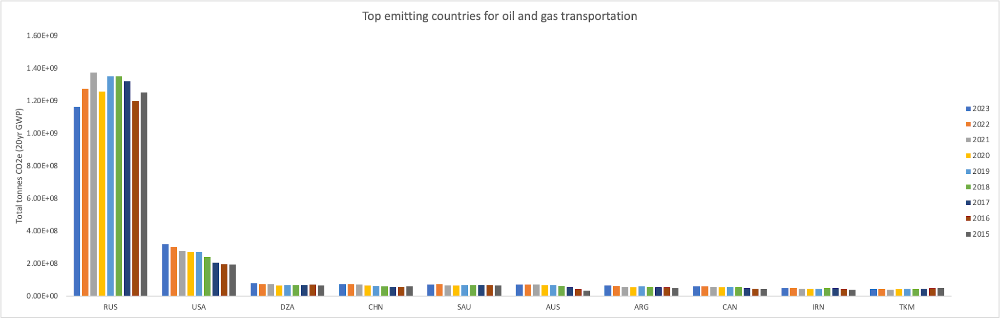

**Figure 8a and 8b** Top 10 highest emitting countries for oil and gas production sector (a) and transport sector (b), for years 2015-2023. The y-axis unit of measure is tonnes of CO2e for 20-year global warming potential (GWP).

Figure 9 shows the top flaring countries by volume for modeled assets. Countries that flare high volumes of gas, such as Russia, Iraq, Iran, and the U.S., are also amongst the top overall emitters in Figure 8. Notably, Canada is the fourth largest overall emitter in Figure 8, due to its high volumes of production, but does not have high flaring volumes and does not rank in the top 10. Flaring inefficiencies also contribute to overall methane emissions--in our analysis, flaring efficiency is estimated at 90%, meaning 10% of flared gas escapes as uncombusted methane. Flaring accounts for approximately 12.5% of total methane emissions from oil and gas production and transport, as shown in Figure 10. Increasing flaring efficiency or capturing and selling the gas that would otherwise be flared is a low hanging fruit in reducing emissions in this sector. Often, addressing flaring as an emissions reduction strategy is low cost or even profitable for operators.

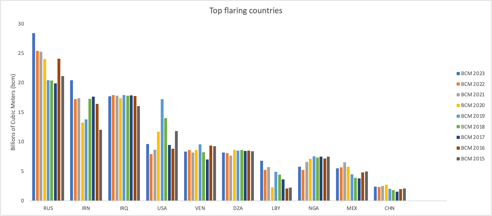

**Figure 9** Top 10 countries by flaring volume (bcm) for years 2015 to 2023. The y-axis unit of measure is billions of cubic meters.

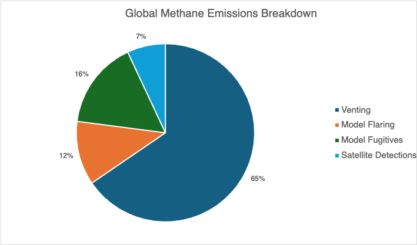

**Figure 10** Contribution of venting, flaring, fugitive, and satellite-observed supermissions to total global methane emissions from oil and gas production and transport for 2024 data.

#### 4. Discussion

#### 4.1 Comparison with Other Emissions Inventories

Our asset-level emissions intensities are compared against comparable estimates for global oil and gas fields published in Masnadi et al. (2018) and the Oil Climate Index + Gas (RMI 2022). Additional comparable sources for absolute CO2 equivalent and methane emissions include: Global Registry on Fossil Fuels (GRFF), Global Fuel Emissions Inventory (GFEI), Emissions Database for Global Atmospheric Research (EDGAR), United Nations Framework Convention on Climate Change (UNFCCC) National Submissions, and International Energy Agency (IEA) Methane Tracker. We do not always include a numeric comparison to all existing inventories because several are based on similar underlying datasets and therefore do not offer new country-level estimates.

Like Climate TRACE, The IEA Methane Tracker estimates all CH4 emissions that occur across segments of the oil and gas supply chain, including production, gathering and processing, refining, transmission, and distribution. The foundation for the estimates is the U.S. GHG Inventory, which is used for developing emissions intensities for venting, fugitive, incomplete flaring, broken down by production subsectors: on and offshore, and conventional and unconventional. With the U.S. intensities serving as a baseline, multipliers are developed for each country based on several factors, including regulatory effectiveness, age of operations and infrastructure, etc (International Energy Agency, 2021). IEA also incorporates satellite-derived ultra-emissions of methane from Kayrros analytics based on Sentinel-5P TROPOMI.

Figure 11 compares Climate TRACE results for top methane-emitting countries with IEA 2021 estimates and Figure 12 compares Climate TRACE emissions results for several UNFCCC annex-1 country inventory submissions. Overall, Climate TRACE results for country-level emissions align most closely with IEA Methane Tracker results compared to any other inventory. In 2021, IEA estimated global methane from oil and gas production and transport to be approximately 82 megatons (Mt). Climate TRACE estimated this total to be approximately 80 Mt. However, Climate TRACE Annex 1 results are more than double that of UNFCCC Annex 1 estimates in Figure 12. Moreover, TRACE estimates demonstrate an increase in 2016-2019, while UNFCCC estimates display a flat trajectory.

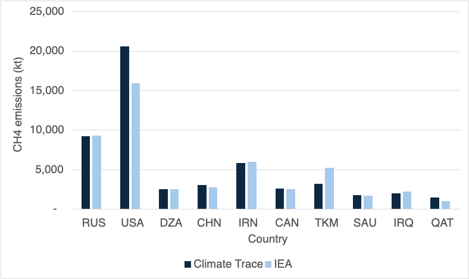

**Figure 11** Top 10 global methane emitters, comparison with IEA Methane Tracker 2024.

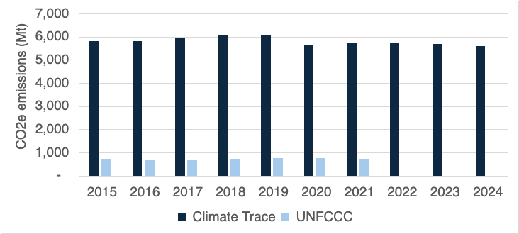

**Figure 12** Comparison of CO2 and CH4 estimates for UNFCCC Annex 1 countries (100 year GWP). Comparison includes 19 countries for which comparable UNFCCC data was available, including Russia, U.S.A., Australia, Bulgaria, Canada, Germany, Denmark, Spain, France, U.K., Greece, Croatia, Italy, Japan, Kazakhstan, New Zealand, Norway, Netherlands, and Ukraine.

The significant difference between Climate TRACE and UNFCCC estimates can be partly attributed to UNFCCC emissions reporting style. The UNFCCC inventory is based on national inventory submissions from two groups of countries—Annex 1 and non-Annex 1 countries (United Nations 2021). Annex 1 comprises forty-three countries, mostly advanced economies. To measure production and refining emissions, Non-Annex 1 countries rely primarily on “Tier 1” methodology, which use default emission factors and relatively simple equations provided by the Intergovernmental Panel on Climate Change (IPCC). Annex 1 countries may develop country-specific emission factors for CO2 and CH4 based on fuel properties (*i.e.,* carbon content, heating value) and use activity data such as fuel consumption statistics. This is consistent with the IPCC “Tier 2” approach. Countries with higher levels of visibility into their refining and production processes may use more detailed data, such as from national inventory and reporting programs. Starting at the facility or even process-unit level, some countries create high resolution, technology-specific emissions factors, described as a “Tier 3” approach. Because Non-Annex 1 countries are not required to report regularly or in a standard format, total country comparisons between Climate TRACE and UNFCCC global datasets are difficult.

Unlike the UNFCCC, and EDGAR, which generally apportion total fuel use to each sector and multiply by emission factors, OPGEE uses engineering process-level detail for particular fuel pathways and publicly available information wherever possible. While EPA emission factors are used for some emissions sources, generally speaking, OPGEE estimates are far more complex. For example, the energy consumed in lifting produced fluids—oil, water, and associated gas—to the surface is computed using the fundamental physics of fluid lifting, accounting for friction and pump efficiencies. The UNFCCC and EDGAR do not account for emissions using this approach. Moreover, the emissions are dynamic over time, as fields age and production characteristics change. Most estimates in OPGEE are based on statistical emissions distributions derived from published academic surveys, thousands of measured data points, and other public data sources. A specific and extensive effort was undertaken to build out the methane fugitives model (Rutherford et al., 2021). Numerous studies point to the fact that the U.S. inventory process undercounts its CH4 emissions from oil and gas supply chain segments, including methane leaks at storage tanks and gathering lines (Yu et al., 2022). Because methane is weighted according to its higher GHG potential, when CH4 is underestimated, so will CO2 equivalent emissions.

Methodology comparisons are further complicated by the different ways in which countries report their emissions to the UNFCCC. In the transport sector, emissions from oil and gas transport - whether by pipeline or tanker - are not disaggregated and are difficult to add back into the production emissions estimate. OPGEE, on the other hand, includes oil transport to the refinery and gas transport to distribution in its asset-level emissions estimates.

Methodology comparisons also depend on the global warming potential (GWP) used to quantify the combined impact of CO2 and other GHGs, most importantly in this sector, CH4 emissions. When selecting a GWP to equate emissions of short-lived climate pollutants like methane into equivalent mass of carbon dioxide, the choice of timescale matters significantly (i.e., 100 vs. 20 year). Today’s inventories use a 100-year timeframe; this GWP is inappropriate for methane, given its atmospheric lifetime of just twelve years. The Climate TRACE inventory offers the opportunity to express total emissions in both 100- and 20-year equivalency. Using a CO2-equivalent 20-year metric places a stronger near-term emphasis on reduction of short-lived climate pollutants and can signal to policymakers, industry, and other stakeholders the climate benefit of prioritizing methane emissions mitigation.

#### 4.2 Implications of Emissions Reduction Solutions

The confidence, feasibility, and consequences of implementing each ERS strategy vary significantly depending on the specific asset and its operational context. The oil and gas sector is inherently complex and, in many cases, opaque. Factors influencing an asset’s emissions and operational decisions may be beyond external visibility or control, including internal governmental policies, corporate strategies, or even interpersonal dynamics within regulatory bodies and firms. These unknowns present challenges when evaluating or applying ERS universally.

Because emissions from most other sectors are linked to their consumption of oil and gas, the implementation of ERS within the oil and gas sector can have ripple effects across the broader economy. For example, shutting down a high-emitting oil field might reduce sector-specific emissions but induce production elsewhere to meet growing global energy demand. This shifting of emissions—often referred to as “leakage”—complicates the net benefit of some strategies. As a result, our necessary aggregation of data occasionally leads to the application of strategies in places where they may not be optimal, highlighting the importance of contextualized analysis.

**Shutting down high-emitting assets** is arguably the most impactful—but also the most challenging—strategy to implement. Rarely is it in the short-term economic interest of operators to cease production entirely. Yet, for extremely polluting fields, this could represent the most meaningful reduction pathway. Induced production elsewhere is inevitable, but with smart policy design, this new production can be encouraged in regions with lower emissions intensity and better environmental safeguards. Moreover, reducing production at the most polluting assets can yield local co-benefits—such as improved air quality—though these benefits may be offset if replacement production occurs in areas with more fragile ecosystems or less stringent regulations. Shutdowns must also be executed responsibly; improperly decommissioned sites can continue leaking for decades, and physical safety risks may persist long after production stops. As other sectors move away from fossil fuels, shutting down high-emitting fields may become more economically viable, especially if carbon pricing or stricter emissions policies are in place.

**Flare efficiency improvements** are generally feasible but require capital investment and ongoing operational oversight. Flaring is often more than just methane combustion—it also involves burning a range of volatile organic compounds (VOCs) and other gases, creating trade-offs in air pollutants. Increasing flare efficiency from a baseline of 91% to 99% can significantly reduce methane emissions, albeit with a rise in CO₂ output due to more complete combustion. While this may sound like a trade-off, the climate benefit is substantial because methane is a far more potent greenhouse gas than CO₂ in the short term. Additionally, better flare monitoring can prevent blowouts, which pose severe safety and environmental risks. Despite these benefits, policies or corporate mandates are often needed to compel flare upgrades, as the upfront costs are rarely recouped directly.

**Stopping venting** offers strong potential for both climate and local environmental gains. While high in short-term costs—especially where supporting infrastructure doesn’t yet exist—eliminating venting can unlock long-term economic value. In fields with high associated gas, producers can potentially monetize gas that would otherwise be wasted. For example, Iraq is a case in point: much of its electricity is generated using imported gas, even as significant volumes of associated gas from domestic oil fields are vented or flared. Capturing and using this gas could improve national energy security and reduce emissions. However, infrastructure build-out may face community or political pushback, as pipelines and gas processing facilities are visible symbols of continued fossil fuel development. Nevertheless, the co-benefits of venting reduction—especially in reducing hazardous air pollutants like VOCs—can provide strong justification for investment, particularly in areas with sensitive populations.

**CO₂ injection** can serve dual purposes: increasing oil recovery (in the case of CO₂-EOR) and sequestering carbon underground. From a climate perspective, it represents one of the few scalable strategies for permanent emissions reductions within active production operations. Its feasibility depends heavily on local geology, availability of CO₂, and access to capital. While the exact costs and trade-offs vary, the technique is already deployed in places like the Sleipner and Gorgon projects, providing real-world proof of concept. In cases where reinjection involves CO₂ already present in the production stream, this strategy also reduces the net emissions associated with gas processing.

**Electrification**, both upstream and in transport, is a promising pathway to decarbonization—though its impact depends heavily on the source of electricity. When operations are connected to a clean grid (as in Norway), emissions are significantly reduced. In other contexts, particularly where grids rely on coal or other fossil fuels, electrification can simply shift emissions rather than eliminate them. Electrification may also face community opposition if it increases local electricity prices or competes with residential demand. One appealing alternative is on-site renewable energy generation, which not only avoids emissions but can provide operators with new revenue opportunities by selling surplus electricity. In the long term, reducing the need to burn hydrocarbons on-site allows producers to sell more of their product, increasing efficiency and profitability.

**Reducing venting from compressors**, especially in transport systems, is another targeted strategy with measurable benefits. A general estimate suggests that a 24% reduction in methane emissions is possible through better maintenance, leak detection, and upgraded equipment. Although this estimate is drawn from literature and may vary by site, it offers a useful benchmark. Implementation requires ongoing monitoring and capital investment, but the benefits extend beyond climate. Because compressor stations are dispersed across large geographic areas, improvements can reduce air pollution over wide regions—enhancing public health and reducing regulatory risk.

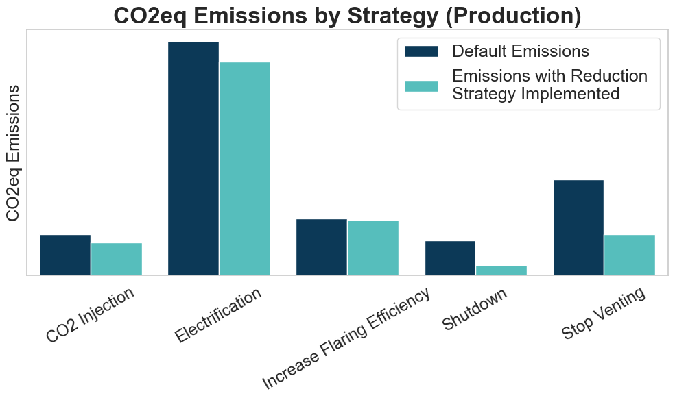

**Figure 13** CO2 equivalent emissions in tonnes for a selection of oil and gas production emissions reductions strategies, with default emission on the left and emissions with the reduction strategy implemented on the right.

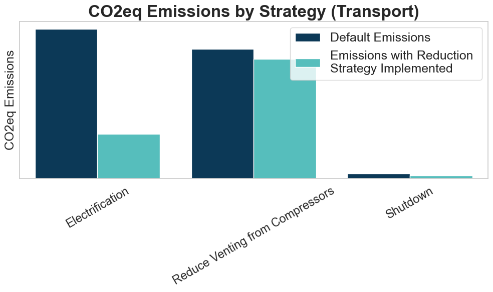

**Figure 14** CO2 equivalent emissions in tonnes for a selection of oil and gas transport emissions reductions strategies, with default emission on the left and emissions with the reduction strategy implemented on the right.

#### 4.3 Limitations

While remote sensing, data inputs, and ground truth data are sourced globally, data availability, quality and uncertainty across countries is uneven. For example, while VIIRS flaring volumes are available globally, North America has been relatively more heavily studied when it comes to fugitive methane emissions in certain subsectors and is more data rich compared to other regions. Moreover, worldwide knowledge around the magnitude, distribution, and duration of large emission events (e.g., upstream purposeful venting) is poor. The lack of global data coverage may result in estimates that are not representative in certain geographies (too high or too low). While not available in the current version of Climate TRACE, future versions of the platform will offer an uncertainty range in emissions, as well as an assessment of data availability in each country where an estimate is available. This will help prioritize how to fill gaps on a country-by-country basis.

#### 5. Conclusion

To chart a clean energy transition, we must bring transparency to emission-intensive sectors like oil and gas. For production and refining, the Climate TRACE platform bolsters accountability that is currently lacking when countries self-report their emissions and offers all countries access to reliable, accurate, and timely emissions data across sectors. The information can empower leaders to pinpoint where efforts should be channeled to maximize impact.

More information and techniques will be applied to improve and refine our oil and gas sector emission estimates. For the OPGEE upstream model, we will continue to collaborate with our Stanford University partners to advance the model coding, improve flexibility, and prepare it to intelligently incorporate new sources of ground-truth data. We will boost country coverage percent of country assets modeled) to reduce scaling error, where possible, and highlight data gaps by advocating for improved data availability with stakeholders in specific geographies.

Since empirical measurements cannot be made over all facilities, in all geographies, all the time, this will require improving our models’ capabilities to make smarter assumptions in data-poor environments. This includes the integration of current and emerging remote sensing technologies that have the capabilities to assess GHGs from oil and gas systems, including AVIRIS-NG, Carbon Mapper, MethaneSat, TROPOMI, and GOSAT. No singular remote sensing system can overcome all the hurdles to capturing the majority of GHG emission sources, but combining different technologies can work towards high resolution measurements, with credible verification and transparency, at scale. A promising future of emissions monitoring lies in a layered system that integrates a suite of measurement technologies, models, and reported data.

Finally, the various Emissions Reduction Strategies (ERS) discussed above target some of the most emissions-intensive components of the upstream and transport segments of the oil and gas sector. However, they do not address the downstream combustion of these fuels, which often generates more emissions than upstream and transport combined. To apply ERS effectively, we developed a selection criterion to match each asset with the most suitable strategy. While this approach improves relevance, the necessary aggregation of data likely limits the full emissions reduction potential that could be achieved at a more granular level. Nevertheless, every asset analyzed has at least one viable ERS that can significantly reduce its emissions—an important finding in an industry widely recognized for its contribution to global greenhouse gas emissions.

#### Acknowledgements

Special thanks to our partners at Climate TRACE, Development Seed, Carbon Mapper, Stanford University, the University of Pittsburgh, the University of Calgary, NASA - Carbon Monitoring System, Colorado School of Mines, and Harvard University that helped with developing the models we deployed, building web tools to share results with public audiences, constructing this document, and working with us to integrate other approaches to and knowledge of oil and gas emissions into these estimates.

#### Supplemental InformationSupplemental Materials

Description of Files  
The country level files for the oil and gas production and transport sectors include summed estimates of CO2 and CH4 emissions, as well as carbon dioxide equivalencies. Countries that have a null value indicate that we did not model any assets in that country, though we know there is some degree of oil and gas production in that country. Countries that have a zero value for emissions indicate that there is no oil and gas production in that country.

The field level asset data file includes estimates of CO2 and CH4 emissions, as well as carbon dioxide equivalencies for aggregated oil and gas field assets.

Emissions data are all freely available on the website. All inputs to the OPGEE model, with the exception of production volumes or other proprietary data, are available by request along with citations of publicly available information. Emissions estimates broken out by supply chain segment (e.g., drilling, extraction and production, surface processing, etc.) are available by request.

**Table S1**: General dataset information for asset-climate-trace\_oil-and-gas-production and asset-climate-trace\_oil-and-gas-transport files

<table><thead><tr class="header"><th><strong>General Description</strong></th><th><strong>Definition</strong></th></tr></thead><tbody><tr class="odd"><td><strong>Sector definition</strong></td><td>
<em><strong>Oil and gas production includes drilling, extraction, production, surface processing, maintenance, and waste disposal.</strong></em>

<em><strong>Oil and gas transport includes pipeline transport, road transport, and LNG processing. Shipping emissions are excluded since they are covered in the Climate TRACE shipping sector.</strong></em>
</td></tr><tr class="even"><td><strong>UNFCCC sector equivalent</strong></td><td>
<em>1.B.2.a.i Exploration</em>

<em>1.B.2.a.ii Production</em>

<em>1.B.2.a.iii Transport</em>

<em>1.B.2.c Venting and Flaring</em>

<em>1.B.2.b.i Exploration</em>

<em>1.B.2.b.ii Production</em>

<em>1.B.2.b.iii Processing</em>

<em>1.B.2.b.iv Transmission and Storage</em>

<em>1.A.1.c.ii Oil and Gas Extraction</em>
</td></tr><tr class="odd"><td><strong>Temporal Coverage</strong></td><td><em>2015 – Present</em></td></tr><tr class="even"><td><strong>Temporal Resolution</strong></td><td><em>Annual; Monthly</em></td></tr><tr class="odd"><td><strong>Data format(s)</strong></td><td><em>CSV</em></td></tr><tr class="even"><td><strong>Coordinate Reference System</strong></td><td><em>EPSG:4326, decimal degrees</em></td></tr><tr class="odd"><td><strong>Number of assets/countries available for download and percent of global emissions (as of 2022)</strong></td><td><em>572 oil and gas aggregated assets representing 99.5% of this sector’s emissions</em></td></tr><tr class="even"><td><strong>Total emissions for 2023</strong></td><td>
<em>6,948,478,866 tonnes CO2e 20yr GWP for oil and gas production sector</em>

<em>2,655,393,068 tones CO2e 20yr GWP for oil and gas transport sector</em>
</td></tr><tr class="odd"><td><strong>Ownership</strong></td><td><em>Ownership data is only partially complete, and comes from ownership reported by the Global Energy Monitor GOGET product (<a href="https://globalenergymonitor.org/projects/global-oil-gas-extraction-tracker/">https://globalenergymonitor.org/projects/global-oil-gas-extraction-tracker/</a>)</em></td></tr><tr class="even"><td><strong>What emission factors were used?</strong></td><td><em>The OPGEE model used to produce emissions is an engineering-based model that accounts for reservoir characteristics and site operations</em></td></tr><tr class="odd"><td><strong>What is the difference between a “NULL / none / nan” versus “0” data field?</strong></td><td><em>“0” values are for true non-existent emissions. If we know that the sector has emissions for that specific gas, but the gas was not modeled, this is represented by “NULL/none/nan”</em></td></tr><tr class="even"><td><strong>total_CO2e_100yrGWP and total_CO2e_20yrGWP conversions</strong></td><td>Climate TRACE uses IPCC AR6 CO2e GWPs. CO2e conversion guidelines are here:https://www.ipcc.ch/report/ar6/wg1/downloads/report/IPCC_AR6_WGI_FullReport_small.pdf</td></tr></tbody></table>

**Table S2** Asset level metadata description for asset-climate-trace\_oil-and-gas-production and asset-climate-trace\_oil-and-gas-transport

<table><thead><tr class="header"><th><strong>Data attribute</strong></th><th><strong>Definition</strong></th></tr></thead><tbody><tr class="odd"><td><strong>sector</strong></td><td><strong>Fossil-fuel-operations</strong></td></tr><tr class="even"><td><strong>asset_sub-sector_name</strong></td><td>
<strong>Oil-and-gas-production</strong>

<strong>Oil-and-gas-transport</strong>
</td></tr><tr class="odd"><td><strong>asset definition</strong></td><td>Oil and/or gas field</td></tr><tr class="even"><td><strong>start_date</strong></td><td>Start date of year modeled</td></tr><tr class="odd"><td><strong>end_date</strong></td><td>End date of year modeled</td></tr><tr class="even"><td><strong>asset_identifier</strong></td><td>NA</td></tr><tr class="odd"><td><strong>asset_name</strong></td><td>Name of oil and/or gas field aggregated group</td></tr><tr class="even"><td><strong>iso3_country</strong></td><td>ISO 3 country code</td></tr><tr class="odd"><td><strong>location</strong></td><td>Coordinates</td></tr><tr class="even"><td><strong>type</strong></td><td>Product type (oil or gas field)</td></tr><tr class="odd"><td><strong>capacity_description</strong></td><td>NA</td></tr><tr class="even"><td><strong>capacity_units</strong></td><td>NA</td></tr><tr class="odd"><td><strong>capacity_factor_description</strong></td><td>NA</td></tr><tr class="even"><td><strong>capacity_factor_units</strong></td><td>NA</td></tr><tr class="odd"><td><strong>activity_description</strong></td><td>NA</td></tr><tr class="even"><td><strong>activity_units</strong></td><td>NA</td></tr><tr class="odd"><td><strong>CO2_emissions_factor</strong></td><td>Tonnes of CO2 per barrel of oil equivalent</td></tr><tr class="even"><td><strong>CH4_emissions_factor</strong></td><td>Tonnes of CH4 per barrel of oil equivalent</td></tr><tr class="odd"><td><strong>N2O_emissions_factor</strong></td><td>NA</td></tr><tr class="even"><td><strong>other_gas_emissions_factor</strong></td><td>NA</td></tr><tr class="odd"><td><strong>CO2_emissions</strong></td><td>Tonnes of CO2</td></tr><tr class="even"><td><strong>CH4_emissions</strong></td><td>Tonnes of CH4</td></tr><tr class="odd"><td><strong>N2O_emissions</strong></td><td>NA</td></tr><tr class="even"><td><strong>other_gas_emissions</strong></td><td>NA</td></tr><tr class="odd"><td><strong>total_CO2e_100yrGWP</strong></td><td>Tonnes of CO2 equivalent at GWP 100</td></tr><tr class="even"><td><strong>total_CO2e_20yrGWP</strong></td><td>Tonnes of CO2 equivalent at GWP 20</td></tr><tr class="odd"><td><strong>other1_description</strong></td><td>Extraction method (frack=1, no frack =0)</td></tr><tr class="even"><td><strong>other1_units</strong></td><td>NA</td></tr><tr class="odd"><td><strong>other2_description</strong></td><td>NA</td></tr><tr class="even"><td><strong>other2_units</strong></td><td>NA</td></tr><tr class="odd"><td><strong>other3_description</strong></td><td>NA</td></tr><tr class="even"><td><strong>other3_units</strong></td><td>NA</td></tr><tr class="odd"><td><strong>other4_description</strong></td><td>NA</td></tr><tr class="even"><td><strong>other4_units</strong></td><td>NA</td></tr><tr class="odd"><td><strong>other5_description</strong></td><td>NA</td></tr><tr class="even"><td><strong>other5_units</strong></td><td>NA</td></tr><tr class="odd"><td><strong>other6_description</strong></td><td>NA</td></tr><tr class="even"><td><strong>other6_units</strong></td><td>NA</td></tr><tr class="odd"><td><strong>other7_description</strong></td><td>NA</td></tr><tr class="even"><td><strong>other7_units</strong></td><td>NA</td></tr><tr class="odd"><td><strong>other8_description</strong></td><td>NA</td></tr><tr class="even"><td><strong>other8_units</strong></td><td>NA</td></tr><tr class="odd"><td><strong>other9_description</strong></td><td>NA</td></tr><tr class="even"><td><strong>other9_units</strong></td><td>NA</td></tr><tr class="odd"><td><strong>other10_description</strong></td><td>NA</td></tr><tr class="even"><td><strong>other10_units</strong></td><td>NA</td></tr></tbody></table>

**Table S3** Asset level metadata description confidence and uncertainty for asset-climate-trace\_oil-and-gas-production and asset-climate-trace\_oil-and-gas-transport.

<table><thead><tr class="header"><th><strong>Data attribute</strong></th><th><strong>Confidence Definition</strong></th><th><strong>Uncertainty Definition</strong></th></tr></thead><tbody><tr class="odd"><td><strong>type</strong></td><td>
Low = little knowledge of characteristics of asset; low number of inputs for modeling

Medium = moderate knowledge of characteristics of asset; medium number of inputs for modeling

High = good knowledge of characteristics of asset; high number of inputs for modeling
</td><td>Standard deviation of 50 model realizations for each asset</td></tr><tr class="even"><td><strong>capacity_description</strong></td><td>NA</td><td>NA</td></tr><tr class="odd"><td><strong>capacity_factor_description</strong></td><td>NA</td><td>NA</td></tr><tr class="even"><td><strong>capacity_factor_units</strong></td><td>NA</td><td>NA</td></tr><tr class="odd"><td><strong>activity_description</strong></td><td>NA</td><td>NA</td></tr><tr class="even"><td><strong>CO2_emissions_factor</strong></td><td>
Low = little knowledge of characteristics of asset; low number of inputs for modeling

Medium = moderate knowledge of characteristics of asset; medium number of inputs for modeling

High = good knowledge of characteristics of asset; high number of inputs for modeling
</td><td>Not provided</td></tr><tr class="odd"><td><strong>CH4_emissions_factor</strong></td><td>
Low = little knowledge of characteristics of asset; low number of inputs for modeling

Medium = moderate knowledge of characteristics of asset; medium number of inputs for modeling

High = good knowledge of characteristics of asset; high number of inputs for modeling
</td><td>Not provided</td></tr><tr class="even"><td><strong>N2O_emissions_factor</strong></td><td>NA</td><td></td></tr><tr class="odd"><td><strong>other_gas_emissions_factor</strong></td><td>NA</td><td></td></tr><tr class="even"><td><strong>CO2_emissions</strong></td><td>
Low = little knowledge of characteristics of asset; low number of inputs for modeling

Medium = moderate knowledge of characteristics of asset; medium number of inputs for modeling

High = good knowledge of characteristics of asset; high number of inputs for modeling
</td><td>Standard deviation of 50 model realizations for each asset</td></tr><tr class="odd"><td><strong>CH4_emissions</strong></td><td>
Low = little knowledge of characteristics of asset; low number of inputs for modeling

Medium = moderate knowledge of characteristics of asset; medium number of inputs for modeling

High = good knowledge of characteristics of asset; high number of inputs for modeling
</td><td>Standard deviation of 50 model realizations for each asset</td></tr><tr class="even"><td><strong>N2O_emissions</strong></td><td>
Low = little knowledge of characteristics of asset; low number of inputs for modeling

Medium = moderate knowledge of characteristics of asset; medium number of inputs for modeling

High = good knowledge of characteristics of asset; high number of inputs for modeling
</td><td>Not provided</td></tr><tr class="odd"><td><strong>other_gas_emissions</strong></td><td>NA</td><td>Not provided</td></tr><tr class="even"><td><strong>total_CO2e_100yrGWP</strong></td><td>
Low = little knowledge of characteristics about asset; low number of inputs for modeling

Medium = moderate knowledge of characteristics of asset; medium number of inputs for modeling

High = good knowledge of characteristics of asset; high number of inputs for modeling
</td><td>Not provided</td></tr><tr class="odd"><td><strong>total_CO2e_20yrGWP</strong></td><td>
Low = little knowledge of characteristics about asset; low number of inputs for modeling

Medium = moderate knowledge of characteristics of asset; medium number of inputs for modeling

High = good knowledge of characteristics of asset; high number of inputs for modeling
</td><td>Not provided</td></tr></tbody></table>

**Table S4** Production ERS Strategy Table

<table><thead><tr class="header"><th><blockquote>
<strong>native_strategy_id</strong>
</blockquote></th><th><strong>Various</strong></th><th><strong>Various</strong></th><th><strong>Various</strong></th><th><strong>Various</strong></th><th><strong>Various</strong></th><th><strong>Various</strong></th><th><strong>Various</strong></th></tr></thead><tbody><tr class="odd"><td><blockquote>
strategy_name
</blockquote></td><td><blockquote>
Shutdown
</blockquote></td><td><blockquote>
Stop Venting
</blockquote></td><td><blockquote>
Increase Flare Efficiency
</blockquote></td><td><blockquote>
CO2 Injection
</blockquote></td><td><blockquote>
Electrification
</blockquote></td><td><blockquote>
Reduce Venting from Compressors
</blockquote></td><td><blockquote>
Electrification
</blockquote></td></tr><tr class="even"><td><blockquote>
strategy_description
</blockquote></td><td><blockquote>
Completely shutdown and shut-in all operations. This will induce demand elsewhere in the sector
</blockquote></td><td><blockquote>
Stop all field venting and capture natural gas for sale. This will induce negative production demand elsewhere as there is now more gas produced
</blockquote></td><td><blockquote>
Increase flaring efficiency from average value of 91% to 99%
</blockquote></td><td><blockquote>
Injection of CO2 gas into reservoir to act as a flood gas
</blockquote></td><td><blockquote>
Full electrification of everything possible inducing action in the energy generation sector
</blockquote></td><td><blockquote>
Reduces venting and fugitives during transport from compressors
</blockquote></td><td><blockquote>
Full electrification of everything possible inducing action in the energy generation sector
</blockquote></td></tr><tr class="odd"><td><blockquote>
mechanism
</blockquote></td><td><blockquote>
retrofit
</blockquote></td><td><blockquote>
retrofit
</blockquote></td><td><blockquote>
retrofit
</blockquote></td><td><blockquote>
retrofit
</blockquote></td><td><blockquote>
retrofit
</blockquote></td><td><blockquote>
retrofit
</blockquote></td><td><blockquote>
retrofit
</blockquote></td></tr><tr class="even"><td><blockquote>
max_activity_affected_

absolute
</blockquote></td><td><blockquote>
1
</blockquote></td><td><blockquote>
1
</blockquote></td><td><blockquote>
1
</blockquote></td><td><blockquote>
1
</blockquote></td><td><blockquote>
1
</blockquote></td><td></td><td></td></tr><tr class="odd"><td><blockquote>
co2_emissions_factor_new_to_old_ratio
</blockquote></td><td><blockquote>
0.912
</blockquote></td><td><blockquote>
1
</blockquote></td><td><blockquote>
1.003
</blockquote></td><td><blockquote>
0.573
</blockquote></td><td><blockquote>
0.729
</blockquote></td><td><blockquote>
1
</blockquote></td><td><blockquote>
0
</blockquote></td></tr><tr class="even"><td><blockquote>
ch4_emissions_factor_new_to_old_ratio
</blockquote></td><td><blockquote>
0.254
</blockquote></td><td><blockquote>
0.235
</blockquote></td><td><blockquote>
0.961
</blockquote></td><td><blockquote>
0.881
</blockquote></td><td><blockquote>
0.983
</blockquote></td><td><blockquote>
0.76
</blockquote></td><td><blockquote>
1
</blockquote></td></tr><tr class="odd"><td><blockquote>
confidence
</blockquote></td><td><blockquote>
high
</blockquote></td><td><blockquote>
high
</blockquote></td><td><blockquote>
high
</blockquote></td><td><blockquote>
high
</blockquote></td><td><blockquote>
low
</blockquote></td><td><blockquote>
high
</blockquote></td><td><blockquote>
low
</blockquote></td></tr><tr class="even"><td><blockquote>
induced_sector_1
</blockquote></td><td></td><td></td><td></td><td></td><td><blockquote>
Electricity-generation
</blockquote></td><td></td><td><blockquote>
Electricity-generation
</blockquote></td></tr><tr class="odd"><td><blockquote>
induced_sector_1_activity_

conversion_rate
</blockquote></td><td></td><td></td><td></td><td></td><td><blockquote>
1503300
</blockquote></td><td></td><td><blockquote>
27600
</blockquote></td></tr><tr class="even"><td><blockquote>
induced_sector_1_activity_

conversion_rate_units
</blockquote></td><td></td><td></td><td></td><td></td><td><blockquote>
Mwh per Asset
</blockquote></td><td></td><td><blockquote>
Mwh per Asset
</blockquote></td></tr></tbody></table>

**Table S5** Transport ERS Strategy Table

<table><thead><tr class="header"><th><blockquote>
<strong>strategy_id</strong>
</blockquote></th><th><blockquote>
<strong>Various</strong>
</blockquote></th><th><blockquote>
<strong>Various</strong>
</blockquote></th><th><blockquote>
<strong>Various</strong>
</blockquote></th></tr></thead><tbody><tr class="odd"><td><blockquote>
strategy_name
</blockquote></td><td><blockquote>
Shutdown
</blockquote></td><td><blockquote>
Reduce Venting from Compressors
</blockquote></td><td><blockquote>
Electrification
</blockquote></td></tr><tr class="even"><td><blockquote>
strategy_description
</blockquote></td><td><blockquote>
Completely shutdown and shut-in all operations. This will induce demand elsewhere in the sector
</blockquote></td><td><blockquote>
Reduces venting and fugitives during transport from compressors
</blockquote></td><td><blockquote>
Full electrification of everything possible inducing action in the energy generation sector
</blockquote></td></tr><tr class="odd"><td><blockquote>
mechanism
</blockquote></td><td><blockquote>
retrofit
</blockquote></td><td><blockquote>
retrofit
</blockquote></td><td><blockquote>
retrofit
</blockquote></td></tr><tr class="even"><td><blockquote>
max_activity_affected_absolute
</blockquote></td><td><blockquote>
1
</blockquote></td><td><blockquote>
1
</blockquote></td><td><blockquote>
1
</blockquote></td></tr><tr class="odd"><td><blockquote>
co2_emissions_factor_new_to_old_ratio
</blockquote></td><td><blockquote>
0.912
</blockquote></td><td><blockquote>
1
</blockquote></td><td><blockquote>
0
</blockquote></td></tr><tr class="even"><td><blockquote>
ch4_emissions_factor_new_to_old_ratio
</blockquote></td><td><blockquote>
0.254
</blockquote></td><td><blockquote>
0.76
</blockquote></td><td><blockquote>
1
</blockquote></td></tr><tr class="odd"><td><blockquote>
confidence
</blockquote></td><td><blockquote>
high
</blockquote></td><td><blockquote>
high
</blockquote></td><td><blockquote>
low
</blockquote></td></tr><tr class="even"><td><blockquote>
induced_sector_1
</blockquote></td><td></td><td></td><td><blockquote>
Electricity-generation
</blockquote></td></tr><tr class="odd"><td><blockquote>
induced_sector_1_activity_

conversion_rate
</blockquote></td><td></td><td></td><td><blockquote>
27600
</blockquote></td></tr><tr class="even"><td><blockquote>
induced_sector_1_activity_

conversion_rate_units
</blockquote></td><td></td><td></td><td><blockquote>
Mwh per Asset
</blockquote></td></tr></tbody></table>

**Permissions and Use:** All Climate TRACE data is freely available under the Creative Commons Attribution 4.0 International Public License, unless otherwise noted below.

> **Data citation format:** Schmeisser, L; Chaney, C.; Tecza, A; Stanger, J.; Bylsma, S; DeLang, M.; Gauthier, K.; and Gordon, D (2025). *Oil and Gas Production and Transport Emissions,* RMI, USA, Climate TRACE Emissions Inventory. [https://climatetrace.org](https://climatetrace.org/) \[Accessed date\]

**Geographic boundaries and names (iso3\_country data attribute):** The depiction and use of boundaries, geographic names and related data shown on maps and included in lists, tables, documents, and databases on Climate TRACE are generated from the Global Administrative Areas (GADM) project (Version 4.1 released on 16 July 2022) along with their corresponding ISO3 codes, and with the following adaptations:

-   HKG (China, Hong Kong Special Administrative Region) and MAC (China, Macao Special Administrative Region) are reported at GADM level 0 (country/national);

-   Kosovo has been assigned the ISO3 code ‘XKX’;

-   XCA (Caspian Sea) has been removed from GADM level 0 and the area assigned to countries based on the extent of their territorial waters;

-   XAD (Akrotiri and Dhekelia), XCL (Clipperton Island), XPI (Paracel Islands) and XSP (Spratly Islands) are not included in the Climate TRACE dataset;

-   ZNC name changed to ‘Turkish Republic of Northern Cyprus’ at GADM level 0;

-   The borders between India, Pakistan and China have been assigned to these countries based on GADM codes Z01 to Z09.

The above usage is not warranted to be error free and does not imply the expression of any opinion whatsoever on the part of Climate TRACE Coalition and its partners concerning the legal status of any country, area or territory or of its authorities, or concerning the delimitation of its borders.

**Disclaimer:** The emissions provided for this sector are our current best estimates of emissions, and we are committed to continually increasing the accuracy of the models on all levels. Please review our terms of use and the sector-specific methodology documentation before using the data. If you identify an error or would like to participate in our data validation process, please contact us.

#### References

1.  Alvarez, R. A., et al. (2018). Assessment of methane emissions from the US oil and gas supply chain. *Science*, 361(6398). doi/10.1126/science.aar7204

2.  BP (2022). Statistical Review of World Energy. 71st Edition [  https://www.bp.com/en/global/corporate/energy-economics/statistical-review-of-world-energy.html](https://www.bp.com/en/global/corporate/energy-economics/statistical-review-of-world-energy.html)

3.  Brandt, A., et al. (2016). Methane Leaks from Natural Gas Systems Follow Extreme Distributions. *Environmental Science and Technology Letters,* 50 (22). [  doi.org/10.1021/acs.est.6b04303](https://doi.org/10.1021/acs.est.6b04303)

4.  Brandt, A., et al. (2021). Oil Production Greenhouse Gas Emissions Estimator (OPGEE) v3.0a: User guide & Technical documentation. Stanford University, California. [  https://github.com/arbrandt/OPGEE/blob/master/documentation/OPGEE\_v3.0\_methodology.pdf](https://github.com/arbrandt/OPGEE/blob/master/documentation/OPGEE_v3.0_methodology.pdf)

5.  California Air Resources Board (CARB) (2021). Calculation of 2020 Crude Average Carbon Intensity Value [  https://ww2.arb.ca.gov/sites/default/files/classic/fuels/lcfs/crude-oil/2020\_crude\_average\_ci\_value\_final.pdf](https://ww2.arb.ca.gov/sites/default/files/classic/fuels/lcfs/crude-oil/2020_crude_average_ci_value_final.pdf)

6.  Chen, Y., el al. (2022). Quantifying Regional Methane Emissions in the New Mexico Permian Basin with a Comprehensive Aerial Survey. *Environmental Science and Technology Letters,* 56(7). [  https://doi.org/10.1021/acs.est.1c06458](https://doi.org/10.1021/acs.est.1c06458)

7.  Cusworth, D., et al. (2021). Multi Satellite Imaging of a Gas Well Blowout Enables Quantification of Total Methane Emissions. *Geophysical Research Letters*, *48*(2). [  https://doi.org/10.1029/2020gl090864](https://doi.org/10.1029/2020gl090864)

8.  Cusworth, D., et al. (2021). Intermittency of Large Methane Emitters in the Permian Basin. *Environmental Science and Technology Letters, 8(7).* [  https://doi.org/10.1021/acs.estlett.1c00173](https://doi.org/10.1021/acs.estlett.1c00173)

9.  Cusworth, D., et al. (2022). Strong methane point sources contribute a disproportionate fraction of total emissions across multiple basins in the United States. *PNAS, 119(38).* [  https://www.pnas.org/doi/10.1073/pnas.2202338119](https://www.pnas.org/doi/10.1073/pnas.2202338119)

10. Global Energy Monitor. (2022). Global Gas Infrastructure Tracker. [  https://globalenergymonitor.org/projects/global-gas-infrastructure-tracker/](https://globalenergymonitor.org/projects/global-gas-infrastructure-tracker/)

11. Gordon, D., Koomey, F., Bergerson, J., and Brandt, A. (2022). Know Your Oil and Gas. [  https://rmi.org/insight/kyog/](https://rmi.org/insight/kyog/)

12. Gordon, D., Feldman, J., Bergerson, J., Brandt, A., and Koomey, J. (2017). The Oil-Climate Index: Assessing GHG Emission Impacts Across the Oil Value Chain. *Encyclopedia of Sustainable Technologies*, 407–415. [  https://doi.org/10.1016/b978-0-12-409548-9.10090-9](https://doi.org/10.1016/b978-0-12-409548-9.10090-9)

13. Gordon, D. and Reuland, F. Mapping, Measuring, and Managing Methane: The Critical Role of a Potent Climate Pollutant. (2019). Watson Institute for International and Public Affairs. [  https://watson.brown.edu/research/2019/methane-will-continue-accelerate-climate-change](https://watson.brown.edu/research/2019/methane-will-continue-accelerate-climate-change)

14. International Energy Agency. (2019) Sankey Diagram World Balance. [  https://www.iea.org/sankey/\#?c=World&s=Balance](https://www.iea.org/sankey/#?c=World&s=Balance)

15. International Energy Agency. (2021) World Energy Model Documentation. [  https://www.iea.org/reports/world-energy-model/documentation\#abstract](https://www.iea.org/reports/world-energy-model/documentation#abstract)

16. International Energy Agency. (2025) Methane Abatement Model, IEA, Paris.

17. Lauvaux et al. (2022), Global Assessment of Oil and Gas Methane Ultra-Emitters, *Science, 375(6580).* [  DOI: 10.1126/science.abj4351](https://doi.org/10.1126/science.abj4351)

18. Masnadi, M. S., El-Houjeiri, H. M., Schunack, D., Li, Y., Englander, J. G., Badahdah, A., Monfort, J. C., Anderson, J. E., Wallington, T. J., Bergerson, J. A., Gordon, D., Koomey, J., Przesmitzki, S., Azevedo, I. L., Bi, X. T., Duffy, J. E., Heath, G. A., Keoleian, G. A., McGlade, C., . . . Brandt, A. R. (2018). Global carbon intensity of crude oil production. *Science*, *361*(6405), 851–853. [  https://doi.org/10.1126/science.aar6859](https://doi.org/10.1126/science.aar6859)

19. Plant, G., et al. (2022). Inefficient and unlit natural gas flares both emit large quantities of methane. *Science, 377(6614)*, 1566-1571. [  DOI: 10.1126/science.abq0385](https://doi.org/10.1126/science.abq0385)

20. RMI. (2022). Oil Climate Index + Gas. [  https://ociplus.rmi.org/](https://ociplus.rmi.org/)

21. Rutherford, J., S., et al. (2021). Closing the gap: Explaining persistent underestimation of US oil and natural gas production methane inventories. *Nature Communications,* 12(4715). [  https://www.nature.com/articles/s41467-021-25017-4](https://www.nature.com/articles/s41467-021-25017-4)

22. United Nations Climate Change (2021). GHG data from the UNFCCC. [  https://unfccc.int/process-and-meetings/transparency-and-reporting/greenhouse-gas-data/ghg-data-unfccc/ghg-data-from-unfccc](https://unfccc.int/process-and-meetings/transparency-and-reporting/greenhouse-gas-data/ghg-data-unfccc/ghg-data-from-unfccc)

23. Yu, J., Hmiel, B., Lyon, D., Warren, J., Cusworth, D., Duren, R., Chen, Y., Murphy, E., and Brandt, A. (2022). Methane Emissions from Natural Gas Gathering Pipelines in the Permian Basin. *Environmental Science & Technology Letters,* [  *https://doi.org/10.1021/acs.estlett.2c00380*](https://doi.org/10.1021/acs.estlett.2c00380)
