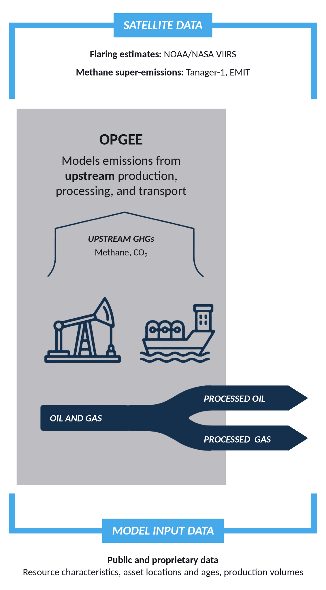

### Fossil Fuel Operations Sector: Oil and Gas Production and Transport Emissions

**Marissa DeLang, Lauren Schmeisser, Carmela Chaney, Adrienne Tecza, Jake Stanger, Sasha Bylsma, Kevin Gauthier and Deborah Gordon**

*All authors affiliated with RMI and Climate TRACE*

V5.12.0, Oct. 2026

#### 1. Introduction

The petroleum resources that are extracted and transformed into usable products for today’s economy are not equal. In reality, their characteristics, production methods, operational stewardship—and thus, their climate impacts—vary widely (Gordon et al., 2022). By treating oil and gas as homogeneous, we miss opportunities to reduce greenhouse gas (GHG) emissions from the sector. Taken together, emissions from production, refining, and transportation of oil and gas represent more than 10 percent of global anthropogenic emissions (IEA, 2023). Therefore, these are critical sectors to mitigate to limit global temperature rise below 1.5 degrees C.

Numerous approaches—bottom-up, top-down, and hybrid methods—exist today to evaluate emissions from petroleum systems. Top-down methods typically record emissions via tower-based measuring stations, drive-by detection, and fly-over techniques, including satellites, aircraft, and drones. Meanwhile, bottom-up methods assess emissions from the ground-up, often estimating emissions based on equipment counts and component-specific emission factors for leaks during the production process. No single method of emissions accounting is entirely decisive. A hybrid ecosystem including systems modeling, remote sensing, and direct measurements is necessary to provide information that better facilitates widespread reductions across the sector.

Recent studies suggest that methane (CH4) from oil and gas systems has traditionally been undercounted in corporate- and country-level reporting systems (Alvarez et al., 2018; Yu et al., 2022). In part, this is due to difficulty quantifying methane resulting from the burning off of unwanted natural gas during oil extraction, a process known as flaring (Plant et al., 2022). More substantially, methane is undercounted because bottom-up methodologies are unable to capture stochastic, large emission events–referred to as “super emitters”– where massive quantities of methane leak into the atmosphere (Rutherford et al., 2021). Super-emitters can comprise less than 5 percent of discrete, individual sources, yet represent more than 50 percent of total emissions (Brandt et al., 2016). In the last few years, the deployment of top-down, remote sensing technologies has captured the effects of super-emitter events at the regional level. Findings suggest these events account for as much as 20 to 60 percent of regional methane emissions (Cusworth et al., 2022). The message is clear: improving detection, measurement, and quantification of super-emitting methane sources is critical for improving emissions estimation and mitigation.

The Climate TRACE emissions estimates for the oil and gas production and transport sectors rely on methodology established by the Oil Climate Index + Gas (OCI+) tool. The OCI+ tool is built on three underlying models that estimate emissions intensity from the oil and gas supply chain: (1) the Oil Production Greenhouse Gas Emissions Estimator (OPGEE) assesses the upstream (production and some transport) portions of the petroleum lifecycle, (2) the Petroleum Refinery Life Cycle Emissions Model (PRELIM) assesses emissions from midstream oil refining, and (3) the Oil Products Emissions Model (OPEM) quantifies downstream end use transport and consumption emissions from oil and gas products. More information on the OCI+ tool can be found at [https://ociplus.rmi.org/](https://ociplus.rmi.org/). The OPGEE model is explained in this methodology, PRELIM is explained in the Climate TRACE refining sector methodology, and OPEM is not used for emissions estimates for the Climate TRACE oil and gas sectors since end use is encompassed by other Climate TRACE sectors. OPGEE was developed by a team from the California Air Resources Board and Stanford University (Brandt et al., 2021). OPGEE has been peer-reviewed and used internationally by policymakers (Masnadi et al., 2018). Through the use of novel analyses of remote sensing data to generate inputs for OPGEE, Climate TRACE provides critical insight into global sources of GHG emissions from the oil and gas sectors.

Given the significant share of emissions attributed to oil and gas production, the industry has a substantial opportunity to reduce its GHG emissions. Several emission reduction solutions (ERS) were explored for the oil and gas sectors; these strategies include shutting down high-emission production sites, increasing flare efficiency, reducing flare volumes, reducing venting, injecting native CO₂, reducing gas loss during transport, and electrifying on-site energy needs for upstream production and transport (see section 2.5). If implemented, these strategies offer practical and effective pathways to lower emissions associated with the production and transportation of oil and gas.

#### 2. Materials and Methods

The oil and gas production and transport sectors estimate carbon dioxide (CO2), CH4, and nitrous oxide (N2O) for years 2015 through present at monthly temporal resolution. Estimates are produced for 711 assets globally, covering 103 countries, representing an estimated 100% of oil and gas production and transport globally.

#### 2.1 Oil Climate Index + Gas (OCI+) Tool

OCI+ is an open-source, hybrid systems tool that quantifies emissions intensity from oil and gas production, processing, refining, shipping, and end uses. The OCI+ tool’s upstream component, OPGEE, covers emissions from all operations that are involved in producing and transporting crude hydrocarbons to the refinery gate, as well as gas molecules to the point of end-use consumption. OPGEE is the foundational model to estimate emissions for this Climate TRACE sector. Figure 1 provides a flowchart of the underlying models of the OCI+ tool and how their inputs and outputs feed into each other.

**Figure 1.** The OCI+ tool quantifies GHG emissions intensities from the upstream, midstream, and downstream components of the petroleum lifecycle. The upstream portion, OPGEE, was used in Climate TRACE’s models for oil and gas production and transport. Here, “upstream” refers to drilling, extraction, and pre-processing of crude oil and natural gas. The “transport” component includes the movement of upstream products towards other sectors, including but not limited to oil moved to refineries, and gas piped to LNG facilities.

Climate TRACE emissions estimates use OPGEE to estimate a portion of bottom-up emissions and incorporate remote sensing data and global datasets to create a more complete picture of global emissions from oil and gas production activity. The following emission sources are considered for the production of oil and gas products:

-   **Flaring.** Combustion of natural gas as a means of depressurizing an extraction or processing site. Flaring predominantly generates carbon dioxide and methane emissions.

-   **Venting.** Leaking of natural gas as a means of depressurizing an extraction, processing, or transmission site. Venting predominantly generates methane emissions.

-   **Fugitive losses.** Natural gas leaks originating from the equipment used in the production, processing, compression, and transmission of crude hydrocarbons.

-   **Super-emitter events.** Large natural gas leaks (emissions rate generally 25 kilograms of methane per hour or greater), intentional or otherwise, that occur in the production, processing, compression, and transmission of crude hydrocarbons.

-   **On-site fuel usage.** Combustion of fuels on-site to power vehicles, drilling rigs, and other equipment.

-   **Biogenic emissions.** Emissions caused by changes to the ecosystem at the extraction site, either as a result of deliberate site preparations (combustion and/or clearing of biomass) or indirect impacts on the local environment.

The hybrid OPGEE and external data approach to estimate oil and gas production and transport emissions is provided in the following sections.

#### 2.2 Asset Definition

Global emissions estimates for oil and gas production and transport are generated at an asset level. An asset is defined as an aggregation of collocated oil and gas activity. The level of granularity of an asset varies based on the underlying data available. In the United States, proprietary production data is available at the well level. Wells are aggregated together into assets based on each well’s geology (i.e. basin, formation), resource type, and state. Outside of the United States, proprietary production data is available at the field level. In order to protect sensitive location and operation information of oil and gas sites, multiple fields are aggregated together to form an asset based on the country, basin, and resource type of each field.

Oil and gas production and transport emissions are modeled at either the field or asset level, whichever is more granular, to get outputs that reflect customized operations that vary between oil and gas fields. OPGEE is a lifecycle engineering model, meaning it includes emissions for each asset based on all extraction sites, wells, storage facilities, gathering stations, boosting stations, crude oil pipelines, gas compression stations, and gas transmission lines associated with the asset. Results from modeling are aggregated to the asset level if needed.

The locations of assets shown in the Climate TRACE dataset usually represent a weighted average of latitude and longitude values from all wells or fields that are grouped into the named asset. Fields are geolocated by their coordinates as provided by four different proprietary data vendors and/or from publicly available sources such as the Global Energy Monitor Global Oil and Gas Extraction Tracker

([https://globalenergymonitor.org/projects/global-oil-gas-extraction-tracker/](https://globalenergymonitor.org/projects/global-oil-gas-extraction-tracker/)).

#### 2.3 Data

A combination of public and proprietary datasets on oil and gas activity and operations is used to inform emissions estimates. These datasets include both ground truth data and remote sensing data, discussed more in the sections below.

#### 2.3.1 Ground Truth Data

Many publicly reported, technical, and academic sources served as ground truth and activity data for OPGEE inputs. These include industry-specific journals, scientific studies, government agency websites, and reputable news sources. Additional upstream activity data come from four different proprietary data providers (however, only derivative products are published). Other than privately procured data and some journal data, which require subscriptions, all sources are openly available. Table 1 summarizes key input data sources for OPGEE.

**Table 1.** Data used as inputs to OPGEE

| **OPGEE Model Inputs for Oil and Gas Production and Transport** |                                                                                                                        |                                                                                                     |
|-----------------------------------------------------------------|------------------------------------------------------------------------------------------------------------------------|-----------------------------------------------------------------------------------------------------|
| **Input**                                                       | **Source**                                                                                                             | **Critical Regions & Field Types**                                                                  |
| Field age                                                       | Derived from proprietary data providers                                                                                | All global fields                                                                                   |
| Field depth                                                     | Technical industry references & publicly reported sources (e.g., Science Direct)                                       | Brazil, China, Offshore assets                                                                      |
| Gas-to-oil ratio                                                | Derived from proprietary data providers                                                                                | All global fields                                                                                   |
| Production volumes                                              | Derived from proprietary data providers                                                                                | All global fields                                                                                   |
| Gas composition                                                 | Technical industry references & publicly reported sources                                                              | Coal bed methane assets, sour and acid gas assets (high sulfur, methane, or CO2 content) |
| API gravity                                                     | Derived from proprietary data providers & publicly reported sources (e.g., One Petro)                                  | Global oil fields                                                                                   |
| Injection characteristics                                       | Technical industry references (e.g., Oil and Gas Journal) & publicly reported sources                                  | Canadian oil sands, extra heavy oils, high water content fields                                     |
| Production methods                                              | Derived from proprietary data providers & publicly reported sources (e.g., Offshore Technology)                        | Fracked fields, enhanced oil recovery fields                                                        |
| Transport means and distances                                   | Public databases (IEA Sankey, BP Statistical Review of World Energy, Global Energy Monitor Gas Infrastructure Tracker) | All global fields                                                                                   |

#### 2.3.2 Remote Sensing Data

Satellite-based remote sensing data can be used to monitor oil and gas production activity and to measure methane emissions. Climate TRACE emissions estimates incorporate remote sensing data to identify flares and large methane emissions events at oil and gas assets.

#### 2.3.2.1 Satellite Flaring Detection

To estimate flaring volumes, we used the Visible Infrared Imaging Radiometer Suite (VIIRS) derived Gas Flaring product (Elvidge et al., 2013). VIIRS detects global gas flaring at 750 m resolution every 24 hours. The National Oceanic and Atmospheric Administration’s (NOAA) VIIRS instrument, flying on the Suomi National Polar Partnership (SNPP) satellite, is uniquely designed to detect a heat signature produced when unwanted facility gas is burned off. The product is derived from detection at shortwave- and infrared bands (M10 and M11 bands) of 1.6 and 2.2 µm. At night, these bands are indicators of combustion sources and are thus ideally suited for finding flares. Flares were distinguished from wildfires by temperature (flares are designated at T &gt; 1,400K) and persistence (wildfires are typically not persistent beyond a few days, while flares are). Figure 2 highlights VIIRS flaring locations for 2025 from the World Bank Global Flaring data portal ([https://www.worldbank.org/en/programs/gasflaringreduction/global-flaring-data](https://www.worldbank.org/en/programs/gasflaringreduction/global-flaring-data)). Data can also be accessed through the Earth Observation Group, Payne Institute for Public Policy, Colorado School of Mines (<https://eogdata.mines.edu/products/vnf/>).

**Figure 2.** 2025 VIIRS flaring locations represented by yellow dots, from the World Bank Global Flaring and Methane Reduction Partnership hosted on: [https://www.worldbank.org/en/programs/gasflaringreduction/global-flaring-data](https://www.worldbank.org/en/programs/gasflaringreduction/global-flaring-data).

While flaring can occur all along the oil and gas supply chain, the VIIRS gas flaring product has observed that 90% of the flaring occurs in upstream production areas, while only 8% occurs at refineries, and 2% at LNG transport facilities (Elvidge et al., 2015). This flaring process produces both carbon dioxide and methane (uncombusted gas ‘slip’), and thus is essential in getting accurate GHG emissions estimates from the oil and gas sector. Using VIIRS nightfire flaring data, we quantified these emissions and produced a derived modeling metric, the flaring-oil-ratio (FOR, units of standard-cubic-feet per barrel-of-oil-equivalent or scf/bbl), which relates flaring to oil production at a field. FOR was computed by dividing the VIIRS variable flr\_volume (volume of flared gas in billions of cubic meters, converted to standard cubic feet) by a field’s oil production. A high FOR indicates a large amount of flaring per barrel of oil produced at a given field, and vice versa for a low FOR. It is worth noting that associated gas venting, which can come from malfunctioning flares, was modeled as a separate emissions source in OPGEE.

An important part of deriving the FOR variable was assigning the satellite-observed flares to the correct oil or gas asset. To do this, we performed geolocation matching using all available oil and gas field polygon shapefiles. A buffer was added around the polygons to account for uncertainties in the flare or field boundary locations. Any flares that fell within the available polygon buffered boundaries were assigned to that oil or gas asset. If a flare fell within two overlapping polygons, the flare was assigned to a field based both on distance to centroid and oil production as equal weights. For assets without polygon files (most assets modeled in the U.S.), a flare that fell within a radius of 10 miles (\~16 km) of the asset was assigned to that asset (a self-defined threshold choice). The exception was in the significantly larger Permian TX asset, for which the distance threshold used was 50 miles (\~80 km). Where oil and gas asset polygons are not available, flares were matched to the closest asset centroid.

#### 2.3.2.2 Remote Sensing-Derived Methane Detections

Methane-sensing satellites have advanced capabilities to detect, pinpoint, and quantify large releases of methane and super-emitter events at oil and gas sites. Climate TRACE emissions estimates incorporate satellite methane detections from Carbon Mapper’s open-access web portal, including data from the Tanager-1 and EMIT satellites. Tanager-1 is the first satellite of the Carbon Mapper Coalition, which includes Planet Labs and NASA’s Jet Propulsion Laboratory. It launched in August 2024. It uses a JPL imaging spectrometer to detect methane and CO₂ super-emitters down to individual facilities. Tanager-2, a replica of Tanager-1, was launched on October 1, 2026, and is expected to roughly double how often observations are made. NASA’s EMIT, an imaging spectrometer on the International Space Station, was launched in July 2022 to map minerals in arid regions, but it also turned out to detect methane.

Attributing satellite-detected methane plumes to assets follows a similar approach to that of incorporating flared gas volumes. Plume data from the Carbon Mapper web portal are overlaid with oil and gas field location data and matched based on proximity logic. Plumes are also compared to other neighboring plumes to discern if a location can be generalized as a single source.

#### 2.3.3 Comparison Data

Once emissions estimates are available, outputs are compared to independent or semi-independent sources of oil and gas emissions where available. Asset-level emissions intensities were compared with field-level estimates for global oil fields from Masnadi et al. (2018). Country-level methane estimates were compared with the IEA Global Methane Tracker (2025; accessed October 2026), which showed the closest agreement, and with national inventory submissions to the UNFCCC (2021 submissions; accessed October 2026), which we use to compare Annex 1 countries. We also considered the Global Registry on Fossil Fuels (GRFF; accessed October 2026), the Global Fuel Emissions Inventory (GFEI; accessed October 2026), and the Emissions Database for Global Atmospheric Research (EDGAR; accessed October 2026) as sources of absolute CO₂e and methane emissions. We do not report numeric comparisons against every inventory, because several report different subsets of global oil and gas emissions than are used in Climate TRACE. Available comparison results, both qualitative and quantitative, are presented in Section 3.2.

#### 2.4 Emissions Modeling

The following sections contain details on the OPGEE model and the integration of external data sources for venting and super-emitter events.

#### 2.4.1 OPGEE Model

The OPGEE model is divided into modules and broken up by major production stages. Over 100 emission sources were classified across all process stages. For a full and detailed accounting of all the OPGEE modules, stages, and processes, see Brandt et al. (2021). For the current discussion, this section provides a broad overview of the emissions sources covered by OPGEE, the gases included in the current analysis, and the parameters required as model inputs to estimate emissions.

For our integration of OPGEE, on-site fuel usage, biogenic emissions, and embodied emissions were calculated within OPGEE. Fugitive emissions were calculated using the OPGEE methodology and externalized using Python due to processing time constraints.

It should be noted that, in addition to CO2, CH4, and N2O, OPGEE also assesses volatile organic compounds (VOCs) and carbon monoxide. However, absolute volumes of these trace gases are not significant drivers of emissions from this sector.

#### 2.4.1.1 Key Inputs

The OPGEE model requires some key inputs to establish the parameters of the model. Prior research has demonstrated emissions results to be sensitive to these inputs. Key inputs included:

-   **Oil, gas, and water production volumes**. Larger hydrocarbon production volumes indicate more emissions-generating activities. A high water-to-oil or gas-to-oil ratio can predict higher energy expenditure for the processes of separating fluids and extracting products.

-   **Gas composition.** The ratio of different gas species in the reservoir. For instance, dry gas fields tend to have high (&gt;90%) methane content compared to wet gas fields, which have higher C2-C5 components. Acid gas fields have high carbon dioxide or hydrogen sulfide (H2S) content, and require additional energy for processing and can have increased venting.

-   **Injection characteristics.** Gas, steam, and/or water may be injected into extraction sites to increase the flow of oil to wells, or manage the pressure at a site. The substance, volume, and methods of injection can all impact the emissions generated during production.

-   **Well characteristics.** The number, type, depth, diameter, and production volume of wells impact the energy expenditure for a unit of production from a field.

-   **Reservoir characteristics.** The pressure and temperature at the depth of the drilling operation.

-   **Crude API gravity.** The inverse of the density of a petroleum liquid relative to water. Oils with higher API gravities are lighter and lower API gravities are heavier.

-   **Production methods.** The extraction methods and emissions management techniques implemented at sites within a field. For instance, fracking is often associated with higher emissions.

-   **Field age**. The number of years since the first year of production for the field. Age can be an indicator of depletion and predict greater energy expenditure per unit of production.

-   **Field depth.** The depth of drilling operations. Deeper fields may be more energy intensive.

-   **Means and distance of transport.** The pipelines, transmission lines, vehicles, and management practices associated with transporting product from a field. For instance, gas may be distributed regionally from the point of production via pipeline, or liquefied and transported over ocean via tanker. See note in the “Liquefied natural gas (LNG), oil and gas transport distances” special settings section below about the need for careful analysis when it comes to attributing transport emissions.

While the list above serves as a general summary, OPGEE can ingest more than 150 data inputs to estimate emissions. When complete data inputs are unavailable, the default estimates OPGEE uses for missing parameters were based on a body of historical datasets tracking thousands of global oil and gas fields. See Brandt et al. (2021) for detailed information. For instance, if the water-to-oil ratio for a field is unknown, OPGEE can estimate this parameter based on field age.

#### 2.4.1.2 Archetype Approach

For modeling global emissions, two challenges are present for the oil and gas sector. First, a complete dataset containing many or even most inputs is not available. Second, many of the inputs have a small impact on the end total emissions, so pinning each one down precisely delivers a small benefit and can create unexplained changes if underlying datasets change. Due to these reasons, an archetype approach is used for Climate TRACE emissions modeling. Rather than characterize every field individually, fields are grouped into a set of predefined operating buckets or “archetypes” that represent the production practices for oil and gas assets. Every archetype carries a representative emission factor, so once a field is matched to one, that factor can stand in as a reasonable estimate of its emissions intensity without the need for a complete field-level dataset.

Fields are matched to archetypes known to be the main drivers of emissions intensity: the gas-to-oil ratio (GOR), the water-to-oil ratio (WOR), whether steam flooding is used, and the acid gas composition of the produced stream. Because these few parameters account for much of the variation in production emissions, matching on them alone is usually enough to place a field with a well-suited archetype.

Some fields do have distinct production practices. These fields have a wealth of information available and have something distinct about them that would alter emissions for those fields. For these, a bespoke archetype is created and matched to the field allowing for greater accuracy and differentiation when warranted.

#### 2.4.1.3 General Settings

Within OPGEE, there are a variety of settings that users can select to customize implementation of the model. This section describes several key settings that were selected for this analysis.

**Product-specific boundaries.** OPGEE users can set boundaries for which stages of the upstream hydrocarbon production process should be included in the model’s emissions estimates for a given asset. For the oil and gas production sector, emissions are reported for all activities occurring within a field boundary. For the oil and gas transport sector, emissions are reported for all emissions occurring after the oil and/or gas product leaves a field. For oil, transport includes emissions after the oil leaves the field and before it arrives at the refinery gates. For gas, transport emissions include after the gas leaves the field and before it is distributed to users including emissions associated with LNG liquefaction and transport.

**Methane venting, fugitives and flaring.** The methane venting and fugitives (VF) portion of the model requires a “component” or “site” level analysis to be selected. Site-level methods for estimating VF emissions leveraged empirical data from site-level emissions measurement campaigns, typically performed at or beyond the facility fence-line. Component-level methods for estimating fugitive emissions start with a list of components present at a site and estimate leakage by component. The model authors recommended the component-level method to be used in Climate TRACE analysis. All fields and sub-fields are modeled at the component level.

Flare slip, also called “methane slip”, is another source of methane due to flaring. Flare slip occurs when a flare fails to fully combust input methane and thus is not converted to carbon dioxide (remains as methane). For most assets, methane combustion efficiency for flares was set to 90%. A handful of assets and regions with enforced efficiency regulation were set to 98%, such as those in Norway.

**Model outputs and barrel of oil equivalency (BOE).** Oil and gas field inputs are specified based on the datasets in section 2.3. The model is run to calculate GHG emissions outputs for each archetype. Under California regulations, OPGEE reports GHG-emissions outputs in units of grams of carbon dioxide equivalent per megajoule (gCO2e/MJ) of petroleum products generated. Carbon dioxide equivalent was calculated using both 100-year and 20-year global warming potential (GWP) for all gases. These outputs were converted into emissions per barrel of oil equivalent (kgCO2e/boe) by multiplying them by the weighted lower heating value of all processed oil and gas products (lower heating value is an energy density metric measured in megajoules per barrel of oil equivalent), which is output in OPGEE’s Energy Summary tab.

#### 2.4.1.4 Settings for Special Cases

OPGEE offers numerous settings to best reflect real-world production and transport operations specific to individual fields.

**Liquefied natural gas (LNG), oil and gas transport distances.** Gas fields where a significant portion of the gas product feeds into an LNG plant, as determined through proprietary data providers, are run with the LNG setting “on”. All other fields transmit and distribute gas via pipelines only and do not generate liquefaction, LNG transport, or regasification emissions. OPGEE utilizes default settings to determine the distance and intensity of gas transport for LNG, providing an estimate for LNG specific emissions.

Careful attribution is needed when considering oil and gas transport emissions. This is especially true for gas transport emissions, which can be a significant portion of emissions from a gas supply chain. While oil and gas are transported around the world, it is very difficult to track the actual path and destination for any given set of produced molecules. The OPGEE model accounts for emissions that occur as a result of moving crude oil and natural gas via general modes, such as pipelines and ocean and LNG tankers. In the Climate TRACE transport sector dataset, these emissions are linked back to the field of origin, even though the actual emissions may have occurred outside of those bounds. For example, Algeria exports gas to Europe and it may travel hundreds of miles to get there, such as via the Trans-Mediterranean Pipeline, shown in Figure 3. The pipeline spans 3,579 km and links Algeria to Italy ([https://www.gem.wiki/Trans-Mediterranean\_Gas\_Pipeline](https://www.gem.wiki/Trans-Mediterranean_Gas_Pipeline)). Various pipeline sections are owned and operated by Sonatrach (Algeria), Sotugat (Tunisia), and ENI (Italy). When modeling a gas field in Algeria, pipeline transport emissions are estimated and linked back to the Algerian gas field from which they originated even though they may be occurring over Tunisian or Italian-owned areas.

Our emissions for transport reflect the emissions that the atmosphere ‘sees’ given the oil and gas produced from that asset and/or in that country.

**Figure 3.** The Trans-Mediterranean Pipeline that links Algeria to Italy.

**Coal bed methane.** In some fields, natural gas is extracted from underground coal beds. These fields are assigned specific gas composition percentages H2S (2%), methane (93%), carbon dioxide (5%), field depth (800 ft), reservoir pressure (329 psi) and temperatures (84oF). Water reinjection practice was turned on, and water-to-oil-ratio (WOR) was calculated by dividing the gas-to-oil-ratio (GOR) by 2000.

**Additional special cases.** Snøhvit, Shah, In Salah, Sleipner West, and Greater Gorgon fields, which have high carbon dioxide content, are run with carbon capture and sequestration parameters “on”, instead of the default which assumes that purged carbon dioxide is vented into the atmosphere. Assets located in California are assigned land carbon richness and development intensity inputs to align with those from California Air Resources Board analysis (CARB 2021).

**Electricity Usage.** Oil and gas fields around the world use energy to power equipment in varying ways. This includes electricity drawn from the grid, onsite electricity generation (from generators or renewable energy sources), or direct power generation. Oil and gas asset emissions estimates exclude electricity pulled from the grid to avoid double counting in Climate TRACE, but account for onsite fuel usage for generators or direct power.

#### 2.4.2 External Emissions Integration

In addition to the emissions estimates produced by OPGEE, we integrate venting and super-emitter emissions from external data sources.

#### 2.4.2.1 Venting Integration

Baseline venting for each asset was calculated using the country-level venting emissions from the International Energy Agency (IEA)’s [Methane Tracker](https://www.iea.org/data-and-statistics/data-tools/methane-tracker). Total country level emissions were first segmented by available categories (onshore vs offshore and oil vs gas). Within each category, emissions were apportioned to each constituent asset proportional to its annual production. In countries where no annual venting emissions were directly available, the Global Methane Tracker provides emissions for groups of countries. The same methodology was applied, but across all assets among every country in each group.

#### 2.4.2.2 Super-emitter Integration

Satellite-detected methane plumes from Tanager-1 and -2, as well as the EMIT instrument, are quantified as methane emissions rates. We convert these plume methane emissions rates into estimates of total methane released over longer time frames. This conversion accounts for the frequency or persistence of an emissions source by assessing the number of satellite overpass observations compared to the number of positive methane detections and allows this type of data to be integrated into emissions modeling and inventorying at annual scales. Satellite plumes matched to the same asset are aggregated together to estimate the total methane released by the asset.

#### 2.5 Emissions Reductions Strategies

Emission Reduction Strategies (ERS) are built on a combination of theoretical modeling and real-world data. Some strategies are applied using generalized assumptions, while others are tailored to the unique characteristics of individual assets. The OPGEE model plays a central role, incorporating both empirical studies and customizable inputs to reflect various operating conditions. OPGEE outputs are disaggregated into specific processes, allowing emissions from certain activities to be subtracted to reflect the impact of reduction strategies. When direct subtraction is not feasible, the model's flexibility—offering a wide range of input variables—enables us to adjust operating conditions and simulate the effects of different ERS. The ERS evaluated for oil and gas production and transport sectors include the following:

-   **Shutdown of high-emissions assets.** The shutdown strategy is based on the principle that certain oil and gas assets are so emissions-intensive that they should be retired entirely. By shutting down these "dirty" assets, their direct emissions are completely eliminated. However, the model accounts for the fact that production and transport may shift to other assets, potentially offsetting some of the reductions. To reflect this, we use the global average emissions intensity for production and transport. For example, if an asset producing *Y* barrels of oil equivalent per year is shut down, and the global average intensity is *X* tonnes CO₂e/boe, the resulting emissions shift is calculated as *X × Y* tonnes CO₂e.

-   **Increase flare efficiency.** This strategy focuses on improving the combustion efficiency of flaring operations. Based on existing literature, we assume a baseline flare efficiency of 90% for most fields and increase it to 99%. This 8 percentage point improvement significantly reduces methane emissions by ensuring that more methane is fully combusted into CO₂—a less potent GHG. In the model, this adjustment translates into a direct reduction in the methane portion of flared volumes. In fields with a higher baseline efficiency, there exists a lower emissions reduction potential, which is accounted for in ERS modeling.

-   **Reduce flaring.** This strategy aims to reduce the total volume of gas being flared. This decreases the produced methane and carbon dioxide in fields that flare in excess of levels required for safety. To implement the strategy, flare volumes were reduced to the minimum required for safe operations like routine pressure releases or maintenance. This results in a large reduction in both relevant gases.

-   **Reduce venting.** Stopping venting involves removing intentional methane releases into the atmosphere. Venting values are based on country-level averages provided by the IEA. Under this strategy, we eliminate the portion of methane attributed to venting, while still accounting for emissions from fugitives and flaring. This results in a net reduction in methane emissions for assets where venting is currently practiced.

-   **CO2 injection**. Some oil and gas fields have the capacity to reinject carbon dioxide that is separated from the produced gas stream. This practice, already in use in several projects globally, reduces emissions by preventing the release of CO₂ into the atmosphere. Within OPGEE, this option can be toggled on, enabling the model to reflect the lower emissions profile of operations that incorporate CO₂ reinjection.

-   **Upstream electrification.** In many oil and gas fields, operations such as drilling, pumping, or processing are directly powered by the very hydrocarbons being extracted. Electrifying these processes removes their associated on-site combustion emissions. OPGEE allows for these processes to be modeled as electrified, shifting the energy demand to the electrical grid. While this removes local emissions, it assumes additional emissions are incurred elsewhere in the energy system, depending on the grid's carbon intensity.

-   **Reduce transport gas loss.** This strategy targets methane leaks and emissions from compressors and pumps in gas transport. Based on literature and internal data, we assume a 50% reduction in methane emissions from this sector. This percentage is applied across all selected assets, leading to a consistent and measurable reduction in emissions related to compression equipment.

-   **Transport electrification.** Transport-related emissions primarily arise from the combustion of fuels used to power compressors and other equipment along pipelines. Full electrification of transport operations—such as switching to electric-driven compressors—eliminates these direct CO₂ emissions. However, similar to upstream electrification, this shift induces emissions from electricity generation, which are modeled accordingly.

When applying emissions reductions within the OPGEE framework, assumptions are grounded in values from published literature. The flare efficiency improvement strategy, for example, is based on average flare efficiency values reported by Plant et al. (2022) and the upper bound of feasible efficiency demonstrated by Cain, Seebold, and Young (2002). Venting estimates are sourced from the IEA. The IEA's *Methane Tracker* (2025) informs upstream venting assumptions, while its methane abatement model provides insight into the potential for reducing venting in transport operations.

Each ERS considered has been implemented in the field to some degree, although public documentation varies. In future versions, the results section will provide more detail on case studies where assets have adopted specific ERS strategies. Major oil and gas companies—such as Shell, BP, Chevron, and Petrobras—have all engaged with these strategies across different global regions, though it can be difficult to find documentation. Where operator disclosures are limited, service and technology providers like Cook Compression and Solar Turbines illustrate the availability of commercial solutions that support ERS implementation.

#### 2.6 Final Emissions Estimates

The final dataset provides asset-level estimates of oil and gas production and transport emissions, where an asset is an aggregation of collocated oil and gas activity (wells in the United States, fields elsewhere) grouped by geology or basin, resource type, and location. For each asset, we report emissions of carbon dioxide (CO₂), methane (CH₄), and nitrous oxide (N₂O), along with total carbon dioxide equivalent (CO₂e) calculated using both 100-year and 20-year global warming potentials. Estimates are produced at monthly temporal resolution for 2015 through present and can also be aggregated to annual totals. In total, emissions are estimated for 711 assets spanning 103 countries, where country-level files are summed field level estimates, representing \~100% of global oil and gas production and transport.

#### 2.7 Confidence and Uncertainty

Due to the relatively new archetypal modeling approach and undeveloped confidence calculations, all emissions numbers for both subsectors are labeled as low confidence. While the methodology does incorporate measurements of methane from satellites, which themselves carry a higher confidence, the baseline data that underpins our modeling of ‘routine’ emissions does not justify confidence levels about ‘low’. This does not reflect a lack of coverage or conclusiveness in results but rather insufficient quantification of confidence.

Similarly, while OPGEE has uncertainty calculation capabilities, the various data sources combined to make this data product each present unique confounding factors towards certainty. Importantly, the new archetypal approach obscures individual uncertainties for each asset, further complicated by necessary aggregation for Climate TRACE. We currently apply a baseline uncertainty of 10% to all emissions values based on Monte Carlo runs of multiple fields and parameters through the OPGEE model, yielding a conservative estimate of 10% uncertainty for all fields.

In future updates, more sophisticated methods for deriving confidence and uncertainty will be utilized and visible in updated results. These methods will include and consolidate the respective uncertainty and confidence of each intensity calculation across all processes within the production and transport subsectors of oil and gas.

#### 3. Results

#### 3.1 Modeled Oil and Gas Emissions Results

One of the most important findings from the oil and gas production and transport sectors is that there is a very large range of emissions intensities (emissions per barrel of oil equivalent). Emissions can vary by 10x to extract the same oil or gas, depending on reservoir characteristics, operational practices, equipment maintenance, and more. Figure 4 shows a box and whisker plot of carbon dioxide equivalent emissions intensity from all global oil and gas assets. Using one emissions intensity for all oil and gas assets globally would omit the important reality that these assets’ emissions vary widely. Prioritizing the use of oil and gas resources with the lowest emissions intensity during the energy transition would mean less emissions to the atmosphere in the long run.

**Figure 4.** Box and whisker plot showing 5th, 25th, 50th, 75th, and 95th percentile of 2025 carbon dioxide equivalent emissions intensities from all modeled oil and gas assets globally using a 20-year GWP.

Figure 5 shows the top 10 countries with the highest emissions from the oil and gas production and transport sectors. The United States topped Russia in 2023 to be the largest emitting country in the oil and gas sectors and held this position for both 2024 and 2025, though both Russia and the United States have had total emission in excess of 1 billion tonnes of CO2e (20-year GWP) from their oil and gas sectors throughout the entire published time series. The next highest emitting countries for 2025 were as follows: Russia, Iran, Algeria, China, Saudi Arabia, Canada, Venezuela, Turkmenistan, and Iraq.

**Figure 5.** Top 10 highest emitting countries for oil and gas production and transport sectors for years 2015-2025. The y-axis unit of measure is tonnes of carbon dioxide equivalent for 20-year GWP.

Figure 6 shows the top 10 flaring countries by volume. Seven of the top-emitting countries shown in Figure 5 also appear in the top-flaring countries list: Russia, Iran, Iraq, Venezuela, Algeria, United States, and Saudi Arabia. Flaring generates both carbon dioxide and methane emissions. In our analysis, flaring efficiency is estimated at 90%, meaning 9% of flared gas escapes directly to the atmosphere. This uncombusted gas is primarily composed of methane. Countries that appear in the top-flaring list but not the top-emitting list include Mexico, Libya, and Nigeria.

**Figure 6.** Top 10 countries by flaring volume (billion cubic meters) for years 2015 to 2025 from the World Bank Global Gas Flaring Data. Data from 2026 is not available yet. ([https://www.worldbank.org/en/programs/gasflaringreduction/global-flaring-data](https://www.worldbank.org/en/programs/gasflaringreduction/global-flaring-data))

Flaring accounts for approximately 11.6% of total methane emissions from oil and gas production and transport, as shown in Figure 7. Increasing flaring efficiency or capturing and selling the gas that would otherwise be flared is a low hanging fruit in reducing emissions in this sector. Often, addressing flaring as an emissions reduction strategy is low cost or even profitable for operators.

**Figure 7.** Contribution of venting, flaring, fugitive, satellite-detected emissions, and combustion to total methane emissions from oil and gas production and transport for 2025 data.

#### 3.2 Comparison with Other Emissions Inventories

Our asset-level emissions intensities are compared against comparable estimates for global oil and gas fields published in Masnadi et al. (2018) and country-level IEA numbers from its Global Methane Tracker. Additional comparable sources for absolute carbon dioxide equivalent and methane emissions include: Global Registry on Fossil Fuels (GRFF), Global Fuel Emissions Inventory (GFEI), Emissions Database for Global Atmospheric Research (EDGAR), United Nations Framework Convention on Climate Change (UNFCCC) National Submissions, and IEA Methane Tracker. We do not always include a numeric comparison to all existing inventories because several are based on similar underlying datasets and therefore do not offer new country-level estimates, or because the processes included in the datasets differ slightly and are hard to compare.

Figure 8 compares Climate TRACE results for top methane-emitting countries with IEA Methane Tracker 2025 estimates and Figure 9 compares Climate TRACE emissions results for UNFCCC annex-1 country inventories. Overall, Climate TRACE results for country-level emissions align most closely with IEA Methane Tracker results compared to any other inventory. In 2025, IEA estimated global methane from oil and gas production and transport to be approximately 80 million tonnes. Climate TRACE estimated this total to be approximately 78 million tonnes. However, Climate TRACE Annex 1 results are more than double that of UNFCCC Annex 1 estimates in Figure 9 for 2021.

**Figure 8.** Top 10 global methane emitters in 2025, comparison with IEA Global Methane Tracker. We used 2025 as it was the most recent year with complete data from both sources.

**Figure 9.** Comparison of oil and gas carbon dioxide (left) and methane (right) estimates for UNFCCC Annex 1 countries.

The significant difference between Climate TRACE and UNFCCC estimates can be partly attributed to UNFCCC emissions reporting style. The UNFCCC inventory is based on national inventory submissions from two groups of countries—Annex 1 and non-Annex 1 countries (United Nations, 2021). Annex 1 comprises forty-three countries, mostly advanced economies. To measure production and refining emissions, Non-Annex 1 countries rely primarily on “Tier 1” methodology, which use default emission factors and relatively simple equations provided by the Intergovernmental Panel on Climate Change (IPCC). Annex 1 countries may develop country-specific emission factors for carbon dioxide and methane based on fuel properties (*i.e.,* carbon content, heating value) and use activity data such as fuel consumption statistics. This is consistent with the IPCC “Tier 2” approach. Countries with higher levels of visibility into their refining and production processes may use more detailed data, such as from national inventory and reporting programs. Starting at the facility or even process-unit level, some countries create high resolution, technology-specific emissions factors, described as a “Tier 3” approach. Because Non-Annex 1 countries are not required to report regularly or in a standard format, total country comparisons between Climate TRACE and UNFCCC global datasets are difficult.

Unlike the UNFCCC and EDGAR, which generally apportion total fuel use to each sector and multiply by emission factors, OPGEE uses engineering process-level detail for particular fuel pathways and publicly available information wherever possible. While EPA emission factors are used for some emissions sources, generally speaking, OPGEE estimates are far more complex. For example, the energy consumed in lifting produced fluids—oil, water, and associated gas—to the surface is computed using the fundamental physics of fluid lifting, accounting for friction and pump efficiencies. The UNFCCC and EDGAR do not account for emissions using this approach. Moreover, the emissions are dynamic over time, as fields age and production characteristics change. Most estimates in OPGEE are based on statistical emissions distributions derived from published academic surveys, thousands of measured data points, and other public data sources. A specific and extensive effort was undertaken to build out the methane fugitives model (Rutherford et al., 2021). Numerous studies point to the fact that the U.S. inventory process undercounts its methane emissions from oil and gas supply chain segments, including methane leaks at storage tanks and gathering lines (Yu et al., 2022). Because methane is weighted according to its higher GHG potential, when methane is underestimated, so will carbon dioxide equivalent emissions.

Methodology comparisons are further complicated by the different ways in which countries report their emissions to the UNFCCC. In the transport sector, emissions from oil and gas transport - whether by pipeline or tanker - are not disaggregated and are difficult to add back into the production emissions estimate. OPGEE, on the other hand, includes oil transport to the refinery and gas transport to distribution in its asset-level emissions estimates.

Methodology comparisons also depend on the GWP used to quantify the combined impact of carbon dioxide and other GHGs, most importantly in this sector, methane emissions. When selecting a GWP to equate emissions of short-lived climate pollutants like methane into equivalent mass of carbon dioxide, the choice of timescale matters significantly (i.e., 100 vs. 20 year). Today’s inventories use a 100-year timeframe; this GWP is inappropriate for methane, given its atmospheric lifetime of just twelve years. The Climate TRACE inventory offers the opportunity to express total emissions in both 100- and 20-year equivalency. Using a carbon dioxide-equivalent 20-year metric places a stronger near-term emphasis on reduction of short-lived climate pollutants and can signal to policymakers, industry, and other stakeholders the climate benefit of prioritizing methane emissions mitigation.

#### 4. Discussion

Using an asset-level, engineering-based approach that combines the OPGEE model with satellite flaring detection and methane plumes, we estimate that oil and gas production and transport emitted roughly 8.3 billion tonnes of CO2e (20-year GWP) in 2025 across 711 assets in 103 countries. These emissions are not evenly distributed or inevitable. Emissions intensity varies by as much as tenfold for the same unit of energy, the United States and Russia each exceed 1 billion tonnes annually, and flaring alone accounts for about 11.6% of sector methane. Our global methane estimates (\~78 Mt) align closely with the IEA’s estimates (\~80 Mt) from their Methane Tracker, but run more than double the UNFCCC inventories for Annex 1 countries, which suggests that self-reported figures substantially undercount the problem. The key takeaway is that this sector’s emissions are both larger than reported and highly reducible: every asset we analyzed has at least one viable reduction strategy, and prioritizing the lowest-intensity resources would cut emissions without waiting for oil and gas demand to fall.

#### 4.1 Implications of Emissions Reductions Strategies

The confidence, feasibility, and consequences of implementing ERS vary significantly depending on the specific asset and its operational context. The oil and gas sector is inherently complex and, in many cases, opaque. Factors influencing an asset’s emissions and operational decisions may be beyond external visibility or control, including internal governmental policies, corporate strategies, or even interpersonal dynamics within regulatory bodies and firms. These unknowns present challenges when evaluating or applying ERS universally.

Because emissions from most other sectors are linked to their consumption of oil and gas, the implementation of each ERS strategy within the oil and gas sector can have ripple effects across the broader economy. For example, shutting down a high-emitting oil field might reduce sector-specific emissions but induce production elsewhere to meet growing global energy demand. This shifting of emissions—often referred to as “leakage”—complicates the net benefit of some strategies. As a result, our necessary aggregation of data occasionally leads to the application of strategies in places where they may not be optimal, highlighting the importance of contextualized analysis.

**Shutting down high-emitting assets** is arguably the most impactful—but also the most challenging—strategy to implement. Rarely is it in the short-term economic interest of operators to cease production entirely. Yet, for extremely polluting fields, this could represent the most meaningful reduction pathway. Induced production elsewhere is inevitable, but with smart policy design, this new production can be encouraged in regions with lower emissions intensity and better environmental safeguards. Moreover, reducing production at the most polluting assets can yield local co-benefits—such as improved air quality—though these benefits may be offset if replacement production occurs in areas with more fragile ecosystems or less stringent regulations. Shutdowns must also be executed responsibly; improperly decommissioned sites can continue leaking for decades, and physical safety risks may persist long after production stops. As other sectors move away from fossil fuels, shutting down high-emitting fields may become more economically viable, especially if carbon pricing or stricter emissions policies are in place.

**Flare efficiency improvements** are generally feasible but require capital investment and ongoing operational oversight. Flaring is often more than just methane combustion—it also involves burning a range of VOCs and other gases, creating trade-offs in air pollutants. Increasing flare efficiency from a baseline of 90% to 99% can significantly reduce methane emissions, albeit with a rise in carbon dioxide output due to more complete combustion. While this may sound like a trade-off, the climate benefit is substantial because methane is a far more potent GHG than CO₂ in the short term. Additionally, better flare monitoring can prevent blowouts, which pose severe safety and environmental risks. Despite these benefits, policies or corporate mandates are often needed to compel flare upgrades, as the upfront costs are rarely recouped directly.

**Flare volume reductions** can provide local co-benefits and prove economically beneficial to operators, providing the opportunity to sell this gas that is otherwise wasted. Challenges arise in the case of oil fields that only flare or vent their associated gas. In the case of these fields, reduction of flare volumes requires major infrastructure for gas takeaway either in the form of a gas pipeline to sell said gas, or onsite infrastructure to use the gas as a fuel or reinjection fluid. In many places, there is large public and environmental opposition to the construction of new pipelines, but where possible it can provide a new long-term revenue stream for producers, especially as gas demand continues to grow. The reduction in flares reduces methane and carbon dioxide because this diverted gas can offset the demand for gas elsewhere in the economy.

**Reducing venting** offers strong potential for both climate and local environmental gains. While high in short-term costs—especially where supporting infrastructure doesn’t yet exist—eliminating venting can unlock long-term economic value. In fields with high associated gas, producers can potentially monetize gas that would otherwise be wasted. For example, Iraq is a case in point: much of its electricity is generated using imported gas, even as significant volumes of associated gas from domestic oil fields are vented or flared. Capturing and using this gas could improve national energy security and reduce emissions. However, infrastructure build-out may face community or political pushback, as pipelines and gas processing facilities are visible symbols of continued fossil fuel development. Nevertheless, the co-benefits of venting reduction—especially in reducing hazardous air pollutants like VOCs—can provide strong justification for investment, particularly in areas with sensitive populations.

**CO₂ injection** can serve dual purposes: increasing oil recovery (in the case of CO₂-enhanced oil recovery) and sequestering carbon underground. From a climate perspective, it represents one of the few scalable strategies for permanent emissions reductions within active production operations. Its feasibility depends heavily on local geology, availability of CO₂, and access to capital. While the exact costs and trade-offs vary, the technique is already deployed in places like the Sleipner and Gorgon projects, providing real-world proof of concept. In cases where reinjection involves CO₂ already present in the production stream, this strategy also reduces the net emissions associated with gas processing.

**Electrification**, both upstream and in transport, is a promising pathway to decarbonization—though its impact depends heavily on the source of electricity. When operations are connected to a clean grid (as in Norway), emissions are significantly reduced. In other contexts, particularly where grids rely on coal or other fossil fuels, electrification can simply shift emissions rather than eliminate them. Electrification may also face community opposition if it increases local electricity prices or competes with residential demand. One appealing alternative is on-site renewable energy generation, which not only avoids emissions but can provide operators with new revenue opportunities by selling surplus electricity. In the long term, reducing the need to burn hydrocarbons on-site allows producers to sell more of their product, increasing efficiency and profitability.

**Reducing transport gas loss**, especially in transport systems, is another targeted strategy with measurable benefits. A general estimate suggests that a 50% reduction in methane emissions is possible through better maintenance, leak detection, and upgraded equipment. Although this estimate is drawn from literature and may vary by site, it offers a useful benchmark. Implementation requires ongoing monitoring and capital investment, but the benefits extend beyond climate. Because compressor stations are dispersed across large geographic areas, improvements can reduce air pollution over wide regions—enhancing public health and reducing regulatory risk.

#### 4.2 Limitations

While remote sensing, data inputs, and ground truth data are sourced globally, data availability, quality and uncertainty across countries is uneven. For example, while VIIRS flaring volumes are available globally, North America has been relatively more heavily studied when it comes to fugitive methane emissions in certain subsectors and is more data rich compared to other regions. Moreover, worldwide knowledge around the magnitude, distribution, and duration of large emission events (e.g., upstream purposeful venting) is poor. The lack of global data coverage may result in estimates that are not representative in certain geographies (too high or too low).

#### 5. Conclusion

To chart a clean energy transition, we must bring transparency to emission-intensive sectors like oil and gas. For production and transport, the Climate TRACE platform bolsters accountability that is currently lacking when countries self-report their emissions and offers all countries access to reliable, accurate, and timely emissions data across sectors. The information can empower leaders to pinpoint where efforts should be channeled to maximize impact.

The oil and gas sector emissions estimates are continuously improved and refined as more information becomes available. For the OPGEE model, we will continue to collaborate with our Stanford University partners to advance the model coding, improve flexibility, and prepare it to intelligently incorporate new sources of ground-truth data. We will boost country coverage (percent of country assets modeled) to reduce scaling error, where possible, and highlight data gaps by advocating for improved data availability with stakeholders in specific geographies.

Since empirical measurements cannot be made over all facilities, in all geographies, all the time, our modeling approach includes making assumptions in data-poor environments. This includes the integration of current and emerging remote sensing technologies that have the capabilities to assess GHGs from oil and gas systems, including AVIRIS-NG, Carbon Mapper, TROPOMI, and GOSAT. No singular remote sensing system can overcome all the hurdles to capturing the majority of GHG emission sources, but combining different technologies can work towards high resolution measurements, with credible verification and transparency, at scale. A promising future of emissions monitoring lies in a layered system that integrates a suite of measurement technologies, models, and reported data.

Finally, the various ERS discussed above target some of the most emissions-intensive components of the upstream and transport segments of the oil and gas sector. However, they do not address the downstream combustion of these fuels, which often generates more emissions than upstream and transport combined. To apply ERS effectively, we developed a selection criterion to ensure each strategy is only matched to suitable assets. While this approach improves relevance, the necessary aggregation of data likely limits the full emissions reduction potential that could be achieved at a more granular level. Nevertheless, every asset analyzed has at least one viable ERS that can significantly reduce its emissions—an important finding in an industry widely recognized for its contribution to global GHG emissions.

#### Acknowledgements

Special thanks to our partners at Climate TRACE, Development Seed, Carbon Mapper, Stanford University, the University of Pittsburgh, the University of Calgary, NASA - Carbon Monitoring System and NASA Goddard Space Flight Center that helped with developing the models we deployed, building web tools to share results with public audiences, providing data, constructing this document, and working with us to integrate other approaches to and knowledge of oil and gas emissions into these estimates.

#### Supplemental Information

The field level asset data file includes estimates of carbon dioxide, methane, and nitrous oxide emissions, as well as carbon dioxide equivalencies for aggregated oil and gas field assets.

The country level files for the oil and gas production and transport sectors include summed field level estimates of carbon dioxide and methane emissions, as well as carbon dioxide equivalencies. Countries that have a zero value for emissions indicate that there is no oil and gas production in that country.

Emissions data are all freely available on the website. All inputs to the OPGEE model, with the exception of production volumes or other proprietary data, are available by request along with citations of publicly available information.

**Table S1**. General dataset information for asset-climate-trace\_oil-and-gas-production and asset-climate-trace\_oil-and-gas-transport files

<table><thead><tr class="header"><th><strong>General Description</strong></th><th><strong>Definition</strong></th></tr></thead><tbody><tr class="odd"><td><strong>Sector definition</strong></td><td>
Oil and gas production includes drilling, extraction, production, surface processing, maintenance, and waste disposal.

Oil and gas transport includes pipeline transport, road transport, and LNG processing. Shipping emissions are excluded since they are covered in the Climate TRACE shipping sector.
</td></tr><tr class="even"><td><strong>UNFCCC sector equivalent</strong></td><td>
1.B.2.a.i Exploration

1.B.2.a.ii Production

1.B.2.a.iii Transport

1.B.2.c Venting and Flaring

1.B.2.b.i Exploration

1.B.2.b.ii Production

1.B.2.b.iii Processing

1.B.2.b.iv Transmission and Storage

1.A.1.c.ii Oil and Gas Extraction
</td></tr><tr class="odd"><td><strong>Temporal Coverage</strong></td><td>2015 – Present</td></tr><tr class="even"><td><strong>Temporal Resolution</strong></td><td>Annual; Monthly</td></tr><tr class="odd"><td><strong>Data format(s)</strong></td><td>CSV</td></tr><tr class="even"><td><strong>Coordinate Reference System</strong></td><td>EPSG:4326, decimal degrees</td></tr><tr class="odd"><td><strong>Number of assets/countries available for download and percent of global emissions (as of 2025)</strong></td><td>711 oil and gas aggregated assets representing 100% of this sector’s emissions</td></tr><tr class="even"><td><strong>Total emissions for 2025</strong></td><td>
7,350,492,875 tonnes CO2e 20-year GWP for oil and gas production sector

950,259,458 tonnes CO2e 20-year GWP for oil and gas transport sector
</td></tr><tr class="odd"><td><strong>Ownership</strong></td><td>Ownership data is only partially complete, and comes from ownership reported by the Global Energy Monitor GOGET product (<a href="https://globalenergymonitor.org/projects/global-oil-gas-extraction-tracker/">https://globalenergymonitor.org/projects/global-oil-gas-extraction-tracker/</a>)</td></tr><tr class="even"><td><strong>What emission factors were used?</strong></td><td>The OPGEE model used to produce emissions is an engineering-based model that accounts for reservoir characteristics and site operations.</td></tr><tr class="odd"><td><strong>What is the difference between a “NULL / none / nan” versus “0” data field?</strong></td><td>“0” values are for true non-existent emissions. If we know that the sector has emissions for that specific gas, but the gas was not modeled, this is represented by “NULL/none/nan”</td></tr><tr class="even"><td><strong>total_CO2e_100yrGWP and total_CO2e_20yrGWP conversions</strong></td><td>Climate TRACE uses IPCC AR6 CO2e GWPs. CO2e conversion guidelines are found here: https://www.ipcc.ch/report/ar6/wg1/downloads/report/IPCC_AR6_WGI_FullReport_small.pdf</td></tr></tbody></table>

**Table S2.** Asset level metadata description for asset-climate-trace\_oil-and-gas-production and asset-climate-trace\_oil-and-gas-transport

| **Data attribute**             | **Definition**                                            |
|--------------------------------|-----------------------------------------------------------|
| **start\_date**                | Start date of time-period modeled                         |
| **end\_date**                  | End date of time-period modeled                           |
| **asset\_identifier**          | Unique asset identifier in the format RMI\#\#\#\#\#\#\#\# |
| **model\_number**              | Which version of model was used to derive data            |
| **asset\_name**                | Name of aggregated group of oil and/or gas activity       |
| **iso3\_country**              | ISO 3 country code                                        |
| **location**                   | Coordinates                                               |
| **type**                       | Product type (oil or gas field)                           |
| **capacity**                   | NA                                                        |
| **capacity\_factor**           | NA                                                        |
| **activity\_description**      | NA                                                        |
| **CO2\_emissions\_factor**     | NA                                                        |
| **CH4\_emissions\_factor**     | NA                                                        |
| **N2O\_emissions\_factor**     | NA                                                        |
| **CO2\_emissions**             | Tonnes of CO2                                  |
| **CH4\_emissions**             | Tonnes of CH4                                  |
| **N2O\_emissions**             | Tonnes of N2O                                  |
| **total\_CO2e\_100yrGWP**      | Tonnes of CO2 equivalent at GWP 100            |
| **total\_CO2e\_20yrGWP**       | Tonnes of CO2 equivalent at GWP 20             |
| **electricity\_input**         | Electricity use in MWh                                    |
| **electricity\_input\_factor** | NA                                                        |
| **other1**                     | Basin name                                                |
| **other2**                     | Fraction of CO2 emissions from combustion      |
| **other3**                     | Fraction of CO2 emissions from fugitives       |
| **other4**                     | Fraction of CO2 emissions from flaring         |
| **other5**                     | Fraction of CO2 emissions from venting         |
| **other6**                     | NA                                                        |
| **other7**                     | NA                                                        |
| **other8**                     | NA                                                        |
| **other9**                     | NA                                                        |
| **other10**                    | NA                                                        |

**Table S3.** Asset level metadata description confidence and uncertainty for asset-climate-trace\_oil-and-gas-production and asset-climate-trace\_oil-and-gas-transport.

<table><thead><tr class="header"><th><strong>Data attribute</strong></th><th><strong>Confidence Definition</strong></th><th><strong>Uncertainty Definition</strong></th></tr></thead><tbody><tr class="odd"><td><strong>type</strong></td><td>
Low = little knowledge of characteristics of asset; low number of inputs for modeling;

Medium = moderate knowledge of characteristics of asset; medium number of inputs for modeling;

High = good knowledge of characteristics of asset; high number of inputs for modeling

Note - all assets are defined as ‘Low’.
</td><td>The plus or minus range of emissions values expected for the given asset.</td></tr><tr class="even"><td><strong>capacity_description</strong></td><td>NA</td><td>NA</td></tr><tr class="odd"><td><strong>capacity_factor_description</strong></td><td>NA</td><td>NA</td></tr><tr class="even"><td><strong>capacity_factor_units</strong></td><td>NA</td><td>NA</td></tr><tr class="odd"><td><strong>activity_description</strong></td><td>NA</td><td>NA</td></tr><tr class="even"><td><strong>CO2_emissions_factor</strong></td><td>Not provided</td><td>Not provided</td></tr><tr class="odd"><td><strong>CH4_emissions_factor</strong></td><td>Not provided</td><td>Not provided</td></tr><tr class="even"><td><strong>N2O_emissions_factor</strong></td><td>Not provided</td><td>Not provided</td></tr><tr class="odd"><td><strong>CO2_emissions</strong></td><td>
Low = little knowledge of characteristics of asset; low number of inputs for modeling

Medium = moderate knowledge of characteristics of asset; medium number of inputs for modeling

High = good knowledge of characteristics of asset; high number of inputs for modeling
</td><td>The plus or minus range of emissions values expected for the given asset.</td></tr><tr class="even"><td><strong>CH4_emissions</strong></td><td>
Low = little knowledge of characteristics of asset; low number of inputs for modeling

Medium = moderate knowledge of characteristics of asset; medium number of inputs for modeling

High = good knowledge of characteristics of asset; high number of inputs for modeling
</td><td>The plus or minus range of emissions values expected for the given asset.</td></tr><tr class="odd"><td><strong>N2O_emissions</strong></td><td>
Low = little knowledge of characteristics of asset; low number of inputs for modeling

Medium = moderate knowledge of characteristics of asset; medium number of inputs for modeling

High = good knowledge of characteristics of asset; high number of inputs for modeling
</td><td>The plus or minus range of emissions values expected for the given asset.</td></tr><tr class="even"><td><strong>total_CO2e_100yrGWP</strong></td><td>
Low = little knowledge of characteristics about asset; low number of inputs for modeling

Medium = moderate knowledge of characteristics of asset; medium number of inputs for modeling

High = good knowledge of characteristics of asset; high number of inputs for modeling
</td><td>The plus or minus range of emissions values expected for the given asset.</td></tr><tr class="odd"><td><strong>total_CO2e_20yrGWP</strong></td><td>
Low = little knowledge of characteristics about asset; low number of inputs for modeling

Medium = moderate knowledge of characteristics of asset; medium number of inputs for modeling

High = good knowledge of characteristics of asset; high number of inputs for modeling
</td><td>The plus or minus range of emissions values expected for the given asset.</td></tr></tbody></table>

**Table S4.** Strategy ERS Table. Each strategy is applied uniquely leading to strong variation in emissions reductions ratios. Up to 95% of methane emissions could be prevented with the Stop Venting strategy, and up to 97% of carbon dioxide emissions could be avoided with the CO2 injection strategy implemented. Similar but generally smaller ranges exist for transport strategies.

|  **strategy\_id**                                         | **Various**                                                                                     | **Various**                                                                                                                                        | **Various**                                                                                                                                        | **Various**                                               | **Various**                                                                                 | **Various**                          |
|-----------------------------------------------------------|-------------------------------------------------------------------------------------------------|----------------------------------------------------------------------------------------------------------------------------------------------------|----------------------------------------------------------------------------------------------------------------------------------------------------|-----------------------------------------------------------|---------------------------------------------------------------------------------------------|--------------------------------------|
| **strategy\_name**                                        | Shutdown (Production)                                                                           | Reduce Venting                                                                                                                                     | Increase Flare Efficiency                                                                                                                          | CO2 Injection                                  | Electrification (Production)                                                                | Reduce flare volume                  |
| **strategy\_description**                                 | Completely shutdown and shut-in all operations. This will induce demand elsewhere in the sector | Reduce all field venting and capture natural gas for sale. This will induce negative production demand elsewhere as there is now more gas produced | Increase flaring efficiency from average value of 90% to 99%. In fields with a higher baseline efficiency, there is lower potential for reduction. | Injection of CO2 gas into reservoir to act as a flood gas | Full electrification of everything possible inducing action in the energy generation sector | Reduce volume of gas going to flares |
| **mechanism**                                             | retrofit                                                                                        | retrofit                                                                                                                                           | retrofit                                                                                                                                           | retrofit                                                  | retrofit                                                                                    | retrofit                             |
| **max\_activity\_affected\_absolute**                     | 1                                                                                               | 1                                                                                                                                                  | 1                                                                                                                                                  | 1                                                         | 1                                                                                           | 1                                    |
| **co2\_emissions\_factor\_new\_to\_old\_ratio**           | varying                                                                                         | varying                                                                                                                                            | varying                                                                                                                                            | varying                                                   | varying                                                                                     | varying                              |
| **ch4\_emissions\_factor\_new\_to\_old\_ratio**           | varying                                                                                         | varying                                                                                                                                            | varying                                                                                                                                            | varying                                                   | varying                                                                                     | varying                              |
| **n2o\_emissions\_factor\_new to old ratio**              | varying                                                                                         | varying                                                                                                                                            | varying                                                                                                                                            | varying                                                   | varying                                                                                     | varying                              |
| **confidence**                                            | high                                                                                            | high                                                                                                                                               | high                                                                                                                                               | high                                                      | low                                                                                         | high                                 |
| **induced\_sector\_1**                                    |                                                                                                 |                                                                                                                                                    |                                                                                                                                                    |                                                           | Electricity-generation                                                                      |                                      |
| **induced\_sector\_1\_activity\_conversion\_rate**        |                                                                                                 |                                                                                                                                                    |                                                                                                                                                    |                                                           | varying                                                                                     |                                      |
| **induced\_sector\_1\_activity\_conversion\_rate\_units** |                                                                                                 |                                                                                                                                                    |                                                                                                                                                    |                                                           | MWh per Asset                                                                               |                                      |

**Table S5**. Strategy ERS Crosswalk Table.

| **strategy\_id**                                          | **Various**                                                     | **Various**                                                                                 |
|-----------------------------------------------------------|-----------------------------------------------------------------|---------------------------------------------------------------------------------------------|
| **strategy\_name**                                        | Reduce Gas Loss                                                 | Electrification (Transport)                                                                 |
| **strategy\_description**                                 | Reduces venting and fugitives during transport from compressors | Full electrification of everything possible inducing action in the energy generation sector |
| **mechanism**                                             | retrofit                                                        | retrofit                                                                                    |
| **max\_activity\_affected\_absolute**                     | 1                                                               | 1                                                                                           |
| **co2\_emissions\_factor\_new\_to\_old\_ratio**           | varying                                                         | varying                                                                                     |
| **ch4\_emissions\_factor\_new\_to\_old\_ratio**           | varying                                                         | varying                                                                                     |
| **n2o emissions factor new to old ratio**                 | varying                                                         | varying                                                                                     |
| **confidence**                                            | high                                                            | low                                                                                         |
| **induced\_sector\_1**                                    |                                                                 | Electricity-generation                                                                      |
| **induced\_sector\_1\_activity\_conversion\_rate**        |                                                                 | varying                                                                                     |
| **induced\_sector\_1\_activity\_conversion\_rate\_units** |                                                                 | MWh per Asset                                                                               |

| **asset\_identifier** | **strategy\_id**               | **strategy\_rank** | **strategy\_name**           | **Definitions**                                                                                             |
|-----------------------|--------------------------------|--------------------|------------------------------|-------------------------------------------------------------------------------------------------------------|
| ***Various***         | Aligned with asset\_identifier | varying            | Shutdown (Production)        | Best recommendation for extremely dirty assets                                                              |
| ***Various***         | Aligned with asset\_identifier | varying            | Reduce Venting               | In the case where an asset is one of the biggest venters on earth, this is a great solution                 |
| ***Various***         | Aligned with asset\_identifier | varying            | Increase Flare Efficiency    | Fields with high flare volumes should prioritize increasing the efficiency of flares                        |
| ***Various***         | Aligned with asset\_identifier | varying            | CO2 Injection     | Where geologic conditions make this strategy possible, it is very effective                                 |
| ***Various***         | Aligned with asset\_identifier | varying            | Reduce Flare Volume          | Where fields have high volumes of gas going to flare, reducing this volume is an effective solution         |
| ***Various***         | Aligned with asset\_identifier | varying            | Electrification (Production) | Where no other strategy is applicable, electrification will likely reduce emissions, even with a dirty grid |
| ***Various***         | Aligned with asset\_identifier | varying            | Reduce Gas Loss              | A large percentage of the methane emissions from this sector occur at replaceable equipment                 |
| ***Various***         | Aligned with asset\_identifier | varying            | Electrification (Transport)  | CO2 emissions in transport come from processes that are possible (though expensive) to electrify |

**Permissions and Use:** All Climate TRACE data is freely available under the Creative Commons Attribution 4.0 International Public License, unless otherwise noted below.

> **Data citation format:**

DeLang, M., Schmeisser, L; Chaney, C.; Tecza, A; Stanger, J.; Bylsma, S; Gauthier, K.; and Gordon, D (2026). *Fossil Fuel Operations Sector: Oil and Gas Production and Transport Emissions,* RMI, USA, Climate TRACE Emissions Inventory. [https://climatetrace.org](https://climatetrace.org/) \[Accessed date\]

**Geographic boundaries and names (iso3\_country data attribute):** The depiction and use of boundaries, geographic names and related data shown on maps and included in lists, tables, documents, and databases on Climate TRACE are generated from the Global Administrative Areas (GADM) project (Version 4.1 released on 16 July 2022) along with their corresponding ISO3 codes, and with the following adaptations:

-   HKG (China, Hong Kong Special Administrative Region) and MAC (China, Macao Special Administrative Region) are reported at GADM level 0 (country/national);

-   Kosovo has been assigned the ISO3 code ‘XKX’;

-   XCA (Caspian Sea) has been removed from GADM level 0 and the area assigned to countries based on the extent of their territorial waters;

-   XAD (Akrotiri and Dhekelia), XCL (Clipperton Island), XPI (Paracel Islands) and XSP (Spratly Islands) are not included in the Climate TRACE dataset;

-   ZNC name changed to ‘Turkish Republic of Northern Cyprus’ at GADM level 0;

-   The borders between India, Pakistan and China have been assigned to these countries based on GADM codes Z01 to Z09.

The above usage is not warranted to be error free and does not imply the expression of any opinion whatsoever on the part of Climate TRACE Coalition and its partners concerning the legal status of any country, area or territory or of its authorities, or concerning the delimitation of its borders.

**Disclaimer:** The emissions provided for this sector are our current best estimates of emissions, and we are committed to continually increasing the accuracy of the models on all levels. Please review our terms of use and the sector-specific methodology documentation before using the data. If you identify an error or would like to participate in our data validation process, please contact the RMI team at [ociplus@rmi.org](mailto:ociplus@rmi.org).

#### References

1.  Alvarez, R. A., et al. (2018). Assessment of methane emissions from the US oil and gas supply chain. *Science*, 361(6398). https://doi.org/10.1126/science.aar7204

2.  BP (2022). Statistical Review of World Energy. 71st Edition [  https://www.bp.com/en/global/corporate/energy-economics/statistical-review-of-world-energy.html](https://www.bp.com/en/global/corporate/energy-economics/statistical-review-of-world-energy.html)

3.  Brandt, A., et al. (2016). Methane Leaks from Natural Gas Systems Follow Extreme Distributions. *Environmental Science and Technology Letters,* 50 (22). [  https://doi.org/10.1021/acs.est.6b04303](https://doi.org/10.1021/acs.est.6b04303)

4.  Brandt, A., et al. (2021). Oil Production Greenhouse Gas Emissions Estimator (OPGEE) v3.0a: User guide & Technical documentation. Stanford University, California. [  https://github.com/arbrandt/OPGEE/blob/master/documentation/OPGEE\_v3.0\_methodology.pdf](https://github.com/arbrandt/OPGEE/blob/master/documentation/OPGEE_v3.0_methodology.pdf)

5.  Cain, J., Seebold, J., Young, L. (2002). Overview of flaring efficiency studies. American Flame Research Committee.

6.  California Air Resources Board (CARB) (2021). Calculation of 2020 Crude Average Carbon Intensity Value [  https://ww2.arb.ca.gov/sites/default/files/classic/fuels/lcfs/crude-oil/2020\_crude\_average\_ci\_value\_final.pdf](https://ww2.arb.ca.gov/sites/default/files/classic/fuels/lcfs/crude-oil/2020_crude_average_ci_value_final.pdf)

7.  Cusworth, D., et al. (2022). Strong methane point sources contribute a disproportionate fraction of total emissions across multiple basins in the United States. *PNAS, 119(38).* [  https://www.pnas.org/doi/10.1073/pnas.2202338119](https://www.pnas.org/doi/10.1073/pnas.2202338119)

8.  Elvidge, C., et al. (2013). VIIRS nightfire: Satellite pyrometry at night. *Remote Sensing, 5(9)*. <https://doi.org/10.3390/rs5094423>

9.  Elvidge, C., et al. (2015). Methods for Global Survey of Natural Gas Flaring from Visible Infrared Imaging Radiometer Suite Data. *Energies, 9(1), 14.* <https://doi.org/10.3390/en9010014>

10. Global Energy Monitor. (2022). Global Gas Infrastructure Tracker. [  https://globalenergymonitor.org/projects/global-gas-infrastructure-tracker/](https://globalenergymonitor.org/projects/global-gas-infrastructure-tracker/)

11. Global Energy Monitor. (2026). Global Oil and Gas Extraction Tracker. <https://globalenergymonitor.org/projects/global-oil-gas-extraction-tracker/>

12. Gordon, D., Koomey, F., Bergerson, J., and Brandt, A. (2022). Know Your Oil and Gas. [  https://rmi.org/insight/kyog/](https://rmi.org/insight/kyog/)

13. International Energy Agency. (2019). Sankey Diagram World Balance. [  https://www.iea.org/sankey/\#?c=World&s=Balance](https://www.iea.org/sankey/#?c=World&s=Balance)

14. International Energy Agency. (2023, November 22). *Distribution of greenhouse gas emissions from the production, transport, and processing of oil and gas worldwide in 2022, by activity* \[Graph\]. Statista. [https://www.statista.com/statistics/1497400/oil-and-gas-supply-ghg-emissions-shares-by-activity/](https://www.statista.com/statistics/1497400/oil-and-gas-supply-ghg-emissions-shares-by-activity/)

15. International Energy Agency. (2025). Methane Tracker Database, IEA, Paris. License: Creative Commons Attribution CC BY 4.0. <https://www.iea.org/data-and-statistics/data-tools/methane-tracker>

16. Masnadi, M. S., El-Houjeiri, H. M., Schunack, D., Li, Y., Englander, J. G., Badahdah, A., Monfort, J. C., Anderson, J. E., Wallington, T. J., Bergerson, J. A., Gordon, D., Koomey, J., Przesmitzki, S., Azevedo, I. L., Bi, X. T., Duffy, J. E., Heath, G. A., Keoleian, G. A., McGlade, C., . . . Brandt, A. R. (2018). Global carbon intensity of crude oil production. *Science*, *361*(6405), 851–853. [  https://doi.org/10.1126/science.aar6859](https://doi.org/10.1126/science.aar6859)

17. Plant, G., et al. (2022). Inefficient and unlit natural gas flares both emit large quantities of methane. *Science, 377(6614)*, 1566-1571. <https://doi.org/10.1126/science.abq0385>

18. RMI. (2022). Oil Climate Index + Gas. <https://ociplus.rmi.org/>

19. Rutherford, J. S., et al. (2021). Closing the gap: Explaining persistent underestimation of US oil and natural gas production methane inventories. *Nature Communications,* 12(4715). <https://www.nature.com/articles/s41467-021-25017-4>

20. United Nations Climate Change (2021). GHG data from the UNFCCC. [  https://unfccc.int/process-and-meetings/transparency-and-reporting/greenhouse-gas-data/ghg-data-unfccc/ghg-data-from-unfccc](https://unfccc.int/process-and-meetings/transparency-and-reporting/greenhouse-gas-data/ghg-data-unfccc/ghg-data-from-unfccc)

21. World Bank Global Flaring and Methane Reduction Partnership. (2026). Global Gas Flaring Tracker. <https://www.worldbank.org/en/programs/gasflaringreduction/global-flaring-data>

22. Yu, J., Hmiel, B., Lyon, D., Warren, J., Cusworth, D., Duren, R., Chen, Y., Murphy, E., and Brandt, A. (2022). Methane Emissions from Natural Gas Gathering Pipelines in the Permian Basin. *Environmental Science & Technology Letters,* [  *https://doi.org/10.1021/acs.estlett.2c00380*](https://doi.org/10.1021/acs.estlett.2c00380)
