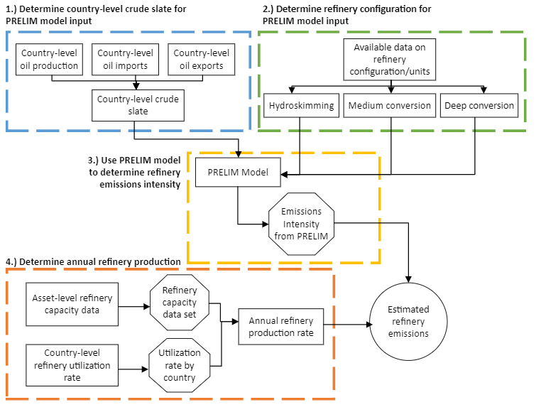
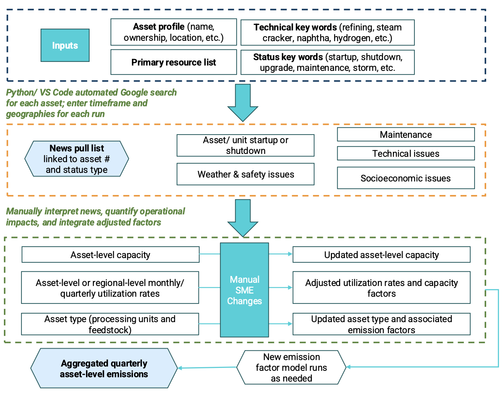
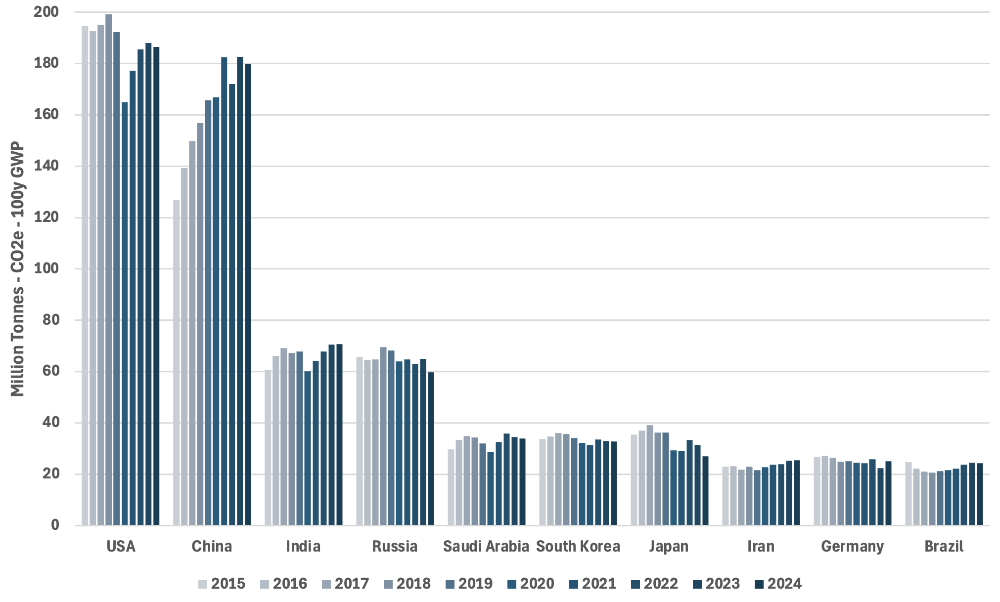
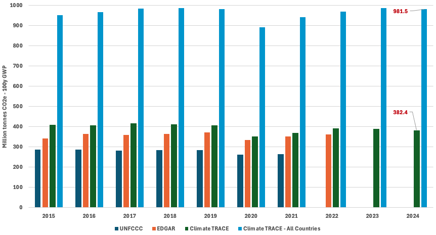
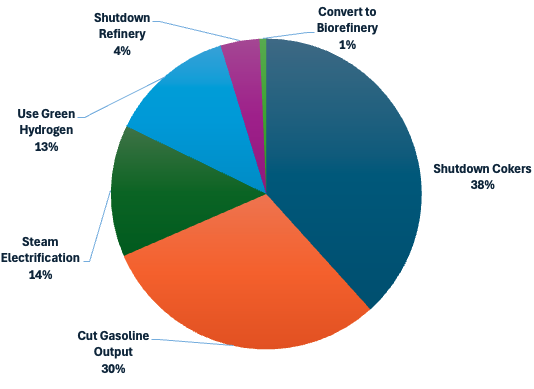
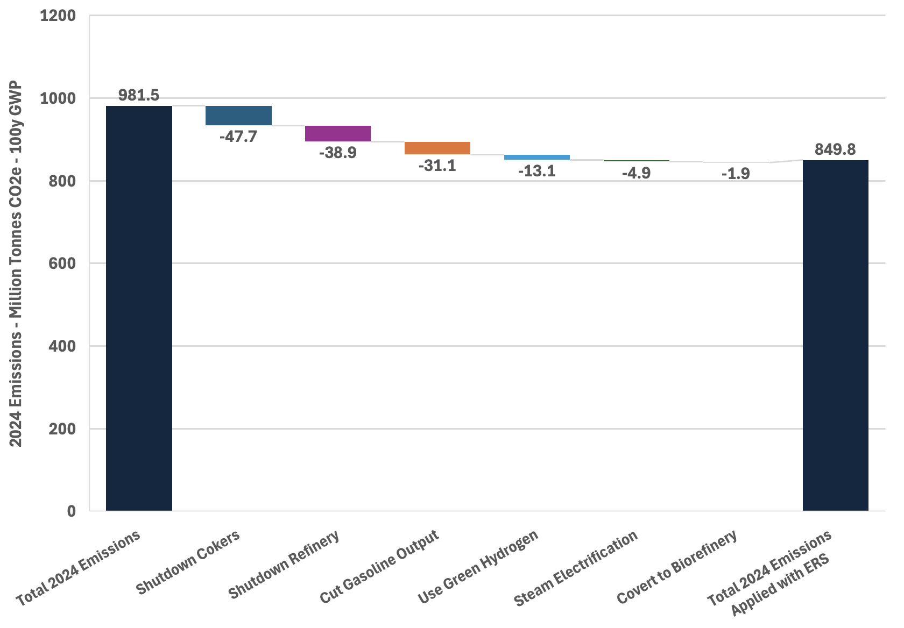

### Fossil Fuel Operations Sector: Refining Emissions

**Jikai Wang, Joseph Fallurin, Meghan Peltier, TJ Conway, and Deborah Gordon**

*All authors affiliated with RMI and Climate TRACE*

V5.9.0, July 2026

#### 1. Introduction

The petroleum resources that are extracted and transformed into usable products for today’s economy are not equal. In reality, their characteristics, production methods, operational stewardship - and thus, their climate impacts - vary widely (Gordon et al., 2022). By treating oil products as homogeneous, we miss opportunities to reduce greenhouse gas (GHG) emissions from the sector. Taken together, emissions from production, refining, and transportation of oil and gas represent more than 15 percent of global anthropogenic emissions. Oil refining alone represents more than three percent (Gordon, et al., 2022) of global anthropogenic emissions. Therefore, these are critical sectors for emissions mitigation to limit global temperature rise below 1.5 degrees Celsius.

The Climate TRACE oil refining sector emissions estimates rely on the methodology established by the Oil Climate Index plus Gas (OCI+) tool (RMI, 2025). The OCI+ tool is built on three underlying models that estimate emissions from the oil and gas supply chain: (1) the Oil Production Greenhouse Gas Emissions Estimator (OPGEE) assesses the upstream (production and some transport) portions of the petroleum lifecycle (Brandt, et al., 2021), (2) the Petroleum Refinery Life Cycle Emissions Model (PRELIM) assesses emissions from midstream oil refining (Bergerson, 2022), and (3) the Oil Products Emissions Model (OPEM) quantifies downstream end-use transport and consumption emissions from oil and gas products. More information on the OCI+ tool can be found here: [https://ociplus.rmi.org/](https://ociplus.rmi.org/). The OPGEE model is explained in the methodology document “*Oil and Gas Production and Transport*”, while the PRELIM model is explained further below. OPEM is not used for emissions estimates from TRACE oil and gas sectors because end-use emissions are covered by other TRACE sectors. Through the use of novel analyses of remote sensing data to generate inputs for OPGEE, Climate TRACE provides critical insight into global sources of GHG emissions from the oil and gas sector.

In addition to estimating refining sector emissions, TRACE 2025 updates added a new module to identify Emission Reduction Solutions (ERSs). ERSs are practical actions or technologies that refineries can adopt to lower their on-site emissions. These solutions quantify the potential reductions achievable at an asset through specific operational or technological changes, with each refinery assigned one or more ERSs based on matching criteria. These ERSs illustrate both structural shifts (such as refinery unit closures) and technical pathways (such as electrification or green hydrogen) that reduce on-site emissions from refining operations.

#### 2. Materials and Methods: PRELIM - Oil Refining Emissions

#### 2.1 Source Definition

**Refineries.** Refineries are major industrial sites, responsible for turning crude oil and gas pumped out of the Earth into the major fuels and feedstocks that underpin transportation (including gasoline, diesel, and jet fuel), heating/cooling, and everyday products. In our emissions estimates, transportation of crude oil to the refinery, and transportation of products to their end-use locations, were excluded. We estimate scope 1 emissions of the refining process within plant gate boundaries using crude oil. This assumes all hydrogen needs are generated on site, no power is generated on site, and no intermediate feedstocks are exchanged between refineries. A high-level flow chart of our estimation process is displayed in Figure 1 below. More detailed information on emission estimate methodology can be found in the following sections.

**Figure 1** Refinery emission estimate methodology flowchart.

#### 2.2 PRELIM model

RMI used the PRELIM model (v1.6) to generate refinery-level emissions estimates using refinery type-specific intensities and estimated throughputs.

PRELIM is a crude oil refining process model that provides an estimate of the emissions and product slates volumes from a refinery per barrel of crude. PRELIM was developed by a team from the University of Calgary (Bergerson, 2022). The model covers fugitive and direct combustion emissions derived from unit processes refining a variety of crude oils within a range of configurations in a refinery; depending on the settings used, it can also include indirect emissions embodied in consumed electricity and upstream natural gas fugitive emissions generated off-site.

#### 2.2.1 Emission Sources

We estimate CO2, CH4, N2O, and CO2e emissions from sources across refinery facilities, including the following main categories:

-   Heat

-   Steam

-   Hydrogen via SMR and CNR

-   FCC catalyst regeneration

-   Flaring excess of RFG

-   Subprocess emissions

-   Support services emissions

-   Releases from managed wastes

#### 2.2.2 Non-GHG Gases and other metrics

In addition to CO2, CH4, N2O, and CO2e, PRELIM also assesses SO2 and PM2.5 emissions from the same source categories across refinery facilities.

To improve emissions inventory visibility, we use PRELIM to estimate the percentage breakdown of CO₂ emissions across combustion, fugitive and process emissions, and flaring, as well as refinery-level electricity use to support further scope 2 emissions analysis.

To support product end-use characterization, we also report two non-fuel metrics: the mass ratio of non-fuel products to total refined products and total non-fuel product mass in tons. These metrics help identify the share of refinery output unlikely to be combusted downstream.

See Table S2, in the Supplemental section, for additional information on the Non-GHG gases and percentage breakdown of CO₂ estimated.

#### 2.2.3 Key Inputs

To estimate total emissions from the refining process, PRELIM required some key inputs to establish the parameters of the model. Prior research has demonstrated emissions results to be sensitive to these inputs. Key inputs include:

-   **Crude Assays**. PRELIM includes an assay library of over 600 crude oils from around the world. Assays contain information about the specific chemical properties of each oil, including details on API gravity (American Petroleum Institute index to measure the density of crude oil and refined products, lighter crude has higher API gravity), sulfur, nitrogen and hydrogen content, volume/mass flow (% recovery), Micro-carbon residue or Conradson carbon residue, and viscosity (cSt at 100 °C) for vacuum residuum. These chemical characteristics influence the processes, energy, and climate impact required to turn each different source of crude into useful products. Representative assays for each refinery are selected based on each facility’s configuration and location, described in more detail below.

-   **Refinery Configuration.** Refineries around the world are configured to process a mix of crude oil and produce a mix of products. These configurations are defined by different combinations of process units, which turn crude oil and its derivatives into useful products. Different configurations are required depending on the type of crude being processed, and the desired mix of end products for the consuming region. Configuration has a very large impact on emissions. Generally speaking, a more complex refinery has more units, and is designed to create a wide range of end products using a heavier mix of crude oil. These more complex refineries are more emissions intensive as a result. On the other hand, simpler refineries have fewer units and process lighter crude, resulting in a less emissions-intensive climate footprint.

PRELIM provided emissions intensities per barrel based on these and other inputs, and those per barrel figures were multiplied by our throughput estimates (explained below) to achieve emissions estimates for each refinery in our coverage. Climate TRACE refinery emissions modeling does not identify individual barrel supply chains from field to specific refinery. Rather, it provided an estimate of the likely refinery complexity and associated emissions based on the properties of an estimated crude oil input mix.

#### 2.3 Datasets

Many publicly reported, technical, and academic sources served as ground truth and activity data for PRELIM. Data availability on refinery throughput, capacity, configurations and locations varies significantly by geography, so our approach varies for non-US refineries and US refineries. For quarterly emissions updates, we relied on publicly available data from industrial media, companies, and national statistics bureaus to estimate asset- or regional-level utilization rates. Where quarterly data was unavailable, annual utilization estimates were applied as the default. In addition, news reports on outages, maintenance, startups, capacity changes, and other major operating events were incorporated on a monthly basis. See sections below on uncertainty and confidence for more details on data quality and model accuracy. Table 1 summarizes key input data sources for PRELIM.

**Table 1** Ground truth data employed as inputs to the PRELIM model.

<table><thead><tr class="header"><th><strong>PRELIM Model Inputs for Oil Refining</strong></th><th></th><th></th></tr></thead><tbody><tr class="odd"><td><strong>Input</strong></td><td><strong>Source</strong></td><td><strong>Regions</strong></td></tr><tr class="even"><td>Country-level utilization rate (used when more granular utilization data is unavailable)</td><td>Joint Organizations Data Initiative (JODI)</td><td><blockquote>
Global
</blockquote></td></tr><tr class="odd"><td>Acquire information on US refinery capacities, utilizations, configurations, and locations</td><td>US Energy Information Agency (EIA): Refinery Capacity Report, and US Energy Atlas</td><td><blockquote>
USA
</blockquote></td></tr><tr class="even"><td>Acquire information on non-US refinery capacities, utilization rates, configurations, and locations</td><td>National Bureau of Statistics of China, Ministry of Petroleum and Natural Gas India, Canada Energy Regulator, and a large number of various company websites, government websites, news articles, and press releases. Global Energy Observatory (GEO).</td><td><blockquote>
Global
</blockquote></td></tr><tr class="odd"><td>Acquire information on country-level oil production, exports, and imports</td><td>Joint Organizations Data Initiative (JODI)</td><td><blockquote>
Global
</blockquote></td></tr><tr class="even"><td>Acquire information on country of origin for oil imports</td><td>The Observatory of Economic Complexity (OEC)</td><td><blockquote>
Global
</blockquote></td></tr></tbody></table>

#### 2.3.1 Emission Reduction Solution Datasets

Emission reductions were primarily estimated through the PRELIM model (v1.6) (Bergerson, 2022). We modeled changes in flow volumes and process-level emission intensities by adjusting inputs and shutting down specific units to reflect different emission reduction solution scenarios. In addition, external datasets were incorporated to capture induced impacts and improve accuracy. For the green hydrogen solution, induced emissions were determined using RMI’s Chemistry in Transition Report model (Huyett et al., 2025). This model is a modified version of the GREET model (Argonne National Lab, 2023). For the biorefinery conversion solution, the R&D GREET 2024 model (Argonne National Lab, 2025) was used to estimate new emission intensities and induced impacts from the road transport sector, while USDA data supported evaluation of land use changes.

#### 2.3.2 News Pull Automation Tool for Monthly Metadata Updates

We use a Python-based news pull automation tool to support monthly refinery metadata updates. As shown in Figure 2, the tool searches by asset profile, source list, technical keywords, status keywords, timeframe, and geography, then generates a structured news list linked to asset IDs and event types.

Subject-matter experts manually review the results and incorporate validated updates into asset-level capacity, utilization, refinery configuration, feedstock assumptions, and associated emission factors. Where operational changes are material, new emission factor model runs are conducted as needed to support updated quarterly asset-level emissions estimates.

**Figure 2** News Pull Automation Workflow for Refinery Metadata Updates

#### 2.4 Method

Refineries around the world are built in different configurations, designed to intake a certain type of crude oil, and produce a certain mix of gasoline, diesel, and other products (with limited flexibility in both inputs and outputs). The PRELIM model can be used to estimate emissions per barrel of oil refined, using information about how a refinery is configured and what type of crude oil it processes. Emissions per barrel values can then be multiplied by throughput to estimate emissions. We follow these general steps for each refinery in our dataset, estimating CO2, CH4, N2O, and CO2e emissions globally, as well as the localized pollutants described above.

#### 2.4.1 Key Updates of 2026 Oil Refining Release

Our 2026 Climate TRACE oil refining database adds modeled refinery-level non-GHG emissions estimates for SO₂ and PM2.5, replacing prior non-GHG impact indicators with dedicated pollutant emissions outputs.

This release also adds CO₂ emissions breakdowns by combustion, fugitive and process emissions, and flaring, along with refinery-level electricity use and non-fuel product metrics to improve inventory visibility and end-use characterization. Table S2 in the Supplemental section provides additional information on these updates.

#### 2.4.2 General PRELIM Settings

PRELIM allows for user control with many settings, but it can also choose smart defaults based on the primary inputs of crude assays and configurations. These settings include different options for many refining processes: naphtha catalytic reforming, FCC hydrotreaters, SMR hydrogen reforming, and many more. We used PRELIM defaults for these inputs, as data availability globally was challenged for these details. We excluded asphalt production for all refineries due to limited data availability. Additionally, offsite electricity and upstream natural gas releases were excluded, which are outside the scope of the refining segments, and the latter is covered by TRACE Oil and Gas Production and Transport.

#### 2.4.3 Non-US Refineries Methodology

To find information on configurations for non-US refineries, company websites, government websites, and news stories were searched, ultimately assigning each refinery to one of three PRELIM configuration categories: hydroskimming, medium conversion, or deep conversion. Refineries in each configuration category generally have similar types of equipment, designed to process similar types of crude oil (EIA, 2012). However, configurations can vary within these categories, which is a potential source of error in our modeling. Hydroskimming refineries generally process light crude, medium conversion refineries generally process medium crude, and deep conversion refineries generally process heavy crude. This configuration information was used to provide inputs to Eq.1 to estimate emissions:

*Emissions Intensity from PRELIM* – The crude slate for each country was generated, which approximated the type of oil processed by refineries within each country. This began with comparing the relative size of a country’s production, exports, and imports. If a country produced crude oil, it generally consumed some of the oil domestically, and perhaps exported the remainder. Imports were generally used to fill a gap between domestically available crude and crude demand. We then used PRELIM to analyze the emissions intensities of the different sources of oil based on its country of origin and weighted them proportionately to estimate refinery emissions. Sources of oil around the world have a wide range of associated emissions (Gordon, et al., 2022), and modeling the origins of a refinery’s likely crude intake helps to model emissions more accurately.

A hypothetical example is provided to understand how oil domestically and imports can impact emissions estimates. Consider a medium conversion refinery in country *A*. Country *A* produces 100 thousand barrels per day (kbd), and exports 20 kbd, leaving 80 kbd of domestically available crude for processing at local refineries. Country *A* imports a total of 60 kbd of foreign crude: 40 kbd from country *B*, and 20 kbd from country *C*. So, refineries in country *A* have 80 + 60 = 140 kbd available to process each day. The theoretical mix of oil available to be processed in country *A* is 57% domestic (80/140), 29% from country *B* (40/140), and 14% from country *C* (20/140). For this medium conversion refinery, we weight the average emissions intensities of medium crude from countries *A*, *B*, and *C* according to their respective shares of the crude available for refining in country *A*. In this example, assume the average PRELIM-calculated emissions intensities of medium crudes produced in countries *A*, *B*, and *C* are 28, 30, and 32 kg CO2/bbl, respectively. Then country *A* medium conversion refinery’s emissions intensity is calculated as: (.57\*28) + (.29\*30) + (.14\*32) = 29.14 kg CO2/bbl. In the case when top exporting countries do not supply the specific type of crude to the importing country, we instead used the global average emissions intensity of this type of crude.

*Capacity factor (effective days operating in a period)* – Monthly utilization rates were primarily sourced from the Joint Organizations Data Initiative (JODI) (JODI, 2025). Where available, facility-level, regional, or other sub-national statistics were collected from government or company sources and applied to the relevant facilities. For countries or assets lacking monthly data, quarterly utilization sources were used; if those were unavailable, annual utilization rates from Energy Institute Statistical Review of World Energy (Energy Institute, 2025) were used as inputs. To highlight, we specified Chinese independent refineries’ (teapots) utilization rate from the country-level data because this group’s operation pattern varies significantly compared to other major refineries in China. All utilization rates were converted to capacity factors by multiplying them by the number of days in each month to reflect effective operating days for that period.

*Capacity* – Facility-level capacity data source varies considerably around the world. Some governments and large oil refiners reported capacity by facility on an annual basis. However, in some countries, publicly available data was limited to news articles and the press. For some refineries in countries with limited data availability it can be challenging to find any legitimate and up-to-date sources. Year-specific capacity data was applied to most of the refineries in the database, covering approximately 93% of total capacity and 86% of the sites. For the rest of the facilities, primarily mid- and small-scale Chinese refineries, throughput estimates rely on previously recorded 2022 (or earlier) capacity data. These outdated capacity data will continue to be validated and updated in future releases to improve accuracy.

All together this provides the required data needed to estimate emissions based on country-specific crude, and facility throughput in a country and capacity in Eq.1:

*Emissions Estimate = Capacity x Capacity factor x Emissions Intensity from PRELIM (Eq.1)*

Monthly modeled emissions were first aggregated on a quarterly basis for submissions to Climate TRACE, which then evenly distributed them across the three months of each quarter for website reporting, reflecting limitations in utilization data granularity.

#### 2.4.4 US Refineries Methodology

US refineries followed the same approach described in 2.4.3, but increased data availability (US EIA, 2025a) allows for more granularity to define eight configuration categories. These categories include hydroskimming as noted above, as well as more detailed subcategories of the medium conversion – fluid catalytic cracking (FCC), hydrocracking (HC), or both – and deep conversion categories (coking & FCC, coking & HC, coking & FCC & HC, coking & FCC & Residue HC). For crude slate, we first categorized what type of crude is typically run by each refinery based on the processing units present (e.g., Medium Sour), and next, computed the production-weighted average API gravity and sulfur content covering all categorized slate crudes and selected the closest representative assay from the PRELIM library based on API gravity and sulfur content characteristics (e.g., "Arab Light Solomon 2015"). We then entered each configuration and crude assay combination into PRELIM to estimate emissions intensity for each refinery. To calculate throughput, we used refinery-level capacity, combined with PADD (Petroleum Administration Defense District: government-defined subnational geographic regions in the US) and sub-PADD monthly utilization data, both provided by the EIA. The throughput was then multiplied by emissions intensities to generate monthly emissions estimates for each refinery modeled per year as done in Eq.1.

#### 2.4.5 Non-GHG and other metrics methodology

Non-GHG emissions and other refinery-level metrics are estimated using the same factor-based logic applied to GHG emissions. PRELIM is used to model metric-specific factors across representative combinations of crude type, refinery configuration, and geography. Each combination generates a unique factor, and each refinery asset is paired with the factor that best matches its asset profile.

For metrics reported as absolute values, we apply Eq.1 using the relevant PRELIM-derived metric factor. Depending on the metric, this factor may represent emissions intensity, product output, electricity input, or an emissions split percentage.

*Non-GHG emissions (SO2 and PM2.5)* - PRELIM is used to derive refinery-level non-GHG emission factors from modeled environmental impacts, including acidification and particulate matter. Representative combinations of crude type and refinery configuration are modeled to estimate the relationship between SO₂ and acidification impacts, and between PM₂.₅ and particulate matter impacts. These ratio-adjusted factors are then used as dedicated SO₂ and PM₂.₅ emission factors.

Absolute SO₂ and PM₂.₅ emissions are calculated using Eq.1, replacing the GHG emissions intensity with the corresponding non-GHG emissions factor.

*Non-fuel metrics* - Non-fuel metrics are used to characterize the share of refinery output unlikely to be combusted downstream. PRELIM is used to generate product output slates across representative combinations of crude type, refinery configuration, petrochemical integration, and geography. As shown in Table 2, refined products are classified as fuel, non-fuel, or dual-use products based on their anticipated downstream end-use pathways.

**Table 2** Refined product classification for non-fuel metrics.

| **Category**      | **Refined products**                                                                                         |
|-------------------|--------------------------------------------------------------------------------------------------------------|
| Fuel products     | blended gasoline, jet fuel, ULSD, fuel oil, liquid heavy ends, surplus NCR H₂, refinery fuel gas, ATRES, VGO |
| Non-fuel products | sulfur, petrochemical feedstocks, asphalt, lubricants, BTX                                                   |
| Dual-use products | coke, liquified petroleum gas (LPG), naphtha                                                                 |

For dual-use products, the share assigned to non-fuel use varies by petrochemical integration status and refinery geography. The final non-fuel factor is calculated as the mass ratio of non-fuel products to total refined products. Each asset is paired with one of 24 unique factors based on crude type, refinery configuration, petrochemical integration, and geography.

Absolute non-fuel product output is estimated by multiplying the non-fuel product output factor in tons per barrel, by refinery capacity and capacity factor.

*Electricity use* - Electricity use is estimated using PRELIM-modeled electricity input factors in MWh per barrel. Representative combinations of crude type and refinery configuration are modeled, and each refinery asset is paired with the most relevant electricity input factor based on its profile.

Absolute electricity use is calculated by multiplying the electricity input factor by refinery capacity and capacity factor for the relevant reporting period.

*CO2 emissions split* - We provide the percentage breakdown of CO₂ emissions across three categories: combustion, fugitive and process emissions, and flaring. These categories are defined using PRELIM unit- and process-level emissions outputs.

Combustion emissions include all heat and steam-related emissions. Fugitive and process emissions include fugitive emissions from blowdown systems, tanks, terminals, and support services, as well as process emissions from feed SMR, SMR process emissions, H₂ via CNR, FCC catalyst regeneration, and other subprocesses. Flaring emissions include general refinery flaring emissions.

Representative combinations of crude type and refinery configuration are modeled to generate a unique CO₂ emissions split for each combination. Each refinery is then paired with the most relevant set of CO₂ breakdown percentages based on its asset profile.

#### 2.4.6 Country-level estimation

Source-level emissions for each country were summed to obtain country-level emissions estimates. With the efforts on asset validation and operational status tracking, we have improved global refining capacity coverage to 99% or more and achieved quarterly emissions estimates.

#### 2.4.7 Emission Reduction Solution Methodology

**Definitions of Primary Emission Reduction Solutions**

**Shutdown Refinery.** Shutting down a refinery eliminates all on-site emissions by halting fuel combustion and processing, reducing emissions by 100% if closure is permanent. Over 30 refineries have closed globally since 2015, with shutdowns most common in Europe, Australia, New Zealand, Japan, and parts of the USA, often due to aging assets, regulations, or declining demand. Co-benefits include eliminating local air and noise pollution, though closures reduce local jobs and tax revenues.

**Convert to Biorefinery.** Converting a refinery to a biorefinery lowers emissions by operating at smaller modified capacity and shutting down many energy-intensive units, reducing on-site emissions by about 43%. Emissions intensity per barrel can be higher due to hydrotreating a higher share of feedstock with even more hydrogen, but overall emissions fall with reduced throughput. Outcomes vary by feedstock type, with possible induced impacts in agriculture, land use, and waste management. Several refineries in North America and Europe, including assets in California, Canada, Croatia, France, and Italy, have already converted or announced plans to do so. Co-benefits include less local pollution, though local jobs and tax revenues often decline.

**Steam Electrification.** Replacing fossil fuel-fired boiler applications with electric boilers, heaters, or motors can cut most steam-related emissions when powered by clean electricity, reducing on-site emissions by about 5-8%. Benefits depend on refinery type and grid mix, with possible induced emissions shifting to the power sector. The technology is proven, but adoption is minimal due to large electricity demand, high costs, and constrained grid capacity. Some partial applications, such as replacing steam-driven turbines with electric motors or electrifying low-temperature steam uses, have been piloted, but not full refinery-wide substitution. Co-benefits include reduced local air pollution.

**Cut Gasoline Output.** Reducing gasoline output lowers emissions by scaling down units such as catalytic reforming and isomerization, leaving more naphtha in the product slate and avoiding these energy-intensive steps. The additional naphtha produced as a result can serve as petrochemical feedstock. This strategy reduces on-site emissions by about 4-14%, depending on refinery configuration and crude type, with possible market support of road transport ERS if reduced gasoline supply encourages shifts toward electrification and other clean alternative fuels. Refineries routinely shut down these units temporarily for maintenance. There are indications of low gasoline demand for transport fuels or rising petrochemical demand in some major refining countries, such as Japan (Energy Institute, 2025) and China (EIA, 2024b), where refineries have begun to reduce gasoline output or add flexibility to do so. Co-benefits include lower local air pollution and reduced benzene exposure.

**Use Green Hydrogen.** Switching from fossil-based hydrogen to green hydrogen produced with renewable electricity via electrolysis can significantly reduce refinery emissions since hydrogen made from natural gas through steam methane reforming is one of the most emission-intensive processes in refining. This strategy lowers on-site emissions by about 5-18%, depending on refinery configuration and crude type, with induced impacts possible in the power sector because electrolysis requires large volumes of renewable electricity; using fossil-based power would undermine benefits. Adoption is limited by high cost of electrolyzers and access to affordable clean power, while co-benefits include less local pollution and resilience to natural gas price shocks.

**Shutdown Cokers.** Shutting down coking units and visbreakers reduces emissions by removing one of refining’s most energy- and carbon-intensive processes. Without cokers, heavy oils remain in the product slate and can be directed to non-combusted uses like asphalt. This strategy cuts on-site emissions by about 7-11%, depending on crude type, though there might be induced impacts in other sectors such as shipping, power, or petrochemicals where those heavier streams can be used. Similar to gasoline output cuts, this can provide market support for road transport ERS if reduced gasoline and diesel supply encourages shift towards greater electrification and other clean alternative fuels. Coker and visbreaker shutdowns have already occurred in Europe, North America, and Japan, often due to the high cost of maintaining complex equipment. Co-benefits include less local pollution and reduced petcoke use in power and heavy industry.

**Emissions Reduction Determination**

**Shutdown Refinery.** A complete and permanent refinery shut down results in 100% elimination of on-site emissions at the facility. Some demand may shift to other facilities or energy sources, but these induced impacts are not modeled.

**Convert to Biorefinery.** Smaller-scale operations and simplified process configurations were simulated in the PRELIM model, reducing throughput to 30% of original input flows. Applying an additional 70% operational safety control factor resulted in an overall capacity scale-down factor of 24%. The R&D GREET 2024 model (Argonne National Lab, 2025) provided a new emission factor for renewable diesel (RD) processing of 10.6 gCO2e/RD MJ. Using GREET's biooil to RD conversion factor (Argonne National Lab, 2023), combined with the capacity reduction factors and new emission factor of RD processing, we calculated an integrated new-to-old emission factor ratio of 43%. The R&D GREET 2024 model also provided an emission factor for transportation of RD production, which was used to estimate induced impacts from biorefining on the transport sector. For land use change estimates, soybean yield per acre and soybean-to-oil yield data were collected from USDA. We assumed 50% soybean oil and 50% used cooking oil as RD production feed oil.

**Steam Electrification.** In PRELIM, steam-related emissions were set to zero to reflect the assumption that fossil-fired boilers are replaced by electric boilers powered with clean electricity. The resulting reduction ranges from 5-8%, depending on refinery configuration and crude type, with higher reductions observed in hydroskimming refineries processing lighter crude. Induced impacts from additional power demand were estimated based on energy conversion of steam demand (with a range of 21-32 MJ/ bbl of crude) modeled by PRELIM, applying a 98% efficiency factor for electric boilers.

**Cut Gasoline Output.** Emissions reduction was modeled by shutting down gasoline-focused units in PRELIM, including the naphtha hydrotreater, catalytic naphtha reformer, isomerization, and methyl tert-butyl ether units, shifting the output slate toward more naphtha and less gasoline. The resulting reduction varies from 4-14%, with the largest reduction in refineries processing light crude, followed by medium crude, and the smallest in heavy crude refineries.

**Use Green Hydrogen.** In PRELIM, hydrogen emissions via steam methane reforming (SMR) were halved to simulate replacing 50% of fossil-based hydrogen with green hydrogen through electrolysis. For one specific refinery type, deep conversion with residue hydrocracking capacity, the coker was shut down and the residue hydrocracker was activated to better reflect the process configuration. The results of emission reduction range from 5-18%, with the largest cuts in refineries operating hydrocrackers, while the smallest in coker refineries processing light crude. The RMI’s Chemistry in Transition Report model (Huyett et al., 2025) provided a green hydrogen production factor as 50 kWh/ kg H2, which was applied to evaluate the induced impacts in the power generation sector. Since renewable electricity is assumed for green hydrogen production, zero electricity generation emissions were induced in the ERS model.

**Shutdown Cokers.** Emissions reduction was modeled by shutting down all coking units in PRELIM, including the coker, coker furnace, coker fractionator, coker naphtha hydrotreater, and visbreaker. The resulting reduction ranges from 7-11%, depending on crude type, with higher reductions observed in coking refineries processing heavy crude.

**Matching Emission Reduction Solutions to Assets**

To assign primary emission reduction solutions (ERSs) to individual refinery assets, a matching framework was created considering refinery configuration, capacity, crude type, access to clean power, and regional fuel supply and demand. Public announcements on full-site shutdown and retrofits were also incorporated. Technical and economic considerations for selecting the most viable levers were guided by the US Department of Energy’s comprehensive report Pathways to Commercial Liftoff: Decarbonizing Chemicals & Refining (US DOE, 2023), Oil and Gas Climate Initiative’s white paper Powering up: Pathways to Decarbonize Refining (OGCI & Wood, 2023), and RMI’s report Oil Refining Emissions Cut Points (RMI, 2022). Table 3 summarizes the categorization framework and the criteria used to assign each ERSs to refinery assets.

**Table 3** Categorization of Refinery Assets by Primary Emissions Reduction Solutions.

<table><thead><tr class="header"><th><strong>Primary Emission Reduction Solution</strong></th><th><strong>ERS code*</strong></th><th><strong>Criteria for Asset Match</strong></th></tr></thead><tbody><tr class="odd"><td>Shutdown Refinery</td><td>REFOFF000</td><td>Assets with official shutdown announcements, or showing viability risk indicators such as prior shutdowns and high local electric vehicle growth. Proposed shutdowns would return regional refining utilization rates back to long-term averages.</td></tr><tr class="even"><td>Convert to Biorefinery</td><td>REFBIO000</td><td>Small-to-medium scale hydroskimming refineries (capacity &lt; 150 MBD) processing medium crude</td></tr><tr class="odd"><td>Steam Electrification</td><td>REFES000 – 004**</td><td>
Asphalt/bitumen refineries and all other hydroskimming refineries

<em>** REFES003 and REFES004 assigned as secondary ERS to medium conversion and coking refineries, respectively</em>
</td></tr><tr class="even"><td>Cut Gasoline Output</td><td>REFNAP000 - 003</td><td>All medium conversion refineries</td></tr><tr class="odd"><td>Use Green Hydrogen</td><td>REFGH000 - 002</td><td>Deep conversion refineries with cokers processing light crude, and deep conversion refineries equipped with residue hydrocrakers</td></tr><tr class="even"><td>Shutdown Cokers</td><td>REFSC000 - 001</td><td>All other coking refineries</td></tr></tbody></table>

\* For each subcode (00X) following the primary ERS code, these represent the variations in emissions reduction potential based on different configuration and crude types, while applying the same primary solution.

#### 2.4.8 Model Version Naming

There is one column in the asset data profiles, “model number”. This model number naming process follows the Semantic Versioning approach that is in the format of X.Y.Z (Major.Minor.Patch), where

-   X stands for a major version. When the PRELIM model is upgraded, we will increase the major version number and reset both minor and patch versions to zero.

-   Y stands for a minor version. When we make major methodology changes based on the same version of the PRELIM model, we will increase the minor version and reset the patch version to zero.

-   Z stands for a patch version. For any small methodology changes and bug fixes, we will increase the patch version and keep both major and minor versions.

#### 2.5 Verifying Emissions Estimates

#### 2.5.1 Confidence Categories

Confidence categories (very low, low, medium, high, very high) were assigned to our estimates to give the user a sense of the quality and consistency of the data. These categories were applied at the country level. We begin with Transparency International’s [Corruption Perception Index](https://www.transparency.org/en/cpi/2022) (Transparency International, 2025), which serves as a proxy for data availability and transparency within each country. Index values were modified by subtracting up to 20 points based on the amount of sub-national utilization data found by our team to create an Oil-Adjusted Corruption Perception Index. For example, if our estimates included sub-national utilization estimates for 50% of capacity, we would subtract 10 points from the Corruption Perception Index. We adjust downward as the oil sector is generally more opaque than other sectors. We then define confidence categories in Table 4.

**Table 4** Confidence categories assigned to oil refining data.

|                                          | Confidence Category |       |        |       |           |
|------------------------------------------|---------------------|-------|--------|-------|-----------|
|                                          | Very Low            | Low   | Medium | High  | Very High |
| Oil-Adjusted Corruption Perception Index | 0-19                | 20-39 | 40-59  | 60-79 | 80-100    |

#### 2.5.2 Uncertainty Analysis

Our quantification of uncertainty is aimed to give the user a measure of the variation in emissions estimates derived from the PRELIM model. Uncertainty figures were calculated and applied at the configuration level for CO2, CH4, N2O, and modeled non-GHGs.

PRELIM uses distributions on several parameters to calculate emissions, resulting in variation across model runs even with identical inputs. To quantify this variation, we ran the model 30 times for each refinery configuration and calculated the standard deviation of the resulting per barrel emissions estimates. We then scaled this standard deviation by facility-level throughput to estimate monthly emissions variability. These uncertainty estimates capture only PRELIM's internal parameter variation and do not account for uncertainty in refinery capacity, utilization, crude slate, or configuration assignments.

#### 2.5.3 Verifying Emission Reduction Solution Results

Most emission reduction solutions in the refining sector represent either emerging technologies or pilot applications of existing technologies, making direct verification of modeled emission reductions limited. Verification would require close tracking of asset-level announcements and observable operational changes, which are often confidential or not reported publicly. Partial validation might be feasible for full-site shutdown, coker shutdown, biorefinery conversion, and green hydrogen use as they are typically announced through company press releases, government filings, or trade press. In contrast, verifying steam electrification or reduced gasoline output applications is very challenging, as changes in product slate, fuel mix, or utility supply are rarely disclosed publicly.

#### 3. Results

Figure 3 shows the top 10 global refining emitters for all years analyzed, from 2015 to 2024. The US ranked first throughout this period. In 2024, China ranked second and India third, despite a decline in China’s refining throughput and emissions. This was China’s second such decline in over two decades, following a downturn amid COVID-19 restrictions and reduced petroleum product export quotas in 2022 (EIA, 2023). This drop reflected lower refinery runs as operators cut back in response to stagnant fuel demand, rapid electric vehicle growth, and continuous weak refining margins. Notably, China’s refining capacity exceeded that of the US for the first time in 2024 (Energy Institute, 2025), but its lower utilization rates and a portfolio of less emission intensive configurations offset increases in capacity.

For Russia, a methodology upgrade on additional operational status checks and the use of a quarterly model for 2024 allowed us to capture the impacts of the Russia-Ukraine war more accurately, yielding lower throughput and emissions that align with observed market conditions. In Japan, the closure of two additional refineries in 2024 drove a significant emissions reduction. By contrast, Germany’s refining utilization rose relative to 2023, and with no major new shutdowns, it surpassed Brazil to reclaim the 9th place among the world’s top refining emitters.

The “Climate TRACE - All Countries” series in Figure 4 shows that global refining sector emissions in 2024 were 981.5 million tonnes CO2e, down slightly from 987.6 million tonnes CO2e in 2023. This marks the first annual decline since 2019, reflecting a mix of weaker fuel demand, refinery closures, and shifts in product output across the sector.

**Figure 3** Top 10 global oil refining emitters, 2015-2024. Ordered by 2024 emissions.

#### 3.1 Comparison with Other Emissions Inventories

In the refining sector, unlike the UNFCCC, and EDGAR, which generally apportion total fuel use to each sector and multiply by emission factors, PRELIM uses a systems-level approach and refinery linear programming modeling methods. This approach includes details for particular crude intake and refinery configurations down to the sub-process level and uses publicly available information whenever possible. While emission factors are used for some emissions sources, generally speaking, PRELIM modeling is far more complex and flexible than traditional emissions factor approaches. The model allows for flexibility in crude slate (the type of crude processed), configuration (which units are present and used to produce a certain mix of products like gasoline), and many other inputs. A large, public database of crude assays, and flexibility in configuration settings allows users to emulate a refinery based on those key characteristics.

Academic literature around refinery emissions has historically focused on local pollutants due to well-documented air quality concerns. The oil and gas production sector outlined in a separate methodology document is currently further along regarding remote sensing studies of key climate pollutants like methane. This is partly motivated by the fact that most methane super-emitter events detected so far have been in the production sector, while equipment further downstream is generally more consolidated and well-maintained. While upstream has been the focus so far, remote sensing emissions studies are beginning to cover the refining sector as well. Aircraft measurements at three US refineries found CH₄ emission rates 11-90 times and CO₂ rates 2–78 times higher than facility-reported estimates (Lavoie et al., 2017a, 2017b). Additional studies of California refineries also identified methane emissions exceeding reported inventories (Mehrotra et al., 2017; Guha et al., 2020). Although these studies cover a limited number of facilities, they provide important evidence of potential underestimation in conventional inventories. However, these observations are not directly incorporated into Climate TRACE refinery estimates, which rely on PRELIM's process-level emission factors and modeled refinery characteristics.

**Figure 4** Comparison of refining sector GHG emissions estimates (million tCO2e, 100-year GWP) from UNFCCC (dark blue bars), EDGAR (orange bars), and Climate TRACE (green bars) for a comparable subset of Annex I countries, and Climate TRACE’s global total for all countries (light blue bars), from 2015 to 2024. Some Annex I countries with highly uncertain or irregular data, such as Russia, were not included in the first three data aggregations for a more accurate comparison.

The differences between Climate TRACE and other inventories shown in Figure 4 may reflect variations in refinery activity data, crude slate and configuration assumptions, process-level emission factors, and accounting boundaries. One important example is hydrogen production: PRELIM assumes all refinery hydrogen requirements are met through onsite steam methane reforming, while other inventories may allocate hydrogen production emissions to different sectors or facilities. Although the atmospheric studies discussed above suggest potential underestimation of CH₄ and CO₂ emissions at certain refineries, these observations are not directly incorporated into PRELIM and therefore do not establish the causes or magnitude of the differences between Climate TRACE, UNFCCC, and EDGAR estimates.

#### 3.2 Emission Reduction Strategy Results

**Figure 5** Crude refining capacity (2024) share of assets that are applied with each primary emission reduction strategy.

Figure 5 shows the distribution of refining capacity in 2024 by primary emission reduction solutions (ERSs) applied. The largest share of assets were assigned Shutdown Coker (38%) and Cut Gasoline Output (30%), reflecting both the widespread presence of coking and catalytic reforming units in relatively complex refineries. Other strategies are applied at smaller but still meaningful shares: Steam electrification (14%), Use Green hydrogen (13%), Shutdown Refinery (4%), and Convert to Biorefinery (1%). This breakdown highlights how ERSs map onto the diversity of refinery configurations worldwide, with heavier or more complex refineries more likely to be assigned shutdown coker or green hydrogen solutions, and simpler configurations aligning with electrification or bioconversion pathways.

As Figure 6 illustrates, these ERSs together could cut global refining emissions from 981.5 MtCO2e to 849.8 MtCO2e in 2024, a reduction of about 13% (see detailed distribution of emissions reduction by solution in Figure 6). Despite applying to only a small share of capacity, Shutdown Refinery ranks as the second largest contributor of emission reduction (38.9 MtCO2e, 30%), highlighting the critical role of rebalancing refined product supply and demand. Shutdown Cokers and Cut Gasoline Output also drive major reductions as these solutions are applied across the largest share of refining capacity. In contrast, Convert to Biorefinery offers minimal overall reductions due to feedstock constraints and uncertain biofuel demand, although total emissions are reduced significantly at assets that pursue this solution.

**Figure 6** Waterfall chart demonstrating the emission reduction potential (million tCO2e 100-year GWP) contributed by each primary emission reduction strategy in 2024.

#### 4. Discussion

The methods and results presented here summarize emissions from the refining sector. We show that these oil and gas processing activities contribute significant amounts of greenhouse gas emissions each year. Our approach emphasizes that processing different types of crude oil using different equipment can markedly affect the amount of emissions per barrel of oil equivalent produced.

The use of the PRELIM models enables transparent, granular source emissions data. This level of granularity is not achievable globally by the other approaches. The models deployed by Climate TRACE have the capability to offer breakouts of process- and source-level emissions and to indicate which supply chain segments contribute the most emissions. With this knowledge, TRACE data can serve as a source of comparison and/or help fill knowledge gaps in existing top-down approaches. Over time, the PRELIM models via the OCI+ will also enable the differentiation of oil and gas resources for market- and policy-relevant applications. This type of transparency will ultimately be needed to make climate-informed decisions around oil and gas sources and to decarbonize the sector.

Importantly, our approach to model oil and gas emissions with OPGEE (upstream) and PRELIM (refining) also demonstrates the ability to improve and incorporate new emissions knowledge as it becomes available. For example, the recent iterations of Climate TRACE inventories demonstrate our adoption of higher quality and more granular model inputs, improved comprehensiveness in country emissions scaling, incorporation of country-level crude mix estimates, validation of capacity change and configuration planning, consideration of upsets and maintenance issues’ effects on operation, and upgrading of the annual model to quarterly estimates.

The results of our new module, Emission Reduction Solutions, indicate that while emerging technologies like green hydrogen and electrification have potential, the largest near-term reductions come from structural shifts, such as unit shutdowns or complete site closures. Over the longer term, scaling technical solutions such as hydrogen substitution or electrification will be essential to sustain deeper reductions. For electrification, access to reliable low-carbon power will be critical to avoid simply shifting emissions to the power sector. For green hydrogen, large-scale stable operation has yet to be proven, and wider adoption will depend on both technical reliability and affordable renewable power supply. Overall, the mix of strategies highlights the importance of combining transitional technologies with structural downsizing to achieve meaningful sector-wide decarbonization.

#### 5. Limitations

Many of the limitations around our estimates stem from the lack of input data. As mentioned above, data availability was very limited in some countries. These data gaps create uncertainty about the crude mix processed at individual refineries and operational events that may have affected their activity. We therefore applied PRELIM’s default assumptions across most facilities (see more details in 2.4.2 General PRELIM Settings). Specifically, we assumed refinery product slates and secondary unit capacity ratios matched PRELIM model defaults for a specified configuration, no combined heat and power systems were used, all net hydrogen needs were met through on-site SMR units, no bio-feedstocks were used, and no carbon capture units were applied for all refineries. Though the last three limitations are inherent to the latest version of the PRELIM model, we hope to address other limitations in future estimates as resources allow. Additionally, we only have sub-national utilization rates for a portion of our coverage. Operators often do not have the incentive to share this data, but basic disclosure requirements from regulators around refinery activity and emissions would result in a better understanding of emissions for those impacted locally and globally.

For emission reduction solutions, each refinery asset was assigned a single primary solution, with some also given a secondary solution. This standardization improves consistency but limits facility-level application accuracy, since in practice multiple solutions may be applied in combination. Future improvements may introduce hybrid strategies or subdivided categories to better reflect real-world operations. In addition, emission intensity models can be strengthened as more granular data and representative assumptions become available. For example, the current model of Convert to Biorefinery solution does not differentiate between biofeed types and generalizes the output slate, which may significantly underestimate emissions variability. This first ERS approach did not directly consider existing petrochemical integration, which may affect operational lifetime and decisions on transition investments vs. unit shutdowns. However, the current ERS approach did indirectly consider broad refinery categories more likely to support petrochemical feedstock production and directionally supported increased yields of petrochemical feedstocks and other non-fuel products like asphalt. Future improvements may incorporate direct consideration of petrochemical integration to better reflect these operational dynamics.

#### 6. Conclusion

To chart a clean energy transition, we must bring transparency to emission-intensive sectors like oil and gas. For the refining sector, the Climate TRACE platform bolsters accountability that is currently lacking when countries self-report their emissions and offers all countries access to reliable, accurate, and timely emissions data across sectors. The information can empower leaders to pinpoint where efforts should be channeled to maximize impact.

More information and techniques will be applied to improve and refine our oil and gas sector emission estimates. For the PRELIM refining model, we will pursue data necessary to level up from refinery category intensities towards sub-national and refinery-specific estimates with our partners at University of Calgary (e.g., individual refinery configurations, crude oil assay pairings, temporally granular throughput data). The addition of our new Emission Reduction Solutions module highlights practical pathways for reducing refining emissions. We will continue to improve emission reduction solutions’ model as technology scales and more granular input information becomes available.

Since empirical measurements cannot be made over all facilities, in all geographies, all the time, this will require improving our models’ capabilities to make smarter assumptions in data-poor environments. This includes the integration of current and emerging remote sensing technologies that have the capabilities to assess GHGs from oil and gas systems. No singular remote sensing system can overcome all the hurdles to capturing the majority of GHG emission sources, but combining different technologies can work towards high resolution measurements, with credible verification and transparency, at scale. A promising future of emissions monitoring lies in a layered system that integrates a suite of measurement technologies, models, and reported data.

#### Acknowledgements

Special thanks to our partners at Climate TRACE, Development Seed, Carbon Mapper, Stanford University, the University of Calgary, NASA - Carbon Monitoring System, Colorado School of Mines, and Harvard University that helped with developing the models we deployed, building web tools to share results with public audiences, constructing this document, and working with us to integrate other approaches to and knowledge of oil and gas emissions into these estimates.

#### Supplemental section metadata

**Dataset Description**

This dataset includes emissions estimates for oil refinery facilities globally. Facility-level emissions are modeled using PRELIM and available data on estimated crude oil types processed, refinery configuration, capacity, and capacity factors derived from monthly, quarterly, or annual utilization data, depending on availability. The dataset covers more than 99% of global refining capacity, and facility-level estimates are aggregated to produce country-level totals.

**Table S1** General metadata information for oil and gas refining sector**.**

<table><thead><tr class="header"><th><strong>General Description</strong></th><th><strong>Definition </strong></th></tr></thead><tbody><tr class="odd"><td><strong>Sector definition</strong></td><td><em>Global Refineries</em></td></tr><tr class="even"><td><strong>UNFCCC sector equivalent</strong></td><td><em>1.A.1.b Petroleum Refining</em></td></tr><tr class="odd"><td><strong>Temporal Coverage</strong></td><td><em>2015 – 2024</em></td></tr><tr class="even"><td><strong>Temporal Resolution</strong></td><td><em>Quarterly (original data submitted to Climate TRACE); Monthly (website reporting, with quarterly totals evenly distributed across the three months of each quarter; see <a href="https://github.com/climatetracecoalition/emissions-methodology/tree/main/Sector-Methodologies/2-Cross-Cutting/temporal-disaggregation">Temporal</a> <a href="https://github.com/climatetracecoalition/emissions-methodology/tree/main/Sector-Methodologies/2-Cross-Cutting/temporal-disaggregation">Disaggregation of Emissions Data for the Climate TRACE</a> <a href="https://github.com/climatetracecoalition/emissions-methodology/tree/main/Sector-Methodologies/2-Cross-Cutting/temporal-disaggregation">Inventory</a>).</em></td></tr><tr class="odd"><td><strong>Data format(s)</strong></td><td><em>CSV</em></td></tr><tr class="even"><td><strong>Coordinate Reference System </strong></td><td><em>EPSG:4326, decimal degrees</em></td></tr><tr class="odd"><td><strong>Number of sources available for download and percent of global emissions (as of 2024)</strong></td><td><em>728 sources representing approximately 99% or more of this sector’s emissions.</em></td></tr><tr class="even"><td><strong>Total emissions for 2024</strong></td><td><em>Approximately 981.5 million tonnes CO2e</em></td></tr><tr class="odd"><td><strong>Ownership </strong></td><td><em>Obtained from government and company websites, as well as news stories</em></td></tr><tr class="even"><td><strong>What emission factors were used?</strong></td><td><em>Many process-level emissions factors are used in the PRELIM model – see PRELIM documentation and model for a complete list. </em></td></tr><tr class="odd"><td><strong>What is the difference between a “NULL / none / nan” versus “0” data field?</strong></td><td><em>“0” values are for true non-existent emissions. If we know that the sector has emissions for that specific gas, but the gas was not modeled, this is represented by “NULL/none/nan” </em></td></tr><tr class="even"><td><strong>total_CO2e_100yrGWP and total_CO2e_20yrGWP conversions</strong></td><td>
Climate TRACE uses IPCC AR6 CO2e GWPs. CO2e conversion guidelines are here:

https://www.ipcc.ch/report/ar6/wg1/downloads/report/IPCC_AR6_WGI_FullReport_small.pdf
</td></tr></tbody></table>

**Table S2** Asset level metadata description for oil and gas refining sector.

| **Data Attribute**                | **Definition**                                                                                                                        |
|-----------------------------------|---------------------------------------------------------------------------------------------------------------------------------------|
| **sector**                        | *fossil-fuel-operations*                                                                                                              |
| **asset\_sub-sector\_name**       | *oil-and-gas-refining*                                                                                                                |
| **start\_date**                   | *month modeled*                                                                                                                       |
| **end\_date**                     | *month modeled*                                                                                                                       |
| **asset\_identifier**             | *TRACE ID number for refinery*                                                                                                        |
| **model\_number**                 | *model version*                                                                                                                       |
| **asset\_name**                   | *common name of the refinery*                                                                                                         |
| **iso3\_country**                 | *country code*                                                                                                                        |
| **location**                      | *location of refinery with point inside site*                                                                                         |
| **type**                          | *refinery configuration reflecting operational complexity*                                                                            |
| **capacity\_description**         | *nameplate crude oil processing capacity*                                                                                             |
| **capacity\_units**               | *barrel per day*                                                                                                                      |
| **capacity\_factor\_description** | *effective days operating in a period*                                                                                                |
| **capacity\_factor\_units**       | *days per time period reported*                                                                                                       |
| **activity\_description**         | *total volume of crude oil processed*                                                                                                 |
| **activity\_units**               | *barrels*                                                                                                                             |
| **CO2\_emissions\_factor**        | *PRELIM-based emission intensity, see methodology for details*                                                                        |
| **CH4\_emissions\_factor**        | *PRELIM-based emission intensity, see methodology for details*                                                                        |
| **N2O\_emissions\_factor**        | *PRELIM-based emission intensity, see methodology for details*                                                                        |
| **SO2\_emissions\_factor**        | *PRELIM-based emission intensity, see methodology for details*                                                                        |
| **PM2\_5\_emissions\_factor**     | *PRELIM-based emission intensity, see methodology for details*                                                                        |
| **CO2\_emissions**                | *monthly absolute CO2 emissions estimate*                                                                                             |
| **CH4\_emissions**                | *monthly absolute CH4 emissions estimate*                                                                                             |
| **N2O\_emissions**                | *monthly absolute N2O emissions estimate*                                                                                             |
| **SO2\_emissions**                | *monthly absolute SO2 emissions estimate*                                                                                             |
| **PM2\_5\_emissions**             | *monthly absolute PM2.5 emissions estimate*                                                                                           |
| **total\_CO2e\_100yrGWP**         | *CO2 equivalent emissions in 100-year global warming potential*                                                                       |
| **total\_CO2e\_20yrGWP**          | *CO2 equivalent emissions in 20-year global warming potential*                                                                        |
| **electricity\_input**            | *estimated electricity usage in MWh*                                                                                                  |
| **electricity\_input\_factor**    | *estimated electricity usage in MWh per barrel of crude oil processed*                                                                |
| **other1\_description**           | *total absolute non-fuel products; see definitions of non-fuel products and refined products in methodology*                          |
| **other1\_units**                 | *tons*                                                                                                                                |
| **other2\_description**           | *mass ratio of non-fuel products to total refined products; see definitions of non-fuel products and refined products in methodology* |
| **other2\_units**                 | *ratio, N/A*                                                                                                                          |
| **other3\_description**           | *share of CO2 emissions from combustion*                                                                                              |
| **other3\_units**                 | *ratio, N/A*                                                                                                                          |
| **other4\_description**           | *share of CO2 emissions from fugitive and process emissions*                                                                          |
| **other4\_units**                 | *ratio, N/A*                                                                                                                          |
| **other5\_description**           | *share of CO2 emissions from flaring*                                                                                                 |
| **other5\_units**                 | *ratio, N/A*                                                                                                                          |

**Table S3** Metadata description for confidence and uncertainty for oil and gas refining sector.

<table><thead><tr class="header"><th><blockquote>
<strong>Data Attribute</strong> 
</blockquote></th><th><blockquote>
<strong>Confidence Definition</strong> 
</blockquote></th><th><blockquote>
<strong>Uncertainty Definition</strong> 
</blockquote></th></tr></thead><tbody><tr class="odd"><td><blockquote>
<strong>type</strong> 
</blockquote></td><td><blockquote>
<em>country level confidence in configuration data</em> 
</blockquote></td><td><blockquote>
<em>N/A</em> 
</blockquote></td></tr><tr class="even"><td><blockquote>
<strong>capacity_description</strong> 
</blockquote></td><td><blockquote>
<em>country level confidence in capacity data</em> 
</blockquote></td><td><blockquote>
<em>N/A</em> 
</blockquote></td></tr><tr class="odd"><td><blockquote>
<strong>capacity_factor_description</strong> 
</blockquote></td><td><blockquote>
<em>country level confidence in utilization data</em> 
</blockquote></td><td><blockquote>
<em>N/A</em> 
</blockquote></td></tr><tr class="even"><td><blockquote>
<strong>capacity_factor_units</strong> 
</blockquote></td><td><blockquote>
<em>N/A</em> 
</blockquote></td><td><blockquote>
<em>N/A</em> 
</blockquote></td></tr><tr class="odd"><td><blockquote>
<strong>activity_description</strong> 
</blockquote></td><td><blockquote>
<em>country level confidence in utilization data</em> 
</blockquote></td><td><blockquote>
<em>N/A</em> 
</blockquote></td></tr><tr class="even"><td><blockquote>
<strong>CO2_emissions_factor</strong> 
</blockquote></td><td><blockquote>
<em>country level confidence in emissions factor</em> 
</blockquote></td><td><blockquote>
<em>standard deviation of PRELIM-generated per barrel emissions factor, based on configuration</em>
</blockquote></td></tr><tr class="odd"><td><blockquote>
<strong>CH4_emissions_factor</strong> 
</blockquote></td><td><blockquote>
<em>country level confidence in emissions factor</em> 
</blockquote></td><td><blockquote>
<em>standard deviation of PRELIM-generated per barrel emissions factor, based on configuration</em>
</blockquote></td></tr><tr class="even"><td><blockquote>
<strong>N2O_emissions_factor</strong> 
</blockquote></td><td><blockquote>
<em>country level confidence in emissions factor</em> 
</blockquote></td><td><blockquote>
<em>standard deviation of PRELIM-generated per barrel emissions factor, based on configuration</em>
</blockquote></td></tr><tr class="odd"><td><blockquote>
<strong>SO2_emissions_factor</strong>
</blockquote></td><td><blockquote>
<em>N/A</em>
</blockquote></td><td><blockquote>
<em>standard deviation of PRELIM-generated per barrel emissions factor, based on configuration</em>
</blockquote></td></tr><tr class="even"><td><blockquote>
<strong>PM2_5_emissions_factor</strong>
</blockquote></td><td><blockquote>
<em>N/A</em> 
</blockquote></td><td><blockquote>
<em>standard deviation of PRELIM-generated per barrel emissions factor, based on configuration</em>
</blockquote></td></tr><tr class="odd"><td><blockquote>
<strong>CO2_emissions</strong> 
</blockquote></td><td><blockquote>
<em>country level confidence in emissions estimate</em> 
</blockquote></td><td><blockquote>
<em>standard deviation of monthly estimate, based on configuration and throughput</em> 
</blockquote></td></tr><tr class="even"><td><blockquote>
<strong>CH4_emissions</strong> 
</blockquote></td><td><blockquote>
<em>country level confidence in emissions estimate</em> 
</blockquote></td><td><blockquote>
<em>standard deviation of monthly estimate, based on configuration and throughput</em> 
</blockquote></td></tr><tr class="odd"><td><blockquote>
<strong>N2O_emissions</strong> 
</blockquote></td><td><blockquote>
<em>country level confidence in emissions estimate</em> 
</blockquote></td><td><blockquote>
<em>standard deviation of monthly estimate, based on configuration and throughput</em> 
</blockquote></td></tr><tr class="even"><td><blockquote>
<strong>SO2_emissions</strong>
</blockquote></td><td><blockquote>
<em>N/A</em>
</blockquote></td><td><blockquote>
<em>standard deviation of monthly estimate, based on configuration and throughput</em> 
</blockquote></td></tr><tr class="odd"><td><blockquote>
<strong>PM2_5_emissions</strong>
</blockquote></td><td><blockquote>
<em>N/A</em> 
</blockquote></td><td><blockquote>
<em>standard deviation of monthly estimate, based on configuration and throughput</em> 
</blockquote></td></tr><tr class="even"><td><blockquote>
<strong>total_CO2e_100yrGWP</strong> 
</blockquote></td><td><blockquote>
<em>country level confidence in emissions estimate</em> 
</blockquote></td><td><blockquote>
<em>standard deviation of monthly estimate, based on configuration and throughput</em> 
</blockquote></td></tr><tr class="odd"><td><blockquote>
<strong>total_CO2e_20yrGWP</strong> 
</blockquote></td><td><blockquote>
<em>country level confidence in emissions estimate</em> 
</blockquote></td><td><blockquote>
<em>standard deviation of monthly estimate, based on configuration and throughput</em> 
</blockquote></td></tr></tbody></table>

**Table S4** Strategy ERS Table

<table><thead><tr class="header"><th><blockquote>
<strong>strategy_id</strong>
</blockquote></th><th><strong>REFSD000</strong></th><th><strong>REFBIO000</strong></th><th><strong>REFES000</strong></th><th><strong>REFES001</strong></th><th><strong>REFES002</strong></th></tr></thead><tbody><tr class="odd"><td><blockquote>
<strong>strategy_name</strong>
</blockquote></td><td>Shutdown Refinery</td><td>Convert to Biorefinery</td><td>Steam Electrification</td><td>Steam Electrification</td><td>Steam Electrification</td></tr><tr class="even"><td><blockquote>
<strong>strategy_description</strong>
</blockquote></td><td>shut down the whole site (no idling)</td><td>convert to produce renewable diesel/ SAF</td><td>electrify steam (non-US hydroskimming refineries)</td><td>electrify steam (US hydroskimming refineries + light crude and condensate splitters)</td><td>electrify steam (US hydroskimming refineries + heavy crude and asphalt/ bitumen refineries)</td></tr><tr class="odd"><td><blockquote>
<strong>mechanism</strong>
</blockquote></td><td>subtract</td><td>retrofit</td><td>retrofit</td><td>retrofit</td><td>retrofit</td></tr><tr class="even"><td><blockquote>
<strong>asset_type_new</strong>
</blockquote></td><td></td><td>biorefinery</td><td></td><td></td><td></td></tr><tr class="odd"><td><blockquote>
<strong>max_activity_affected_ratio</strong>
</blockquote></td><td>1</td><td>1</td><td>1</td><td>1</td><td>1</td></tr><tr class="even"><td><blockquote>
<strong>CO2_emissions_factor_new_absolute</strong>
</blockquote></td><td>0</td><td></td><td></td><td></td><td></td></tr><tr class="odd"><td><blockquote>
<strong>CO2_emissions_factor_new_to_old_ratio</strong>
</blockquote></td><td></td><td>0.572</td><td>0.932</td><td>0.916</td><td>0.945</td></tr><tr class="even"><td><blockquote>
<strong>CH4_emissions_factor_new_absolute</strong>
</blockquote></td><td>0</td><td></td><td></td><td></td><td></td></tr><tr class="odd"><td><blockquote>
<strong>CH4_emissions_factor_new_to_old_ratio</strong>
</blockquote></td><td></td><td>1</td><td>1</td><td>1</td><td>1</td></tr><tr class="even"><td><blockquote>
<strong>N2O_emissions_factor_new_absolute</strong>
</blockquote></td><td>0</td><td></td><td></td><td></td><td></td></tr><tr class="odd"><td><blockquote>
<strong>N2O_emissions_factor_new_to_old_ratio</strong>
</blockquote></td><td></td><td>1</td><td>1</td><td>1</td><td>1</td></tr><tr class="even"><td><blockquote>
<strong>confidence</strong>
</blockquote></td><td>Very high</td><td>High</td><td>Low</td><td>Low</td><td>Low</td></tr><tr class="odd"><td><blockquote>
<strong>induced_sector_1</strong>
</blockquote></td><td></td><td>Road-transportation</td><td>Electricity-generation</td><td>Electricity-generation</td><td>Electricity-generation</td></tr><tr class="even"><td><blockquote>
<strong>induced_sector_1_activity_conversion_rate</strong>
</blockquote></td><td></td><td>0.273</td><td>0.0072</td><td>0.0088</td><td>0.0058</td></tr><tr class="odd"><td><blockquote>
<strong>induced_sector_1_activity_conversion_rate_units</strong>
</blockquote></td><td></td><td>km/bbl of biooil</td><td>MWh/bbl</td><td>MWh/bbl</td><td>MWh/bbl</td></tr><tr class="even"><td><blockquote>
<strong>induced_sector_2</strong>
</blockquote></td><td></td><td>Forest-land-degradation</td><td></td><td></td><td></td></tr><tr class="odd"><td><blockquote>
<strong>induced_sector_2_activity_conversion_rate</strong>
</blockquote></td><td></td><td>0.0154</td><td></td><td></td><td></td></tr><tr class="even"><td><blockquote>
<strong>induced_sector_2_activity_conversion_rate_units</strong>
</blockquote></td><td></td><td>soybean tons/ bbl of bio oil</td><td></td><td></td><td></td></tr></tbody></table>

**Table S4** Strategy ERS Table (continued)

<table><thead><tr class="header"><th><blockquote>
<strong>strategy_id</strong>
</blockquote></th><th><strong>REFES003</strong></th><th><strong>REFES004</strong></th><th><strong>REFNAP000</strong></th><th><strong>REFNAP001</strong></th><th><strong>REFNAP002</strong></th></tr></thead><tbody><tr class="odd"><td><blockquote>
<strong>strategy_name</strong>
</blockquote></td><td>Steam Electrification</td><td>Steam Electrification</td><td>Cut Gasoline Output</td><td>Cut Gasoline Output</td><td>Cut Gasoline Output</td></tr><tr class="even"><td><blockquote>
<strong>strategy_description</strong>
</blockquote></td><td>electrify steam (secondary strategy for all medium conversion refineries)</td><td>electrify steam (secondary strategy for all deep conversion refineries w. coking)</td><td>shut down units that convert paraffinic naphtha to gasoline (non-US medium conversion refineries)</td><td>shut down units that convert paraffinic naphtha to gasoline (US medium conversion refineries + light crude)</td><td>shut down units that convert paraffinic naphtha to gasoline (US medium conversion refineries + medium crude)</td></tr><tr class="odd"><td><blockquote>
<strong>mechanism</strong>
</blockquote></td><td>retrofit</td><td>retrofit</td><td>retrofit</td><td>retrofit</td><td>retrofit</td></tr><tr class="even"><td><blockquote>
<strong>asset_type_new</strong>
</blockquote></td><td></td><td></td><td></td><td></td><td></td></tr><tr class="odd"><td><blockquote>
<strong>max_activity_affected_ratio</strong>
</blockquote></td><td>1</td><td>1</td><td>1</td><td>1</td><td>1</td></tr><tr class="even"><td><blockquote>
<strong>CO2_emissions_factor_new_absolute</strong>
</blockquote></td><td></td><td></td><td></td><td></td><td></td></tr><tr class="odd"><td><blockquote>
<strong>CO2_emissions_factor_new_to_old_ratio</strong>
</blockquote></td><td>0.944</td><td>0.971</td><td>0.887</td><td>0.855</td><td>0.904</td></tr><tr class="even"><td><blockquote>
<strong>CH4_emissions_factor_new_absolute</strong>
</blockquote></td><td></td><td></td><td></td><td></td><td></td></tr><tr class="odd"><td><blockquote>
<strong>CH4_emissions_factor_new_to_old_ratio</strong>
</blockquote></td><td>1</td><td>1</td><td>1</td><td>1</td><td>1</td></tr><tr class="even"><td><blockquote>
<strong>N2O_emissions_factor_new_absolute</strong>
</blockquote></td><td></td><td></td><td></td><td></td><td></td></tr><tr class="odd"><td><blockquote>
<strong>N2O_emissions_factor_new_to_old_ratio</strong>
</blockquote></td><td>1</td><td>1</td><td>1</td><td>1</td><td>1</td></tr><tr class="even"><td><blockquote>
<strong>confidence</strong>
</blockquote></td><td>Low</td><td>Low</td><td>Medium</td><td>Medium</td><td>Medium</td></tr><tr class="odd"><td><blockquote>
<strong>induced_sector_1</strong>
</blockquote></td><td>Electricity-generation</td><td>Electricity-generation</td><td></td><td></td><td></td></tr><tr class="even"><td><blockquote>
<strong>induced_sector_1_activity_conversion_rate</strong>
</blockquote></td><td>0.0073</td><td>0.0051</td><td></td><td></td><td></td></tr><tr class="odd"><td><blockquote>
<strong>induced_sector_1_activity_conversion_rate_units</strong>
</blockquote></td><td>MWh/bbl</td><td>MWh/bbl</td><td></td><td></td><td></td></tr><tr class="even"><td><blockquote>
<strong>induced_sector_2</strong>
</blockquote></td><td></td><td></td><td></td><td></td><td></td></tr><tr class="odd"><td><blockquote>
<strong>induced_sector_2_activity_conversion_rate</strong>
</blockquote></td><td></td><td></td><td></td><td></td><td></td></tr><tr class="even"><td><blockquote>
<strong>induced_sector_2_activity_conversion_rate_units</strong>
</blockquote></td><td></td><td></td><td></td><td></td><td></td></tr></tbody></table>

**Table S4** Strategy ERS Table (continued)

<table><thead><tr class="header"><th><blockquote>
<strong>strategy_id</strong>
</blockquote></th><th><strong>REFNAP003</strong></th><th><strong>REFGH000</strong></th><th><strong>REFGH001</strong></th><th><strong>REFGH002</strong></th><th><strong>REFSC000</strong></th></tr></thead><tbody><tr class="odd"><td><blockquote>
<strong>strategy_name</strong>
</blockquote></td><td>Cut Gasoline Output</td><td>Use Green Hydrogen</td><td>Use Green Hydrogen</td><td>Use Green Hydrogen</td><td>Shutdown Cokers</td></tr><tr class="even"><td><blockquote>
<strong>strategy_description</strong>
</blockquote></td><td>shut down units that convert paraffinic naphtha to gasoline (US medium conversion refineries + heavy crude)</td><td>replace 50% of SMR-based hydrogen by green hydrogen (non-US deep conversion w. residue hydrocrackers); green hydrogen is produced using 100% renewable electricity</td><td>replace 50% of SMR-based hydrogen by green hydrogen (US deep conversion refineries w. coking + light crude); green hydrogen is produced using 100% renewable electricity</td><td>replace 50% of SMR-based hydrogen by green hydrogen (US deep conversion w. residue hydrocrackers); green hydrogen is produced using 100% renewable electricity</td><td>shut down cokers and visbreakers (all other refineries except US deep conversion + medium crude)</td></tr><tr class="odd"><td><blockquote>
<strong>mechanism</strong>
</blockquote></td><td>retrofit</td><td>retrofit</td><td>retrofit</td><td>retrofit</td><td>retrofit</td></tr><tr class="even"><td><blockquote>
<strong>asset_type_new</strong>
</blockquote></td><td></td><td></td><td></td><td></td><td></td></tr><tr class="odd"><td><blockquote>
<strong>max_activity_affected_ratio</strong>
</blockquote></td><td>1</td><td>1</td><td>1</td><td>1</td><td>1</td></tr><tr class="even"><td><blockquote>
<strong>CO2_emissions_factor_new_absolute</strong>
</blockquote></td><td></td><td></td><td></td><td></td><td></td></tr><tr class="odd"><td><blockquote>
<strong>CO2_emissions_factor_new_to_old_ratio</strong>
</blockquote></td><td>0.958</td><td>0.824</td><td>0.953</td><td>0.904</td><td>0.894</td></tr><tr class="even"><td><blockquote>
<strong>CH4_emissions_factor_new_absolute</strong>
</blockquote></td><td></td><td></td><td></td><td></td><td></td></tr><tr class="odd"><td><blockquote>
<strong>CH4_emissions_factor_new_to_old_ratio</strong>
</blockquote></td><td>1</td><td>1</td><td>1</td><td>1</td><td>1</td></tr><tr class="even"><td><blockquote>
<strong>N2O_emissions_factor_new_absolute</strong>
</blockquote></td><td></td><td></td><td></td><td></td><td></td></tr><tr class="odd"><td><blockquote>
<strong>N2O_emissions_factor_new_to_old_ratio</strong>
</blockquote></td><td>1</td><td>1</td><td>1</td><td>1</td><td>1</td></tr><tr class="even"><td><blockquote>
<strong>confidence</strong>
</blockquote></td><td>Medium</td><td>Low</td><td>Low</td><td>Low</td><td>Medium</td></tr><tr class="odd"><td><blockquote>
<strong>induced_sector_1</strong>
</blockquote></td><td></td><td>Electricity-generation</td><td>Electricity-generation</td><td>Electricity-generation</td><td></td></tr><tr class="even"><td><blockquote>
<strong>induced_sector_1_activity_conversion_rate</strong>
</blockquote></td><td></td><td>0.0531</td><td>0.0083</td><td>0.0205</td><td></td></tr><tr class="odd"><td><blockquote>
<strong>induced_sector_1_activity_conversion_rate_units</strong>
</blockquote></td><td></td><td>MWh/bbl</td><td>MWh/bbl</td><td>MWh/bbl</td><td></td></tr><tr class="even"><td><blockquote>
<strong>induced_sector_2</strong>
</blockquote></td><td></td><td>Electricity-generation</td><td>Electricity-generation</td><td>Electricity-generation</td><td></td></tr><tr class="odd"><td><blockquote>
<strong>induced_sector_2_activity_conversion_rate</strong>
</blockquote></td><td></td><td>-0.0531</td><td>-0.0083</td><td>-0.0205</td><td></td></tr><tr class="even"><td><blockquote>
<strong>induced_sector_2_activity_conversion_rate_units</strong>
</blockquote></td><td></td><td>MWh/bbl</td><td>MWh/bbl</td><td>MWh/bbl</td><td></td></tr></tbody></table>

**Table S4** Strategy ERS Table (continued)

<table><thead><tr class="header"><th><blockquote>
<strong>strategy_id</strong>
</blockquote></th><th><strong>REFSC001</strong></th><th><strong>REFOFF000</strong></th><th></th><th></th><th></th></tr></thead><tbody><tr class="odd"><td><blockquote>
<strong>strategy_name</strong>
</blockquote></td><td>Shutdown Cokers</td><td>Do Not Reopen</td><td></td><td></td><td></td></tr><tr class="even"><td><blockquote>
<strong>strategy_description</strong>
</blockquote></td><td>shut down cokers and visbreakers (US deep conversion + medium crude)</td><td>permanently closed already</td><td></td><td></td><td></td></tr><tr class="odd"><td><blockquote>
<strong>mechanism</strong>
</blockquote></td><td>retrofit</td><td>subtract</td><td></td><td></td><td></td></tr><tr class="even"><td><blockquote>
<strong>asset_type_new</strong>
</blockquote></td><td></td><td></td><td></td><td></td><td></td></tr><tr class="odd"><td><blockquote>
<strong>max_activity_affected_ratio</strong>
</blockquote></td><td>1</td><td>1</td><td></td><td></td><td></td></tr><tr class="even"><td><blockquote>
<strong>CO2_emissions_factor_new_absolute</strong>
</blockquote></td><td></td><td>0</td><td></td><td></td><td></td></tr><tr class="odd"><td><blockquote>
<strong>CO2_emissions_factor_new_to_old_ratio</strong>
</blockquote></td><td>0.931</td><td></td><td></td><td></td><td></td></tr><tr class="even"><td><blockquote>
<strong>CH4_emissions_factor_new_absolute</strong>
</blockquote></td><td></td><td>0</td><td></td><td></td><td></td></tr><tr class="odd"><td><blockquote>
<strong>CH4_emissions_factor_new_to_old_ratio</strong>
</blockquote></td><td>1</td><td></td><td></td><td></td><td></td></tr><tr class="even"><td><blockquote>
<strong>N2O_emissions_factor_new_absolute</strong>
</blockquote></td><td></td><td>0</td><td></td><td></td><td></td></tr><tr class="odd"><td><blockquote>
<strong>N2O_emissions_factor_new_to_old_ratio</strong>
</blockquote></td><td>1</td><td></td><td></td><td></td><td></td></tr><tr class="even"><td><blockquote>
<strong>confidence</strong>
</blockquote></td><td>Medium</td><td>Very high</td><td></td><td></td><td></td></tr><tr class="odd"><td><blockquote>
<strong>induced_sector_1</strong>
</blockquote></td><td></td><td></td><td></td><td></td><td></td></tr><tr class="even"><td><blockquote>
<strong>induced_sector_1_activity_conversion_rate</strong>
</blockquote></td><td></td><td></td><td></td><td></td><td></td></tr><tr class="odd"><td><blockquote>
<strong>induced_sector_1_activity_conversion_rate_units</strong>
</blockquote></td><td></td><td></td><td></td><td></td><td></td></tr><tr class="even"><td><blockquote>
<strong>induced_sector_2</strong>
</blockquote></td><td></td><td></td><td></td><td></td><td></td></tr><tr class="odd"><td><blockquote>
<strong>induced_sector_2_activity_conversion_rate</strong>
</blockquote></td><td></td><td></td><td></td><td></td><td></td></tr><tr class="even"><td><blockquote>
<strong>induced_sector_2_activity_conversion_rate_units</strong>
</blockquote></td><td></td><td></td><td></td><td></td><td></td></tr></tbody></table>

**Table S5** ERS Crosswalk Table. An emissions reduction strategy rank and id were provided for every asset, only a small sample of the total crosswalk is provided below to illustrate the asset ERS crosswalk.

| asset\_identifier | strategy\_id | strategy\_rank | definition                                                                                                                                                                                                                                             |
|-------------------|--------------|----------------|--------------------------------------------------------------------------------------------------------------------------------------------------------------------------------------------------------------------------------------------------------|
| 48                | ERFSD000     | 1              | For all assets with official shutdown announcements, or showing viability risk indicators (e.g., prior shutdowns, high local electric vehicle growth). Proposed shutdowns would return regional refining utilization rates back to long-term averages. |
| 112               | REFBIO000    | 1              | For all small-to-medium scale hydroskimming refineries (capacity &lt; 150 MBD) processing medium crude. Due to crude type availability, this solution only applies to US refineries currently.                                                         |
| 244               | REFES000     | 1              | For all of the hydroskimming refineries outside of the US, excluding condensate splitters, asphalt refineries and bitumen refineries.                                                                                                                  |
| 778               | REFES001     | 1              | For all hydroskimming refineries in the US processing light crude, and all condensate splitters.                                                                                                                                                       |
| 121               | REFES002     | 1              | For all hydroskimming refineries in the US processing heavy crude, and all asphalt refineries and bitumen refineries.                                                                                                                                  |
| 220               | REFES003     | 2              | As a secondary strategy for all medium conversion refineries.                                                                                                                                                                                          |
| 278               | REFES004     | 2              | As a secondary strategy for all deep conversion refineries with coking units.                                                                                                                                                                          |
| 220               | REFNAP000    | 1              | For all non-US medium conversion refineries.                                                                                                                                                                                                           |
| 33                | REFNAP001    | 1              | For all US medium conversion refineries processing light crude.                                                                                                                                                                                        |
| 54                | REFNAP002    | 1              | For all US medium conversion refineries processing medium crude.                                                                                                                                                                                       |
| 25                | REFNAP003    | 1              | For all US medium conversion refineries processing heavy crude.                                                                                                                                                                                        |
| 498               | REFGH000     | 1              | For all deep conversion refineries with residue hydrocrackers outside of the US. Assuming only heavy crude is processed in these refineries.                                                                                                           |
| 1                 | REFGH001     | 1              | For all US deep conversion refineries with cokers or visbreakers processing light crude.                                                                                                                                                               |
| 2                 | REFGH002     | 1              | For all US deep conversion refineries with residue hydrocrackers.                                                                                                                                                                                      |
| 278               | REFSC000     | 1              | For all other deep conversion refineries with cokers or visbreakers worldwide, except those processing medium crude in the US.                                                                                                                         |
| 75                | REFSC001     | 1              | For all US deep conversion refineries with cokers or visbreakers processing medium crude.                                                                                                                                                              |
| 491               | REFOFF000    | 1              | For all assets that have been permanently closed but were operational at any point since 2015, when Climate TRACE started to track refining emissions.                                                                                                 |

**Permissions and Use:** All Climate TRACE data is freely available under the Creative Commons Attribution 4.0 International Public License, unless otherwise noted below.

> **Data citation format:** Wang, J., Fallurin, J., Peltier, M., Conway, T., and Gordon, D. (2026). Oil and Gas Production, Processing, Refining, and Transport Emissions, RMI, USA, Climate TRACE Emissions Inventory. https://climatetrace.org \[Accessed date\]

**Geographic boundaries and names (iso3\_country data attribute):** The depiction and use of boundaries, geographic names and related data shown on maps and included in lists, tables, documents, and databases on Climate TRACE are generated from the Global Administrative Areas (GADM) project (Version 4.1 released on 16 July 2022) along with their corresponding ISO3 codes, and with the following adaptations:

-   HKG (China, Hong Kong Special Administrative Region) and MAC (China, Macao Special Administrative Region) are reported at GADM level 0 (country/national);

<!-- -->

-   Kosovo has been assigned the ISO3 code ‘XKX’;

-   XCA (Caspian Sea) has been removed from GADM level 0 and the area assigned to countries based on the extent of their territorial waters;

-   XAD (Akrotiri and Dhekelia), XCL (Clipperton Island), XPI (Paracel Islands) and XSP (Spratly Islands) are not included in the Climate TRACE dataset;

-   ZNC name changed to ‘Turkish Republic of Northern Cyprus’ at GADM level 0;

-   The borders between India, Pakistan and China have been assigned to these countries based on GADM codes Z01 to Z09.

The above usage is not warranted to be error free and does not imply the expression of any opinion whatsoever on the part of Climate TRACE Coalition and its partners concerning the legal status of any country, area or territory or of its authorities, or concerning the delimitation of its borders.

**Disclaimer:** The emissions provided for this sector are our current best estimates of emissions, and we are committed to continually increasing the accuracy of the models on all levels. Please review our terms of use and the sector-specific methodology documentation before using the data. If you identify an error or would like to participate in our data validation process, please [contact us](mailto:coalition@climatetrace.org).

#### References

1.  Alvarez, R.A. *et al.* (2018) “Assessment of methane emissions from the U.S. oil and gas supply chain,” *Science*, 361(6398), pp. 186–188. Available at: [https://doi.org/10.1126/science.aar7204](https://doi.org/10.1126/science.aar7204).

2.  Argonne National Lab (2023) “R&D GREET Life Cycle Assessment Model.” US Department of Energy. Available at: [https://www.energy.gov/eere/rd-greet-life-cycle-assessment-model](https://www.energy.gov/eere/rd-greet-life-cycle-assessment-model).

3.  Argonne National Laboratory (ANL), Argonne, IL (United States) *et al.* (2025) *Life Cycle Analysis of Greenhouse Gas Emissions of Clean Fuels with the R&D GREET 2024 Model*. 193611, ANL/ESIA--24/21, 2520162, pp. 193611, ANL/ESIA--24/21, 2520162. Available at: [https://doi.org/10.2172/2520162](https://doi.org/10.2172/2520162).

4.  Bergerson, J. (2022) “PRELIM: The Petroleum Refinery Life Cycle Inventory Model.” University of Calgary. Available at: [https://www.ucalgary.ca/energy-technology-assessment/open-source-models/prelim](https://www.ucalgary.ca/energy-technology-assessment/open-source-models/prelim).

5.  Brandt, A.R., Heath, G.A. and Cooley, D. (2016) “Methane Leaks from Natural Gas Systems Follow Extreme Distributions,” *Environmental Science & Technology*, 50(22), pp. 12512–12520. Available at: [https://doi.org/10.1021/acs.est.6b04303](https://doi.org/10.1021/acs.est.6b04303).

6.  California Air Resources Board (CARB) (2021) “Calculation of 2020 Crude Average Carbon Intensity Value.” Available at: [https://ww2.arb.ca.gov/sites/default/files/classic/fuels/lcfs/crude-oil/2020\_crude\_average\_ci\_value\_final.pdf](https://ww2.arb.ca.gov/sites/default/files/classic/fuels/lcfs/crude-oil/2020_crude_average_ci_value_final.pdf).

7.  Canada Energy Regulator (2025) *Weekly Crude Run Summary and Data*. Available at: [https://www.cer-rec.gc.ca/en/data-analysis/energy-commodities/crude-oil-petroleum-products/statistics/weekly-crude-run-summary-data/index.html](https://www.cer-rec.gc.ca/en/data-analysis/energy-commodities/crude-oil-petroleum-products/statistics/weekly-crude-run-summary-data/index.html).

8.  Conway, T., Fallurin, J. and Kirk, T. (2022) *Oil Refining Emissions Cut Points: Downstream Decarbonization in the Decisive Decade*. RMI. Available at: [https://rmi.org/insight/oil-refining-emissions-cut-points/](https://rmi.org/insight/oil-refining-emissions-cut-points/).

9.  Ecopetrol (2025) *Ecopetrol Quarterly Results*. Available at: [https://www.ecopetrol.com.co/wps/portal/Home/en/investors/financial-results/quarterly-results](https://www.ecopetrol.com.co/wps/portal/Home/en/investors/financial-results/quarterly-results).

10. Energy Institute (2025) *Energy Institute Statistical Review of World Energy 2025*. Available at: [https://www.energyinst.org/statistical-review](https://www.energyinst.org/statistical-review).

11. Gordon, D., Bylsma, S. and Kirk, T. (2022) *Emissions Out the Gate: State of the Refining and Petrochemical Industries*. RMI. Available at: [https://rmi.org/insight/emissions-out-the-gate/](https://rmi.org/insight/emissions-out-the-gate/).

12. Guha, A. *et al*. (2020) “Assessment of Regional Methane Emission Inventories through Airborne Quantification in the San Francisco Bay Area,” *Environmental Science & Technology*, 54(15), pp. 9254–9264. Available at: [https://doi.org/10.1021/acs.est.0c01212](https://doi.org/10.1021/acs.est.0c01212?utm_source=chatgpt.com)

13. Huyett, C. *et al.* (2025) *Chemistry in Transition: Charting solutions for a low-emissions chemical industry*. RMI. Available at: [https://rmi.org/chemistry-in-transition-charting-solutions-for-a-low-emissions-chemical-industry/](https://rmi.org/chemistry-in-transition-charting-solutions-for-a-low-emissions-chemical-industry/).

14. Jing, L. *et al.* (2020) “Carbon intensity of global crude oil refining and mitigation potential,” *Nature Climate Change*, 10(6), pp. 526–532. Available at: [https://doi.org/10.1038/s41558-020-0775-3](https://doi.org/10.1038/s41558-020-0775-3).

15. Joint Organization Data Initiative (JODI) (2025) “JODI Monthly Oil Data.” Available at: [https://www.jodidata.org/oil/database/data-downloads.aspx](https://www.jodidata.org/oil/database/data-downloads.aspx).

16. KMG (2025) *KMG Quarterly results*. Available at: [https://www.kmg.kz/en/investors/reporting/](https://www.kmg.kz/en/investors/reporting/).

17. Lavoie, T.N. *et al.* (2017a) “Assessing the Methane Emissions from Natural Gas-Fired Power Plants and Oil Refineries,” *Environmental Science & Technology*, 51(6), pp. 3373–3381. Available at: [https://doi.org/10.1021/acs.est.6b05531](https://doi.org/10.1021/acs.est.6b05531).

18. Lavoie, T.N. *et al*. (2017b) “Correction to Assessing the Methane Emissions from Natural Gas-Fired Power Plants and Oil Refineries,” *Environmental Science & Technology*, 51(10), pp. 5856–5857. Available at: [https://doi.org/10.1021/acs.est.7b01742](https://doi.org/10.1021/acs.est.7b01742?utm_source=chatgpt.com)

19. Mehrotra, S. *et al*. (2017) “Airborne Methane Emission Measurements for Selected Oil and Gas Facilities Across California,” *Environmental Science & Technology*, 51(21), pp. 12981–12987. Available at: [https://doi.org/10.1021/acs.est.7b03254](https://doi.org/10.1021/acs.est.7b03254?utm_source=chatgpt.com)

20. Ministry of Petroleum and Natural Gas, Government of India (2025) “Monthly Production Data.” Available at: [https://mopng.gov.in/en/petroleum-statistics/monthly-production](https://mopng.gov.in/en/petroleum-statistics/monthly-production).

21. National Bureau of Statistics, China (2025) “Monthly Data.” Available at: [https://data.stats.gov.cn/easyquery.htm?cn=A01](https://data.stats.gov.cn/easyquery.htm?cn=A01).

22. OGCI and Wood (2023) “Powering up: Pathways to decarbonize refining.” Available at: [https://www.ogci.com/news/ogci-sets-out-roadmap-to-decarbonize-refining](https://www.ogci.com/news/ogci-sets-out-roadmap-to-decarbonize-refining).

23. OIES (2024) *Russian Oil Refining: in the Crosshairs*. Available at: [https://www.oxfordenergy.org/wpcms/wp-content/uploads/2024/04/Russian-Oil-Refining-in-the-Crosshairs.pdf](https://www.oxfordenergy.org/wpcms/wp-content/uploads/2024/04/Russian-Oil-Refining-in-the-Crosshairs.pdf).

24. Pemex (2025) “Pemex Base de Datos Institucional.” Available at: [https://ebdi.pemex.com/bdi/bdiController.do?action=temas&language=en](https://ebdi.pemex.com/bdi/bdiController.do?action=temas&language=en).

25. Petrobras (2025) *Petrobras Results and Announcements*. Available at: [https://www.investidorpetrobras.com.br/en/results-and-announcements/results-center/](https://www.investidorpetrobras.com.br/en/results-and-announcements/results-center/).

26. Petroperu (2025) *Petroperu Quarterly earnings releases*. Available at: [https://inversionistas.petroperu.com.pe/en/quarterly-earnings-releases/](https://inversionistas.petroperu.com.pe/en/quarterly-earnings-releases/).

27. RMI (2025) “Oil Climate Index plus Gas Model (OCI+).” Available at: [https://ociplus.rmi.org/](https://ociplus.rmi.org/).

28. Stanford University (2022) “Oil Production Greenhouse Gas Emissions Estimator (OPGEE) v3.0b: User guide & Technical documentation.” Available at: [https://eao.stanford.edu/sites/g/files/sbiybj22256/files/media/file/opgee\_v3.0\_methodology-3.pdf](https://eao.stanford.edu/sites/g/files/sbiybj22256/files/media/file/opgee_v3.0_methodology-3.pdf).

29. The Observatory of Economic Complexity (OEC) (2025) “Country Yearly Trade Historical Data.” Available at: [https://oec.world/en](https://oec.world/en).

30. Transparency International (2025) “Corruption Perceptions Index 2024.” Available at: [https://www.transparency.org/en/cpi/2024](https://www.transparency.org/en/cpi/2024).

31. UCalgary (2022) “PRELIM V1.6 Methodology.”

32. US DOE (2023) *Pathways to Commercial Liftoff: Decarbonizing Chemicals & Refining*. Available at: [https://www.energy.gov/sites/default/files/2025-07/LIFTOFF\_DOE\_Industrial-Decarbonization.pdf](https://www.energy.gov/sites/default/files/2025-07/LIFTOFF_DOE_Industrial-Decarbonization.pdf).

33. US Energy Information Administration (EIA) (2012) *Crude oils have different quality characteristics*. Available at: [https://www.eia.gov/todayinenergy/detail.php?id=7110](https://www.eia.gov/todayinenergy/detail.php?id=7110).

34. US Energy Information Administration (EIA) (2023) “Domestic policy and geopolitics reduced China’s refinery activity in 2022.” Available at: <https://www.eia.gov/todayinenergy/detail.php?id=55579>.

35. US Energy Information Administration (EIA) (2024a) “Country Analysis Brief: Libya.” Available at: [https://www.eia.gov/international/content/analysis/countries\_long/Libya/pdf/libya.pdf](https://www.eia.gov/international/content/analysis/countries_long/Libya/pdf/libya.pdf).

36. US Energy Information Administration (EIA) (2024b) “What’s driving decreasing gasoline consumption in China?” Available at: [https://www.eia.gov/todayinenergy/detail.php?id=63764](https://www.eia.gov/todayinenergy/detail.php?id=63764).

37. US Energy Information Administration (EIA) (2025a) “Refinery Capacity Report.” Available at: [https://www.eia.gov/petroleum/refinerycapacity/](https://www.eia.gov/petroleum/refinerycapacity/).

38. US Energy Information Administration (EIA) (2025b) *Refinery Utilization and Capacity*. Available at: [https://www.eia.gov/dnav/pet/pet\_pnp\_unc\_dcu\_nus\_m.htm](https://www.eia.gov/dnav/pet/pet_pnp_unc_dcu_nus_m.htm).

39. YPF (2025) *YPF Investor Kit*. Available at: [https://investors.ypf.com/Financial-information.html](https://investors.ypf.com/Financial-information.html).
