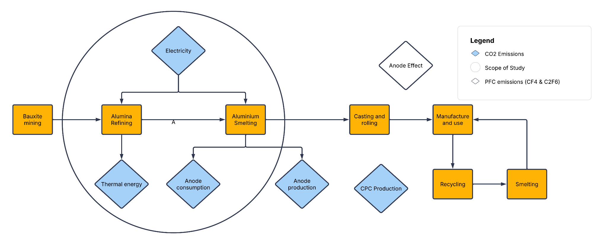
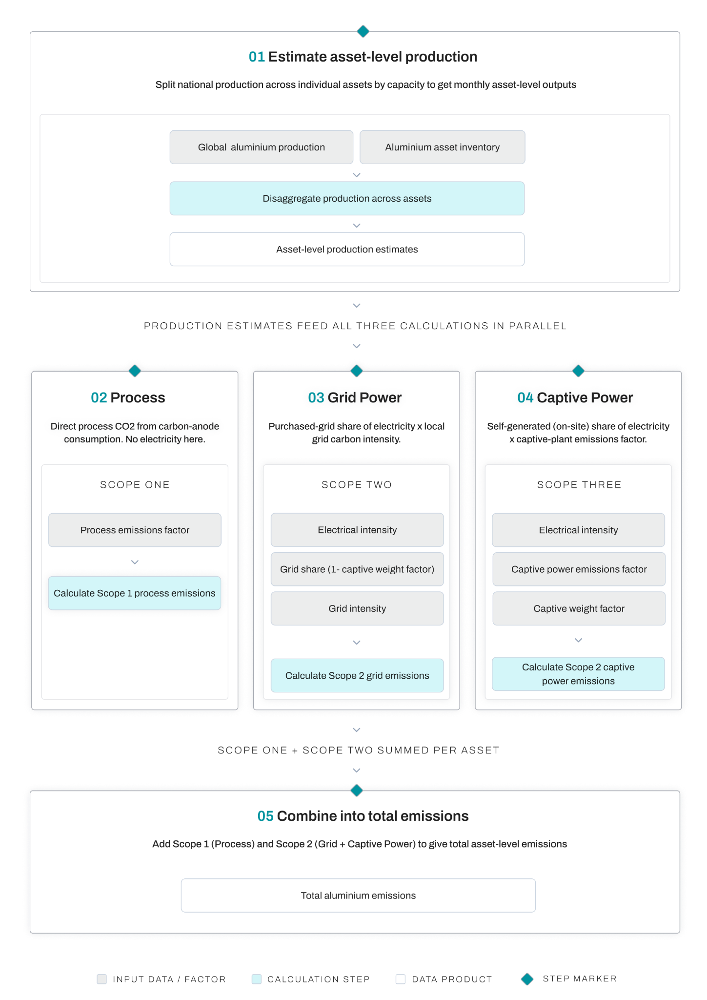
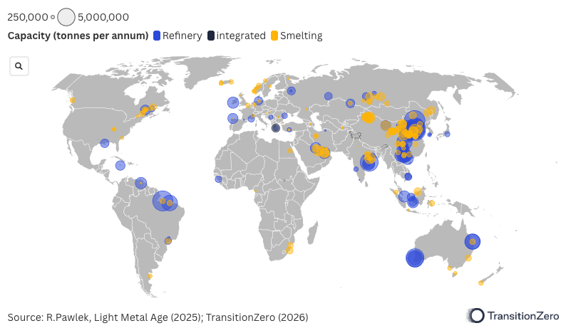
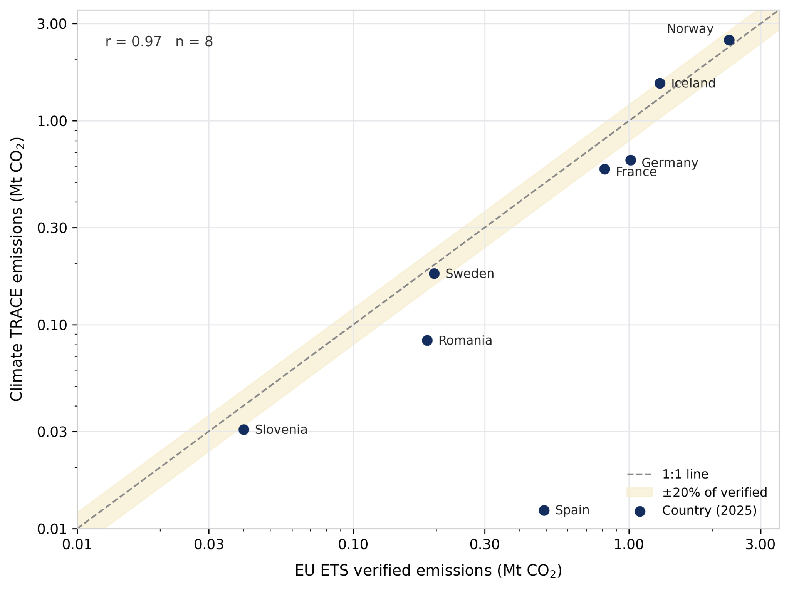
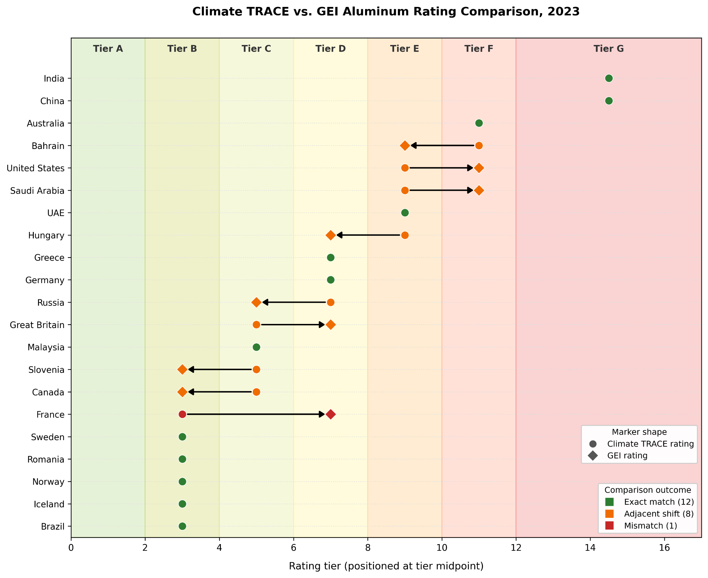

### Manufacturing and Industrial Processes sector: Aluminum Production Emissions

**Verity Crane, George Ebri, and Charlotte Underwood**

*Authors are affiliated with TransitionZero and Climate TRACE*

V5.10.0, Aug. 2026

#### 1. Introduction

Aluminum is the second most produced metal in the world after steel, with primary production reaching 104 million tonnes (Mt) in 2025 (IAI, 2026). Its combination of low density, high conductivity, corrosion resistance, and formability makes it valuable across construction, transport, packaging, and power transmission. It is also difficult to produce: the metal does not occur in native form, and industrial-scale extraction by electrolysis only became possible in the late nineteenth century, with the large-scale deployment of electricity generation. About two-thirds of global aluminum comes from primary production derived from bauxite; the remainder is secondary (recycled) metal, which requires roughly 5% of the energy needed to make virgin aluminum and can be recycled repeatedly with little degradation (IAI, 2025b).

Primary aluminum production accounts for around 2% of global human-caused greenhouse gas emissions once both direct emissions and indirect emissions from electricity generation are included (GEI, 2025). Beyond carbon dioxide (CO2), the sector is the largest global source of the perfluorocarbons (PFCs) carbon tetrafluoride (CF4) and hexafluoroethane (C2F6), produced during anode effects in electrolysis (Worton et al., 2007).

Point-source visibility for the sector is poor. Production is fiercely competitive, so facility-level data is rarely published; in most cases production is available only at the country or regional level and is released with delays of months to years (IAI, 2025a; NBSC, 2025). Only a few jurisdictions, such as the EU and the USA, publish facility-level emissions data (E-PRTR, 2024; US EPA, 2025). This methodology closes those spatial and temporal gaps by providing global, asset-level estimates of sector emissions on a monthly basis. Climate TRACE additionally provides asset-level emission reduction solutions (ERSs) to show how sector-specific mitigation could lower emissions.

#### 2. Scope and System Boundary

Figure 1 details the aluminium sector processes, from bauxite mining, through to manufacture and use. The emissions estimated in this study correspond only to the processes within the circle. A breakdown of the emissions within scope is described in Section 2.1.

**Figure 1** High-level overview of the aluminum sector describing processes and sources of GHG emissions. The scope of this study, primary aluminum production emissions, is enclosed by a circle.

Primary aluminum production begins with the extraction of bauxite, an oxidized ore of aluminum. Bauxite is refined into alumina through the Bayer process, and alumina is smelted into aluminum through the Hall-Héroult electrolysis process before being alloyed and cast. Electrolysis consumes a carbon anode continuously; anodes may be produced on-site or externally (Huglen and Kvande, 2016).

#### 2.1 Emissions in Scope

Following the process description in Huglen and Kvande (2016), this methodology estimates emissions related to alumina refining and aluminum smelting (Figure 1):

-   Direct (Scope 1) CO2 from anode consumption during electrolysis (smelters)

-   Direct (Scope 1) CO2 from fossil-fuel combustion supplying thermal energy to the Bayer process (refineries)

-   Indirect (Scope 2) CO2 from captive power generation at self-generating smelters and refineries

-   Indirect (Scope 2) CO2 from purchased grid electricity for smelting and refining

#### 2.2 Emissions out of Scope

Anode production — the CO2 from baking carbon paste into anodes — is excluded. Anode-baking facilities are frequently owned and operated by third parties and may sit off-site, making these emissions Scope 3 for many smelters rather than Scope 1. As Light Metal Age noted in its 2023 decarbonization review, whether a smelter owns its carbon plant ‘determines whether these emissions would belong to Scope 1 or 3’, and the global split is not known (Light Metal Age, 2023a). Anode consumption during electrolysis is instead captured through the fixed anode base emission factor applied to all smelters (Section 4.2).

PFC emissions from anode effects, casting, anode rodding, and bauxite mining are also excluded; each is individually small, and bauxite mining is reported in a separate Climate TRACE sector. Secondary (recycled) production, which accounts for under 2% of total sector emissions, is likewise outside scope.

#### 2.3 Technology routes

Two routes dominate primary production: the pre-bake process, in which a solid carbon anode is baked before electrolysis, and the Søderberg process, in which a self-baking carbon paste feeds the cell continuously. Global production is dominated by the more efficient pre-bake route, with around 4% still from Søderberg plants. We do not distinguish technology type at the asset level, because the source data does not record each plant’s route; anode consumption is therefore represented by a single fixed factor across all smelters.

#### 2.4 Coverage

We benchmark the asset pipeline against the US Geological Survey Mineral Commodity Summaries (USGS, 2025, 2026). For primary smelting, the pipeline captures 64 Mt of annualized production, about 89% of the 72 Mt global benchmark (2024 estimate) (USGS, 2025). For alumina refining, it captures 114 Mt of 2024 production, about 80% of the 142 Mt global total (USGS, 2026).

In emissions terms, the scope of study circled in Figure 1 captures approximately 80% of the cradle-to-gate carbon footprint of primary aluminum, based on IAI’s published 2025 global-average process breakdown (IAI, 2025a). This comprises electrolysis and direct process emissions (\~68% of the footprint) and refining electricity and thermal energy (\~12%). The remaining \~20% is spread across the excluded sources: anode production (\~7%), PFC emissions from anode effects (\~5%), ancillary materials and transport (\~7%), casting (\~1%), and bauxite mining (&lt;1%). Measured against the primary-production phase alone — rather than the full cradle-to-gate footprint — the in-scope processes represent more than 90% of emissions.

#### 3. Datasets employed

We use publicly available data sources and inventories to estimate primary aluminum production, including:

-   Primary aluminum production, primary aluminum smelting power consumption, alumina production, metallurgical alumina energy intensity and metallurgical alumina fuel consumption aggregated by regions from the International Aluminium Institute statistics (IAI, 2026).

-   Power grid intensities from Ember’s monthly electricity data (Ember, 2026a)

-   Aluminum asset (smelter and refinery) capacities from Industrial Information Resources (IIR, 2026).

-   Aluminum asset (smelter) database from Light Metal Age (R. Pawlek, 2026). Where smelter assets are also available in the IIR dataset, we prioritize LMA capacity data which provides historic capacity changes.

-   Combustion emission factors from the 2006 IPCC Guidelines (Vol. 2, Table 1.4) (IPCC, 2006), supported by EIA carbon dioxide emission coefficients (EIA, 2021) and IEA Emissions Factors 2024 (IEA, 2024).

-   Heat rate factors from EIA Electric Power Annual Table 8.2 (Average Tested Heat Rates by Prime Mover and Energy Source) (EIA, 2024).

-   Captive weight derived from country grid strength.

#### 4. Method

**Figure 2** Flowchart of the methodology to calculate facility-level emissions for aluminum smelters and alumina refineries.

Total emissions for each asset are the sum of Scope 1 and Scope 2 CO2. Production is first disaggregated to the asset level (Section 4.1), then multiplied by the relevant Scope 1 and Scope 2 emission factors (Sections 4.2–4.5).

#### 4.1 Production Estimates

The foundation of our emissions estimates is monthly alumina and aluminum production data from IAI (2026). To estimate the production at the facility level, a disaggregation method was applied: for each facility, we computed its share of regional capacity to derive the facility’s contribution to the regional production for the given timeframe (Figure 2 Section 1) . See below for an illustrative example of a country with two plants A and B (of capacities $`C_{A}`$and $`C_{B}`$ respectively) and a total production $`P_{\text{\ m}}`$ for a region in a given month m. The production estimates for these two plants are respectively $`P_{A,\ m}`$ and $`P_{B,\ m}`$:

-   $`P_{A,\ m} = \ \frac{C_{A}}{C_{A}\  + \ C_{B}}\  \times \ P_{m}`$

-   $`P_{B,\ m} = \ \frac{C_{B}}{C_{A}\  + \ C_{B}}\  \times \ P_{m}`$

Asset capacity data is sourced from IIR (2026) and LMA (R. Pawlek, 2026). Facility-level production is then multiplied by the relevant Scope 1 and Scope 2 emissions factors to derive point source emissions estimates.

**Figure 3** Visual representation of the primary aluminum assets used in this work. Refinery assets are represented by blue circles, whilst smelting assets are represented by orange circles, and integrated assets are represented by dark blue circles. The circle size reflects the plant capacity as shown top left with the smallest circle = 250,000 and large circle = 5,000,000.

#### 4.2 Smelter Scope 1: Anode Consumption

A fixed anode base emissions factor of 1.5 tCO2/t-Al is applied to all smelters (Figure 2 Section 2). This represents the direct CO2 from carbon anode consumption during electrolysis and is treated as a fixed process chemistry term: it does not vary with power source, so smelters powered entirely by renewable energy still generate these anode emissions.

This factor is consistent with the Ecofys (2009) EU ETS benchmark study and the IPCC 2006 guidance for aluminum production. The earlier Ecofys methodology reported electrolysis process emissions (\~2.025 tCO2/t-Al) and anode production (\~0.447 tCO2/t-Al) separately; our consolidated factor of 1.5 tCO2/t-Al reflects the anode consumption component only, with the remainder accounted for through the captive power methodology described in Section 4.3.

#### 4.3 Refinery Scope 1: Process thermal emissions

Refinery Scope 1 emissions arise primarily from fossil fuel combustion supplying thermal energy to the Bayer process (digestion at 150–200°C; calcination at \~1,050°C). These are estimated using IAI regional direct emissions factors (tCO2/t-alumina), which capture fleet-average thermal combustion intensity by region and year. Refineries with renewable primary fuel types (solar, wind, hydro) receive a process thermal EF of 0.0, on the basis that no fossil combustion is required for thermal energy.

#### 4.4 Scope 2: Indirect emissions from purchased electricity

Scope 2 emissions from purchased grid electricity are estimated as:

**Scope 2** purchased electricity = Grid emissions intensity (tCO2/MWh) ×

Electrical intensity (MWh/t product) × (1 − Captive weight)

Grid emissions intensity is sourced from Ember's monthly electricity data (Ember, 2026a), using country-level intensity where available and falling back to the global average elsewhere (Figure 2 Section 3).

#### 4.5 Scope 2: Indirect emissions from captive power generation

For smelters and refineries with on-site (captive) power generation, additional Scope 2 emissions arise from fossil fuel combustion in the captive power plant (Figure 2 Section 4). These emissions are often reported as Scope 1 emissions, as they take place on-site, but Climate TRACE reports all emissions from electricity generation for use within manufacturing under Scope 2.

These are estimated as:

**Captive power Scope 2** = Captive power EF (tCO2/MWh) ×

Electrical intensity (MWh/t-Al) × Captive weight

Where:

-   **Captive power EF** is derived from fuel-specific combustion emission factors (IPCC 2006 Volume 2 Table 1.4) and technology heat rates.

-   **Electrical intensity** is the IAI regional average electricity consumption per tonne of aluminum (\~13–16 MWh/t-Al for smelters, \~0.4-0.8 MWh.t-alumina for refineries).

-   **Captive weight** is the estimated fraction of electrical load supplied by captive generation, derived from country-level infrastructure profiles.

Where an asset has both a primary and secondary captive fuel, an 80/20 weighted split is applied to the captive power EF.

**Total Scope 2 (refineries and smelters) =** Purchased electricity Scope 2 + Captive power Scope 2

**Captive weight assignment** follows a three-tier hierarchy:

1.  Country-specific weight.

2.  Where no country match exists: 0.85 for any asset with known fuel data; 0.00 for grid-connected assets.

3.  Regional inference: assets in CHN, IND, KAZ are assumed to use coal (Tan et al., 2025; Ember, 2026b); assets in ARE, BHR, QAT, OMN, SAU are assumed to use natural gas (Tan et al.,2025), where no explicit fuel data is available.

**Total emissions =** Scope 1 CO2 emissions + Scope 2 CO2 emissions

#### 5. Results

China accounts for around 45% of the global primary aluminum production, with some of the largest smelting facilities. Tables 1 and 2 show the largest emitters in the aluminum sector at country and plant level; Tables 3 and 4 show the equivalent for alumina refining. See Section 2.1 for which scopes are categorized as direct and indirect emissions.

<table><thead><tr class="header"><th><strong>Table 1</strong> Top 10 emitting countries for primary aluminum production (smelting) in 2025</th><th></th><th></th><th></th></tr></thead><tbody><tr class="odd"><td><strong>Country</strong></td><td>
<strong>Direct</strong>

<strong>emissions (MtCO2)</strong>
</td><td>
<strong>Indirect</strong>

<strong>emissions (MtCO2)</strong>
</td><td>
<strong>Total</strong>

<strong>emissions (MtCO2)</strong>
</td></tr><tr class="even"><td>China</td><td>55.3</td><td>432.3</td><td>487.7</td></tr><tr class="odd"><td>India</td><td>3.8</td><td>36.0</td><td>39.8</td></tr><tr class="even"><td>UAE</td><td>4.0</td><td>20.5</td><td>24.5</td></tr><tr class="odd"><td>Russia</td><td>5.6</td><td>18.4</td><td>24.0</td></tr><tr class="even"><td>Bahrain</td><td>2.4</td><td>19.0</td><td>21.3</td></tr><tr class="odd"><td>Australia</td><td>2.2</td><td>13.3</td><td>15.6</td></tr><tr class="even"><td>Canada</td><td>4.7</td><td>9.2</td><td>13.8</td></tr><tr class="odd"><td>South Africa</td><td>1.0</td><td>6.6</td><td>7.6</td></tr><tr class="even"><td>Iran</td><td>1.0</td><td>6.0</td><td>7.0</td></tr><tr class="odd"><td>Qatar</td><td>1.0</td><td>5.4</td><td>6.4</td></tr></tbody></table>

| **Table 2** Top 10 emitting aluminum smelters in 2025 |             |                   |                                        |
|-------------------------------------------------------|-------------|-------------------|----------------------------------------|
| **Plant name**                                        | **Country** | **Capacity (Mt)** | **Total emissions (MtCO2)** |
| Zouping                                               | China       | 2.5               | 29.3                                   |
| Fukang                                                | China       | 1.9               | 24.0                                   |
| Tongshuan                                             | China       | 1.9               | 24.0                                   |
| Xinjiang                                              | China       | 1.7               | 21.7                                   |
| Alba                                                  | Bahrain     | 1.7               | 21.3                                   |
| Jharsuguda                                            | India       | 1.7               | 17.8                                   |
| Gansu Dongxing Jiujia                                 | China       | 1.4               | 17.2                                   |
| Chiping Xinfa                                         | China       | 1.3               | 17.1                                   |
| Wujiaqu                                               | China       | 1.4               | 17.1                                   |
| Baotou Shi                                            | China       | 1.4               | 17.1                                   |

The majority of smelting emissions are linked to electricity consumption. The share of indirect emissions varies by region, depending on grid intensity and captive weight (the proportion of electricity generated on site compared to sourced from the grid); indirect emissions reach 84% of the total in Venezuela and 83% in South Africa. Electricity consumption also factors into the Scope 1 emissions, through the captive power term, which is not grid dependent, rather is dependent on the fuel type used on site to generate electricity. Refineries, in contract, primarily emit emissions from fossil fuels used to produce heat (Tables 3 and 4).

<table><thead><tr class="header"><th><strong>Table 3</strong> Top 10 emitting countries for alumina production (refinery) in 2025</th><th></th><th></th><th></th></tr></thead><tbody><tr class="odd"><td><strong>Country</strong></td><td><strong>Direct 
emissions (MtCO2)</strong></td><td><strong>Indirect 
emissions (MtCO2)</strong></td><td>
<strong>Total</strong>

<strong>emissions (MtCO2)</strong>
</td></tr><tr class="even"><td>China</td><td>121.4</td><td>8.6</td><td>130.1</td></tr><tr class="odd"><td>Australia</td><td>25.4</td><td>1.7</td><td>27.1</td></tr><tr class="even"><td>Brazil</td><td>15.7</td><td>2.1</td><td>17.9</td></tr><tr class="odd"><td>India</td><td>14.4</td><td>0.8</td><td>15.3</td></tr><tr class="even"><td>Indonesia</td><td>8.7</td><td>0.30</td><td>9.0</td></tr><tr class="odd"><td>Russia</td><td>3.2</td><td>0.20</td><td>3.5</td></tr><tr class="even"><td>Venezuela</td><td>2.9</td><td>0.3</td><td>3.2</td></tr><tr class="odd"><td>Argentina</td><td>2.9</td><td>0.1</td><td>2.9</td></tr><tr class="even"><td>Saudi Arabia</td><td>2.6</td><td>0.1</td><td>2.7</td></tr><tr class="odd"><td>Ireland</td><td>2.0</td><td>0.2</td><td>2.2</td></tr></tbody></table>

<table><thead><tr class="header"><th><strong>Table 4</strong> Top 10 emitting aluminum refineries in 2025</th><th></th><th></th><th></th></tr></thead><tbody><tr class="odd"><td><strong>Plant name</strong></td><td><strong>Country</strong></td><td><strong>Capacity (Mt)</strong></td><td>
<strong>Total</strong>

<strong>emissions (MtCO2)</strong>
</td></tr><tr class="even"><td>Tangshan Caofeidian</td><td>China</td><td>8.8</td><td>12.2</td></tr><tr class="odd"><td>Barcarena Alunorte</td><td>Brazil</td><td>6.3</td><td>10.3</td></tr><tr class="even"><td>Chifeng</td><td>China</td><td>6.5</td><td>9.8</td></tr><tr class="odd"><td>Weiqiao Binzhou</td><td>China</td><td>6.0</td><td>9.1</td></tr><tr class="even"><td>Binzhou Zhanhua</td><td>China</td><td>6.0</td><td>9.1</td></tr><tr class="odd"><td>Lanjigarh</td><td>India</td><td>5.0</td><td>7.6</td></tr><tr class="even"><td>Pinjarra</td><td>Australia</td><td>5.0</td><td>7.0</td></tr><tr class="odd"><td>Sao Luis</td><td>Brazil</td><td>3.8</td><td>6.3</td></tr><tr class="even"><td>Worsley</td><td>Australia</td><td>4.4</td><td>6.2</td></tr><tr class="odd"><td>Zibo</td><td>China</td><td>4.0</td><td>5.5</td></tr></tbody></table>

Regional fleet-average emission intensities are broadly consistent with IAI’s published figures (IAI, 2024).

#### 6. Comparisons to external data sources

Evaluating the absolute accuracy of global, asset-level greenhouse gas emissions for primary aluminum smelting and alumina refining is a difficult task. To validate the operational integrity, directional accuracy, and physical baselines of the refined asset-level methodology developed in this work, our outputs are benchmarked against two of the most prominent external industrial reference systems:

1.  The European Union Emissions Trading System (EU ETS)

2.  The Global Efficiency Intelligence (GEI) Rating Framework

Importantly, these comparisons are not intended to yield a flawless, one-to-one mathematical match: different regulatory bodies and research institutions utilize vastly different accounting boundaries, reporting scopes, and process thresholds. Instead, these comparative exercises serve as an essential "sanity check" to verify that our model is directionally robust, geographically accurate, and physically constrained.

#### 6.1 EU ETS Emissions Data

The EU ETS is a highly regulated cap-and-trade market where industrial installations within Europe are legally required to report their emissions annually. When comparing our model's direct CO2 emissions to the EU ETS verified emissions, both represent Scope 1 (direct) emissions, but define the emissions boundaries differently: Climate TRACE focuses on process-specific chemistry, while the EU ETS enforces a strict physical fence-line:

**Climate TRACE Model: Process-Specific Scope 1**

-   Focuses on electrolysis chemical reactions (anode consumption).

-   In addition to the process Scope 1 emissions, the emissions from captive power generation, which are reported within the Scope 2 emissions, are extracted and included here, as the EU ETS scope explicitly states that it includes ‘on-site power generation’.

-   Excluded: downstream thermal heat (casting/baking).

**EU ETS: Physical Fence-Line Scope 1**

-   Includes all combustion within the facility (electrolysis + casting + baking + 100% of on-site backup/combustion generation).

**Figure 4** Comparison of ETS and Climate TRACE Scope 1 and captive power emissions for 2025 (tonnes) for the countries reported by ETS with non-zero emissions. The dashed line indicates exact agreement and the shaded band ±20% of verified emissions.

ETS therefore reports higher for most countries, except where smelters run on renewable power with little on-site combustion (Norway, Iceland), which match closely. The divergences elsewhere group into two causes:

1.  Scope — where casthouse, anode-baking or extrusion mills sit under one site permit, the ETS total exceeds ours (Germany, France, Spain)

2.  Multi-year curtailment — where a smelter idled but the consolidated permit stayed live, the ETS runs far higher (Spain, Slovakia, Romania; see Appendix 11.1 for more details)

The ETS's inability to isolate primary metal also biases it upward, with the following acknowledgement in its methodology: “it is not possible to differentiate between the production of primary and secondary aluminium \[...\] leading to overestimation of primary aluminium”.

#### 6.2 GEI Primary Aluminum Rating System

The Global Efficiency Intelligence (GEI) framework evaluates the national carbon intensity of the primary aluminum industry and assigns countries a letter-grade rating from A (cleanest) to G (most carbon-intensive).

To facilitate a comparative analysis, we have mapped our calculated asset-level emissions factors to the letter-grade brackets defined by the GEI. While we have assigned our values to the letter-based ranking system presented by GEI for the sake of comparison, the reader should note distinct differences in scope and methodology:

-   Cradle-to-Gate vs. Asset-Gate boundaries: GEI utilizes a broad cradle-to-gate boundary. If a country imports its raw materials (such as alumina), GEI assigns the carbon footprint of that upstream refining process directly to the consuming country's primary metal rating. Conversely, our model operates on an asset-gate boundary, isolating the exact performance of local smelting and refining facilities independently.

-   The PFC Anode Effect Gap: The GEI scope includes perfluorocarbon (PFC) process emissions (CF4 and C2F6) caused by temporary anode effects in the electrolysis pots. Our model does not currently capture these process emissions, introducing a minor, non-uniform underestimation. Modernized smelting fleets (e.g., Norway, Canada, Sweden) utilize advanced, computer-controlled point-fed systems that experience virtually no anode effects, keeping their ratings highly accurate. In contrast, countries running older smelting lines with less stable process controls (e.g., the United States) are artificially elevated to cleaner rating tiers in our baseline data, as their real-world PFC footprints (0.5 to 1.5 tCO2e/t) are omitted.

The Climate TRACE framework deliberately maintains the asset-gate boundary: forcing upstream alumina emissions into every smelting asset's footprint would require top-down regional trade assumptions, as alumina is a highly traded global commodity. By isolating the smelting stage, our model preserves the 'clean signal' of local decarbonization efforts - such as low-carbon PPAs and localized grid optimizations without diluting it with the fossil-thermal footprint of offshore alumina refining.

**Figure 5** Country-level comparison of Climate TRACE and GEI primary aluminum emissions ratings, 2023.

This data comparison shows that GEI and Climate TRACE agree on the relative cleanliness of aluminum production across a number of geographies. The gate-boundary difference in scope drives all adjacent or mismatched categorisations; countries whose primary aluminium supply chain is largely domestic (raw materials and smelting co-located) tend to align closely across both frameworks, since the cradle-to-gate and asset-gate boundaries collapse to nearly the same footprint. Adjacent classifications generally reflect countries with a meaningful import share of upstream alumina, or with older smelting fleets where the omitted PFC contribution is large enough to shift a rating tier. The effect of these scope differences is most pronounced for France, and is discussed in more detail in Appendix 11.1.

#### 7. Emissions Reduction Solutions Overview and Application

Emissions Reduction Solutions (ERSs) for this sector are two strategies: recycled feedstock for smelting and shut down refineries. *Note: Only rank 1 strategies are provided for assets on the Climate TRACE website and additional strategies will be made available in future releases.*

#### 7.1 Recycled feedstock for smelting

The use of recycled aluminum feedstock (secondary inputs) represents a major opportunity for emissions reduction. Recycling aluminum requires only a small fraction of the energy used in primary production and reduces the need for bauxite mining and alumina refining, both of which are highly carbon-intensive (The Aluminum Association, 2022). Electrifying some production processes can further decrease fossil fuel combustion emissions.

By employing recycled feedstock, the emission factor for aluminum production can decrease by approximately 95% compared to primary production (European Environment Agency, 2023). This approach also reduces the need for around eight tonnes of bauxite ore per tonne of aluminum, thereby cutting emissions from raw material extraction. Recycling of aluminum feedstock is widely practiced globally, accounting for more than one-third of total aluminum production in many industrialized economies (The Aluminum Association, 2022). Increased recycling also delivers co-benefits by lowering nitrogen oxide (NOₓ) and sulfur oxide (SOₓ) emissions from combustion processes (European Environment Agency, 2023).

There are potential caveats and limitations to employing this strategy. First, adoption includes maintaining product quality and managing impurities in recycled inputs. Second, in areas with fossil-fuel-dependent power grids, the emissions reductions from electrified recycling processes may be partially offset by higher indirect emissions from electricity use.

#### 7.2 Shut down refineries

This strategy focuses on the retirement of inefficient or high-emitting aluminum refineries. Some refineries produce higher emissions per tonne of aluminum due to process or equipment type. By shutting down these facilities and reallocating production to other, more efficient refineries, overall sectoral emissions can be reduced while maintaining total production output.

This strategy effectively eliminates 100% of activity and emissions at the decommissioned facility. The associated production activity is then induced at nearby facilities, which generally have a lower emissions factor (i.e., emit less CO₂ per tonne of aluminum produced). In practice, refineries operating above the national average emissions factor are candidates for closure, enabling emissions reductions by diverting activity to more efficient sites.

In principle, this strategy can be implemented anywhere with sufficient capacity at other refineries to absorb the diverted production. Its feasibility depends on the availability of underutilized capacity and the efficiency of alternative facilities. The development of low-emitting, high-capacity aluminum refineries—including those using more efficient technologies or cleaner energy inputs—would enhance the viability of this approach, effectively “pushing out” less efficient plants.

#### 8. Discussion and Limitations

We estimate point-source emissions for both alumina refineries and aluminum smelters by allocating a share of reported national production to each asset by capacity, then applying Scope 1 and Scope 2 emission factors. The sources covered are anode consumption, captive power generation, electricity consumption for electrolysis, and fuel combustion for alumina production.

The main limitation is the assumption that all assets in a region operate at the same utilization rate, which is how production is allocated by proportional capacity. This will misstate output where an asset is mothballed or offline for part of the year. Estimates would improve with more granular production data; province-level data would be particularly valuable for China, where most production and emissions occur. The method also omits PFC emissions from anode effects and does not distinguish pre-bake from Søderberg technology at the asset level. Even so, it provides a robust foundation for estimating CO2 emissions across the sector, with clear routes to refinement as more data becomes available.

#### 9. Data Availability and Metadata

Aluminum sector CO2 emissions are reported for individual assets from January 2021. The emissions described here represent a subset of country-level emissions estimates from the Climate TRACE manufacturing sector. All data is freely available on the Climate TRACE website ([https://climatetrace.org/](https://climatetrace.org/)). A detailed description of what is available is described in Tables 7-9.

<table><thead><tr class="header"><th><strong>Table 5</strong> Details on the asset metadata.</th><th></th></tr></thead><tbody><tr class="odd"><td><strong>General Description</strong></td><td><strong>Definition</strong></td></tr><tr class="even"><td>Sector definition</td><td>Emissions from aluminum production</td></tr><tr class="odd"><td>UNFCCC sector equivalent</td><td>2.C.3. aluminum production</td></tr><tr class="even"><td>Temporal Coverage</td><td>2021 – present</td></tr><tr class="odd"><td>Temporal Resolution</td><td>Monthly</td></tr><tr class="even"><td>Data format</td><td>CSV</td></tr><tr class="odd"><td>Coordinate Reference System</td><td>None. ISO3 country code provided</td></tr><tr class="even"><td>Number of emitters available for download</td><td>313 assets across 50 countries</td></tr><tr class="odd"><td>What emission factors were used?</td><td>Region and process specific emission factors</td></tr><tr class="even"><td>What is the difference between a “0” versus “NULL/none/nan” data field?</td><td>
“0” values are for true non-existent emissions. If we know that the

sector has emissions for that specific gas, but the gas was not modelled, this is represented by “NULL/none/nan”
</td></tr><tr class="odd"><td>total_CO2e_100yrGWP and total_CO2e_20yrGWP conversions</td><td>Climate TRACE uses IPCC AR6 CO2e GWPs. CO2e conversion guidelines are here: https://www.ipcc.ch/report/ar6/wg1/downloads/report/IPCC_AR6_WGI_FullReport_small.pdf</td></tr></tbody></table>

| **Table 6** Definition of the fields in asset dataset. |                                                                                                                                                                                                                                                                                                                                                                     |
|--------------------------------------------------------|---------------------------------------------------------------------------------------------------------------------------------------------------------------------------------------------------------------------------------------------------------------------------------------------------------------------------------------------------------------------|
| **Data attribute**                                     | **Definition**                                                                                                                                                                                                                                                                                                                                                      |
| sector                                                 | manufacturing                                                                                                                                                                                                                                                                                                                                                       |
| source\_sub-sector\_name                               | aluminum                                                                                                                                                                                                                                                                                                                                                            |
| source definition                                      | emissions from alumina and aluminum production                                                                                                                                                                                                                                                                                                                      |
| start\_date                                            | start date for time period of emissions estimation (YYYY-MM-DD format)                                                                                                                                                                                                                                                                                              |
| end\_date                                              | end date for time period of emissions estimation (YYYY-MM-DD format)                                                                                                                                                                                                                                                                                                |
| asset\_identifier                                      | internal identifier                                                                                                                                                                                                                                                                                                                                                 |
| asset\_name                                            | name of the facility                                                                                                                                                                                                                                                                                                                                                |
| iso3\_country                                          | ISO 3166-1 alpha-3 country code                                                                                                                                                                                                                                                                                                                                     |
| location                                               | well-known text (WKT) point location                                                                                                                                                                                                                                                                                                                                |
| type                                                   | manufacturing method                                                                                                                                                                                                                                                                                                                                                |
| capacity                                               | monthly plant capacity                                                                                                                                                                                                                                                                                                                                              |
| capacity\_factor                                       | utilization rate of refinery/smelters                                                                                                                                                                                                                                                                                                                               |
| activity                                               | production estimates                                                                                                                                                                                                                                                                                                                                                |
| CO2\_emissions\_factor                                 | direct emissions factor (t-CO2/t-alumina or aluminum)                                                                                                                                                                                                                                                                                                    |
| CH4\_emissions\_factor                                 | not used; N/A                                                                                                                                                                                                                                                                                                                                                       |
| N2O\_emissions\_factor                                 | not used; N/A                                                                                                                                                                                                                                                                                                                                                       |
| CO2\_emissions                                         | direct emissions estimates (t-CO2)                                                                                                                                                                                                                                                                                                                       |
| CH4\_emissions                                         | not used; N/A                                                                                                                                                                                                                                                                                                                                                       |
| N2O\_emissions                                         | not used; N/A                                                                                                                                                                                                                                                                                                                                                       |
| total\_CO2e\_100yrGWP                                  | 100 years global warming potential (t-CO2e)                                                                                                                                                                                                                                                                                                              |
| total\_CO2e\_20yrGWP                                   | 20 years global warming potential (t-CO2e)                                                                                                                                                                                                                                                                                                               |
| other1                                                 | direct and indirect emissions factor: includes electricity use (t-CO2/t-alumina or aluminum)                                                                                                                                                                                                                                                             |
| other2                                                 | direct and indirect emissions: includes electricity use (t-CO2)                                                                                                                                                                                                                                                                                          |
| other3                                                 | electricity use factor (MWh/t-alumina or aluminum)                                                                                                                                                                                                                                                                                                                  |
| other4                                                 | electricity consumption (MWh)                                                                                                                                                                                                                                                                                                                                       |
| other5                                                 | grid emissions intensity (t-CO2/MWh)                                                                                                                                                                                                                                                                                                                     |
| other6                                                 | Smelting share of total asset CO2 emissions (100 for pure smelters, 0 for pure refineries, proportional split for integrated assets)                                                                                                                                                                                                                     |
| other7                                                 | Thermal energy share of Scope 1 (direct) emissions, as a factor (0-1). 0 for pure smelters (process EF is anode/electrolysis chemistry, not combustion), 1 for pure refineries (process EF is IAI regional thermal average, i.e. Bayer process combustion), proportional blend for integrated assets weighted by each plant type's share of total direct emissions. |
| model\_number                                          | version of the model (e.g. 1, 2, …)                                                                                                                                                                                                                                                                                                                                 |

<table><thead><tr class="header"><th><strong>Table 7</strong> Definition for confidence and uncertainty in asset data.</th><th></th><th></th></tr></thead><tbody><tr class="odd"><td><strong>Data attribute</strong></td><td><strong>Confidence Definition</strong></td><td><strong>Uncertainty Definition</strong></td></tr><tr class="even"><td>type</td><td><ul><li><blockquote>
Very low: Based on highly speculative or obsolete information. Very low level of confidence in the accuracy of asset classification.
</blockquote></li><li><blockquote>
Low: Limited or somewhat outdated data. Low level of confidence in the classification's correctness.
</blockquote></li><li><blockquote>
Medium: A mix of historical and more recent data. A medium level of confidence in its accuracy.
</blockquote></li><li><blockquote>
High: Grounded in comprehensive and recent data. A high level of confidence in the precise classification of the asset.
</blockquote></li><li><blockquote>
Very high: Extensive, up-to-date, and verified data. A very high level of confidence in the accurate and detailed identification of the asset.
</blockquote></li></ul></td><td>Not used; N/A</td></tr><tr class="odd"><td>capacity</td><td><ul><li><blockquote>
Very low: Limited or outdated data, and significant uncertainties exist.
</blockquote></li><li><blockquote>
Low: Outdated and/or incomplete data.
</blockquote></li><li><blockquote>
Medium: A mix of historical and recent data.
</blockquote></li><li><blockquote>
High: Comprehensive and recent data updates. High level of certainty.
</blockquote></li><li><blockquote>
Very high: Extensive, up-to-date, and verified data. A very high level of certainty.
</blockquote></li></ul></td><td>Not used; N/A</td></tr><tr class="even"><td>capacity_factor</td><td><ul><li><blockquote>
Very low: Data is sparse or highly unreliable. Considerable uncertainty in capacity factor estimations.
</blockquote></li><li><blockquote>
Low: Moderate uncertainty in capacity factor calculations.
</blockquote></li><li><blockquote>
Medium: Data is sufficiently available, though not comprehensive. No absolute accuracy in capacity factor estimations.
</blockquote></li><li><blockquote>
High: High confidence in the accuracy of capacity factor calculations.
</blockquote></li><li><blockquote>
Very high: Derived from thorough and validated data sources. Very high precision of capacity factor estimations.
</blockquote></li></ul></td><td>Not used; N/A</td></tr><tr class="odd"><td>activity</td><td><ul><li><blockquote>
Very low: Largely speculative or based on outdated information. A very low level of confidence in activity assessments.
</blockquote></li><li><blockquote>
Low: Limited or somewhat outdated sources. A low level of confidence in the activity assessments.
</blockquote></li><li><blockquote>
Medium: A mix of historical and more recent data. Medium level of confidence in activity insights.
</blockquote></li><li><blockquote>
High: Detailed and current operational data ensures a high level of confidence in the accuracy of activity assessments.
</blockquote></li><li><blockquote>
Very high: Extensive, verified, and up-to-date data. A very high level of confidence in their accuracy.
</blockquote></li></ul></td><td>±12 to 15 % of production estimates</td></tr><tr class="even"><td>CO2_emissions_factor</td><td><ul><li><blockquote>
Very low: Highly uncertain due to insufficient or unreliable data.
</blockquote></li><li><blockquote>
Low: Estimated from incomplete data. Low confidence level in its precision.
</blockquote></li><li><blockquote>
Medium: A mix of historical and more recent data. Medium level of confidence in their accuracy.
</blockquote></li><li><blockquote>
High: Derived from comprehensive and recent data. A high level of confidence in their precision.
</blockquote></li><li><blockquote>
Very high: Based on extensive and validated data, providing a very high level of confidence in their precision.
</blockquote></li></ul></td><td>±19 to 25 % of assumed value</td></tr><tr class="odd"><td>CH4_emissions_factor</td><td>Not used; N/A</td><td>Not used; N/A</td></tr><tr class="even"><td>N2O_emissions_factor</td><td>Not used; N/A</td><td>Not used; N/A</td></tr><tr class="odd"><td>CO2_emissions</td><td><ul><li><blockquote>
Very low: Based on very rough estimations or outdated information. A very low level of confidence in its accuracy.
</blockquote></li><li><blockquote>
Low: Estimated from incomplete data. Low confidence level in its precision.
</blockquote></li><li><blockquote>
Medium: A mix of historical and more recent data. Medium level of confidence in their accuracy.
</blockquote></li><li><blockquote>
High: Derived from comprehensive and recent data. A high level of confidence in their precision.
</blockquote></li><li><blockquote>
Very high: Based on extensive and validated data, providing a very high level of confidence in their precision.
</blockquote></li></ul></td><td>±19 to 25% of emissions estimates</td></tr><tr class="even"><td>CH4_emissions</td><td>Not used; N/A</td><td>Not used; N/A</td></tr><tr class="odd"><td>N2O_emissions</td><td>Not used; N/A</td><td>Not used; N/A</td></tr><tr class="even"><td>total_CO2e_100yrGWP</td><td><ul><li><blockquote>
Very low: Based on very rough estimations or outdated information. A very low level of confidence in its accuracy.
</blockquote></li><li><blockquote>
Low: Estimated from incomplete data. Low confidence level in its precision.
</blockquote></li><li><blockquote>
Medium: A mix of historical and more recent data. Medium level of confidence in their accuracy.
</blockquote></li><li><blockquote>
High: Derived from comprehensive and recent data. A high level of confidence in their precision.
</blockquote></li><li><blockquote>
Very high: Based on extensive and validated data, providing a very high level of confidence in their precision.
</blockquote></li></ul></td><td>±19 to 25% of emissions estimates</td></tr><tr class="odd"><td>total_CO2e_20yrGWP</td><td><ul><li><blockquote>
Very low: Based on very rough estimations or outdated information. A very low level of confidence in its accuracy.
</blockquote></li><li><blockquote>
Low: Estimated from incomplete data. Low confidence level in its precision.
</blockquote></li><li><blockquote>
Medium: A mix of historical and more recent data. Medium level of confidence in their accuracy.
</blockquote></li><li><blockquote>
High: Derived from comprehensive and recent data. A high level of confidence in their precision.
</blockquote></li><li><blockquote>
Very high: Based on extensive and validated data, providing a very high level of confidence in their precision.
</blockquote></li></ul></td><td>±19 to 25% of emissions estimates</td></tr></tbody></table>

**Permissions and Use:** All Climate TRACE data is freely available under the Creative Commons Attribution 4.0 International Public License, unless otherwise noted below.

**Citation format:** Crane, V., Ebri, G., and Underwood, C. (2026). *Manufacturing and Industrial Processes sector– Aluminum Production Emissions*. TransitionZero, UK, Climate TRACE Emissions Inventory. [https://climatetrace.org](https://climatetrace.org)

**Disclaimer:** The emissions provided for this sector are our current best estimates of emissions, and we are committed to continually increasing the accuracy of the models on all levels. Please review our terms of use and the sector-specific methodology documentation before using the data. If you identify an error or would like to participate in our data validation process, please [contact us](mailto:coalition@climatetrace.org).

#### 10. References

1.  Alcoa Corporation (2021). Alcoa Reaches Agreement on Future of San Ciprián Smelter. Press release, December 29, 2021. Available at: [https://www.businesswire.com/news/home/20211229005367/en/Alcoa-Reaches-Agreement-on-Future-of-San-Ciprin-Smelter](https://www.businesswire.com/news/home/20211229005367/en/Alcoa-Reaches-Agreement-on-Future-of-San-Ciprin-Smelter)

2.  Alcoa Corporation (2024). Form 10-K, Fiscal Year 2024. U.S. Securities and Exchange Commission. Available at: [ https://www.sec.gov/Archives/edgar/data/1675149/000095017025024242/aa-20241231.html](https://www.sec.gov/Archives/edgar/data/1675149/000095017025024242/aa-20241231.html)

3.  Alro S.A. (2022). Communique on the reduction of primary aluminium production activity. Available at: [https://www.alro.ro/en/article/communique-production-activity-primary-aluminum-will-be-reduced](https://www.alro.ro/en/article/communique-production-activity-primary-aluminum-will-be-reduced)

4.  The Aluminum Association (2022) 2022 Semi-Fabricated Aluminum Life Cycle Assessment Report. Available at: [https://www.aluminum.org/sites/default/files/2022-01/2022\_Semi-Fab\_LCA\_Report.pdf](https://www.aluminum.org/sites/default/files/2022-01/2022_Semi-Fab_LCA_Report.pdf) (Accessed: 4 November 2025).

5.  European External Action Service (EEAS) (2019). Joint Letter to U.S. Senate Minority Leader Schumer on Delisting RUSAL and EN+. Available at: [https://www.eeas.europa.eu/node/56433\_en](https://www.eeas.europa.eu/node/56433_en)

6.  E-PRTR contributors (2024) ‘Steel emissions data retrieved from: E-PRTR’. European Pollutant Release and Transfer Register. Available at: [http://prtr.ec.europa.eu/](http://prtr.ec.europa.eu/)

7.  Ecofys (2009) Methodology for the free allocation of emission allowances in the EU ETS post 2012 - Sector report for the aluminium industry. Ecofys Netherlands / Fraunhofer Institute for Systems and Innovation research Available at: [https://climate.ec.europa.eu/system/files/2016-11/bm\_study-project\_approach\_and\_general\_issues\_en.pdf](https://climate.ec.europa.eu/system/files/2016-11/bm_study-project_approach_and_general_issues_en.pdf)

8.  EIA (2021) Carbon Dioxide Emissions Coefficients retrieved from: EIA. Available at: [https://www.eia.gov/tools/faqs/faq.php?id=74&t=11](https://www.eia.gov/tools/faqs/faq.php?id=74&t=11)

9.  Ember (2026a) ‘Regional grid intensity retrieved from: Monthly Electricity Data’. Available at: [https://ember-energy.org/data/monthly-electricity-data/](https://ember-energy.org/data/monthly-electricity-data/)

10. Ember (2026b). 'As aluminium surges in China, so do carbon emissions'. Available at: [https://ember-energy.org/latest-insights/as-aluminium-surges-in-china-so-do-carbon-emissions/](https://ember-energy.org/latest-insights/as-aluminium-surges-in-china-so-do-carbon-emissions/)

11. European Environment Agency (2023) EMEP/EEA Air Pollutant Emission Inventory Guidebook 2023 – Part B: Sectoral guidance chapters, 2.C.3 Aluminum production. Available at: [https://www.eea.europa.eu/publications/emep-eea-guidebook-2023](https://www.eea.europa.eu/publications/emep-eea-guidebook-2023) (Accessed: 4 November 2025).

12. Global Efficiency Intelligence (GEI) (2025). Aluminum Climate Impact 2025: An International Benchmarking of Energy and CO2 Intensities. Global Efficiency Intelligence, LLC. Florida, United States. Available at: [https://www.globalefficiencyintel.com/aluminum-climate-impact-2025-an-international-benchmarking-of-energy-and-co2-intensities](https://www.globalefficiencyintel.com/aluminum-climate-impact-2025-an-international-benchmarking-of-energy-and-co2-intensities)

13. Huglen, R., Kvande, H. (2016) How to minimise the Carbon Footprint from Aluminum Smelters. Vol. 76, No. 1, Norwegian University of Science and Technology, University of Auckland

14. Industrial Information Resources (IIR) (2026). Available at: [https://www.industrialinfo.com/](https://www.industrialinfo.com/)

15. International Aluminium Institute (IAI) (2026) Aluminium production and emissions data retrieved from: IAI Statistics. Available at: [https://international-aluminium.org/statistics/primary-aluminium-production/](https://international-aluminium.org/statistics/primary-aluminium-production/)

16. International Aluminium Institute (IAI) (2025a). Aluminium Carbon Footprint FAQs. Available at: [https://international-aluminium.org/landing/aluminium-carbon-footprint-faqs/](https://international-aluminium.org/landing/aluminium-carbon-footprint-faqs/)

17. International Aluminium Institute (IAI) (2025b) Material Flow Analysis. Available at: [https://international-aluminium.org/resource/material-flow-analysis-a-look-at-the-numbers-globally-and-in-asia/](https://international-aluminium.org/resource/material-flow-analysis-a-look-at-the-numbers-globally-and-in-asia/)

18. International Aluminium Institute (IAI). 2024. Primary Aluminium Greenhouse Gas Emissions Intensity. [https://international-aluminium.org/statistics/greenhouse-gas-emissions-primary-aluminium/](https://international-aluminium.org/statistics/greenhouse-gas-emissions-primary-aluminium/)

19. International Energy Agency (IEA). 2024. Emissions Factors 2024. [https://www.iea.org/data-and-statistics/data-product/emissions-factors-2024](https://www.iea.org/data-and-statistics/data-product/emissions-factors-2024)

20. IPCC (2006). 2006 IPCC Guidelines for National Greenhouse Gas Inventories, Volume 2: Energy, Chapter 2: Stationary Combustion, Table 1.4.

21. Light Metal Age (2023a); Decarbonising the Primary Aluminum Industry, March 20 2023. Accessed 14/07/2026. Available at: [https://www.lightmetalage.com/news/industry-news/smelting/decarbonizing-the-primary-aluminum-industry/](https://www.lightmetalage.com/news/industry-news/smelting/decarbonizing-the-primary-aluminum-industry/)

22. Light Metal Age (2023b). The Shift Toward Renewable Power in Aluminum Smelting. Available at: [https://www.lightmetalage.com/news/industry-news/smelting/the-shift-toward-renewable-power-in-aluminum-smelting/](https://www.lightmetalage.com/news/industry-news/smelting/the-shift-toward-renewable-power-in-aluminum-smelting/)

23. Mission Possible Partnership (2026). Aluminium Dunkerque \| France. Available at: [https://missionpossiblepartnership.org/aluminium-dunkerque-france/](https://missionpossiblepartnership.org/aluminium-dunkerque-france/)

24. Nord France Invest (2026). Aluminium Dunkerque: low-carbon aluminum at the heart of Hauts-de-France. Available at: https://www.nordfranceinvest.com/success-story/the-road-to-carbon-free-aluminium/

25. NBSC (2025) ‘Chinese aluminium production data retrieved from: NBSC’. National Bureau of Statistics of China. Available at: [http://www.stats.gov.cn/english/](http://www.stats.gov.cn/english/)

26. Norsk Hydro (2022). Slovalco will stop primary aluminium production. Press release, August 17, 2022. Available at: [https://www.hydro.com/en/global/media/news/2022/slovalco-will-stop-primary-aluminium-production/](https://www.hydro.com/en/global/media/news/2022/slovalco-will-stop-primary-aluminium-production/)

27. R. Pawlek (2026). ‘Primary aluminium producers’. Light Metal Age. Available at: [https://www.lightmetalage.com/resources-section/primary-producers/](https://www.lightmetalage.com/resources-section/primary-producers/)

28. Reuters, cited in MINING.com (2022). Europe's power crunch sparks aluminum smelter meltdown. Available at: [https://www.mining.com/web/europes-power-crunch-sparks-aluminum-smelter-meltdown/](https://www.mining.com/web/europes-power-crunch-sparks-aluminum-smelter-meltdown/)

29. RTE (2026). Collateral damage: Aughinish Alumina and EU sanctions. Raidió Teilifís Éireann. Available at: [https://www.rte.ie/news/analysis-and-comment/2026/0530/1575983-aughinish-alumina-analysis/](https://www.rte.ie/news/analysis-and-comment/2026/0530/1575983-aughinish-alumina-analysis/)

30. Tan, C., Yu, X., Li, D., Lei, T., Hao, Q. and Guan, D. (2025). 'Different technology packages for aluminium smelters worldwide to deliver the 1.5 °C target'. *Nature Climate Change*, 15, pp. 51–58. Available at: [https://www.nature.com/articles/s41558-024-02193-x](https://www.nature.com/articles/s41558-024-02193-x)

31. U.S. Energy Information Administration (EIA). 2024. Electric Power Annual, Table 8.2: Average Tested Heat Rates by Prime Mover and Energy Source. Washington, DC: U.S. Department of Energy. Available at: [https://www.eia.gov/electricity/annual/html/epa\_08\_02.html](https://www.eia.gov/electricity/annual/html/epa_08_02.html)

32. US EPA contributors (2025) ‘Aluminum emissions data retrieved from: US EPA’. United States Environmental Protection Agency. Available at: [https://www.epa.gov/eps-partnership/aluminum-industry\#sources](https://www.epa.gov/eps-partnership/aluminum-industry#sources)

33. U.S. Geological Survey (2025). Mineral Commodity Summaries 2025: Aluminum. Reston, VA: U.S. Geological Survey. Available at: [https://pubs.usgs.gov/periodicals/mcs2025/mcs2025-aluminum.pdf](https://pubs.usgs.gov/periodicals/mcs2025/mcs2025-aluminum.pdf)

34. U.S. Geological Survey (2026). Mineral Commodity Summaries 2026: Bauxite and Alumina. Reston, VA: U.S. Geological Survey. Available at: [https://pubs.usgs.gov/periodicals/mcs2026/mcs2026-bauxite-alumina.pdf](https://pubs.usgs.gov/periodicals/mcs2026/mcs2026-bauxite-alumina.pdf)

35. Worton, D.R., Sturges, W.T., Gohar, L.K., Shine, K.P., Martinerie, P., Oram, D.E., Humphrey, S.P., Begley, P., Gunn, L., Barnola, J.-M., Schwander, J., Mulvaney, R., 2007. Atmospheric Trends and Radiative Forcings of CF4 and C2F6 Inferred from Firn Air. Environ. Sci. Technol. 41, 2184–2189. Available at: [https://doi.org/10.1021/es061710t](https://doi.org/10.1021/es061710t)

#### 11. Appendix

#### 11.1 Supporting detail for the EU ETS and GEI comparisons

**Country-specific ETS divergences**

Where the ETS reports substantially more than Climate TRACE, the gap almost always traces to a single structural cause: the ETS captures a whole site under one consolidated permit, whereas the model tracks only the primary smelting process. We have identified three effects:

Process thermal combustion: In Germany, France and Spain, anode-baking furnaces run almost exclusively on natural gas; those combustion emissions are captured by the ETS but sit outside the boundary of the Climate TRACE Scope 1 model, so the ETS reads higher.

Multi-year curtailment: This effect is seen where a smelter idled but the site permit stayed live. In Spain, the divergence reflects a sustained curtailment rather than a single 2025 event: Alcoa curtailed San Ciprián's primary smelting potlines from January 2022 under a workforce viability agreement (Alcoa Corporation, 2021), with no smelting capacity reported for 2021–2024. The refinery and casthouse continued operating throughout (Alcoa Corporation, 2021; Alcoa Corporation, 2024), so the consolidated ETS permit stayed high while Climate TRACE tracked the smelter curtailment; a partial restart in 2025 is reflected by Climate TRACE. Slovakia followed the same pattern: Slovalco shut down all primary smelting electrolysis lines in stages between 2022 and early 2023, driven by the European energy price crisis affecting smelters across the continent (Norsk Hydro, 2022), and this shows as zero Climate TRACE emissions from 2024, while the ETS still reports the site's continuing casthouse and recycling operation of around 75,000 tonnes/year (Norsk Hydro, 2022).

Capacity adjustment at integrated sites: In Romania, Alro Slatina reduced output from five to two potlines in December 2021 amid "exorbitant energy prices" (Reuters, 2022; Alro S.A., 2022). The Climate TRACE model scales down proportionally, whereas the ETS stays more constant, again reflecting the site's integrated anode plant, casting house and downstream rolling and extrusion mills under one permit (Alro S.A., 2022).

Norway and Iceland, by contrast, show close agreement: these smelters run almost entirely on renewable hydroelectric and geothermal power (Light Metal Age, 2023b) with minimal on-site combustion, so both datasets report effectively the same scope.

**France GEI worked example**

France's smelters (Dunkerque and Saint-Jean-de-Maurienne) run on clean, nuclear-dominated grid power via long-term power purchase agreements with EDF and Engie (Mission Possible Partnership, 2026; Nord France Invest, 2026). France has, however, no domestic production of smelter-grade alumina — its four domestic refineries specialise exclusively in non-metallurgical, abrasive grades — so smelter-grade alumina is imported, chiefly from the Aughinish Alumina Refinery in Ireland (around 68% of Dunkerque's supply) and the San Ciprián Refinery in Spain (RTE, 2026; EEAS, 2019). GEI's cradle-to-gate boundary includes this imported refining footprint; Climate TRACE does not. Applying a realistic 80/20 supply split between Aughinish and San Ciprián adds an estimated 4.08 tCO₂/t to France's total emissions factor, shifting the Climate TRACE rating into the D category and matching GEI.

This effect is pronounced for France because of the combination of an exceptionally clean grid and total reliance on imported alumina. Other trading nations — Australia, China, Brazil — are largely vertically integrated domestically, so the boundaries align; and in coal-heavy countries like China and India, smelting electricity emissions dominate enough that imported alumina has a negligible effect on the final rating.
