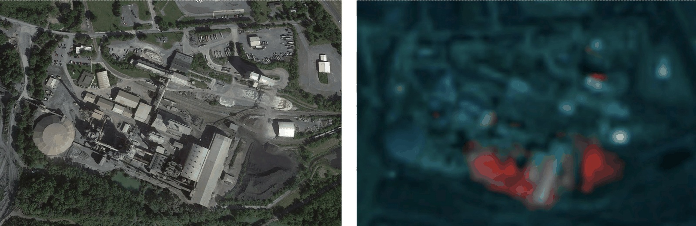
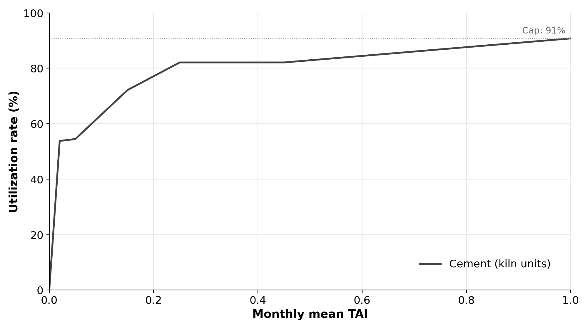

### Manufacturing and Industrial Processes sector: Cement Manufacturing Emissions

**Verity Crane, George Ebri and Charlotte Underwood**

*Authors are affiliated with TransitionZero and Climate TRACE*

V5.10.0, Aug. 2026

#### 1. Introduction

The cement industry plays a critical role in both global infrastructure and global emissions. It accounts for roughly 7% of industrial energy use and 6% of global carbon dioxide emissions, making it the second-largest source of direct industrial CO2 emissions after steel (IEA, 2025). Cement is the principal ingredient used to make concrete, the most widely used manufactured material in the world, owing to its versatility across housing, sanitation, transportation, and energy infrastructure. Meeting future cement demand while cutting CO2 emissions poses a major challenge: although China's construction sector has cooled in recent years, rising demand in other regions is set to drive global consumption upward.

A clear picture of where cement-sector emissions originate and how they are distributed is typically difficult to obtain. Commercial confidentiality and international competition limit public reporting of plant-level production data. Most official statistics are aggregated at the national level, with reporting delays of up to several years (USGS, 2026a; NBSC, 2026). Only a few jurisdictions, such as the EU and the United States, publish facility-level emissions data (EEA, 2026; US EPA, 2025). This dataset aims to close these spatial and temporal gaps by providing global, asset-level estimates of cement-related emissions on a monthly basis. Using satellite-derived thermal anomaly data, we infer activity levels at clinker-producing cement facilities identified in Global Energy Monitor's Global Cement and Concrete Tracker (GEM, 2026). This approach allows for consistent, near-real-time monitoring of cement production and associated emissions across regions where traditional data sources are limited or unavailable. National totals are also published monthly from January 2015, based on reported national production and asset-derived emission factors (Section 2.2.4).

Unlike steel and other carbon-intensive sectors, the majority of cement emissions are process-related, stemming from limestone calcination rather than fuel combustion for heat generation. The cement industry therefore requires unique, targeted emissions reduction strategies. In this work, we propose a set of nine emission reduction strategies and provide a minimum of one for each asset in the dataset based on known production technology and process characteristics. We take into account conventional wet- or dry-kiln operations, use of alternative fuels, and clinker substitution practices. Based on these, the strategies considered include switching to alternative fuels, implementing carbon capture and storage (CCS), substituting clinker with supplementary materials such as slag or calcined clay, and decommissioning high-emission wet-kiln plants. Each strategy represents a pathway to reduce emissions, either by lowering process emissions from clinker production, reducing fuel-related emissions, or phasing out high-emission technologies.

#### 2. Materials and methods

Cement production emits CO2 from two main sources: process emissions from limestone calcination and combustion emissions from fossil fuels used to heat rotary kilns. Clinker production is by far the most emissions-intensive stage in the cement value chain and accounts for the majority of the sector's total CO2 output. A more detailed overview is provided in Section 9.1 and Figure 10.

Given the lack of asset-level emission data publicly available, a standardized 'bottom-up' approach is used to quantify the emissions. This process is characterized by first estimating production levels for each plant before applying an emission factor to generate emissions estimates. Emission factors are asset-specific, determined as a function of final product characteristics (clinker-to-cement ratio, cement color, type), plant production route (wet, dry, semi-dry), and the use of emissions-reduction technologies (alternative fuels, supplementary cementitious materials, CCS/CCUS). The workflow is summarized in Figure 1.

**Figure 1** Flowchart of the methodology to calculate plant level emissions for global cement assets.

#### 2.1. Materials

#### 2.1.1. Asset inventory dataset

Cement production consists of three steps: first limestone is mixed with other materials, then the mixture is heated to produce clinker, and finally this clinker is ground together with other ingredients to produce cement. The final grinding process can happen in integrated facilities where clinker is also produced, or in independent grinding facilities closer to the end market. Global Energy Monitor provides facility-level information such as GPS coordinates, owner, capacity, age, product, and technology type for integrated, clinker-only, and grinding plant types. In this work, we estimate emissions for integrated plants only. Grinding and clinker-only plants are excluded. Plants for which GEM reports no plant type are treated as integrated. In total there are 2,493 integrated cement plants across 143 countries and territories. We manually validated the locations of all the plants using geolocation data from Google Maps (2025) and OpenStreetMap (2025).

Figure 2 shows the global distribution of integrated cement plants. China accounts for around half of global production, followed by India at 10% (USGS, 2026a).

**Figure 2** Global map showing integrated cement facilities. Countries included in cement emissions monitoring are shaded. Assets that are monitored with satellites are shown in blue. The circle size represents plant production capacity, with reference scales shown at the top of the figure for 1,200 and 6,000 thousand tonnes per annum (ktpa).

#### 2.1.2. Remote sensing datasets

Satellite-derived production estimates make use of multispectral imagery from two different collections:

-   The European Space Agency (ESA) Copernicus Sentinel mission with a resolution of 20 m and a combined 5-day equator revisit with two satellites:

-   Sentinel-2A: with imagery available since 2015 (ESA, 2025).

-   Sentinel-2B: with imagery available since 2017 (ESA, 2025).

-   Sentinel-2C, with imagery available since January 2025, when it replaced Sentinel-2A in routine operations; Sentinel-2A continues to acquire imagery in an extended campaign (ESA, 2025).

All three Sentinel-2 satellites have a MultiSpectral Instrument (MSI) that measures wavelengths from \~443 to \~2,190 nm (blue to shortwave infrared, SWIR) at 10–60 m spatial resolution; the bands used here (B8A, B11, B12) have 20 m resolution.

-   The U.S. Geological Survey (USGS) and National Aeronautics and Space Administration (NASA) Landsat program with a resolution of 30 m and a combined 8-day revisit:

-   Landsat-8: with imagery available since 2013 (NASA and USGS, 2025a).

-   Landsat-9: with imagery available from 2021 (NASA and USGS, 2025b).

Both Landsat-8 and Landsat-9 have an Operational Land Imager (OLI) that can measure wavelengths from \~435 to \~2,294 nm (blue to SWIR) at 30 m spatial resolution; the bands used here are B5, B6 and B7.

All imagery was sourced and processed using Google Earth Engine (Google Earth Engine, 2025a, 2025b, 2025c). For each image we compute the thermal anomaly index (TAI) of Liu et al. (2021), which combines the two high-temperature-sensitive SWIR bands with the high-temperature-insensitive near-infrared (NIR) band:

-   Sentinel-2A/B: $`TAI\  = \ \frac{(B12\  - \ B11)}{(B8a)}`$

-   Landsat-8/9: $`TAI\  = \ \frac{(B7\  - \ B6)}{(B5)}`$

**Figure 3** Left: high resolution image of Lafarge’s cement plant in Port-la-Nouvelle, France with a manually labeled rotary kiln (yellow shaded rectangle). Right: Sentinel-2 image showing the thermal anomaly over the rotary kiln and surrounding features (red for hot pixel) during 2023. Source: Modified Copernicus data and GEM GCCT.

where B refers to the band number for the specific satellite. Landsat values are converted to reflectance with the USGS Collection 2 scale factors, and Sentinel-2 values are adjusted to Landsat equivalents using NASA’s band-pass adjustments (NASA, 2023), so the two collections can be used as one. All images are resampled to 20 m and images are used when they cover at least 20% of the plant outline and cloud cover over it is at most 60%, using the Sentinel-2 cloud probability product and the Landsat quality band.

For each kiln and image, the kiln’s signal is its maximum TAI minus the mean TAI of a background area around the plant. Negative values are set to zero, values above 5 are discarded as outliers, and where a kiln is imaged more than once on the same day, the image with the highest coverage and lowest cloud cover is kept. Figure 3 shows an example of a cement plant with identified hotspots over a rotary kiln.

#### 2.1.3. Production datasets

Aggregated national cement production used in our models is primarily sourced from USGS (2026a) on an annual basis. These are used to form country-level totals (Section 2.2.4).

#### 2.1.4. Emissions factors dataset

Emissions factors are combined from multiple sources. See Section 2.2.3 for more details.

#### 2.2. Methods

#### 2.2.1. Emissions scope

Emissions were estimated for the direct and indirect CO2 released during the manufacture of cement. Direct emissions comprise process emissions from the calcination of limestone in the kiln, and emissions from the combustion of fuels used to reach the temperatures required in the kiln. Indirect emissions arise from electricity consumed by the plant. Emissions vary by production route (wet, semi-dry, dry), by product characteristics such as cement type and color, and by the emissions-reduction technologies in place at the asset. Emissions are estimated for integrated plants only (Section 2.1.1).

#### 2.2.2. Production methodology

Asset-level production is estimated from satellite imagery wherever a facility releases enough heat to be detected (Zhou et al., 2018; Marchese et al., 2019; Liangrocapart, Khetkeeree and Petchthaweetham, 2020). This is the case for clinker-producing plants, where clinkerization occurs at around 1,400 °C. Each clinker kiln is identified in the imagery and outlined with a hand-drawn polygon (Figure 4).

**Figure 4** Zooming in on an integrated cement plant in Kota Padang, Sumatera Barat, Indonesia. The 5 kilns have been hand labeled (yellow shaded rectangles).

Each month, the mean Thermal Anomaly Index (TAI) across all usable images of a plant is converted to a utilization rate using a piecewise-linear curve capped at 0.91 (Figure 12, Appendix 9.3). Production is the utilization rate multiplied by monthly plant capacity. The curve was fitted to reported monthly clinker production by district in the United States (USGS, 2026b) and cement production by province in China (NBSC, 2026). A month with only one cloud-free image showing no heat is not treated as idle, and where a plant has no usable image in a month, its most recent TAI is carried forward.

Some plants cannot be monitored: the signal-to-noise ratio may be too low to distinguish production from background fluctuations, cold elements may occasionally produce strong reflections, or kilns may be hidden under a roof (Section 9.2, Figure 11). For these plants, production is estimated using a regional or global average of satellite-derived utilization rates. Asset production is then compared with national cement production reported by USGS (2026a). Where the sum of a country’s assets exceeds the national figure for a year, every asset in that country is scaled down by the same factor so that the total matches. Assets are never scaled up, because the inventory may not include every plant. For the current, incomplete year the comparison is made monthly. In 2024 this scaling applied in 69 of 142 countries and reduced total asset production by 7%, from 3,440 to 3,190 Mt.

The curve was tested, before this scaling, against national production for countries not used in the calibration (Appendix 9.3). Across 22 countries, estimated 2023 production totals 62.9 Mt against 60.8 Mt reported (+3.4%), but the median absolute error for individual countries is 20%. TAI is therefore better suited to detecting whether a plant is operating and to tracking aggregate change than to precise plant-level quantification.

Figure 5 shows how the model responds to observed activity at two plants, in Spain and India (TAI values are derived from the hotspot data in Figure 6). In Figure 5a, TAI falls in March and September 2024 and estimated production drops to roughly a quarter and a half of the plant’s typical monthly output, respectively. At Govindapuram (Figure 5b), TAI and estimated production fall each July–August and peak between January and April.

**Figure 5** Satellite-based TAI (blue line) and estimated cement production (red line) at (a) the Cementos Portland Valderrivas Mataporquera cement plant in Cantabria, Spain, and (b) the Ramco Cements Govindapuram cement plant, India. Production is estimated from TAI (Section 2.2.2), so the figure shows how estimated activity responds to the observed thermal signal rather than validating it against reported production (Appendix 9.3).

**Figure 6** Satellite-detected hotspots over the Cementos Portland Valderrivas Mataporquera cement plant in Cantabria, Spain during August 2024.

#### 2.2.3. Emissions methodology

In line with IPCC guidelines, clinker data is our primary source for estimating process emissions from cement production. This is because process CO2 is released during calcination, the step that produces clinker; the subsequent blending and grinding stages emit comparatively little CO2, mainly through electricity use. The proportion of clinker contained in each tonne of cement varies according to a number of product and plant characteristics provided by GEM (2026). Where GEM reports a clinker substitution band for a grey-cement plant, the clinker-to-cement ratio is taken as one minus the band midpoint; otherwise the ratios in Table 1, sourced from IEA (2022) and Cembureau (2025), are applied according to cement type and color. For plants in China, lower ratios are applied (Table 1). These are assumptions within the ranges permitted by the Chinese national standard, which requires at least 80% clinker and gypsum in ordinary Portland cement and 50–80% in composite cement (SAC, 2007). A global clinker emission factor of 0.507 tCO2/t-clinker (IPCC, 2000) is then applied to the estimated clinker required by each plant, and reduced where carbon capture is indicated.

Fuel emissions vary by production route and, within the dry route, by kiln configuration: plants with both a precalciner and a preheater are assigned a lower thermal energy requirement than those with a preheater only or with neither, with the corresponding emission factors derived from reported thermal energy intensities (Worrell et al., 2008) and IPCC fuel carbon contents (IPCC, 2006). Where GEM does not confirm both kiln characteristics, the route-level factor is applied. White cement is treated as 70% more energy-intensive than grey (Cembureau, 2025), and alternative fuel use reduces fuel emissions (MPP, 2023).

Indirect emissions are estimated from an electricity use factor of 0.091 MWh/t-cement (IEA, 2018), reduced by 20% where waste heat recovery is reported (Sahoo, Kumar and Samsher, 2022), multiplied by the national or regional grid intensity (Ember, 2025). The full set of factors and adjustments is given in Tables 2 and 3.

| **Table 1** Factors impacting the clinker-to-cement ratio |              |                        |                           |
|-----------------------------------------------------------|--------------|------------------------|---------------------------|
| **Characteristic**                                        | **Category** | **Clinker percentage** | **Source**                |
| White                                                     | Cement color | 97                     | Cembureau (2025)          |
| Ordinary Portland Cement                                  | Cement type  | 95                     | Cembureau (2025)          |
| Blended                                                   | Cement type  | 71                     | IEA (2022)                |
| Blast-furnace slag                                        | Cement type  | 50                     | Cembureau (2025)          |
| Ordinary Portland Cement (China)                          | Cement type  | 80                     | SAC (2007)                |
| Blended (China)                                           | Cement type  | 60                     | SAC (2007)                |
| White (China)                                             | Cement color | 90                     | TransitionZero assumption |

| **Table 2** Product and plant characteristics impacting the direct and indirect emissions factor |                                |                     |                            |                                     |                                               |
|--------------------------------------------------------------------------------------------------|--------------------------------|---------------------|----------------------------|-------------------------------------|-----------------------------------------------|
| **Product/Plant characteristics**                                                                | **Emissions factors**          | **Source**          |                            |                                     |                                               |
| **Characteristic**                                                                               | **Category**                   | **Fuel or process** | **Absolute or adjustment** | **Value**                           |                                               |
| White                                                                                            | Cement color                   | Fuel                | Adjustment                 | 70% more energy intensive than grey | Cembureau (2025)                              |
| Dry - unconfirmed configuration                                                                  | Production route               | Fuel                | Absolute                   | 0.32 tCO2/t-clinker      | IEA (2022), IPCC 2006 Vol. 2 Ch. 2            |
| Dry - Precalciner + preheater                                                                    | Production route               | Fuel                | Absolute                   | 0.31 tCO2/t-clinker      | IPCC 2006 Vol. 2 Ch. 2, Worrell et al. (2008) |
| Dry - Preheater                                                                                  | Production route               | Fuel                | Absolute                   | 0.33 tCO2/t-clinker      | IPCC 2006 Vol. 2 Ch. 2, Worrell et al. (2008) |
| Dry - Neither                                                                                    | Production route               | Fuel                | Absolute                   | 0.49 tCO2/t-clinker      | IPCC 2006 Vol. 2 Ch. 2, Worrell et al. (2008) |
| Semidry                                                                                          | Production route               | Fuel                | Absolute                   | 0.39 tCO2/t-clinker      | ECRA (2016)                                   |
| Wet                                                                                              | Production route               | Fuel                | Absolute                   | 0.59 tCO2/t-clinker      | Gao et al. (2024)                             |
| Carbon Capture and Storage (CCS)                                                                 | Emissions-reduction technology | Process             | Adjustment                 | 70% capture rate                    | CaptureMap (2022)                             |
| Alternative fuels                                                                                | Emissions-reduction technology | Fuel                | Adjustment                 | 35% emissions reduction             | MPP (2023)                                    |
| Clay calcination                                                                                 | Emissions-reduction technology | Process             | Adjustment                 | 40% emissions reduction             | MPP (2023)                                    |
| Waste heat recovery                                                                              | Emissions-reduction technology | Electricity         | Adjustment                 | 20% reduction in electricity use    | Sahoo, Kumar and Samsher (2022)               |

<table><thead><tr class="header"><th><strong>Table 3</strong> Emission types and associated emissions factors</th><th></th><th></th><th></th><th></th></tr></thead><tbody><tr class="odd"><td><strong>Type of emissions</strong></td><td><strong>Direct emissions</strong></td><td><strong>Indirect emissions</strong></td><td></td><td></td></tr><tr class="even"><td></td><td><em><strong>Process emissions</strong></em></td><td><em><strong>Fuel emissions</strong></em></td><td>External power consumption from the national grid</td><td></td></tr><tr class="odd"><td></td><td>
Limestone calcination

CaCO3 → CaO + CO2

Cement kiln dust (not included)
</td><td>Kiln fuel emissions</td><td>Non-kiln fuel emissions</td><td></td></tr><tr class="even"><td></td><td></td><td>
Heat consumption of kilns

Drying of fuels

Drying of raw materials
</td><td>On-site power generation</td><td></td></tr><tr class="odd"><td></td><td>0.091 tCO2/t-clinker (with CCS and clay calcination)-0.507 tCO2/t-clinker (unabated)</td><td>0.20-1.0 tCO2/t-clinker (see Table 2)</td><td>0.091 MWh/t-cement (or 0.073 MWh/t-cement where waste heat recovery is present) multiplied by national or regional grid intensity</td><td></td></tr><tr class="even"><td><em><strong>Sources</strong></em></td><td><em>IPCC (2000) (clinker emission factor) 
CaptureMap 2022 (CCS adjustment)</em></td><td><em>MPP (2023) (alternative fuels adjustment), McKinsey (2020), Ecofys (2009) and Worrell et al. (2008) (direct fuel emissions), Cembureau (2025) (white cement color adjustment)</em></td><td><em>IEA (2018) (electricity use factor), Ember (2025) (grid intensities) and Sahoo, Kumar and Samsher (2022).</em></td><td></td></tr></tbody></table>

#### 2.2.4. Country-level emissions

Country-level emissions are reported monthly from January 2015 and are not a sum of asset-level emissions. For each country, annual cement production is taken from USGS (2026a), using the most recent edition for each year. Missing years are filled with the nearest reported year, and production is split across months in proportion to the number of days. Where a country has no USGS production at all, the sum of our asset-level production estimates is used.

Production is multiplied by a country emissions factor, calculated each month as total asset-level emissions divided by total asset-level production for that country (Section 2.2.3). Months without an asset-derived factor take the nearest available month for that country. Countries with no monitored assets take the global production-weighted factor for that month.

In 2024, 141 countries used USGS production with their own asset-derived emissions factor (2,493 MtCO2), 19 countries without monitored assets used USGS production with the global factor (7 MtCO2), and one country (Somalia) used the asset sum (&lt;0.1 MtCO2). The remaining 90 territories have no reported production and are reported as zero. Asset-level emissions account for 83% of the published national total (2.07 of 2.50 GtCO2). Asset-level production is scaled down where a country’s assets would otherwise exceed USGS production for the year (Section 2.2.2). Within a year the two can still differ by month, because national production is allocated by number of days while asset production follows satellite-observed activity: in 2024 the asset sum exceeds the national total in about 30% of country-months with assets.

###

#### 2.3. Emissions reduction solutions

To integrate each emissions reduction strategy into facility-level emissions estimates, eligible assets were identified based on their production technology, alternative fuel use, clinker composition, and CCS application using Global Energy Monitor's Global Cement and Concrete Tracker (GEM, 2026). Emissions were then adjusted according to either literature-based emission factors or assumed percentage reductions, and facility-level CO2 emissions were recalculated under each strategy scenario, as shown in Table 9. The full set of strategies is defined below.

#### 2.3.1. Strategy definitions

The baseline adjustments in Section 2.2.3 reflect measures reported as in place today, and each applies to one emission source: alternative fuels cut fuel emissions by 35%, clay calcination cuts process emissions by 40%, and carbon capture removes 70% of process emissions. The strategies represent full deployment and apply to total direct emissions: Strategy 1 removes 40% (the fuel-related share), Strategy 4 removes 30%, and Strategy 2 removes 95%. The two sets of figures therefore differ by design. A strategy is only assigned to plants that do not already report the same measure, with the exception of Strategy 6, where 67 of the 943 plants already report one of the two measures.

**Strategy 0: Continue current operation -** Reserved for assets with very low emissions or no production, where no reduction strategy applies. Emissions are unchanged. No asset is assigned this strategy in the current release.

**Strategy 1: Alternative fuel** - Applied to assets currently using conventional fossil fuels. We assumed that alternative fuels (e.g. biomass, industrial by-products, or waste-derived fuels) could fully replace fossil fuels, thereby reducing fuel-related CO2 emissions, which account for \~40% of total plant emissions (World Economic Forum, 2024; IEA Greenhouse Gas R&D Programme, 2008). Emissions reductions were applied proportionally, reflecting real-world examples of European cement plants operating near 100% on alternative fuels, such as the Allmendingen plant in Germany and the Rugby plant in the UK (Cembureau, 2018; Lloyd-Perks, 2024). Applied as a secondary approach where a combined mitigation strategy (e.g. CCS + alternative fuels) was prioritized, and as a primary approach for assets where one of these measures had already been implemented.

**Strategy 2: Carbon capture and storage (CCS)** - Applied to assets capable of retrofitting CCS. CCS can capture almost the entire CO2 output of a cement plant, including both process and fuel-related emissions (Emanuelsson et al., 2025). While the technology holds significant mitigation potential, it has not yet been widely deployed. The Norcem plant in Brevik, Norway provides an example of large-scale implementation (Cavalett et al., 2021), with further projects under development, including Ketton in the UK and Lengfurt in Germany (Linde Engineering, 2024; Global Cement, 2024a). Applied as a secondary approach in combined-mitigation cases, and as a primary approach where one of these measures had already been implemented.

**Strategy 3: Clinker substitution with GGBS** - Applied to assets capable of partially replacing clinker with ground granulated blast-furnace slag (GGBS) during grinding. The resulting reduction in both process and fuel-related emissions was applied proportionally to the share of clinker substituted, up to \~70% depending on substitution rate and plant technology (Yue and Zhu, 2025). A well-established practice - for example, the Heidelberg Speed Slag cement plant in the US (Heidelberg Materials, 2024; Global Cement, 2024b) - and particularly applicable in countries with high steel production, such as China, where GGBS is readily available as a by-product.

**Strategy 4: Clinker substitution with calcined clay (LC3)** - Applied to assets that can partially replace clinker with calcined clay during grinding. Reductions in emission factors were applied based on the substitution rate, up to \~30% (MPP, 2023; Lacina, 2024). Adoption is growing in regions with abundant clay resources (LC3, 2022) but remains limited by local clay availability and calcination infrastructure.

**Strategy 5: Shut down wet-process plants** – Applied to the 71 wet-kiln assets, which are among the most energy-intensive. Emissions at the plant are set to zero, giving a modeled reduction of about 41 MtCO2 a year. In practice this production would move to other plants rather than disappear, so the figure is an upper bound: the true saving is the difference between the wet kilns’ emissions and those of whatever capacity replaces them.

**Strategy 6: Alternative fuel + CCS** - Applied to eligible assets capable of both substituting fossil fuels with alternative fuels and retrofitting CCS. The resulting emission-factor reductions reflect near-complete elimination of both fuel- and process-related CO2 emissions. Projects combining the two approaches are under development at several cement plants, such as Ketton in the UK and Lengfurt in Germany (GEM, 2026). Applied as a high-priority option for high-production assets, where the potential for absolute emissions reductions is greatest.

**Strategy 7: Clinker substitution with GGBS + alternative fuel** - Applied to assets capable of both GGBS substitution and alternative fuel use. CO2 emissions were reduced proportionally based on substitution rate and fuel replacement, with total reductions up to \~80%. Primarily applied to lower-production facilities and in countries where GGBS is readily available as a by-product of steel production.

**Strategy 8: Clinker substitution with calcined clay + alternative fuel** - Applied to assets that can implement both calcined-clay substitution and alternative fuel use. Emissions reductions were applied proportionally, with typical reductions of 50–60%, reflecting both emerging adoption and technical feasibility. Targeted at lower-production facilities where suitable clay resources are accessible.

#### 2.3.2. Verifying modeled emissions reductions

Verification of the modeled reductions varies depending on the strategy and the type of change assumed. For alternative fuel strategies (Strategy 1), implementation could in principle be monitored through company reports, trade statistics, and updates to facility fuel-usage data in the Global Cement and Concrete Tracker (GEM, 2026), although these sources may not provide real-time confirmation. CCS retrofits (Strategy 2) are not directly observable from satellite data, but can be tracked through company disclosures, pilot-project announcements, and regulatory filings. Clinker substitution strategies (Strategy 3 – GGBS; Strategy 4 – calcined clay) could be partially verified through satellite monitoring of lower clinker production, combined with company reports on feedstock use. In contrast, the shutdown of wet-process plants (Strategy 5) can be verified more robustly through satellite-based activity monitoring, which allows direct observation of whether a facility has ceased operation. Finally, combined strategies (Strategies 6–8) could be partially confirmed by combining the approaches above.

#### 2.4. Coverage

Based on 2024 data, asset-level emissions estimates accounted for approximately 86% (2.07 GtCO2) of estimated global direct sector emissions of 2.4 GtCO2, comprising \~1.5 GtCO2 from limestone calcination and \~0.9 GtCO2 from kiln fuel combustion (Andrew, 2025). Asset-level production estimates of 3.19 Gt of cement represent around 82% of the USGS world total of 3.9 Gt for the same year (USGS, 2026a). Across the full monitoring period, 85% of assets (2,109 of 2,493) were satellite-derived, either monitored directly or extrapolated from their own satellite-derived utilization rates; these assets contributed 88% of total asset-level emissions and 89% of estimated production. The remainder was estimated using national or global average utilization rates.

#### 3. Validation

Modeled emissions were compared with global estimates of emission intensity derived from the Global Carbon Project and USGS, and verified emissions reported under the EU Emissions Trading System (EU ETS) at country and asset level.

#### 3.1. Comparison with global estimates

Our production-weighted process emission intensity for 2024 is 0.41 tCO2 per tonne of cement. The Global Carbon Project’s cement dataset (GCP-CEM) estimates process emissions of \~1.5 GtCO2, which divided by USGS world cement production of 3.9 Gt gives about 0.38 tCO2/t (Andrew, 2025; USGS, 2026a), a difference of 8%. GCP-CEM covers process emissions only; its documentation gives a further \~0.9 GtCO2 from fuel combustion as an approximate figure outside the dataset. On that basis the total direct intensity is about 0.62 tCO2/t, against our 0.65 tCO2/t (of which 0.24 tCO2/t is from fuel), a difference of about 5%.

#### 3.2. Comparison with regulatory data

Modeled direct emissions for 2024 were compared with verified emissions reported under EU ETS activity code 29, production of cement clinker (EEA, 2026). This activity covers process and combustion emissions at clinker-producing installations and therefore matches our direct emissions boundary.

#### 3.2.1. Country level

The comparison was restricted to the fourteen countries with four or more monitored assets. In countries with only a few plants, a single facility can determine national output, so small errors in plant-level activity produce large proportional differences. Across the fourteen countries, modeled and verified emissions are closely correlated (r = 0.957; Figure 7). Residual differences reflect the capture adjustment described in Section 3.2.2 and country-specific variation in clinker ratio and product mix.

####

**Figure 7** Modeled direct CO2 emissions against verified emissions reported under EU ETS activity code 29 (production of cement clinker) for 2024, for the fourteen European countries with four or more monitored assets. The dashed line indicates exact agreement and the shaded band ±20% of verified emissions.

#### 3.2.2. Asset level

The 50 largest cement plants that could be matched to an EU ETS installation with high confidence are compared in Figure 8 and listed with their matched installations in Table 10 (Appendix 9.4). In total, modeled emissions are 11% below verified emissions (ratio 0.89; median plant ratio 0.81), with 22% of plants within ±20% and 66% within ±50%.

**Figure 8** Climate TRACE direct emissions against EU ETS verified emissions for the 50 largest cement plants with a high-confidence installation match, 2024. The dashed line shows exact agreement; shaded bands show ±20% and ±50% of verified emissions.

The largest differences come from the treatment of carbon capture. A 70% capture rate is applied to process emissions at plants that GEM (2026) flags as having CCS or CCUS, which covers projects under development as well as those operating. We understand that no installation in the comparison carried out full-scale capture in 2024; the first, Brevik in Norway, began operating in June 2025. The flag affects 87 of the 2,493 assets in the dataset (3.5%) but 19 of the 50 plants in Figure 8 (38%), and for those 19 plants modeled emissions are 46% below verified emissions in total.

This will be corrected in the next release. With this change, the 19 flagged plants match verified emissions in total (ratio 1.00). Across all 50 plants, the share within ±20% rises from 22% to 26%, the share within ±50% from 66% to 78%, and the total ratio moves from 0.89 to 1.09 (median 1.06). The remaining 9% excess is in the same direction as the difference from the global estimates in Section 3.1.

#### 4. Results

#### 4.1. Top emitters

Country totals in Table 4 are national totals as described in Section 2.2.4, not sums of the plants in Table 5. Tables 4 and 5 show the biggest producers and emitters in the cement industry at country and plant level, respectively. China accounts for almost half of the global cement emissions.

| **Table 4** Top 10 emitters in the cement sector in 2025 - by country (direct emissions only, national total; see Section 2.2.4) |                                                 |
|----------------------------------------------------------------------------------------------------------------------------------|-------------------------------------------------|
| **Country**                                                                                                                      | **CO2 emissions (MtCO2)** |
| China                                                                                                                            | 1,087                                           |
| India                                                                                                                            | 298                                             |
| Turkey                                                                                                                           | 63                                              |
| Vietnam                                                                                                                          | 59                                              |
| Iran                                                                                                                             | 53                                              |
| Russia                                                                                                                           | 50                                              |
| USA                                                                                                                              | 49                                              |
| Egypt                                                                                                                            | 46                                              |
| Brazil                                                                                                                           | 40                                              |
| Saudi Arabia                                                                                                                     | 40                                              |

<table><thead><tr class="header"><th><strong>Table 5</strong> Top 10 emitting cement plants in 2025 (direct emissions only).</th><th></th><th></th><th></th></tr></thead><tbody><tr class="odd"><td><strong>Plant name</strong></td><td><strong>Country</strong></td><td><strong>Plant capacity (Mt)</strong></td><td>
<strong>CO2 emissions</strong>

<strong>(MtCO2)</strong>
</td></tr><tr class="even"><td>Jinfeng Cement Changzhou Cement Plant</td><td>China</td><td>20.0</td><td>11.4</td></tr><tr class="odd"><td>Wonder Cement Phachar Aheeran Cement Plant</td><td>India</td><td>21.5</td><td>10.3</td></tr><tr class="even"><td>National Company for Cement in Beni Suef New Beni Suef Cement Plant</td><td>Egypt</td><td>13.3</td><td>8.4</td></tr><tr class="odd"><td>UltraTech Cement Maihar Cement Plant</td><td>India</td><td>12.0</td><td>6.7</td></tr><tr class="even"><td>Sichuan Esheng Cement Group Leshan Cement Plant</td><td>China</td><td>12.0</td><td>6.6</td></tr><tr class="odd"><td>Sungshin Cement Danyang Cement Plant</td><td>S Korea</td><td>11.3</td><td>6.4</td></tr><tr class="even"><td>Fujian Yong’an Jianfu Yongan Cement Plant</td><td>China</td><td>12.4</td><td>6.4</td></tr><tr class="odd"><td>China Resources Cement (Fengkai) Zhaoqing Cement Plant</td><td>China</td><td>12.0</td><td>6.0</td></tr><tr class="even"><td>Sampyo Cement Samcheok Cement Plant</td><td>S Korea</td><td>10.0</td><td>5.5</td></tr><tr class="odd"><td>Sichuan Xingchuancheng Cement Neijiang Cement Plant</td><td>China</td><td>12.0</td><td>5.4</td></tr></tbody></table>

#### 4.2. Emissions reduction solutions results

Applying these strategies to the cement assets demonstrates the significant mitigation potential of technological and operational shifts. Figure 9 presents the change in direct emission factors, separated by source - emissions from clinker calcination and emissions from fuel combustion - before and after strategy implementation.

Direct emission factors currently average about 0.41 tCO2/t-cement from calcination and 0.24 tCO2/t-cement from fuel combustion, 0.65 tCO2/t-cement in total. Alternative fuels (Strategy 1) remove the fuel-related share, lowering the total to about 0.39 tCO2/t-cement. Carbon capture and storage (Strategy 2) is modeled as capturing 95% of both process and fuel emissions, bringing the total to about 0.03 tCO2/t-cement for eligible facilities (Emanuelsson et al., 2025).

Strategies focused on clinker substitution further complement these reductions. Partial replacement of clinker with granulated blast-furnace slag (GGBS, Strategy 3) or calcined clay (LC3, Strategy 4) can reduce total plant emissions by up to \~70% and \~30% respectively, depending on substitution rates and local material availability (Yue and Zhu, 2025).

Shutdown of wet-process plants that are emission intensive (Strategy 5) immediately stops all emissions. While not necessarily practical due to shifting production to other assets, along with other economic and labor impacts, we provide it as a possibility to consider.

Lastly, combined strategies, such as GGBS or calcined-clay substitution paired with alternative fuels (Strategies 7 and 8), allow reductions of 50–80%, highlighting the synergistic effect of targeting both process- and fuel-related emissions.

Overall, these results show that near-zero emissions in cement production is potentially possible when high-producing assets adopt CCS alongside alternative fuels, while widespread adoption of clinker substitution and fuel switching across smaller facilities can contribute substantially to global decarbonization.

**Figure 9** Average direct emission factors (tCO2 per tonne of cement) from calcination and fuel combustion before (yellow bars) and after (blue bars) the application of emission reduction strategies across cement assets worldwide.

#### 5. Discussion

#### 5.1. Emissions estimates

The satellite-derived TAI offers a promising approach for estimating cement production at the asset level on a monthly basis. By calibrating TAI against regional production data and combining it with clinker-based process parameters, it is possible to estimate direct CO2 emissions from both calcination and fuel combustion. This approach enables temporally resolved, asset-specific emission estimates that go beyond traditional annual reporting, particularly for regions or facilities with limited disclosure.

The accuracy of these estimates depends on asset-specific characteristics, including production route (wet, semi-dry, dry), clinker-to-cement ratios, fuel type, and the use of emissions-reduction technologies such as CCS or alternative fuels. For example, conventional clinker production without mitigation results in \~0.42 tCO2/t-cement from calcination and \~0.25 tCO2/t-cement from fuel combustion, while the adoption of CCS or alternative fuels can greatly reduce asset emissions. Differences in cement type, production technology, and regional energy intensity further influence direct emission factors, highlighting the importance of integrating plant-level characteristics with TAI-based monitoring. Overall, combining satellite observations with process-based emission modeling provides a scalable framework for tracking cement-sector emissions and evaluating the potential of mitigation strategies across global assets.

The input-based uncertainty ranges in Table 8 are narrower than the plant-level differences in Section 3: 22% of matched EU ETS plants are within ±20% of verified emissions and 66% within ±50%, reflecting reporting boundaries, the CCS treatment and plant-level production error. They are best read as applying to national and aggregated estimates, which are bounded by reported national production.

#### 5.2. Applying the reduction strategies

Cement emissions are primarily driven by the chemical process of clinker production and the fuel used to heat kilns to high temperatures. Process emissions from calcination are largely unavoidable without technological intervention, while fuel emissions can be reduced through substitution or decarbonization. Applying these strategies to cement production routes demonstrates significant mitigation potential. The most promising strategies fall into three themes: reducing fuel-related emissions and capturing CO2, substituting clinker and improving process efficiency, and integrating multiple strategies.

#### 5.2.1. Fuel-related emissions and CO2 capture

Strategy 1 (alternative fuel) shows substantial potential, eliminating fuel-related emissions, which account for \~40% of total plant emissions (World Economic Forum, 2024; IEA Greenhouse Gas R&D Programme, 2008). Many European plants already operate near 100% on alternative fuels (Allmendingen, Germany; Rugby, UK), demonstrating technical feasibility. This strategy is particularly effective as a primary pathway for assets that have already implemented decarbonization measures targeting calcination emissions. Limitations include variability in fuel quality, availability, and retrofitting costs, which require supportive policy and incentives to accelerate adoption.

Strategy 2 (carbon capture and storage, CCS) has the potential to capture almost the entire CO2 output of a cement plant, including both process and fuel-related emissions (Emanuelsson et al., 2025). While full deployment could theoretically reduce plant emissions close to zero, the technology remains in the early stages of commercial application. High capital and operational costs, infrastructure requirements, and technical complexity constrain broader deployment. Demonstration projects such as the Norcem plant in Brevik, Norway provide examples of large-scale implementation, but policy support, carbon pricing, and net-zero commitments will be critical for scaling CCS in the sector. This strategy is most relevant for high-production assets, where mitigation impact is maximized.

#### 5.2.2. Clinker substitution and process optimization

Strategies 3 and 4 (clinker substitution with GGBS or calcined clay) target process emissions by replacing a fraction of clinker with industrial by-products or low-carbon materials. GGBS substitution can reduce emissions by up to \~70% (Yue and Zhu, 2025) and is already widely adopted in regions with high steel production where slag is readily available (Heidelberg Speed Slag cement plant, US). Calcined-clay substitution offers reductions of up to \~30%, particularly suitable for regions with abundant clay resources. Both strategies are effective but are constrained by material availability, regional resource distribution, and potential quality considerations in cement performance.

Strategy 5 (shutdown of wet-process plants) immediately eliminates emissions from highly energy-intensive older facilities. While technically effective, its practical implementation depends on regulatory enforcement and on ensuring production is shifted to lower-emission assets rather than offset elsewhere. Economic and workforce impacts are additional considerations for policy planning.

#### 5.2.3. Combined strategies

Combined strategies (6–8) demonstrate the synergistic potential of integrating multiple approaches. Pairing alternative fuels with CCS (Strategy 6) can nearly eliminate both process- and fuel-related emissions, representing a high-priority option for high-production facilities. Similarly, combining clinker substitution with alternative fuels (Strategies 7 and 8) achieves reductions of 50–80%, depending on material availability and substitution rates. These combinations highlight pathways to substantial decarbonization, though scaling requires coordinated supply chains for low-carbon materials, reliable alternative fuels, and policy frameworks that support investment in CCS infrastructure.

Overall, this analysis indicates that near-zero emissions in cement production are potentially achievable through a combination of CCS, alternative fuels, and clinker substitution. However, sector-wide decarbonization is constrained by material availability, technological maturity, high costs, and the need for supportive regulatory and policy environments. Strategic deployment targeting high-production assets, alongside broader adoption of clinker substitution and fuel-switching technologies, will be essential to meet global net-zero ambitions.

#### 6. Conclusions

This work has shown that timely facility-level production and emissions can be obtained without the need to rely upon systematic and exhaustive company-published figures. Where possible, satellite data is directly used to estimate cement production, to which a facility-specific emission factor is applied to estimate emissions. Where satellite data is unavailable, regional utilization rates derived from our satellite estimates are used. In December 2024, 88% of total direct emissions were derived directly from satellite data.

Electricity-related emissions estimated in this work include emissions originating from the grinding process, which may or may not occur in the same facility where the clinker was produced. The GEM GCCT database contains grinding assets (where no clinker is produced) that contribute around a quarter of global cement capacity but are not included in the present work. Power-related grinding emissions are treated as if they were occurring in the facility that produced the clinker. This assumption allows us to cover a broader scope of emissions but does not create a large bias in the asset-level estimates, since grinding emissions contribute less than 5% of total cement production emissions (Shen et al., 2014). We intend to investigate the inclusion of grinding plants in future to more accurately distribute grinding emissions. However, this requires knowledge of clinker flows between plants, which has so far fallen outside the scope of this work.

Building on our production and emissions estimates, we have systematically applied a set of emissions reduction strategies to evaluate each asset's potential for decarbonization. Alternative fuels can nearly eliminate fuel-related emissions, while CCS offers the deepest overall reductions by targeting both process and combustion emissions, yet deployment is constrained by high costs, infrastructure, and policy uncertainty. Clinker substitution with slag or calcined clay provides significant near-term reductions but depends on regional material availability. Plant shutdowns and modernization to efficient dry processes can also deliver immediate cuts but raise socio-economic challenges. Overall, this analysis highlights that no single strategy can deliver full decarbonization of cement on its own. Instead, a portfolio of complementary measures - alternative fuels, clinker substitution, CCS, and targeted asset retirements - will be required, with the optimal mix depending on regional material availability, technology readiness, and policy support. Strong policy incentives and infrastructure investment will be critical to scale CCS and enable the sector to move toward net-zero emissions.

#### 7. Supplementary metadata section

Cement sector CO2 emissions are reported for individual assets from January 2021. The emissions described here represent a subset of specific country-level emissions estimates from the Climate TRACE manufacturing sector. All data is freely available on the Climate TRACE website ([https://climatetrace.org/](https://climatetrace.org/)). A detailed description of what is available is described in Tables 6 - 8.

| **Table 6** Details on the asset metadata                                   |                                                                                                                                                                                                                              |
|-----------------------------------------------------------------------------|------------------------------------------------------------------------------------------------------------------------------------------------------------------------------------------------------------------------------|
| **General Description**                                                     | **Definition**                                                                                                                                                                                                               |
| **Sector definition**                                                       | *Emissions from cement production*                                                                                                                                                                                           |
| **UNFCCC sector equivalent**                                                | *2.A.1 Cement production*                                                                                                                                                                                                    |
| **Temporal Coverage**                                                       | *2021 - present*                                                                                                                                                                                                             |
| **Temporal Resolution**                                                     | *Monthly*                                                                                                                                                                                                                    |
| **Data format**                                                             | *CSV*                                                                                                                                                                                                                        |
| **Coordinate Reference System**                                             | *None. ISO3 country code provided*                                                                                                                                                                                           |
| **Number of emitters available for download**                               | *2,493 integrated cement plants covering 143 countries and territories*                                                                                                                                                      |
| **What emission factors were used?**                                        | *Process- and plant- specific emission factors*                                                                                                                                                                              |
| **What is the difference between a “0” versus “NULL/none/nan” data field?** | *“0” values are for true non-existent emissions. If we know that the sector has emissions for that specific gas, but the gas was not modeled, this is represented by “NULL/none/nan”*                                        |
| **total\_CO2e\_100yrGWP and total\_CO2e\_20yrGWP conversions**              | *Climate TRACE uses IPCC AR6 CO2e GWPs. CO2e conversion guidelines are here: https://www.ipcc.ch/report/ar6/wg1/downloads/report/IPCC\_AR6\_WGI\_FullReport\_small.pdf* |

| **Table 7** Definition of the fields in asset dataset |                                                                                                                       |
|-------------------------------------------------------|-----------------------------------------------------------------------------------------------------------------------|
| **Data attribute**                                    | **Definition**                                                                                                        |
| **sector**                                            | manufacturing                                                                                                         |
| **source\_sub-sector\_name**                          | cement                                                                                                                |
| **source definition**                                 | emissions from cement production                                                                                      |
| **start\_date**                                       | start date for time period of emissions estimation (YYYY-MM-DD format)                                                |
| **end\_date**                                         | end date for time period of emissions estimation (YYYY-MM-DD format)                                                  |
| **asset\_identifier**                                 | internal identifier                                                                                                   |
| **asset\_name**                                       | name of the facility                                                                                                  |
| **iso3\_country**                                     | ISO 3166-1 alpha-3 country code                                                                                       |
| **location**                                          | well-known text (WKT) point location                                                                                  |
| **type**                                              | manufacturing method                                                                                                  |
| **capacity**                                          | monthly plant capacity                                                                                                |
| **capacity\_factor**                                  | utilization rate of cement plants                                                                                     |
| **activity**                                          | production estimates                                                                                                  |
| **CO2\_emissions\_factor**                            | direct emissions factor (tCO2/t-cement)                                                                    |
| **CH4\_emissions\_factor**                            | not used; N/A                                                                                                         |
| **N2O\_emissions\_factor**                            | not used; N/A                                                                                                         |
| **CO2\_emissions**                                    | direct emissions estimates (tCO2)                                                                          |
| **CH4\_emissions**                                    | not used; N/A                                                                                                         |
| **N2O\_emissions**                                    | not used; N/A                                                                                                         |
| **total\_CO2e\_100yrGWP**                             | 100 years global warming potential (tCO2e)                                                                 |
| **total\_CO2e\_20yrGWP**                              | 20 years global warming potential (tCO2e)                                                                  |
| **other1**                                            | direct and indirect emissions factor, includes - calcination, fuel use and electricity use (tCO2/t-cement) |
| **other2**                                            | calcination emissions factor (tCO2/t-cement)                                                               |
| **other3**                                            | fuel emissions factor (tCO2/t-cement)                                                                      |
| **other4**                                            | electricity use factor (MWh/t-cement)                                                                                 |
| **other5**                                            | electricity use (MWh)                                                                                                 |
| **other6**                                            | grid emissions intensity (tCO2/MWh)                                                                        |
| **other7**                                            | cement type                                                                                                           |
| **other8**                                            | emissions reduction technologies                                                                                      |
| **other9**                                            | clinker-to-cement ratio                                                                                               |
| **other10**                                           | model methodology (e.g. satellite\_monitored or extrapolation)                                                        |
| **model\_number**                                     | version of the model (e.g. 1, 2, …)                                                                                   |

<table><thead><tr class="header"><th><strong>Table 8</strong> Definition for confidence and uncertainty in asset data.</th><th></th><th></th></tr></thead><tbody><tr class="odd"><td><strong>Data attribute</strong></td><td><strong>Confidence Definition</strong></td><td><strong>Uncertainty Definition</strong></td></tr><tr class="even"><td><strong>type</strong></td><td><ul><li><blockquote>
<em>Very low:</em> Based on highly speculative or obsolete information. Very low level of confidence in the accuracy of asset classification.
</blockquote></li><li><blockquote>
<em>Low:</em> Limited or somewhat outdated data. Low level of confidence in the classification's correctness.
</blockquote></li><li><blockquote>
<em>Medium:</em> A mix of historical and more recent data. A medium level of confidence in its accuracy.
</blockquote></li><li><blockquote>
<em>High:</em> Grounded in comprehensive and recent data. A high level of confidence in the precise classification of the asset.
</blockquote></li><li><blockquote>
<em>Very high:</em> Extensive, up-to-date, and verified data. A very high level of confidence in the accurate and detailed identification of the asset.
</blockquote></li></ul></td><td>Not used; N/A</td></tr><tr class="odd"><td><strong>capacity</strong></td><td><ul><li><blockquote>
<em>Very low:</em> Limited or outdated data, and significant uncertainties exist.
</blockquote></li><li><blockquote>
<em>Low:</em> Outdated and/or incomplete data.
</blockquote></li><li><blockquote>
<em>Medium:</em> A mix of historical and recent data.
</blockquote></li><li><blockquote>
<em>High:</em> Comprehensive and recent data updates. High level of certainty.
</blockquote></li><li><blockquote>
<em>Very high:</em> Extensive, up-to-date, and verified data. A very high level of certainty.
</blockquote></li></ul></td><td>Not used; N/A</td></tr><tr class="even"><td><strong>capacity_factor</strong></td><td><ul><li><blockquote>
<em>Very low:</em> Data is sparse or highly unreliable. Considerable uncertainty in capacity factor estimations.
</blockquote></li><li><blockquote>
<em>Low:</em> Moderate uncertainty in capacity factor calculations.
</blockquote></li><li><blockquote>
<em>Medium:</em> Data is sufficiently available, though not comprehensive. No absolute accuracy in capacity factor estimations.
</blockquote></li><li><blockquote>
<em>High:</em> High confidence in the accuracy of capacity factor calculations.
</blockquote></li><li><blockquote>
<em>Very high:</em> Derived from thorough and validated data sources. Very high precision of capacity factor estimations.
</blockquote></li></ul></td><td>Not used; N/A</td></tr><tr class="odd"><td><strong>activity</strong></td><td><ul><li><blockquote>
<em>Very low:</em> Largely speculative or based on outdated information. A very low level of confidence in activity assessments.
</blockquote></li><li><blockquote>
<em>Low:</em> Limited or somewhat outdated sources. A low level of confidence in the activity assessments.
</blockquote></li><li><blockquote>
<em>Medium:</em> A mix of historical and more recent data. Medium level of confidence in activity insights.
</blockquote></li><li><blockquote>
<em>High:</em> Detailed and current operational data ensures a high level of confidence in the accuracy of activity assessments.
</blockquote></li><li><blockquote>
<em>Very high:</em> Extensive, verified, and up-to-date data. A very high level of confidence in their accuracy.
</blockquote></li></ul></td><td>±8 to 15 % of asset production</td></tr><tr class="even"><td><strong>CO2_emissions_factor</strong></td><td><ul><li><blockquote>
<em>Very low:</em> Highly uncertain due to insufficient or unreliable data.
</blockquote></li><li><blockquote>
<em>Low:</em> Estimated from incomplete data. Low confidence level in its precision.
</blockquote></li><li><blockquote>
<em>Medium:</em> A mix of historical and more recent data. Medium level of confidence in their accuracy.
</blockquote></li><li><blockquote>
<em>High:</em> Derived from comprehensive and recent data. A high level of confidence in their precision.
</blockquote></li><li><blockquote>
<em>Very high:</em> Based on extensive and validated data, providing a very high level of confidence in their precision.
</blockquote></li></ul></td><td>±10% of asset (based on IPCC)</td></tr><tr class="odd"><td><strong>CH4_emissions_factor</strong></td><td>Not used; N/A</td><td>Not used; N/A</td></tr><tr class="even"><td><strong>N2O_emissions_factor</strong></td><td>Not used; N/A</td><td>Not used; N/A</td></tr><tr class="odd"><td><strong>CO2_emissions</strong></td><td><ul><li><blockquote>
<em>Very low:</em> Based on very rough estimations or outdated information. A very low level of confidence in its accuracy.
</blockquote></li><li><blockquote>
<em>Low:</em> Estimated from incomplete data. Low confidence level in its precision.
</blockquote></li><li><blockquote>
<em>Medium:</em> A mix of historical and more recent data. Medium level of confidence in their accuracy.
</blockquote></li><li><blockquote>
<em>High:</em> Derived from comprehensive and recent data. A high level of confidence in their precision.
</blockquote></li><li><blockquote>
<em>Very high:</em> Based on extensive and validated data, providing a very high level of confidence in their precision.
</blockquote></li></ul></td><td>±13 to 18 % of asset emissions</td></tr><tr class="even"><td><strong>CH4_emissions</strong></td><td>Not used; N/A</td><td>Not used; N/A</td></tr><tr class="odd"><td><strong>N2O_emissions</strong></td><td>Not used; N/A</td><td>Not used; N/A</td></tr><tr class="even"><td><strong>total_CO2e_100yrGWP</strong></td><td><ul><li><blockquote>
<em>Very low:</em> Based on very rough estimations or outdated information. A very low level of confidence in its accuracy.
</blockquote></li><li><blockquote>
<em>Low:</em> Estimated from incomplete data. Low confidence level in its precision.
</blockquote></li><li><blockquote>
<em>Medium:</em> A mix of historical and more recent data. Medium level of confidence in their accuracy.
</blockquote></li><li><blockquote>
<em>High:</em> Derived from comprehensive and recent data. A high level of confidence in their precision.
</blockquote></li><li><blockquote>
<em>Very high:</em> Based on extensive and validated data, providing a very high level of confidence in their precision.
</blockquote></li></ul></td><td>±13 to 18% of asset emissions</td></tr><tr class="odd"><td><strong>total_CO2e_20yrGWP</strong></td><td><ul><li><blockquote>
<em>Very low:</em> Based on very rough estimations or outdated information. A very low level of confidence in its accuracy.
</blockquote></li><li><blockquote>
<em>Low:</em> Estimated from incomplete data. Low confidence level in its precision.
</blockquote></li><li><blockquote>
<em>Medium:</em> A mix of historical and more recent data. Medium level of confidence in their accuracy.
</blockquote></li><li><blockquote>
<em>High:</em> Derived from comprehensive and recent data. A high level of confidence in their precision.
</blockquote></li><li><blockquote>
<em>Very high:</em> Based on extensive and validated data, providing a very high level of confidence in their precision.
</blockquote></li></ul></td><td>±13 to 20% of asset emissions</td></tr></tbody></table>

Ranges are assigned by estimation method (production ±8–15%, emission factor ±10% from IPCC) and combined by error propagation; they describe input uncertainty and are not derived from the validation in Section 3.

| **Table 9** Emissions reduction solutions for the cement sector. |                                                       |                                                                                                                           |               |                                                  |                                                      |
|------------------------------------------------------------------|-------------------------------------------------------|---------------------------------------------------------------------------------------------------------------------------|---------------|--------------------------------------------------|------------------------------------------------------|
| **Strategy ID**                                                  | **strategy name**                                     | **strategy description**                                                                                                  | **mechanism** | **CO2 emissions factor new absolute** | **CO2 emissions factor new to old ratio** |
| 0                                                                | Continue current operation                            | plants with very low CO2 emission or without production can continue with their current operation              |               |                                                  | 1                                                    |
| 1                                                                | Alternative fuel                                      | Substitute fossil fuels for biomass, waste, electricity, or H₂ in kiln operations                                         | resourcing    |                                                  | 0.6                                                  |
| 2                                                                | CCS                                                   | Install carbon capture and storage (CCS) system for process and/or fuel combustion emissions                              | retrofit      | 0                                                |                                                      |
| 3                                                                | Clinker substitution GGBS                             | Replace clinker with ground granulated blast furnace slag (GGBFS) as supplementary cementitious material (SCM)            | resourcing    |                                                  | 0.3                                                  |
| 4                                                                | Clinker substitution calcined clay                    | Replace clinker with calcined clay (e.g., LC3) as SCM                                                                     | resourcing    |                                                  | 0.7                                                  |
| 5                                                                | Shut down plant                                       | Shut down a wet-process plant and set its emissions to zero. Re-routing of production to other facilities is not modeled. | subtract      | 0                                                |                                                      |
| 6                                                                | Alternative Fuel + CCS                                | This combines strategies 1 and 2                                                                                          | retrofit      | 0                                                |                                                      |
| 7                                                                | Clinker substitution GGBS + Alternative Fuel          | This combines strategies 1 and 3                                                                                          | resourcing    |                                                  | 0.18                                                 |
| 8                                                                | Clinker substitution calcined clay + alternative fuel | This combines strategies 1 and 4                                                                                          | resourcing    |                                                  | 0.42                                                 |

**Permissions and Use:** All Climate TRACE data is freely available under the Creative Commons Attribution 4.0 International Public License, unless otherwise noted below.

**Citation format:** Crane, V., Ebri, G. and Underwood, C. (2026). Manufacturing and Industrial Processes sector – Cement Manufacturing Emissions. TransitionZero, UK, Climate TRACE Emissions Inventory. [https://climatetrace.org](https://climatetrace.org)

The above usage is not warranted to be error free and does not imply the expression of any opinion whatsoever on the part of Climate TRACE Coalition and its partner concerning the legal status of any country, area or territory or of its authorities, or concerning the delimitation of its borders.

**Disclaimer:** The emissions provided for this sector are our current best estimates of emissions, and we are committed to continually increasing the accuracy of the models on all levels. Please review our terms of use and the sector-specific methodology documentation before using the data. If you identify an error or would like to participate in our data validation process, please [contact us](mailto:coalition@climatetrace.org).

#### 8. References

1.  Andrew, R.M. (2025) Global CO2 emissions from cement production (GCP-CEM, version 251007) \[Data set\]. CICERO Center for International Climate Research. Zenodo. Available at: https://doi.org/10.5281/zenodo.17287474 (Accessed: 26 August 2026).

2.  CaptureMap (2022) ‘The Cement industry needs carbon capture for reducing emissions’. Available at: https://www.capturemap.no/carbon-capture-cement-industry/

3.  Cavalett, O., Cherubini, F. & Olsson, O. (2021) Deployment of bio-CCS in the cement sector: an overview of technology options and policy tools. IEA Bioenergy Technology Collaboration Programme. Available at: https://www.ieabioenergy.com/wp-content/uploads/2022/03/bio-CCS-in-the-cement-sector.pdf (Accessed: 26 September 2025).

4.  CEMBUREAU (2018) Cementing the European Green Deal: Reaching Climate Neutrality Along the Cement and Concrete Value Chain by 2050. CEMBUREAU, The European Cement Association. Available at: https://cembureau.eu/media/kuxd32gi/cembureau-2050-roadmap\_final-version\_web.pdf (Accessed: 26 September 2025).

5.  Cembureau (2025) ‘Product Standards’. Available at: https://cembureau.eu/about-our-industry/cement/\#:\~:text=CEM%20I%20Portland%20cement%20(%3E95,(20%2D64%25%20clinker)

6.  Construction Cost (2016) Cement Production Process, Cement Production Process. Available at: https://www.constructioncost.co/cement-production-process.html

7.  Ecofys (2009) ‘Methodology for the free allocation of emission allowances in the EU ETS post 2012. Report on the project approach and general issues’. Available at: https://climate.ec.europa.eu/system/files/2016-11/bm\_study-project\_approach\_and\_general\_issues\_en.pdf

8.  EEA (2026) EU Emissions Trading System (ETS) data viewer, European Environment Agency. Verified emissions for main activity code 29 (production of cement clinker), extracted from the European Union Transaction Log (EUTL). Available at: https://www.eea.europa.eu/data-and-maps/dashboards/emissions-trading-viewer-1 (Accessed: 1 September 2026).

9.  Emanuelsson, A.H., Rootzén, J. and Johnsson, F., 2025. Deployment of carbon capture and storage in the cement industry–Is the European Union up to shape?. International Journal of Greenhouse Gas Control, 146, p.104442.

10. Ember (2025) ‘Regional grid intensity retrieved from: Monthly Electricity Data’, Ember. Available at: https://ember-energy.org/data/monthly-electricity-data/

11. ESA (2025) ‘Satellite images data retrieved from: Copernicus Sentinel-2 ESA’, European Space Agency Available at: https://www.esa.int/Applications/Observing\_the\_Earth/Copernicus/Sentinel-2

12. European Cement Research Academy (ECRA) (2016) https://cembureau.eu/media/oyahklgk/12042-ecra-energy-performance-cement-kilns-2017-10-15.pdf

13. Gao H, Wang D, Zhao Z, Dang P. (2024) Reducing carbon emissions in the cement industry using effective measures based on countries' characteristics. PLoS One. 2024 Nov 21;19(11):e0311859. doi: 10.1371/journal.pone.0311859. PMID: 39570832; PMCID: PMC11581325.

14. Global Cement (2024a) C-Capture launches new carbon capture trial at Heidelberg Materials' Ketton plant. Global Cement, 9 May. Available at: https://www.globalcement.com/news/item/17347-c-capture-launches-new-carbon-capture-trial-at-heidelberg-materials-ketton-plant (Accessed: 26 September 2025).

15. Global Cement (2024b) Heidelberg Materials converts Indiana cement plant to slag grinding facility. Global Cement, 25 June. Available at: https://www.globalcement.com/news/item/17527-heidelberg-materials-converts-indiana-cement-plant-to-slag-grinding-facility (Accessed: 26 September 2025).

16. Global Energy Monitor (GEM) (2026), Global Cement and Concrete Tracker, July 2026 release. Available at: https://globalenergymonitor.org/projects/global-cement-and-concrete-tracker/

17. Google Earth Engine (2025a) Landsat 8 Datasets in Earth Engine, Google Developers. Available at: https://developers.google.com/earth-engine/datasets/catalog/landsat-8 .

18. Google Earth Engine (2025b) Landsat 9 Datasets in Earth Engine, Google Developers. Available at: https://developers.google.com/earth-engine/datasets/catalog/landsat-9 .

19. Google Earth Engine (2025c) Sentinel-2 Datasets in Earth Engine, Google Developers. Available at: https://developers.google.com/earth-engine/datasets/catalog/sentinel-2.

20. Google Maps (2025) ‘Cement inventory data retrieved from: Google Maps’, Google. Available at: https://www.google.co.uk/maps.

21. Heidelberg Materials (2024) Advancing sustainable products: Heidelberg Materials converts cement plant to a slag grinding facility in Indiana. Press Release, 24 June. Available at: https://www.heidelbergmaterials.com/en/pr-2024-06-24 (Accessed: 26 September 2025).

22. IEA (2018) ‘Technology Roadmap - Low-Carbon Transition in the Cement Industry’, International Energy Agency, p. 66.

23. IEA (2022) Cement, International Energy Agency. Available at: https://www.iea.org/energy-system/industry/cement (Accessed: 1 September 2026).

24. IEA (2025) World Energy Outlook 2025, International Energy Agency, Paris. Annex A, Tables A.2a and A.4a.

25. IEA Greenhouse Gas R&D Programme (2008) CO2 Capture in the Cement Industry (Report No. 2008/3). IEA Greenhouse Gas R&D Programme. Available at: https://publications.ieaghg.org/technicalreports/2008-03%20CO2%20Capture%20in%20the%20Cement%20Industry.pdf (Accessed: 26 September 2025).

26. IPCC (2000) Good Practice Guidance and Uncertainty Management in National Greenhouse Gas Inventories, Chapter 3.1: CO2 Emissions from Cement Production. Available at: https://www.ipcc-nggip.iges.or.jp/public/gp/bgp/3\_1\_Cement\_Production.pdf

27. IPCC (2006) Chapter 2: Stationary Combustion, in 2006 IPCC Guidelines for National Greenhouse Gas Inventories, Volume 2: Energy. Available at: https://www.ipcc-nggip.iges.or.jp/public/2006gl/pdf/2\_Volume2/V2\_2\_Ch2\_Stationary\_Combustion.pdf (Accessed: 1 September 2026).

28. Lacina, L. L. P. (2024) Cement production accounts for 7% of global CO2 emissions. Here's how to make it more sustainable. World Economic Forum, 16 September. Available at: https://www.weforum.org/stories/2024/09/cement-production-sustainable-concrete-co2-emissions/ (Accessed: 26 September 2025).

29. LC3 (2022) LC3: A sustainable alternative for the cement industry. LC³. Available at: https://lc3.ch/wp-content/uploads/2022/11/LC3-A-sustainable-alternative-FINAL-WEB.pdf (Accessed: 26 September 2025).

30. Liangrocapart, S., Khetkeeree, S. and Petchthaweetham, B. (2020) ‘Thermal Anomaly Level Algorithm for Active Fire Mapping by Means of Sentinel-2 Data’, in 17th International Conference on Electrical Engineering/Electronics, Computer, Telecommunications and Information Technology (ECTI-CON), pp. 687–690. Available at: https://doi.org/10.1109/ECTI-CON49241.2020.9158262 .

31. Linde Engineering (2024) Groundbreaking Ceremony for one of the World's First Large-Scale Carbon Capture Projects in the Cement Industry. Press Release, 19 June. Available at: https://www.linde-engineering.com/news-and-events/press-releases/2024/groundbreaking-ceremony-for-one-of-the-world-s-first-large-scale-carbon-capture-projects-in-the-cement-industry (Accessed: 26 September 2025).

32. Liu, Y., Zhi, W., Xu, B., Xu, W. and Wu, W. (2021) ‘Detecting high-temperature anomalies from Sentinel-2 MSI images’, ISPRS Journal of Photogrammetry and Remote Sensing, 177, p. 174-193, Available at: https://doi.org/10.1016/j.isprsjprs.2021.05.008

33. Lloyd-Perks, A. (2024) Cemex celebrates 1 million t of alternative fuel used at its Rugby Cement Plant. World Cement, 12 December 2024. Available at: https://www.worldcement.com/europe-cis/12122024/cemex-celebrates-1-million-t-of-alternative-fuel-used-at-its-rugby-cement-plant/ (Accessed: 26 September 2025).

34. Marchese, F. et al. (2019) ‘A Multi-Channel Algorithm for Mapping Volcanic Thermal Anomalies by Means of Sentinel-2 MSI and Landsat-8 OLI Data’, Remote Sensing, 11(23), p. 2876. Available at: https://doi.org/10.3390/rs11232876.

35. McKinsey (2020) ‘Laying the foundation for zero-carbon cement’. Available at: https://www.mckinsey.com/industries/chemicals/our-insights/laying-the-foundation-for-zero-carbon-cement

36. MPP (2023) ‘Report: Making Net-Zero Concrete and Cement Possible,’ p. 12, Mission Possible Partnership. Available at: https://www.missionpossiblepartnership.org/making-net-zero-concrete-and-cement-possible-report/

37. NASA (2023) ‘Band Pass Adjustment’, National Aeronautics and Space Administration Available at: https://hls.gsfc.nasa.gov/algorithms/bandpass-adjustment/.

38. NASA and USGS (2025a) ‘Satellite images data retrieved from: Landsat-8 NASA/USGS’, National Aeronautics and Space Administration and United States Geological Survey. Available at: https://www.usgs.gov/landsat-missions/landsat-8.

39. NASA and USGS (2025b) ‘Satellite images data retrieved from: Landsat-9 NASA/USGS’, National Aeronautics and Space Administration and United States Geological Survey. Available at: https://www.usgs.gov/landsat-missions/landsat-9.

40. NBSC (2026) 'Chinese provincial monthly cement production retrieved from: NBSC', National Bureau of Statistics of China. Available at: https://data.stats.gov.cn/english/ (Accessed: 1 September 2026).

41. OpenStreetMap (2025) ‘Cement inventory data retrieved from: OpenStreetMap’. OpenStreetMap. Available at: https://www.openstreetmap.org .

42. Riley, I. (2025) 'Cement Demand Forecast 2050', Global Cement Magazine, 21 January. Available at: https://www.globalcement.com/magazine/articles/1368-cement-demand-forecast-2050

43. SAC (2007) GB 175-2007: Common Portland Cement. Standardization Administration of the People’s Republic of China, Beijing.

44. Sahoo, N., Kumar, A. and Samsher (2022) 'Review on energy conservation and emission reduction approaches for cement industry', Environmental Development, 44, 100767. Available at: https://doi.org/10.1016/j.envdev.2022.100767 (Accessed: 1 September 2026).

45. Shen, L. et al. (2014) ‘Factory-level measurements on CO2 emission factors of cement production in China’, Renewable and Sustainable Energy Reviews, 34, pp. 337–349. Available at: https://doi.org/10.1016/j.rser.2014.03.025.

46. US EPA (2025) ‘Cement emissions data retrieved from: US EPA’, United States Environmental Protection Agency. Available at: https://www.epa.gov/.

47. USGS (2026a) Cement, in Mineral Commodity Summaries 2026, and Minerals Yearbook: Cement. United States Geological Survey. Used for reported annual national and world cement production. Available at: https://pubs.usgs.gov/periodicals/mcs2026/mcs2026-cement.pdf (Accessed: 1 September 2026).

48. USGS (2026b) Mineral Industry Surveys: Cement, monthly. Table 4, clinker production by district. United States Geological Survey. Available at: https://www.usgs.gov/centers/national-minerals-information-center/cement-statistics-and-information (Accessed: 1 September 2026).

49. World Economic Forum (2024) Net-Zero Industry Tracker: 2024 Edition – Cement Industry. World Economic Forum. Available at: https://reports.weforum.org/docs/WEF\_Net\_Zero\_Industry\_Tracker\_2024\_Cement.pdf (Accessed: 26 September 2025).

50. Worrell, E., Galitsky, C. and Price, L. (2008) Energy Efficiency Improvement and Cost Saving Opportunities for Cement Making: An ENERGY STAR Guide for Energy and Plant Managers, LBNL-54036-Revision. Lawrence Berkeley National Laboratory. Available at: https://www.osti.gov/servlets/purl/927882 (Accessed: 1 September 2026).

51. Yue, Z. and Zhu, X. (2025) Microstructural insights and technical challenges of effectively adopting high-volume GGBS in blended cements for low-carbon construction. npj Materials Sustainability, 3, 25. Available at: https://doi.org/10.1038/s44296-025-00070-y (Accessed: 26 September 2025).

52. Zhou, Y. et al. (2018) ‘A Method for Monitoring Iron and Steel Factory Economic Activity Based on Satellites’, Sustainability, 10(6), p. 1935. Available at: https://doi.org/10.3390/su10061935.

#### 9. Appendix

#### 9.1. Overview of the cement production process

The cement production process starts with mining and quarrying, where raw materials are extracted from the environment. Then, three main operations are performed. First, raw meals made of an appropriate mix of crushed limestone, calcium, silicon, aluminum and iron oxides are prepared. Second, raw meals are placed into a kiln where a large flame elevates the temperature greatly to allow for formation of clinker by chemical reaction and thereby releasing CO2. The thermal energy provided by the kiln originates from the combustion of various types of fuels ranging from traditional fossil fuels like coal and oil to alternative waste fuels and biomass. Third, cooled clinkers are ground and mixed with gypsum to create cement. An overview of this process is highlighted in Figure 10.

**Figure 10** Overview of the cement production process (Construction Cost, 2016).

#### 9.2. Limitations to hotspot mapping

Figure 11 depicts an example of a cement plant that is not monitored with satellite due to small signal-to-noise ratio limitations. Not only the heat signal is much more diluted around the kiln in comparison to the plant of Figure 3, but we also observe undesired signals originating from reflections on the coal stack.

**Figure 11** Left - High resolution image of the Stockertown cement plant in Pennsylvania, United States. Right - composite Sentinel-2 image of the same plant. Heat signals (red areas) are not situated over kiln areas but on the coal stack (dashed circles). Sources: modified Copernicus and USGS data.

#### 9.3. TAI calibration

The curve in Figure 12 converts a plant’s monthly mean TAI into a utilization rate (Section 2.2.2). Plant-level cement production is rarely published, so the curve is calibrated against regional production. For every plant and month, the curve is applied to that plant’s mean TAI and multiplied by its capacity; the results are then summed to the region and compared with reported production. Curve parameters are chosen to minimize the capacity-weighted squared error of that regional comparison.

**Training data.** The curve is calibrated against monthly clinker production for 17 United States districts (USGS, 2026b) and monthly cement production for 24 Chinese provinces (NBSC, 2026), from January 2021 to June 2026. The USGS Maine–New York and Pennsylvania districts, reported separately before 2023, are merged across all years. United States plants are compared on clinker capacity, using GEM clinker capacity where reported and otherwise cement capacity multiplied by the clinker-to-cement ratio; Chinese plants are compared on cement capacity. GEM capacity implied utilization above 100% in six United States districts, so for calibration each region’s capacity is taken as its peak monthly production divided by 0.95. A region-month is used only where at least 70% of the region’s plant capacity has an observed TAI that month. This gives 2,078 region-months from 758 plants (77 in the United States and 681 in China). Unobserved months are not filled, so each regional estimate assumes that unobserved plants behave like observed plants in the same region.

**Shape.** The curve passes through zero at a TAI of zero, is monotone and continuous, and is capped at a utilization of 0.91 (Figure 12). It is not set to zero below a detection threshold: one fifth of cement plant-months have a TAI of 0.02 or less, and regions with many such plant-months still produce at 70–80% of capacity. Utilization therefore rises steeply from 0 to 54% between a TAI of 0 and 0.02. Other monotone forms fit the calibration data equally well (RMSE 0.119–0.124 across the six tested). This form was chosen because it leaves the fewest plant-months at the ceiling (7%), so utilization continues to respond to the signal.

**Validation.** The curve was tested on countries not used in the calibration. It was applied directly, before national scaling (Section 2.2.2), and the result was compared with 2023 national cement production (USGS, 2026a). Countries were included if they had one to six integrated plants, grinding capacity of no more than 5% of national capacity, reported production between 30% and 105% of GEM capacity, and satellite coverage of at least 85% of capacity. Twenty-six countries met these criteria. In four of them (Belarus, Kosovo, New Zealand and Syria), reported production is 85% or more of GEM capacity, well above the global average of about 65%, which suggests that listed capacity is understated. These four are excluded because the comparison would test the capacity data and not the curve. Across the remaining 22 countries, estimated production totals 62.9 Mt against 60.8 Mt reported, a difference of +3.4%. Half of the countries fall within ±20%, the median absolute error is 20%, and the correlation between predicted and reported utilization is 0.62. The slope of predicted on reported utilization is 0.46, so the curve captures about half of the difference in utilization between countries, over-predicting low-utilization countries and under-predicting high-utilization ones. The largest under-predictions, in Taiwan and Eritrea, come from large plants with a mean TAI at or below 0.05, where the weak kiln signal detected means that the curve assigns no more than 55% utilization.

**Fit to the calibration data.** Across all 41 regions the curve has a capacity-weighted RMSE of 0.12 in utilization and a bias of −0.004. It explains about a third of the month-to-month variation in regional utilization (R² 0.35). That explanatory power comes from the Chinese provinces, which supply 681 of the 758 plants. In the United States districts, the curve does not improve on the average utilization of those districts in predicting individual months. The reason is that TAI differs between regions far more than utilization does: between-region differences account for 56–64% of the variation in TAI but only 4–9% of the variation in utilization, and a single global curve cannot remove these regional offsets in signal strength. As a check on the overall level, the capacity-weighted mean utilization of monitored plants in 2024 is 0.67, against global kiln utilization of about 65% reported by the World Cement Association (Riley, 2025).

**Limitations.** TAI distinguishes operating plants from idle ones and follows aggregate and directional change, but it is not suited to precise plant- or country-level quantification. Country estimates from the curve alone carry an uncertainty of roughly 20–30%. In the published data this is bounded by scaling asset production down to reported national production wherever the asset total would exceed it (Section 2.2.2). Where that scaling applies, in 69 of 142 countries and territories in 2024, the curve determines only the monthly profile and the allocation of production among plants. The United States calibration uses clinker and the Chinese calibration uses cement, which are comparable only if provincial clinker-to-cement ratios are stable over the period. Provincial cement output also includes grinding-only plants and imported clinker, which our plant list excludes. Region-specific curves will be tested in a future release, and the curve will be recalibrated once a further 174 plants (133 in China) have satellite coverage.

|                                                                                                                                                                                      |
|----------------------------------------------------------------------------------------------------------------------------------------------------------------------------------------------------------------------------------------------------------------|
| **Figure 12 T**AI calibration curve for cement, converting a plant’s monthly mean TAI into a utilization rate. Utilization rises steeply to 54% at a TAI of 0.02, is flat at 82% between TAI values of 0.25 and 0.45, and reaches its 91% cap at a TAI of 1.0. |

#### 9.4. Plants in the EU ETS comparison

<table><thead><tr class="header"><th><strong>Table 10</strong> Cement plants compared with EU ETS verified emissions in Figure 8, 2024. ETS installation identifiers are the registry code and installation identifier from the European Union Transaction Log. Plants marked CCS carry the GEM CCS/CCUS flag (Section 3.2.2).</th><th></th><th></th><th></th><th></th></tr></thead><tbody><tr class="odd"><td><strong>No.</strong></td><td><strong>Asset ID</strong></td><td><strong>Plant</strong></td><td><strong>Country</strong></td><td><strong>CCS flag</strong></td></tr><tr class="even"><td><strong>1</strong></td><td>
TZCMT2404000002632

TZCMT2404000002631
</td><td>
Holcim (Romania) Câmpulung Cement Plant

Holcim (Romania) Chistag Cement Plant
</td><td>Romania</td><td>Yes</td></tr><tr class="odd"><td><strong>2</strong></td><td>TZCMT2404000001541</td><td>Holcim (Deutschland) Lägerdorf Cement Plant</td><td>Germany</td><td>Yes</td></tr><tr class="even"><td><strong>3</strong></td><td>TZCMT2404000002625</td><td>ROMCIM Hoghiz Cement Plant</td><td>Romania</td><td></td></tr><tr class="odd"><td><strong>4</strong></td><td>TZCMT2404000002626</td><td>ROMCIM Medgidia Cement Plant</td><td>Romania</td><td></td></tr><tr class="even"><td><strong>5</strong></td><td>TZCMT2404000001712</td><td>Lafarge France Saint-Pierre-la-Cour Cement Plant</td><td>France</td><td>Yes</td></tr><tr class="odd"><td><strong>6</strong></td><td>TZCMT2404000002726</td><td>Danucem Slovensko Rohoznik Cement Plant</td><td>Slovakia</td><td></td></tr><tr class="even"><td><strong>7</strong></td><td>TZCMT2404000002214</td><td>Heidelberg Materials Italia Cementi Calusco D'Adda Cement Plant</td><td>Italy</td><td></td></tr><tr class="odd"><td><strong>8</strong></td><td>TZCMT2404000002212</td><td>Heidelberg Materials Italia Cementi Rezzato Cement Plant</td><td>Italy</td><td>Yes</td></tr><tr class="even"><td><strong>9</strong></td><td>TZCMT2404000001554</td><td>SCHWENK Zement Allmendingen Cement Plant</td><td>Germany</td><td></td></tr><tr class="odd"><td><strong>10</strong></td><td>TZCMT2404000001515</td><td>Dyckerhoff Deuna Cement Plant</td><td>Germany</td><td>Yes</td></tr><tr class="even"><td><strong>11</strong></td><td>TZCMT2404000001536</td><td>Heidelberg Materials Geseke Cement Plant</td><td>Germany</td><td>Yes</td></tr><tr class="odd"><td><strong>12</strong></td><td>TZCMT2404000000094</td><td>Heidelberg Materials Benelux Antoing Cement Plant</td><td>Belgium</td><td>Yes</td></tr><tr class="even"><td><strong>13</strong></td><td>
TZCMT2404000001782

TZCMT2404000001783
</td><td>
CEMEX Hrvatska Kastel Sucurac Cement Plant

CEMEX Hrvatska Solin Cement Plant
</td><td>Croatia</td><td></td></tr><tr class="odd"><td><strong>14</strong></td><td>TZCMT2404000001535</td><td>Heidelberg Materials Lengfurt Cement Plant</td><td>Germany</td><td>Yes</td></tr><tr class="even"><td><strong>15</strong></td><td>TZCMT2404000001721</td><td>Vicat Montalieu Cement Plant</td><td>France</td><td>Yes</td></tr><tr class="odd"><td><strong>16</strong></td><td>TZCMT2404000001636</td><td>Cementos Portland Valderrivas Alcalá Cement Plant</td><td>Spain</td><td></td></tr><tr class="even"><td><strong>17</strong></td><td>TZCMT2404000001641</td><td>ÇimEspaña Operaciones Alcanar Cement Plant</td><td>Spain</td><td></td></tr><tr class="odd"><td><strong>18</strong></td><td>TZCMT2404000001633</td><td>Cementos Portland Valderrivas Morata de Tajuña Cement Plant</td><td>Spain</td><td></td></tr><tr class="even"><td><strong>19</strong></td><td>TZCMT2404000001526</td><td>CEMEX Deutschland Rüdersdorf Cement Plant</td><td>Germany</td><td>Yes</td></tr><tr class="odd"><td><strong>20</strong></td><td>TZCMT2404000001553</td><td>SCHWENK Zement Bernburg Cement Plant</td><td>Germany</td><td></td></tr><tr class="even"><td><strong>21</strong></td><td>TZCMT2404000001559</td><td>Spenner Erwitte Cement Plant</td><td>Germany</td><td></td></tr><tr class="odd"><td><strong>22</strong></td><td>TZCMT2404000002203</td><td>Colacem Caravate Cement Plant</td><td>Italy</td><td></td></tr><tr class="even"><td><strong>23</strong></td><td>TZCMT2404000001652</td><td>Votorantim Cimentos Fábrica de Málaga Cement Plant</td><td>Spain</td><td></td></tr><tr class="odd"><td><strong>24</strong></td><td>TZCMT2404000001708</td><td>Lafarge France Viviers le Teil Cement Plant</td><td>France</td><td>Yes</td></tr><tr class="even"><td><strong>25</strong></td><td>TZCMT2404000001542</td><td>Holcim (Deutschland) Höver Cement Plant</td><td>Germany</td><td>Yes</td></tr><tr class="odd"><td><strong>26</strong></td><td>TZCMT2404000001647</td><td>Cementos Tudela Veguín La Robla Cement Plant</td><td>Spain</td><td></td></tr><tr class="even"><td><strong>27</strong></td><td>TZCMT2404000001534</td><td>Heidelberg Materials Schelklingen Cement Plant</td><td>Germany</td><td></td></tr><tr class="odd"><td><strong>28</strong></td><td>TZCMT2404000001646</td><td>Cementos Tudela Veguín Aboño Cement Plant</td><td>Spain</td><td></td></tr><tr class="even"><td><strong>29</strong></td><td>TZCMT2404000001517</td><td>Dyckerhoff GmbH Göllheim Cement Plant</td><td>Germany</td><td>Yes</td></tr><tr class="odd"><td><strong>30</strong></td><td>TZCMT2404000002224</td><td>Holcim (Italia) Ternate Cement Plant</td><td>Italy</td><td></td></tr><tr class="even"><td><strong>31</strong></td><td>TZCMT2404000001556</td><td>SCHWENK Zement Karlstadt Cement Plant</td><td>Germany</td><td></td></tr><tr class="odd"><td><strong>32</strong></td><td>TZCMT2404000001552</td><td>Südbayerisches Portland-Zementwerk Gebrüder Wiesböck &amp; GmbH Rohrdorf Cement Plant</td><td>Germany</td><td>Yes</td></tr><tr class="even"><td><strong>33</strong></td><td>TZCMT2404000001657</td><td>Holcim España Villaluenga de la Sagra Cement Plant</td><td>Spain</td><td></td></tr><tr class="odd"><td><strong>34</strong></td><td>TZCMT2404000001510</td><td>CEMEX Czech Republic sro Prachovice Cement Plant</td><td>Czechia</td><td></td></tr><tr class="even"><td><strong>35</strong></td><td>TZCMT2404000002182</td><td>Buzzi Guidonia Cement Plant</td><td>Italy</td><td></td></tr><tr class="odd"><td><strong>36</strong></td><td>TZCMT2404000000078</td><td>Holcim (Österreich) Mannersdorf Cement Plant</td><td>Austria</td><td>Yes</td></tr><tr class="even"><td><strong>37</strong></td><td>TZCMT2404000002613</td><td>SECIL Companhia Geral de Cal e Cimento Marinha Grande Cement Plant</td><td>Portugal</td><td></td></tr><tr class="odd"><td><strong>38</strong></td><td>TZCMT2404000002185</td><td>Buzzi Vernasca Cement Plant</td><td>Italy</td><td>Yes</td></tr><tr class="even"><td><strong>39</strong></td><td>TZCMT2404000001684</td><td>Eqiom Héming Cement Plant</td><td>France</td><td></td></tr><tr class="odd"><td><strong>40</strong></td><td>TZCMT2404000002211</td><td>Heidelberg Materials Italia Cementi Matera Cement Plant</td><td>Italy</td><td></td></tr><tr class="even"><td><strong>41</strong></td><td>TZCMT2404000001661</td><td>Votorantim Cimentos Córdoba Cement Plant</td><td>Spain</td><td></td></tr><tr class="odd"><td><strong>42</strong></td><td>TZCMT2404000001540</td><td>Holcim Süddeutschland Dotternhausen Cement Plant</td><td>Germany</td><td></td></tr><tr class="even"><td><strong>43</strong></td><td>TZCMT2404000002180</td><td>Buzzi Augusta Cement Plant</td><td>Italy</td><td></td></tr><tr class="odd"><td><strong>44</strong></td><td>TZCMT2404000001720</td><td>Vicat La Grave de Peille Cement Plant</td><td>France</td><td></td></tr><tr class="even"><td><strong>45</strong></td><td>TZCMT2404000001711</td><td>Lafarge France Port-la-Nouvelle Cement Plant</td><td>France</td><td></td></tr><tr class="odd"><td><strong>46</strong></td><td>TZCMT2404000000146</td><td>Holcim (Bulgaria) Beli Izvor Cement Plant</td><td>Bulgaria</td><td>Yes</td></tr><tr class="even"><td><strong>47</strong></td><td>TZCMT2404000001513</td><td>Heidelberg Materials CZ Radotin Cement Plant</td><td>Czechia</td><td></td></tr><tr class="odd"><td><strong>48</strong></td><td>TZCMT2404000001635</td><td>Cementos Portland Valderrivas Venta de Baños Cement Plant</td><td>Spain</td><td></td></tr><tr class="even"><td><strong>49</strong></td><td>TZCMT2404000001710</td><td>Lafarge France Martres-Tolosane Cement Plant</td><td>France</td><td>Yes</td></tr><tr class="odd"><td><strong>50</strong></td><td>TZCMT2404000001685</td><td>Eqiom Lumbres Cement Plant</td><td>France</td><td>Yes</td></tr></tbody></table>
