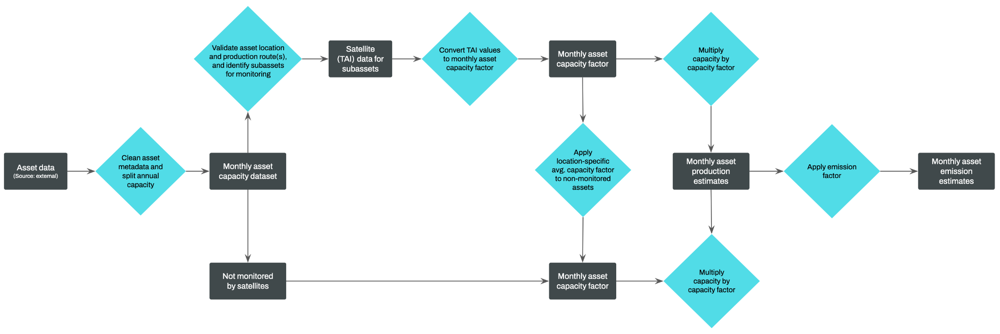
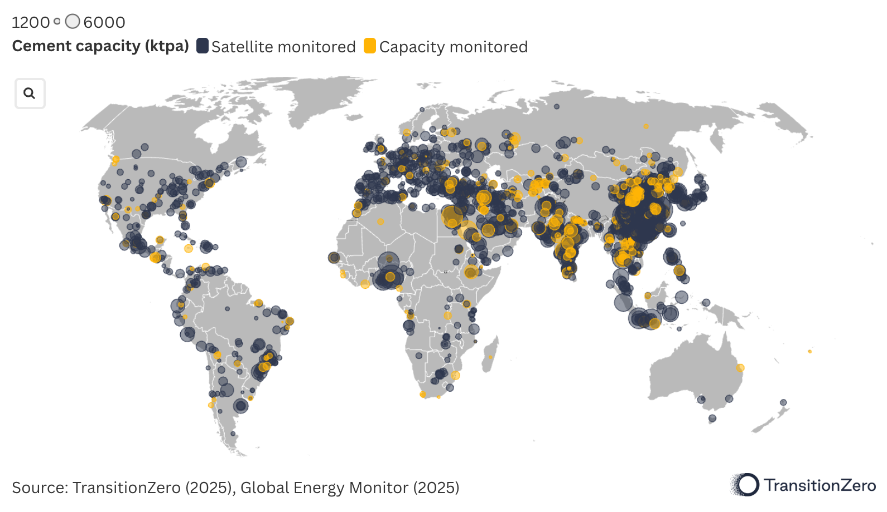
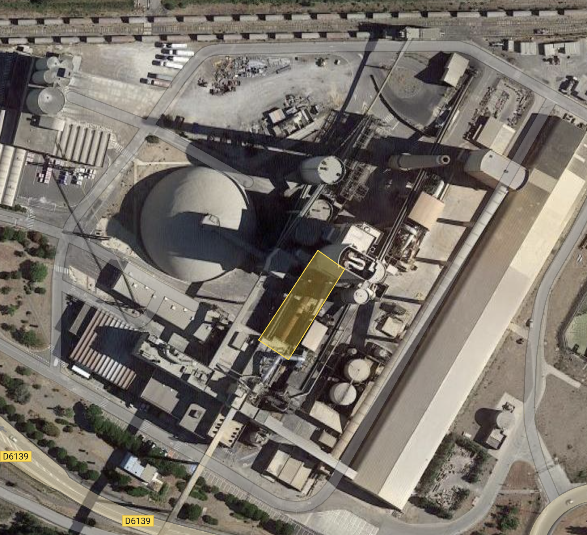
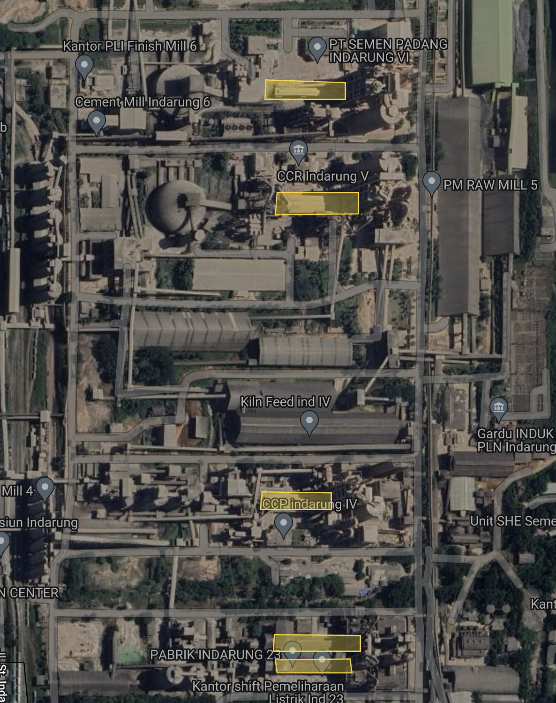
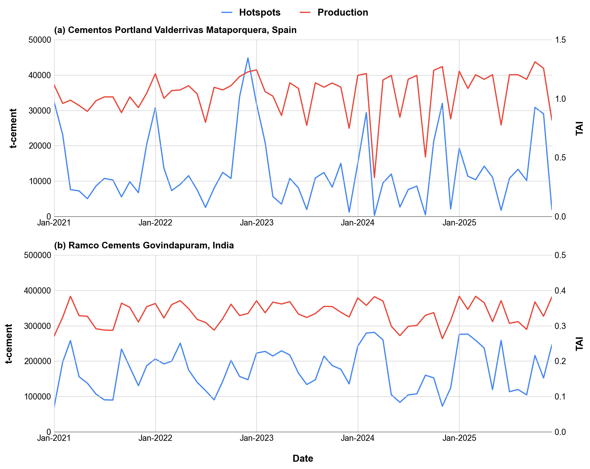
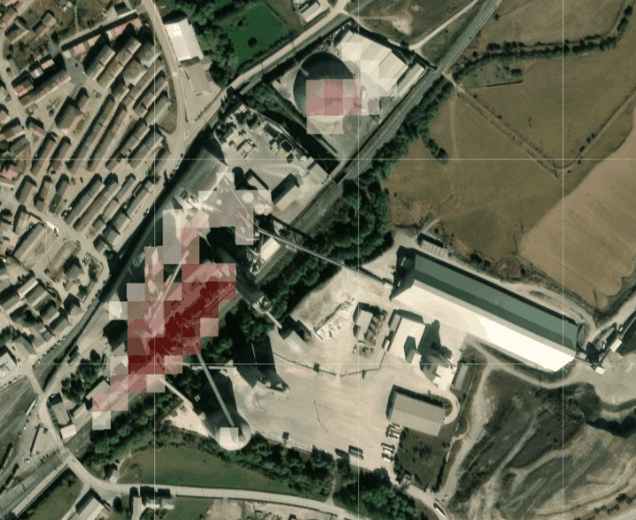
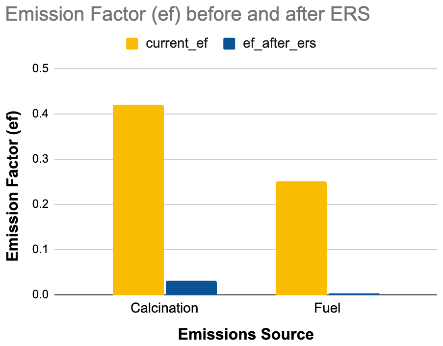
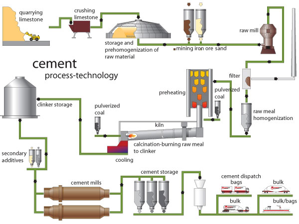

### Manufacturing and Industrial Processes sector: Cement Manufacturing Emissions

**Verity Crane and George Ebri**

*Author affiliated with TransitionZero and Climate TRACE*

#### 1. Introduction

The cement industry plays a critical role in both global infrastructure and global emissions. It accounts for roughly 7% of industrial energy use and an equal share of global carbon dioxide emissions, making it the second-largest source of direct industrial CO₂ emissions after steel (IEA, 2018). Cement is the principal ingredient used to make concrete, the most widely used manufactured material in the world owing to its versatility across housing, sanitation, transportation, and energy infrastructure. Meeting future cement demand while cutting CO₂ emissions poses a major challenge: although China’s construction sector has cooled in recent years, rising demand in other regions is set to drive global consumption upward.

A clear picture of where cement-sector emissions originate and how they are distributed is typically difficult to obtain. Commercial confidentiality and international competition limit public reporting of plant-level production data. Most official statistics are aggregated at the national level, with reporting delays of up to several years (USGS, 2025; NBSC, 2025). Only a few jurisdictions, such as the EU and the United States, publish facility-level emissions data (E-PRTR, 2024; US EPA, 2024). This dataset aims to close these spatial and temporal gaps by providing global, asset-level estimates of cement-related emissions on a monthly basis. Using satellite-derived thermal anomaly data, we infer activity levels at clinker-producing facilities identified in Global Energy Monitor’s Global Cement and Concrete Tracker (GEM, 2025). This approach allows for consistent, near-real-time monitoring of cement production and associated emissions across regions where traditional data sources are limited or unavailable.

Unlike steel and other carbon-intensive sectors, the majority of cement emissions are process-related, stemming from limestone calcination rather than fuel combustion for heat generation. The cement industry therefore requires unique, targeted emissions reduction solutions (ERS). In this study, we propose a minimum of one suitable strategy for each asset in the dataset based on known production technology and process characteristics. We take into account conventional wet- or dry-kiln operations, use of alternative fuels, and clinker substitution practices. Based on these, the strategies considered include switching to alternative fuels, implementing carbon capture and storage (CCS), substituting clinker with supplementary materials such as slag or calcined clay, and decommissioning high-emission wet-kiln plants. Each strategy represents a pathway to reduce emissions, either by lowering process emissions from clinker production, reducing fuel-related emissions, or phasing out high-emission technologies.

#### 2. Materials and Methods

Cement production emits CO₂ from two main sources: process emissions from limestone calcination and combustion emissions from fossil fuels used to heat rotary kilns. Clinker production is by far the most emissions-intensive stage in the cement value chain and accounts for the majority of the sector’s total CO₂ output. A more detailed overview is provided in Section 7.1 and Figure 5.

Given the lack of asset-level emission data publicly available, a standardized “bottom-up” approach is used to quantify the emissions. This process is characterized by first estimating production levels for each plant before applying an emission factor to generate emissions estimates. Emissions factors are asset-specific, determined as a function of final product characteristics (clinker-to-cement ratio, cement color, type), plant production route (wet, dry, semi-dry) and the use of emissions-reduction technologies (alternative fuels, supplementary cementitious materials, CCS/CCUS).

**Figure 1** Flowchart of the methodology to calculate plant level emissions for global cement assets.

#### 2.1. Materials

#### 2.1.1. Asset inventory dataset

Cement production consists of three steps: first limestone is mixed with other materials, then the mixture is heated up to produce clinker, and finally this clinker is grinded together with other ingredients to produce cement. The final grinding process can happen in integrated facilities where clinker is also produced or in independent grinding facilities closer to the end market. Global Energy Monitor provides facility-level information such as GPS coordinates, owner, capacity, age, product and technology type for both integrated, clinker-only and grinding plant types. In this work, we estimate emissions for clinker-producing assets only. In total there are 2,160 integrated cement plants across 141 countries. We manually validated the locations of all the plants using geolocation data from Google Maps API (2025) and OpenStreetMap (2025).

Figure 2 shows the global distribution of integrated cement plants. China accounts for around half of global production, followed by India at 10% (USGS, 2025).

**Figure 2** Global map showing integrated cement facilities. Countries included in cement emissions monitoring are shaded. Assets that are monitored with satellites are shown in blue. The circle size represents plant production capacity, with reference scales shown at the top of the figure for 1,200 and 6,000 thousand tonnes per annum (ktpa).

#### 2.1.2. Remote sensing datasets

Satellite-derived production estimates make use of multispectral imagery from two different collections:

-   The European Space Agency (ESA) Copernicus Sentinel mission with a resolution of 20 m and a combined 5-day equator revisit with two satellites:

-   Sentinel 2A: with imagery available since 2015 (ESA, 2025).

-   Sentinel 2B: with imagery available since 2017 (ESA, 2025).

> Both Sentinel-2 satellites have a MultiSpectral Instrument (MSI) that can measure wavelengths from \~443 - \~2190 nm (blue to shortwave infrared (SWIR)) at 10-60 m spatial resolutions.

-   The U.S. Geological Survey (USGS) and National Aeronautics and Space Administration (NASA) Landsat program with a resolution of 30 m and a combined 8-day revisit:

-   Landsat-8: with imagery available since 2013 (NASA and USGS 2025a).

-   Landsat-9: with historical images available from 2021 (NASA and USGS 2025b).

> Both Landsat-8 and Landsat-9 have an Operational Land Imager (OLI) that can measure wavelengths from \~435 to \~1384 nm (blue to thermal infrared) at 15-100 m spatial resolutions.

All satellite datasets were sourced and processed using Google Earth Engine (Google Earth Engine 2025a, 2025b, 2025c). From each satellite dataset, we relied on the surface reflectance products and computed the ratio of the difference between two SWIR bands and NIR bands of each satellite. This is based on the study to detect high-temperature anomalies from Sentinel-2 MSI images where a tri-spectral thermal anomaly index (TAI) that jointly uses the two high-temperature sensitive SWIR bands and the high-temperature-insensitive NIR band to enhance High Temperature Anomalies (Yongxue et al., 2021). For the respective satellite collections, we infer the TAI through the following equations:

-   Sentinel-2A/B: $`TAI\  = \ \frac{(B12\  - \ B11)}{(B8a)}`$

-   Landsat-8/9: $`TAI\  = \ \frac{(B7\  - \ B6)}{(B5)}`$

**Figure 3** Left - high resolution image of Lafarge’s cement plant in Port-la-nouvelle, France with a manually labelled rotary kiln (yellow shaded rectangle). Right - Sentinel-2 image which shows the thermal anomaly over the rotary kiln and surrounding features (red for hot pixel) during 2023. Source: Modified Copernicus data and GEM GCCT.

Where B\# refers to the band number for the specific satellite. This ratio was used to identify thermal anomalies within the temperature range of industrial processes, while eliminating most of the noise from reflectance interference. Pixel values between the Sentinel 2A/B MSI and Landsat OLI were harmonized using NASA’s band pass adjustments allowing the two image collections to be used as if they were a single collection (NASA 2018). The harmonized dataset ensured higher revisit for time-series surface applications. Partial images (coverage of the steel facility’s boundaries less than 80%) and cloudy images (more than 20% clouds) were excluded. Figure 3 shows an example of a cement plant with identified hotspots over a rotary kiln.

#### 2.1.3. Production datasets

Aggregated national cement production used in our models is primarily sourced from USGS (2025) on an annual basis.

#### 2.1.4. Emissions factors dataset

Emissions factors are combined from multiple sources. See section 2.2.2 for more details.

#### 2.1.5 Emissions Reduction Solutions

Each ERS is applied to cement production assets according to their technology, fuel use, and clinker composition. Each ERS has a strategy that was analysed in this study:

1.  **Strategy 0 – Continue Current Operation:** Baseline scenario where assets continue current operations without implementing additional emission reduction measures.

2.  **Strategy 1 – Alternative Fuel:** Replace conventional fossil fuels with alternative fuels (e.g., biomass, industrial by-products, waste-derived fuels) to reduce fuel-related CO2 emissions. Many European plants already operate near 100% on alternative fuels such as Allmendingen Cement Plant, Germany and Rugby Cement Plant, UK (CEMBUREAU, 2018; Lloyd-Perks, 2024).

3.  **Strategy 2 – Carbon Capture and Storage (CCS):** Capture CO2 emissions from both clinker calcination and fuel combustion. With full deployment, CCS can potentially reduce emissions close to 100%. However, commercial adoption is still limited, with projects under development such as the Ketton Cement Plant in the UK and the Lengfurt Cement Plant in Germany (Linde Engineering, 2024; Global Cement, 2024).

4.  **Strategy 3 – Clinker Substitution with GGBS:** Replace a portion of clinker with ground granulated blast furnace slag (GGBS) during the grinding phase to reduce both process and fuel-related emissions. Emission reductions can reach up to 70%, depending on substitution rates and plant technology. Examples of this are producers integrating GGBS into their grinding phase to reduce CO2 emissions, such as the Heidelberg Speed Slag Cement Plant in the US (Heidelberg Materials, 2024; Global Cement staff, 2024).

5.  **Strategy 4 – Clinker Substitution with Calcined Clay (LC3)**: Replace a portion of clinker with calcined clay to lower process and fuel-related emissions, potentially reducing the emission factor by up to 30%. Adoption is growing in regions with abundant clay resources (LC3, 2022).

6.  **Strategy 5 – Shutdown Wet-Process Plants:** Decommission older, energy-intensive wet-kiln plants and transition production to dry-kiln technology, effectively eliminating CO2 emissions from the affected assets.

7.  **Strategy 6 – Alternative Fuel + CCS:** Combine alternative fuels with CCS to target both process and fuel emissions, potentially reducing the plant’s emission factor close to zero. The combined use of alternative fuels and CCS is a proven approach and has been implemented at several cement plants such as Ketton Cement Plant - UK, and Lengfurt Cement Plant - Germany (GEM, 2025).

8.  **Strategy 7 – Clinker Substitution with GGBS + Alternative Fuel:** Combine clinker substitution with GGBS and alternative fuels to reduce both major sources of emissions, achieving up to \~80% reduction in total CO2 emissions.

9.  **Strategy 8 – Clinker Substitution with Calcined Clay + Alternative Fuel:** Combine clinker substitution with calcined clay and alternative fuels to reduce both process and fuel emissions, achieving approximately 50–60% reduction in CO2 emissions.

*Note: Only rank 1 strategies are provided for assets on the Climate TRACE website and additional strategies will be made available in future releases.*

#### 2.2. Methods

#### 2.2.1. Production methodology

Two approaches were used to estimate asset- level production. As a priority, satellite-derived production estimates are used whenever a facility releases enough heat to be captured by satellite imagery (Zhou *et al.* 2018; Marchese *et al.* 2019; Liangrocapart, Khetkeeree and Petchthaweetham 2020). This is the case for clinker-producing plants as clinkerization occurs at high temperatures of around 1,400oC.

Our methodology scours satellite imagery for heat signatures from the operating cement plants. Each clinker-producing kiln, once identified, is outlined with a hand-drawn polygon, as shown in Figure 4.

**Figure 4:** Zooming in on an integrated cement plant in Kota Padang, Sumatera Barat, Indonesia. The 5 kilns have been hand labelled (yellow shaded rectangles).

The intensity of the hotspot above each kiln is calibrated against the annual country level production data (USGS, 2025) to estimate plant activity in each month.For plants without usable hotspot signals, we estimate production using a regional or global average of satellite-derived utilization rates.

The satellite-based approach is useful for detecting fluctuations in plant activity, such as capturing if a plant has been switched off. However, assets may be excluded from satellite monitoring due to a small signal-to-noise ratio which makes it difficult to distinguish production from background fluctuations. Other sources of complication can be the occasional presence of strong reflections from a-priori cold elements, or the fact that kilns may be placed inside a building and hidden by a roof. A representative example is shown in Section 7.2 Figure 6.

#### 2.2.2. Emissions methodology

In line with IPCC guidelines, clinker data is our primary source for estimating process emissions from cement production. This is because CO₂ is released during the calcination process that outputs clinker—not during the blending or grinding stages of cement production. The proportion of clinker contained in each tonne of cement varies according to a number of product and plant characteristics provided by GEM (2025), with corresponding clinker-to-cement ratios sourced from IEA (2022) and Cembureau (2025). A global clinker emissions factor of 0.507 tCO2/t-clinker sourced from IPCC is then applied to the estimated clinker required by each plant. Energy requirements and corresponding combustion fuel (i.e. direct) and electricity (i.e. indirect) emissions also vary by production route, emissions reduction technologies and cement type/color (IEA 2018, Mission Possible Partnership 2023, McKinsey 2025, CaptureMap 2022).

**Table 1** Factors impacting the clinker-to-cement ratio

| **Characteristic**       | **Category**       | **Clinker percentage**                        | **Source**       |
|--------------------------|--------------------|-----------------------------------------------|------------------|
| White                    | Cement color       | 97                                            | Cembureau (2025) |
| Ordinary Portland Cement | Cement type        | 95                                            | Cembureau (2025) |
| Blended                  | Cement type        | 71                                            | IEA (2022)       |
| Blast-furnace slag       | Cement type        | 50                                            | Cembureau (2025) |
| China                    | Regional variation | Reduced by up to 15% depending on cement type | IEA (2025)       |

**Table 2** Product and plant characteristics impacting the direct emissions factor

| **Product/Plant characteristics** | **Emissions factors**          | ***Source***          |                              |                                     |                                       |
|-----------------------------------|--------------------------------|-----------------------|------------------------------|-------------------------------------|---------------------------------------|
| ***Characteristic***              | ***Category***                 | ***Fuel or process*** | ***Absolute or adjustment*** | ***Value***                         |                                       |
| White                             | Cement color                   | Fuel                  | Adjustment                   | 70% more energy intensive than grey | Cembureau (2025)                      |
| Dry                               | Production route               | Fuel                  | Absolute                     | 0.32 tCO2/t-clinker                 | McKinsey (2020)                       |
| Semidry                           | Production route               | Fuel                  | Absolute                     | 0.39 tCO2/t-clinker                 | ECRA (2016)                           |
| Wet                               | Production route               | Fuel                  | Absolute                     | 0.59 tCO2/t-clinker                 | Gao H, Wang D, Zhao Z, Dang P. (2024) |
| Carbon Capture and Storage (CCS)  | Emissions-reduction technology | Process               | Adjustment                   | 70% capture rate                    | CaptureMap (2022)                     |
| Alternative fuels                 | Emissions-reduction technology | Fuel                  | Adjustment                   | 35% emissions reduction             | MPP (2023)                            |
| Clay calcination                  | Emissions-reduction technology | Process               | Adjustment                   | 40% emissions reduction             | MPP (2023)                            |

**Table 3** Emission types and associated emissions factors

<table><thead><tr class="header"><th>Type of emissions</th><th><strong>Direct emissions</strong></th><th><strong>Indirect emissions</strong></th><th></th><th></th></tr></thead><tbody><tr class="odd"><td></td><td><em><strong>Process emissions</strong></em></td><td><em><strong>Fuel emissions</strong></em></td><td>External power consumption from the national grid</td><td></td></tr><tr class="even"><td></td><td>
Limestone calcination

CaCO3 → CaCO + CO2

Cement kiln dust
</td><td>Kiln fuel emissions</td><td>Non-kiln fuel emissions</td><td></td></tr><tr class="odd"><td></td><td></td><td>
Heat consumption of kilns

Drying of fuels

Drying of raw materials
</td><td>On-site power generation</td><td></td></tr><tr class="even"><td></td><td>0.152 tCO2/t-clinker (with CCS)-0.507 tCO2/t-clinker (without CCS)</td><td>0.208-1.22 tCO2/t-clinker (see Table 2)</td><td>0.091 MWh/t-cement multiplied by national or regional grid intensity</td><td></td></tr><tr class="odd"><td><em>Sources</em></td><td><em>IPCC (clinker-to-cement ratio) 
CaptureMap 2022 (CCS adjustment)</em></td><td><em>MPP 2023 (alternative fuels adjustment), McKinsey 2025 &amp; Ecofys (2009) (direct fuel emissions), Cembureau 2025 (white cement color adjustment)</em></td><td><em>IEA 2018 (electricity use factor) and Ember 2025 (grid intensities)</em></td><td></td></tr></tbody></table>

#### 2.3. Coverage

Based on 2023 emission numbers, asset level estimates account for 68% (1.51 Gt) of the sector’s direct emissions. Satellite-monitored assets represented 93% of the total integrated assets and contributed to 93% of the total asset level emissions estimates.

#### 2.4. Incorporating ERS

To integrate each ERS strategy into facility-level emissions estimates, we applied a consistent method across all strategies. For each ERS, eligible assets were identified based on their production technology, alternative fuel use, clinker composition, and CCS application using the Global Energy Monitor’s Global Cement and Concrete Tracker (GEM, 2025). Emissions were then adjusted according to either literature-based emission factors or assumed percentage reductions, and facility-level CO2 emissions were recalculated under each ERS scenario.

The following subsections describe each strategy:

**- Strategy 0 – Continue Current Operation (Near-Zero Baseline):** This strategy represents a theoretical baseline in which both fuel-related and calcination emissions are fully eliminated through complete decarbonization of the production process. In practice, no cement asset in the database has yet achieved this condition.

\- **Strategy 1 – Alternative Fuel:** This strategy was applied to assets currently using conventional fossil fuels. We assumed that alternative fuels (e.g., biomass, industrial by-products, or waste-derived fuels) could fully replace fossil fuels, thereby reducing fuel-related CO2 emissions, which account for \~40% of total plant emissions (World Economic Forum, 2024; IEA Greenhouse Gas R&D Programme, 2008). Emissions reductions were applied proportionally, reflecting real-world examples of European cement plants operating near 100% on alternative fuels. This strategy was applied as a secondary approach in cases where a combined mitigation strategy for CO2 emissions (e.g., CCS + alternative fuels) was prioritized, and as a primary approach for assets where one of these mitigation measures had already been implemented.

\- **Strategy 2 – Carbon Capture and Storage (CCS):** This strategy was applied to assets capable of retrofitting CCS technology. CCS can capture almost the entire CO2 emissions of a cement plant, including both process and fuel-related emissions (Emanuelsson, 2025). While the technology holds significant mitigation potential, it has not yet been widely deployed. The Norcem plant in Brevik (Norway) provides an example of large-scale implementation (Cavalett, 2021). This strategy was applied as a secondary approach in cases where a combined mitigation strategy for CO2 emissions (e.g., CCS + alternative fuels) was prioritized, and as a primary approach for assets where one of these mitigation measures had already been implemented.

\- **Strategy 3 – Clinker Substitution with GGBS:** This strategy was applied to assets capable of partially replacing clinker with granulated blast furnace slag (GGBS) during the grinding phase. The resulting reduction in both process and fuel-related emissions was applied proportionally to the share of clinker substituted, with maximum reductions up to \~70% depending on substitution rate and plant technology (Yue, 2025). This is a well-established practice in the cement industry; for example, many producers integrate GGBS into their grinding phase to reduce CO2 emissions, such as the Heidelberg Speed Slag Cement Plant in the US.The strategy is particularly applicable in countries with high steel production, such as China, where GGBS is readily available as a by-product.

\- **Strategy 4 – Clinker Substitution with Calcined Clay (LC3):** This strategy was applied to assets that can partially replace the clinker with calcined clay during grinding. Reductions in emissions factors were applied based on the substitution rate, with potential reductions up to \~30% (MPP, 2023; Lacina, 2024). Adoption is limited by local clay availability and calcination infrastructure.

\- **Strategy 5 – Shutdown Wet-Process Plants:** This strategy was applied to older, highly energy-intensive wet-kiln assets (IEA, 2018). Emissions from these plants were set to zero to reflect a theoretical retirement scenario, aligned with the efficiency gap between wet kilns and more efficient kilns, and with the ongoing transition of cement production toward efficient dry-kiln technologies (Miller, 2021).

\- **Strategy 6 – Alternative Fuel + CCS:** This combined strategy was applied to eligible assets capable of both substituting fossil fuels with alternative fuels and retrofitting CCS. The resulting emission factor reductions reflect near-complete elimination of both fuel- and process-related CO2 emissions. This strategy was applied as a high-priority option for assets with high production, where the potential for absolute emissions reductions is greatest.

\- **Strategy 7 – Clinker Substitution with GGBS + Alternative Fuel:** This strategy was applied to assets capable of both clinker substitution with GGBS and alternative fuel use. CO2 emissions were reduced proportionally based on substitution rate and fuel replacement, with total reductions up to \~80%. This strategy was primarily applied to lower-production facilities and in countries where GGBS is readily available as a by-product of steel production.

**Strategy 8 – Clinker Substitution with Calcined Clay + Alternative Fuel:** This strategy was applied to assets that can implement both clinker substitution with calcined clay and alternative fuel use. Emissions reductions were applied proportionally, with typical reductions of 50–60%, reflecting both emerging adoption and technical feasibility. This strategy was targeted at lower-production facilities where suitable clay resources are accessible.

#### 2.5 Verifying modeled ERS emissions estimates

Verification of the modeled ERS varies depending on the strategy and the type of change assumed. For alternative fuel strategies (Strategy 1), implementation could in principle be monitored through company reports, trade statistics, and updates to facility fuel usage data in the Global Iron and Steel Tracker (GEM, 2025), although these sources may not provide real-time confirmation. CCS retrofits (Strategy 2) are not directly observable from satellite data but can be tracked through company disclosures, pilot project announcements, and regulatory filings. Clinker substitution strategies (Strategy 3 – GGBS; Strategy 4 – calcined clay) could be partially verified through satellite monitoring of lower clinker production, combined with company reports on feedstock use. In contrast, the shutdown of wet-process plants (Strategy 5) can be verified more robustly through satellite-based activity monitoring, which allows for direct observation of whether a facility has ceased operation. Finally, combined strategies (Strategies 6–8) could be partially confirmed by combining the mentioned approaches.

#### 3. Results and Analysis

#### 3.1 TAI and Emissions

Figure 5 illustrates the relationship between satellite-derived Thermal Anomaly Index (TAI) and the corresponding emissions for a cement plant in Spain. The data demonstrates that, for most months, estimated emissions (based on production levels) align closely with fluctuations in TAI. For example, both measurements increase prior to after July 2021 and then rapidly increase between July 2021 and Jan 2022, after which both decrease into January 2022. However, further calibration is needed to enhance the model that translates TAI into asset-level production estimates, as TAI data can vary significantly by asset depending on factors like equipment type, age, geographic location, and other operational conditions. The TAI values presented here are derived from the hotspot data shown in Figure 6.

**Figure 5** Satellite-based Thermal Anomaly Index (TAI; red solid line) and estimated emissions (blue solid line) at Valderrivas cement plant in Cantabria, Spain during January 2021 - September 2024.

**Figure 6** Satellite-detected hotspots over Valderrivas cement plant in Cantabria, Spain during August 2024.

Tables 2 and 3 show the biggest producers and emitters in the cement industry at country and plant level, respectively. China accounts for almost half of the global cement emissions.

**Table 4** Top 10 emitters in the cement sector in 2024 - by country (direct emissions only)

| Country   | CO2 emissions (MtCO2) |
|-----------|---------------------------------------------|
| China     | 1092                                        |
| India     | 226                                         |
| Vietnam   | 58                                          |
| USA       | 49                                          |
| Turkey    | 44                                          |
| Iran      | 39                                          |
| Indonesia | 36                                          |
| Brazil    | 36                                          |
| Russia    | 34                                          |
| Egypt     | 28                                          |

**Table 5** Top 10 emitting cement plants in 2024 (direct emissions only).

<table><thead><tr class="header"><th>Plant name</th><th>Country</th><th>Plant capacity (Mt)</th><th>
CO2 emissions

(MtCO2)
</th></tr></thead><tbody><tr class="odd"><td>Jinfeng Cement Plant</td><td>China</td><td>20</td><td>6.7</td></tr><tr class="even"><td>Sungshin Cement Danyang Cement Plant</td><td>S Korea</td><td>11.3</td><td>6.1</td></tr><tr class="odd"><td>Obajana Cement Plant</td><td>Nigeria</td><td>16.2</td><td>5.9</td></tr><tr class="even"><td>Lucky Cement Pezu Cement Plant</td><td>Pakistan</td><td>10.2</td><td>5.5</td></tr><tr class="odd"><td>Semen Gresik Tuban Cement Plant</td><td>Indonesia</td><td>11.9</td><td>5.1</td></tr><tr class="even"><td>TPI Polene Mittaphap Cement Plant</td><td>Thailand</td><td>13.5</td><td>4.5</td></tr><tr class="odd"><td>Anhui Panjing Cement Co. Cement Plant</td><td>China</td><td>8</td><td>4.4</td></tr><tr class="even"><td>National Cement New Beni Suef Cement Plant</td><td>Egypt</td><td>12</td><td>4.3</td></tr><tr class="odd"><td>Sokoto Cement Plant</td><td>Nigeria</td><td>12.5</td><td>4.3</td></tr><tr class="even"><td>China Resources Cement (Fengkai) Ltd Cement Plant</td><td>China</td><td>12</td><td>4.3</td></tr></tbody></table>

#### 3.2 ERS Emissions Estimates

Applying ERS strategies to the cement assets demonstrates the significant mitigation potential of technological and operational shifts. Figure 7 presents the change in direct emission factors, separated by source: emissions from clinker calcination and emissions from fuel combustion, before and after ERS implementation.

For current assets mostly using conventional fossil fuels and standard clinker production, total CO2 emission factors averaged around 0.42 tCO₂/t cement from the calcination process and contributed an additional \~0.25 tCO₂/t cement from fuel combustion. Application of alternative fuels (Strategy 1) reduces fuel-related emissions close to zero, while carbon capture and storage (CCS, Strategy 2) can reduce nearly all calcination emissions, bringing the overall emission factor down to \~0.03 tCO₂/t cement for eligible facilities (Emanuelsson, 2025).

Strategies focused on clinker substitution further complement these reductions. Partial replacement of clinker with granulated blast furnace slag (GGBS, Strategy 3) or calcined clay (LC3, Strategy 4) can reduce total plant emissions by up to \~70% and \~30%, respectively, depending on substitution rates and local material availability (Yue, 2025). Combined strategies, such as GGBS or calcined clay substitution paired with alternative fuels (Strategies 7 and 8), allow reductions of 50–80%, highlighting the synergistic effect of targeting both process- and fuel-related emissions.

Overall, these results show that near-zero emissions in cement production is potentially possible when high-producing assets adopt CCS alongside alternative fuels, while widespread adoption of clinker substitution and fuel switching across smaller facilities can contribute substantially to global decarbonization.

**Figure 7** Average direct emission factors (tCO₂ per tonne of cement) from calcination and fuel combustion before (yellow bars) and after (blue bars) the application of emission reduction strategies (ERS) across cement assets worldwide.

#### 4. Discussion

#### 4.1 Emissions Estimates

Satellite-derived Thermal Anomaly Index (TAI) offers a promising approach for estimating cement production at the asset level on a monthly basis. By calibrating TAI against plant production data and combining it with clinker-based process parameters, it is possible to estimate direct CO2 emissions from both calcination and fuel combustion. This approach enables temporally resolved, asset-specific emission estimates that go beyond traditional annual reporting, particularly for regions or facilities with limited disclosure.

The accuracy of these estimates depends on asset-specific characteristics, including production route (wet, semi-dry, dry), clinker-to-cement ratios, fuel type, and the use of emissions reduction technologies such as CCS or alternative fuels. For example, conventional clinker production without mitigation results in \~0.42 tCO₂/t cement from calcination and \~0.25 tCO₂/t cement from fuel combustion, while the adoption of CCS or alternative fuels can greatly reduce the asset emissions. Differences in cement type, production technology, and regional energy intensity further influence direct emission factors, highlighting the importance of integrating plant-level characteristics with TAI-based monitoring. Overall, combining satellite observations with process-based emission modeling provides a scalable framework for tracking cement sector emissions and evaluating the potential of mitigation strategies across global assets.

#### 4.2 ERS Emissions Estimates

Cement emissions are primarily driven by the chemical process of clinker production and the fuel used to heat kilns to high temperatures. Process emissions from calcination are largely unavoidable without technological intervention, while fuel emissions can be reduced through substitution or decarbonization. Applying ERS to cement production routes demonstrates the significant mitigation potential. The most promising strategies fall into three themes: reducing fuel-related emissions and capturing CO2, substituting clinker and improving process efficiency, and integrating multiple strategies.

#### 4.2.1 Fuel-related emissions and CO2 capture

Strategy 1 (Alternative Fuel) shows substantial potential, eliminating fuel-related emissions, which account for \~40% of total plant emissions (World Economic Forum, 2024; IEA Greenhouse Gas R&D Programme, 2008). Many European plants already operate near 100% on alternative fuels (Allmendingen Cement Plant, Germany; Rugby Cement Plant, UK), demonstrating technical feasibility. This strategy is particularly effective as a primary pathway for assets that have already implemented decarbonization measures targeting calcination emissions. Limitations include variability in fuel quality, availability, and retrofitting costs, which need supportive policy and incentives to accelerate adoption.

Strategy 2 (Carbon Capture and Storage, CCS) has the potential to capture almost the entire CO2 emissions of a cement plant, including both process and fuel-related emissions (Emanuelsson, 2025). While full deployment could theoretically reduce plant emissions close to zero, the technology remains in early stages of commercial application. High capital and operational costs, infrastructure requirements, and technical complexity constrain broader deployment. Demonstration projects such as the Norcem plant in Brevik, Norway, provide examples of large-scale implementation, but policy support, carbon pricing, and net-zero commitments will be critical for scaling CCS in the sector. This strategy is most relevant for high-production assets where mitigation impact is maximized.

#### 4.2.2 Clinker substitution and process optimization

Strategies 3 and 4 (Clinker Substitution with GGBS or Calcined Clay) target process emissions by replacing a fraction of clinker with industrial by-products or low-carbon materials. GGBS substitution can reduce emissions by up to \~70% (Yue, 2025) and is already widely adopted in regions with high steel production where slag is readily available (Heidelberg Speed Slag Cement Plant, US). Calcined clay substitution offers reductions of up to \~30%, particularly suitable for regions with abundant clay resources. Both strategies are effective but are constrained by material availability, regional resource distribution, and potential quality considerations in cement performance.

Strategy 5 (Shutdown of Wet-Process Plants) immediately eliminates emissions from highly energy-intensive older facilities. While technically effective, its practical implementation depends on regulatory enforcement and ensuring production is shifted to lower-emission assets rather than offset elsewhere. Economic and workforce impacts are additional considerations for policy planning.

#### 4.2.3 Combined strategies

Combined Strategies (6–8) demonstrate the synergistic potential of integrating multiple ERSs. Pairing alternative fuels with CCS (Strategy 6) can nearly eliminate both process- and fuel-related emissions, representing a high-priority option for high-production facilities. Similarly, combining clinker substitution with alternative fuels (Strategies 7 and 8) achieves reductions of 50–80%, depending on material availability and substitution rates. These combinations highlight pathways to substantial decarbonization, though scaling requires coordinated supply chains for low-carbon materials, reliable alternative fuels, and policy frameworks that support investment in CCS infrastructure.

Overall, this analysis indicates that near-zero emissions in cement production are potentially achievable through a combination of CCS, alternative fuels, and clinker substitution. However, sector-wide decarbonization is constrained by material availability, technological maturity, high costs, and the need for supportive regulatory and policy environments. Strategic deployment targeting high-production assets, alongside broader adoption of clinker substitution and fuel-switching technologies, will be essential to meet global net-zero ambitions.

#### 5. Conclusions

This work has shown that timely facility-level production and emissions can be obtained without the need to rely upon systematic and exhaustive factory published figures. Where possible, satellite data is directly used to estimate cement production, to which a facility-specific emissions factor is applied to estimate emissions. Where satellite data is unavailable, regional utilization rates derived from our satellite estimates are used. In December 2024, 85% of total direct emissions were derived directly from satellite data.

Electricity related emissions estimated in this work include emissions originating from the grinding process, which may or may not occur in the same facility where the clinker was produced. The GEM GCCT database contains grinding assets (where no clinker is produced) that contribute to around a quarter of global cement capacity but are not included in the present work. Power-related grinding emissions are treated as if they were occurring in the facility that produced the clinker. This assumption allows us to cover a broader scope of emissions but does not create a large bias on the asset-level estimates since the grinding emissions contribute less than 5% of total cement production emissions (Shen *et al.*, 2014). We intend to investigate the inclusion of grinding plants in future to more accurately distribute grinding emissions. However, this requires knowledge of clinker flows between plants which has so far fallen outside the scope of this work.

Building on our production and emissions estimates, we have systematically applied a set of emissions reduction solutions (ERS) to evaluate each asset’s potential for decarbonization. Alternative fuels can nearly eliminate fuel-related emissions, while CCS offers the deepest overall reductions by targeting both process and combustion emissions, yet deployment is constrained by high costs, infrastructure, and policy uncertainty. Clinker substitution with slag or calcined clay provides significant near-term reductions but depends on regional material availability. Plant shutdowns and modernization to efficient dry processes can also deliver immediate cuts but raise socio-economic challenges. Overall, the ERS framework highlights that no single strategy can deliver full decarbonization of cement on its own. Instead, a portfolio of complementary measures – alternative fuels, clinker substitution, CCS, and targeted asset retirements – will be required, with the optimal mix depending on regional material availability, technology readiness, and policy support. Strong policy incentives and infrastructure investment will be critical to scale CCS and enable the sector to move toward net-zero emissions.

#### 6. Supplementary metadata section

Cement sector CO2 emissions are reported for individual assets from January 2021. The emissions described here represent a subset of specific country-level emissions estimates from the Climate TRACE manufacturing sector. All data is freely available on the Climate TRACE website (<https://climatetrace.org/>). A detailed description of what is available is described in Tables 6 - 8.

**Table 6** Details on the asset metadata

| **General Description**                                                     | **Definition**                                                                                                                                                                                                               |
|-----------------------------------------------------------------------------|------------------------------------------------------------------------------------------------------------------------------------------------------------------------------------------------------------------------------|
| **Sector definition**                                                       | *Emissions from cement production*                                                                                                                                                                                           |
| **UNFCCC sector equivalent**                                                | *2.A.1 Cement production*                                                                                                                                                                                                    |
| **Temporal Coverage**                                                       | *2021 - present*                                                                                                                                                                                                             |
| **Temporal Resolution**                                                     | *Monthly*                                                                                                                                                                                                                    |
| **Data format**                                                             | *CSV*                                                                                                                                                                                                                        |
| **Coordinate Reference System**                                             | *None. ISO3 country code provided*                                                                                                                                                                                           |
| **Number of emitters available for download**                               | *2,241 integrated cement plants covering 138 countries*                                                                                                                                                                      |
| **What emission factors were used?**                                        | *Process- and plant- specific emission factors*                                                                                                                                                                              |
| **What is the difference between a “0” versus “NULL/none/nan” data field?** | *“0” values are for true non-existent emissions. If we know that the sector has emissions for that specific gas, but the gas was not modelled, this is represented by “NULL/none/nan”*                                       |
| **total\_CO2e\_100yrGWP and total\_CO2e\_20yrGWP conversions**              | *Climate TRACE uses IPCC AR6 CO2e GWPs. CO2e conversion guidelines are here: https://www.ipcc.ch/report/ar6/wg1/downloads/report/IPCC\_AR6\_WGI\_FullReport\_small.pdf* |

**Table 7** Definition of the fields in asset dataset

| **Data attribute**           | **Definition**                                                                                                         |
|------------------------------|------------------------------------------------------------------------------------------------------------------------|
| **sector**                   | manufacturing                                                                                                          |
| **source\_sub-sector\_name** | cement                                                                                                                 |
| **source definition**        | emissions from cement production                                                                                       |
| **start\_date**              | start date for time period of emissions estimation (YYYY-MM-DD format)                                                 |
| **end\_date**                | end date for time period of emissions estimation (YYYY-MM-DD format)                                                   |
| **asset\_identifier**        | internal identifier                                                                                                    |
| **asset\_name**              | name of the facility                                                                                                   |
| **iso3\_country**            | ISO 3166-1 alpha-3 country code                                                                                        |
| **location**                 | well-known text (WKT) point location                                                                                   |
| **type**                     | manufacturing method                                                                                                   |
| **capacity**                 | monthly plant capacity                                                                                                 |
| **capacity\_factor**         | utilization rate of cement plants                                                                                      |
| **activity**                 | production estimates                                                                                                   |
| **CO2\_emissions\_factor**   | direct emissions factor (t-CO2/t-cement)                                                                    |
| **CH4\_emissions\_factor**   | not used; N/A                                                                                                          |
| **N2O\_emissions\_factor**   | not used; N/A                                                                                                          |
| **CO2\_emissions**           | direct emissions estimates (t-CO2)                                                                          |
| **CH4\_emissions**           | not used; N/A                                                                                                          |
| **N2O\_emissions**           | not used; N/A                                                                                                          |
| **total\_CO2e\_100yrGWP**    | 100 years global warming potential (t-CO2e)                                                                 |
| **total\_CO2e\_20yrGWP**     | 20 years global warming potential (t-CO2e)                                                                  |
| **other1**                   | direct and indirect emissions factor, includes - calcination, fuel use and electricity use (t-CO2/t-cement) |
| **other2**                   | calcination emissions factor (t-CO2/t-cement)                                                               |
| **other3**                   | fuel emissions factor (t-CO2/t-cement)                                                                      |
| **other4**                   | electricity use factor (MWh/t-cement)                                                                                  |
| **other5**                   | electricity use (MWh)                                                                                                  |
| **other6**                   | grid emissions intensity (t-CO2/MWh)                                                                        |
| **other7**                   | cement type                                                                                                            |
| **other8**                   | emissions reduction technologies                                                                                       |
| **other9**                   | clinker-to-cement ratio                                                                                                |
| **other10**                  | model methodology (e.g. satellite\_monitored or extrapolation)                                                         |
| **model\_number**            | version of the model (e.g. 1, 2, …)                                                                                    |

**Table 8** Definition for confidence and uncertainty in asset data.

<table><thead><tr class="header"><th><strong>Data attribute</strong></th><th><strong>Confidence Definition</strong></th><th><strong>Uncertainty Definition</strong></th></tr></thead><tbody><tr class="odd"><td><strong>type</strong></td><td><ul><li>
<em>Very low:</em> Based on highly speculative or obsolete information. Very low level of confidence in the accuracy of asset classification.
</li><li>
<em>Low:</em> Limited or somewhat outdated data. Low level of confidence in the classification's correctness.
</li><li>
<em>Medium:</em> A mix of historical and more recent data. A medium level of confidence in its accuracy.
</li><li>
<em>High:</em> Grounded in comprehensive and recent data. A high level of confidence in the precise classification of the asset.
</li><li>
<em>Very high:</em> Extensive, up-to-date, and verified data. A very high level of confidence in the accurate and detailed identification of the asset.
</li></ul></td><td>Not used; N/A</td></tr><tr class="even"><td><strong>capacity</strong></td><td><ul><li>
<em>Very low:</em> Limited or outdated data, and significant uncertainties exist.
</li><li>
<em>Low:</em> Outdated and/or incomplete data.
</li><li>
<em>Medium:</em> A mix of historical and recent data.
</li><li>
<em>High:</em> Comprehensive and recent data updates. High level of certainty.
</li><li>
<em>Very high:</em> Extensive, up-to-date, and verified data. A very high level of certainty.
</li></ul></td><td>Not used; N/A</td></tr><tr class="odd"><td><strong>capacity_factor</strong></td><td><ul><li>
<em>Very low:</em> Data is sparse or highly unreliable. Considerable uncertainty in capacity factor estimations.
</li><li>
<em>Low:</em> Moderate uncertainty in capacity factor calculations.
</li><li>
<em>Medium:</em> Data is sufficiently available, though not comprehensive. No absolute accuracy in capacity factor estimations.
</li><li>
<em>High:</em> High confidence in the accuracy of capacity factor calculations.
</li><li>
<em>Very high:</em> Derived from thorough and validated data sources. Very high precision of capacity factor estimations.
</li></ul></td><td>Not used; N/A</td></tr><tr class="even"><td><strong>activity</strong></td><td><ul><li>
<em>Very low:</em> Largely speculative or based on outdated information. A very low level of confidence in activity assessments.
</li><li>
<em>Low:</em> Limited or somewhat outdated sources. A low level of confidence in the activity assessments.
</li><li>
<em>Medium:</em> A mix of historical and more recent data. Medium level of confidence in activity insights.
</li><li>
<em>High:</em> Detailed and current operational data ensures a high level of confidence in the accuracy of activity assessments.
</li><li>
<em>Very high:</em> Extensive, verified, and up-to-date data. A very high level of confidence in their accuracy.
</li></ul></td><td>±8 to 15 % of asset production</td></tr><tr class="odd"><td><strong>CO2_emissions_factor</strong></td><td><ul><li>
<em>Very low:</em> Highly uncertain due to insufficient or unreliable data.
</li><li>
<em>Low:</em> Estimated from incomplete data. Low confidence level in its precision.
</li><li>
<em>Medium:</em> A mix of historical and more recent data. Medium level of confidence in their accuracy.
</li><li>
<em>High:</em> Derived from comprehensive and recent data. A high level of confidence in their precision.
</li><li>
<em>Very high:</em> Based on extensive and validated data, providing a very high level of confidence in their precision.
</li></ul></td><td>±10% of asset (based on IPCC)</td></tr><tr class="even"><td><strong>CH4_emissions_factor</strong></td><td>Not used; N/A</td><td>Not used; N/A</td></tr><tr class="odd"><td><strong>N2O_emissions_factor</strong></td><td>Not used; N/A</td><td>Not used; N/A</td></tr><tr class="even"><td><strong>CO2_emissions</strong></td><td><ul><li>
<em>Very low:</em> Based on very rough estimations or outdated information. A very low level of confidence in its accuracy.
</li><li>
<em>Low:</em> Estimated from incomplete data. Low confidence level in its precision.
</li><li>
<em>Medium:</em> A mix of historical and more recent data. Medium level of confidence in their accuracy.
</li><li>
<em>High:</em> Derived from comprehensive and recent data. A high level of confidence in their precision.
</li><li>
<em>Very high:</em> Based on extensive and validated data, providing a very high level of confidence in their precision.
</li></ul></td><td>±13 to 20 % of asset emissions</td></tr><tr class="odd"><td><strong>CH4_emissions</strong></td><td>Not used; N/A</td><td>Not used; N/A</td></tr><tr class="even"><td><strong>N2O_emissions</strong></td><td>Not used; N/A</td><td>Not used; N/A</td></tr><tr class="odd"><td><strong>total_CO2e_100yrGWP</strong></td><td><ul><li>
<em>Very low:</em> Based on very rough estimations or outdated information. A very low level of confidence in its accuracy.
</li><li>
<em>Low:</em> Estimated from incomplete data. Low confidence level in its precision.
</li><li>
<em>Medium:</em> A mix of historical and more recent data. Medium level of confidence in their accuracy.
</li><li>
<em>High:</em> Derived from comprehensive and recent data. A high level of confidence in their precision.
</li><li>
<em>Very high:</em> Based on extensive and validated data, providing a very high level of confidence in their precision.
</li></ul></td><td>±13 to 20% of asset emissions</td></tr><tr class="even"><td><strong>total_CO2e_20yrGWP</strong></td><td><ul><li>
<em>Very low:</em> Based on very rough estimations or outdated information. A very low level of confidence in its accuracy.
</li><li>
<em>Low:</em> Estimated from incomplete data. Low confidence level in its precision.
</li><li>
<em>Medium:</em> A mix of historical and more recent data. Medium level of confidence in their accuracy.
</li><li>
<em>High:</em> Derived from comprehensive and recent data. A high level of confidence in their precision.
</li><li>
<em>Very high:</em> Based on extensive and validated data, providing a very high level of confidence in their precision.
</li></ul></td><td>±13 to 20% of asset emissions</td></tr></tbody></table>

**Table 9** Emissions reduction solutions for the cement sector

| **native\_strategy\_ id** | **strategy name**                                     | **strategy description**                                                                                                              | **mechanism** | **CO2 emissions factor new absolute** | **CO2 emissions factor new to old ratio** |
|---------------------------|-------------------------------------------------------|---------------------------------------------------------------------------------------------------------------------------------------|---------------|---------------------------------------|-------------------------------------------|
| 0                         | Continue current operation                            | plants with very low CO2 emission or without production can continue with their current operation                                     |               |                                       | 1                                         |
| 1                         | Alternative fuel                                      | Substitute fossil fuels for biomass, waste, electricity, or H₂ in kiln operations                                                     | resourcing    |                                       | 0.6                                       |
| 2                         | CCS                                                   | Install carbon capture and storage (CCS) system for process and/or fuel combustion emissions                                          | retrofit      | 0                                     |                                           |
| 3                         | Clinker substitution GGBS                             | Replace clinker with ground granulated blast furnace slag (GGBFS) as supplementary cementitious material (SCM)                        | resourcing    |                                       | 0.3                                       |
| 4                         | Clinker substitution calcined clay                    | Replace clinker with calcined clay (e.g., LC3) as SCM                                                                                 | resourcing    |                                       | 0.7                                       |
| 5                         | Shut down plant                                       | Shut down a plant and re-route production to another facility. Applied for wet plants with lower efficiency and high emission factor. | subtract      | 0                                     |                                           |
| 6                         | Alternative Fuel + CCS                                | This combines strategies 1 and 2                                                                                                      | retrofit      | 0                                     |                                           |
| 7                         | Clinker substitution GGBS + Alternative Fuel          | This combines strategies 1 and 3                                                                                                      | resourcing    |                                       | 0.18                                      |
| 8                         | Clinker substitution calcined clay + alternative fuel | This combines strategies 1 and 4                                                                                                      | resourcing    |                                       | 0.42                                      |

**Permissions and Use:** All Climate TRACE data is freely available under the Creative Commons Attribution 4.0 International Public License, unless otherwise noted below.

> **Citation format:** Crane, V. and Ebri, E. (2026). *Manufacturing and Industrial Processes sector – Cement Manufacturing Emissions.* TransitionZero, UK, Climate TRACE Emissions Inventory. [https://climatetrace.org](https://climatetrace.org)

The above usage is not warranted to be error free and does not imply the expression of any opinion whatsoever on the part of Climate TRACE Coalition and its partners concerning the legal status of any country, area or territory or of its authorities, or concerning the delimitation of its borders.

> **Disclaimer:** The emissions provided for this sector are our current best estimates of emissions, and we are committed to continually increasing the accuracy of the models on all levels. Please review our terms of use and the sector-specific methodology documentation before using the data. If you identify an error or would like to participate in our data validation process, please [contact us](mailto:coalition@climatetrace.org).

#### 6. References

1.  Construction Cost (2016) *Cement Production Process*, *Cement Production Process*. Available at: [https://www.constructioncost.co/cement-production-process.html](https://www.constructioncost.co/cement-production-process.html)

2.  Ember (2025) ‘*Regional grid intensity retrieved from: Monthly Electricity Data’,* Ember. Available at: [https://ember-energy.org/data/monthly-electricity-data/](https://ember-energy.org/data/monthly-electricity-data/)

3.  E-PRTR (2024) ‘*Cement emissions data retrieved from: E-PRTR*’, European Pollutant Release and Transfer Register. Available at: [http://prtr.ec.europa.eu/](http://prtr.ec.europa.eu/)

4.  ESA (2025) ‘*Satellite images data retrieved from: Copernicus Sentinel-2 ESA*’, European Space Agency Available at: [https://www.esa.int/Applications/Observing\_the\_Earth/Copernicus/Sentinel-2](https://www.esa.int/Applications/Observing_the_Earth/Copernicus/Sentinel-2)

5.  Google Earth Engine (2025a) *Landsat 8 Datasets in Earth Engine*, *Google Developers*. Available at: [https://developers.google.com/earth-engine/datasets/catalog/landsat-8](https://developers.google.com/earth-engine/datasets/catalog/landsat-8) .

6.  Google Earth Engine (2025b) *Landsat 9 Datasets in Earth Engine*, *Google Developers*. Available at: [https://developers.google.com/earth-engine/datasets/catalog/landsat-9](https://developers.google.com/earth-engine/datasets/catalog/landsat-9) .

7.  Google Earth Engine (2025c) *Sentinel-2 Datasets in Earth Engine*, *Google Developers*. Available at: [https://developers.google.com/earth-engine/datasets/catalog/sentinel-2](https://developers.google.com/earth-engine/datasets/catalog/sentinel-2).

8.  Google Maps (2025) ‘Cement inventory data retrieved from: Google Maps’, Google. Available at: [https://www.google.co.uk/maps](https://www.google.co.uk/maps).

9.  IEA (2018) ‘*Technology Roadmap - Low-Carbon Transition in the Cement Industry*’, International Energy Agency, p. 66.

10. Liangrocapart, S., Khetkeeree, S. and Petchthaweetham, B. (2020) ‘*Thermal Anomaly Level Algorithm for Active Fire Mapping by Means of Sentinel-2 Data*’, in 17th International Conference on Electrical Engineering/Electronics, Computer, Telecommunications and Information Technology (ECTI-CON), pp. 687–690. Available at: [https://doi.org/10.1109/ECTI-CON49241.2020.9158262](https://doi.org/10.1109/ECTI-CON49241.2020.9158262) .

11. Marchese, F. *et al.* (2019) ‘*A Multi-Channel Algorithm for Mapping Volcanic Thermal Anomalies by Means of Sentinel-2 MSI and Landsat-8 OLI Data*’, Remote Sensing, 11(23), p. 2876. Available at: [https://doi.org/10.3390/rs11232876](https://doi.org/10.3390/rs11232876).

12. NASA (2023) ‘Band Pass Adjustment’, National Aeronautics and Space Administration Available at: [https://hls.gsfc.nasa.gov/algorithms/bandpass-adjustment/](https://hls.gsfc.nasa.gov/algorithms/bandpass-adjustment/).

13. NASA and USGS (2025a) ‘*Satellite images data retrieved from: Landsat-8 NASA/USGS*’, National Aeronautics and Space Administration and United States Geological Survey. Available at: [https://www.usgs.gov/landsat-missions/landsat-8](https://www.usgs.gov/landsat-missions/landsat-8).

14. NASA and USGS (2025b) ‘*Satellite images data retrieved from: Landsat-9 NASA/USGS*’, National Aeronautics and Space Administration and United States Geological Survey. Available at: [https://www.usgs.gov/landsat-missions/landsat-9](https://www.usgs.gov/landsat-missions/landsat-9).

15. NBSC (2025) ‘Chinese cement production data retrieved from: NBSC’, National Bureau of Statistics of China. Available at: [http://www.stats.gov.cn/english/](http://www.stats.gov.cn/english/)

16. OpenStreetMap (2025) ‘*Cement inventory data retrieved from: OpenStreetMap*’. OpenStreetMap. Available at: [https://www.openstreetmap.org](https://www.openstreetmap.org/) .

17. Global Energy Monitor, Global Cement and Concrete Tracker, July 2025 (V1) release. Available at: [https://globalenergymonitor.org/projects/global-cement-and-concrete-tracker/](https://globalenergymonitor.org/projects/global-cement-and-concrete-tracker/)

18. Shen, L. *et al.* (2014) ‘*Factory-level measurements on CO2 emission factors of cement production in China*’, Renewable and Sustainable Energy Reviews, 34, pp. 337–349. Available at: [https://doi.org/10.1016/j.rser.2014.03.025](https://doi.org/10.1016/j.rser.2014.03.025).

19. US EPA (2025) ‘*Cement emissions data retrieved from: US EPA*’, United States Environmental Protection Agency. Available at: [https://www.epa.gov/](https://www.epa.gov/).

20. USGS (2025) ‘*Cement production data retrieved from: USGS Cement Statistics and Informatio*n’, United States Geological Survey. Available at: [https://www.usgs.gov/centers/national-minerals-information-center/cement-statistics-and-information](https://www.usgs.gov/centers/national-minerals-information-center/cement-statistics-and-information)

21. Yongxue, L., Weifeng, Z., Bihua, X., Wenxuan, X., Wei, W. (2021) ‘*Detecting high-temperature anomalies from Sentinel-2 MSI images*’, [ISPRS Journal of Photogrammetry and Remote Sensing](https://www.sciencedirect.com/journal/isprs-journal-of-photogrammetry-and-remote-sensing), [177](https://www.sciencedirect.com/journal/isprs-journal-of-photogrammetry-and-remote-sensing/vol/177/suppl/C), p. 174-193, Available at: [https://doi.org/10.1016/j.isprsjprs.2021.05.00](https://doi.org/10.1016/j.isprsjprs.2021.05.008)

22. Zhou, Y. *et al.* (2018) ‘*A Method for Monitoring Iron and Steel Factory Economic Activity Based on Satellites*’, Sustainability, 10(6), p. 1935. Available at: [https://doi.org/10.3390/su10061935](https://doi.org/10.3390/su10061935).

23. MPP (2023) ‘*Report: Making Net-Zero Concrete and Cement Possible*,’ p. 12, Mission Possible Partnership. Available at: [https://www.missionpossiblepartnership.org/making-net-zero-concrete-and-cement-possible-report/](https://www.missionpossiblepartnership.org/making-net-zero-concrete-and-cement-possible-report/)

24. Ecofys (2009) ‘*Methodology for the free allocation of emission allowances in the EU ETS post 2012. Report on the project approach and general issues*’. Available at: [https://climate.ec.europa.eu/system/files/2016-11/bm\_study-project\_approach\_and\_general\_issues\_en.pdf](https://climate.ec.europa.eu/system/files/2016-11/bm_study-project_approach_and_general_issues_en.pdf)

25. Cembureau (2025) ‘Product Standards’*.* Available at: [https://cembureau.eu/about-our-industry/cement/\#:\~:text=CEM%20I%20Portland%20cement%20(%3E95,(20%2D64%25%20clinker)](https://cembureau.eu/about-our-industry/cement/#:~:text=CEM%20I%20Portland%20cement%20(%3E95,(20%2D64%25%20clinker))

26. European Cement Research Academy (2016) [https://cembureau.eu/media/oyahklgk/12042-ecra-energy-performance-cement-kilns-2017-10-15.pdf](https://cembureau.eu/media/oyahklgk/12042-ecra-energy-performance-cement-kilns-2017-10-15.pdf)

27. Gao H, Wang D, Zhao Z, Dang P. (2024) Reducing carbon emissions in the cement industry using effective measures based on countries' characteristics. PLoS One. 2024 Nov 21;19(11):e0311859. doi: 10.1371/journal.pone.0311859. PMID: 39570832; PMCID: PMC11581325.

28. IPCC *‘CO2 Emissions From Cement Production’,* Task Force on National Greenhouse Inventories. Available at: [https://www.ipcc-nggip.iges.or.jp/public/gp/bgp/3\_1\_Cement\_Production.pdf](https://www.ipcc-nggip.iges.or.jp/public/gp/bgp/3_1_Cement_Production.pdf)

29. McKinsey (2020) ‘*Laying the foundation for zero-carbon cement*’. Available at: [https://www.mckinsey.com/industries/chemicals/our-insights/laying-the-foundation-for-zero-carbon-cement](https://www.mckinsey.com/industries/chemicals/our-insights/laying-the-foundation-for-zero-carbon-cement)

30. CaptureMap (2022) ‘The Cement industry needs carbon capture for reducing emissions’. Available at: [https://www.capturemap.no/carbon-capture-cement-industry/](https://www.capturemap.no/carbon-capture-cement-industry/)

31. CEMBUREAU (2018) *Cementing the European Green Deal: Reaching Climate Neutrality Along the Cement and Concrete Value Chain by 2050*. CEMBUREAU, The European Cement Association. Available at: [https://cembureau.eu/media/kuxd32gi/cembureau-2050-roadmap\_final-version\_web.pdf](https://cembureau.eu/media/kuxd32gi/cembureau-2050-roadmap_final-version_web.pdf) (Accessed: 26 September 2025).

32. Lloyd-Perks, A. (2024) Cemex celebrates 1 million t of alternative fuel used at its Rugby Cement Plant. *World Cement*, 12 December 2024. Available at: [https://www.worldcement.com/europe-cis/12122024/cemex-celebrates-1-million-t-of-alternative-fuel-used-at-its-rugby-cement-plant/](https://www.worldcement.com/europe-cis/12122024/cemex-celebrates-1-million-t-of-alternative-fuel-used-at-its-rugby-cement-plant/) (Accessed: 26 September 2025).

33. Linde Engineering (2024) *Groundbreaking Ceremony for one of the World's First Large-Scale Carbon Capture Projects in the Cement Industry*. Press Release, 19 June. Available at: [https://www.linde-engineering.com/news-and-events/press-releases/2024/groundbreaking-ceremony-for-one-of-the-world-s-first-large-scale-carbon-capture-projects-in-the-cement-industry](https://www.linde-engineering.com/news-and-events/press-releases/2024/groundbreaking-ceremony-for-one-of-the-world-s-first-large-scale-carbon-capture-projects-in-the-cement-industry) (Accessed: 26 September 2025).

34. Global Cement (2024) C-Capture launches new carbon capture trial at Heidelberg Materials' Ketton plant. *Global Cement*, 9 May. Available at: [https://www.globalcement.com/news/item/17347-c-capture-launches-new-carbon-capture-trial-at-heidelberg-materials-ketton-plant](https://www.globalcement.com/news/item/17347-c-capture-launches-new-carbon-capture-trial-at-heidelberg-materials-ketton-plant) (Accessed: 26 September 2025).

35. World Economic Forum (2024) *Net-Zero Industry Tracker: 2024 Edition – Cement Industry*. World Economic Forum. Available at: [https://reports.weforum.org/docs/WEF\_Net\_Zero\_Industry\_Tracker\_2024\_Cement.pdf](https://reports.weforum.org/docs/WEF_Net_Zero_Industry_Tracker_2024_Cement.pdf) (Accessed: 26 September 2025).

36. IEA Greenhouse Gas R&D Programme (2008) *CO₂ Capture in the Cement Industry* (Report No. 2008/3). IEA Greenhouse Gas R&D Programme. Available at: [https://publications.ieaghg.org/technicalreports/2008-03%20CO2%20Capture%20in%20the%20Cement%20Industry.pdf](https://publications.ieaghg.org/technicalreports/2008-03%20CO2%20Capture%20in%20the%20Cement%20Industry.pdf) (Accessed: 26 September 2025).

37. Cavalett, O., Cherubini, F. & Olsson, O. (2021) *Deployment of bio-CCS in the cement sector: an overview of technology options and policy tools*. IEA Bioenergy Technology Collaboration Programme. Available at: [https://www.ieabioenergy.com/wp-content/uploads/2022/03/bio-CCS-in-the-cement-sector.pdf](https://www.ieabioenergy.com/wp-content/uploads/2022/03/bio-CCS-in-the-cement-sector.pdf) (Accessed: 26 September 2025).

38. Emanuelsson, A.H., Rootzén, J. and Johnsson, F., 2025. Deployment of carbon capture and storage in the cement industry–Is the European Union up to shape?. International Journal of Greenhouse Gas Control, 146, p.104442.

39. Yue, Z. and Zhu, X. (2025) Microstructural insights and technical challenges of effectively adopting high-volume GGBS in blended cements for low-carbon construction. *npj Materials Sustainability*, 3, 25. Available at: [https://doi.org/10.1038/s44296-025-00070-y](https://doi.org/10.1038/s44296-025-00070-y) (Accessed: 26 September 2025).

40. Heidelberg Materials (2024) *Advancing sustainable products: Heidelberg Materials converts cement plant to a slag grinding facility in Indiana*. Press Release, 24 June. Available at: [https://www.heidelbergmaterials.com/en/pr-2024-06-24](https://www.heidelbergmaterials.com/en/pr-2024-06-24) (Accessed: 26 September 2025).

41. Global Cement (2024) Heidelberg Materials converts Indiana cement plant to slag grinding facility. *Global Cement*, 25 June. Available at: [https://www.globalcement.com/news/item/17527-heidelberg-materials-converts-indiana-cement-plant-to-slag-grinding-facility](https://www.globalcement.com/news/item/17527-heidelberg-materials-converts-indiana-cement-plant-to-slag-grinding-facility) (Accessed: 26 September 2025).

42. Lacina, L. L. P. (2024) Cement production accounts for 7% of global CO2 emissions. Here's how to make it more sustainable. *World Economic Forum*, 16 September. Available at: [https://www.weforum.org/stories/2024/09/cement-production-sustainable-concrete-co2-emissions/](https://www.weforum.org/stories/2024/09/cement-production-sustainable-concrete-co2-emissions/) (Accessed: 26 September 2025).

43. LC3 (2022) *LC3: A sustainable alternative for the cement industry*. LC³. Available at: [https://lc3.ch/wp-content/uploads/2022/11/LC3-A-sustainable-alternative-FINAL-WEB.pdf](https://lc3.ch/wp-content/uploads/2022/11/LC3-A-sustainable-alternative-FINAL-WEB.pdf) (Accessed: 26 September 2025).

44. Miller, S.A., Habert, G., Myers, R.J. & Harvey, J.T. (2021) Achieving net zero greenhouse gas emissions in the cement industry via value chain mitigation strategies. *One Earth*, 4, pp. 1398–1411. Available at: [https://doi.org/10.1016/j.oneear.2021.09.011](https://doi.org/10.1016/j.oneear.2021.09.011)

#### 7. Appendices

#### 7.1. Overview of the cement production process

The cement production process starts with mining and quarrying, where raw materials are extracted from the environment. Then, three main operations are performed. First, raw meals made of an appropriate mix of crushed limestone, calcium, silicon, aluminium and iron oxides are prepared. Second, raw meals are placed into a kiln where a large flame elevates the temperature greatly to allow for formation of clinker by chemical reaction and thereby releasing CO2. The thermal energy provided by the kiln originates from the combustion of various types of fuels ranging from traditional fossil fuels like coal and oil to alternative waste fuels and biomass. Third, cooled clinkers are ground and mixed with gypsum to create cement. An overview of this process is highlighted in Figure 7.

**Figure 7** Overview of the cement production process (Construction Cost, 2016).

#### 7.2. Limits to hotspot mapping

Figure 8 depicts an example of a cement plant that is not monitored with satellite due to small signal-to-noise ratio limitations. Not only the heat signal is much more diluted around the kiln in comparison to the plant of Figure 3, but we also observe undesired signals originating from reflections on the coal stack.

**Figure 8** Left - High resolution image of the Stockertown cement plant in Pennsylvania, United States. Right - composite Sentinel-2 image of the same plant. Heat signals (red areas) are not situated over kiln areas but on the coal stack (dashed circles). Sources: modified Copernicus and USGS data.
