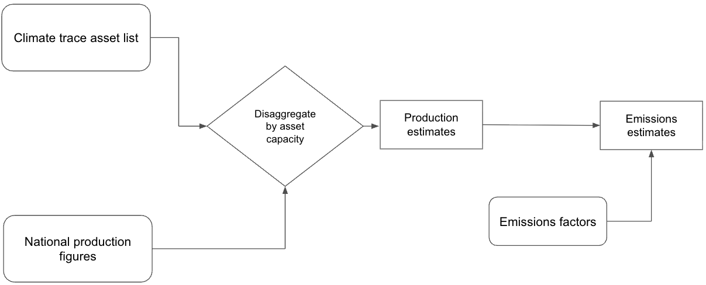
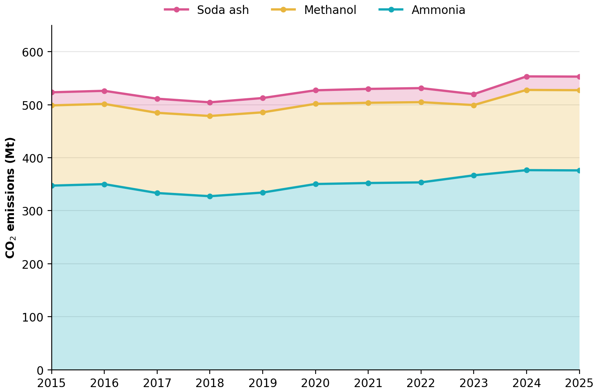

### Manufacturing and Industrial Processes sector: Chemicals Emissions

**Verity Crane and Charlotte Underwood**

*Authors are affiliated with TransitionZero and Climate TRACE*

V5.10.0, Aug. 2026

#### 1. Introduction

The chemical industry is the largest industrial consumer of energy worldwide and the third-largest industrial source of direct CO₂ emissions. Those emissions are concentrated in a handful of commodity chemicals: ammonia, methanol and high-value chemicals together produce around 935 Mt of direct CO₂ a year, with ammonia alone responsible for 45% of primary-chemical emissions and methanol 28% (IEA, 2023). Production of these chemicals relies almost entirely on fossil fuels and feedstocks (IRENA, 2024), and demand has grown steadily: methanol demand has expanded at roughly 6.5% a year over the past decade, driven largely by China, which accounts for 58% of production (IEA, 2023). Soda ash, the third chemical covered here, is produced mainly via the Solvay process; on average, 200–300 kg of CO₂ is vented per tonne of soda ash produced (EEA, 2023), before fuel combustion for steam and calcination is counted. The direct CO₂ intensity of primary chemical production has changed little in recent years, so emissions have tracked output rather than decoupling from it (IEA, 2023).

Policymakers, investors and companies trying to change this face a basic information problem. National inventories report chemical emissions as aggregate totals, often with a lag of two years or more, and do not identify which plants, processes or fuels are responsible. Corporate disclosure is partial and inconsistent, and few jurisdictions publish facility-level data at all. Without plant-level estimates it is difficult to target the highest-emitting assets, assess the credibility of decarbonization commitments, or track whether announced projects are actually reducing emissions.

This document sets out how Climate TRACE addresses that gap for ammonia, methanol and soda ash. Section 2 describes the data and methods: a global asset inventory of 137 ammonia, 42 methanol and 36 soda ash plants across 30, 20 and 16 countries respectively, supplemented by residual capacities aggregated to sub-national regions where plant data are incomplete (2.1); the disaggregation of national production to individual facilities by capacity share and the application of technology- and country-specific emission factors (2.2); the uncertainty and confidence framework applied to each estimate (2.3); and, from the November 2025 release, the emission reduction solutions (ERSs) attached to each facility (2.4). Section 3 presents global and country-level results for 2015 to 2025, Section 4 discusses limitations and next steps, and Section 5 documents the published dataset and its metadata.

#### 2. Materials and Methods

We investigated each major processing route independently using publicly available data. Currently there is no comprehensive asset or emissions inventory for the production of chemicals. To address this gap, we used a large language model (LLM) to collect asset metadata from online sources. We quantified emissions using a standardized “bottom-up” approach by applying an emissions factor to estimated plant-level production. Plant-level production is estimated by disaggregating publicly available national-level data among plants in that country. In the case of missing annual data, we carry forward production from the most recent available year. For countries where national production data was unavailable throughout the entire dataset time period, we used a global average capacity utilization rate to estimate plant production; for methanol, which has no national production data, a fixed capacity factor is applied (Table 2).

#### 2.1 Datasets employed

#### 2.1.1 Asset inventory datasets

Climate TRACE has collected and compiled a global asset inventory containing important production characteristics (capacity, type, location). We developed a large language model to collect all chemical assets source data. Where the results of this model fell well below expected global capacity in the chemicals subsectors, residual capacities from Industrial Info Resources (IIR, 2025) were used on an aggregated geographical level: GADM administrative regions (GADM, 2022) for ammonia and methanol, and national level for soda ash. IIR capacities are available to 2023; 2023 values are carried forward for 2024 and 2025. The totals for each sector are provided below:

-   Ammonia: 258 emission sources (includes GADM-2 regions) in 41 countries (of which 137 are assets across 30 countries)

-   Methanol: 140 emission sources (includes GADM-2 regions) in 31 countries (of which 42 are assets across 20 countries)

-   Soda Ash: 61 emission sources (includes GADM-0 level) in 34 countries (of which 36 are assets across 16 countries)

#### 2.1.2 Production datasets

For ammonia and soda ash, national production data was retrieved from USGS (2026a, 2026b). We were unable to source an equivalent dataset for methanol production. USGS reports annual production for major producing countries only; its residual “other countries” total is not assigned to any country, and plants in countries not reported by USGS receive the global average capacity factor (Section 2.2.2). Where a country’s production is missing for a year, the most recent reported value is carried forward. A description of the steps taken to estimate national production is outlined in Table 2.

#### 2.1.3 Emissions factor dataset

Emission factors cover direct (Scope 1) CO₂ emissions at the production site, i.e. process emissions together with on-site fuel combustion. No deduction is made for CO₂ captured and used in downstream urea synthesis. IPCC (2006) category 2.B.1 subtracts this CO₂ at the ammonia stage, so our ammonia totals are not directly comparable with national inventory submissions under that category. Ammonia factors are the EU CBAM default values for direct embedded emissions (Vidovic et al., 2023), accessed via Climatiq (2025). They are country-specific for 22 producing countries, with an EU value applied to EU member states without their own factor and a CBAM world-average default (European Commission, 2023) applied elsewhere. Methanol factors are based on the Methanol Institute (2022) production-stage intensities: 3.2 t per tonne for coal-based production, applied to China, and 0.375 t per tonne for natural gas–based production, applied elsewhere (the Methanol Institute reports about 0.40 t for modern gas-based plants). A single global factor is applied to all soda ash production; this factor (0.425 t CO₂/t) is a production-weighted average of natural and synthetic routes. The natural (trona) value combines the IPCC (2006) process default of 0.138 t CO₂/t with fuel-combustion emissions of 0.179 t CO₂/t derived from US EPA (2009). The synthetic (Solvay) value combines the upper end of the 0.20–0.30 t CO₂/t direct emissions range reported by Gutierrez et al. (2025) with the same fuel term, giving 0.479 t CO₂/t. Synthetic production is assumed to be two-thirds of global output (RSC, 2025). The factors are listed in Table 1.

| **Table 1** Emission factors (t CO₂ per tonne of product) |                       |
|-----------------------------------------------------------|-----------------------|
| **Chemical: region**                                      | **t CO₂ / t product** |
| Ammonia: China                                            | 3.88                  |
| Ammonia: Other countries (CBAM world average)             | 2.82                  |
| Ammonia: Trinidad and Tobago                              | 2.43                  |
| Ammonia: Turkmenistan                                     | 2.40                  |
| Ammonia: Chile                                            | 2.27                  |
| Ammonia: Belarus                                          | 2.25                  |
| Ammonia: Ukraine                                          | 2.25                  |
| Ammonia: Indonesia                                        | 2.24                  |
| Ammonia: Serbia                                           | 2.22                  |
| Ammonia: Georgia                                          | 2.19                  |
| Ammonia: Turkey                                           | 2.18                  |
| Ammonia: Morocco                                          | 2.12                  |
| Ammonia: Russia                                           | 2.11                  |
| Ammonia: Saudi Arabia                                     | 2.11                  |
| Ammonia: Algeria                                          | 2.08                  |
| Ammonia: Egypt                                            | 2.08                  |
| Ammonia: Tunisia                                          | 2.06                  |
| Ammonia: Israel                                           | 2.05                  |
| Ammonia: USA                                              | 2.00                  |
| Ammonia: Canada                                           | 1.99                  |
| Ammonia: EU (default for member states)                   | 1.98                  |
| Ammonia: United Kingdom                                   | 1.97                  |
| Ammonia: Norway                                           | 1.91                  |
| Methanol: China                                           | 3.20                  |
| Methanol: rest of world                                   | 0.38                  |
| Soda ash: global                                          | 0.425                 |

*Sources: ammonia: Vidovic et al. (2023) via Climatiq (2025), with the world average from European Commission (2023); methanol: Methanol Institute (2022); soda ash: US EPA (2024) and Gutierrez et al. (2025).*

#### 2.2 Methods

#### 2.2.1 Methodology for completing data gaps

Our asset production and emissions estimates rely on information about asset capacities and national production in each country. Where data gaps existed across our data sources, we used various methods to complete them determined by the data available for each country. The steps taken are detailed below in Table 2.

<table><thead><tr class="header"><th><strong>Table 2</strong> Descriptions of the steps taken to assign missing asset capacities and estimate national production where raw data is unavailable.</th><th></th><th></th><th></th><th></th><th></th></tr></thead><tbody><tr class="odd"><td><strong>National production data available</strong></td><td><strong>National capacity data available</strong></td><td><strong>At least some asset capacities available</strong></td><td><strong>Method for assigning missing asset capacities</strong></td><td><strong>Method for estimating national production</strong></td><td><strong>Relevant sector(s)</strong></td></tr><tr class="even"><td>Yes</td><td>Yes</td><td>Yes</td><td>
(1) Assign average of known asset capacities across assets missing capacities.

(2) If (1) brings the national total in excess of national capacity, scale each asset proportionally to match official figures.

This is preferred over assigning residual national capacity to avoid assigning unrealistically high or low capacities in light of a high degree of uncertainty in our source data.
</td><td>N/A</td><td>Soda Ash, Ammonia</td></tr><tr class="odd"><td>Yes</td><td>Yes</td><td>No</td><td>(3) Equally distribute national capacity among all assets.</td><td>N/A</td><td>Soda Ash, Ammonia</td></tr><tr class="even"><td>Yes</td><td>No</td><td>Yes</td><td>(4) Estimate national capacity using a global average capacity factor, derived from countries with available production and capacity data. 
Then follow steps (1) and (2)</td><td>N/A</td><td>Soda Ash, Ammonia</td></tr><tr class="odd"><td>Yes</td><td>No</td><td>No</td><td>Estimate national capacity as in (4), then equally distribute among all assets.</td><td>N/A</td><td>Soda Ash, Ammonia</td></tr><tr class="even"><td>No</td><td>No</td><td>Yes</td><td>N/A</td><td>Use known asset-level capacity, plus IIR residual capacity, as national capacity. Apply a fixed capacity factor of 0.89 in line with the utilization reported for Methanex’s global plant fleet (Methanex, 2026) to estimate production in every country and year.</td><td>Methanol</td></tr></tbody></table>

#### 2.2.2 Production methodology

The subsequent step in quantifying emissions for each facility was estimating the associated activity in each time period. To do this, a disaggregation method was applied: for each facility, its share of national capacity was computed before multiplying this number by the national production to derive the facility’s contribution. An illustrative example is shown below where a country has two plants A and B (with capacities $`C_{A}`$and $`C_{B}`$ respectively) and a total production $`P_{\text{\ m}}`$ for a given month *m*, the capacity-based production estimates for these two plants are (respectively $`P_{A,\ m}`$ and $`P_{B,\ m}`$):

-   $`P_{A,\ m} = \ \frac{C_{A}}{C_{A}\  + \ C_{B}}\  \times \ P_{m}`$

-   $`P_{B,\ m} = \ \frac{C_{B}}{C_{A}\  + \ C_{B}}\  \times \ P_{m}`$

In cases where national production exceeds the maximum realistic utilization rate of 95% national capacity, our asset capacity data was deemed to be incomplete. Due to indications of significantly lower capacity coverage across our assets in the chemical sector, we aggregated residual capacities from Industrial Info Resources (2025) to the smallest possible geographical level to estimate residual production.

USGS production is reported annually. For ammonia and soda ash, each country’s annual capacity factor (national production divided by national capacity, including any residual capacity) is applied to every asset and residual source in that country. Monthly capacity is annual capacity scaled by the number of days in the month, so monthly production follows calendar length only and does not capture seasonal patterns, maintenance outages or changes in output within a year. Where a country’s capacity factor still exceeds 0.95, or production data are unavailable, the global average capacity factor is used instead. This average is calculated for each year as the mean of national capacity factors between 0.40 and 0.95 in countries whose asset coverage is assumed complete.

Table 3 lists the global average capacity factor for each year and the number of countries it is calculated from. In 2025 it is based on 14 countries for ammonia (Bangladesh, Belarus, Canada, Egypt, France, Germany, India, Italy, the Netherlands, Nigeria, Pakistan, Poland, Slovakia and Spain) and 4 for soda ash (Botswana, France, India and Kenya). In 2025 the global average replaces the national factor in Iran, Oman and Uzbekistan for ammonia and in China, Pakistan, Turkey and Uzbekistan for soda ash (case 2). It is also used for Colombia (ammonia) and 13 soda ash countries that USGS does not report (case 3).

| **Table 3** Global average capacity factor by year (number of countries in brackets) |             |              |
|--------------------------------------------------------------------------------------|-------------|--------------|
| **Year**                                                                             | **Ammonia** | **Soda ash** |
| 2015                                                                                 | 0.68 (14)   | 0.77 (5)     |
| 2016                                                                                 | 0.66 (15)   | 0.71 (6)     |
| 2017                                                                                 | 0.71 (14)   | 0.87 (4)     |
| 2018                                                                                 | 0.75 (13)   | 0.80 (5)     |
| 2019                                                                                 | 0.73 (15)   | 0.82 (6)     |
| 2020                                                                                 | 0.65 (14)   | 0.86 (3)     |
| 2021                                                                                 | 0.74 (19)   | 0.76 (4)     |
| 2022                                                                                 | 0.71 (14)   | 0.80 (4)     |
| 2023                                                                                 | 0.70 (16)   | 0.78 (4)     |
| 2024                                                                                 | 0.72 (15)   | 0.76 (4)     |
| 2025                                                                                 | 0.70 (14)   | 0.77 (4)     |

#### 2.2.3 Emissions methodology

With the production estimates generated for each asset or region, the emission estimates were derived by multiplying the production by the relevant emission factors. The high-level process is summarized in Figure 1.

**Figure 1** Methodology to calculate asset level emissions.

#### 2.2.4 Country-level emissions

Climate TRACE national totals for chemicals are calculated separately from the asset dataset. For ammonia and soda ash, where USGS reports national production for a country and year, the national total is USGS production multiplied by the country’s emission factor (Table 1). This replaces, rather than adds to, the sum of asset emissions in that country. Where USGS does not report a country, the national total is the sum of emissions from its assets and residual sources. Methanol has no national production dataset, so its national totals are always the asset sum.

Between 2015 and 2025, 715 ammonia country-years use USGS production (275 of them in countries with no assets in our inventory) and 11 use the asset sum. For soda ash, 231 country-years use USGS production and 143 the asset sum. All 341 methanol country-years use the asset sum.

Asset totals are therefore lower than national totals wherever USGS reports production in countries that our inventory does not cover (for example Indonesia, Saudi Arabia and Qatar for ammonia), or where USGS production exceeds 95% of inventory capacity, so that the country’s assets use the global average capacity factor while its national total uses USGS production (Section 2.2.2). In 2025, assets account for 84% of the national ammonia total (376 of 450 Mt CO₂), 81% of soda ash (25.6 of 31.6 Mt CO₂) and all of methanol (151 Mt CO₂).

#### 2.3 Uncertainty and Confidence Methodology

Uncertainty and confidence levels were assigned to activity estimates, emission factors, and CO₂ emissions following the framework detailed in the sections below, based on the IPCC (2006) guidance on uncertainties.

#### 2.3.1 Activity Estimation

Uncertainty in activity estimates arises from both the source of capacity data and the method used to determine capacity factors. When capacity information comes from reliable sources -such as independent organizations with asset-level data- and production is assessed at the national level, uncertainty is relatively low, and confidence is relatively higher. In contrast, when capacity is derived from less certain sources, such as large language model (LLM) outputs, uncertainty increases. The level of confidence further depends on the geographical resolution used to calculate capacity factors, with coarser resolutions generally leading to higher uncertainty.

The following rules apply:

-   Reliable source for capacity (independent organizations with asset-level data), and capacity factor by using national level production: 0.12 (medium confidence)

<!-- -->

-   Low confidence source for capacity (large language model outputs), and capacity factor estimated by using world production: 0.30 (very low confidence)

-   Low confidence source for capacity (large language model outputs), and capacity factor estimated by using regional production: 0.25 (very low confidence)

-   Low confidence source for capacity (large language model outputs), and capacity factor estimated by using national level production: 0.20 (very low confidence)

In the current release, all ammonia and soda ash sources are assigned an activity uncertainty of 0.20 (LLM capacity, national production), and all methanol sources 0.30 (LLM capacity, capacity factor not derived from production data). IIR-derived residual sources are treated conservatively in the same way as the assets of their subsector, although their capacity source would qualify for 0.12.

#### 2.3.2 Emissions Factor

Uncertainty and confidence depends on the IPCC Tier of the emissions factor applied. In the soda ash subsector and most countries in the methanol subsector, a single global emission factor is applied to all assets. Since this factor is not differentiated by region, technology, or process, the associated uncertainty is 0.15, corresponding to low confidence. Country-differentiated default factors (comparable to IPCC Tier 2) are used in the ammonia subsector, and a China-specific factor in the methanol subsector; these are considered medium confidence and lower uncertainty (0.10-0.12). The soda ash factor is applied to both Solvay-process and natural (trona-based) production. Trona-based production, which dominates in the United States and Turkey, generally has lower process emissions, so soda ash emissions in these countries are likely overestimated.

#### 2.3.3 CO2 emissions

The total CO₂ emissions uncertainty is calculated through propagation of uncertainties in both activity and emission factors. The uncertainty of emissions is determined as:

$`{\sigma_{A}\  = \ \sqrt{\ {{{(\sigma}_{B})}^{2}} + {{{(\sigma}_{C})}^{2}}}}`$

Where:

-   $`\sigma_{A}`$​ = relative uncertainty of emissions

-   $`\sigma_{B}`$​ = relative uncertainty of activity

-   $`\sigma_{C}`$ = relative uncertainty of emission factor

Emissions confidence levels are then classified according to the resulting uncertainty value:

-   ≥ 0.25 - very low confidence

-   0.15 – ﹤0.25 - low confidence

-   &lt; 0.15 - medium confidence

#### 2.4 Emissions Reduction Solutions Overview and Application

Emissions Reduction Solutions (ERSs) for the chemicals sector are two strategies: carbon capture and renewable-driven Solvay process. Both are discussed below.

***Chemicals - Carbon capture and storage***

The proposed strategy is the integration of carbon capture and storage (CCS) systems to capture CO₂ from process and/or fuel combustion emissions in ammonia and methanol production. CCS involves capturing CO₂ before it is released into the atmosphere and securely storing it, reducing the overall greenhouse gas footprint of production operations. Implementing CCS can reduce emissions and emissions factors by approximately 78% for the targeted processes. This reduction is achieved by capturing the majority of CO₂ emissions produced during chemical synthesis and energy generation in ammonia and methanol plants.

The IEAGHG has conducted a detailed study evaluating the cost, effectiveness, and deployment potential of CCS in ammonia and methanol production. While CCS is recognized as an industry goal, current deployment is limited, and the report primarily provides technical and economic projections rather than evaluations of existing full-scale operations (IEAGHG, 2017). Factors such as technology readiness, capital costs, and integration into existing facilities influence adoption.

***Chemicals - Renewable-driven Solvay process***

The chemicals sector includes emissions from ammonia, methanol, and soda ash production. Soda ash, used in many household and industrial products, is traditionally produced from salt (NaCl) and limestone (CaCO₃) using an ammonia-based loop. Ammonia acts as a catalyst, enabling the conversion of raw materials into soda ash and is regenerated and reused to improve process efficiency. However, the lime kiln in this process is fueled by fossil energy, generating substantial CO₂ emissions (EPA, 2015a; EPA, 2015b).

The strategy applied here is based on a pilot-scale module developed by Solvay, a European chemical company ([https://www.solvay.com/en/](https://www.solvay.com/en/)). They have developed “e.Solvay”, a technology that reduces emissions. The approach, applied to soda ash production, begins by replacing the fossil-fueled lime kiln with a less energy-intensive electrochemical system powered by decarbonized, renewable electricity. Ammonia is still recovered and reused in a circular loop, but the process no longer generates CO₂ in the calcination step. In addition to eliminating CO₂ emissions from lime calcination, the process improves resource efficiency, using 20% less brine, 30% less limestone, and 20% less energy while maintaining production output (Solvay, 2025). Overall, this results in a 50% reduction in CO₂ emissions compared to the traditional process.

Implementing the e.Solvay process can potentially reduce the sector’s emissions while simultaneously improving material and energy efficiency, thereby translating process improvements into quantifiable emissions reductions. Following full validation, the company plans deployment across all European soda ash plants until 2050, reflecting the technology’s readiness and potential for scale (Solvay, 2025). Adoption is supported by both emissions reduction potential and process efficiency improvements, though global deployment may be influenced by regional electricity decarbonization levels.

#### 3. Results

Figure 2 presents the total CO2 emission estimates for the chemicals asset dataset. Among the three sub-sectors, ammonia production is the largest emitter, with emissions of about 376 Mt CO2 in 2025. Methanol ranks second, at about 151 Mt CO2. Finally, soda ash production accounts for relatively lower emissions, remaining stable at approximately 26 Mt CO2 in recent years.

Tables 3 to 5 list the largest emitters in the ammonia, methanol and soda ash industries. Across all three chemical subsectors, China is the largest emitter, particularly for methanol where production is coal-dominated as opposed to using natural gas used more extensively elsewhere.

**Figure 2** Global annual Climate TRACE estimated CO2 emissions (stacked by sub-sector) for ammonia, methanol and soda ash for years 2015 to 2025.

| **Table 3** Top 10 countries by asset-level ammonia emissions in 2025 |                                                 |
|-----------------------------------------------------------------------|-------------------------------------------------|
| **Country**                                                           | **CO2 Emissions (MtCO2)** |
| China                                                                 | 190.1                                           |
| India                                                                 | 42.3                                            |
| Russia                                                                | 31.7                                            |
| USA                                                                   | 28.0                                            |
| Pakistan                                                              | 10.7                                            |
| Iran                                                                  | 9.5                                             |
| Egypt                                                                 | 8.3                                             |
| Germany                                                               | 7.7                                             |
| Canada                                                                | 7.6                                             |
| Nigeria                                                               | 5.6                                             |
|                                                                       |                                                 |

| **Table 4** Top 10 countries by asset-level methanol emissions in 2025 |                                                 |
|------------------------------------------------------------------------|-------------------------------------------------|
| **Country**                                                            | **CO2 Emissions (MtCO2)** |
| China                                                                  | 130.5                                           |
| Iran                                                                   | 3.6                                             |
| Saudi Arabia                                                           | 2.7                                             |
| USA                                                                    | 2.7                                             |
| Russia                                                                 | 2.2                                             |
| Malaysia                                                               | 1.6                                             |
| Egypt                                                                  | 1.1                                             |
| Oman                                                                   | 0.7                                             |
| Canada                                                                 | 0.7                                             |
| New Zealand                                                            | 0.7                                             |

| **Table 5** Top 10 countries by asset-level soda ash emissions in 2025 |                                                 |
|------------------------------------------------------------------------|-------------------------------------------------|
| **Country**                                                            | **CO2 Emissions (MtCO2)** |
| China                                                                  | 11.6                                            |
| USA                                                                    | 5.1                                             |
| Russia                                                                 | 1.5                                             |
| Turkey                                                                 | 1.3                                             |
| India                                                                  | 1.1                                             |
| Germany                                                                | 1.1                                             |
| Bulgaria                                                               | 0.5                                             |
| Poland                                                                 | 0.5                                             |
| France                                                                 | 0.4                                             |
| Iran                                                                   | 0.3                                             |

#### 4. Discussion & Conclusions

In this work, asset-level CO2 emissions are provided on a monthly basis for the chemicals sector, with residual production and emissions aggregated to GADM-2 regions for ammonia and methanol, and to national level for soda ash, where public asset data was unavailable.

To estimate emissions at the facility-level, our methodology disaggregates national production numbers to assets based on the share of their capacity to the total national production capacity. Consequently, the accuracy of these estimates can be considered limited. Nevertheless, this work serves as a foundational piece for estimating CO2 emissions in the chemical sector and may be utilized to develop more detailed estimates in the future as more data becomes available.

#### 4.1 Limitations

**LLM-derived asset inventory.** Asset locations, capacities and process routes come from a large language model search of online sources and have not been independently verified for every plant. Missing plants are partly covered by IIR residual capacity, but this is aggregated to regional or national level and 2022 values are carried forward for 2024 and 2025.

**No monthly activity data.** National production is reported annually, so monthly estimates reflect calendar length rather than observed seasonal patterns or outages.

**Methanol activity.** No national production dataset is available for methanol. Production is estimated with a fixed capacity factor, so methanol emissions do not reflect year-on-year changes in output.

**Emission factors.** Ammonia factors vary by country, but methanol (outside China) and soda ash use single global factors that do not distinguish technology or feedstock, for example trona-based versus Solvay soda ash.

**Capacity-share disaggregation.** Each plant is assigned production in proportion to its share of national capacity, so every plant in a country runs at the same utilization rate. This compresses the real spread between plants: idle or underused plants are overestimated and high-utilization plants underestimated, although national totals are unaffected.

**Asset coverage of national totals.** Where USGS reports production for countries without assets in our inventory, or where national production exceed 95% of inventory capacity, so that country’s assets use the global average capacity factor whils its national total uses USGS production (Section 2.2.2), the asset dataset is lower than the national total (84% for ammonia and 81% for soda ash in 2025; Section 2.2.4).

#### 5. Supplementary metadata section

#### 5.1 Chemicals

The chemicals sector CO2 emissions were reported for individual assets for the years 2015 to 2025. The emissions described here represent a subset of specific country-level emissions estimates from the Climate TRACE manufacturing sector. All data is freely available on the Climate TRACE website ([https://climatetrace.org/](https://climatetrace.org/)). A detailed description of what is available is described in Tables 6 to 8.

| **Table 6** Details on the chemical assets metadata                     |                                                                                                                                                                                                                              |
|-------------------------------------------------------------------------|------------------------------------------------------------------------------------------------------------------------------------------------------------------------------------------------------------------------------|
| **General Description**                                                 | **Definition**                                                                                                                                                                                                               |
| Sector definition                                                       | *Emissions from chemicals production*                                                                                                                                                                                        |
| UNFCCC sector equivalent                                                | *2.B.1 (Ammonia), 2.B.8.a. (Methanol), 2.B.7. (Soda ash). Ammonia excludes the IPCC deduction for CO₂ used in urea (see Section 2.1.3)*                                                                                      |
| Temporal Coverage                                                       | *2015 - 2025*                                                                                                                                                                                                                |
| Temporal Resolution                                                     | *Monthly*                                                                                                                                                                                                                    |
| Data format                                                             | *CSV*                                                                                                                                                                                                                        |
| Coordinate Reference System                                             | *WGS 84 (EPSG:4326). Point locations provided as WKT, with ISO3 country code.*                                                                                                                                               |
| Number of emitters available for download                               | *258 ammonia sources, 140 methanol sources and 61 soda ash sources*                                                                                                                                                          |
| What emission factors were used?                                        | *Country-specific factors for ammonia (EU CBAM default values), a China-specific and a global factor for methanol, and a single global factor for soda ash (see Table 1)*                                                    |
| What is the difference between a “0” versus “NULL/none/nan” data field? | *“0” values are for true non-existent emissions. If we know that the sector has emissions for that specific gas, but the gas was not modeled, this is represented by “NULL/none/nan”*                                        |
| total\_CO2e\_100yrGWP and total\_CO2e\_20yrGWP conversions              | *Climate TRACE uses IPCC AR6 CO2e GWPs. CO2e conversion guidelines are here: https://www.ipcc.ch/report/ar6/wg1/downloads/report/IPCC\_AR6\_WGI\_FullReport\_small.pdf* |

| **Table 7** Definition of the fields in the chemicals asset dataset |                                                                        |
|---------------------------------------------------------------------|------------------------------------------------------------------------|
| **Data attribute**                                                  | **Definition**                                                         |
| **sector**                                                          | manufacturing                                                          |
| **source\_sub-sector\_name**                                        | chemicals                                                              |
| **source definition**                                               | emissions from chemicals production                                    |
| **start\_date**                                                     | start date for time period of emissions estimation (YYYY-MM-DD format) |
| **end\_date**                                                       | end date for time period of emissions estimation (YYYY-MM-DD format)   |
| **asset\_identifier**                                               | internal identifier                                                    |
| **asset\_name**                                                     | name of the facility                                                   |
| **iso3\_country**                                                   | ISO 3166-1 alpha-3 country code                                        |
| **location**                                                        | well-known text (WKT) point location                                   |
| **type**                                                            | chemicals type (ammonia, methanol, soda ash)                           |
| **capacity**                                                        | monthly plant capacity (tonnes)                                        |
| **capacity\_factor**                                                | utilization rate of plants                                             |
| **CO2\_emissions\_factor**                                          | direct emissions factor (t-CO2/tonne of chemicals)          |
| **CH4\_emissions\_factor**                                          | not used; N/A                                                          |
| **N2O\_emissions\_factor**                                          | not used; N/A                                                          |
| **CO2\_emissions**                                                  | Direct emissions (t-CO2)                                    |
| **CH4\_emissions**                                                  | not used; N/A                                                          |
| **N2O\_emissions**                                                  | not used; N/A                                                          |
| **total\_CO2e\_100yrGWP**                                           | 100 years global warming potential (t-CO2e)                 |
| **total\_CO2e\_20yrGWP**                                            | 20 years global warming potential (t-CO2e)                  |
| **other1**                                                          | not used; N/A                                                          |
| **model\_number**                                                   | version of the model (e.g. 1,2...)                                     |

<table><thead><tr class="header"><th><strong>Table 8</strong> Definition for confidence and uncertainty in emissions.</th><th></th><th></th></tr></thead><tbody><tr class="odd"><td><strong>Data attribute</strong></td><td><strong>Confidence Definition</strong></td><td><strong>Uncertainty Definition</strong></td></tr><tr class="even"><td><strong>type</strong></td><td><ul><li><blockquote>
<em>Very low:</em> Based on highly speculative or obsolete information. Very low level of confidence in the accuracy of asset classification.
</blockquote></li><li><blockquote>
<em>Low:</em> Limited or somewhat outdated data. Low level of confidence in the classification's correctness.
</blockquote></li><li><blockquote>
<em>Medium:</em> A mix of historical and more recent data. A medium level of confidence in its accuracy.
</blockquote></li><li><blockquote>
<em>High:</em> Grounded in comprehensive and recent data. A high level of confidence in the precise classification of the asset.
</blockquote></li><li><blockquote>
<em>Very high:</em> Extensive, up-to-date, and verified data. A very high level of confidence in the accurate and detailed identification of the asset.
</blockquote></li></ul></td><td>Not used; N/A</td></tr><tr class="odd"><td><strong>capacity</strong></td><td><ul><li><blockquote>
<em>Very low:</em> Limited or outdated data, and significant uncertainties exist.
</blockquote></li><li><blockquote>
Low: Outdated and/or incomplete data.
</blockquote></li><li><blockquote>
<em>Medium:</em> A mix of historical and recent data.
</blockquote></li><li><blockquote>
<em>High:</em> <em>Comprehensive</em> and recent data updates. High level of certainty.
</blockquote></li><li><blockquote>
<em>Very high:</em> Extensive, up-to-date, and verified data. Very high level of certainty.
</blockquote></li></ul></td><td>Not used; N/A</td></tr><tr class="even"><td><strong>capacity_factor</strong></td><td><ul><li><blockquote>
<em>Very low:</em> Data is sparse or highly unreliable. Considerable uncertainty in capacity factor estimations.
</blockquote></li><li><blockquote>
<em>Low:</em> Moderate uncertainty in capacity factor calculations.
</blockquote></li><li><blockquote>
<em>Medium:</em> Data is sufficiently available, though not comprehensive. No absolute accuracy in capacity factor estimations.
</blockquote></li><li><blockquote>
<em>High:</em> High confidence in the accuracy of capacity factor calculations.
</blockquote></li><li><blockquote>
<em>Very high:</em> Derived from thorough and validated data sources. Very high precision of capacity factor estimations.
</blockquote></li></ul></td><td>Not used; N/A</td></tr><tr class="odd"><td><strong>activity</strong></td><td><ul><li><blockquote>
<em>Very low:</em> Largely speculative or based on outdated information. A very low level of confidence in activity assessments.
</blockquote></li><li><blockquote>
<em>Low:</em> Limited or somewhat outdated sources. A low level of confidence in the activity assessments.
</blockquote></li><li><blockquote>
<em>Medium:</em> A mix of historical and more recent data. Medium level of confidence in activity insights.
</blockquote></li><li><blockquote>
<em>High:</em> Detailed and current operational data ensures a high level of confidence in the accuracy of activity assessments.
</blockquote></li><li><blockquote>
<em>Very high:</em> Extensive, verified, and up-to-date data. A very high level of confidence in their accuracy.
</blockquote></li></ul></td><td>±20 to 30% of production estimates (based on IPCC)</td></tr><tr class="even"><td><strong>CO2_emissions_factor</strong></td><td><ul><li><blockquote>
<em>Very low:</em> Highly uncertain due to insufficient or unreliable data.
</blockquote></li><li><blockquote>
<em>Low:</em> Estimated from incomplete data. Low confidence level in its precision.
</blockquote></li><li><blockquote>
<em>Medium:</em> A mix of historical and more recent data. Medium level of confidence in their accuracy.
</blockquote></li><li><blockquote>
<em>High:</em> Derived from comprehensive and recent data. A high level of confidence in their precision.
</blockquote></li><li><blockquote>
<em>Very high:</em> Based on extensive and validated data, providing a very high level of confidence in their precision.
</blockquote></li></ul></td><td>±10-15% of emission factor (based on IPCC)</td></tr><tr class="odd"><td><strong>CH4_emissions_factor</strong></td><td>Not used; N/A</td><td>Not used; N/A</td></tr><tr class="even"><td><strong>N2O_emissions_factor</strong></td><td>Not used; N/A</td><td>Not used; N/A</td></tr><tr class="odd"><td><strong>CO2_emissions</strong></td><td><ul><li><blockquote>
<em>Very low:</em> Based on very rough estimations or outdated information. A very low level of confidence in its accuracy.
</blockquote></li><li><blockquote>
<em>Low:</em> Estimated from incomplete data. Low confidence level in its precision.
</blockquote></li><li><blockquote>
<em>Medium:</em> A mix of historical and more recent data. Medium level of confidence in their accuracy.
</blockquote></li><li><blockquote>
<em>High:</em> Derived from comprehensive and recent data. A high level of confidence in their precision.
</blockquote></li><li><blockquote>
<em>Very high:</em> Based on extensive and validated data, providing a very high level of confidence in their precision.
</blockquote></li></ul></td><td>±22 to 34% of emissions estimates</td></tr><tr class="even"><td><strong>CH4_emissions</strong></td><td>Not used; N/A</td><td>Not used; N/A</td></tr><tr class="odd"><td><strong>N2O_emissions</strong></td><td>Not used; N/A</td><td>Not used; N/A</td></tr><tr class="even"><td><strong>total_CO2e_100yrGWP</strong></td><td><ul><li><blockquote>
<em>Very low:</em> Based on very rough estimations or outdated information. A very low level of confidence in its accuracy.
</blockquote></li><li><blockquote>
<em>Low:</em> Estimated from incomplete data. Low confidence level in its precision.
</blockquote></li><li><blockquote>
<em>Medium:</em> A mix of historical and more recent data. Medium level of confidence in their accuracy.
</blockquote></li><li><blockquote>
<em>High:</em> Derived from comprehensive and recent data. A high level of confidence in their precision.
</blockquote></li><li><blockquote>
<em>Very high:</em> Based on extensive and validated data, providing a very high level of confidence in their precision.
</blockquote></li></ul></td><td>
±22 to 34% of emissions

estimates
</td></tr><tr class="odd"><td><strong>total_CO2e_20yrGWP</strong></td><td><ul><li><blockquote>
<em>Very low:</em> Based on very rough estimations or outdated information. A very low level of confidence in its accuracy.
</blockquote></li><li><blockquote>
<em>Low:</em> Estimated from incomplete data. Low confidence level in its precision.
</blockquote></li><li><blockquote>
<em>Medium:</em> A mix of historical and more recent data. Medium level of confidence in their accuracy.
</blockquote></li><li><blockquote>
<em>High:</em> Derived from comprehensive and recent data. A high level of confidence in their precision.
</blockquote></li><li><blockquote>
<em>Very high:</em> Based on extensive and validated data, providing a very high level of confidence in their precision.
</blockquote></li></ul></td><td>±22 to 34% of emissions estimates</td></tr></tbody></table>

**Permissions and Use:** All Climate TRACE data is freely available under the Creative Commons Attribution 4.0 International Public License, unless otherwise noted below.

> **Citation format:** Crane, V. and Underwood, C. (2026). *Manufacturing and Industrial Processes sector - Chemicals*. TransitionZero, UK, Climate TRACE Emissions Inventory. [https://climatetrace.org](https://climatetrace.org)
>
> **Disclaimer:** The emissions provided for this sector are our current best estimates of emissions, and we are committed to continually increasing the accuracy of the models on all levels. Please review our terms of use and the sector-specific methodology documentation before using the data. If you identify an error or would like to participate in our data validation process, please [contact us](mailto:coalition@climatetrace.org).

#### 6. References

1.  Climatiq (2025), ‘Ammonia emissions factors retrieved from: Climatiq’. Available at: [https://www.climatiq.io/data/activity/chemicals-type\_ammonia](https://www.climatiq.io/data/activity/chemicals-type_ammonia)

2.  EEA (2023), EMEP/EEA air pollutant emission inventory guidebook 2023, Chapter 2.B.7 Soda ash production. European Environment Agency. Available at: https://www.eea.europa.eu/en/analysis/publications/emep-eea-guidebook-2023

3.  EPA (2015a). Technical Support Document: Soda Ash Manufacturing. Available at: https://www.epa.gov/sites/default/files/2015-03/documents/subpartcc-tsd-sodaash.pdf \[Accessed: 22 October 2025\].

4.  EPA (2015b). Response to Comments: Soda Ash Manufacturing. Available at: https://www.epa.gov/sites/default/files/2015-03/documents/subpartcc-rtc-sodaashmanuf.pdf \[Accessed: 22 October 2025\].

5.  European Commission (2023), Default values for the transitional period of the CBAM between 1 October 2023 and end of 2025. Directorate-General for Taxation and Customs Union, Brussels. Available at: [https://taxation-customs.ec.europa.eu/system/files/2023-12/Default%20values%20transitional%20period.pdf](https://taxation-customs.ec.europa.eu/system/files/2023-12/Default%20values%20transitional%20period.pdf)

6.  GADM (2022), GADM database of Global Administrative Areas, version 4.1. Available at: https://gadm.org

7.  Gutierrez, M., Lorenz, H., Schulze, P. (2025), Carbon-negative production of soda ash: process development and feasibility evaluation. Ind. Eng. Chem. Res. 64(23), 11474-11496. Available at: doi:10.1021/acs.iecr.5c00483

8.  Industrial Info Resources (2025). Available at: https://www.industrialinfo.com/ (proprietary database, accessed under license).

9.  IEAGHG (2017). Techno-Economic Evaluation of HYCO Plant Integrated to Ammonia, Urea or Methanol Production with CCS. Available at: https://publications.ieaghg.org/technicalreports/2017-03%20Techno-Economic%20Evaluation%20of%20HYCO%20Plant%20Integrated%20to%20Ammonia%20%20Urea%20or%20Methanol%20Production%20with%20CCS.pdf \[Accessed: 22 October 2025\].

10. IEA (2023), Tracking Clean Energy Progress 2023: Chemicals. International Energy Agency, Paris. Available at: [https://www.iea.org/energy-system/industry/chemicals](https://www.iea.org/energy-system/industry/chemicals)

11. IPCC (2006), 2006 IPCC Guidelines for National Greenhouse Gas Inventories. Volume 1, Chapter 3: Uncertainties; Volume 3, Chapter 3: Chemical Industry Emissions. IGES, Japan. Available at: [https://www.ipcc-nggip.iges.or.jp/public/2006gl/](https://www.ipcc-nggip.iges.or.jp/public/2006gl/)

12. IRENA (2024), Decarbonising hard-to-abate sectors with renewables: Perspectives for the G7. International Renewable Energy Agency, Abu Dhabi. Available at: [https://www.irena.org/Publications/2024/Apr/Decarbonising-hard-to-abate-sectors-with-renewables-Perspectives-for-the-G7](https://www.irena.org/Publications/2024/Apr/Decarbonising-hard-to-abate-sectors-with-renewables-Perspectives-for-the-G7)

13. Methanol Institute (2022), ‘Methanol emissions factors retrieved from: Methanol Institute’, Carbon Footprint of Methanol. Available at: [https://www.methanol.org/wp-content/uploads/2022/01/CARBON-FOOTPRINT-OF-METHANOL-PAPER\_1-31-22.pdf](https://www.methanol.org/wp-content/uploads/2022/01/CARBON-FOOTPRINT-OF-METHANOL-PAPER_1-31-22.pdf)

14. Methanex (2026), Investor Presentation, July 2026. Methanex Corporation. Available at: [https://www.methanex.com/wp-content/uploads/MEOH-Investor-Presentation-July-2026.pdf](https://www.methanex.com/wp-content/uploads/MEOH-Investor-Presentation-July-2026.pdf)

15. Solvay (2025). Inventing Soda Ash Again. Available at: https://www.solvay.com/en/article/inventing-soda-ash-again \[Accessed: 22 October 2025\].

16. US EPA (2024), ‘Emissions data retrieved from: US EPA’, United States Environmental Protection Agency. Available at: https://www.epa.gov/

17. USGS (2026a) ‘Nitrogen (fixed)—ammonia’, Mineral Commodity Summaries 2026, United States Geological Survey. Available at: https://pubs.usgs.gov/periodicals/mcs2026/mcs2026-nitrogen.pdf

18. USGS (2026b) ‘Soda ash’, Mineral Commodity Summaries 2026, United States Geological Survey. Available at: [https://pubs.usgs.gov/periodicals/mcs2026/mcs2026-soda-ash.pdf](https://pubs.usgs.gov/periodicals/mcs2026/mcs2026-soda-ash.pdf)

19. Vidovic, D., Marmier, A., Zore, L. and Moya, J. (2023), Greenhouse gas emission intensities of the steel, fertilisers, aluminium and cement industries in the EU and its main trading partners. JRC Technical Report EUR 31653 EN. Publications Office of the European Union. Available at: https://publications.jrc.ec.europa.eu/repository/handle/JRC134682
