### Manufacturing and Industrial Processes sector: Iron and Steel Production Emissions

**Verity Crane, George Ebri and Charlotte Underwood**

*Authors are affiliated with TransitionZero and Climate TRACE*

V5.11.0, Sept. 2026

#### 1. Introduction

Steel production is a major industrial source of energy demand and carbon emissions, accounting for roughly 8% of global energy use and 7% of energy-sector CO2 emissions (IEA, 2020). These emissions stem largely from the sector's reliance on coal, particularly in primary steelmaking. Global crude steel production was reported at about 1.85 billion tonnes in 2025, concentrated in a few countries: China (52.0%), India (8.9%), Japan (4.4%), and the US (4.4%) (WSA, 2026).

Steelmaking relies on two critical metallic inputs: iron ore and recycled scrap. Around 70% of global steel production uses iron ore, with the remainder coming from scrap. Primary steel, produced in blast furnaces (BFs), dominates sectoral emissions, while secondary steel produced in electric arc furnaces (EAFs) is roughly one-eighth as energy-intensive, using electricity instead of coal (IEA, 2020).

Accurate facility-level steel production data is important for estimating sector emissions, yet such data is rarely publicly available due to competitive pressures. Most reported figures are at the national level, often with multi-month delays (WSA, 2026; NBSC, 2025). Plant-level emissions data are reported to regulators in the EU (European Commission, 2025, 2026), the US (US EPA, 2024) and Canada (Environment and Climate Change Canada, 2026), but these account for only about 12% of global output (WSA, 2026).

This work addresses both temporal and spatial gaps in traditional steel production and emissions reporting by generating monthly, facility-level estimates for all assets identified in Global Energy Monitor's Global Iron and Steel Tracker (GIST) database (GEM, 2026a). Facility activity is primarily inferred from satellite-derived hotspot data, which capture fluctuations in operational intensity at certain steel plants. These satellite-based estimates are then calibrated against regional and national production statistics to derive final production values. Production estimates are subsequently combined with route- and process-specific emission factors to calculate asset-level CO2 emissions.

Given its contribution to global emissions, steel production requires targeted emissions reduction solutions. In this study, reduction strategies are applied to assets based on the production technology in use, including the blast furnace–basic oxygen furnace (BF-BOF), electric arc furnace (EAF), induction furnace (IF), and direct reduced iron (DRI–EAF and DRI–IF) routes. The solutions include strategies such as maximizing scrap use in electric facilities, substituting natural gas with green hydrogen in DRI plants, integrating carbon capture and storage (CCUS) into BF-BOF operations, and phasing out or replacing high-emission blast furnaces with hydrogen-based DRI–EAF routes. In all, we identify 11 different strategies with each strategy representing a pathway to reduce emissions, either by lowering direct process emissions, substituting carbon-intensive inputs, or phasing out high-emission technologies (see Section 2.3.1). Together, these strategies reflect both incremental and transformative options for emission reduction in the steel sector, capturing the diversity of regional conditions and technological readiness levels.

#### 2. Materials and methods

This section provides a high-level overview of the datasets and associated pipelines used to derive emission estimates for a steel plant. Monthly emissions are estimated for each of the 1,017 steel plants in 82 countries that operated between January 2021 and August 2026. Country-level estimates include 101 steel-producing countries or territories from January 2015 to August 2026.

Direct emissions are released during the manufacturing of crude steel, with estimates varying by production route, namely BF–BOF, DRI–EAF, EAF, IF, and DRI–IF. A simplified overview of the steel production value chain from raw materials to final steel products is available in Appendix 1 (Section 9.1).

Because source-level emissions data are rarely published, a standardized bottom-up approach is used (Figure 1). Monthly production is first estimated for each plant, from satellite-observed heat signatures where available (Section 2.2.2) or from national capacity factors otherwise, and route-specific emission factors are then applied (Section 2.2.3). Country-level emissions are estimated separately, as national crude steel production from the World Steel Association (WSA) multiplied by a national emission factor derived from the plants in each country (Section 2.2.4).

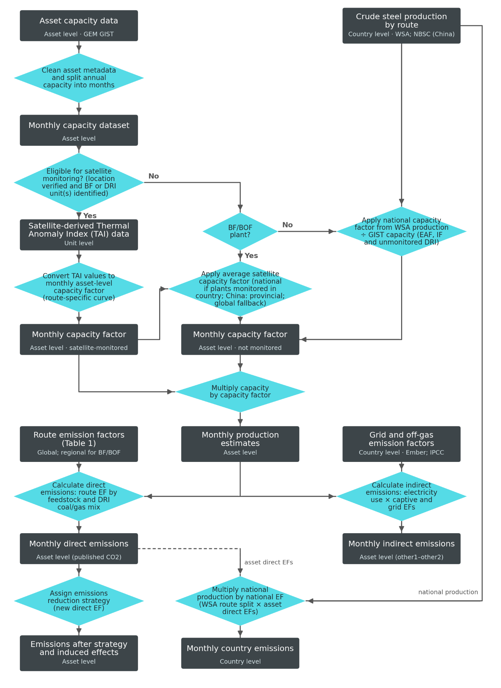

**Figure 1** Flowchart of the methodology to calculate plant-level and country-level emissions for global steel assets.

#### 2.1 Materials

#### 2.1.1 Steel inventory dataset

GEM provides facility-level information such as location, owner, capacity, age, product type, and technology type via the GIST, which includes every iron and steel plant currently operating with a capacity of more than 500,000 tonnes. The GIST also includes all plants meeting that capacity threshold that have been proposed or under construction since 2017, and retired or mothballed since 2020. In total there are 1,293 unique steel facilities, with an annual steelmaking capacity of 2.2 billion tonnes operating and 0.86 billion tonnes under development, across 91 countries (GEM, 2026b). We manually validated the position of all the plants using geolocation data from Google Maps API (Google Maps, 2025) and OpenStreetMap (OpenStreetMap, 2025).

Figure 2 shows how steel mills are distributed globally, with a high concentration of sources in China. The map also highlights countries with little to no steel production, mainly concentrated in Sub-Saharan Africa, Latin America, and Southeast Asia.

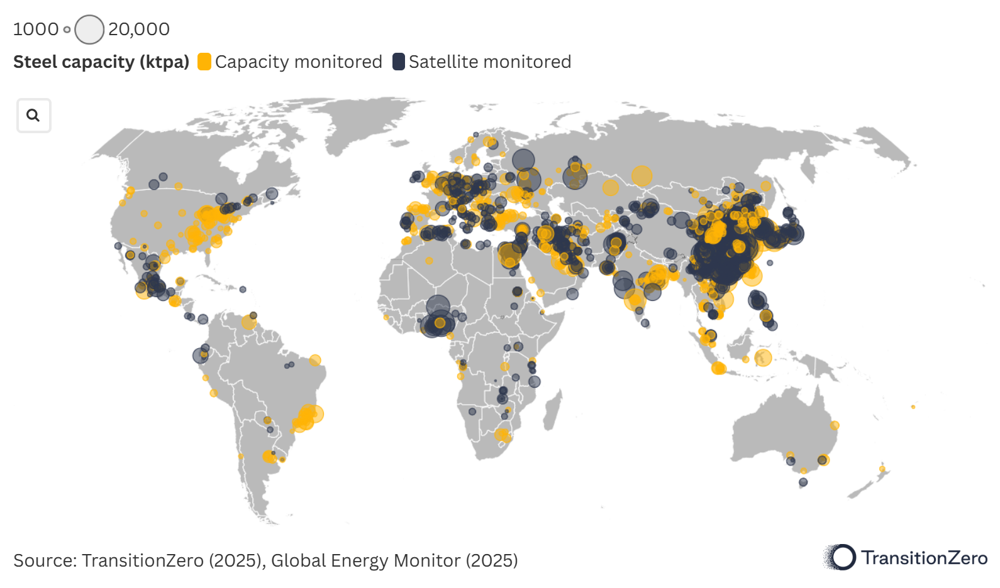

**Figure 2** Global map showing operating steel plants as of 2025. Satellite-monitored facilities (shown in dark blue) and other facilities (shown in orange). The circle size represents plant production capacity, with reference scales shown at the top of the figure for 1,000 and 20,000 thousand tonnes per annum (ktpa).

####

#### 2.1.2 Remote sensing datasets

Satellite-derived production estimates make use of multispectral imagery from two different collections:

1.  The European Space Agency (ESA) Copernicus Sentinel-2 mission (Level-2A surface reflectance), with a combined five-day equator revisit with two satellites:

1.  Sentinel-2A, with imagery available since 2015 (ESA, 2025).

2.  Sentinel-2B, with imagery available since 2017 (ESA, 2025).

Both Sentinel-2 satellites have a MultiSpectral Instrument (MSI) that measures wavelengths from \~443 to \~2,190 nm (blue to shortwave infrared, SWIR) at 10–60 m spatial resolution; the bands used here (B8A, B11, B12) have 20 m resolution.

1.  The US Geological Survey (USGS) and National Aeronautics and Space Administration (NASA) Landsat program (Collection 2 Level-2 surface reflectance), with a combined eight-day revisit:

1.  Landsat-8, with imagery available since 2013 (NASA and USGS, 2025a).

2.  Landsat-9, with imagery available from 2021 (NASA and USGS, 2025b).

Both Landsat-8 and Landsat-9 have an Operational Land Imager (OLI) that measures wavelengths from \~435 to \~2,294 nm (blue to SWIR) at 30 m spatial resolution; the bands used here are B5, B6 and B7.

All imagery was sourced and processed using Google Earth Engine (Google Earth Engine, 2025a, 2025b, 2025c). For each image we compute the thermal anomaly index (TAI) of Liu et al. (2021), which combines the two high-temperature-sensitive SWIR bands with the high-temperature-insensitive near-infrared (NIR) band:

-   Sentinel-2A/B: $`TAI\  = \ \frac{(B12\  - \ B11)}{(B8a)}`$

-   Landsat-8/9: $`TAI\  = \ \frac{(B7\  - \ B6)}{(B5)}`$

Where *B* refers to the band number for the specific satellite. Landsat values are converted to reflectance with the USGS Collection 2 scale factors, and Sentinel-2 values are adjusted to Landsat equivalents using NASA’s band-pass adjustments (NASA, 2018), so the two collections can be used as one. All images are resampled to 20 m, and pixels with implausible reflectance (NIR below 0.01, or SWIR outside 0–1) are masked. Images are used when they cover at least 20% of the plant outline and cloud cover over it is at most 60%, using the Sentinel-2 cloud probability product and the Landsat quality band.

For each production unit and image, the unit’s signal is its maximum TAI minus the mean TAI of a background area around the plant. Negative values are set to zero, values above 5 are discarded as outliers, and where a unit is imaged more than once on the same day, the image with the highest coverage and lowest cloud cover is kept. Figure 3 shows an example of TAI with identified hotspots at a steel plant.

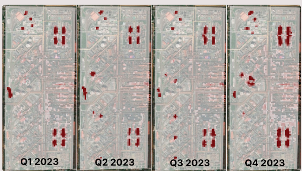

**Figure 3** Left: identified hotspots at POSCO's Gwangyang steel plant, South Korea, during different quarters in 2023. Right: identified sub-assets within the facility based on thermal anomalies. Sources: modified Copernicus and USGS data, ESRI base map.

#### 2.1.3 Production datasets

National crude steel production is taken from the WSA’s monthly production statistics (WSA, 2026), which are loaded as each monthly release is published. In 2025 the monthly series covers 67 countries and 97% of modeled national production (1,798 of 1,850 Mt). A further 28 smaller producers are reported only as annual totals (52 Mt in 2025), which are split across months by the number of days in each month; countries with neither are given zero unless they have modeled assets, in which case asset-level estimates are used (Section 2.2.4). Each monthly release restates earlier months, and the model uses the most recent value for every country and month: between the September and October 2026 releases, 7% of country-months back to January 2025 were revised, adding 1.4 Mt in total. WSA’s annual statistics also split production by process route (oxygen, electric and open hearth), which we use to divide national production between BF-BOF and electric routes (Section 2.2.4) and to calculate the electric-route capacity factors for plants without satellite data (Section 2.2.2). For China, provincial crude steel output from the National Bureau of Statistics (NBSC, 2025) is used to allocate national production to provinces.

#### 2.1.4 Emission factors dataset

The direct emission factors for each steel production routes were sourced from multiple references, including the WSA (2025), the IPCC (2006b), the Mission Possible Partnership's Steel Transition Strategy (MPP, 2024), and the International Energy Agency (IEA, 2020), providing global average values specific to each production route. For BF-BOF plants in Europe and the USA, a lower regional direct factor was derived from EU ETS verified emissions (European Commission, 2025) and checked against US EPA facility data (US EPA, 2024).

Electricity use was sourced separately for each route, as the gross electricity a plant consumes per tonne of crude steel, whether generated on site or bought from the grid. Sources are the Mission Possible Partnership steel model (MPP, 2022), RITE's DNE21+ model (RITE, 2008), Midrex operating data (Midrex, 2021; Voelker and Boyle, 2022), and Indian surveys of DRI and induction furnace plants (Ministry of Steel, 2024; Kartheek et al., 2024). The emission factor for electricity generated onsite from steelworks off-gases was derived from IPCC (2006a) Volume 2 combustion defaults. Grid emission intensities are monthly values from Ember (2025), for the facility’s country where available, and otherwise for its region.

#### 2.1.5 Feedstock composition and DRI reductant mix

The composition of the feedstock mix used in EAF and IF production was provided by GEM, including the percentages of scrap, DRI, sponge iron, pig iron, and other sources of iron. This data was used to adjust the emission factor for the EAF and IF production routes. Separately, the reductant used in direct reduction – coal, natural gas or hydrogen – was compiled per plant, giving the share of each plant's DRI capacity reduced with coal, natural gas or hydrogen. This split determines which of the coal- and gas-based DRI emission factors in Table 1 applies at each facility. Where no split is available the DRI is assumed to be entirely natural-gas-based, except in India, where it is assumed to be coal-based. Around 80% of Indian DRI is produced in coal-fired rotary kilns (Kartheek et al., 2024), so a gas default would understate emissions at most Indian plants without fuel data.

#### 2.2 Methods

#### 2.2.1 Emissions scope

Emissions were estimated for the direct and indirect CO2 released during the manufacture of crude steel. Direct emissions comprise process emissions from iron ore reduction (IPPU) and emissions from fuel combustion used to provide energy to the process. Indirect emissions arise from the electricity consumed by the production routes, whether bought from the grid or generated at the plant (captive power).

Integrated BF–BOF plants generate most of their own electricity by burning blast furnace, coke oven and BOF gases (collectively referred to as off-gases) in on-site power plants. In this work, the emissions from that on-site generation are reported with the indirect (electricity) emissions rather than with the direct emissions. This differs from GHG Protocol accounting, where on-site generation falls under Scope 1; Climate TRACE instead reports all emissions from generating electricity used in manufacturing as indirect (Scope 2) regardless of whether the power is bought from the grid or generated on site (Lancellotti et al., 2025). This maintains comparability between plants that generate their own power and those that buy it. Section 4.3 combines direct emissions and captive power before comparing with regulatory data.

Emissions vary by production route (BF–BOF, DRI–EAF, EAF, IF, and DRI–IF) and, for scrap-based routes, by feedstock mix. Emissions from upstream mining and downstream steel fabrication are outside the scope of this work.

#### 2.2.2 Production methodology

Two approaches were used to estimate source-level production. As a priority, satellite-derived production estimates were used whenever a facility released enough heat to be captured by a satellite's sensor that can measure shortwave infrared (SWIR) and near-infrared (NIR) wavelengths (Zhou et al., 2018; Marchese et al., 2019; Liangrocapart, Khetkeeree and Petchthaweetham, 2020). This is the case for BF–BOF, DRI–EAF, and DRI–IF facilities, which have several units that function at temperatures higher than 1,200 °C. These hotspots include signals from BFs, coke ovens, sinter plants, pellet plants, BOFs, and DRIs.

Our methodology scours satellite imagery for heat signatures from operating steel plants. Each steel production unit is outlined with a hand-drawn polygon, as shown in Figure 4. Using the GIST (GEM, 2026a) as a foundation, we built a global dataset of blast furnaces, coke oven batteries, sinters, pellet plants, and DRI plants with the help of our satellite-based hotspot methodology. The current dataset for satellite monitoring spans 53 countries and contains the location, shape, crude steel capacity, and operation start year for 402 plants with blast furnaces and 114 plants with DRI units, along with the location, shape, and type for their associated sub-assets. More details on the methodology and dataset are available on the TransitionZero website ([https://www.transitionzero.org/insights/steel-data-explainer](https://www.transitionzero.org/insights/steel-data-explainer)).

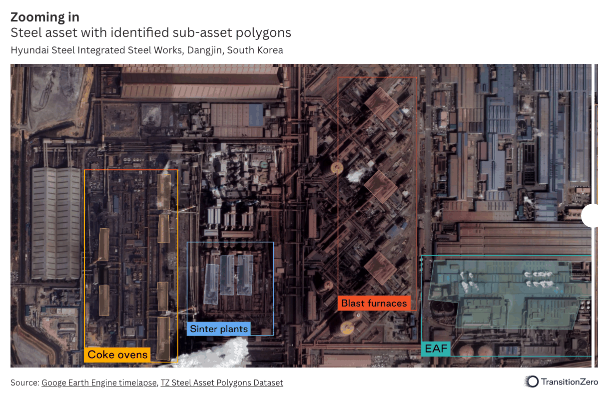

**Figure 4** Zooming in on Hyundai Steel Integrated Steel Works (Dangjin, South Korea), with identified sub-asset polygons.

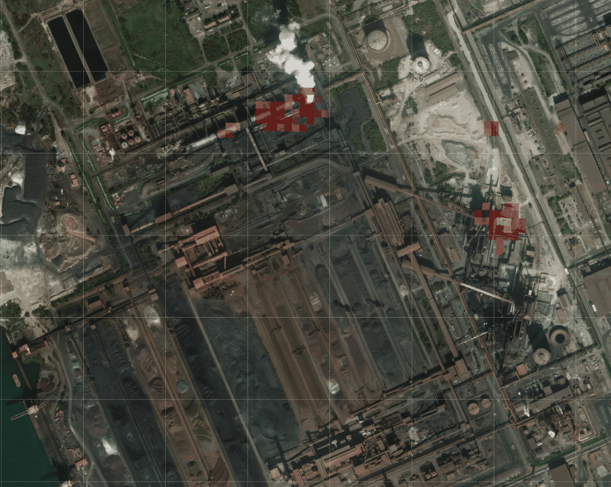

**Figure 5** Satellite-detected hotspots (green boxes in upper center and center right) over ArcelorMittal's Fos-sur-Mer steel plant in September 2024.

For each plant, unit signals are averaged by month for its blast furnace group (blast furnaces, coke ovens and sinter plants) and its DRI group. Two filters are applied before averaging. Unit values above 2 are excluded to limit the influence of extreme readings on the monthly mean; the calibration curves already reach their maximum at a TAI of about 0.5 for BF–BOF and 1.0 for DRI. Readings below 0.01, the relaxed detection threshold of Liu et al. (2021) and the level at which our curves set utilization to zero, are only used from images with less than 30% cloud cover, because cloud can hide a hot unit and make an operating plant appear idle; for the same reason, a near-zero month based on a single day of imagery is discarded. Each group’s monthly TAI is converted to a utilization rate using a piecewise-linear curve calibrated separately for BF–BOF and DRI plants, with a maximum of 95% (Figure 12, Appendix 4). Months without a usable image take the plant’s nearest earlier or later value.

For BF-BOF plants without usable hotspot signals, we apply the national (in China, provincial) average satellite-derived utilization rate, or the global average where no plants in the country are monitored. DRI–EAF and DRI–IF plants without usable signals, together with EAF and IF plants, use a national utilization rate based on historical WSA production and GIST capacity (global average where this exceeds 100%). Assets may be excluded from satellite monitoring due to a low signal-to-noise ratio, which makes it difficult to distinguish production from background fluctuations. Other sources of complication can be the occasional presence of strong reflections from a priori cold elements. These combined techniques, applied to operating plants sourced from the GIST database, yield a total of 1,017 facilities monitored monthly for production and CO2 emissions.

Figure 6 illustrates the relationship between satellite-derived TAI and the corresponding emissions for a steel plant in France. The TAI values presented here are derived from the hotspot data shown in Figure 5.

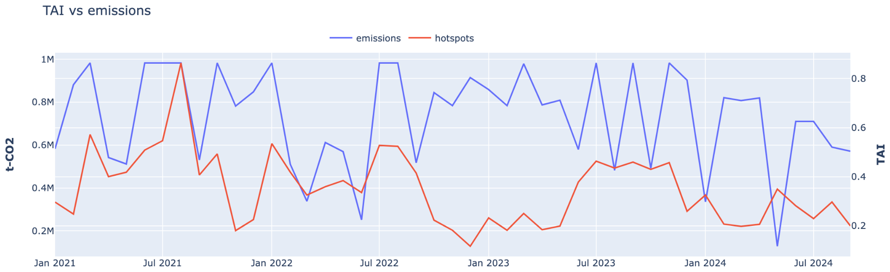

**Figure 6** Satellite-based Thermal Anomaly Index (TAI; red solid line) and estimated emissions (blue solid line) at ArcelorMittal's Fos-sur-Mer steel plant, January 2021 – September 2024.

Estimated production for all plants is then calibrated to national or provincial (China) statistics. This corrects the level differences between plants that a single global curve does not capture (Appendix 4): where a country has one blast furnace plant it sets that plant’s production to the reported value, and where several share national output the thermal signal determines how it is allocated among them.

#### 2.2.3 Emissions methodology

Facility emissions are the product of estimated production and emission factors specific to each production route and, where known, its feedstock and DRI reductant (IPCC, 2006b; WSA, 2025; IEA, 2020; Ministry of Steel, 2024). Direct and indirect emissions follow the scope defined in Section 2.2.1; Table 1 gives the factors for each route.

| **Table 1** Direct emission, electricity use, and process emission factors for the different crude steel production routes. |                                                       |                                                        |                                          |                                   |
|-----------------------------------------------------------------------------------------------------------------------------|-------------------------------------------------------|--------------------------------------------------------|------------------------------------------|-----------------------------------|
| **Production route**                                                                                                        | **Direct emission factor (t-CO2/t-steel)** | **Process emission factor (t-CO2/t-steel)** | **Electricity use factor (MWh/t-steel)** | **Electricity generated on-site** |
| BF-BOF                                                                                                                      | 1.9 (Europe and USA: 1.4)                             | 1.71 (Europe and USA: 1.21)                            | 0.25                                     | 100% (off-gas power)              |
| BOF (no blast furnace on site)                                                                                              | 1.45                                                  | 1.16                                                   | 0.19                                     | 0%                                |
| DRI–EAF (NG)                                                                                                                | 1.0                                                   | 0.62                                                   | 0.70                                     | 0%                                |
| DRI–EAF (coal)                                                                                                              | 2.27                                                  | 1.41                                                   | 0.85                                     | 0%                                |
| EAF                                                                                                                         | 0.08                                                  | 0.08                                                   | 0.635                                    | 0%                                |
| DRI–IF (NG)                                                                                                                 | 0.93                                                  | 0.55                                                   | 0.95                                     | 0%                                |
| DRI–IF (coal)                                                                                                               | 2.20                                                  | 1.34                                                   | 0.95                                     | 0%                                |
| IF                                                                                                                          | 0.01                                                  | 0.01                                                   | 0.79                                     | 0%                                |

*Europe and the USA: EU ETS countries (EU-27, Norway, Iceland and Liechtenstein), the UK and the USA. Captive power assumptions and the off-gas emission factor are given in Tables 9–11 (Appendix 9.2)*

**Direct emissions**

Direct emissions comprise process emissions (IPPU), mainly from the carbon used to reduce iron ore, and emissions from fuel burned to provide heat. Process factors follow the IPCC (2006b) defaults for each technology, complemented by Fan and Friedmann (2021) for the DRI–EAF route.

BF-BOF. The direct emission factor outside Europe and the USA is the IPCC (2006b) Tier 1 default of 1.9 t-CO2/t-steel. In Europe, EU ETS verified emissions for integrated steelworks and their coke plants, excluding separately permitted off-gas power plants (whose emissions are counted under captive power), averaged 1.33 t-CO2/t-steel over 2021–2024 at sites with reliable production data (European Commission, 2025). This is raised to 1.4 t-CO2/t-steel for European BF-BOF plants, reflecting the precision warranted by the sample size and a preference for a conservative estimate. The reduction is applied to process emissions (1.21 t-CO2/t), with fuel emissions unchanged at 0.19 t-CO2/t.

The European factor is also applied, provisionally, to BF-BOF plants in the USA. The evidence comes from the four integrated sites whose US EPA GHGRP boundary includes coke making and on-site off-gas power (US EPA, 2024; Section 4.3). Per tonne of modeled 2023 production, Gary Works reported 1.98 t-CO2 and Burns Harbor 2.06, close to the 1.91 implied by the European factor plus captive power and well below the 2.41 implied by the global factor. Indiana Harbor (1.26) and Granite City (1.24) reported less than the European direct factor alone, most likely because our production estimates for these sites exceed their 2023 output. Across the four sites, our estimates total 1.12 times reported emissions with the European factor, and would total about 1.4 times with the global factor. Cleveland-Cliffs’ company-wide BF-BOF average of 1.54 t-CO2e/t crude steel (Scope 1 and 2, worldsteel boundary) points the same way, on a different boundary (Cleveland-Cliffs, 2024), as do Canada’s integrated plants, which use the global factor and are 28% above reported emissions (Section 4.3). The choice is material: using the global factor instead would raise the 2025 US national total from 44.5 to about 56 Mt-CO2 (+26%), since 23.5 Mt of US crude steel is made by the BF-BOF route.

*DRI-based routes*. Natural-gas DRI–EAF uses 1.0 t-CO2/t-steel (IEA, 2020). Coal DRI–EAF uses 2.27 t-CO2/t-steel: CEEW's coal DRI–EAF route total of 2.85 t-CO2/t-steel (Elango et al., 2023), less its electricity emissions at India's grid intensity (0.85 MWh/t × 0.681 t-CO2/MWh). This is consistent with other Indian route estimates once their electricity emissions are removed (2.21–2.32 t-CO2/t-steel; Ministry of Steel, 2024; Kartheek et al., 2024). The DRI–IF factors are the DRI–EAF values less 0.07 t-CO2/t-steel, the melt-shop difference between EAF and IF (which has no graphite electrodes).

*EAF and IF feedstock blending.* For EAF and IF facilities, the factor is refined using the feedstock mix: the share of scrap and, for the rest, the type of iron and its reduction route. To calculate the effective emission factor *Ea* based on the actual feedstock composition, the following weighted-average formula was applied:

*Ea = Ea,scrap × pcscrap + Ea,pig × pcpig + Ea,DRI × (1 − pcscrap − pcpig)*

where the DRI term is itself blended by each plant's DRI fuel mix (Section 2.1.5):

*Ea,DRI = EDRI,coal × pcDRI,coal + EDRI,NG × pcDRI,NG*

Here *pcscrap* and *pcpig* are the shares of scrap and pig iron in the feedstock, and the remainder is treated as DRI (other iron sources are assumed equivalent to DRI). The reference factors are the route values in Table 1: for EAF facilities, *Ea,scrap* = 0.08 (IPCC, 2006b), *EDRI,NG* = 1.0 and *EDRI,coal* = 2.27; for IF facilities, *Ea,scrap* = 0.01 (Bedarkar, 2024), *EDRI,NG* = 0.93 and *EDRI,coal* = 2.20. Pig iron uses *Ea,pig* = 1.71 (1.21 in Europe and the USA): the direct factor less its 0.19 t-CO2/t fuel component, equal to the BF-BOF process factor in Table 1.

Where the scrap share was not available, it was set to the average of assets reporting less than 100% scrap, on the assumption that assets using 100% scrap would report it, given its 'green' credentials. For facilities with several EAF or IF units, feedstock shares were weighted by unit capacity; for plants with several production routes, the emission factor was weighted by each route's share of production.

**Indirect emissions**

Indirect emissions combine a facility's electricity use with the emission factor of the electricity supplying it, whether generated on site or bought from the grid:

*Eindirect* = *Uelec* × \[*w* × *EFcaptive* + (1 − *w*) × *EFgrid*\]

where *Uelec* is electricity use (MWh/t-steel), *w* is the share generated on site, *EFcaptive* is the emission factor of on-site generation (t-CO2/MWh) and *EFgrid* is the monthly grid intensity for the facility’s country, or its region where no country value is available (Ember, 2025). For plants with several routes, *Uelec* and *w* are weighted by each route's share of production. For DRI–EAF and DRI–IF facilities, *Uelec\ *is blended by the plant’s coal and gas DRI mix in the same way as the direct factor; EAF and IF facilities use their route value whatever their feedstock.

*Electricity use.* Each route has a sourced value (Table 1). For scrap EAF it is MPP's purchased electricity of 2.29 GJ/t (0.635 MWh/t), corroborated by RITE (0.623 MWh/t; RITE, 2008) and the Ministry of Steel (0.664 MWh/t). Induction furnaces use 1.24 times the EAF value, the ratio of Indian IF to EAF consumption (Ministry of Steel, 2024). Gas-based DRI–EAF uses RITE's 0.70 MWh/t (RITE, 2008). Coal-based DRI–EAF adds about 0.12 MWh/t for charging cold DRI (Voelker and Boyle, 2022) and about 0.10 MWh/t for the DRI plant (Midrex, 2021; Kartheek et al., 2024) to the EAF value. DRI-fed induction furnaces use 0.95 MWh/t, from the CEEW plant survey (Kartheek et al., 2024).

*On-site generation at BF-BOF plants.* Integrated BF-BOF plants are assumed to generate all their electricity on site by burning blast furnace, coke oven and BOF gases (w = 1); the average BF-BOF plant is a net electricity exporter (MPP, 2022). The off-gas power emission factor is 2.04 t-CO2/MWh: an off-gas combustion factor of 198.2 t-CO2/TJ (IPCC, 2006a, Volume 2 defaults, blended by the MPP average off-gas mix) multiplied by a heat rate of 10.3 GJ/MWh (35% generation efficiency; Tables 10 and 11, Appendix 9.2). The gap between MPP’s facility-gate emission intensity for BF-BOF (2.43 t-CO2/t-steel) and the IPCC direct factor (1.9 t-CO2/t-steel) corresponds to 0.26 MWh/t-steel at this emission factor; we use 0.25 MWh/t-steel, which gives a total within 1% of MPP’s. The resulting captive-power term of about 0.51 t-CO2/t-steel is corroborated by unit-level US GHGRP data: at Burns Harbor in 2023 the six power station boilers, fired on blast furnace gas, reported 1.85 Mt-CO2, or 0.50 t-CO2 per tonne of modeled production (US EPA, 2024; Section 4.3). Natural gas co-fired in the boilers is reported in a site-wide common pipe and cannot be attributed, so this is a lower bound. BF-BOF plants therefore have the same total emission factor in every country regardless of the local grid: about 2.41 t-CO2/t-steel, or about 1.91 in Europe and the USA. Because these plants are assumed to buy no grid electricity, the grid term is not used for them.

*Other routes.* All other routes are assumed to buy all their electricity from the grid (w = 0) (Table 9, Appendix 9.2). Many Indian DRI and induction furnace plants also run captive coal-fired power plants or waste heat recovery boilers; these are not yet modeled.

#### 2.2.4 Country-level emissions

Country-level emissions are not the sum of asset-level emissions. They are estimated separately, as national crude steel production multiplied by a national emission factor. This keeps national totals consistent with reported production, and captures plants that are below the GIST reporting threshold (500 ktpa) or missing from the inventory (GEM, 2026a). Across 2021–2025, assets account for 87–90% of national CO2; in 2025, 2.35 of 2.63 Gt-CO2. The difference is largest in India (181 vs 279 Mt-CO2), where many induction furnaces and small DRI plants fall below the GIST threshold. In 4–6 countries per year the national total is slightly below the asset sum (by 0.1–0.5 Mt-CO2), because modeled asset production exceeds WSA production; in 2025 these were Bosnia and Herzegovina, Czechia, North Korea, Romania, Ukraine and the USA. Countries with no assets contribute 1–3 Mt-CO2 per year.

**Production:** Monthly national crude steel production is taken from WSA. Where WSA publishes only an annual total, it is split across months in proportion to the number of days in each month, and monthly WSA values are scaled so that they sum to the WSA annual total. Where WSA reports nothing for a country, our asset-level production estimates are used, scaled to the most recent WSA total where one exists. For months after the latest WSA release, the most recent emissions are carried forward.

**Emission factor:** The national factor combines the WSA production mix with the asset-level factors in Section 2.2.3: EFcountry = sBF × EFBF + (1 − sBF) × EFEAF, where sBF is the WSA share of crude steel from the oxygen, open-hearth and other routes, and EFBF and EFEAF are the production-weighted mean direct factors of the country's BF-BOF and EAF (including DRI–EAF) assets. Where WSA gives no route split for that year, or where many plants run mixed routes (Brazil, Canada, Iran, Mexico, North Korea, Russia, South Korea, Taiwan, Vietnam and Angola), the production-weighted mean factor across all the country's assets is used. Countries with no assets use the default route factors in Table 1, weighted by the national (or, if unavailable, regional) route split.

#### 2.3 Emissions reduction strategies

To estimate the emissions reductions each facility could achieve, we assigned decarbonization strategies to facilities and calculated their effect on modeled emissions. Each strategy is defined in Table 2 by the facilities it applies to, the new direct emission factor or reduction it achieves, and any activity it induces in other sectors. Strategies are assigned to each facility based on its latest month of modeled data (Section 2.2): its production routes and feedstock mix from the Global Iron and Steel Tracker (GEM, 2026a), its direct emission factor, its DRI fuel mix, its location and, for blast furnaces, the age of its furnace stock. The provenance of each adjustment differs: some emission factors are taken directly from published studies independent of Climate TRACE data, some reduction rates are calibrated from reported demonstration-project performance, and some are theoretical assumptions applied uniformly to eligible assets.

Section 5.2 discusses the practicality and deployment of each strategy; the definitions below are not repeated there.

#### 2.3.1 Strategy IDs and definitions

**Strategy 0: Continue current operations (Do nothing)** - Baseline scenario for facilities already operating EAFs with 100% scrap feedstock, which represent the most decarbonized pathway currently available for direct process emissions. No additional reduction is applied; the residual footprint is largely indirect emissions from electricity use, which depend on grid decarbonization (IEA, 2020).

**Strategy 1: Increase scrap steel content to 100% -** Applied to EAF facilities operating below full scrap capacity (GEM, 2026a), increasing the scrap share to 100% and eliminating emissions from virgin iron inputs. Reductions are applied proportionally – up to \~80% for plants with low baseline scrap use – giving a new direct emission factor of 0.08 t-CO2/t-steel (IPCC, 2006b; IEA, 2020). The proportional scaling is a theoretical assumption, though scrap-EAF itself is a mature and widely adopted practice.

**Strategy 2: Replace Natural Gas with Green Hydrogen in DRI/EAF** - Applied to DRI–EAF facilities currently using natural gas as reductant, substituting green hydrogen. The emission factor is replaced with a hydrogen-based benchmark of 0.08 t-CO2/t-steel where hydrogen is produced entirely from renewable electricity (from carbon in the steel, EAF electrodes and lime; MPP, 2022). The benchmark factor is taken from published studies and is not derived from Climate TRACE data.

**Strategy 3: Carbon capture and storage** - Applied to BF-BOF assets unlikely to be shut down in the near term (see Strategy 4), retrofitting carbon capture to process emissions. An average 59% reduction is applied to direct emissions (a ratio of 0.41), within the typical 50–60% range of CO2 avoided for capture retrofitted to an integrated steel mill (IEAGHG, 2013). The 59% figure is calibrated from reported capture rates at existing demonstration projects. The capture equipment's additional electricity is reported as an induced activity (Section 2.3.3).

**Strategy 4: Reduce output (overcapacity)** - Applied to BF-BOF facilities identified as retirement candidates on either of two grounds. The first is asset age: plants operating the BF-BOF route alone are eligible where the blast furnace stock is approaching the end of its productive life, defined as the youngest operating blast furnace at the plant being more than 40 years old, or the most recent relining at the plant having taken place more than 15 years ago. Because relining is a periodic, capital-intensive campaign, a furnace nearing the end of its campaign life represents a natural decision point at which reinvestment can be weighed against closure. Both tests use the youngest furnace and the most recent relining at the plant, since the strategy retires the facility as a whole. The age criterion is applied globally. The second ground is scale: in China, plants producing less than 4 million tonnes of steel per year are eligible, reflecting national policy to consolidate output in fewer, larger facilities. Blast furnace start dates, relining dates, and unit status are taken from GEM's unit-level blast furnace records (GEM, 2026a); only units recorded as operating or operating pre-retirement are considered. Where both could apply, the age criterion takes precedence. For eligible assets, emissions are set to zero to reflect complete retirement. The route is supported by real-world enforced closures of small, inefficient blast furnaces in China: in 2025, China retired 40 mtpa of blast furnace capacity, with 56 mtpa of planned retirements (GEM, 2026b). The retired facility’s production is assumed to move to the other steel facilities in the same country, and the emissions of that reallocated production are reported as an induced effect (Section 2.3.3). Both the retirement and the reallocation are theoretical assumptions.

**Strategy 5: Direct production towards electric furnaces** - Applied to facilities operating both BF-BOF and EAF technologies, migrating BF-BOF production to the EAF route (assuming 100% scrap feedstock). Depending on the current EAF-versus-BF-BOF split, reductions reach up to 95% of Scope 1 emissions relative to full BF-BOF operation, for a new factor of 0.08 t-CO2/t-steel (IEA, 2020; IPCC, 2006b). Both the migration of production and the 100% scrap assumption are theoretical, but reflect practice already observed at some Chinese facilities. The EAF's additional grid electricity is reported as an induced activity (Section 2.3.3).

**Strategy 6a: Replace Blast Furnace with Green Hydrogen DRI/EAF** - A long-term route for fully decarbonizing primary steel: replacing BF-BOF units with hydrogen-based DRI–EAF facilities powered entirely by green hydrogen, achieving near-zero direct emissions (a new factor of 0.08 t-CO2/t-steel, the same hydrogen DRI–EAF end state as Strategy 2; MPP, 2022). The factor is taken from published modeling; its application to existing BF-BOF assets is a theoretical substitution.

**Strategy 6b: Replace blast furnace with green hydrogen and renewable energy driven EAF/DRI** - This is a long-term route to fully decarbonizing primary steel. It replaces BF-BOF units with hydrogen-based DRI–EAF facilities that use green hydrogen for iron reduction and 100% renewable electricity to run the electric arc furnace. Direct emissions are the same near-zero factor as in the *Replace Blast Furnace with Green Hydrogen* strategy, a new factor of 0.08 t-CO₂/t-steel for the hydrogen DRI–EAF end state (MPP, 2022). Unlike the grid-powered version, the EAF draws no standard grid electricity, so this strategy adds zero induced emissions to the electricity-generation sector. The strategy also assumes that enough dedicated renewable electricity is available to supply both hydrogen production and EAF operation.

**Strategy 7: Use** **100% Scrap in Induction Furnace** - The IF equivalent of Strategy 1, applied to induction furnace facilities operating below full scrap capacity (GEM, 2026a). Increasing the scrap share to 100% eliminates emissions from virgin iron inputs, giving a new factor of 0.01 t-CO2/t-steel. Particularly relevant in India and other South and Southeast Asian markets where IF steelmaking is common. As with Strategy 1, the scaling is theoretical; the IF scrap factor is taken from published work (Bedarkar, 2024).

**Strategy 8: Retrofit Coal-Based rotary Kiln with Green Hydrogen DRI** - Applied to coal-based rotary-kiln DRI, the dominant ironmaking route in India (roughly 2.7–3.1 t-CO2 per tonne of crude steel for Scope 1 and 2; Ministry of Steel, 2024; Kartheek et al., 2024). Reduction with green hydrogen brings direct reduction emissions close to zero (a new factor of 0.08 t-CO2/t-steel, the same hydrogen DRI–EAF end state as Strategies 2 and 6). As hydrogen use in rotary kilns is at pilot/demonstration stage, this is applied with lower confidence (TERI, 2025). Both the baseline and the target factor are drawn from published studies rather than Climate TRACE data, and the retrofit itself remains at an early stage of development.

**Strategy 9: Replace Coal-Based Rotary Kiln with Natural Gas DRI** - An interim measure for coal-based DRI (2.27 t-CO2 per tonne of crude steel for Scope 1; Table 1): switching the reductant from coal to natural gas, moving its DRI to gas-DRI levels. Because facilities often combine DRI with scrap or pig iron, the reduction is applied as a ratio: the facility's direct emissions are scaled by the ratio of the gas- and coal-based DRI emission factors in Table 1 (1.0 / 2.27 = 0.44), cutting the DRI's direct emissions by 56%. Applied only where it genuinely lowers a plant's emission factor; treated as a transitional route to green hydrogen that retains residual emissions and upstream methane exposure. The post-retrofit factor is the published gas-DRI value for a commercially mature route.

**Strategy 10: Use Blast Furnace hydrogen injection + Install Carbon Capture and Storage** - A BF-BOF retrofit combining hydrogen injection with carbon capture on the blast furnace off-gas, reducing direct emissions by around 50% (a ratio of 0.5). It is explicitly CCS-dependent – hydrogen injection alone reaches only \~20–25% before furnace thermodynamics limit further substitution. Being developed in Japan under the COURSE50 and Super COURSE50 programs; a transitional rather than net-zero route (TransitionZero, 2025). The \~50% figure is a commercial target for around 2040, with roughly 43% demonstrated to date in an experimental furnace (Nippon Steel, 2024). In this study the strategy is assigned as the primary route for BF-BOF plants in Japan, where the technology is being developed and where geological CO2 storage constraints make a partial-capture retrofit the more realistic near-term option; those plants are correspondingly not assigned the shutdown or standalone CCS strategies. The capture equipment's additional electricity is reported as an induced activity (Section 2.3.3).

| **Table 2** Emissions reduction strategies for the steel sector, with mechanism and resulting emission factors. This table is the canonical reference for strategy names and values. |                                                                               |                                                                                                                                                                                                                                                               |               |                                                |                      |
|--------------------------------------------------------------------------------------------------------------------------------------------------------------------------------------|-------------------------------------------------------------------------------|---------------------------------------------------------------------------------------------------------------------------------------------------------------------------------------------------------------------------------------------------------------|---------------|------------------------------------------------|----------------------|
| **ID**                                                                                                                                                                               | **Strategy name**                                                             | **Description**                                                                                                                                                                                                                                               | **Mechanism** | **New absolute EF (t-CO2/t-steel)** | **New-to-old ratio** |
| 0                                                                                                                                                                                    | Continue current operation (do nothing)                                       | Plants with very low CO2 emissions per tonne of steel continue their current operation.                                                                                                                                                            | –             | –                                              | 1                    |
| 1                                                                                                                                                                                    | Increase scrap steel content to 100%                                          | Increase scrap content, eliminating process emissions from iron ore reduction.                                                                                                                                                                                | Resourcing    | 0.08                                           | –                    |
| 2                                                                                                                                                                                    | Replace NG-DRI with H2-DRI/EAF                                                | Replace natural gas in DRI production with 100% green hydrogen, eliminating fossil-fuel emissions from iron reduction.                                                                                                                                        | Retrofit      | 0.08                                           | –                    |
| 3                                                                                                                                                                                    | Carbon capture and storage                                                    | Install CCUS for the CO2 produced in the process.                                                                                                                                                                                                  | Retrofit      | –                                              | 0.41                 |
| 4                                                                                                                                                                                    | Reduce output (overcapacity)                                                  | Shut down the most emissive low-output BF-BOF plants and reroute production, addressing global overcapacity.                                                                                                                                                  | Subtract      | 0                                              | –                    |
| 5                                                                                                                                                                                    | Direct production towards electric furnaces                                   | Plants with both BF-BOF and EAF technology redirect production to EAF (applicable to plants in China).                                                                                                                                                        | Retrofit      | 0.08                                           | –                    |
| 6a                                                                                                                                                                                   | Replace BF with H2-DRI/EAF                                                    | Replace blast furnace production with DRI using 100% green hydrogen, eliminating fossil-fuel emissions from iron reduction.                                                                                                                                   | Retrofit      | 0.08                                           | –                    |
| 6b                                                                                                                                                                                   | Replace blast furnace with green hydrogen and renewable energy driven EAF/DRI | Replace blast furnace production with direct-reduced iron (DRI) production using 100% green hydrogen, and power the DRI-EAF process entirely with renewable electricity to fully eliminate fossil fuel emissions from both iron reduction and steel refining. | Retrofit      | 0.08                                           | –                    |
| 7                                                                                                                                                                                    | 100% Scrap-IF                                                                 | Increase scrap content in induction furnaces, eliminating process emissions from iron ore reduction.                                                                                                                                                          | Resourcing    | 0.01                                           | –                    |
| 8                                                                                                                                                                                    | Retrofit coal-DRI (rotary kiln) to H2-DRI                                     | Convert coal-based rotary-kiln DRI to 100% green hydrogen reduction. Same near-zero target as gas-shaft H2-DRI, but lower technology readiness, hence lower confidence.                                                                                       | Retrofit      | 0.08                                           | –                    |
| 9                                                                                                                                                                                    | Retrofit coal-DRI to NG-DRI                                                   | Interim route for coal-based DRI: switch the reductant from coal to natural gas, cutting the direct emission factor to gas-DRI levels. Transitional, not a zero-emissions endpoint.                                                                           | Retrofit      | –                                              | 0.44                 |
| 10                                                                                                                                                                                   | BF hydrogen injection + CCUS (Super COURSE50)                                 | Inject hydrogen into the blast furnace and capture CO2 from by-product gas. \~50% direct-emissions reduction; retains the blast furnace and depends on CCS. Transitional, not net-zero.                                                            | Retrofit      | –                                              | 0.5                  |

#### 2.3.2 Calculating emissions after a strategy

Strategies are applied to each facility’s latest month of modeled data (Section 2.2). Strategies with a new absolute emission factor in Table 2 (1, 2, 4, 5, 6, 7 and 8) set the facility’s new direct emissions to that factor multiplied by its production, because the end state does not depend on the starting route. Strategies with a new-to-old ratio (0, 3, 9 and 10) multiply the facility’s current direct emissions by the ratio, because the result depends on its starting feedstock and fuel mix. The emissions reduction is the difference between current and new direct emissions. Each facility is given up to two ranked strategies using the eligibility rules in Section 2.3.1.

#### 2.3.3 Induced effects in other sectors

Some strategies increase activity in another sector. These induced effects are reported separately from the facility's own emissions. Strategies 0, 1, 7 and 9 have no induced effects in this dataset: they keep the facility’s furnace, and feedstock changes do not impact modeled electricity use for the EAF and IF routes. Upstream effects, such as additional scrap collection or natural gas supply, are outside the scope of this work.

*Electricity (Strategies 2, 3, 5, 6, 8 and 10)* For strategies that replace the production route (2, 5, 6 and 8), the induced electricity is the new route's total electricity use less the grid electricity the facility already uses, so existing demand is not counted twice. The hydrogen DRI–EAF end state (Strategies 2, 6 and 8) uses 4.3 MWh/t-steel: about 2.9 MWh/t for electrolysis (55 kg of hydrogen per tonne of steel at 52.5 kWh/kg), 0.35 MWh/t for electric heating of the reducing gas and 1.0 MWh/t for the shaft furnace, EAF and auxiliaries. This is within published estimates of about 3.5–4.8 MWh/t (Vogl et al., 2018; Bhaskar et al., 2020). For a typical plant, the induced electricity is 3.60 MWh/t-steel for gas DRI–EAF (Strategy 2), 4.30 for BF-BOF (Strategy 6), whose power is generated on site, and 3.35 for coal DRI–IF (Strategy 8). Strategy 5 adds the scrap-EAF route's 0.635 MWh/t-steel (0.64 for a BF-BOF plant). Strategy 3 adds 1.2 MWh/t-steel, assuming \~1.2 t-CO2 captured per tonne at \~0.14 MWh/t-CO2 for capture and compression (IEAGHG, 2013) plus \~3 GJ/t-CO2 of solvent-regeneration heat supplied by electricity; MPP (2022) assumes 1.68 MWh/t-steel. Strategy 10 adds 2.0 MWh/t-steel, assuming \~27.5 kg of electrolytic hydrogen per tonne (Yilmaz et al., 2017) at \~53 kWh/kg, plus electricity for capturing the remaining CO2.

The hydrogen strategies (2, 6 and 8) assume renewable electricity, so their induced electricity has no emissions. For Strategies 3, 5 and 10, induced emissions are the induced electricity multiplied by the facility's grid emission intensity (Section 2.2.3). Annual induced emissions are estimated by scaling each facility’s latest month to its 2025 production.

*Steel production (Strategy 4)* A retired facility's production is assumed to move to other steel plants, so each tonne no longer produced induces one tonne of steel elsewhere. Its emissions are estimated at the average direct emission factor of the other facilities in the same country in the latest month, or the global average where the facility is its country's only producer.

#### 2.3.4 Verifying modeled emission reduction estimates

Verification of the modeled reductions varies by strategy and by the type of change assumed. For scrap-based strategies (0, 1, and 7), implementation could in principle be monitored through company reports, trade statistics, and updates to facility feedstock data in the Global Iron and Steel Tracker (GEM, 2026a), although these sources may not provide real-time confirmation. Hydrogen-based DRI (Strategies 2, 6, and 8) and CCUS retrofits (Strategies 3 and 10) are not directly observable from satellite data, but can be tracked through company disclosures, pilot-project announcements, and regulatory filings. In contrast, the reduced overcapacity of BF-BOF assets (Strategy 4) and coal-DRI conversion (Strategy 9) can be verified more robustly through satellite-based activity monitoring, which allows direct observation of whether a facility has ceased operation. Finally, the prioritization of EAF production over BF-BOF at dual-technology sites (Strategy 5) can be partially confirmed through satellite activity data, as a sustained reduction in BF-BOF operations would be observable.

#### 2.4 Coverage

Based on 2025 data, asset-level emissions estimates (2.35 Gt-CO2) account for 89% of our country-level total of 2.63 Gt-CO2 (Section 2.2.4). Both figures are direct emissions only; including indirect emissions from electricity, the asset-level total is about 3.11 Gt-CO2. The direct country total is consistent with Wang et al’s (2026) estimate of about 2.7 Gt-CO2 of direct CO2 from steelmaking in 2025. Across the full 2021–2025 monitoring period, 426 of the 1,017 modeled facilities (42%) have satellite-derived production for at least one month; these plants contributed about 92% of total facility-level emissions. The satellite-monitoring dataset described in Section 2.2.2 (402 plants with blast furnaces and 114 with DRI units) is larger because it also includes plants that did not operate during the monitoring period and plants without a usable signal, and plants with both unit types appear in both counts.

#### 3. Results

#### 3.1 Top emitters

Tables 3 and 4 show the highest emitters in the steel industry at country and plant level, respectively. China accounts for more than half of global steel production and emissions, and has some of the largest and most-emitting steel plants (Table 4).

| **Table 3** Top 10 emitters in the steel sector in 2025, by country (direct emissions only). |                                                                 |                                                                 |
|----------------------------------------------------------------------------------------------|-----------------------------------------------------------------|-----------------------------------------------------------------|
| **Country**                                                                                  | **CO2 emissions (MtCO2) - sum of assets** | **CO2 emissions (MtCO2) - country total** |
| China                                                                                        | 1,450                                                           | 1,599                                                           |
| India                                                                                        | 181                                                             | 279                                                             |
| Japan                                                                                        | 101                                                             | 115                                                             |
| Russia                                                                                       | 91                                                              | 98                                                              |
| South Korea                                                                                  | 87                                                              | 88                                                              |
| Brazil                                                                                       | 53                                                              | 53                                                              |
| USA                                                                                          | 45                                                              | 45                                                              |
| Germany                                                                                      | 34                                                              | 34                                                              |
| Vietnam                                                                                      | 34                                                              | 34                                                              |
| Iran                                                                                         | 32                                                              | 32                                                              |

| **Table 4** Top 10 emitting steel plants in 2025 (direct emissions only). |             |                         |                                                 |
|---------------------------------------------------------------------------|-------------|-------------------------|-------------------------------------------------|
| **Plant name**                                                            | **Country** | **Plant capacity (Mt)** | **CO2 emissions (MtCO2)** |
| POSCO Gwangyang steel plant                                               | South Korea | 23                      | 36.7                                            |
| Angang Steel Co. Ltd.                                                     | China       | 20.6                    | 35.8                                            |
| Inner Mongolia BaoTou Steel Union Co. Ltd.                                | China       | 16.8                    | 30.3                                            |
| Ma'anshan Iron & Steel Co. Ltd.                                           | China       | 17.3                    | 27.7                                            |
| POSCO Pohang steel plant                                                  | South Korea | 18.8                    | 27.4                                            |
| Wuhan Iron and Steel Co. Ltd.                                             | China       | 15.9                    | 26.1                                            |
| Jiangsu Shagang Iron & Steel Co. Ltd.                                     | China       | 17.3                    | 25.3                                            |
| Baoshan Iron and Steel Co. Ltd. Headquarters                              | China       | 19.8                    | 24.5                                            |
| NLMK Lipetsk steel plant                                                  | Russia      | 14.4                    | 22.4                                            |
| Hyundai Steel Dangjin steel plant                                         | South Korea | 16.2                    | 21.6                                            |

#### 3.2 Emissions reduction strategies results

Applying the strategies to the main steel production routes demonstrates the significant mitigation potential of technological and operational shifts. Figure 7 presents the change in emission factors before and after applying each facility’s primary strategy by production route (BF-BOF, DRI–EAF, EAF).

Table 5 summarises the annual abatement from each facility’s primary strategy, applied to 2025 production. Together, the primary strategies reduce direct emissions from the 1,017 modeled facilities by 1.70 Gt-CO2 per year, from 2.32 to 0.63 Gt-CO2 (73%). Strategies that add electricity demand or move production to other plants induce 1.03 Gt-CO2 in other sectors (Section 2.3.3), so the net reduction is 0.67 Gt-CO2 (29%). Most of the gross reduction comes from carbon capture at BF-BOF plants (Strategy 3, 0.78 Gt-CO2) and retiring older or smaller BF-BOF plants (Strategy 4, 0.66 Gt-CO2). These two strategies also account for most of the induced emissions: capture-plant electricity at current grid intensities (0.43 Gt-CO2), and production reallocated to other plants in the same country (0.54 Gt-CO2). As a secondary strategy, replacing the 331 eligible BF-BOF plants with green-hydrogen DRI–EAF (Strategy 6) would cut 2.04 Gt-CO2, 96% of those plants’ direct emissions, with no induced emissions under the renewable-electricity assumption. Secondary strategies are alternatives to the primary ones, so the two are not additive.

| **Table 5** Annual direct-emissions reduction by primary strategy (Mt-CO2, 2025 production) |            |                              |               |                       |                   |
|--------------------------------------------------------------------------------------------------------|------------|------------------------------|---------------|-----------------------|-------------------|
| **Strategy ID/Names**                                                                                  | **Plants** | **Current direct emissions** | **Reduction** | **Induced emissions** | **Net reduction** |
| 0 Continue current operation                                                                           | 273        | 8                            | 0             | 0                     | 0                 |
| 1 Increase scrap to 100% (EAF)                                                                         | 316        | 70                           | 51            | 0                     | 51                |
| 2 Replace NG-DRI with H2-DRI                                                                           | 43         | 55                           | 50            | 0                     | 50                |
| 3 Carbon capture and storage                                                                           | 141        | 1,315                        | 776           | 430                   | 346               |
| 4 Reduce overcapacity                                                                                  | 165        | 665                          | 665           | 544                   | 121               |
| 5 Direct production to electric furnaces                                                               | 20         | 66                           | 63            | 11                    | 52                |
| 7 100% scrap-IF                                                                                        | 14         | 3                            | 3             | 0                     | 3                 |
| 8 Replace coal-DRI with H2-DRI                                                                         | 34         | 43                           | 41            | 0                     | 41                |
| 10 BF hydrogen injection + CCUS                                                                        | 11         | 98                           | 49            | 44                    | 5                 |
| **Total**                                                                                              | **1,017**  | **2,323**                    | **1,696**     | **1,029**             | **667**           |

Each bar in Figure 7 is the average across all facilities on that route, so it combines several strategies. For BF–BOF plants the average falls from 1.86 to 0.46 t-CO2/t-steel (75%). Within this, carbon capture (Strategy 3) cuts a plant’s direct emissions by 59% and hydrogen injection with CCS (Strategy 10) by 50%, while plants assumed to retire (Strategy 4) fall to zero and plants shifting to an EAF (Strategy 5) fall to 0.08. Retirements account for roughly a third of the BF–BOF reduction. CCS is treated here as a transitional measure for existing blast furnaces; full decarbonization of this route relies on replacement with green-hydrogen DRI–EAF (Strategy 6, Table 5).

For DRI–EAF facilities the average falls from 0.94 to 0.08 t-CO2/t-steel (Figure 7). For gas-based plants, switching to green hydrogen (Strategy 2) lowers the emission factor from 0.85 to 0.08 t-CO2/t-steel. This represents one of the deepest potential cuts in the sector and illustrates how hydrogen-based pathways could provide a near-zero-emissions solution if renewable hydrogen is available at scale.

For EAF facilities, which already operate at comparatively low direct emissions, further reductions can be achieved by increasing the scrap share to 100% (Strategy 1). In such cases, emissions linked to the production of virgin iron inputs are eliminated, making EAF the lowest-emission pathway currently available.

Overall, these results show that while scrap-based EAF offers the lowest direct emissions, scaling global decarbonization will also require CCS retrofits for legacy BF-BOF plants and the deployment of hydrogen-based DRI–EAF.

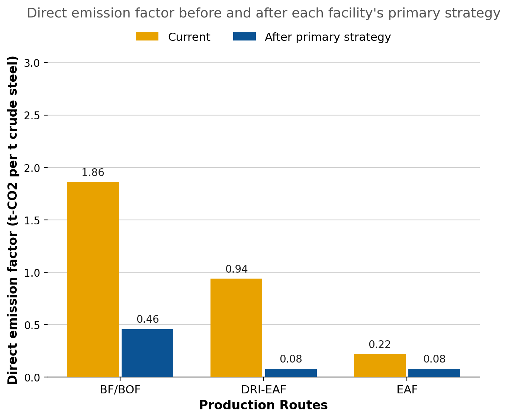

**Figure 7** Average emission factors (t-CO2 per tonne of steel) before (yellow bars) and after (blue bars) the application of primary emission reduction solutions across major steel production routes worldwide.

#### 4. Validation

This section tests the two components of the production model separately, then the combined estimates. Section 4.1 compares satellite-derived utilization with reported production, at example plants and on regions held out from the curve fit; Section 4.2 benchmarks the route emission factors against published intensities, which share sources with ours and so serve as a consistency check. The independent test, against emissions reported to regulators at plant level, is Section 4.3.

#### 4.1 Satellite production model

Figure 8 shows TAI alongside reported pig iron production at the only blast furnace plant in each of Chile, a calibration region, and Hungary, which was not used in the fit. In both cases TAI follows the plant’s operating state more closely than its month-to-month output: it falls during the Hungarian halt in late 2022, recovers at the restart, and declines after both plants’ final shutdowns. This ability to detect cessation of operations is what matters most for verifying shutdown-based emission reduction strategies (Section 2.3.4).

Plant-level production is rarely published, so the TAI-to-utilization curves are calibrated against national or provincial production and tested on regions held out from the fit (Appendix 4). The curves reproduce annual production with an R² of 0.87 for DRI across 20 country-years and 0.80 for BF-BOF across 27 region-years, with an aggregate BF-BOF bias of −2.5%. The main residual error is a persistent level difference between plants: large, modern plants run above a single global curve and small or distressed plants below it. At present this is corrected by calibrating plant production to national or provincial statistics (Section 2.2.2), so the curve determines the monthly profile and, where several plants share national output, the allocation among them. Region-specific curves, planned for the next release, are expected to carry more of this correction in the curve itself.

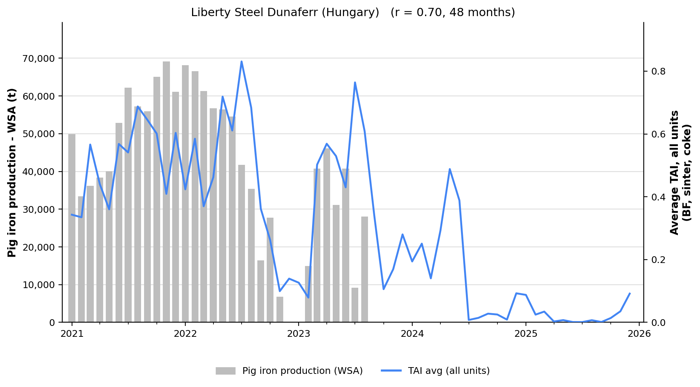

**Figure 8** Satellite-based Thermal Anomaly Index (TAI; blue line, average across all units) and reported pig iron production (grey bars) at the only blast furnace steel plant in (a) Chile, CAP Acero Huachipato, and (b) Hungary, Liberty Steel Dunaferr, 2021–2025. In (a), the sustained decline in TAI from mid-2024 is consistent with the cessation of blast furnace operations (GEM, 2026a). In (b), TAI falls during the production halt in late 2022, recovers with the restart in 2023 and declines after the final shutdown in September 2023. TAI values beyond this were collected from coke ovens that remained in operation until June 2024 (GMK Center, 2024); all units read near zero from July 2024 and WSA does not report Hungarian pig iron after 2024.

#### 4.2 Emission factor benchmarks

The route factors draw on WSA (2025), and the Indian coal-DRI factors on CEEW (Elango et al., 2023; Kartheek et al., 2024) and the Ministry of Steel (2024), so comparison with these sources is a consistency check rather than validation; the aggregate figures also depend on plant-level production, route assignment and country mix, which are not drawn from them.

At the route level, our total (direct plus indirect) emission factors of 2.37, 1.38 and 0.51 t-CO2/t-steel for BF-BOF, DRI–EAF and scrap-EAF are within 1% and 6% of WSA’s 2024 intensities of 2.34 and 1.47 for the first two routes, as expected given the shared basis. Our scrap-EAF factor is 26% below WSA’s 0.69, partly because it covers the melt shop only, whereas reported EAF totals often include downstream processing (Section 4.3). Aggregating across routes with modeled plant-level production, our global average total emission factor is 1.87 t-CO2/t-steel against WSA’s 1.92 (Figure 9). For India, our national average of 2.29 t-CO2/t-steel is about 10% below the Ministry of Steel’s sector-wide 2.54 t-CO2/tcs for 2023–24. The asset list includes only plants of 500 ktpa or more (GEM, 2026a); the Indian plants below that threshold are predominantly small coal-based rotary-kiln DRI units feeding induction furnaces, the most emission-intensive route in the country, so their omission pulls the modeled average down. Our coal-based DRI estimates (2.72–2.81 t-CO2/t-steel) fall within the Ministry’s reported 2.7–3.1 t-CO2/tcs (Figure 9).

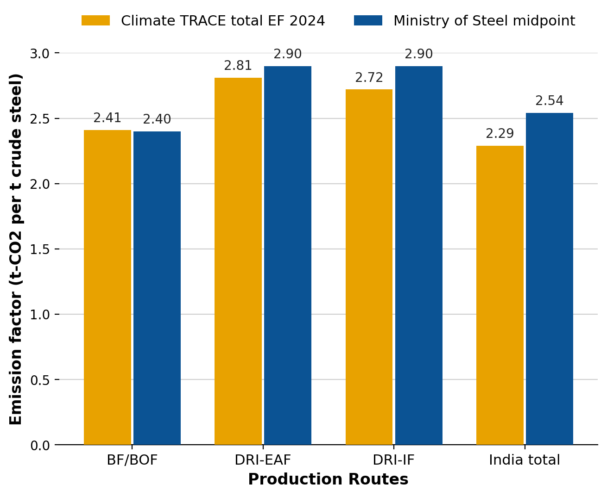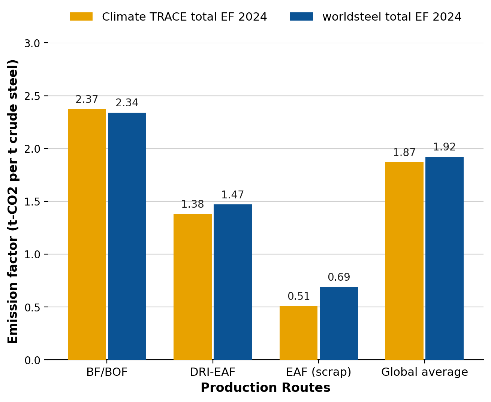

**Figure 9** Comparison of Climate TRACE modeled emission factors against reported statistics (total emission factors, t-CO2 per tonne of crude steel, 2024). Left: global route-level total emission factors versus WSA (2025). Right: India route-level and national-average total emission factors versus India Ministry of Steel figures (Ministry of Steel, 2024).

#### 4.3 Comparison with regulatory data

We compare plant-level estimates with emissions reported under the EU Emissions Trading System (EU ETS), the US EPA Greenhouse Gas Reporting Program (GHGRP) and Canada’s Greenhouse Gas Reporting Program. These programs report by permitted installation or facility, which rarely matches a steel plant as we model it, so the comparison is a sanity check rather than a one-to-one match. Registries report on-site emissions including power generated on site, so we compare Climate TRACE direct emissions plus captive power (Section 2.2.3) with all reported installations at each site, including separately permitted coke plants and off-gas power plants. Only high-confidence matches are used, and BF-BOF sites only where coke making and power generation are inside the matched boundary; matching rules and boundaries are in Appendix 3 (Table 12).

Two of the three comparisons are not fully independent of the model. The European BF-BOF factor (1.4 t-CO2/t-steel) was derived from EU ETS verified emissions for 2021–2024 at many of the same sites, and US plants use it because of the 2023 EPA totals at Burns Harbor and Gary Works (Section 2.2.3). The 2025 EU ETS comparison is therefore out of sample in time but not in sites, and the US agreement at those two sites is partly by construction. Canada, where integrated plants keep the IPCC default, is the independent test.

*EU ETS.* For the ten BF-BOF sites, estimates come to within 5% of 2025 verified emissions in total, and all fall within ±50% (Figure 10). Matching boundaries is essential: five sites have separately permitted off-gas power plants, and comparing direct emissions with the steelworks and coke permits alone gives an apparent 28% overestimate, while adding captive power and comparing with the whole site brings the total to within 1%. Larger divergences at individual sites mostly reflect production estimates. EAF plants agree less well: estimates total 28% above verified emissions, the median plant is 12% below, and 13 of 20 fall within ±50%. Their direct emissions are small and the boundaries differ in both directions: EAF permits include downstream processing that our melt-shop factor excludes, our estimates include the off-site production of any non-scrap feed, and EAF production is estimated from capacity rather than monitored by satellite (Appendix 3).

*US EPA GHGRP.* We compare 2023 facility CO2 across all reporting subparts (US EPA, 2024), the most recent year published; in 2025 the EPA proposed ending reporting for most sectors, including iron and steel (US EPA, 2025). Only BF-BOF sites are compared, because US EAF facilities include rolling, annealing and coating lines that cannot be separated from melt-shop emissions. At the four integrated sites with coke making inside the matched boundary, estimates are 3% below reported at Gary Works and 7% below at Burns Harbor, and 39% and 54% above at Indiana Harbor and Granite City, most likely because our production estimates for those sites exceed their 2023 output; EPA does not publish plant production, so this cannot be confirmed.

*Canada GHGRP.* For Canada’s three integrated producers, whose 2024 facility totals include coke making and on-site power (Environment and Climate Change Canada, 2026), estimates are 9% above reported at Dofasco, 26% above at Lake Erie and 49% above at Algoma, 28% above in total — the largest difference of the three registries. These plants use the IPCC default of 1.9 t-CO2/t-steel; on direct emissions alone the range would be 14% below to 18% above. The default may overstate emissions at Canadian integrated plants, although Algoma’s production estimate may also be high.

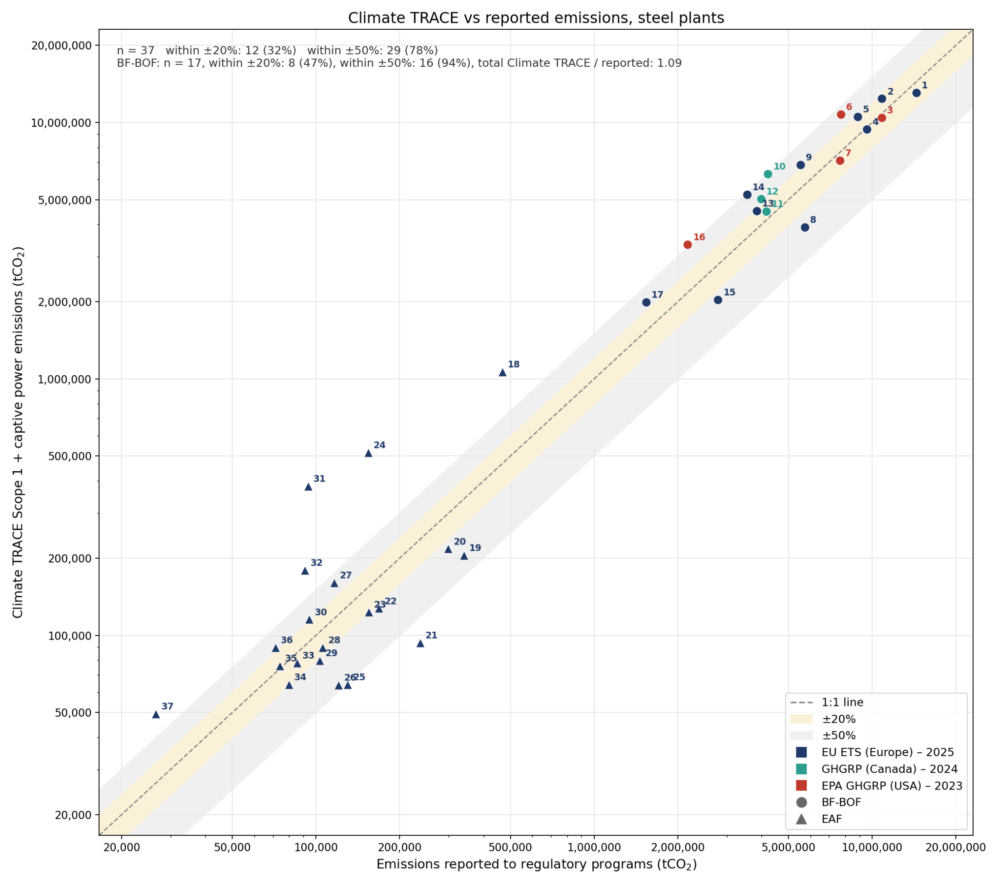

**Figure 10** Climate TRACE Scope 1 and captive power emissions compared with emissions reported to regulatory programs for steel plants: EU ETS 2025 (European Commission, 2026), Canada GHGRP 2024 (Environment and Climate Change Canada, 2026) and US EPA GHGRP 2023 (US EPA, 2024), in tonnes CO2. Circles are BF-BOF sites; triangles are EAF plants (EU ETS only). The dashed line indicates exact agreement, and the shaded bands ±20% and ±50% of reported emissions. Point numbers correspond to Table 13 (Appendix 9.3)*.*

Across the 17 BF-BOF sites, estimates total 1.09 times reported emissions; 47% fall within ±20% and 94% within ±50%. Agreement is closest in Europe (1.05), then the US (1.12) and Canada (1.28). Most of the remaining differences appear to come from plant-level production rather than emission factors.

#### 5. Discussion

#### 5.1 Emissions estimates

The satellite-derived Thermal Anomaly Index (TAI) provides monthly, asset-level estimates of steel production. Because the thermal signature of a facility depends on its production route – the number, type and operating temperature of its units differ between BF-BOF and DRI plants – the relationship between TAI and activity is calibrated separately for each route rather than through a single global curve. Calibrating TAI against production data in this way yields capacity factors that, combined with route-specific process parameters, give CO2 emission estimates for individual plants. The result is a monthly, consistently derived record of activity and emissions that complements reported data, and extends coverage to regions and assets where disclosure is limited.

However, even with route-specific calibration, the accuracy of TAI-based estimates depends on asset-specific characteristics, including equipment type, age, and operational practices, which can influence thermal signatures. Continued calibration as the observation record lengthens, particularly for more recently monitored routes such as DRI, is therefore important to improve reliability across the diversity of assets and geographies. Despite these challenges, integrating satellite observations with process-based emission modeling provides a scalable framework for tracking steel-sector emissions and supporting decarbonization strategies at both plant and country levels.

The uncertainty ranges in Table 8 (±13–20% for direct emissions) describe uncertainty in the inputs and factors used to estimate each asset’s emissions. They are not directly comparable with the differences from reported emissions in Section 4.3, which also reflect differences in reporting boundaries, such as separately permitted coke and off-gas power plants, downstream rolling and finishing included in registry totals, and the off-site ironmaking included in our EAF estimates. A difference of more than 20% at an individual plant therefore does not imply uncertainty of that size in the estimate.

**Captive power at Indian DRI and induction furnace plants**. All routes other than BF-BOF are assumed to buy their electricity from the grid (Section 2.2.3). In India, many coal-based DRI and induction furnace plants generate part of their electricity in captive coal-fired plants, which typically emit more per MWh than India’s grid (0.681 t-CO2/MWh), or in waste heat recovery boilers, which burn no additional fuel. The net effect on indirect emissions is therefore uncertain in direction and is not yet modeled; direct emissions are unaffected. India is also where asset-level and country-level totals diverge most (181 vs 279 Mt-CO2 in 2025; Section 2.2.4), because many small DRI and induction furnace plants fall below the GIST capacity threshold. Plant-level data on captive generation would address the first issue, and a lower inventory threshold the second.

#### 5.2 Applying the emissions reduction strategies: practicality and challenges

Steel emissions depend fundamentally on the iron reduction method and the source of energy used, so the strategies are grouped by production route. Each is discussed below in terms of practicality and deployment; strategy definitions and values are given in Section 2.3.1 and Table 2.

#### 5.2.1 EAF and DRI–EAF routes

EAF and DRI–EAF strategies reduce emissions by increasing scrap use, switching to low-carbon feedstocks, or adopting hydrogen-based production. These approaches leverage mature technologies for near-term reductions while also providing pathways for deep decarbonization where renewable electricity and green hydrogen are available.

Strategy 0 represents the most decarbonized form of current steelmaking, with minimal scope for additional direct-emission reductions. Its primary challenge lies not in technology but in the availability of clean electricity; widespread deployment of low-carbon grids is therefore essential for this route to contribute fully to net-zero ambitions.

Strategy 1 shows large potential reductions – up to \~80% for plants currently operating with low scrap input – and, because scrap-EAF is mature and widely adopted, is a highly practical near-term option. Its limit is scrap supply rather than technology. All collected scrap is already recycled, but because of the long service life of steel products, end-of-life scrap arisings (about 400 Mt in 2019, rising to roughly 900 Mt by 2050) remain well below steel demand (WSA, 2021), and scrap is projected to meet under half of global demand even in 2050 (IEA, 2020). Accumulation of tramp elements, particularly copper, further restricts the use of post-consumer scrap in high-grade products (WSA, 2021; Daehn et al., 2017). Scrap maximization is therefore a cost-effective step at individual plants but cannot on its own deliver full sectoral decarbonization, and the same constraint bounds Strategies 5 and 7 below.

Strategy 2 highlights one of the most transformative pathways, reducing emission factors from \~0.85 to 0.08 t-CO2/t-steel. Early pilots such as HYBRIT (Sweden) have demonstrated technical feasibility, and projects such as SALCOS (Germany) are moving towards industrial scale (HYBRIT, 2024; European Commission, 2022). Adoption is constrained by the cost and availability of green hydrogen and the need for substantial investment in renewables and electrolysis capacity (Bhaskar et al., 2022). With supportive policy and falling renewable costs, this route could play a central role in a net-zero steel sector by mid-century.

#### 5.2.2 BF-BOF route

BF-BOF strategies span transitional and long-term measures for primary steel. Incremental options such as CCS or shifting output to an existing EAF achieve partial reductions; deep decarbonization relies on technology shifts, ultimately full replacement with hydrogen-based DRI–EAF.

Strategy 3 provides only a partial solution, reducing emissions by around 59%, which makes it a transitional measure rather than a long-term pathway. Demonstrations such as Al Reyadah in the UAE confirm technical viability (Nicholas and Basirat, 2024), but large-scale adoption is hindered by high costs, infrastructure needs and uncertainty around long-term storage, and residual emissions remain significant. Given the longevity of existing BF-BOF assets, CCUS may nevertheless serve as a bridge until full replacements can be deployed.

Strategy 4 eliminates emissions at the facility level, offering immediate reductions. Because the primary eligibility test is the age of the blast furnace stock rather than plant size, the strategy identifies a broader set of candidates than policy-driven closure programs alone, and its practicality rests on a different logic: a furnace approaching the end of its relining campaign faces a genuine reinvestment decision, and the capital that would be committed to another campaign can instead be directed to a lower-emission route. End-of-campaign timing is thus a natural window for retirement, though operators may equally reline and continue where demand or regional supply security favors it. Realizing retirements at scale has in practice also depended on stringent regulatory measures, as in China’s closure of small, inefficient blast furnaces. The challenge lies in ensuring that demand is met by lower-emission alternatives rather than shifting to other high-emission assets; economic disruption and workforce impacts also present major barriers.

Strategy 5 is particularly relevant for hybrid facilities, many of which are in China. By prioritizing the EAF, reductions of up to \~95% (assuming 100% scrap input) are achievable, and the strategy is technologically straightforward since both routes already exist at the facility. The practical constraints are the scrap availability discussed under Strategy 1 and the carbon intensity of the local grid; where both are favorable, this strategy can deliver reductions quickly.

Strategy 6 represents the long-term solution for the BF-BOF route. Replacing blast furnaces with hydrogen-based DRI–EAF facilities powered entirely by green hydrogen achieves near-zero direct emissions. Current adoption is limited by the availability and cost of green hydrogen and by high capital requirements, but this pathway provides the ultimate reduction potential for primary steel and is the benchmark toward which transitional strategies such as CCUS or partial shifts to EAF should converge.

Strategy 10 offers partial, transitional reductions of around 50% while retaining the blast furnace. It is being developed primarily in Japan under the COURSE50 and Super COURSE50 programs but remains at demonstration scale, and its reliance on large-scale CCS raises the same barriers as Strategy 3 – high cost, CO2 transport and storage infrastructure, and geological storage constraints that are particularly acute in Japan. Combined with its dependence on affordable low-carbon hydrogen, these factors make it a bridging measure rather than a deep-decarbonization route, with a real risk of stranding capital if H2-DRI matures faster (TransitionZero, 2025).

#### 5.2.3 Coal-based DRI and IF routes

Induction furnace steelmaking, and the coal-based DRI that commonly feeds it, are concentrated in India and other South Asian markets. Coal-based DRI, produced in coal-fired rotary kilns, feeds both IF and EAF steelmaking and is among the most emissions-intensive ironmaking routes, making it a distinct decarbonization challenge regardless of the downstream furnace. Because the emissions intensity of DRI depends heavily on whether coal or natural gas is the reductant, the modeled baseline and post-strategy factors for these routes reflect each plant’s DRI fuel mix rather than a single average (Section 2.2.3). The strategies below target both the furnace feedstock and the DRI reductant.

Strategy 7 is the IF analogue of Strategy 1, displacing coal-based DRI feed with scrap to deliver large reductions where baseline scrap use is low. It is bounded by the same scrap availability and quality constraints, and IF operators may face additional difficulty sourcing consistent scrap grades in markets where scrap infrastructure is less developed.

Strategy 8 offers the deepest reductions of the coal-DRI strategies but is also the least mature. Hydrogen use in rotary kilns remains at pilot or demonstration stage and is far less proven than the gas-shaft H2-DRI route, so it is applied with lower confidence. Its deployment depends on the same green-hydrogen availability and cost constraints that limit hydrogen routes generally, compounded by the technical challenge of adapting kiln-based reactors.

Strategy 9 is a more readily deployable interim measure, since natural-gas-based DRI is a mature, commercially proven route (MIDREX and Energiron/HYL). Its main constraint is gas availability and price – acute in India, where domestic gas is scarce and expensive – along with the cost of rebuilding coal kilns as gas-based reactors. As a fossil-based bridge it retains residual emissions and upstream methane exposure, but it can keep assets hydrogen-ready for a later full conversion.

#### 6. Conclusions

This work estimates monthly CO2 emissions for 1,017 steel plants worldwide from January 2021, and national totals for 101 countries from January 2015. Emissions cover both direct emissions and the indirect emissions from the electricity each plant uses, including power generated on site from steelworks off-gases. The estimates are compared with emissions reported to regulators in the EU, the USA and Canada.

Production is estimated first and emission factors applied to it. For BF-BOF and DRI plants, activity is tracked from satellite thermal anomalies at the furnaces, coke ovens, sinter plants and DRI units that operate above 1,200 °C, converted to utilization with a curve calibrated separately for each route, and then calibrated to national production statistics; for EAF and IF plants, whose thermal signal is too weak to monitor, production is taken from national utilization rates. The satellite record gives monthly estimates that reported statistics cannot, and across 17 integrated sites the combined estimates total 1.09 times the emissions reported to regulators. The main limitation is the level difference between plants that a single curve does not capture; a longer record and region-specific curves are the planned response.

This work demonstrates that timely, facility-level production and monthly CO2 emissions estimates can be obtained without relying on company-reported figures, which are often outdated by several years. This capability offers a valuable tool for more responsive climate policy development. Future work may benefit from increased availability of asset-level data to further enhance model training and accuracy.

In this study, we also developed and systematically applied a set of emissions reduction strategies to steel production assets worldwide, in order to evaluate their potential to lower greenhouse gas emissions. These strategies reflect both technological and operational pathways available to the sector. Scrap-based EAF, and its induction-furnace equivalent, remain the most effective pathway, though their expansion is constrained by limited scrap availability and quality requirements. Hydrogen-based DRI offers deep reductions but is currently limited by the high cost and low availability of green hydrogen; this technology could also represent a long-term solution to fully decarbonize primary steel production by replacing conventional BF-BOF facilities with hydrogen-based DRI–EAF technology. For the coal-based DRI that dominates ironmaking in India and South Asia, switching the reductant to natural gas or hydrogen can substantially cut emissions, though the former is a fossil-based bridge and the latter remains at an early stage in kiln-based reactors. CCS, whether applied to BF-BOF off-gas directly or combined with hydrogen injection, can provide transitional reductions in BF-BOF, yet deployment is challenged by high costs and the need for CO2 transport and storage infrastructure. Shutting down smaller BF-BOF plants or shifting production towards EAF can accelerate decarbonization, but both depend on managing market demand, regional supply security, and socio-economic impacts.

Overall, the analysis underscores that decarbonizing steel will require a portfolio of strategies tailored to regional conditions, with careful consideration of technological readiness, infrastructure needs, and material constraints. Emerging technologies, such as direct electrolysis of iron ore, may also play a role in the longer term, though they remain at an early stage of development.

#### 7. Supplementary Metadata Section

Steel-sector CO2 emissions have been reported for individual sources from January 2021. The emissions described here represent a subset of country-level emissions estimates from the Climate TRACE manufacturing sector. All data is freely available on the Climate TRACE website (https://climatetrace.org/). A detailed description of what is available is given in Tables 6–8.

| **Table 6** Details on the asset metadata.                 |                                                                                                                                                                                     |
|------------------------------------------------------------|-------------------------------------------------------------------------------------------------------------------------------------------------------------------------------------|
| **General description**                                    | **Definition**                                                                                                                                                                      |
| Sector definition                                          | Emissions from iron and steel manufacturing                                                                                                                                         |
| UNFCCC sector equivalent                                   | 2.C.1 Iron and steel production and 1.A.2.a Iron and steel (fuel combustion)                                                                                                        |
| Temporal coverage                                          | January 2021 – August 2026                                                                                                                                                          |
| Temporal resolution                                        | Monthly                                                                                                                                                                             |
| Data format                                                | CSV                                                                                                                                                                                 |
| Coordinate reference system                                | WGS 84 (EPSG:4326); point locations as WKT                                                                                                                                          |
| Number of sources available for download                   | 1,017 sources covering 82 countries: the GIST facilities operating at some point since January 2021 (Section 2.2.2)                                                                 |
| Total emissions for 2025                                   | 2.35 Gt-CO2 direct from assets (3.11 Gt including indirect) and 2.63 Gt-CO2 at a country level (Section 2.2.4)                                                                      |
| What emission factors were used?                           | Route-specific emission factors: global defaults, with a regional BF-BOF factor for Europe and the USA, blended by feedstock and DRI fuel mix                                       |
| Difference between a '0' and a 'NULL/none/nan' data field  | '0' values are for true non-existent emissions. If we know that the sector has emissions for that specific gas, but the gas was not modeled, this is represented by 'NULL/none/nan' |
| total\_CO2e\_100yrGWP and total\_CO2e\_20yrGWP conversions | Climate TRACE uses IPCC AR6 CO2e GWPs. CO2e conversion guidelines: https://www.ipcc.ch/report/ar6/wg1/downloads/report/IPCC\_AR6\_WGI\_FullReport\_small.pdf  |

| **Table 7** Definition of the fields in the asset dataset. |                                                                                                                                    |
|------------------------------------------------------------|------------------------------------------------------------------------------------------------------------------------------------|
| **Data attribute**                                         | **Definition**                                                                                                                     |
| sector                                                     | manufacturing                                                                                                                      |
| source\_sub-sector\_name                                   | iron and steel                                                                                                                     |
| source definition                                          | emissions from iron and steel manufacturing                                                                                        |
| start\_date                                                | start date for time period of emissions estimation (YYYY-MM-DD format)                                                             |
| end\_date                                                  | end date for time period of emissions estimation (YYYY-MM-DD format)                                                               |
| asset\_identifier                                          | internal identifier                                                                                                                |
| asset\_name                                                | name of the facility                                                                                                               |
| iso3\_country                                              | ISO 3166-1 alpha-3 country code                                                                                                    |
| location                                                   | well-known text (WKT) point location                                                                                               |
| type                                                       | manufacturing method                                                                                                               |
| capacity                                                   | monthly plant capacity                                                                                                             |
| capacity\_factor                                           | utilization rate of steel mills                                                                                                    |
| activity                                                   | production estimates                                                                                                               |
| CO2\_emissions\_factor                                     | direct emission factor (t-CO2/t-steel)                                                                                  |
| CH4\_emissions\_factor                                     | not used; N/A                                                                                                                      |
| N2O\_emissions\_factor                                     | not used; N/A                                                                                                                      |
| CO2\_emissions                                             | direct emissions estimates (t-CO2)                                                                                      |
| CH4\_emissions                                             | not used; N/A                                                                                                                      |
| N2O\_emissions                                             | not used; N/A                                                                                                                      |
| total\_CO2e\_100yrGWP                                      | 100-year global warming potential (t-CO2e)                                                                              |
| total\_CO2e\_20yrGWP                                       | 20-year global warming potential (t-CO2e)                                                                               |
| other1                                                     | direct and indirect emission factor: indirect includes grid and on-site (captive) power (t-CO2/t-steel)                 |
| other2                                                     | direct and indirect emissions: indirect includes grid and on-site (captive) power (t-CO2)                               |
| other3                                                     | electricity use factor (MWh/t-steel), including electricity generated on site                                                      |
| other4                                                     | electricity consumption (MWh), including electricity generated on site                                                             |
| other5                                                     | grid emissions intensity (t-CO2/MWh)                                                                                    |
| other6                                                     | model methodology (e.g. satellite, extrapolation)                                                                                  |
| other7                                                     | share of scrap in EAF/IF feed (0–1)                                                                                                |
| other8                                                     | share of direct emissions from IPPU emissions (0–1)                                                                                |
| other9                                                     | share of indirect emissions from electricity generated on site (0–1); on-site power emissions = (other2 − CO2\_emissions) × other9 |
| other10                                                    | emission factor of on-site power generation (t-CO2/MWh); 0 where the facility has no on-site generation                            |
| model\_number                                              | version of the model (e.g. 1, 2, …)                                                                                                |

<table><thead><tr class="header"><th><strong>Table 8</strong> Definition of confidence and uncertainty in emissions.</th><th></th><th></th></tr></thead><tbody><tr class="odd"><td><strong>Data attribute</strong></td><td><strong>Confidence definition</strong></td><td><strong>Uncertainty definition</strong></td></tr><tr class="even"><td>type</td><td>
Very low: Based on highly speculative or obsolete information. Very low level of confidence in the accuracy of steel plant classification.

Low: Limited or somewhat outdated data. Low level of confidence in the accuracy of steel plant classification.

Medium: A mix of historical and more recent data. Medium level of confidence in the accuracy of steel plant classification.

High: Grounded in comprehensive and recent data. High level of confidence in the accuracy of steel plant classification.

Very high: Extensive, up-to-date, and verified data. Very high level of confidence in the accuracy of steel plant classification.
</td><td>Not used; N/A</td></tr><tr class="odd"><td>capacity</td><td>
Very low: Limited or outdated data, and significant uncertainties exist.

Low: Outdated and/or incomplete data.

Medium: A mix of historical and recent data.

High: Comprehensive and recent data updates. High level of certainty.

Very high: Extensive, up-to-date, and verified data. Very high level of certainty.
</td><td>Not used; N/A</td></tr><tr class="even"><td>capacity_factor</td><td>
Very low: Data is sparse or highly unreliable. Considerable uncertainty in capacity factor estimations.

Low: Moderate uncertainty in capacity factor calculations.

Medium: Data is sufficiently available, though not comprehensive.

High: High confidence in the accuracy of capacity factor calculations.

Very high: Derived from thorough and validated data sources. Very high precision.
</td><td>Not used; N/A</td></tr><tr class="odd"><td>activity</td><td>
Very low: Based on highly speculative or obsolete information. Very low level of confidence in activity assessments.

Low: Limited or somewhat outdated data. Low level of confidence in activity assessments.

Medium: A mix of historical and more recent data. Medium level of confidence in activity assessments.

High: Grounded in comprehensive and recent data. High level of confidence in activity assessments.

Very high: Extensive, up-to-date, and verified data. Very high level of confidence in activity assessments.
</td><td>±8 to 15% of production estimates</td></tr><tr class="even"><td>CO2_emissions_factor</td><td>
Very low: Based on highly speculative or obsolete information. Very low level of confidence in their precision.

Low: Limited or somewhat outdated data. Low level of confidence in their precision.

Medium: A mix of historical and more recent data. Medium level of confidence in their precision.

High: Grounded in comprehensive and recent data. High level of confidence in their precision.

Very high: Extensive, up-to-date, and verified data. Very high level of confidence in their precision.
</td><td>±10 to 12% of assumption (based on IPCC)</td></tr><tr class="odd"><td>CH4_emissions_factor</td><td>Not used; N/A</td><td>Not used; N/A</td></tr><tr class="even"><td>N2O_emissions_factor</td><td>Not used; N/A</td><td>Not used; N/A</td></tr><tr class="odd"><td>CO2_emissions</td><td>
Very low: Based on highly speculative or obsolete information. Very low level of confidence in their accuracy.

Low: Limited or somewhat outdated data. Low level of confidence in their accuracy.

Medium: A mix of historical and more recent data. Medium level of confidence in their accuracy.

High: Grounded in comprehensive and recent data. High level of confidence in their accuracy.

Very high: Extensive, up-to-date, and verified data. Very high level of confidence in their accuracy.
</td><td>±13 to 20% of emissions estimates</td></tr><tr class="even"><td>CH4_emissions</td><td>Not used; N/A</td><td>Not used; N/A</td></tr><tr class="odd"><td>N2O_emissions</td><td>Not used; N/A</td><td>Not used; N/A</td></tr><tr class="even"><td>total_CO2e_100yrGWP</td><td>
Very low: Based on highly speculative or obsolete information. Very low level of confidence in their accuracy.

Low: Limited or somewhat outdated data. Low level of confidence in their accuracy.

Medium: A mix of historical and more recent data. Medium level of confidence in their accuracy.

High: Grounded in comprehensive and recent data. High level of confidence in their accuracy.

Very high: Extensive, up-to-date, and verified data. Very high level of confidence in their accuracy.
</td><td>±13 to 20% of emissions estimates</td></tr><tr class="odd"><td>total_CO2e_20yrGWP</td><td>
Very low: Based on highly speculative or obsolete information. Very low level of confidence in their accuracy.

Low: Limited or somewhat outdated data. Low level of confidence in their accuracy.

Medium: A mix of historical and more recent data. Medium level of confidence in their accuracy.

High: Grounded in comprehensive and recent data. High level of confidence in their accuracy.

Very high: Extensive, up-to-date, and verified data. Very high level of confidence in their accuracy.
</td><td>±13 to 20% of emissions estimates</td></tr></tbody></table>

**Permissions and use:** All Climate TRACE data is freely available under the Creative Commons Attribution 4.0 International Public License, unless otherwise noted below.

> **Data citation format:** Crane, V., Ebri, G. and Underwood, C. (2026). *Manufacturing and Industrial Processes sector – Iron and Steel Production Emissions.* TransitionZero, UK, Climate TRACE Emissions Inventory. [https://climatetrace.org](https://climatetrace.org)

**Geographic boundaries and names (iso3\_country data attribute):** The depiction and use of boundaries, geographic names and related data shown on maps and included in lists, tables, documents, and databases on Climate TRACE are generated from the Global Administrative Areas (GADM) project (Version 4.1 released on 16 July 2022) along with their corresponding ISO3 codes, and with the following adaptations:

-   HKG (China, Hong Kong Special Administrative Region) and MAC (China, Macao Special Administrative Region) are reported at GADM level 0 (country/national);

-   Kosovo has been assigned the ISO3 code ‘XKX’;

-   XCA (Caspian Sea) has been removed from GADM level 0 and the area assigned to countries based on the extent of their territorial waters;

-   XAD (Akrotiri and Dhekelia), XCL (Clipperton Island), XPI (Paracel Islands) and XSP (Spratly Islands) are not included in the Climate TRACE dataset;

-   ZNC name changed to ‘Turkish Republic of Northern Cyprus’ at GADM level 0;

-   The borders between India, Pakistan and China have been assigned to these countries based on GADM codes Z01 to Z09.

For steel assets, the iso3\_country code is assigned from the country reported for each plant in the Global Iron and Steel Tracker (GEM, 2026a), matched to the GADM country names above, rather than from the plant’s coordinates.

The above usage is not warranted to be error free and does not imply the expression of any opinion whatsoever on the part of Climate TRACE Coalition and its partners concerning the legal status of any country, area or territory or of its authorities, or concerning the delimitation of its borders.

**Disclaimer:** The emissions provided for this sector are our current best estimates of emissions, and we are committed to continually increasing the accuracy of the models on all levels. Please review our terms of use and the sector-specific methodology documentation before using the data. If you identify an error or would like to participate in our data validation process, please contact us ([coalition@climatetrace.org](mailto:coalition@climatetrace.org)).

#### 8. References

1.  Bedarkar, S.S. (2024) ‘Carbon Flow and CO2 Emission in Induction Furnace Steelmaking’, Journal of Powder Metallurgy & Mining, 13, 434. Available at: [https://www.omicsonline.org/open-access-pdfs/carbon-flow-and-co2-emission-in-induction-furnace-steelmaking.pdf](https://www.omicsonline.org/open-access-pdfs/carbon-flow-and-co2-emission-in-induction-furnace-steelmaking.pdf)

2.  Bhaskar, A., Assadi, M. and Nikpey Somehsaraei, H. (2020) ‘Decarbonization of the iron and steel industry with direct reduction of iron ore with green hydrogen’, Energies, 13(3), 758. Available at: [https://doi.org/10.3390/en13030758](https://doi.org/10.3390/en13030758)

3.  Bhaskar, A., Abhishek, R., Assadi, M. and Nikpey Somehsaraei, H. (2022) ‘Decarbonizing primary steel production: Techno-economic assessment of a hydrogen-based green steel production plant in Norway’, Journal of Cleaner Production, 350, p. 131339. Available at: [https://doi.org/10.1016/j.jclepro.2022.131339](https://doi.org/10.1016/j.jclepro.2022.131339)

4.  Clean Air Task Force (2025). *Decarbonization Pathways and Policy Recommendations for the United States Steel Sector.* [https://www.catf.us/resource/decarbonization-pathways-policy-recommendations-united-states-steel-sector/](https://www.catf.us/resource/decarbonization-pathways-policy-recommendations-united-states-steel-sector/)

5.  Cleveland-Cliffs (2024) Sustainability Report 2023. Cleveland, OH: Cleveland-Cliffs Inc. Available at: [https://www.clevelandcliffs.com/news/news-releases/detail/632/cleveland-cliffs-issues-sustainability-report-for-2023](https://www.clevelandcliffs.com/news/news-releases/detail/632/cleveland-cliffs-issues-sustainability-report-for-2023) (Accessed: 13 October 2026).

6.  CRU (2020). Ordosch, A. and Speelmanns, I. “CRU Explains: Why Early Blast Furnace Restarts Lead to Oversupply.” *Steel Market Update*, 2 June 2020. [https://www.steelmarketupdate.com/2020/06/02/cru-explains-why-early-blast-furnace-restarts-lead-to-oversupply](https://www.steelmarketupdate.com/2020/06/02/cru-explains-why-early-blast-furnace-restarts-lead-to-oversupply)

7.  Daehn, K.E., Cabrera Serrenho, A. and Allwood, J.M. (2017) ‘How will copper contamination constrain future global steel recycling?’ Environmental Science & Technology, 51(11), 6599–6606. [https://doi.org/10.1021/acs.est.7b00997](https://doi.org/10.1021/acs.est.7b00997)

8.  Elango, S., Nitturu, K., Yadav, D., Sripathy, P., Patidar, R. and Mallya, H. (2023) Evaluating Net-zero for the Indian Steel Industry: Marginal Abatement Cost Curves of Carbon Mitigation Technologies. New Delhi: Council on Energy, Environment and Water (CEEW). Available at: [https://www.ceew.in/publications/how-can-india-decarbonise-for-net-zero-steel-industry](https://www.ceew.in/publications/how-can-india-decarbonise-for-net-zero-steel-industry) (Accessed: 27 July 2026).

9.  Ember (2025) Monthly Electricity Data. Ember. Available at: [https://ember-energy.org/data/monthly-electricity-data/](https://ember-energy.org/data/monthly-electricity-data/)

10. Environment and Climate Change Canada (2026) Greenhouse Gas Reporting Program: facility greenhouse gas data, 2004–2024. Available at: [https://open.canada.ca/data/en/dataset/a8ba14b7-7f23-462a-bdbb-83b0ef629823](https://open.canada.ca/data/en/dataset/a8ba14b7-7f23-462a-bdbb-83b0ef629823)

11. ESA (2025) Copernicus Sentinel-2. European Space Agency. Available at: [https://www.esa.int/Applications/Observing\_the\_Earth/Copernicus/Sentinel-2](https://www.esa.int/Applications/Observing_the_Earth/Copernicus/Sentinel-2)

12. European Commission (2022) ‘State aid: Commission approves €1 billion German measure to support Salzgitter in decarbonising its steel production by using hydrogen’, press release IP/22/5968, 4 October 2022. Available at: [https://ec.europa.eu/commission/presscorner/detail/en/ip\_22\_5968](https://ec.europa.eu/commission/presscorner/detail/en/ip_22_5968)

13. European Commission (2025) EU Emissions Trading System verified emissions, 2021–2024 (Union Registry / EUTL). Available at: [https://climate.ec.europa.eu/eu-action/carbon-markets/eu-emissions-trading-system-eu-ets/union-registry\_en](https://climate.ec.europa.eu/eu-action/carbon-markets/eu-emissions-trading-system-eu-ets/union-registry_en)

14. European Commission (2026) EU Emissions Trading System verified emissions, 2025 (Union Registry). Available at: [https://climate.ec.europa.eu/eu-action/carbon-markets/eu-emissions-trading-system-eu-ets/union-registry\_en](https://climate.ec.europa.eu/eu-action/carbon-markets/eu-emissions-trading-system-eu-ets/union-registry_en)

15. Fan, Z. and Friedmann, S.J. (2021) Low-Carbon Production of Iron & Steel: Technology Options, Economic Assessment, and Policy. Center on Global Energy Policy, Columbia University. Available at: [https://www.energypolicy.columbia.edu/publications/low-carbon-production-iron-steel-technology-options-economic-assessment-and-policy/](https://www.energypolicy.columbia.edu/publications/low-carbon-production-iron-steel-technology-options-economic-assessment-and-policy/) (Accessed: 30 August 2025).

16. Geerdes, M., Chaigneau, R., Kurunov, I., Lingiardi, O. and Ricketts, J. (2015). *Modern Blast Furnace Ironmaking: An Introduction*, 3rd ed. Amsterdam: IOS Press.

17. GEM (2026a) Global Iron and Steel Tracker. Global Energy Monitor. Available at: [https://globalenergymonitor.org/projects/global-iron-steel-tracker](https://globalenergymonitor.org/projects/global-iron-steel-tracker) (Accessed: 29 July 2026).

18. GEM (2026b) Pedal to the Metal 2026: The iron and steel industry’s coal lock-in crisis. Global Energy Monitor. Available at: [https://globalenergymonitor.org/research/pedal-metal-2026](https://globalenergymonitor.org/research/pedal-metal-2026) (Accessed: 27 July 2026).

19. GMK Center (2024) ‘LIBERTY Dunaújváros decommissions two coke ovens’, 11 June. Available at: [https://gmk.center/en/news/liberty-dunaujvaros-decommissions-two-coke-ovens/](https://gmk.center/en/news/liberty-dunaujvaros-decommissions-two-coke-ovens/)

20. Google Earth Engine (2025a) Landsat 8 Datasets in Earth Engine, Google Developers. Available at: [https://developers.google.com/earth-engine/datasets/catalog/landsat-8](https://developers.google.com/earth-engine/datasets/catalog/landsat-8)

21. Google Earth Engine (2025b) Landsat 9 Datasets in Earth Engine, Google Developers. Available at: [https://developers.google.com/earth-engine/datasets/catalog/landsat-9](https://developers.google.com/earth-engine/datasets/catalog/landsat-9)

22. Google Earth Engine (2025c) Sentinel-2 Datasets in Earth Engine, Google Developers. Available at: [https://developers.google.com/earth-engine/datasets/catalog/sentinel-2](https://developers.google.com/earth-engine/datasets/catalog/sentinel-2)

23. Google Maps (2025) Google Maps. Google. Available at: [https://www.google.co.uk/maps](https://www.google.co.uk/maps)

24. HYBRIT (2024) Fossil-free steel production ready for industrialisation. HYBRIT brochure. Available at: [https://www.hybritdevelopment.se/wp-content/uploads/2024/08/hybrit-fossil-free-steel-production-ready-for-industrialisation.pdf](https://www.hybritdevelopment.se/wp-content/uploads/2024/08/hybrit-fossil-free-steel-production-ready-for-industrialisation.pdf)

25. IEA (2020) ‘Iron and Steel Technology Roadmap – Towards more sustainable steelmaking’. International Energy Agency. Available at: [https://www.iea.org/reports/iron-and-steel-technology-roadmap](https://www.iea.org/reports/iron-and-steel-technology-roadmap)

26. [IEAGHG (2013) Iron and Steel CCS Study (Techno-Economics Integrated Steel Mill). Report 2013/04. Cheltenham: IEA Greenhouse Gas R&D Programme. Available at:](https://www.iea.org/reports/iron-and-steel-technology-roadmap) [https://publications.ieaghg.org/technicalreports/2013-04%20Iron%20and%20Steel%20CCS%20Study%20(Techno-Economics%20Integrated%20Steel%20Mill).pdf](https://publications.ieaghg.org/technicalreports/2013-04%20Iron%20and%20Steel%20CCS%20Study%20(Techno-Economics%20Integrated%20Steel%20Mill).pdf) [(Accessed: 9 November 2026).](https://www.iea.org/reports/iron-and-steel-technology-roadmap)

27. IPCC (2006a) Volume 2: Energy, Chapter 1, Table 1.4 (default CO2 emission factors for combustion). Available at: [https://www.ipcc-nggip.iges.or.jp/public/2006gl/pdf/2\_Volume2/V2\_1\_Ch1\_Introduction.pdf](https://www.ipcc-nggip.iges.or.jp/public/2006gl/pdf/2_Volume2/V2_1_Ch1_Introduction.pdf)

28. IPCC (2006b) Chapter 4: Metal Industry Emissions, in 2006 IPCC Guidelines for National Greenhouse Gas Inventories, Volume 3: Industrial Processes and Product Use. Available at: [https://www.ipcc-nggip.iges.or.jp/public/2006gl/pdf/3\_Volume3/V3\_4\_Ch4\_Metal\_Industry.pdf](https://www.ipcc-nggip.iges.or.jp/public/2006gl/pdf/3_Volume3/V3_4_Ch4_Metal_Industry.pdf) (Accessed: 15 August 2025).

29. Kartheek, N., Sripathy, P., Patidar, R., Elango, S., Yadav, D. and Mallya, H. (2024) Decarbonising Coal-based Direct Reduced Iron Production: Surveying the Landscape in Steel Clusters of India. New Delhi: Council on Energy, Environment and Water (CEEW). Available at: [https://www.ceew.in/publications/how-can-india-decarbonise-coal-based-direct-reduced-iron-plants-in-steel-production](https://www.ceew.in/publications/how-can-india-decarbonise-coal-based-direct-reduced-iron-plants-in-steel-production) (Accessed: 27 July 2026).

30. Lancellotti, B.V., Malof, J.M., Davitt, A. et al. (2025) ‘Closing Gaps in Emissions Monitoring with Climate TRACE’, arXiv preprint arXiv:2511.19277. Available at: [https://doi.org/10.48550/arXiv.2511.19277](https://doi.org/10.48550/arXiv.2511.19277)

31. Liangrocapart, S., Khetkeeree, S. and Petchthaweetham, B. (2020) ‘Thermal Anomaly Level Algorithm for Active Fire Mapping by Means of Sentinel-2 Data’, in 2020 17th International Conference on Electrical Engineering/Electronics, Computer, Telecommunications and Information Technology (ECTI-CON), Phuket, Thailand. Available at: [https://ieeexplore.ieee.org/document/9158057](https://ieeexplore.ieee.org/document/9158057)

32. Liu, Y., Zhi, W., Xu, B., Xu, W. and Wu, W. (2021) ‘Detecting high-temperature anomalies from Sentinel-2 MSI images’, ISPRS Journal of Photogrammetry and Remote Sensing, 177, pp. 174–193. Available at: [https://doi.org/10.1016/j.isprsjprs.2021.05.008](https://doi.org/10.1016/j.isprsjprs.2021.05.008)

33. Marchese, F. et al. (2019) ‘A Multi-Channel Algorithm for Mapping Volcanic Thermal Anomalies by Means of Sentinel-2 MSI and Landsat-8 OLI Data’, Remote Sensing, 11(23), p. 2876. Available at: [https://doi.org/10.3390/rs11232876](https://doi.org/10.3390/rs11232876)

34. Midrex (2021) MIDREX® Direct Reduction Plants – 2020 Operations Summary. Charlotte, NC: Midrex Technologies. Available at: [https://www.midrex.com/tech-article/midrex-direct-reduction-plants-2020-operations-summary/](https://www.midrex.com/tech-article/midrex-direct-reduction-plants-2020-operations-summary/) (Accessed: 21 October 2026).

35. Ministry of Steel (2024) ‘Greening the Steel Sector in India: Roadmap and Action Plan’, Ministry of Steel, Government of India. Available at: [https://steel.gov.in/sites/default/files/2025-03/GSI%20Report.pdf](https://steel.gov.in/sites/default/files/2025-03/GSI%20Report.pdf) (Accessed: 27 July 2026).

36. MPP (2022) Mission Possible Partnership Steel Model, Technology Business Cases (Avg BF-BOF; BAT BF-BOF+CCUS; DRI–EAF\_100% green H2). Available at: [https://github.com/missionpossiblepartnership/mpp-steel-model](https://github.com/missionpossiblepartnership/mpp-steel-model) (Accessed: 21 October 2026).

37. MPP (2024) Steel Transition Strategy. Mission Possible Partnership. Available at: [https://www.missionpossiblepartnership.org/action-sectors/steel/](https://www.missionpossiblepartnership.org/action-sectors/steel/)

38. NASA (2018) ‘Band Pass Adjustment’, National Aeronautics and Space Administration. Available at: [https://hls.gsfc.nasa.gov/algorithms/bandpass-adjustment/](https://hls.gsfc.nasa.gov/algorithms/bandpass-adjustment/) (Accessed: 1 June 2024).

39. NASA and USGS (2025a) Landsat-8. US Geological Survey. Available at: [https://www.usgs.gov/landsat-missions/landsat-8](https://www.usgs.gov/landsat-missions/landsat-8)

40. NASA and USGS (2025b) Landsat-9. US Geological Survey. Available at: [https://www.usgs.gov/landsat-missions/landsat-9](https://www.usgs.gov/landsat-missions/landsat-9)

41. NBSC (2025) National Data: crude steel output by province. National Bureau of Statistics of China. Available at: [http://www.stats.gov.cn/english/](http://www.stats.gov.cn/english/)

42. Nicholas, S. and Basirat, S. (2024) Carbon Capture for Steel? Fact sheet, April 2024. Institute for Energy Economics and Financial Analysis. Available at: [https://ieefa.org/sites/default/files/2024-04/Carbon%20capture%20for%20steel-April24.pdf](https://ieefa.org/sites/default/files/2024-04/Carbon%20capture%20for%20steel-April24.pdf)

43. [Nippon Steel (2024) Establishment of technology to reduce CO2 emissions in blast furnaces using hydrogen: achieved world’s first 43% reduction in CO2 emissions in a test furnace. News release, 20 December 2024. Available at:](https://ieefa.org/sites/default/files/2024-04/Carbon%20capture%20for%20steel-April24.pdf) [https://www.nipponsteel.com/en/news/20241220\_100.html](https://www.nipponsteel.com/en/news/20241220_100.html) [(Accessed: 9 November 2026).](https://ieefa.org/sites/default/files/2024-04/Carbon%20capture%20for%20steel-April24.pdf)

44. OpenStreetMap (2025) OpenStreetMap. Available at: [https://www.openstreetmap.org/](https://www.openstreetmap.org/)

45. RITE (2008) Outline of DNE21+ Model – Iron and Steel, Cement, Aluminum Sector. Kyoto: Research Institute of Innovative Technology for the Earth, Systems Analysis Group. Available at: [https://www.rite.or.jp/system/en/global-warming-ouyou/download-data/E-DNE21plus\_SteelCementAl.pdf](https://www.rite.or.jp/system/en/global-warming-ouyou/download-data/E-DNE21plus_SteelCementAl.pdf) (Accessed: 21 October 2026).

46. TERI (2025) ‘Hydrogen Rotary Kilns for Ironmaking in India: A novel solution for decarbonizing small-scale ironmaking’. The Energy and Resources Institute. Available at: [https://www.teriin.org/research-paper/hydrogen-rotary-kilns-ironmaking-india](https://www.teriin.org/research-paper/hydrogen-rotary-kilns-ironmaking-india) (Accessed: 27 July 2026).

47. TransitionZero (2025) Decarbonising the steel industry: modeling pathways in Japan. Available at: [https://www.transitionzero.org/insights/decarbonising-the-steel-industry-modelling-pathways-in-japan](https://www.transitionzero.org/insights/decarbonising-the-steel-industry-modelling-pathways-in-japan) (Accessed: 27 July 2026).

48. US EPA (2024) Greenhouse Gas Reporting Program facility-level data, 2023 (FLIGHT). United States Environmental Protection Agency. Available at: [https://ghgdata.epa.gov/flight/](https://ghgdata.epa.gov/flight/)

49. US EPA (2025) ‘Reconsideration of the Greenhouse Gas Reporting Program’, proposed rule, Federal Register, 90 FR 44591, 16 September 2025. Available at: [https://www.govinfo.gov/content/pkg/FR-2025-09-16/html/2025-17923.html](https://www.govinfo.gov/content/pkg/FR-2025-09-16/html/2025-17923.html)

50. Voelker, B. and Boyle, S. (2022) ‘Getting the Most From Direct Reduced Iron – Operational Results of MIDREX® Hot Transport-Hot Charging’, Direct From Midrex, 3rd Quarter 2022. Midrex Technologies. Available at: [https://www.midrex.com/tech-article/getting-the-most-from-direct-reduced-iron-operational-results-of-midrex-hot-transport-hot-charging/](https://www.midrex.com/tech-article/getting-the-most-from-direct-reduced-iron-operational-results-of-midrex-hot-transport-hot-charging/) (Accessed: 21 October 2026).

51. Vogl, V., Åhman, M. and Nilsson, L.J. (2018) ‘Assessment of hydrogen direct reduction for fossil-free steelmaking’, Journal of Cleaner Production, 203, pp. 736–745. Available at: [https://doi.org/10.1016/j.jclepro.2018.08.279](https://doi.org/10.1016/j.jclepro.2018.08.279)

52. Wang, P. et al. (2026) ‘Decarbonizing global steel production’, Nature Reviews Earth & Environment, 7(6), pp. 374–391. Available at: [https://www.nature.com/articles/s43017-026-00786-y](https://www.nature.com/articles/s43017-026-00786-y)

53. WSA (2021) Scrap use in the steel industry. Fact sheet, May 2021. World Steel Association. Available at: [https://www.saisi.org/wp-content/uploads/2024/02/Scrap-Fact-Sheet.pdf](https://www.saisi.org/wp-content/uploads/2024/02/Scrap-Fact-Sheet.pdf) (Accessed: 13 October 2026).

54. WSA (2025) Sustainability Indicators – 2025 report: Sustainability performance of the steel industry 2003–2024, World Steel Association. Available at: [https://worldsteel.org/wp-content/uploads/Sustainability-Indicators-publication-2025\_Feb-2026-1.pdf](https://worldsteel.org/wp-content/uploads/Sustainability-Indicators-publication-2025_Feb-2026-1.pdf) (Accessed: 27 July 2026).

55. WSA (2026) World Steel in Figures 2026. World Steel Association. Available at: [https://worldsteel.org/data/world-steel-in-figures/world-steel-in-figures-2026/](https://worldsteel.org/data/world-steel-in-figures/world-steel-in-figures-2026/)

56. Yilmaz, C., Wendelstorf, J. and Turek, T. (2017) ‘Modeling and simulation of hydrogen injection into a blast furnace to reduce carbon dioxide emissions’, Journal of Cleaner Production, 154, pp. 488–501. Available at: [https://doi.org/10.1016/j.jclepro.2017.03.162](https://doi.org/10.1016/j.jclepro.2017.03.162)

57. Zhou, Y. et al. (2018) ‘A Method for Monitoring Iron and Steel Factory Economic Activity Based on Satellites’, Sustainability, 10(6), p. 1935. Available at: [https://doi.org/10.3390/su10061935](https://doi.org/10.3390/su10061935)

#### 9. Appendices

#### 9.1 Appendix 1: overview of the steel production process

The principal inputs to steelmaking today are iron ore, energy, limestone, and scrap. Iron ore and scrap are used to provide the metallic charge, with scrap having a much higher metallic concentration than iron ore. Energy inputs provide heat to melt the metallic input and, in the case of iron ore, to chemically remove oxygen. Limestone is used at various stages of the steelmaking process to help remove impurities. Figure 11 highlights the main routes to produce steel.

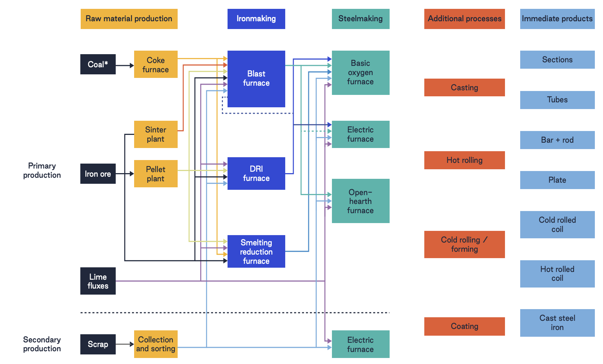

**Figure 11** Steel production routes – adapted from IEA (2020).

#### 9.2 Appendix 2: Captive power assumptions

Indirect emissions combine each route's electricity use with the share generated on site (captive weight) and the emission factor of that on-site generation (Section 2.2.3). Table 9 gives the captive weight by route, Table 10 the captive power emission factor, and Table 11 the derivation of the off-gas combustion factor.

| **Table 9** Captive weight and electricity use by production route. |                                   |                    |                  |                                                                    |
|---------------------------------------------------------------------|-----------------------------------|--------------------|------------------|--------------------------------------------------------------------|
| **Production route**                                                | **Electricity use (MWh/t-steel)** | **Captive weight** | **Captive fuel** | **Source**                                                         |
| BF-BOF                                                              | 0.25                              | 1.0                | Steel off-gas    | MPP (2022): the average BF-BOF plant is a net electricity exporter |
| Pig iron in EAF and IF feed                                         | As the furnace route              | 0                  | –                | Electricity follows the EAF or IF route                            |
| BOF (no blast furnace on site)                                      | 0.19                              | 0                  | –                | Grid only                                                          |
| EAF                                                                 | 0.635                             | 0                  | –                | Grid only                                                          |
| IF                                                                  | 0.79                              | 0                  | –                | Grid only                                                          |
| DRI–EAF (NG/coal)                                                   | 0.70/0.85                         | 0                  | –                | Grid only; captive coal and waste heat recovery not yet modeled    |
| DRI–IF (NG/coal)                                                    | 0.95                              | 0                  | –                | Grid only; captive coal and waste heat recovery not yet modeled    |

<table><thead><tr class="header"><th>
<strong>Table 10</strong> Captive power emission factor by fuel.

Captive power EF = combustion factor × heat rate ÷ 1,000,000.
</th><th></th><th></th><th></th><th></th></tr></thead><tbody><tr class="odd"><td><strong>Fuel</strong></td><td><strong>Combustion emission factor (kgCO2/TJ)</strong></td><td><strong>Heat rate (GJ/MWh)</strong></td><td><strong>Captive power EF (t-CO2/MWh)</strong></td><td><strong>Technology assumed</strong></td></tr><tr class="even"><td>Steel off-gas (blast furnace, coke oven and BOF gas)</td><td>198,200</td><td>10.3</td><td>2.04</td><td>Off-gas boiler and steam turbine, 35% efficiency</td></tr><tr class="odd"><td>Grid electricity (all other routes)</td><td>–</td><td>–</td><td>Country, else regional (Ember, 2025)</td><td>Grid supply</td></tr></tbody></table>

| **Table 11** Steel off-gas combustion emission factor (IPCC, 2006a, Volume 2, Table 1.4; MPP, 2022). |                               |                                                      |
|------------------------------------------------------------------------------------------------------|-------------------------------|------------------------------------------------------|
| **Off-gas**                                                                                          | **MPP quantity (GJ/t-steel)** | **IPCC CO2 factor (kgCO2/TJ)** |
| Blast furnace gas                                                                                    | 7.19                          | 260,000                                              |
| Coke oven gas                                                                                        | 2.80                          | 44,400                                               |
| BOF gas                                                                                              | 0.82                          | 182,000                                              |
| Energy-weighted blend                                                                                | 10.81                         | \~198,200                                            |

The resulting 2.04 t-CO2/MWh is about twice a typical grid intensity, as expected for a low-grade fuel. EU ETS verified emissions divided by Climate TRACE power generation at steelworks off-gas power plants (DK6, Huckingen, Hamborn and Knippegroen) give about 1.1–2.3 t-CO2/MWh. If the power plants burn mostly blast furnace gas, with coke oven gas used elsewhere on site, the factor rises to about 2.7 t-CO2/MWh. The BF-BOF electricity use in Table 9 was derived from this factor, so the two should be updated together.

#### 9.3 Appendix 3: Comparison with regulatory data

#### Boundaries

| **Table 12** Reporting boundaries: Climate TRACE and regulatory registries |                                                                                                                                                             |                                                                                                                                                                                                                                                                   |
|----------------------------------------------------------------------------|-------------------------------------------------------------------------------------------------------------------------------------------------------------|-------------------------------------------------------------------------------------------------------------------------------------------------------------------------------------------------------------------------------------------------------------------|
|                                                                            | **Climate TRACE**                                                                                                                                           | **Regulatory registries**                                                                                                                                                                                                                                         |
| BF-BOF                                                                     | Production × route factor, covering coke making, sintering, ironmaking and steelmaking, plus captive off-gas power (0.25 MWh/t × 2.04 t-CO2/MWh) | All combustion and process emissions at the installation or facility, often including rolling and finishing. In the EU ETS, coke plants, sinter plants and off-gas power plants may be separate installations; carbon in waste gas is reported where it is burned |
| EAF                                                                        | Melt shop (0.08 t-CO2/t) plus the production of any non-scrap feed (pig iron; "other iron" treated as DRI), wherever it is made                  | Melt shop plus reheating furnaces and, at special-steel and flat-product mills, forging, annealing and coating                                                                                                                                                    |

#### Matching rules

-   High-confidence matches only. The installation or facility names the same operator and site, and covers the plant's iron or steelmaking.

-   All installations at the site are summed. For example, thyssenkrupp Duisburg includes its Schwelgern coke plant and three off-gas power plants, and IJmuiden includes Vattenfall IJmond and Velsen. Off-gas power plants matched with medium confidence (Aboño, Block 4 Bremen, Cycofos, Energetika Třinec) are not included.

-   BF-BOF sites are included only where coke making and off-gas power generation are inside the matched boundary.

-   EU EAF installations registered mainly as ferrous-metal processing (activity 25, mostly rolling mills) are excluded.

-   Years: EU ETS 2025, Canada 2024 and US 2023, the latest published years. Sites are included only where every installation reported for that year.

#### EAF differences in detail

EAF results vary in both directions for four reasons:

-   Feed: our estimates are 2–4 times verified emissions at plants with 10–25% non-scrap feed in our data (Cremona, Osoppo, Sestao, Seixal), because they include ironmaking at the supplier.

-   Downstream processing: they are about half of verified emissions where permits include downstream processing (Bertoli Safau, Balboa, Peiner Träger; 0.15–0.20 t-CO2/t).

-   Efficient mills: the most efficient scrap mills report 0.04–0.07 t-CO2/t, below the IPCC default of 0.08.

-   Production: EAF production is estimated from capacity and national utilization, not observed.

| **Table 13** Plants compared in Figure 10. Ratio = Climate TRACE estimate ÷ reported emissions. |                                                                   |                   |           |           |
|-------------------------------------------------------------------------------------------------|-------------------------------------------------------------------|-------------------|-----------|-----------|
| **\#**                                                                                          | **Plant(s)**                                                      | **Registry**      | **Route** | **Ratio** |
| 1                                                                                               | ThyssenKrupp Steel Duisburg                                       | EU ETS 2025       | BF-BOF    | 0.91      |
| 2                                                                                               | Tata Steel IJmuiden                                               | EU ETS 2025       | BF-BOF    | 1.14      |
| 3                                                                                               | U.S. Steel Gary Works                                             | US EPA GHGRP 2023 | BF-BOF    | 0.97      |
| 4                                                                                               | ArcelorMittal Gent                                                | EU ETS 2025       | BF-BOF    | 0.98      |
| 5                                                                                               | Voestalpine Stahl Linz                                            | EU ETS 2025       | BF-BOF    | 1.19      |
| 6                                                                                               | Cleveland-Cliffs Indiana Harbor + Cleveland-Cliffs Riverdale      | US EPA GHGRP 2023 | BF-BOF    | 1.39      |
| 7                                                                                               | Cleveland-Cliffs Burns Harbor                                     | US EPA GHGRP 2023 | BF-BOF    | 0.93      |
| 8                                                                                               | Acciaierie d'Italia Taranto                                       | EU ETS 2025       | BF-BOF    | 0.68      |
| 9                                                                                               | AG der Dillinger Hüttenwerke Dillingen + Saarstahl Völklingen     | EU ETS 2025       | BF-BOF    | 1.24      |
| 10                                                                                              | Algoma                                                            | Canada GHGRP 2024 | BF-BOF    | 1.49      |
| 11                                                                                              | ArcelorMittal Dofasco                                             | Canada GHGRP 2024 | BF-BOF    | 1.09      |
| 12                                                                                              | Cleveland-Cliffs Lake Erie                                        | Canada GHGRP 2024 | BF-BOF    | 1.26      |
| 13                                                                                              | SSAB Raahe                                                        | EU ETS 2025       | BF-BOF    | 1.18      |
| 14                                                                                              | ArcelorMittal Méditerranée Fos sur Mer                            | EU ETS 2025       | BF-BOF    | 1.48      |
| 15                                                                                              | Voestalpine Stahl Donawitz                                        | EU ETS 2025       | BF-BOF    | 0.73      |
| 16                                                                                              | U.S. Steel Granite City Works                                     | US EPA GHGRP 2023 | BF-BOF    | 1.54      |
| 17                                                                                              | SSAB Oxelösund                                                    | EU ETS 2025       | BF-BOF    | 1.30      |
| 18                                                                                              | Finarvedi Cremona                                                 | EU ETS 2025       | EAF       | 2.28      |
| 19                                                                                              | Finarvedi Acciai Speciali Terni                                   | EU ETS 2025       | EAF       | 0.60      |
| 20                                                                                              | Aperam Stainless Belgium Châtelet + Aperam Stainless Belgium Genk | EU ETS 2025       | EAF       | 0.73      |
| 21                                                                                              | Danieli ABS Pozzuolo del Friuli                                   | EU ETS 2025       | EAF       | 0.40      |
| 22                                                                                              | Acerinox Europa Los Barrios                                       | EU ETS 2025       | EAF       | 0.76      |
| 23                                                                                              | Celsa Barcelona Castellbisbal                                     | EU ETS 2025       | EAF       | 0.80      |
| 24                                                                                              | Pittini Ferriere Nord Osoppo                                      | EU ETS 2025       | EAF       | 3.36      |
| 25                                                                                              | Grupo Gallardo Siderurgica Balboa Jerez de los Caballeros         | EU ETS 2025       | EAF       | 0.49      |
| 26                                                                                              | Salzgitter Peiner Träger Peine                                    | EU ETS 2025       | EAF       | 0.53      |
| 27                                                                                              | Kehler Baden Steel Works                                          | EU ETS 2025       | EAF       | 1.38      |
| 28                                                                                              | Lech Stahlwerke Meitingen                                         | EU ETS 2025       | EAF       | 0.85      |
| 29                                                                                              | ArcelorMittal Olaberria-Bergara (Olaberria)                       | EU ETS 2025       | EAF       | 0.77      |
| 30                                                                                              | Riva Brandenburg Electric Steel Works                             | EU ETS 2025       | EAF       | 1.22      |
| 31                                                                                              | ArcelorMittal Sestao                                              | EU ETS 2025       | EAF       | 4.09      |
| 32                                                                                              | SN SEIXAL Siderurgia Nacional                                     | EU ETS 2025       | EAF       | 1.97      |
| 33                                                                                              | Pittini Acciaierie di Verona                                      | EU ETS 2025       | EAF       | 0.91      |
| 34                                                                                              | Riva Siderurgica Sevillana                                        | EU ETS 2025       | EAF       | 0.80      |
| 35                                                                                              | Feralpi Siderurgica Lonato                                        | EU ETS 2025       | EAF       | 1.03      |
| 36                                                                                              | ESF Elbe Stahlwerke Feralpi Riesa                                 | EU ETS 2025       | EAF       | 1.26      |
| 37                                                                                              | Celsa Nervacero                                                   | EU ETS 2025       | EAF       | 1.86      |

#### 9.4 Appendix 4: TAI calibration curves

The curves in Figure 12 convert a plant group’s monthly mean TAI into a utilization rate; the calibration of the resulting production to national statistics is described in Section 2.2.2 and the held-out results are summarised in Section 4.1. Each curve is piecewise-linear on fixed TAI breakpoints. The lowest segments are set from operational evidence; the remaining segments are fitted to national or provincial production by minimizing capacity-weighted root-mean-square error (RMSE).

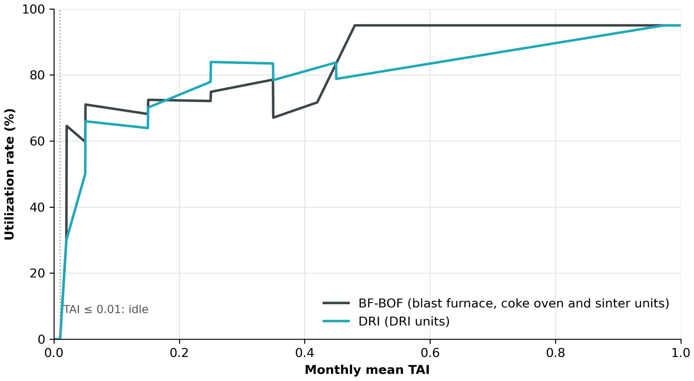

**Figure 12** TAI-to-utilization curves for BF-BOF plants (blast furnace, coke oven and sinter units) and DRI plants. Utilization is zero below a TAI of 0.01 and capped at 95%.

**Training data.** The BF-BOF curve uses eight regions where the monitored blast furnaces account for all national or provincial pig iron output: Argentina, Chile, Italy, the Netherlands, Poland, Serbia, Guizhou and Shanghai. This gives 400 region-months with usable satellite measurements between January 2021 and February 2026, out of a possible 496 – the two Chinese provincial series begin in October 2022, and months without a satellite reading are excluded. Observed utilization is WSA monthly pig iron production, converted to crude steel equivalent (÷0.8) to match GEM BF-BOF capacity which is expressed in crude steel.

The DRI curve uses five countries where WSA reports monthly DRI production: Argentina, Canada, Egypt, Libya and Saudi Arabia, December 2021 to May 2026. GEM nameplate capacity implied utilization above 100% in a third of these country-months, so for calibration, capacity is instead taken as each country’s peak monthly production divided by 0.95. This fixes the maximum of the training data at 95% by construction; the 95% cap on the curve follows from it rather than being an independent finding.

**Shape.** Below a TAI of 0.01, utilization is zero. Idle units in the training set averaged a TAI of 0.008, and across idle unit-months a reading of 0.01 or below corresponded to a non-operating blast furnace in 98% of cases. Between 0.01 and 0.02, utilization rises steeply from 0 to 30%. This reflects a known property of the process: a blast furnace has a technical minimum operating rate below which the burden descent becomes unstable and the hearth is at risk, so output cannot be turned down indefinitely and operators instead bank or blow out the furnace (CRU, 2020; Geerdes et al., 2015). The 30% breakpoint is set from the lowest sustained utilization observed in the training set. DRI plants can be slowed, idled and restarted more readily than blast furnaces (Clean Air Task Force, 2025), consistent with the longer ramp in the DRI curve, which continues to 50% at a TAI of 0.05, where training data are sparse. Above these fixed segments, each remaining segment is fitted independently, up to the 95% cap, which is reached at a TAI of 0.48 for BF-BOF and 0.97 for DRI. Independent fitting leaves small discontinuities at some breakpoints; these are smaller than the standard-error uncertainty of about ±0.05 on the fitted segment values and have no material effect on aggregated results.

**Fit and validation.** In-sample, monthly RMSE is 0.13 for DRI and 0.24 for BF-BOF. Both curves were tested out of sample. The DRI curve was applied to five producers not used in the fit — Bahrain, Germany, Malaysia, Oman, and Trinidad and Tobago, with capacity taken from GEM nameplate — and reproduces annual WSA production for 2022–2025 with an R² of 0.87 across the 20 country-years; Oman and Bahrain fall within ±10% in most years. For BF-BOF, each of the eight training regions was withheld in turn and predicted from the other seven: monthly RMSE rises to 0.27, and annual pig iron is reproduced with an R² of 0.80 across 27 region-years with an aggregate bias of −2.5%. About half of the remaining BF-BOF error is a persistent level difference between regions: large, modern plants such as those in Shanghai and the Netherlands run above a single global curve, and small or distressed ones such as those in Chile and Italy below it. Correcting each region’s level would reduce the held-out monthly RMSE from 0.27 to 0.19. The remaining error reflects what TAI measures: whether furnaces are hot rather than how hard they run, averaged over all units at a plant. Partial curtailment is therefore under-detected, and after a furnace stops the remaining units keep the plant average in the operating range for months. A future release will weight the thermal signal by unit type, so that a blast furnace going cold registers as a halt in production even while coke ovens remain online.
