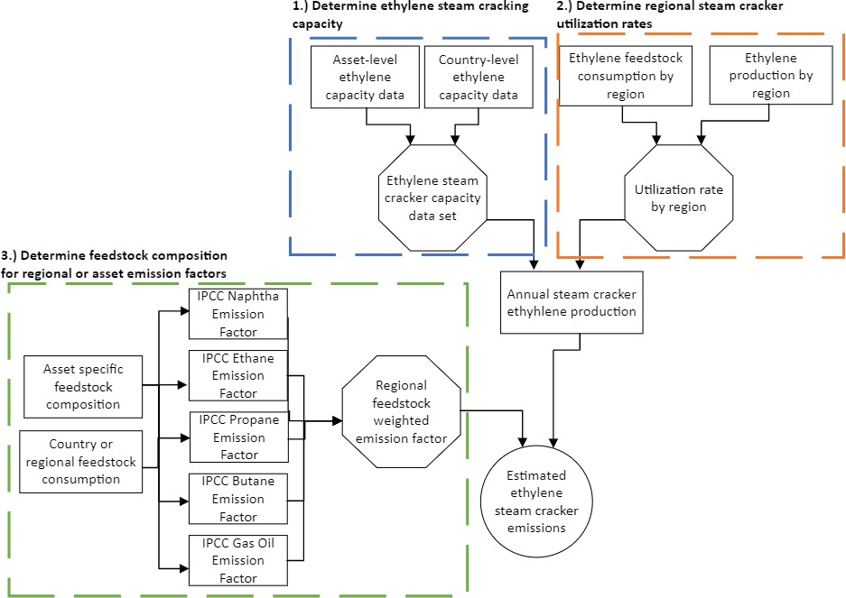
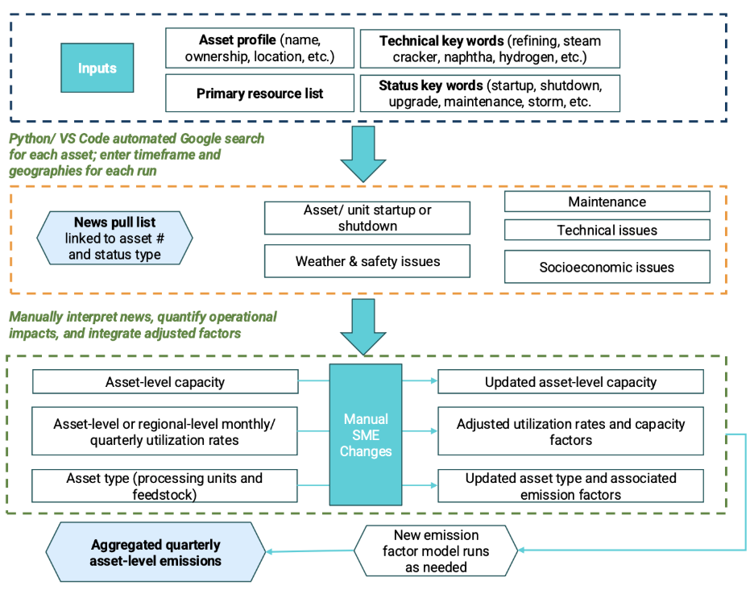
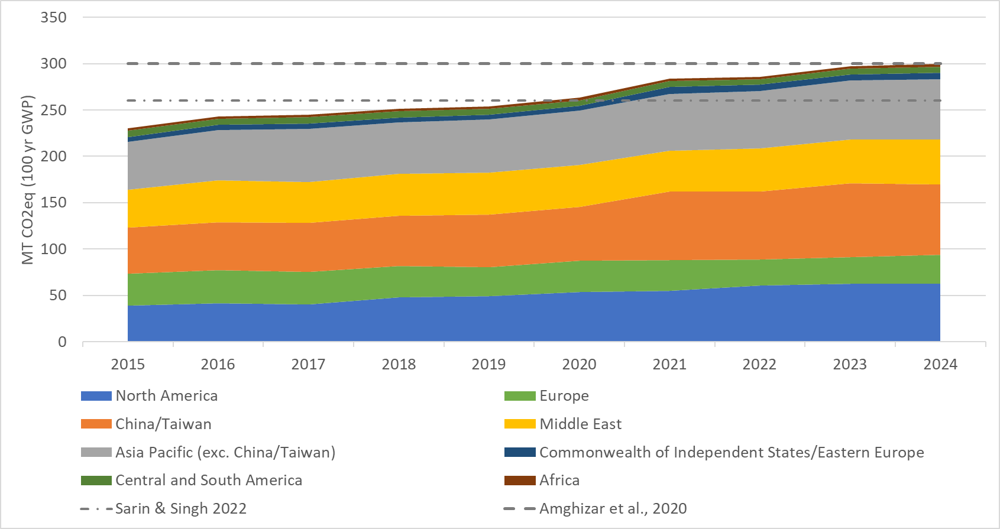
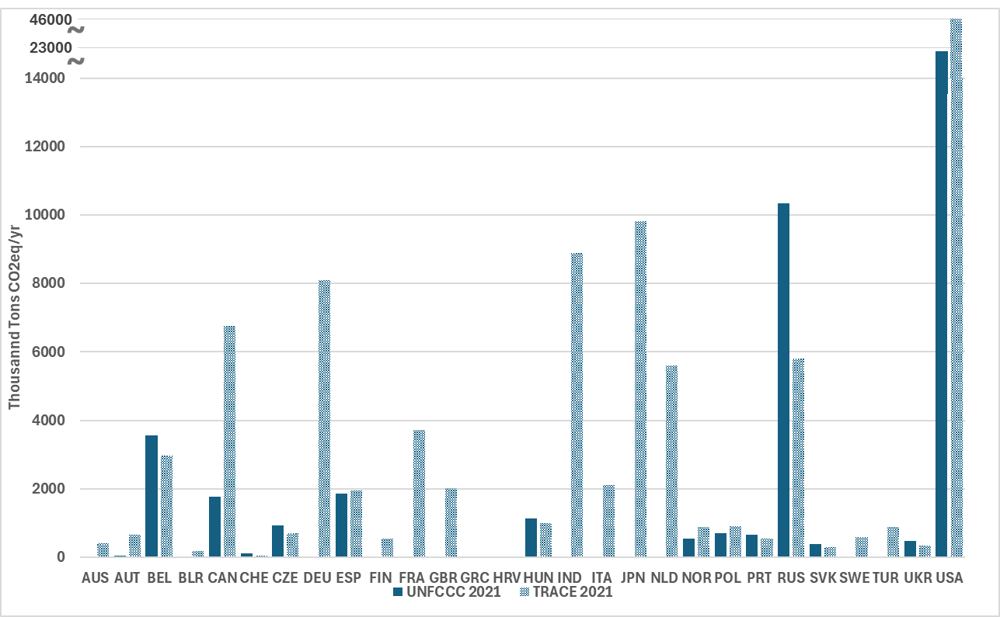
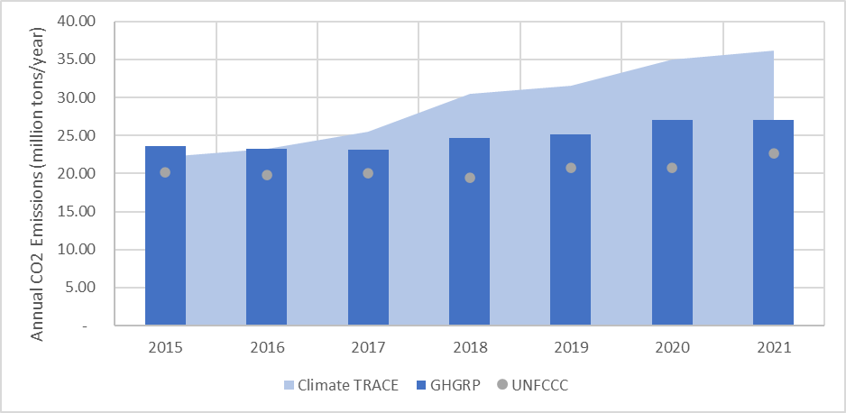
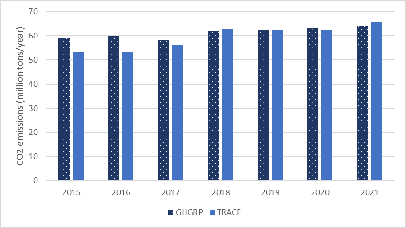
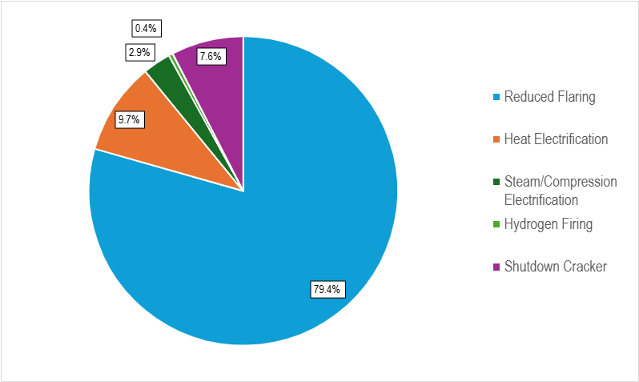
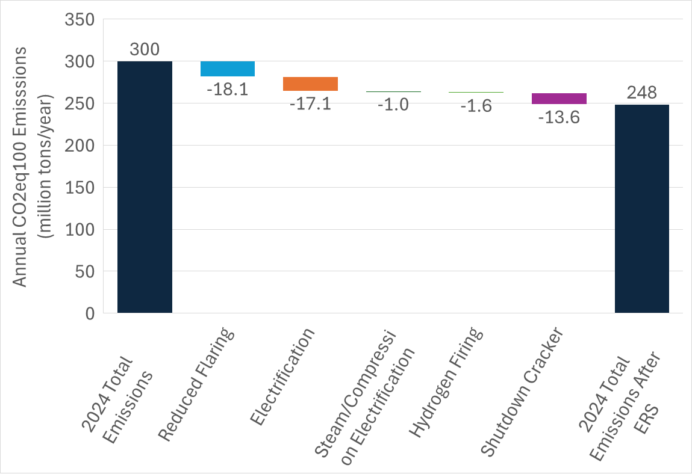

### Manufacturing and Industrial Processes Sector: Petrochemical Steam Cracker Emissions

**Meghan Peltier, Joseph Fallurin, Jikai Wang, TJ Conway, and Deborah Gordon**

*All authors affiliated with RMI and Climate TRACE*

V5.9.0, July 2026

#### Introduction

Plastics and similar petrochemical products make up a growing share of the petroleum industry’s climate impacts. Demand for organic high-value petrochemicals could drive over half of world oil demand by 2050 (IEA, 2022). The petrochemical industry is an incredibly diverse sector covering a range of assets and products. A significant portion of the sector’s supply flows through ethylene steam crackers, which convert refined oil products and natural gas liquids into ethylene and similar primary organic chemicals.

The petrochemical industry consists of a plethora of different processing units and ethylene steam crackers are the first step into this diverse landscape. Steam crackers produce a range of hydrocarbon intermediates that serve as material inputs for clothing, medical equipment, electrical transmission cables, solar panels, wind turbines, and electric vehicles among many other products. These assets have significant emissions impacts, generating up to half of full life-cycle emissions for many petrochemicals like polyethylene plastic packaging films (Sphera, 2022). As the world seeks to limit global temperature rise below 1.5 degrees Celsius, this sector will become increasingly important, for both the products it produces and the emissions it creates.

Currently there is no comprehensive asset and emissions inventory for these energy intensive steam cracker units. Understanding the emissions footprint of these assets provides insight into the petrochemical industry globally. These Climate TRACE petrochemical emission estimates use academically reviewed emissions factors published by the Intergovernmental Panel on Climate Change (IPCC) by region and feedstock. Applying these factors to reasonable estimates of production and feed type provides critical insight into global sources of petrochemical greenhouse gas emissions.

In the TRACE 2025 update, emissions reduction solutions (ERSs) were added to the petrochemical steam cracking data set. These ERS strategies - Hydrogen Firing, Heat Electrification, Reduced Flaring, Steam/Compression Electrification, and Shutdown Cracker - quantify emissions reductions possible at an asset by implementing a given strategy. Each asset was assigned at least one emissions reduction strategy based on matching criteria. These emissions reduction strategies provide valuable insight into ways the sector can reduce its emissions.

#### Materials and Methods

Figure 1 gives an overview of the method for determining steam cracker emissions. Data on steam cracker capacity was compiled and adjusted by utilization rates to represent actual production. This ethylene steam cracker production data was then multiplied by a feedstock weighted regional emission factor to provide steam cracker emission estimates. More detailed information on this methodology can be found in the following sections.

**Figure 1.** Steam cracker emission estimate methodology flowchart.

#### Asset Definition- Petrochemical Ethylene Steam Crackers

**Ethylene Steam Crackers**. Steam cracking is a petrochemical process that applies high temperature heat to hydrocarbon feed and steam to thermally crack hydrocarbons larger than methane into several organic chemicals including olefins (ethylene, propylene, butylene) and sometimes aromatics (benzene, toluene, xylene). These products, known in industry as high value chemicals, then serve as feedstocks for many petrochemical products including bulk commodity plastics (HDPE, LDPE, LLDPE, PVC, PET, and PP), detergents, solvents, and other specialty chemicals. Steam crackers can be co-located with a refinery petrochemical complex or part of stand-alone chemical sites; both stand-alone and integrated steam crackers are included in TRACE emissions estimates. Steam crackers were aggregated to the site-level, where a stated facility's capacity could include one or multiple cracker furnaces. The transport of feedstocks and products is excluded from emissions estimates.

**Integrated Facilities.** Integrated facilities refer to sites that consist of both a refinery and steam cracker operated by the same company (or its chemical subsidiary, or joint venture) co-located in the same facility. These integrated sites will share some utility and logistical infrastructure.

#### 2.1.2 Definition- Emissions Reduction Solutions

**Reduced Flaring**. The reduced flaring emissions reduction strategy assumes the operator reduces flaring emissions by 90% and total asset emissions are reduced by 7%, most commonly through installation of a flare gas recovery system and/or changes to operational practices. Flare gas recovery systems are well established in the industry and deployed at many sites. Additionally, significant literature on best operational practices to reduce flaring exist and regulations commonly strive to minimize flaring. Flaring reduction efforts may result in co-benefits such as reliability improvements to asset owners and lower non-GHG community impacts such as extra noise, light, and conventional air pollutants. While this emissions reduction strategy should be deployable at most sites, implementation can be limited by capital expenses for flare gas recovery system installation.

**Heat Electrification**. The heat electrification strategy assumes an operator replaces high temperature steam cracking furnaces and other fired boilers with electric heaters, eliminating major combustion emissions.  This strategy reduces asset direct emissions by greater than 90% but induces significant electricity emissions due to the high energy requirements for steam cracking. This strategy should only be implemented when clean firm power can be sourced.  Electric steam cracker furnaces are an emerging technology currently only deployed at demo pilot scale (e.g., BASF, SABIC, and Linde in 2024 (Gallucci, 2023)). Electric boilers are a more mature technology and are deployed in a variety of other sectors. Accessibility of clean power, grid availability, and capital cost for retrofits are all limiting factors for the deployment of this strategy. Co-benefits may include reduced conventional air pollution from reduced combustion on-site.

**Steam/Compression Electrification**. The steam/compression electrification strategy assumes an operator replaces gas fired boilers for steam production with electric boilers, and replaces steam/gas driven compressor and pump drives with electric motors. This strategy reduces asset direct emissions by about 15% while inducing electricity emissions. This strategy should preferentially be implemented when clean firm power can be sourced, however emerging thermal and power storage systems can increasingly manage variable supply.  Both electric boilers and electric drives are mature technologies that have been deployed in a range of applications. Their deployment as an emissions reduction strategy together for petrochemical steam cracking is less common. Implementing this retrofit will require modest capital investment. Co-benefits may include reduced conventional air pollution on-site and higher compressor reliability.

**Hydrogen Firing**. The hydrogen firing strategy assumes the operator replaces all the gas fired in heaters and boilers with hydrogen by retrofitting furnace burners and other supporting components. Hydrogen does not release CO2 when combusted. Hydrogen is assumed to be sourced from the production process and supplemented with either green hydrogen produced using clean power or blue hydrogen produced from natural gas with effective methane leak mitigation and carbon capture.  This strategy reduces asset emissions by greater than 90%. If supplemental hydrogen for firing is sourced from green hydrogen, emissions are induced in the electricity sector. Burners capable of burning pure hydrogen are a mature technology and have been deployed in limited applications (e.g., ExxonMobil in 2025 (ExxonMobil 2025)). A full retrofit of a steam cracking asset to run on hydrogen has not been completed at scale but has reached final investment decision (e.g., Dow in 2023, delayed as of 2025 (Dow Canada 2025)). Sourcing supplemental hydrogen (cost, availability, and storage/transport), furnace retrofit capital costs, and changes to operations/safety for hydrogen firing are all limiting factors for deployment of this strategy. Co-benefits may include reduced conventional air pollutants from combustion but higher NOx emissions depending on the combustion control systems applied.

**Shutdown Cracker**. The shutdown cracker strategy assumes the operator closes the petrochemical steam cracking asset. This strategy eliminates all emissions from an asset, assuming the site is permanently closed. There have been several asset closures in recent years due to a persistent oversupply of ethylene which has led to poor economics for certain assets. This strategy has only been applied to assets that have publicly announced intention to close. This solution essentially eliminates all health, noise, and other pollution impacts to fenceline communities as a co-benefit but does result in negative impacts to local jobs and tax revenues.

#### 1.  Emissions Determination

1.  **Emissions**

Climate TRACE used emissions factors for steam cracking by feed type and region from the IPCC’s Emission Factor Database (IPCC, 2006). Asset and country-level emissions were determined using these emissions factors, estimated feedstock compositions, and estimated throughputs for each asset or country. In addition to the IPCC base emissions factor, a flaring factor of 1.075 was applied to all assets based on data provided in the IPCC’s Emission Factor Database supplemental information (IPCC, 2006).

#### Gases

Emissions were based on overall CO2 equivalency (CO2e) reported at the asset or country level. Estimations for emissions of carbon dioxide (CO2) and methane (CH4) were included separately for each estimated asset or country.

Additional non-greenhouse gas emissions estimates were provided for CO, NO2, PM10, PM2.5, SO2, and VOCs. Non-GHG emissions were estimated using emissions factors derived from the US National Emissions Inventory database (Young et. Al, 2022).

#### Key Inputs

**Feed Type.** Steam crackers use naphtha, gas oil, liquified petroleum gas (LPG), ethane, propane, or butane as feed. Steam crackers that use naphtha or gas oil, heavier range hydrocarbon feeds, are less efficient at producing ethylene and are therefore more emissions intensive. Conversely, steam crackers that use LPG or ethane for feed produce higher yields of ethylene and are less emissions intensive per ton of ethylene produced. To economically optimize assets some steam crackers are “flex steam crackers”; able to run a combination of multiple feeds. Estimates assumed these sites used both naphtha and LPG/ethane feeds with different ratios. All sites integrated to refineries were assumed as “flex steam crackers” unless public sources specified otherwise.

#### Data Sets

Data was collected for asset-level estimations globally, with asset-level coverage estimated at 92%. Data sources were publicly available at the time of this writing and summarized in Table 1. For quarterly emissions updates, publicly available data from a variety of industry groups, companies, and country statistics bureaus was used to estimate asset or regional utilization rates at a quarterly interval. Where this data was not available, 6-month utilization estimates were used as a default. Publicly available data from news sources on outages, maintenance, startups, capacity changes, or other significant operating events was incorporated every month.

**Table 1** Data sources by region and source.

| **Inputs for Steam Cracker Emissions**                                            |                                                                                                              |            |
|-----------------------------------------------------------------------------------|--------------------------------------------------------------------------------------------------------------|------------|
| **Input**                                                                         | **Source**                                                                                                   | **Region** |
| Emissions Factors                                                                 | IPCC EFDB                                                                                                    | Global     |
| Information on US steam cracker capacity, locations, and feed type                | US Energy Information Agency (EIA 2023), company websites, government websites, and news articles            | USA        |
| Information on Europe steam cracker capacity, locations, and feed type            | Petrochemicals Europe (Petrochemicals Europe n.d.), company websites, government websites, and news articles | Europe     |
| Information on China steam cracker capacity, locations, and feed type             | Company websites, government websites, and news articles                                                     | China      |
| Information on Japan steam cracker capacity, locations, and feed type             | Japan's Ministry of Economy, Trade, and Industry Statistics, company websites, and news articles             | Japan      |
| Information on Mexico steam cracker capacity, locations, and feed type            | Pemex's website and news articles                                                                            | Mexico     |
| Information on Brazil steam cracker capacity, locations, and utilization          | Braskem’s website and news articles                                                                          | Brazil     |
| Information on rest of the world steam cracker capacity, locations, and feed type | Company websites, government websites, and news articles                                                     | Global     |

#### 2.3.1 Emissions Reduction Solutions Data Sets

Emissions reductions for the hydrogen firing, heat electrification, and steam/compression electrification strategies were estimated using RMI’s Chemistry in Transition Report model (Huyett 2025). This model is a modified version of the GREET model (Argonne National Lab, 2023). Additional resources like the WBCSD’s Life Cycle Metrics for Chemical Products (WBSCD, 2015) and World Best Practice Energy Intensity Values for Selected Industrial Sectors (Worrell et. al, 2008) were used to verify energy usage for steam, electricity, and combustion. For the flaring reduction strategy, the IPCC’s supplemental information on steam crackers (IPCC 2006) provided a flaring factor that was used in emissions reduction estimates. The shutdown cracker strategy did not use any data sets.

In addition to steam cracker specific data sets, the Ember Yearly Electricity Data (Ember, 2024) was used to provide the share of electricity generation from renewables by country. This share of renewable electricity by country was then used to determine when electrification strategies would be assigned to an asset. See section 2.4.4.2 for more detailed information on assigning strategies to assets.

#### 2.3.2 News Pull Automation for Monthly Metadata Updates

A Python-based news pull automation tool was used to support monthly petrochemical metadata updates. As shown in Figure 2, the tool searches by asset profile, source list, technical keywords, status keywords, timeframe, and geography, then generates a structured news list linked to asset IDs and event types.

Subject-matter experts manually review the news pull results and incorporates validated updates into asset-level capacity, utilization, refinery configuration, feedstock assumptions, and associated emission factors. Where operational changes are material, new emission factor model runs were conducted as needed to support updated quarterly asset-level emissions estimates.

**Figure 2** News Pull Automation Workflow for Petrochemical Steam Cracking Metadata Updates

#### Method

Sections 2.4.1-2.4.5 cover the methodology for monthly asset-level emissions globally. Emissions were estimated on a quarterly basis and then split into monthly estimates. Country-level emissions were determined by summing asset-level emissions within each country. Equation 1 was used to determine asset-level emissions with more detailed information on the underlying assumptions provided in the sections below.

*Emissions = Ethylene Capacity x Utilization x Regional Emissions Factor x Flaring Factor (Eq.1)*

Where the *Emissions* is in tons of CO2, CH4, CO2eq, or non-GHG per quarter is a function of:

“*Ethylene Capacity*”: the ethylene production capacity of a site, in tons of ethylene per quarter, is determined from annual capacity values.

“*Utilization*”: the ratio of ethylene production over ethylene capacity on a regional basis, in percent for a given quarter.

“*Regional Emissions Factor*”: the IPCC emissions factor weighted by feedstock mix for country or asset, in tons of CO2, CH4, or CO2eq per ton of ethylene. For non-GHG emissions estimates the emissions factor, in tons of CO, NO2, PM10, PM2.5, SO2, or VOCs per ton of ethylene, is not weighted by feedstock.

“*Flaring Factor*”: 1.075 emission factor applied to represent flaring emissions per IPCC supplemental information for steam crackers. Note the flaring factor is not applied to non-GHG emissions.

#### 2.4.1 Asset Capacity Methodology

Data on the ethylene capacity of steam crackers was sourced from the data sets listed in Table 1. Where applicable, the steam cracker capacity by region was compared to aggregated asset-level data as a back check for accuracy. Data on unit start up, shut down, and/or capacity additions was incorporated on a monthly basis as information was available in public news sources.

#### 2.4.2 Asset Throughput Methodology

Throughput estimations for steam crackers were determined by multiplying asset capacity by estimated utilization, the “Ethylene Capacity” and “Utilization” in Eq.1. Where more granular data was available, regional utilization numbers were determined and applied to steam cracker capacity. For example, for the U.S., data on ethane supplied was compared to U.S. cracker capacity to develop a regional utilization (EIA, 2023). Similarly, for European crackers, data on production and capacity provided regional utilization (CEFIC, 2023). For China, nationally reported ethylene production numbers were used to determine utilization by year (Li et al. 2022; National Statistics Network Direct Reporting Portal, 2022). See key assumptions in Table 2 for some key assumptions on utilization and feed in select regions. For countries outside of these regions a similar approach was used, incorporating regionally specific data when applicable. In regions where no publicly available data was available a proprietary data set was used as a proxy for steam cracker utilization.

For quarterly emissions updates, publicly available data from a variety of industry groups, companies, and country statistics bureaus were used to estimate asset or regional utilization rates at a quarterly interval. Where this data was not available, 6-month utilization estimates were used as a default. Publicly available data from news sources on outages, startups, capacity changes, or other significant operating events was incorporated on a monthly basis.

**Table 2** Key Assumptions for Asset Emissions Calculations.

<table><thead><tr class="header"><th><strong>Utilization and Feed Mix</strong></th><th><strong>United States</strong></th><th><strong>European Union</strong></th><th><strong>China</strong></th></tr></thead><tbody><tr class="odd"><td><strong>Stand-alone</strong> <strong>Flex Cracker Feed Mix</strong></td><td>Ethane</td><td>
70% Naphtha,

15% Propane,

15% Butane
</td><td>
87% Naphtha,

7.8% Propane,

5.2% Butane
</td></tr><tr class="even"><td><strong>Integrated Refinery Cracker Feed Mix</strong></td><td>
70% Ethane,

10% Propane,

10% Naphtha,

10% Butane
</td><td>
50% Naphtha,

17% Propane,

17% Butane,

10% Ethane,

6% Gas Oil
</td><td>
87% Naphtha,

7.8% Propane,

5.2% Butane
</td></tr><tr class="odd"><td><strong>Utilization</strong> <strong>Data Source</strong></td><td>Energy Information Administration/American Chemistry Council (2023)</td><td>CEFIC (2023)</td><td>National Bureau of Statistics China (2023)</td></tr></tbody></table>

#### Asset Emissions Methodology

Individual steam crackers emissions were determined by multiplying the relevant feed emissions factors by estimated asset throughput, the “Regional Emissions Factor” and “Ethylene Capacity”/“Utilization” in Eq. 1. For flex steam crackers not integrated with a refinery the feed type was assigned based on publicly available information on feedstock type. Where this information was unavailable, regional economic incentives for naphtha vs. ethane/LPG feedstock combined with available information on feedstock consumption by region was used to estimate feedstock for steam cracking assets. The stand-alone flex cracker feed for some regions can be found in the key assumptions table (Table 2). For flex steam crackers integrated with a refinery, a similar regional approach for feed mix was determined. The feed mix assumption for some regions can be found in the key assumptions table (Table 2). This method was repeated for each individual asset.

CO2 emissions were also estimated by category: combustion, fugitive, and flaring. Literature estimates that 90% of CO2 emissions come from combustion (Tiggeloven et. al 2023), 7% of emissions come from flaring (IPCC) with the remainder, 3%, coming from fugitive emissions and this breakdown was assumed for all assets.

Alongside asset emissions, the estimated electricity usage was determined for each asset. Electricity usage for ethylene steam crackers was estimated at 1 GJ/ton ethylene (Ren et. Al 2006), this was converted to 0.278 MWh/ton ethylene and applied to the activity data to estimate electricity usage.

See ‘Table S2 Asset level metadata description for petrochemicals’ for additional information on CO2 emissions by category and electricity usage by asset.

#### Emissions Reduction Solution Methodology

#### 2.4.4.1 Emissions Reduction Determination

For each strategy (see section 2.1.2), the emissions reduction achieved was estimated using various model-based approaches. For flaring reduction, it was assumed that flaring emissions could be reduced by 90% to account for the likelihood of some flaring during abnormal upsets outside of operators’ control. This reduced total asset emissions by 7%. For the heat electrification strategy, a modified GREET model (Huyett, 2024) was used to model the emissions of a naphtha-fed steam cracker when all combustion emissions were removed. This provided a new emissions factor of 0.14 tons of CO2/ton of ethylene. The same model was used for the hydrogen firing strategy, removing all combustion emissions for an 80% ethane 20% naphtha fed steam cracker. This provided a new emissions factor of 0.07 tons of CO2/ton of ethylene. Feed to the steam cracker was matched to pilots or announced projects for these strategies to provide the most accurate estimate. It’s important to note for both of these strategies no existing data sets for actual measured emissions at scale exist to verify emissions reduction estimates. For the steam/compression electrification strategy, data sets from WBSCD and DOE (WBCSD, 2015 and Worrell et al, 2008) were used to determine the share of primary energy consumption attributable to steam and compression. Based on these values, a conservative estimate of a 15% total emissions reduction for this strategy was determined. Shutting down a cracker eliminates all emissions as the asset is no longer operating.

In addition to reducing emissions, some emissions reduction strategies induced emissions in another sector. For the heat electrification and hydrogen firing strategies, the modified GREET model (Huyett, 2024) was used to estimate induced electricity generation. For heat electrification the total required energy in GJ/ton of ethylene for steam cracking was converted to MWh. This total induced electricity usage for electrified steam cracking was estimated at 6.4 MWh/ton of ethylene. This energy requirement was compared to reported electricity usage for pilot projects and found to be in a reasonable range. For hydrogen firing, the required BTUs of natural gas for combustion was converted to BTUs of hydrogen, this value was then converted to electricity usage for green hydrogen using 50 kwh/kg H2 produced (Huyett, 2024). The final induced electricity emissions for the hydrogen firing strategy was estimated at 3.2 MWh/ton ethylene. For the steam/compression electrification strategy, energy usage from WBCSD and DOE were converted into electricity, making the final estimated induced electricity generation for this strategy 1.7 MWh/ton ethylene.

#### 2.4.4.2 Assigning Emissions Reduction Strategies to Assets

To determine a primary emissions reduction strategy for an asset, a matching strategy based upon country level renewable grid percentage (Ember, 2024), feed type, and news announcements was used. Importantly, the matching strategy considers the renewable grid percentage for assets as both electrification strategies require significant clean firm renewable power to ensure emissions induced in the electricity generation sector are not greater than emissions reduced in the petrochemical steam cracking sector. Any naphtha fed assets with greater than 60% renewable grids were assigned the heat electrification strategy as the only pilot studies for electrified cracking have been for naphtha fed units. Electrified steam/compression was matched to all other assets with greater than 60% renewable grids. For hydrogen firing and shutdown crackers, only assets with announced closures or hydrogen firing projects were assigned these corresponding strategies. As hydrogen firing has not been proven at scale and technically any cracker could be shutdown, these strategies were deployed only at sites with public announcements so as to not overstate their impact. Reduced flaring was applied as the primary strategy to all assets that did not match any other strategy based on the previous criteria. Additionally, any asset that was not shut down was also assigned reduced flaring as a secondary strategy as it can be employed alongside the more novel strategies.

*Note: Only rank 1 strategies are provided for assets on the Climate TRACE website and additional strategies will be made available in future releases.*

#### 2.5 Verifying Emissions Estimates

#### 2.5.1 Confidence Categories

A confidence level was determined for each asset’s data inputs. The confidence level (very low, low, medium, high, or very high) indicates the data quality and availability used to make assumptions for asset emission estimates. To determine a confidence interval, the 2023 Corruption Perception Index was used as a proxy for data quality by country (Transparency International, 2023). Emissions estimates rely upon publicly available data from government or news sources and the Corruption Perception Index provides a score for the perception of corruption in the public sector by country. This data provides a proxy for the perceived reliability and accuracy of data sources. The raw corruption perception index value was used for each country unless the country was a part of the Petrochemical Europe data set. In that case, the perception index value was increased by ten to represent the increased confidence in data quality. Using this method each asset was assigned a confidence level according to their adjusted corruption perception index value: 0-45 = very low, 45-65 = low, 65-85 = medium, 85-100 = high, &gt;100 = very high.

#### Uncertainty Analysis

For emission factors, the IPCC uncertainty ranges defined in Volume 3, Chapter 3, Table 3.16 in the 2006 IPCC Guidelines for National Greenhouse Gas Inventories were applied to provide low and high uncertainty ranges. These ranges were applied to the overall asset emission estimates by multiplying the standard deviation of the emission factor by asset throughput. This method provides an uncertainty estimate for the asset emissions but does not include any numerical uncertainty in the asset capacity, utilization, or feed composition assumptions.

#### 2.5.3 Verifying Emissions Reduction Solutions Results

Many of the emissions reduction solutions are novel technologies or a novel application of an existing technology. Due to the emergent nature of these strategies, it is not possible to verify the emissions reductions yet. Verifying implementation requires tracking announced projects closely. Flaring reduction and shutting down crackers are exceptions to this rule. Crackers that have shut down are often publicly announced and can be verified in national or other news publications. At this time flaring reductions are not observably verified but with the potential incorporation of VIIRS flaring data it may be possible in the future to verify reduced flaring emissions using satellite data.

*Note: Only rank 1 strategies are provided for assets on the Climate TRACE website and additional strategies will be made available in future releases.*

#### 3 Results: Petrochemicals

Figure 3 displays the total global emissions from ethylene steam crackers for the Climate TRACE data set along with other reported values. China, Asia Pacific, North America, and the Middle East are the largest emitting regions. Previous global steam cracking emissions are estimated at [260 MTCO2e/yea](https://www.spglobal.com/commodityinsights/en/ci/products/net-zero-carbon-ethylene-production.html#%3A~%3Atext%3DSteam%20cracking%20of%20hydrocarbons%20is%2Cmetric%20ton%20of%20ethylene%20produced)r (Sarin & Singh, 2022) to 300 MTCO2e/year (Amghizar et. al,. 2020) in 2022 and 2020 respectively. In contrast, Climate TRACE emissions estimates provide granular emissions estimates annually from 2015 to 2024, with 2024 steam cracker emissions estimated at 299 MTCO2e, the highest of all the reported years. These yearly emissions updates are based on our monitoring of capacity changes, utilization shifts, and other emission-related operational issues, ideally at the facility level. 2024 further increased temporal granularity, providing quarterly emissions estimates for these assets.

**Figure 3** Climate TRACE emission estimates by region. Each region contains the following countries- North America (light blue): Canada, U.S., and Mexico; China/Taiwan (orange); Asia Pacific exc. China/Taiwan (gray): Australia, India, Indonesia, Japan, Malaysia, Philippines, Singapore, South Korea, and Thailand; Central and South America (dark green): Argentina, Brazil, Colombia, and Venezuela; Europe (light green); Austria, Bulgaria, Belgium, Croatia, Czech Republic, Finland, France, Germany, Greece, Hungary, Italy, Netherlands, Norway, Poland, Portugal, Romania, Slovakia, Spain, Sweden, Switzerland, Turkey, and United Kingdom; Middle East (yellow): Iran, Iraq, Israel, Kuwait, Oman, Qatar, Saudi Arabia, and United Arab Emirates; Commonwealth of Independent States/Eastern Europe (dark blue): Azerbaijan, Belarus, Russia, Serbia, Turkmenistan, Ukraine, and Uzbekistan; Africa (dark red): Algeria, Egypt, Libya, Nigeria, and South Africa.

Global steam cracking capacity is estimated to be 190 MT ethylene/year in 2022 (Gelder, 2023). The current TRACE asset data set represents 205 MT ethylene/year in 2022, within 15% of the 2022 asset estimate. TRACE asset capacity increased to 215 MT ethylene/yr in 2024 up from 211 MT ethylene/yr in 2023 due to new asset startups and expansions. Total ethylene production capacity increases were offset by some asset shutdowns. Emissions from the sector increased from 297 MTCO2e in 2023 to 299 MTCO2e in 2024 correlated to the increase in capacity. On a country level, China, the United States, and Saudi Arabia have the largest operating ethylene capacities and therefore highest emissions in this sector.

#### 3.1 Comparison to Other Emission Inventories

Very few comprehensive estimates for ethylene steam cracking emissions exist; therefore, the focus of this analysis is on comparisons between Climate TRACE and United Nations Framework Convention on Climate Change (UNFCCC) reported emissions. Figure 4 below displays the UNFCCC 2.B.8.b Ethylene and Climate TRACE results for Annex 1 countries. Several countries displayed (i.e. FRA, GBR, and NLD) in Figure 4 reported no CO2 emissions with ethylene production, attributing those emissions to either industrial stationary combustion or other chemical processes.

**Figure 4** UNFCCC (dark blue bars) and Climate TRACE (bars with light blue dots) emission comparisons for Annex 1 countries in 2021. Only UNFCCC 2021 emissions estimates were compared as the most recent emissions data available.

There are significant differences in the UNFCCC and Climate TRACE results that vary by region. Much of this delta can be attributed to methodological differences. The UNFCCC numbers are created from national inventory reports from each country. There is no standard

methodology between national inventories, creating hard to quantify differences. To better understand discrepancies between each inventory, each country's national inventory report was reviewed and the most likely reason for the discrepancies was identified. Table 3 describes each country's approach for reporting petrochemical steam cracker emissions and highlights the identified primary reason for the discrepancy.

**Table 3.** Review of UNFCCC National Inventory Reports (NIRs) and comparison to Climate TRACE inventories.

<table><thead><tr class="header"><th>
<strong>UNFCCC</strong>

<strong>Emissions Reporting Status</strong>
</th><th><strong>Country</strong></th><th><strong>Comments</strong></th></tr></thead><tbody><tr class="odd"><td>
UNFCCC

does not report any emissions in 2.B.8.b

ethylene production
</td><td>AUS</td><td>NIR report specifies there are ethylene production facilities in Australia, but no info is provided on ethylene production and only emission factors for CH4 and VOCs are provided. There is language in the NIR regarding legislation which protects companies from having to share data which might mean that all chemical production is aggregated up together in Australia's NIR submission. (Australian Government Department of Climate Change, Energy, the Environment and Water 2021)</td></tr><tr class="even"><td></td><td>DEU</td><td>"The production-quantity data for methanol and ethylene dichloride are subject to confidentiality requirements in certain years. For these reasons, all production quantities for the products in groups a) through e) are aggregated and then reported, together with the pertinent CO2 and CH4 emissions, under 2.B.8.g "(ethylene is b in this grouping). Additionally, "related CO2 emissions of steam cracker units, which are far and away the largest group of emitters considered in this context, occur almost exclusively via combustion in cracking furnaces, auxiliary boilers or flares. With the exception of flares in the petrochemical industry, such combustion-related emissions are included in the energy-sector section in 1.A.2.c." (Federal Environment Agency)</td></tr><tr class="odd"><td></td><td>FRA</td><td>"Emissions from ethylene, ethylene dichloride and propylene are estimated together and cannot be reported separately." The combined emissions from chemical production are reported under 2.8.10. (Ministère de la Transition Écologique)</td></tr><tr class="even"><td></td><td>JPN</td><td>Emissions from ethylene are listed as confidential so no data is provided, results are likely aggregated up under total petrochemical production emissions. (Ministry of the Environment, Japan Greenhouse Gas Inventory Office of Japan (GIO), CGER, NIES)</td></tr><tr class="odd"><td></td><td>NLD</td><td>
CO2 emissions from the production of silicon carbide, carbon black, methanol and ethylene from the combustion of residual gas (a by-product of the non-energy use of fuels) are included in 1.A.2.c (Chemicals).

Although these CO2 emissions are more or less process-related, they are included in 1.A.2 to keep consistency with energy statistics that account for the combustion of residual gases. Additionally, petrochemical production emissions are aggregated up into total petrochemical production emissions. (National Institute for Public Health and the Environment)
</td></tr><tr class="even"><td></td><td>SWE</td><td>"Production of petrochemical products (ethylene, ethylene dichloride and vinyl chloride monomer and ethylene oxide) as well as carbon black, which are described in IPCC 2006 Guidelines under CRF 2.B.8, are included in 2.B.10 due to difficulties in separating these emissions." (Swedish Environmental Protection Agency)</td></tr><tr class="odd"><td></td><td>TUR</td><td>
The majority of ethylene production emissions are reported in section

1.A.2. " This fuel is named “fuel gas” and emissions due to the combustion of fuel gas is included in the energy sector. However, some of the fuel gas is combusted in the flare stacks and the emissions from the flare stacks are included in the IPPU category." These remaining fuel gas emissions are aggregated up into petrochemical production. (Turkish Statistical Institute)
</td></tr><tr class="even"><td>
UNFCCC 2.B.8.b

ethylene production emissions are significantly lower than Climate TRACE

emissions
</td><td>AUT</td><td>
Energy emissions from combustion including flaring are reported under

1.A.2.c. Only methane emissions are reported under 2.B.8.b. (Federal Ministry of Climate Action, Environment, Energy, Mobility, Innovation and Technology 2022)
</td></tr><tr class="odd"><td></td><td>CAN</td><td>Canada uses a 0.411 kg/kg CO2 emission factor for their steam crackers which is more than 50% lower than IPCC factors. Data is based on surveys of individual sites. Process emissions are explicitly called out, likely indicating combustion emissions are accounted for elsewhere. Chemicals are included in 1.A.2 emissions. Information on the determination of the emissions factor was very difficult to find, likely a similar issue to the USA discrepancy. (Environment and Climate Change Canada 2023)</td></tr><tr class="even"><td></td><td>FIN</td><td>All CO2 emissions are reported in the Energy sector, therefore CO2 emissions from ethylene production are reported as IE. Fugitive CH4 emissions from flanges, valves, and other process equipment from ethylene production are included in the 2.B.8.b inventory. (Statistics Finland)</td></tr><tr class="odd"><td></td><td>GBR</td><td>Ethylene production is incorrectly listed under 2.B.8.g while methanol production emissions are reported under 2.B.8.b. (Department for Business, Energy &amp; Industrial Strategy 2023)</td></tr><tr class="even"><td></td><td>ITA</td><td>
No specific language included but only CH4 emissions are calculated for ethylene production. Likely that CO2 emissions are either in 1.A.2 or are not accounted for. (The Institute for Environmental Protection and

Research)
</td></tr><tr class="odd"><td></td><td>IND</td><td>India only reported emissions in 2016 and there is good agreement in that year, about a 3.5% difference from TRACE results.</td></tr><tr class="even"><td></td><td>USA</td><td>See section below and Figures 4 and 5 for a detailed review of the large USA discrepancy. (United States Environmental Protection Agency 2023)</td></tr><tr class="odd"><td>
UNFCCC 2.B.8.b

ethylene production emissions are significantly higher than

Climate

TRACE

emissions
</td><td>RUS</td><td>
Russia uses a 1.73 (IPCC's Western Europe Naphtha Cracker) emissions factor *130% correction factor for CO2 emissions. This has been constant across reporting years. Climate TRACE takes a more asset level approach determining feed on an asset-by-asset basis. Many new crackers built in Russia are next to gas plants and are expected to use a gas-based feed contributing to lower emission results for Climate TRACE assets. (Federal Service for Hydrometeorology and Environmental Monitoring

(Roshydromet)
</td></tr></tbody></table>

A deeper dive into the U.S. UNFCCC and Climate TRACE difference is warranted as the country represents some of the largest total steam cracker emissions globally. In the U.S., petrochemical facilities report emissions to the Greenhouse Gas Reporting Program (GHGRP) which compiles this emissions data for the Greenhouse Gas Inventory (GHGI) which makes up the national inventory report (Environmental Protection Agency, 2023). A comparison of UNFCCC reported emissions, emissions reported to the GHGRP, and emissions calculated by TRACE are shown in Figure 5 below. Data is only provided to 2021 as that is the most recent, available UNFCCC data. Emissions reported to GHGRP are on a site-level and can include emissions associated with further downstream processing beyond ethylene production likely accounting for the UNFCCC and GHGRP reported emissions discrepancy, but no explicit methodology was provided for converting site reported GHGRP emissions to the GHGI and ultimately UNFCCC inventories.

**Figure 5** U.S. GHGRP, UNFCCC, and TRACE emission comparisons for years 2015 to 2021. 2021 is the most recent year with UNFCCC data.

Climate TRACE and UNFCCC inventories both show significant additional ethylene production in the US from 2015-2020, in the range of 7 million tons per year increased ethylene production; however, Climate TRACE emissions estimates show a proportional increase in associated emissions and UNFCCC and GHGRP data do not. Review of GHGRP reported emissions on a site-by-site basis identified that some sites are categorizing emissions differently than others. Specifically, some refinery integrated sites are attributing only emissions associated with petrochemical flaring to ethylene cracker emissions reporting, while attributing remaining process heat emissions to the associated refinery. Climate TRACE estimates both flaring and process heat emissions. The majority of emissions from ethylene production comes from process heat, steam, and electricity; reporting only flaring emissions will result in significant undercounting of total process emissions attributed to ethylene production. The GHGRP emissions accounting boundary leaves room for interpretation on attributing emissions from integrated sites which has led to the large delta between Climate TRACE and UNFCCC ethylene emissions inventory for the US.

Efforts were made to correct this reporting discrepancy in the GHGRP emissions inventory. Process heat emissions that should be attributed to ethylene production were pulled from site GHGRP emission inventory reports. These emissions were then added to the flaring petrochemical emissions reported to the GHGRP. When comparing these results to the TRACE modeled emissions, agreement between US ethylene emissions inventory methods was very strong (Figure 6). Earlier discrepancies where Climate TRACE emissions were lower than GHGRP reported emissions can likely be attributed to the feedstock slate shift from naphtha to lighter ethane/LPG in U. ethylene steam cracking. Climate TRACE data likely overcounts ethane-based steam cracking versus naphtha-based steam cracking in 2015-2017 compared to the reality, resulting in lower emissions estimates than reported in those years.

**Figure 6** U.S. GHGRP (dark blue bars with white dots) adjusted and TRACE (light blue bars) emissions comparisons for years 2015 to 2021. 2021 is the most recent year with UNFCCC data.

Limited data availability on ethylene production emissions globally prevented comparison of TRACE results to other regions. Additional transparency in both UNFCCC reported data and non-Annex 1 countries would enable greater comparability for confirmation of modeled TRACE results.

#### 3.2 Emissions Reduction Solutions Results

As evidenced in the results section above, petrochemical steam cracking is a significant source of industrial emissions and continues to grow year after year as new assets come online. Reducing emissions from this sector is critical, and the emissions reduction strategies laid out in the sections above were applied to all assets in the Climate TRACE database. Results below are for primary emissions reduction strategies only. Figure 7 shows the distribution of assets that utilized each primary strategy with reduced flaring the most common emissions reduction strategy due to ease of deployment, while hydrogen firing is the least common emissions reduction strategy due to novelty of deployment at scale.

**Figure 7** Pie chart displaying the percentage of assets (by number) that deployed each primary strategy. Assets employing specific strategies in this figure don’t necessarily match what is employed on the Climate TRACE website.

Applying these primary strategies across all assets resulted in a 50 MTCO2eq reduction in emissions for the sector (see Figure 8 for detailed distribution of emissions reduction by solution). Despite having the lowest emissions reduction on an intensity basis, reducing flaring was the largest contributor to total emissions reductions as it was applied across 79.4% of assets. Heat electrification (9.7%) and shutting down crackers (7.6%) were the next largest contributors as these strategies were applied across the next largest share of assets and both strategies reduced emissions by greater than 90%. Assets that have already shut down were assigned the shutdown cracker strategy and did not contribute to sector emissions reductions.

**Figure 8** Waterfall chart demonstrating share of total emissions reductions achieved for each ERS lever. Assets employing specific strategies in this figure don’t necessarily match what is employed on the Climate TRACE website.

#### 4 Discussion: Petrochemical Ethylene Steam Crackers

The methods and results presented here summarize emissions from ethylene steam cracking. These activities contribute significant amounts of greenhouse gas emissions each year, with demonstrated increases in both capacity and emissions in several major regions. These trends are expected to continue as oil and gas companies continue to invest in downstream petrochemical applications to replace transportation fuel demand. Additional ethylene steam crackers are anticipated to start up over the next five to ten years resulting in increased emissions in the sector.

The use of the IPCC emissions factors allows for transparent emissions and country-level data for ethylene steam crackers. The IPCC factors represent a well agreed upon base value comparable to other academically reviewed papers’ emissions factors and provide transparency into emissions calculations. While these emission factors are a good starting point, more robust process modeling like the refinery PRELIM model for steam crackers would provide a more accurate emissions estimate. Currently PRELIM only models refinery emissions but ongoing work with the University of Calgary is looking to expand the PRELIM model into chemicals production including a more advanced ethylene steam cracker model (Bergerson, 2022). This

work will be necessary to make climate informed decisions around petrochemical assets to decarbonize the sector.

Results show reasonable agreement with some inventories while drawing attention to differences in others. Overall, there is limited information available on emissions inventories for ethylene steam cracking and methodological differences in the UNFCCC national inventory reports can create confusion on regional ethylene production carbon intensity. The Climate TRACE approach offers a novel, independent data set that applies and expands upon trusted models with roots in academia and policy.

Importantly, our approach to steam cracker emissions will have the ability to improve and incorporate new emissions knowledge as it becomes available. As models like PRELIM evolve, our Climate TRACE emissions methodology will evolve as well, providing more detailed granular emissions modeling for steam cracking. As detection technology and regulation evolve in the petrochemical and related industries, we will continue to incorporate the best-in-class available information to ensure emissions estimates at the asset, sub-national, and country level keep pace.

#### 4.1 Limitations

Current emissions estimates for ethylene steam cracking rely on an emission factor-based approach. While these emissions factors have been compared to other academic papers, they do not represent more granular emissions data for process heat, flaring, electricity, etc. at a site. Additionally, data availability and quality vary greatly by region, especially related to feedstock type at a site, which can significantly impact emissions calculations. This could result in emissions estimates that are too high or low for a given region. A best effort was made to collect up-to-date accurate data. Finally, while other oil and gas sector supply chain segments for Climate TRACE incorporate satellite data such as VIIRS (Visible Infrared Imaging Radiometer Suite) flaring data, ethylene steam cracking does not currently include any remote sensing data.

#### 4.2 Emissions Reduction Solutions Discussion

The emissions reduction solutions results emphasize the importance of continued innovation in the petrochemical steam cracking sector to encourage deployment of more novel emissions reduction technologies. While flare gas recovery units are well established technologies to help operators reduce flaring, the total impact varies and is often more limited as the majority of emissions from the sector come from combustion. While shutting down crackers results in significant emissions reductions, announced closures are outpaced by new asset announcements as petrochemical demand is projected to grow into 2050. 47 million tons of ethylene capacity is slated to come online by 2029 (Argus 2024) while only 9 million tons of ethylene capacity has announced intent to close.

Strategies like heat electrification, hydrogen firing, and steam/compression electrification have the potential to dramatically reduce emissions in the sector but deployment is limited due to novelty of the technology, availability of renewable power, and proven at scale deployment. For electrified strategies especially, availability of clean firm low carbon power is critical to support operations and reduce emissions at steam cracking assets without inducing significant emissions in the electricity generation sector. For hydrogen firing, operation of a fully hydrogen fired steam cracking facility has not been proven at scale and stable operation will be key to encourage other operators to invest. Additionally, similar to electrified solutions, if supplemental hydrogen is sourced from green hydrogen producers, significant quantities of renewable power will be required to limit induced emissions in the electricity sector.

#### 5 Conclusion

To chart a clean energy transition, we must bring transparency to emission-intensive sectors like petrochemicals. The petrochemicals sector is difficult to trace due to complex supply chains and a vast array of products but modeling emissions from ethylene steam crackers represents a valuable first step and useful addition to the production and refining oil and gas sectors. The Climate TRACE platform bolsters accountability that is currently lacking when countries self-report their emissions and offers access to reliable, accurate, and timely emissions data across sectors. The emissions reduction solutions make an informed first attempt at identifying impactful emissions reduction opportunities for petrochemical steam crackers. This information can empower leaders to pinpoint where efforts should be channeled to maximize impact.

More information and techniques will be applied to improve and refine our petrochemical sector emission estimates. We will continue to collaborate with our University of Calgary partners to advance the modeling efforts for steam crackers and other petrochemical assets in PRELIM. We will highlight data gaps by advocating for improved data availability with stakeholders in specific geographies. We will continue to update and improve upon emissions reduction strategy estimates as technology scales and more information becomes available. Currently, no remote sensing data is included in our ethylene steam cracker emissions estimates, but we will continue to increase our understanding of data availability to incorporate these emerging technologies into emissions modeling for improved accuracy. For example, in the future we would like to incorporate flaring satellite data into our flaring factor to provide more accurate emissions estimates.

#### Acknowledgements

Special thanks to our partners at Climate TRACE, Development Seed, Carbon Mapper, Stanford University, the University of Calgary, NASA - Carbon Monitoring System, Colorado School of Mines, and Harvard University that helped with developing the oil and gas models that underlie much of this work and are continuing to pursue advancement of the oil and gas emissions modeling work into the downstream petrochemical sector.

#### Supplemental section metadata

**Covered Emissions and Available Data:** Only ethylene steam cracking unit emissions were modeled in this data set. Any other ethylene production pathways such as coal-to-olefin or methanol-to-olefin are not included in the dataset. The asset and country-level data that is freely available on the website can be found in Tables S1, S2 and S3 below. Additional information on ethylene capacity by country for country-level emission estimates can be shared upon request.

**Table S1**. General dataset information for petrochemicals

<table><thead><tr class="header"><th><strong>General Description</strong></th><th><strong>Definition</strong></th></tr></thead><tbody><tr class="odd"><td><strong>Sector Definition</strong></td><td><em>Petrochemicals covering ethylene steam cracking assets</em></td></tr><tr class="even"><td><strong>UNFCCC sector equivalent</strong></td><td><em>2.B.8.b Ethylene</em></td></tr><tr class="odd"><td><strong>Temporal Coverage</strong></td><td><em>2015-2024</em></td></tr><tr class="even"><td><strong>Temporal Resolution</strong></td><td><em>Quarterly (original); Monthly (on website, see <a href="https://github.com/climatetracecoalition/emissions-methodology/tree/main/Sector-Methodologies/2-Cross-Cutting/temporal-disaggregation">Temporal</a> <a href="https://github.com/climatetracecoalition/emissions-methodology/tree/main/Sector-Methodologies/2-Cross-Cutting/temporal-disaggregation">Disaggregation of Emissions Data for the Climate TRACE</a> <a href="https://github.com/climatetracecoalition/emissions-methodology/tree/main/Sector-Methodologies/2-Cross-Cutting/temporal-disaggregation">Inventory</a>)</em></td></tr><tr class="odd"><td><strong>Data format(s)</strong></td><td><em>CSV</em></td></tr><tr class="even"><td><strong>Coordinate Reference System</strong></td><td><em>EPSG:4326, decimal degrees</em></td></tr><tr class="odd"><td><strong>Number of assets/countries available for download and percent of global emissions (as of 2023)</strong></td><td><em>Data covers 52 countries representing 99% of global emissions and 234 assets representing 92% of global emissions</em></td></tr><tr class="even"><td><strong>Total emissions for 2023</strong></td><td><em>296 million tons of CO2e</em></td></tr><tr class="odd"><td><strong>Ownership</strong></td><td><em>We used research and news sources to identify ownership information</em></td></tr><tr class="even"><td><strong>What emission factors were used?</strong></td><td><em>IPCC Tier 1</em></td></tr><tr class="odd"><td><strong>What is the difference between a "NULL / none / nan" versus "0" data field?</strong></td><td><em>"0" values are for true non-existent emissions. If we know that the sector has emissions for that specific gas, but the gas was not modeled, this is represented by "NULL/none/nan"</em></td></tr><tr class="even"><td><strong>total_CO2e_100yrGWP and total_CO2e_20yrGWP conversions</strong></td><td>
<em>Climate TRACE uses IPCC AR6 CO2e GWPs. CO2e conversion</em> <em>guidelines</em> <em>are</em> <em>here:</em>

<em>https://<a href="http://www.ipcc.ch/report/ar6/wg1/downloads/report/IPC">www.ipcc.ch/report/ar6/wg1/downloads/report/IPC</a> C_AR6_WGI_Full</em>
</td></tr></tbody></table>

**Table S2** Asset level metadata description for petrochemicals.

| **Data attribute**                | **Definition**                                                                                                            |
|-----------------------------------|---------------------------------------------------------------------------------------------------------------------------|
| **sector**                        | *fossil-fuel-operations*                                                                                                  |
| **asset\_sub-sector\_name**       | *petrochemicals*                                                                                                          |
| **asset\_definition**             | *ethylene steam cracker*                                                                                                  |
| **start\_date**                   | *month modeled*                                                                                                           |
| **end\_date**                     | *month modeled*                                                                                                           |
| **asset\_identifier**             | *TRACE ID number for facility*                                                                                            |
| **asset\_name**                   | *common name of steam cracker facility*                                                                                   |
| **iso3\_country**                 | *country code*                                                                                                            |
| **location**                      | *location of facility with point inside site*                                                                             |
| **type**                          | *feed for steam cracker*                                                                                                  |
| **capacity\_description**         | *maximum ethylene production capacity*                                                                                    |
| **capacity\_units**               | *tons of ethylene per month*                                                                                              |
| **capacity\_factor\_description** | *utilization of asset*                                                                                                    |
| **capacity\_factor\_units**       | *percentage*                                                                                                              |
| **activity\_description**         | *ethylene production*                                                                                                     |
| **activity\_units**               | *tons of ethylene per month*                                                                                              |
| **CO2\_emissions\_factor**        | *IPCC tier 1 emissions factor*                                                                                            |
| **CH4\_emissions\_factor**        | *IPCC tier 1 emissions factor*                                                                                            |
| **N2O\_emissions\_factor**        | *not modeled*                                                                                                             |
| **CO\_emissions\_factor**         | *See methodology for emissions factor*                                                                                    |
| **NO2\_emissions\_factor**        | *See methodology for emissions factor*                                                                                    |
| **PM10\_emissions\_factor**       | *See methodology for emissions factor*                                                                                    |
| **PM2\_5\_emissions\_factor**     | *See methodology for emissions factor*                                                                                    |
| **SO2\_emissions\_factor**        | *See methodology for emissions factor*                                                                                    |
| **NMVOC\_emissions\_factor**      | *See methodology for emissions factor*                                                                                    |
| **CO2\_emissions**                | *monthly absolute CO2 emissions estimate*                                                                                 |
| **CH4\_emissions**                | *monthly absolute CH4 emissions estimate*                                                                                 |
| **N2O\_emissions**                | *not modeled*                                                                                                             |
| **CO\_emissions**                 | *monthly absolute CO emissions estimate*                                                                                  |
| **NO2\_emissions**                | *monthly absolute NO2 emissions estimate*                                                                                 |
| **PM10\_emissions**               | *monthly absolute PM10 emissions estimate*                                                                                |
| **PM2\_5\_emissions**             | *monthly absolute PM2.5 emissions estimate*                                                                               |
| **SO2\_emissions**                | *monthly absolute SO2 emissions estimate*                                                                                 |
| **NMVOC\_emissions**              | *monthly absolute VOC emissions estimate*                                                                                 |
| **total\_CO2e\_100yrGWP**         | *CO2e emissions in 100 year global warming potential*                                                                     |
| **total\_CO2e\_20yrGWP**          | *CO2e emissions in 200 year global warming potential*                                                                     |
| **electricity\_input**            | *Estimated electricity usage in MWh*                                                                                      |
| **electricity\_input\_factor**    | *Estimated electricity usage per ton of ethylene produced MWh/ton ethylene*                                               |
| **other1\_description**           | *refinery TRACE ID for integrated asset*                                                                                  |
| **other1\_units**                 | *N/A*                                                                                                                     |
| **other2\_description**           | *High value chemical (HVC) production: high value chemicals are defined as ethylene, propylene, butadiene, and aromatics* |
| **other2\_units**                 | *tons of HVC per month*                                                                                                   |
| **other3\_description**           | *Share of CO2 emissions from combustion*                                                                                  |
| **other3\_units**                 | *% of CO2\_emissions column value%*                                                                                       |
| **other4\_description**           | *Share of CO2 emissions from fugitive*                                                                                    |
| **other4\_units**                 | *% of CO2\_emissions column value*                                                                                        |
| **other5\_description**           | *Share of CO2 emissions from flaring*                                                                                     |
| **other5\_units**                 | *% of CO2\_emissions column value%*                                                                                       |

**Table S3**. Asset level metadata description confidence and uncertainty for petrochemicals. See section 2.4.4 Confidence Categories for confidence definitions.

| **Data Attribute**                | **Confidence Definition**                      | **Uncertainty Definition** |
|-----------------------------------|------------------------------------------------|----------------------------|
| **type**                          | *country level confidence in feedstock data*   | *N/A*                      |
| **capacity\_description**         | *country level confidence in capacity data*    | *N/A*                      |
| **capacity\_factor\_description** | *country level confidence in utilization data* | *N/A*                      |
| **capacity\_factor\_units**       | *N/A*                                          | *N/A*                      |
| **activity\_description**         | *country level confidence in utilization data* | *N/A*                      |
| **CO2\_emissions\_factor**        | *country level confidence in emissions factor* | *IPCC high and low ranges* |
| **CH4\_emissions\_factor**        | *country level confidence in emissions factor* | *IPCC high and low ranges* |
| **N2O\_emissions\_factor**        | *country level confidence in emissions factor* | *N/A*                      |
| **CO\_emissions\_factor**         | *country level confidence in emissions factor* | *N/A*                      |
| **NO2\_emissions\_factor**        | *country level confidence in emissions factor* | *N/A*                      |
| **PM10\_emissions\_factor**       | *country level confidence in emissions factor* | *N/A*                      |
| **PM2\_5\_emissions\_factor**     | *country level confidence in emissions factor* | *N/A*                      |
| **SO2\_emissions\_factor**        | *country level confidence in emissions factor* | *N/A*                      |
| **NMVOC\_emissions\_factor**      | *country level confidence in emissions factor* | *N/A*                      |
| **CO2\_emissions**                | *country level confidence in emissions*        | *IPCC high and low ranges* |
| **CH4\_emissions**                | *country level confidence in emissions*        | *IPCC high and low ranges* |
| **N2O\_emissions**                | *country level confidence in emissions factor* | *N/A*                      |
| **CO\_emissions\_factor**         | *country level confidence in emissions factor* | *N/A*                      |
| **NO2\_emissions\_factor**        | *country level confidence in emissions factor* | *N/A*                      |
| **PM10\_emissions\_factor**       | *country level confidence in emissions factor* | *N/A*                      |
| **PM2\_5\_emissions\_factor**     | *country level confidence in emissions factor* | *N/A*                      |
| **SO2\_emissions\_factor**        | *country level confidence in emissions factor* | *N/A*                      |
| **NMVOC\_emissions\_factor**      | *country level confidence in emissions factor* | *N/A*                      |
| **total\_CO2e\_100yrGWP**         | *country level confidence in emissions*        | *IPCC high and low ranges* |
| **total\_CO2e\_20yrGWP**          | *country level confidence in emissions*        | *IPCC high and low ranges* |

**Table S4.** Strategy ERS Table. *Note: Only rank 1 strategies are provided for assets on the Climate TRACE website and additional strategies will be made available in future releases.*

<table><thead><tr class="header"><th><strong>native_strategy_id</strong></th><th><strong>PTCMSCF001</strong></th><th><strong>PTCMSCE002</strong></th><th><strong>PTCMSCE003</strong></th><th><strong>PTCMSCH004</strong></th><th><strong>PTCMSCS005</strong></th></tr></thead><tbody><tr class="odd"><td><strong>strategy_name</strong></td><td>Reduced flaring</td><td>Electrification</td><td>Steam/compression electrification</td><td>Hydrogen firing</td><td>Shutdown cracker</td></tr><tr class="even"><td><strong>strategy_description</strong></td><td>Sites reduce flaring by 90%</td><td>All combustion is electrified, including boilers and cracking furnaces</td><td>Electrify steam boilers and compressor</td><td>Replace natural gas firing with hydrogen firing</td><td>Shutdown site</td></tr><tr class="odd"><td><strong>mechanism</strong></td><td>retrofit</td><td>retrofit</td><td>retrofit</td><td>retrofit</td><td>subtract</td></tr><tr class="even"><td><strong>asset_type_new</strong></td><td></td><td>Electric furnace</td><td></td><td>H2 firing</td><td></td></tr><tr class="odd"><td><strong>max_activity_affected_ratio</strong></td><td>1</td><td>1</td><td>1</td><td>1</td><td>1</td></tr><tr class="even"><td><strong>CO2_emissions_factor_new_absolute</strong></td><td></td><td>0.14</td><td></td><td>0.07</td><td>0</td></tr><tr class="odd"><td><strong>CO2_emissions_factor_new_to_old_ratio</strong></td><td>0.93</td><td></td><td>0.85</td><td></td><td></td></tr><tr class="even"><td><strong>CH4_emissions_factor_new_absolute</strong></td><td></td><td></td><td></td><td></td><td>0</td></tr><tr class="odd"><td><strong>CH4_emissions_factor_new_to_old_ratio</strong></td><td>.93</td><td>1</td><td>1</td><td>1</td><td></td></tr><tr class="even"><td><strong>N2O_emissions_factor_new_to_old_ratio</strong></td><td>1</td><td>1</td><td>1</td><td>1</td><td>1</td></tr><tr class="odd"><td><strong>confidence</strong></td><td>high</td><td>low</td><td>medium</td><td>low</td><td>very high</td></tr><tr class="even"><td><strong>induced_sector_1</strong></td><td></td><td>
electricity-

generation
</td><td>
electricity-

generation
</td><td>
electricity-

generation
</td><td></td></tr><tr class="odd"><td><strong>induced_sector_1_activity_conversion_rate</strong></td><td></td><td>6.4</td><td>1.7</td><td>3.2</td><td></td></tr></tbody></table>

**Permissions and Use:** All Climate TRACE data is freely available under the Creative Commons Attribution 4.0 International Public License, unless otherwise noted below.

> **Data citation format:** Peltier, M; Fallurin, J, Wang, J, Conway, TJ, and Gordon, D (2026). *Manufacturing and Industrial Processes sector- Petrochemical Ethylene Steam Cracker Emissions,* RMI, USA, Climate TRACE Emissions Inventory. [https://climatetrace.org](https://climatetrace.org/) \[Accessed date\]

**Geographic boundaries and names (iso3\_country data attribute):** The depiction and use of boundaries, geographic names and related data shown on maps and included in lists, tables, documents, and databases on Climate TRACE are generated from the Global Administrative Areas (GADM) project (Version 4.1 released on 16 July 2022) along with their corresponding ISO3 codes, and with the following adaptations:

-   HKG (China, Hong Kong Special Administrative Region) and MAC (China, Macao Special Administrative Region) are reported at GADM level 0 (country/national);

-   Kosovo has been assigned the ISO3 code ‘XKX’;

-   XCA (Caspian Sea) has been removed from GADM level 0 and the area assigned to countries based on the extent of their territorial waters;

-   XAD (Akrotiri and Dhekelia), XCL (Clipperton Island), XPI (Paracel Islands) and XSP (Spratly Islands) are not included in the Climate TRACE dataset;

-   ZNC name changed to ‘Turkish Republic of Northern Cyprus’ at GADM level 0;

-   The borders between India, Pakistan and China have been assigned to these countries based on GADM codes Z01 to Z09.

The above usage is not warranted to be error free and does not imply the expression of any opinion whatsoever on the part of Climate TRACE Coalition and its partners concerning the legal status of any country, area or territory or of its authorities, or concerning the delimitation of its borders.

**Disclaimer:** The emissions provided for this sector are our current best estimates of emissions, and we are committed to continually increasing the accuracy of the models on all levels. Please review our terms of use and the sector-specific methodology documentation before using the data. If you identify an error or would like to participate in our data validation process, please [contact us](mailto:coalition@climatetrace.org).

#### References

1.  National Bureau of Statistics China (2023). National Statistics Network Direct Reporting Portal; National Bureau of Statistics China. [https://data.stats.gov.cn/easyquery.htm?cn=C01](https://data.stats.gov.cn/easyquery.htm?cn=C01)

2.  American Chemistry Council. (2023). *2023 Guide to the Business of Chemistry* (pp. 85–86) \[Review of *2023* *Guide* *to* *the* *Business* *of* *Chemistry*\]. [https://www.americanchemistry.com/content/download/14468/file/2023-Guide-to-the-Business-of-Chemi](https://www.americanchemistry.com/content/download/14468/file/2023-Guide-to-the-Business-of-Chemistry.pdf) [stry.pdf](https://www.americanchemistry.com/content/download/14468/file/2023-Guide-to-the-Business-of-Chemistry.pdf)

3.  Amghizar, I., Dedeyne, J. N., Brown, D. J., Marin, G. B., & Geem, K. M. V. (2020). Sustainable innovations in steam cracking: CO2 neutral olefin production. *Reaction Chemistry & Engineering*, *5*(2), 239–257. [https://doi.org/10.1039/C9RE00398C](https://doi.org/10.1039/C9RE00398C)

4.  Argonne National Lab (2023) *R&D GREET Life Cycle Assessment Model*, *Energy.gov*. Department of Energy. Available at: https://www.energy.gov/eere/rd-greet-life-cycle-assessment-model.

5.  Australian Government Department of Climate Change, Energy, the Environment and Water (2023) *Vol National Inventory Report 2021.*, *The Australian Government Submission to the United Nations Framework Convention on Climate Change*. rep. Available at: [https://unfccc.int/documents/627765](https://unfccc.int/documents/627765).

6.  Bergerson, J. (2022). *PRELIM: The Petroleum Refinery Life Cycle Inventory Model* \[Review of *PRELIM: The Petroleum Refinery Life Cycle Inventory Model*\]. University of Calgary. [https://www.ucalgary.ca/energy-technology-assessment/open-source-models/prelim](https://www.ucalgary.ca/energy-technology-assessment/open-source-models/prelim)

7.  CEFIC (2023) *2023 facts and figures of the European Chemical Industry*, *cefic.org*. Available at: [https://cefic.org/a-pillar-of-the-european-economy/facts-and-figures-of-the-european-chemical-industry/](https://cefic.org/a-pillar-of-the-european-economy/facts-and-figures-of-the-european-chemical-industry/)

8.  Department for Business, Energy & Industrial Strategy. 2023. Review of *UK Greenhouse Gas Inventory, 1990 to 2019*. [https://unfccc.int/documents/627789](https://unfccc.int/documents/627789)

9.  EIA. (2023). *Ethylene Crackers* \[Review of *Ethylene Crackers*\]. EIA U.S. Energy Atlas. [https://atlas.eia.gov/datasets/2a3894eae1df438fab70d6f6f0a8867f/explore](https://atlas.eia.gov/datasets/2a3894eae1df438fab70d6f6f0a8867f/explore)

10. Ember (2024) Yearly Electricity Data \| Ember, Ember. Available at: https://ember-energy.org/data/yearly-electricity-data/.

11. Environment and Climate Change Canada (2023) *NATIONAL INVENTORY REPORT 1990 –2019: GREENHOUSE GAS SOURCES AND SINKS IN CANADA*. rep. Available at:

[https://unfccc.int/documents/627833](https://unfccc.int/documents/627833)

1.  Environmental Protection Agency (2023. *EPA Facility Level GHG Emissions* \[Review of *EPA Facility Level GHG Emissions*\]. [https://ghgdata.epa.gov/ghgp/main.do](https://ghgdata.epa.gov/ghgp/main.do)

2.  *ExxonMobil’s next-gen hydrogen burner in Baytown can help decarbonize a key industry* (2025) *ExxonMobil*. Available at: [https://corporate.exxonmobil.com/what-we-do/delivering-industrial-solutions/hydrogen/baytown-hydrogen-burner-decarbonize-industry](https://corporate.exxonmobil.com/what-we-do/delivering-industrial-solutions/hydrogen/baytown-hydrogen-burner-decarbonize-industry) (Accessed: 20 August 2025).

3.  Federal Environment Agency (2023) *Submission under the United Nations Framework Convention on Climate Change and the Kyoto Protocol 2021 National Inventory Report for the German Greenhouse Gas Inventory*. rep. Available at: [https://unfccc.int/documents/627785](https://unfccc.int/documents/627785).

4.  Federal Ministry of Climate Action, Environment, Energy, Mobility, Innovation and Technology (2023) *AUSTRIA’S NATIONAL INVENTORY REPORT 2022 Submission under the United Nations Framework Convention on Climate Change and under the Kyoto Protocol*. rep. Available at: [https://unfccc.int/documents/627757](https://unfccc.int/documents/627757)

5.  Federal Service for Hydrometeorology and Environmental Monitoring (Roshydromet). 2023. Review of *NATIONAL REPORT on the INVENTORY of Anthropogenic Emissions from Sources and Removals by Sinks of Greenhouse Gases Not Controlled by the Montreal Protocol for 1990 - 2019*. [https://unfccc.int/documents/631719](https://unfccc.int/documents/631719)

6.  *Fort Saskatchewan path2zero* (no date) Dow Canada. Available at: [https://ca.dow.com/en-ca/about/fort-saskatchewan-path2zero.html](https://ca.dow.com/en-ca/about/fort-saskatchewan-path2zero.html) (Accessed: 20 August 2025).

7.  Gallucci, M. (2023) This key chemical is super dirty to make. can an electric furnace..., Canary Media. Available at: [https://www.canarymedia.com/articles/clean-industry/this-key-chemical-is-super-dirty-to-make-can-an-electric-furnace-help](https://www.canarymedia.com/articles/clean-industry/this-key-chemical-is-super-dirty-to-make-can-an-electric-furnace-help) (Accessed: 20 August 2025).

8.  Gelder, A (2023, April 25) *Refinery-petrochemical integration disrupts gas-based cracker feedstock* *advantage* *\|* *Wood* *Mackenzie*. Www.woodmac.com. [https://www.woodmac.com/news/opinion/refinery-petrochemical-integration-gas-based-cracker-feedstock](https://www.woodmac.com/news/opinion/refinery-petrochemical-integration-gas-based-cracker-feedstock)

20\. Huyett, C. and Peltier, M. (2025) *Chemistry in Transition: Charting solutions for a low-emissions chemical industry*, *RMI*. Available at: https://rmi.org/chemistry-in-transition-charting-solutions-for-a-low-emissions-chemical-industry/.

1.  IEA (2022) *World* *Energy* *Outlook* *2022*.

[https://iea.blob.core.windows.net/assets/830fe099-5530-48f2-a7c1-11f35d510983/WorldEnergyOutlook2](https://iea.blob.core.windows.net/assets/830fe099-5530-48f2-a7c1-11f35d510983/WorldEnergyOutlook2022.pdf) [022.pdf](https://iea.blob.core.windows.net/assets/830fe099-5530-48f2-a7c1-11f35d510983/WorldEnergyOutlook2022.pdf)

1.  IPCC (2006) *Ethylene* \[Review of *Ethylene*\]. Emissions Factor Database; IPCC. [https://www.ipcc-nggip.iges.or.jp/EFDB/find\_ef.php?ipcc\_code=2.B.8.b&ipcc\_level=3](https://www.ipcc-nggip.iges.or.jp/EFDB/find_ef.php?ipcc_code=2.B.8.b&ipcc_level=3)

2.  IPCC (2006) *2006 IPCC Guidelines for National Greenhouse Gas Inventories Volume 3 Industrial Processes and Product Use* \[Review of *2006 IPCC Guidelines for National Greenhouse Gas Inventories Volume 3 Industrial Processes and Product Use*\]. [https://www.ipcc-nggip.iges.or.jp/public/2006gl/pdf/3\_Volume3/V3\_3\_Ch3\_Chemical\_Industry.pdf](https://www.ipcc-nggip.iges.or.jp/public/2006gl/pdf/3_Volume3/V3_3_Ch3_Chemical_Industry.pdf)

3.  Life Cycle Metrics for Chemical Products (2015) World Business Council for Sustainable Development (WBCSD). Available at: https://archive.wbcsd.org/Projects/Chemicals/Resources/Life-Cycle-Metrics-for-Chemical-Products (Accessed: 21 August 2025).

4.  Ministère de la Transition Écologique (2023) *Rapport National d’Inventaire pour la France au titre de la Convention cadre des Nations Unies sur les Changements Climatiques et du Protocole de Kyoto*. rep. Available at: [https://unfccc.int/documents/627737](https://unfccc.int/documents/627737)

5.  Ministry of the Environment, Japan Greenhouse Gas Inventory Office of Japan (GIO), CGER, NIES (2023) *National Greenhouse Gas Inventory Report of JAPAN 2021*. rep. Available at: [https://unfccc.int/documents/627900](https://unfccc.int/documents/627900)

6.  National Institute for Public Health and the Environment (2023) *Greenhouse gas emissions in the Netherlands 1990–2019 National Inventory Report 2021*. rep. Available at: [https://unfccc.int/documents/627759](https://unfccc.int/documents/627759)

7.  Petrochemicals Europe (n.d.) *Cracker Capacity* \[Review of *Cracker Capacity*\]. [https://www.petrochemistry.eu/about-petrochemistry/petrochemicals-facts-and-figures/cracker-capacity/](https://www.petrochemistry.eu/about-petrochemistry/petrochemicals-facts-and-figures/cracker-capacity/)

8.  Transparency International (2023) *Corruption Perceptions Index*. Transparency International. [https://www.transparency.org/en/cpi/2023](https://www.transparency.org/en/cpi/2023)

9.  Ren, T. and Blok, M.K. (2006) *Olefins from conventional and heavy feedstocks: Energy use in steam cracking and alternative processes \| request PDF*. Available at: https://www.researchgate.net/publication/222578401\_Olefins\_from\_conventional\_and\_heavy\_feedstocks\_Energy\_use\_in\_steam\_cracking\_and\_alternative\_processes (Accessed: 30 June 2026).

10. Sarin, S., & Singh, R (2022) *Net-zero carbon ethylene production via recovery of CO 2 from cracking* *furnace* *flue* *gas* *Process* *Economics* *Program*. [https://cdn.ihsmarkit.com/www/pdf/0722/RW2022-03\_toc.pdf](https://cdn.ihsmarkit.com/www/pdf/0722/RW2022-03_toc.pdf)

11. Sphera (2022, April 7) *Life Cycle Assessment of Chemical Recycling for Food Grade Film* \[Review of *Life Cycle Assessment of Chemical Recycling for Food Grade Film*\]. Consumer Goods Forum.

[https://www.theconsumergoodsforum.com/wp-content/uploads/2022/04/Life-Cycle-Assessment-of-Chem](https://www.theconsumergoodsforum.com/wp-content/uploads/2022/04/Life-Cycle-Assessment-of-Chemical-Recycling-for-Food-Grade-Film.pdf) [ical-Recycling-for-Food-Grade-Film.pdf](https://www.theconsumergoodsforum.com/wp-content/uploads/2022/04/Life-Cycle-Assessment-of-Chemical-Recycling-for-Food-Grade-Film.pdf)

1.  Statistics Finland (2023) *GREENHOUSE GAS EMISSIONS IN FINLAND 1990 to 2019*. rep.

Available at: [https://unfccc.int/documents/627718](https://unfccc.int/documents/627718)

*29. Steam cracker capacity addition: Relief in sight* (2024) *Argus Media*. Available at: https://www.argusmedia.com/en/news-and-insights/market-opinion-and-analysis-blog/steam-cracker-capacity-addition-relief-in-sight (Accessed: 21 August 2025).

1.  Swedish Environmental Protection Agency (2023) *National Inventory Report Sweden 2021 Greenhouse Gas Emission Inventories 1990-2019*. rep. Available at: [https://unfccc.int/documents/627663](https://unfccc.int/documents/627663)

2.  The Institute for Environmental Protection and Research. 2023. Review of *Italian Greenhouse Gas Inventory 1990-2019. National Inventory Report 2021*. [https://unfccc.int/documents/627845](https://unfccc.int/documents/627845)

3.  Tiggeloven, J. *et al.* (2023) *Optimization of electric ethylene production: Exploring the role of Cracker flexibility, batteries, and renewable energy integration \| industrial & engineering chemistry research*. Available at: https://pubs.acs.org/doi/10.1021/acs.iecr.3c02226

4.  Turkish Statistical Institute (2023) *April 2021 TURKISH GREENHOUSE GAS INVENTORY 1990 - 2019*. rep. Available at: [https://unfccc.int/documents/627786](https://unfccc.int/documents/627786).

5.  United States Environmental Protection Agency. 2023. Review of *Inventory of U.S. Greenhouse Gas Emissions and Sinks*. [https://unfccc.int/documents/627784](https://unfccc.int/documents/627784)

6.  Worrell, E. et al. (2008) World Best Practice Energy Intensity Values for Selected Industrial Sectors. Available at: https://eta.lbl.gov/publications/world-best-practice-energy-intensity (Accessed: 21 August 2025).

7.  Young, B., Hawkins, T. R., Chiquelin, C., Sun, P., Gracida-Alvarez, U. R., & Elgowainy, A. (2022). Environmental life cycle assessment of olefins and by-product hydrogen from steam cracking of natural gas liquids, naphtha, and Gas Oil. *Journal of Cleaner Production*, *359*, 131884. [https://doi.org/10.1016/j.jclepro.2022.131884](https://doi.org/10.1016/j.jclepro.2022.131884)
