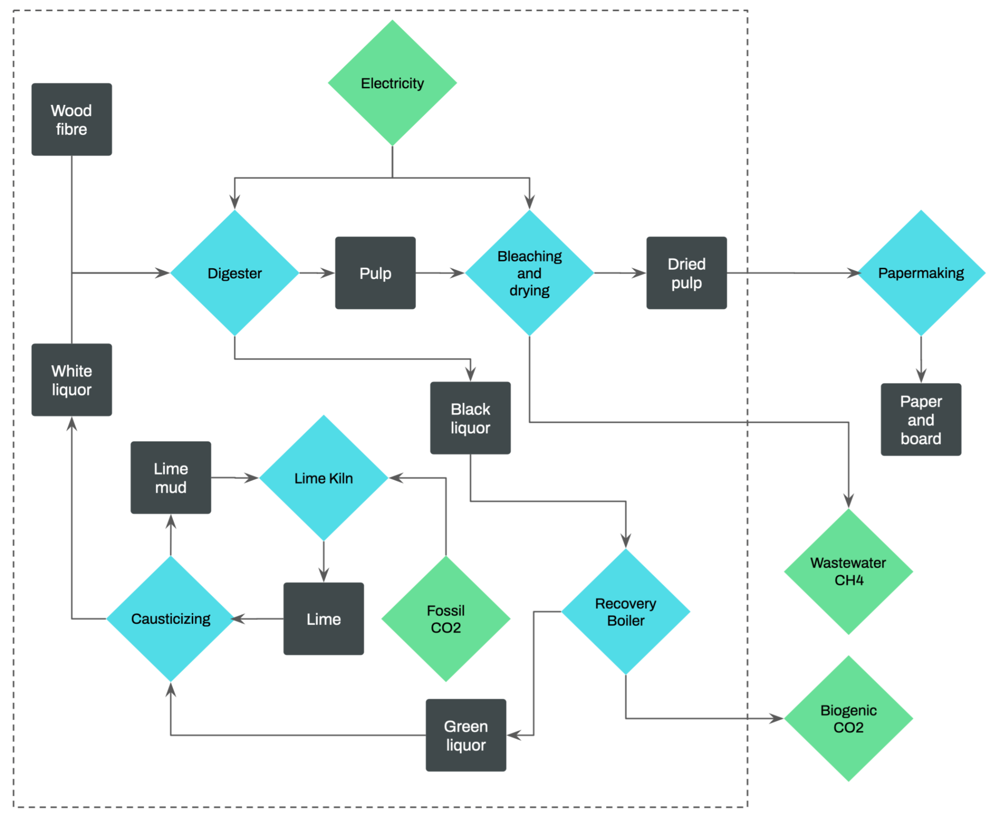
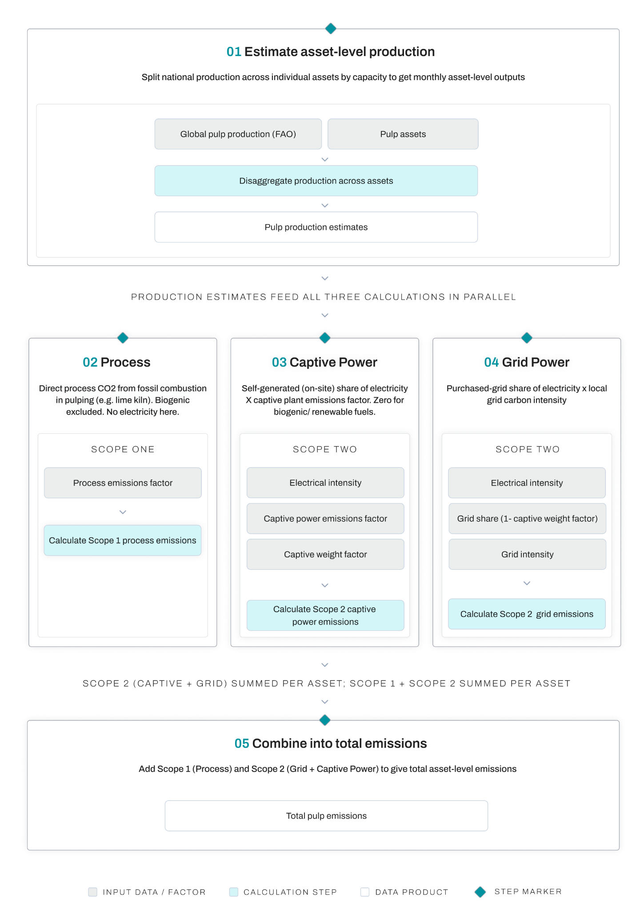
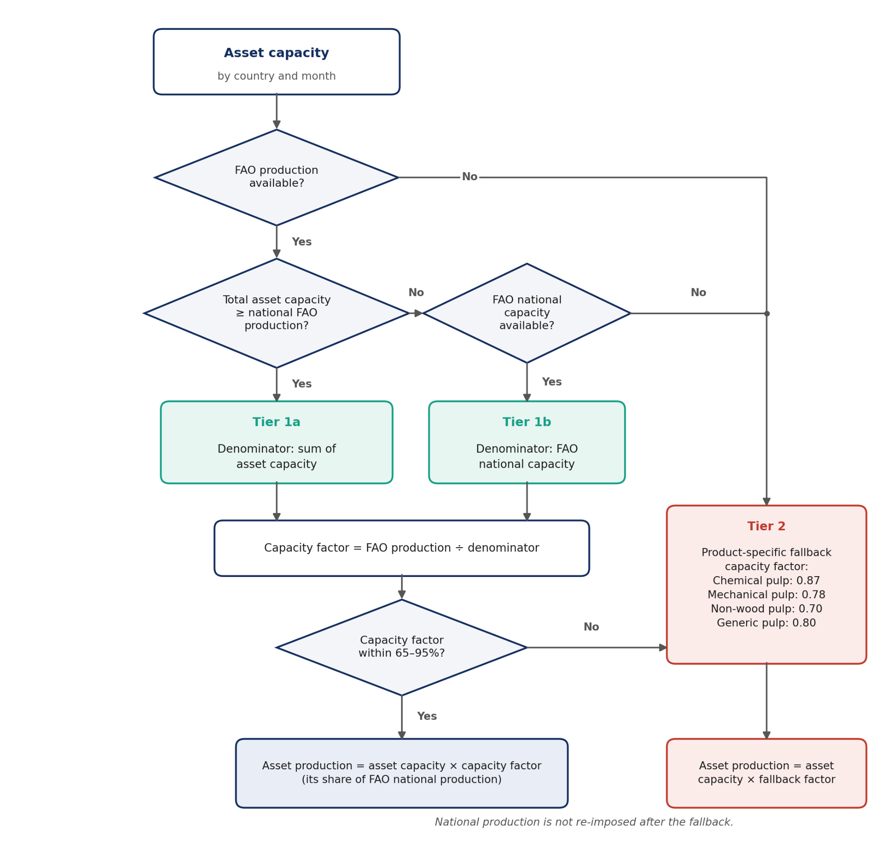
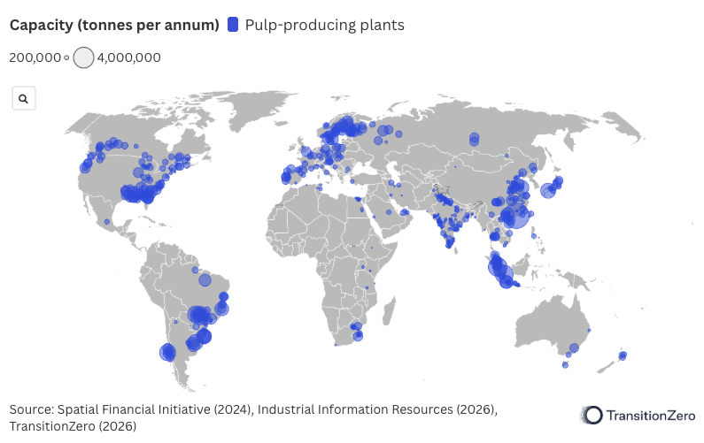
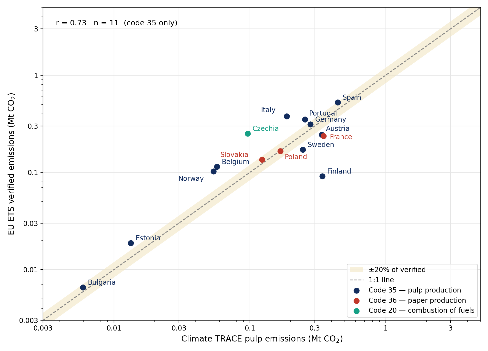
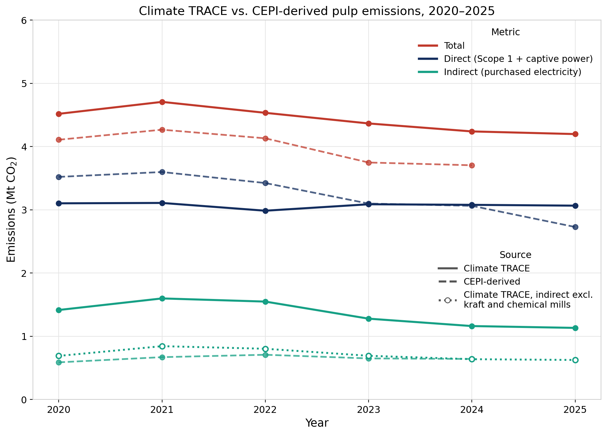
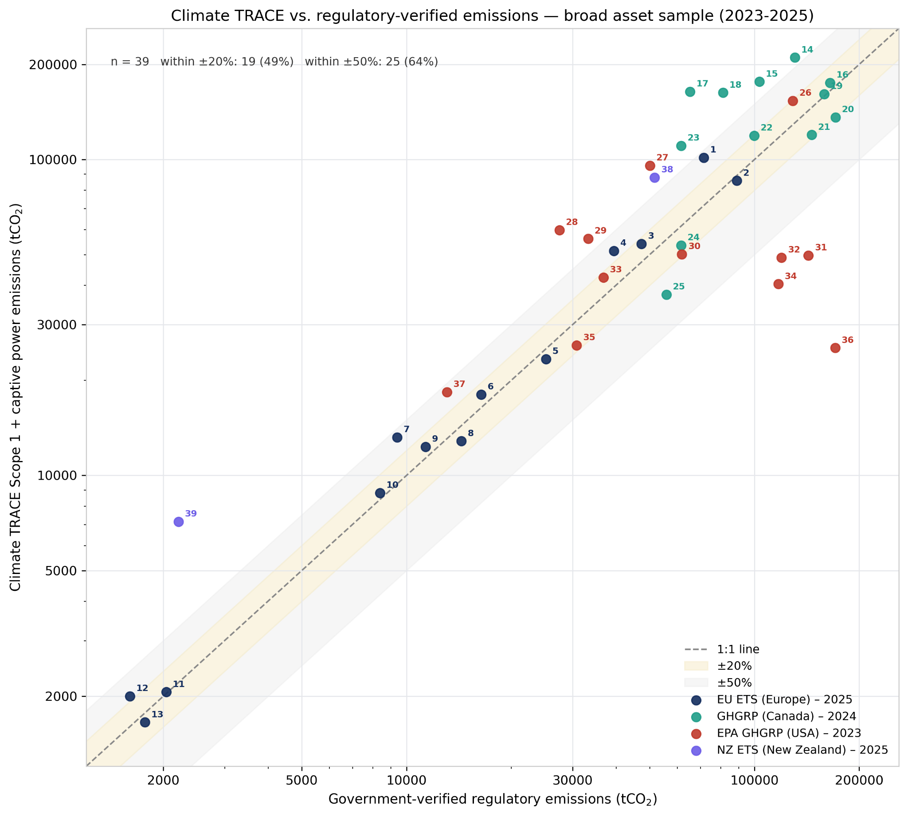

**Manufacturing and Industrial Processes sector: Pulp and Paper Production Emissions**

**Verity Crane and Charlotte Underwood**

*Authors are affiliated with TransitionZero and Climate TRACE*

**1. Introduction**
-------------------

Pulp is the fibrous raw material behind paper, packaging, tissue and a range of textile and specialty products. Producing it is energy-intensive. The pulp and paper industry is the fourth-largest industrial energy consumer globally, using around 5% of industrial final energy, and accounts for roughly 2% of direct industrial CO2 emissions (Kong et al., 2012; Furszyfer Del Rio et al., 2022). Global pulp and paper production has grown by roughly a quarter since 2000 (FAO, 2024a). Efficiency has improved over that period, but sector emissions have still risen alongside demand.

Pulp differs from most heavy industry subsectors because much of its energy is already biogenic. Kraft mills, which dominate chemical pulp production, burn black liquor and wood residues to meet most of their own heat and power needs. Their fossil emissions are concentrated in a few places: the lime kiln, fossil-fired captive power and purchased electricity. The size of these sources varies widely between mills. It depends on pulping route, kiln fuel, captive power mix and the carbon intensity of the local grid. As a result, two mills with similar output can have very different emissions footprints.

Public data largely hides this variation. Few mills report emissions. Those that do usually report for integrated pulp-and-paper sites, which makes it hard to isolate pulp production, and national statistics generally cover the sector as a whole. Without facility-level estimates, policymakers, investors and companies struggle to see where abatement potential is concentrated or to track progress at individual sites.

This paper sets out the methodology used to estimate plant-level CO2 emissions from pulp production worldwide within the Climate TRACE emissions inventory (Lancellotti et al., 2025). It covers 782 pulp assets in 56 countries from 2015 to 2026. It estimates Scope 1 process emissions and Scope 2 emissions from purchased electricity and captive power generation (Sections 4.2–4.4). Estimates are compared against government-verified facility data from the EU ETS, US EPA, Canada and New Zealand, and against European sector statistics from CEPI (Section 6.2). Climate TRACE also identifies emissions reduction solutions for each asset (Section 7).

**2. Scope and System Boundary**
--------------------------------

<table><thead><tr class="header"><th>

</th></tr></thead><tbody><tr class="odd"><td><strong>Figure 1</strong> High-level overview of the pulp sector describing processes and sources of GHG emissions. The scope of this study, pulp production emissions, is enclosed by a circle.</td></tr></tbody></table>

Pulp production begins with wood fiber — either roundwood harvested directly for pulping, or wood chips and residues from sawmilling — which is processed either mechanically, by grinding or refining the wood to physically separate the fibers while retaining most of the lignin, or chemically, by dissolving the lignin to liberate the cellulose fibers. The dominant chemical process, kraft pulping, cooks wood chips in a pressurized digester with white liquor, dissolving the lignin. The resulting spent cooking liquor (black liquor), rich in dissolved lignin and pulping chemicals, is concentrated and burned in a recovery boiler, which recovers both process energy and the pulping chemicals as an inorganic smelt. This smelt is dissolved and causticized to regenerate fresh white liquor, with the calcium carbonate byproduct calcined in a lime kiln to recover reusable lime — the kraft chemical recovery cycle. Mechanical and semi-chemical pulping, which use little or no cooking chemistry, have no equivalent recovery cycle and are correspondingly more electricity-intensive.

Power and steam for pulping may be generated on-site, purchased from the grid, or both. Most self-generation at kraft mills comes from burning biogenic fuels, black liquor and wood residues, in recovery and biomass boilers. The main fossil fuel source in a modern kraft mill is usually the lime kiln. Calcination needs very high temperatures, and the biogenic fuels used elsewhere in the mill can't always meet them. Some kilns have been converted to run mainly on biomass or gasified black liquor. Even these still burn small amounts of fossil fuel during startup, shutdown and unstable operation (Kuparinen and Vakkilainen, 2017); Section 4.2 describes how this is modeled.

Throughout this paper, pulp quantities are expressed in air-dry tonnes (ADt), the industry standard of pulp at around 90% dryness, and emissions intensities in tonnes of CO2 per tonne of pulp (CO2/t).

### **2.1 Emissions in scope**

This methodology estimates fossil CO2 emissions from pulp production, covering the pulping process itself and, for kraft mills, the chemical recovery cycle (digesting, recovery boiler combustion, causticizing and lime kiln calcination; Figure 1). Three emission sources are included:

-   **Direct (Scope 1) emissions from fossil fuel combustion in the pulping process.** At kraft mills, this is mainly the fuel used to fire the lime kiln (Section 4.2). Equivalent process fuel use is included for mechanical, semi-chemical and other pulp types.

-   **Indirect (Scope 2) emissions from captive power generation.** These are emissions from fossil fuels burned in on-site power plants at self-generating mills (Section 4.4). Climate TRACE reports these as Scope 2, although they are often reported as Scope 1 elsewhere.

-   **Indirect (Scope 2) emissions from purchased electricity** used in pulp production (Section 4.3).

### **2.2 Emissions out of scope**

Paper and board production (downstream of pulp in Figure 1) is excluded from this study's scope; only pulp production emissions are estimated, including at integrated pulp-and-paper sites. Biogenic CO2 is excluded throughout, consistent with IPCC (2006) reporting conventions, for both Scope 1 process emissions and Scope 2 captive power. Wastewater CH4 from mill effluent treatment (Figure 1) is out of scope and not currently estimated. Upstream emissions from wood fiber harvesting, transport, and chemical inputs (e.g. bleaching agents) are also excluded, consistent with an asset-gate rather than cradle-to-gate boundary. Fossil fuel burned to raise process steam in power or combined heat and power boilers is not separately estimated, which may understate emissions at coal-fired mills.

### **2.3 Technology routes**

Pulp is produced via several process routes with materially different emissions profiles. Kraft (sulfate) pulping is the dominant chemical process globally, using the alkaline recovery cycle described in Section 2, and accounts for the majority of fossil process emissions modeled in Section 4.2. Sulfite pulping is a smaller-volume chemical alternative. Mechanical processes, such as thermomechanical pulping (TMP), and semi-chemical processes, such as bleached chemi-thermomechanical pulping (BCTMP) use little or no cooking chemistry, separating fibers by mechanical refining. These routes are substantially more electricity-intensive and correspondingly less reliant on captive chemical-recovery power (Sections 4.3–4.4). Dissolving pulp is a specialty chemical route producing cellulose for textile and specialty applications. Recycled (secondary fiber) pulping reprocesses recovered paper with minimal comparable process emissions. We do not distinguish sub-technology within these broad routes at the asset level, as source data does not consistently record it; the process emission factor and electrical intensity are applied by broad output product type.

### **2.4 Coverage**

We benchmark modeled pulp production against FAO’s ‘Pulp for paper’ statistics (FAO, 2024a), which cover virgin wood and non-wood pulp but exclude pulp made from recovered paper. The 782 assets in the pipeline are located in 56 countries that together account for 99% of FAO’s 190 Mt of global production in 2024. Modeled production totals 169 Mt in 2025: 146 Mt of virgin pulp, equivalent to 77% of the FAO total, and 23 Mt of recycled-fiber pulp, which FAO’s series does not include. Facility-level capacity data availability varies by region, which the tiered production-estimation approach addresses (Section 4.1); where FAO production implies an implausible utilization rate for a country’s assets, production is estimated from a fallback capacity factor instead.

**3. Datasets Employed**
------------------------

We use publicly available data sources and inventories to estimate pulp emissions, including:

-   Pulp asset capacity data from SFI’s Global Pulp and Paper Mill Database (2024) with Industrial Information Resources capacity data (IIR, 2026); where an asset is present in both datasets, the IIR data is preferred.

-   National-level production pulp and paper data is sourced from the Food and Agriculture Organization (FAO, 2024a).

-   Process emission factors (tCO2/t pulp) are sourced by output product type, compiled from Kuparinen et al. (2019), US EPA (2013), Kong et al. (2012) and European Commission (2015) (Table 1).

-   Combustion emission factors from the 2006 IPCC Guidelines (Vol. 2, Table 1.4) (IPCC, 2006), supported by EIA carbon dioxide emission coefficients (EIA, 2021b) and IEA Emissions Factors 2024 (IEA, 2024)

-   Heat rate factors from EIA Electric Power Annual Table 8.2 (Average Tested Heat Rates by Prime Mover and Energy Source) (EIA, 2024)

-   Captive power generation emission factors (tCO2/MWh) are derived from IPCC 2006 Table 1.4 combustion factors by fuel type. Grid emissions intensities are sourced from Ember's monthly electricity data (Ember, 2026).

-   Electrical intensity by pulp product type is sourced from a synthesis of technical benchmarking studies, principally the US DOE *Bandwidth Study on Pulp and Paper* (2015), NRCan's *Benchmarking Energy Use in Canadian Pulp and Paper Mills* (2003), LBNL's review of emerging energy-efficiency technologies (2012), and the European Commission's BAT Reference Document for the pulp and paper sector (2015), and Worrell et al.'s review of world best-practice energy intensity values (2008).

-   Captive weight is derived from country- and energy-profile-specific self-generation data, compiled from industry sources, national industry associations, and individual company sustainability reports. See Appendix 11.4 Table 12 for the details of captive weights and sources.

**4. Method**
-------------

|                         |
|--------------------------------------------------------------------------------------------------|
| **Figure 2** Flowchart of the methodology to calculate facility-level emissions for pulp plants. |

Total emissions for each asset are the sum of Scope 1 and Scope 2 CO2 (Figure 2). Production is first disaggregated to the asset level, then multiplied by the relevant Scope 1 and Scope 2 emission factors.

### **4.1 Production estimates**

The foundation of our emissions estimates is annual pulp production data from FAO (FAO, 2024a). The latest published ‘Pulp for paper’ data is from 2024, so data is forward-filled to the current year. Monthly national production is the annual value multiplied by the month’s share of days in the year. Facility-level production is estimated using a capacity-shared disaggregation method: for each country, a facility’s estimated production in a given month is calculated as its share of national asset capacity multiplied by national production for that month. For a country with two plants A and B (with capacities $C_{A}\ $and $C_{B}$ respectively) and a total production $P_{\text{\ m}}$ for a given month *m*, the capacity-based production estimates for these two plants are (respectively $P_{A,\ m}$ and $P_{B,\ m}$):

-   $P_{A,\ m} = \ \frac{C_{A}}{C_{A}\  + \ C_{B}}\  \times \ P_{m}$

-   $P_{B,\ m} = \ \frac{C_{B}}{C_{A}\  + \ C_{B}}\  \times \ P_{m}$

The production calculation applied depends on data availability, following a tiered approach, shown in Figure 3.

|                                                                                                                                                                                                                                                                                                                                                                                                    |
|-----------------------------------------------------------------------------------------------------------------------------------------------------------------------------------------------------------------------------------------------------------------------------------------------------------------------------------------------------------------------------------------------------------------------------------------------------------------------------|
| **Figure 3** Flowchart of the methodology to estimate production from FAO production, FAO capacity and asset capacity. Sources: FAO national capacity, FAO (2022). Capacity factor bounds (65–95%), FAO (2022; 2024a) and CEPI (2023; 2025; 2026). Fallback factors: chemical pulp, FAO (2024b) and Fastmarkets (2024); mechanical pulp, FAO (2024b); non-wood pulp, an assumption informed by FAO (2024b); generic pulp, the average across pulp types (FAO, 2022; 2024a). |

National production is not re-imposed after the fallback, so modeled national totals can differ from FAO. Of the 56 countries, 54 have modeled production in 2025. Of these, 31 fall outside the capacity-factor bounds and use the fallback for some or all months, and a further 6 have no FAO data and use the fallback directly. Where asset capacity greatly exceeds FAO production, the fallback capacity factor gives national totals above FAO. Malaysia is the clearest case: FAO reports 0.13 Mt of pulp production which excludes recycled pulp, whereas most modeled Malaysian production (4.0 Mt in 2025) is recycled-fiber pulp; the published capacities of the country’s four largest recycled-fiber pulp producers alone total about 2 Mt per year (Jingxing Holdings (M), 2026; Nine Dragons Paper, n.d.; IFC, 2025).

Asset capacity data is sourced from SFI (2024) and IIR (2026) (Figure 4). Facility-level production is then multiplied by the relevant Scope 1 and Scope 2 emission factors to derive point source emissions estimates.

|                                                                                                                                    |
|-------------------------------------------------------------------------------------------------------------------------------------------------------------------------------------------------------|
| **Figure 4** Map of the pulp assets reported in this work. The circle size reflects the plant capacity as shown top left with the smallest circle = 200,000t/year and large circle = 4,000,000t/year. |

### **4.2 Pulp Scope 1: process emissions**

The process emission factor captures fossil fuel combustion in the pulping process (primarily lime kiln combustion for kraft mills). A reduced factor of 0.02 tCO₂/t, representing fossil fuel used only for startup and upset conditions, is applied where all three conditions hold: the mill’s captive fuel is biogenic (black liquor or biomass); it produces kraft or chemical pulp; and it is in Brazil, Finland, Norway, Portugal or Sweden, where biomass-fired lime kilns are documented (Kuparinen and Vakkilainen, 2017). Outside of these countries, the full product-specific process emission factor is applied (Table 1), consistent with survey findings that the substantial majority of pulp mill lime kilns globally are fired with fossil oil or natural gas (Ecofys, 2009; Kuparinen and Vakkilainen, 2017).

<table><thead><tr class="header"><th><strong>Table 1</strong> Pulp process emissions by plant type</th><th></th></tr></thead><tbody><tr class="odd"><td><strong>Plant type</strong></td><td><strong>Process emission factor tCO2/t pulp</strong></td></tr><tr class="even"><td>
Chemical wood pulp,

Kraft hardwood pulp (bleached),

Kraft hardwood pulp (unbleached),

Kraft softwood pulp (bleached),

Kraft softwood pulp (unbleached)
</td><td>0.179</td></tr><tr class="odd"><td>Mechanical wood pulp</td><td>0.03</td></tr><tr class="even"><td>Pulp from fibers other than wood</td><td>0.25</td></tr><tr class="odd"><td>Pulp misc.</td><td>0.18</td></tr><tr class="even"><td>Recycled fiber pulp</td><td>0.02</td></tr><tr class="odd"><td>Semi-chemical wood pulp</td><td>0.08</td></tr></tbody></table>

*Sources: chemical and kraft pulp, Kuparinen et al. (2019), from lime kiln combustion. Mechanical and recycled fiber pulp, derived from US EPA (2013) stationary-combustion data for the Other Paper Producers subsector and Kong et al. (2012). Semi-chemical pulp, a midpoint between mechanical and kraft (European Commission (2015)). Non-wood pulp, an assumption of about 40% above kraft (high uncertainty; informed by Favero et al., 2017, and Sun et al., 2018). Pulp misc., a fallback weighted toward chemical pulp (FAO, 2024a).*

**  
4.3 Pulp Scope 2: Indirect emissions from purchased electricity**

Scope 2 emissions from purchased electricity are estimated as:

**Scope 2 purchased electricity** = Grid emissions intensity (tCO2/MWh) ×

Electrical intensity (MWh/t product) ×

(1 − Captive weight) ×

Production estimate (t)

Grid emissions intensity is sourced from Ember's monthly electricity data (Ember, 2026), using country-level intensity where available and falling back to the global average elsewhere. Months missing from a country’s Ember series, including the most recent months, use that country’s latest available value. Electrical intensity varies substantially by pulp type: mechanical pulp mills are electrically intensive (\~2.0 MWh/t) due to the absence of chemical recovery; kraft mills are largely self-sufficient (\~0.65–0.70 MWh/t) via black liquor recovery. A fallback value of 0.65 MWh/t is applied to unmatched or miscellaneous product types.

<table><thead><tr class="header"><th><strong>Table 2</strong> Electrical intensity by plant type</th><th></th></tr></thead><tbody><tr class="odd"><td><strong>Plant type</strong></td><td><strong>Electrical intensity factor (MWh/t pulp)</strong></td></tr><tr class="even"><td>Recycled fiber pulp</td><td>0.5</td></tr><tr class="odd"><td>
Kraft softwood pulp (unbleached),

Chemical wood pulp,

Kraft hardwood pulp (unbleached),

Pulp from fibers other than wood,

Pulp misc.
</td><td>0.65</td></tr><tr class="even"><td>
Kraft hardwood pulp (bleached)

Kraft softwood pulp (bleached)
</td><td>0.7</td></tr><tr class="odd"><td>Semi-chemical wood pulp</td><td>1.2</td></tr><tr class="even"><td>Mechanical wood pulp</td><td>2.0</td></tr></tbody></table>

*Sources: chemical and kraft pulp, US DOE Bandwidth Study (2015) and NRCan (2003), at 0.65 unbleached and 0.70 bleached (bleaching adds about 50–100 kWh/t). Recycled fiber pulp, Kong et al. (2012) and US DOE (2015). Mechanical pulp, a weighted average of TMP, SGW and CTMP (European Commission, 2015; NRCan, 2003). Semi-chemical pulp, estimated from Valmet (2026.) and European Commission, 2015. Non-wood pulp, wood kraft used as a proxy (Kong et al., 2012; Worrell et al., 2008), as no non-wood benchmark was found. Pulp misc., a fallback weighted toward chemical pulp (FAO, 2024a).*

**  
4.4 Pulp Scope 2: Indirect emissions from captive power generation**

Many pulp mills generate some or all of their electricity on-site (captive power). The fossil CO2 from this generation is estimated here. It covers the share of the mill's electricity demand not met by the grid (Section 4.3).

Under the GHG Protocol, emissions from on-site power generation are normally reported as Scope 1. Climate TRACE instead reports all emissions from generating electricity used in manufacturing as Scope 2, whether the power is bought from the grid or generated on-site (Lancellotti et al., 2025). This keeps electricity-related emissions comparable between mills that generate their own power and those that buy it. Readers comparing these estimates with company or regulatory reporting should account for this difference. Section 6 does this by combining Scope 1 and Scope 2 captive power before comparison.

Only fossil fuel combustion is counted. Captive power from black liquor, biomass and other biogenic fuels is assigned an emission factor of zero, in line with IPCC (2006).

These are estimated as:

**Scope 2** **captive power** = Captive power EF (tCO2/MWh) ×

Electrical intensity (MWh/t-pulp) ×

Captive weight ×

Production estimate (t)

Where:

-   **Captive power EF** is the fossil CO₂ emitted per MWh of electricity generated on site. Biogenic fuels, including black liquor, wood and biomass, and renewable sources are assigned zero. Values by fuel are given in Table 13 (Appendix 11.5).

-   **Electrical intensity** is the product-type-specific average electricity consumption per tonne of pulp (\~2.0 MWh/t for mechanical pulping; \~0.65–0.70 MWh/t for kraft; see Section 3 for sources).

-   **Captive weight** is the estimated fraction of electrical load supplied by captive power.

Captive weight represents the fraction of a mill's electrical load supplied by its own generation. Pulp captive weight is primarily determined by process physics: kraft and chemical mills achieve high self-generation (65–90%) via black liquor recovery boilers, while mechanical and recycled-fiber mills have no comparable chemical recovery process and remain largely grid-reliant (10–30%).

**Total Scope 2** = Scope 2 purchased electricity + Scope 2 captive power

Captive weight assignment follows a four-tier hierarchy:

1.  Country + fuel + energy profile match

2.  Country + energy profile match

3.  Country-level default

4.  Global fallback of 70%: an assumed self-generation share for integrated kraft mills with captive power but no country- or fuel-specific data, somewhat above the US industry average of about 60% of electricity (AF&PA, 2024). 0.00 is applied for confirmed grid-connected mills.

Where IIR and SFI record no captive fuel for a mill, a fuel is inferred from its country and product type. Non-mechanical, non-recycled mills in Finland, Norway and Sweden, and kraft or chemical mills in Russia and Indonesia, are assigned black liquor. Non-chemical mills in China and India are assigned coal. All other mills without fuel data are treated as fully grid-connected (captive weight 0).

Captive power emission factors are fuel-specific; biogenic and renewable fuels carry a captive power EF of zero, in line with IPCC (2006). Where IIR records both a primary and a secondary captive fuel, the captive EF is a weighted average of the two. Where the primary fuel is biogenic (black liquor or biomass), a 95/5 biogenic/fossil split is applied, reflecting the secondary fossil fuel’s typical role in start-up, load balancing and auxiliary firing. This is consistent with mill-level data for Swedish and Finnish market chemical pulp mills, where fossil fuels make up about 1–4% of fuel use (Lipiäinen et al., 2022). Where both fuels are fossil, an 80/20 split is applied. The 95/5 split applies to 143 mills, whose captive power emissions total 0.5 MtCO₂ in 2025, about 1% of global emissions.

**Total emissions** = Scope 1 CO2 emissions + Scope 2 CO2 emissions

### **4.5 Country-level emissions**

Country-level emissions are the annual sum of asset-level direct (Scope 1) process emissions in each country, for 2015–2025. No other data source feeds the national totals, so assets account for 100% of each published national total. Countries with pulp production but no identified assets consequently have no national total in this release; a future release will add a top-down estimate for these countries from FAO production statistics. Scope 2 emissions from purchased and captive electricity are reported at asset level but are not included in country totals. In 2025, national totals therefore sum to 19 MtCO₂, compared with 54 MtCO₂ of Scope 1 and Scope 2 emissions at asset level (Section 5).

**5. Results**
--------------

Climate TRACE estimates global pulp production emissions of 54 MtCO2 in 2025, of which 19 MtCO2 are direct (Scope 1) emissions, which form the published country-level totals (Section 4.5). Emissions are concentrated both geographically and by source. The ten highest-emitting countries account for around 80% of the global total (Table 3). Across those countries, indirect emissions from grid and captive electricity make up roughly two-thirds of emissions. Direct emissions from process fuel make up the remaining third. Throughout this section, direct emissions are Scope 1 process emissions and indirect emissions are Scope 2 emissions from purchased and captive electricity (Section 2.1).

China is the largest emitter, at 13.8 MtCO2, or around a quarter of the global total. More than three-quarters of China's emissions are indirect. India shows the same pattern more strongly: about 90% of its 6.2 MtCO2 is indirect. In both countries, pulping is powered by coal-heavy electricity, whether from the grid or from captive plants. The two countries differ in structure, however. China accounts for five of the ten highest-emitting facilities (Table 4). India has none, because its emissions are spread across a large number of smaller mills.

The United States ranks second, at 9.8 MtCO2, and has the highest direct emissions of any country (5.0 MtCO2). This reflects a large kraft fleet whose lime kilns the model assumes are mostly fired with fossil fuel. Brazil, Chile and the United States are the only top-ten countries where direct emissions exceed indirect emissions. Brazil and Chile have low-carbon grids and large kraft mills that are largely self-sufficient in electricity; in the United States, direct emissions are driven by a large kraft fleet with fossil-fired lime kilns.

At the facility level, the ten highest-emitting plants produce 8.4 MtCO2, around 16% of the global total, from about 1% of assets. Emissions do not scale simply with capacity. Shangqiu has 0.5 Mt of capacity but emits about as much as Shouguang, which has twice the capacity. Shangqiu produces mechanical pulp, which uses about three times as much electricity per tonne as kraft pulp (Table 2), mostly supplied by coal-fired captive power. Its intensity of about 1.8 tCO₂/t compares with a global mean of 0.32 tCO₂/t.

| **Table 3** Ten highest-emitting countries for pulp production, 2025 |                                         |                                           |                                        |
|----------------------------------------------------------------------|-----------------------------------------|-------------------------------------------|----------------------------------------|
| **Country**                                                          | **Direct emissions (MtCO2)** | **Indirect emissions (MtCO2)** | **Total emissions (MtCO2)** |
| China                                                                | 3.2                                     | 10.7                                      | 13.8                                   |
| United States                                                        | 5.0                                     | 4.7                                       | 9.8                                    |
| India                                                                | 0.6                                     | 5.6                                       | 6.2                                    |
| Canada                                                               | 1.5                                     | 2.1                                       | 3.7                                    |
| Russia                                                               | 0.7                                     | 1.9                                       | 2.6                                    |
| Indonesia                                                            | 1.0                                     | 1.2                                       | 2.2                                    |
| Brazil                                                               | 1.3                                     | 0.4                                       | 1.7                                    |
| Malaysia                                                             | 0.2                                     | 1.4                                       | 1.6                                    |
| Japan                                                                | 0.7                                     | 0.7                                       | 1.4                                    |
| Chile                                                                | 1.0                                     | 0.3                                       | 1.2                                    |

| **Table 4** Ten highest-emitting pulp plants, 2025 |               |                   |                                        |
|----------------------------------------------------|---------------|-------------------|----------------------------------------|
| **Plant name**                                     | **Country**   | **Capacity (Mt)** | **Total emissions (MtCO2)** |
| Dongguan                                           | China         | 5.8               | 2.2                                    |
| Rizhao                                             | China         | 2.0               | 1.7                                    |
| Laibin                                             | China         | 1.5               | 0.9                                    |
| Shangqiu                                           | China         | 0.5               | 0.7                                    |
| Shouguang                                          | China         | 1.0               | 0.7                                    |
| Kondopoga                                          | Russia        | 0.7               | 0.6                                    |
| Ashdown                                            | United States | 1.0               | 0.5                                    |
| Mishima                                            | Japan         | 2.0               | 0.5                                    |
| Perawang                                           | Indonesia     | 0.8               | 0.5                                    |
| Koryazhma (Kotlasskiy)                             | Russia        | 1.0               | 0.5                                    |

Capacities are pulp capacities as recorded in IIR/SFI; several of these sites are integrated pulp and paper complexes, and Dongguan is a recycled-fiber pulp line.

**6. Comparisons with External Data**
-------------------------------------

Few pulp mills publish emissions data. Most public reporting covers pulp and paper together, at both facility and national level, so pulp-only benchmarks are scarce. We therefore compare Climate TRACE estimates at three levels, each using the closest available equivalent:

-   National totals for EU countries against EU ETS verified emissions

-   European sector totals against statistics from the Confederation of European Paper Industries (CEPI)

-   Individual mills against government-verified data from four regulatory registries

Because registries report on-site emissions, comparisons use Climate TRACE's Scope 1 process emissions plus Scope 2 captive power (Section 4.4). Purchased electricity emissions are compared separately where the benchmark allows.

### **6.1 EU ETS national totals**

Under the EU ETS, industrial installations report verified emissions each year (European Commission/European Environment Agency, 2026). EU ETS installations can be broader than Climate TRACE's pulp-only assets, and some include paper machines or energy plants. Pulp emissions are not always filed under the pulp activity code (35); integrated sites often report under the paper code (36), and separately permitted boilers under the combustion code (20).

Figure 5 compares Climate TRACE estimates with EU ETS emissions by country. For most countries, EU ETS totals are higher, as the broader installation boundary would suggest. Where the gap is large, it closes substantially once emissions reported under codes 36 or 20 are included. For Finland and Sweden, Climate TRACE estimates exceed EU ETS pulp-code totals. This is because the model applies a small startup and shutdown fuel factor across biogenic kraft mills in these countries, which report little or no fossil fuel use under the EU ETS (Appendix 11.1).

|                                                                                                                                                                                                                                                                                                                                     |
|--------------------------------------------------------------------------------------------------------------------------------------------------------------------------------------------------------------------------------------------------------------------------------------------------------------------------------------------------------------------------------------------------------------|
| **Figure 5** Comparison of EU ETS verified emissions and Climate TRACE Scope 1 and captive power emissions by country, 2025 (MtCO₂). Each country is shown once, using the activity code under which its Climate TRACE pulp mills report: code 35 (pulp) unless marked. The dashed line indicates exact agreement and the shaded band ±20% of verified emissions; r is calculated on code-35 countries only. |

### **6.2 CEPI European sector totals**

CEPI publishes direct and indirect CO₂ emissions for the pulp and paper sector in its member countries (CEPI, 2023; 2025; 2026). We derive pulp-only benchmarks by splitting these sector totals between pulp and paper, using CEPI's annual production data and the relative intensity of pulp and paper production in verified EU data: EU ETS emissions intensities for direct emissions (European Commission, 2021), and JRC data on electricity consumed and generated on-site for indirect emissions (Moya and Pavel, 2018). The derivation is set out in Appendix 11.2.

Direct emissions per tonne of pulp agree within 2–4% in 2020–2022, and total direct emissions are within 14% of the benchmark in every year (Figure 6). The difference per tonne widens to 23% by 2025 because CEPI's reported intensity falls, while Climate TRACE emission factors do not change over time.

Climate TRACE indirect emissions are 81–141% above the benchmark in 2020–2024. Most of this difference comes from kraft and chemical mills: CEPI reports net purchased electricity, after deducting the electricity mills sell, much of it surplus from kraft pulp mills, whereas Climate TRACE counts each mill’s gross grid purchases, as in facility-level Scope 2 reporting. This approach is consistent with mill-level data for Swedish and Finnish kraft mills (Lipiäinen et al., 2022). Excluding kraft and chemical mills, Climate TRACE indirect emissions are within 26% of the benchmark in every year and within 6% in 2023–2024 (Appendix 11.2).

|                                                                                                                                                                                                                   |
|--------------------------------------------------------------------------------------------------------------------------------------------------------------------------------------------------------------------------------------------------------------------------------------------|
| **Figure 6** Climate TRACE pulp emissions in CEPI countries compared with pulp-only benchmarks derived from CEPI sector totals, 2020–2025. The dotted line shows Climate TRACE indirect emissions excluding kraft and chemical pulp mills. CEPI has not published 2025 indirect emissions. |

### 

### **6.3 Individual mills**

We compared estimates for 39 pulp mills against verified facility emissions from the EU ETS, Canada's Greenhouse Gas Reporting Program (Environment and Climate Change Canada, 2025), the US EPA Greenhouse Gas Reporting Program (US EPA, 2024) and the New Zealand ETS (New Zealand Environmental Protection Authority, 2026) (Figure 7). Across the sample, 49% of estimates fall within ±20% of the verified figure and 64% within ±50%. Agreement is closest for EU ETS mills, where 70% fall within ±20%.

As an additional check, Mercer International reports emissions intensity for four mills in this sample (Rosenthal, Stendal, Celgar and Peace River). Climate TRACE intensities are 8–25% higher across 2021–2024 (Mercer International, 2024; Table 10), although Mercer’s reporting boundary may differ from Climate TRACE’s.

Divergence at individual mills has no consistent direction. Most comes from applying fleet-average emission factors and captive fuel splits to mills that differ from the average in kiln efficiency, fuel mix or utilization. Divergence tends to be larger where site data is outdated or a mill has been curtailed. There is one systematic pattern: at several US kraft mills, operators report that 17–32% of total mill energy comes from fossil fuels. This is a different measure from the model’s 5% fossil share of captive fuel, but it suggests that share may be too low for this type of mill. US survey data also show a higher fossil share of fuel at pulp mills (EIA, 2021a), although this includes lime kiln fuel, which Climate TRACE counts separately as Scope 1 process emissions. Individual cases are discussed in Appendix 11.3.

|                                                                                                                                                                                   |
|------------------------------------------------------------------------------------------------------------------------------------------------------------------------------------------------------------------------------------------------------------|
| **Figure 7** Comparison of asset-level pulp emissions for 39 pulp mills across the EU (2025), Canada (2024), the USA (2023) and New Zealand (2025) against Climate TRACE emissions. Point numbers correspond to the mill list in Table 11 (Appendix 11.3). |

**7. Emissions Reduction Strategies: Overview and Application**
---------------------------------------------------------------

For each pulp asset, Climate TRACE identifies the emissions reduction strategy with the greatest potential. One strategy is currently modeled for the sector: switching from fossil to biomass fuels, combined with equipment optimization. Further strategies will be added in future releases.

This strategy targets the main sources of direct fossil emissions at pulp mills: lime kiln fuel and fossil-fired captive power. Lime kilns can run on biomass or on mill byproducts such as gasified black liquor, lignin, tall oil and methanol. Several Nordic and Brazilian kraft mills already operate this way (Kuparinen and Vakkilainen, 2017; Hart, 2020). Fossil-fired captive boilers can similarly be converted to wood residues or other biomass. Improving equipment efficiency further reduces the fuel needed per tonne of pulp. Together, these measures are estimated to reduce plant-level emissions by around 40%, consistent with recent sector decarbonization reviews (Sciencedirect, 2025).

This strategy does not address emissions from purchased electricity, which make up the majority of emissions in several of the largest producing countries (Section 5). For mills that rely on the grid, particularly electricity-intensive mechanical pulp mills, grid decarbonization or renewable power procurement will matter more than fuel switching.

**8. Discussion and Limitations**
---------------------------------

This methodology provides an updated global, asset-level, monthly-resolution estimate of pulp production emissions for a sector with historically poor point-source visibility, but several structural limitations shape how the results should be read. Updates include the inclusion of fuel type in estimating emission factors, and a greater asset coverage.

FAO’s ‘Pulp for paper’ statistics are available to 2024, so the national production benchmark for 2025 and 2026 is carried forward from 2024. Emission factors, electrical intensities and captive-power shares are held constant across 2015–2026, and months of Ember grid intensity not yet published take the latest available value. Year-to-year changes in estimated emissions thus reflect changes in capacity, benchmarked production and grid intensity rather than changes in mill efficiency or fuel mix.

Facility-level production is estimated by allocating national totals across assets in proportion to capacity rather than observed output, so estimates for any individual mill will diverge where its true utilization differs from this assumption — through curtailment, outages, or ownership transitions, as documented directly at Quesnel River Pulp (Section 6.3, Appendix 11.3). Both the process and captive-power emission factors are applied by broad product type rather than mill-specific data; Section 6.3 shows this produces roughly symmetric, not systematically biased, scatter, though it also surfaces a specific pattern worth flagging — for several US mills marketed by their operators as high-renewable-energy sites, operator-reported fossil shares of total mill energy (17–32%) suggest the default 95/5 captive split may understate fossil fuel use at some kraft mills, although the two measures are not directly comparable. At integrated pulp-and-paper sites, FAO national production includes pulp consumed on-site (FAO et al., n.d.), so the method allocates both market and integrated pulp. However, IIR and SFI do not consistently state whether reported capacity covers a mill’s total pulp output or only its market pulp, so the split between integrated and market mills is uncertain. This same ambiguity limits the external data sources used for validation (EU ETS activity-code assignment, CEPI's combined-sector reporting, and regulatory registries with their own boundary conventions), meaning divergence against any single comparison should not be read as model error in isolation. The uncertainty ranges in Table 7 (±19–27%) describe uncertainty in the inputs and factors used to estimate each asset’s emissions. They are not directly comparable with the differences from reported emissions in Section 6.3, which also reflect differences in reporting boundaries, such as integrated pulp and paper sites, separately permitted energy plants and activity-code classification. A difference of more than 27% at an individual mill therefore does not imply uncertainty of that size in the estimate. Despite these constraints, the methodology improves facility-level visibility for the sector and provides a foundation for more granular estimation as further asset-level fuel-mix and utilization data becomes available.

**  
9. Supplementary Metadata Section**

Pulp sector CO2 emissions were reported for the individual emitting sources for the years 2015 to 2026. The emissions described here represent a subset of specific country-level emissions estimates from the Climate TRACE manufacturing sector. All data is freely available on the Climate TRACE website ([https://climatetrace.org/](https://climatetrace.org/)). A detailed description of what is available is described in Tables 5 to 7.

| **Table 5** Details on the pulp and paper assets metadata               |                                                                                                                                                                                                                              |
|-------------------------------------------------------------------------|------------------------------------------------------------------------------------------------------------------------------------------------------------------------------------------------------------------------------|
| **General Description**                                                 | **Definition**                                                                                                                                                                                                               |
| Sector definition                                                       | *Emissions from pulp production*                                                                                                                                                                                             |
| UNFCCC sector equivalent                                                | *2.H.1 Pulp and paper, 1.A.2.d Pulp, paper and print: fuel combustion at mills, including lime kilns and captive power.*                                                                                                     |
| Temporal Coverage                                                       | *2015 – 2026*                                                                                                                                                                                                                |
| Temporal Resolution                                                     | *Monthly*                                                                                                                                                                                                                    |
| Data format                                                             | *CSV*                                                                                                                                                                                                                        |
| Coordinate Reference System                                             | *WGS84, WKT point. ISO3 country code provided*                                                                                                                                                                               |
| Number of emitters available for download                               | *782 pulp sources across 56 countries*                                                                                                                                                                                       |
| What emission factors were used?                                        | *Product-type, fuel- and country-specific emission factors*                                                                                                                                                                  |
| What is the difference between a “0” versus “NULL/none/nan” data field? | *“0” values are for true non-existent emissions. If we know that the sector has emissions for that specific gas, but the gas was not modeled, this is represented by “NULL/none/nan”*                                        |
| total\_CO2e\_100yrGWP and total\_CO2e\_20yrGWP conversions              | *Climate TRACE uses IPCC AR6 CO2e GWPs. CO2e conversion guidelines are here: https://www.ipcc.ch/report/ar6/wg1/downloads/report/IPCC\_AR6\_WGI\_FullReport\_small.pdf* |

<table><thead><tr class="header"><th><strong>Table 6</strong> Definition of the fields in the pulp and paper asset dataset</th><th></th></tr></thead><tbody><tr class="odd"><td><strong>Data attribute</strong></td><td><strong>Definition</strong></td></tr><tr class="even"><td>sector</td><td>manufacturing</td></tr><tr class="odd"><td>source_sub-sector_name</td><td>pulp and paper</td></tr><tr class="even"><td>source definition</td><td>emissions from pulp production</td></tr><tr class="odd"><td>start_date</td><td>start date for time period of emissions estimation (YYYY-MM-DD format)</td></tr><tr class="even"><td>end_date</td><td>end date for time period of emissions estimation (YYYY-MM-DD format)</td></tr><tr class="odd"><td>asset_identifier</td><td>internal identifier</td></tr><tr class="even"><td>asset_name</td><td>name of the facility</td></tr><tr class="odd"><td>iso3_country</td><td>ISO 3166-1 alpha-3 country code</td></tr><tr class="even"><td>location</td><td>well-known text (WKT) point location</td></tr><tr class="odd"><td>capacity</td><td>monthly plant capacity (tonnes of pulp)</td></tr><tr class="even"><td>capacity_factor</td><td>utilization rate of plants</td></tr><tr class="odd"><td>activity</td><td>production of pulp (tonnes)</td></tr><tr class="even"><td>CO2_emissions_factor</td><td>direct emission factor (tonnes of CO2 per tonne of pulp)</td></tr><tr class="odd"><td>CH4_emissions_factor</td><td>not used; N/A</td></tr><tr class="even"><td>N2O_emissions_factor</td><td>not used; N/A</td></tr><tr class="odd"><td>CO2_emissions</td><td>direct emissions (tonnes of CO2)</td></tr><tr class="even"><td>CH4_emissions</td><td>not used; N/A</td></tr><tr class="odd"><td>N2O_emissions</td><td>not used; N/A</td></tr><tr class="even"><td>total_CO2e_100yrGWP</td><td>100 years global warming potential (tonnes of CO2e) - direct emissions only</td></tr><tr class="odd"><td>total_CO2e_20yrGWP</td><td>20 years global warming potential (tonnes of CO2e) - direct emissions only</td></tr><tr class="even"><td>electricity_input</td><td>electricity_use (MWh)</td></tr><tr class="odd"><td>electricity_input_factor</td><td>electricity_use_factor (MWh per tonne of pulp)</td></tr><tr class="even"><td>other1</td><td>direct &amp; indirect emission factor (tonnes of CO2 per tonne of pulp)</td></tr><tr class="odd"><td>other2</td><td>direct and indirect emissions: includes electricity use (tonnes of CO2)</td></tr><tr class="even"><td>other3</td><td>grid_emissions_intensity (tonnes of CO2 per MWH)</td></tr><tr class="odd"><td>other4</td><td>
scope2_captive_share: share of Scope 2 (indirect) emissions attributable

to captive power generation (0–1)
</td></tr></tbody></table>

<table><thead><tr class="header"><th><strong>Table 7</strong> Pulp and paper sector description for confidence and uncertainty in emissions.</th><th></th><th></th></tr></thead><tbody><tr class="odd"><td><strong>Data attribute</strong></td><td><strong>Confidence Definition</strong></td><td><strong>Uncertainty Definition</strong></td></tr><tr class="even"><td>type</td><td><ul><li><blockquote>
<em>Very low:</em> Based on highly speculative or obsolete information. Very low level of confidence in the accuracy of asset classification.
</blockquote></li><li><blockquote>
<em>Low:</em> Limited or somewhat outdated data. Low level of confidence in the classification's correctness.
</blockquote></li><li><blockquote>
<em>Medium:</em> A mix of historical and more recent data. A medium level of confidence in its accuracy.
</blockquote></li><li><blockquote>
<em>High:</em> Grounded in comprehensive and recent data. A high level of confidence in the precise classification of the asset.
</blockquote></li><li><blockquote>
<em>Very high:</em> Extensive, up-to-date, and verified data. A very high level of confidence in the accurate and detailed identification of the asset.
</blockquote></li></ul></td><td>Not used; N/A</td></tr><tr class="odd"><td>capacity</td><td><ul><li><blockquote>
<em>Very low:</em> Limited or outdated data, and significant uncertainties exist.
</blockquote></li><li><blockquote>
<em>Low:</em> Outdated and/or incomplete data.
</blockquote></li><li><blockquote>
<em>Medium:</em> A mix of historical and recent data.
</blockquote></li><li><blockquote>
<em>High:</em> Comprehensive and recent data updates. High level of certainty.
</blockquote></li><li><blockquote>
<em>Very high:</em> Extensive, up-to-date, and verified data. A very high level of certainty.
</blockquote></li></ul></td><td>Not used; N/A</td></tr><tr class="even"><td>capacity_factor</td><td><ul><li><blockquote>
<em>Very low:</em> Data is sparse or highly unreliable. Considerable uncertainty in capacity factor estimations.
</blockquote></li><li><blockquote>
<em>Low:</em> Moderate uncertainty in capacity factor calculations.
</blockquote></li><li><blockquote>
<em>Medium:</em> Data is sufficiently available, though not comprehensive. No absolute accuracy in capacity factor estimations.
</blockquote></li><li><blockquote>
<em>High:</em> High confidence in the accuracy of capacity factor calculations.
</blockquote></li><li><blockquote>
<em>Very high:</em> Derived from thorough and validated data sources. Very high precision of capacity factor estimations.
</blockquote></li></ul></td><td>Not used; N/A</td></tr><tr class="odd"><td>activity</td><td><ul><li><blockquote>
<em>Very low:</em> Largely speculative or based on outdated information. A very low level of confidence in activity assessments.
</blockquote></li><li><blockquote>
<em>Low:</em> Limited or somewhat outdated sources. A low level of confidence in the activity assessments.
</blockquote></li><li><blockquote>
<em>Medium:</em> A mix of historical and more recent data. Medium level of confidence in activity insights.
</blockquote></li><li><blockquote>
<em>High:</em> Detailed and current operational data ensures a high level of confidence in the accuracy of activity assessments.
</blockquote></li><li><blockquote>
<em>Very high:</em> Extensive, verified, and up-to-date data. A very high level of confidence in their accuracy.
</blockquote></li></ul></td><td>±12 to 18 % of production estimates</td></tr><tr class="even"><td>CO2_emissions_factor</td><td><ul><li><blockquote>
<em>Very low:</em> Highly uncertain due to insufficient or unreliable data.
</blockquote></li><li><blockquote>
<em>Low:</em> Estimated from incomplete data. Low confidence level in its precision.
</blockquote></li><li><blockquote>
<em>Medium:</em> A mix of historical and more recent data. Medium level of confidence in their accuracy.
</blockquote></li><li><blockquote>
<em>High:</em> Derived from comprehensive and recent data. A high level of confidence in their precision.
</blockquote></li><li><blockquote>
<em>Very high:</em> Based on extensive and validated data, providing a very high level of confidence in their precision.
</blockquote></li></ul></td><td>±15 to 20 % of assumption</td></tr><tr class="odd"><td>CH4_emissions_factor</td><td>Not used; N/A</td><td>Not used; N/A</td></tr><tr class="even"><td>N2O_emissions_factor</td><td>Not used; N/A</td><td>Not used; N/A</td></tr><tr class="odd"><td>CO2_emissions</td><td><ul><li><blockquote>
<em>Very low:</em> Based on very rough estimations or outdated information. A very low level of confidence in its accuracy.
</blockquote></li><li><blockquote>
<em>Low:</em> Estimated from incomplete data. Low confidence level in its precision.
</blockquote></li><li><blockquote>
<em>Medium:</em> A mix of historical and more recent data. Medium level of confidence in their accuracy.
</blockquote></li><li><blockquote>
<em>High:</em> Derived from comprehensive and recent data. A high level of confidence in their precision.
</blockquote></li><li><blockquote>
<em>Very high:</em> Based on extensive and validated data, providing a very high level of confidence in their precision.
</blockquote></li></ul></td><td>
±19 to 27 % of emissions

estimates
</td></tr><tr class="even"><td>CH4_emissions</td><td>Not used; N/A</td><td>Not used; N/A</td></tr><tr class="odd"><td>N2O_emissions</td><td>Not used; N/A</td><td>Not used; N/A</td></tr><tr class="even"><td>total_CO2e_100yrGWP</td><td><ul><li><blockquote>
<em>Very low:</em> Based on very rough estimations or outdated information. A very low level of confidence in its accuracy.
</blockquote></li><li><blockquote>
<em>Low:</em> Estimated from incomplete data. Low confidence level in its precision.
</blockquote></li><li><blockquote>
<em>Medium:</em> A mix of historical and more recent data. Medium level of confidence in their accuracy.
</blockquote></li><li><blockquote>
<em>High:</em> Derived from comprehensive and recent data. A high level of confidence in their precision.
</blockquote></li><li><blockquote>
<em>Very high:</em> Based on extensive and validated data, providing a very high level of confidence in their precision.
</blockquote></li></ul></td><td>
±19 to 27 % of emissions

estimates
</td></tr><tr class="odd"><td>total_CO2e_20yrGWP</td><td><ul><li><blockquote>
<em>Very low:</em> Based on very rough estimations or outdated information. A very low level of confidence in its accuracy.
</blockquote></li><li><blockquote>
<em>Low:</em> Estimated from incomplete data. Low confidence level in its precision.
</blockquote></li><li><blockquote>
<em>Medium:</em> A mix of historical and more recent data. Medium level of confidence in their accuracy.
</blockquote></li><li><blockquote>
<em>High:</em> Derived from comprehensive and recent data. A high level of confidence in their precision.
</blockquote></li><li><blockquote>
<em>Very high:</em> Based on extensive and validated data, providing a very high level of confidence in their precision.
</blockquote></li></ul></td><td>
±19 to 27 % of emissions

estimates
</td></tr></tbody></table>

Permissions and Use: All Climate TRACE data is freely available under the Creative Commons Attribution 4.0 International Public License, unless otherwise noted below.

> **Data citation format**: Crane, V. and Underwood, C. (2026). *Manufacturing and Industrial Processes sector, Pulp and Paper Production Emissions*. TransitionZero, UK, Climate TRACE Emissions Inventory. [https://climatetrace.org](https://climatetrace.org)
>
> Disclaimer: The emissions provided for this sector are our current best estimates of emissions, and we are committed to continually increasing the accuracy of the models on all levels. Please review our terms of use and the sector-specific methodology documentation before using the data. If you identify an error or would like to participate in our data validation process, please [contact us](mailto:coalition@climatetrace.org).
>
> **  
> 10. References**

1.  Ali, R.H., Abdel Samee, A.A., Attalla, M. and Maghrabie, H.M. (2023) 'Energy-exergy approach of a cogeneration system in pulp and paper industry with a chemical recovery of black liquor and soda', Case Studies in Thermal Engineering, 42, 102712. Available at: https://doi.org/10.1016/j.csite.2023.102712 (Accessed: 20 October 2026).

2.  American Forest & Paper Association (AF & PA) (2024) *Facts About Energy Use and the Paper Industry*, 20 February. Available at: [https://afandpa.org/news/2024/facts-about-energy-use-and-paper-industry](https://afandpa.org/news/2024/facts-about-energy-use-and-paper-industry) (Accessed: 13 May 2026).

3.  APP Purinusa Ekapersada (2023) Sustainability Report 2022. Jakarta: Asia Pulp & Paper Sinar Mas. Available at: https://app.co.id/o/web.sinarmas.sustainabilityreport2022/assets/document/SR%20APP%20PURINUSA%20EKAPERSADA%202022.pdf (Accessed: 20 October 2026).

4.  Arauco (2024) Integrated Report 2023. Santiago: Celulosa Arauco y Constitución S.A. Available at: https://na.arauco.com/en/resources/download/INTEGRATED\_REPORT\_2024\_ARAUCO (Accessed: 20 October 2026).

5.  Arkhangelsk PPM (2019) Отчет о выбросах парниковых газов за 2018 год \[Greenhouse gas emissions report for 2018\]. Novodvinsk: Arkhangelsk Pulp and Paper Mill. Available at: https://www.appm.ru/upload/iblock/fff/fff8f600b053075eb1dd346786bd5400.pdf (Accessed: 20 October 2026).

6.  ASPAPEL (2024) Memoria de Sostenibilidad de la industria de la pasta, el papel y el cartón en España. Madrid: ASPAPEL. Available at: https://www.aspapel.es/wp-content/uploads/2024/11/memoria-sostenibilidad-aspapel-2023.pdf (Accessed: 20 October 2026).

7.  Austropapier (2026) Jahresbericht 2025: Papier aus Österreich für Europa. Vienna: Austropapier – Vereinigung der Österreichischen Papierindustrie. Available at: https://www.advantageaustria.org/rw/zentral/branchen/papier\_verpackung/zahlen-und-fakten/Austropapier\_Branchenbericht\_2025.pdf (Accessed: 20 October 2026).

8.  BEE (2022) Energy and Resource Mapping of MSMEs in India: Paper Sector Report. New Delhi: Bureau of Energy Efficiency. Available at: https://beeindia.gov.in/WriteReadData/RTF1984/RTF-PDF-090b95dfac330902\_1776169393.pdf (Accessed: 20 October 2026).

9.  Biond (2026) Boletim Estatístico 2024. Lisbon: Biond – Associação das Bioindústrias de Base Florestal (formerly CELPA). Available at: https://www.biond.pt/publicacoes/boletim-estatistico-2024/ (Accessed: 20 October 2026).

10. CEPI (2023) Key Statistics 2022: European pulp & paper industry. Brussels: Confederation of European Paper Industries. Available at: [https://www.cepi.org/wp-content/uploads/2023/07/2022-Key-Statistics-FINAL.pdf](https://www.cepi.org/wp-content/uploads/2023/07/2022-Key-Statistics-FINAL.pdf)

11. CEPI (2025) *Key Statistics 2024: European pulp & paper industry*. Confederation of European Paper Industries, Brussels. Available at: [https://www.cepi.org/wp-content/uploads/2025/07/Cepi-2024-Key-Statistics.pdf](https://www.cepi.org/wp-content/uploads/2025/07/Cepi-2024-Key-Statistics.pdf)

12. CEPI (2026) *Key Statistics 2025: European pulp & paper industry*. Confederation of European Paper Industries, Brussels. Available at: [https://www.cepi.org/wp-content/uploads/2026/07/Cepi-Key-Statistics-2025-FINAL.pdf](https://www.cepi.org/wp-content/uploads/2026/07/Cepi-Key-Statistics-2025-FINAL.pdf)

13. CER (2019) Market Snapshot: Pulp and paper sector uses less energy, produces less material than it did 20 years ago, 20 November. Calgary: Canada Energy Regulator. Available at: https://www.cer-rec.gc.ca/en/data-analysis/energy-markets/market-snapshots/2019/market-snapshot-pulp-paper-sector-uses-less-energy-produces-less-material-than-it-did-20-years-ago.html (Accessed: 20 October 2026).

14. CMPC (2026) Reporte Integrado 2025. Santiago: Empresas CMPC S.A. Available at: https://storage.googleapis.com/assets-wordpress-cmpc/assets/uploads/pdf/reporte-integrado/REPORTE-INTEGRADO-CMPC-2025-WEB-v4.pdf (Accessed: 20 October 2026).

15. COPACEL (2026) Rapport statistique 2025 de l’industrie papetière française. Paris: COPACEL. Available at: [https://copacel.fr/wp-content/uploads/2026/05/Rapport-Statistique-COPACEL-2025.pdf](https://copacel.fr/wp-content/uploads/2026/05/Rapport-Statistique-COPACEL-2025.pdf)

16. Die Papierindustrie (2026) Papier 2026 – Ein Leistungsbericht. Bonn: Die Papierindustrie e.V. Available at: https://www.papierindustrie.de/fileadmin/0002-PAPIERINDUSTRIE/00\_Bilder/Leistungsbericht\_Papier\_2026\_digital\_neu.pdf (Accessed: 20 October 2026).

17. Ecofys, Fraunhofer Institute for Systems and Innovation Research and Öko-Institut (2009) Methodology for the free allocation of emission allowances in the EU ETS post 2012 – Sector report for the pulp and paper industry. Report for the European Commission. Available at: [https://climate.ec.europa.eu/system/files/2016-11/bm\_study-pulp\_and\_paper\_en.pdf](https://climate.ec.europa.eu/system/files/2016-11/bm_study-pulp_and_paper_en.pdf)

18. EEAA (2012) Case Summary: General Company for Paper Industry (RAKTA) – Fuel switching of boilers (4&5) from mazout into natural gas. Cairo: Egyptian Environmental Affairs Agency, Egyptian Pollution Abatement Project. Available at: https://www.eeaa.gov.eg/Uploads/Project/Files/20221117134435834.pdf (Accessed: 20 October 2026).

19. EIA (2021a) *2018 Manufacturing Energy Consumption Survey, Table 3.1: Fuel Consumption, 2018*. Washington, DC: U.S. Energy Information Administration. Available at: [https://www.eia.gov/consumption/manufacturing/data/2018/pdf/Table3\_1.pdf](https://www.eia.gov/consumption/manufacturing/data/2018/pdf/Table3_1.pdf) (Accessed: 7 July 2026).

20. EIA (2021b) *Carbon Dioxide Emissions Coefficients*. U.S. Energy Information Administration. Available at: [https://www.eia.gov/tools/faqs/faq.php?id=74&t=11](https://www.eia.gov/tools/faqs/faq.php?id=74&t=11)

21. EIA (2021c) 2018 Manufacturing Energy Consumption Survey, Table 11.1: Electricity: Components of Net Demand, 2018. Washington, DC: U.S. Energy Information Administration. Available at: https://www.eia.gov/consumption/manufacturing/data/2018/xls/Table11\_1.xlsx (Accessed: 20 October 2026).

22. EIA (2024) *Electric Power Annual, Table 8.2: Average Tested Heat Rates by Prime Mover and Energy Source*. Washington, DC: U.S. Department of Energy. Available at: [https://www.eia.gov/electricity/annual/html/epa\_08\_02.html](https://www.eia.gov/electricity/annual/html/epa_08_02.html)

23. Ember (2026) *Regional grid intensity retrieved from: Monthly Electricity Data*. Available at: [https://ember-energy.org/data/monthly-electricity-data/](https://ember-energy.org/data/monthly-electricity-data/)

24. Ence (2025) Informe de Sostenibilidad 2024. Madrid: Ence Energía y Celulosa S.A. Available at: https://ence.es/wp-content/uploads/2025/02/Ence\_Informe-Sostenibilidad-2024\_vf.pdf (Accessed: 20 October 2026).

25. Environment and Climate Change Canada (2025) *Greenhouse Gas Reporting Program (GHGRP) facility-level data*. Available at: [https://www.canada.ca/en/environment-climate-change/services/national-pollutant-release-inventory/greenhouse-gas-reporting.html](https://www.canada.ca/en/environment-climate-change/services/national-pollutant-release-inventory/greenhouse-gas-reporting.html)

26. Essity (2022) *Annual and Sustainability Report 2021: Production facilities* and *Raw materials*. Essity Aktiebolag (publ). Available at: <https://reports.essity.com/2021/annual-and-sustainability-report/essity-data/production-facilities.html> and <https://reports.essity.com/2021/annual-and-sustainability-report/essity-data/raw-materials.html> (Accessed: 20 October 2026).

27. European Commission (2015) *Best Available Techniques (BAT) Reference Document for the Production of Pulp, Paper and Board*. Joint Research Centre, Publications Office of the European Union. DOI: 10.2791/370629; JRC95678. Available at: [https://publications.jrc.ec.europa.eu/repository/handle/JRC95678](https://publications.jrc.ec.europa.eu/repository/handle/JRC95678)

28. European Commission (2021) Update of benchmark values for the years 2021–2025 of phase 4 of the EU ETS: Benchmark curves and key parameters. Final version, 12 October 2021. Available at: [https://climate.ec.europa.eu/document/download/fd041819-e22e-4e77-a267-6ab4405328aa\_en](https://climate.ec.europa.eu/document/download/fd041819-e22e-4e77-a267-6ab4405328aa_en)

29. European Commission / European Environment Agency (2026) EU ETS Union Registry verified emissions data. Available at: [https://climate.ec.europa.eu/eu-action/carbon-markets/eu-emissions-trading-system-eu-ets/union-registry\_en](https://climate.ec.europa.eu/eu-action/carbon-markets/eu-emissions-trading-system-eu-ets/union-registry_en)

30. FAO (2022) Pulp and paper capacities, survey 2021–2026. Rome: Food and Agriculture Organization of the United Nations. Available at: [https://openknowledge.fao.org/handle/20.500.14283/cc1985t](https://openknowledge.fao.org/handle/20.500.14283/cc1985t) (Accessed: 23 October 2026).

31. FAO (2024a) *Pulp and paper production retrieved from: FAOSTAT*. Food and Agriculture Organization of the United Nations. Available at: [https://www.fao.org/faostat/en/\#home](https://www.fao.org/faostat/en/#home)

32. FAO (2024b) Pulp and paper capacities, survey 2023–2025. Rome: Food and Agriculture Organization of the United Nations. Available at: [https://doi.org/10.4060/cd2190t](https://doi.org/10.4060/cd2190t) (Accessed: 23 October 2026).

33. FAO, ITTO, UNECE and Eurostat (n.d.) *Joint Forest Sector Questionnaire: Definitions*. Available at: <https://www.fao.org/forestry-fao/7800-0944787ecbf6036088182f841ab15fe42.pdf> (Accessed: 7 July 2026).

34. Fastmarkets (2024) Global market pulp outlook \[presentation by P. Cavanagh\], November. Chicago: Fastmarkets. Available at: [https://www.fastmarkets.com/uploads/2024/11/Global-market-pulp-outlook.pdf](https://www.fastmarkets.com/uploads/2024/11/Global-market-pulp-outlook.pdf) (Accessed: 23 October 2026).

35. Favero, A., Thomas, V.M. and Luettgen, C. (2017) *Life Cycle and Market Review of the Major Alternative Fibers for Paper Production*. Atlanta, GA: Georgia Institute of Technology, for Green Seal. Available at: [https://greenseal.org/wp-content/uploads/Life-Cycle-Alternative-Fibers-for-Paper-Production.-April-2017\_.pdf](https://greenseal.org/wp-content/uploads/Life-Cycle-Alternative-Fibers-for-Paper-Production.-April-2017_.pdf)

36. Francis, D.W., Towers, M.T. and Browne, T.C. (2002) Energy Cost Reduction in the Pulp and Paper Industry: An Energy Benchmarking Perspective. Ottawa: Natural Resources Canada / CIPEC. Available at: https://natural-resources.canada.ca/sites/www.nrcan.gc.ca/files/oee/pdf/publications/infosource/pub/cipec/pulp-paper-industry/pdf/pulp-paper-industry.pdf (Accessed: 20 October 2026).

37. Furszyfer Del Rio, D.D., Sovacool, B.K., Griffiths, S., Bazilian, M., Kim, J., Foley, A.M. and Rooney, D. (2022) 'Decarbonizing the pulp and paper industry: A critical and systematic review of sociotechnical developments and policy options', *Renewable and Sustainable Energy Reviews*, 167, 112706. Available at: [https://doi.org/10.1016/j.rser.2022.112706](https://doi.org/10.1016/j.rser.2022.112706)

38. Hart, P.W. (2020) 'Alternative "green" lime kiln fuels: Part I — Pulping/recovery byproducts', *TAPPI Journal*, 19(5), pp. 263–269. Available at: [https://doi.org/10.32964/TJ19.5.263](https://doi.org/10.32964/TJ19.5.263)

39. Ibá (2024) Relatório Anual 2024. Brasília: Indústria Brasileira de Árvores. Available at: https://iba.org/datafiles/publicacoes/relatorios/relatorio2024.pdf (Accessed: 20 October 2026).

40. IEA (2024) *Emissions Factors 2024*. International Energy Agency. Available at: [https://www.iea.org/data-and-statistics/data-product/emissions-factors-2024](https://www.iea.org/data-and-statistics/data-product/emissions-factors-2024)

41. IFC (2025) *World Bank Group’s IFC and XSD Partner to Boost Jobs and Sustainability in Malaysia’s Paper Industry*. International Finance Corporation, 18 December. Available at: [https://www.ifc.org/en/pressroom/2025/world-bank-group-s-ifc-and-xsd-partner-to-boost-jobs-and-sustainability-in-malaysi](https://www.ifc.org/en/pressroom/2025/world-bank-group-s-ifc-and-xsd-partner-to-boost-jobs-and-sustainability-in-malaysi) (Accessed: 7 October 2026).

42. Ilim Group (2022) Отчет об устойчивом развитии 2021 \[Sustainability Report 2021\]. St Petersburg: Ilim Group. Available at: https://www.ilimgroup.ru/upload/iblock/334/egzsxl60xneepek74aq5v3st7p33oth7/sustainability-report.pdf (Accessed: 20 October 2026).

43. Industrial Information Resources (IIR) (2026) Global Pulp, Paper and Wood Database. Available at: [https://www.industrialinfo.com/](https://www.industrialinfo.com/)

44. IPCC (2006) *2006 IPCC Guidelines for National Greenhouse Gas Inventories, Volume 2: Energy, Chapter 1: Introduction.* Eggleston, H.S., Buendia, L., Miwa, K., Ngara, T. and Tanabe, K. (eds). Prepared by the National Greenhouse Gas Inventories Programme. Hayama: Institute for Global Environmental Strategies (IGES). Available at: https://www.ipcc-nggip.iges.or.jp/public/2006gl/pdf/2\_Volume2/V2\_1\_Ch1\_Introduction.pdf (Accessed: 20 October 2026)

45. Japan Paper Association (2025) 製紙業界 ベンチマーク検討にあたっての留意点 \[Paper industry: considerations for benchmark design\], Benchmark Working Group hearing material 6, 24 July. Tokyo: Ministry of Economy, Trade and Industry. Available at: https://www.meti.go.jp/shingikai/sankoshin/sangyo\_gijutsu/emissions\_trading/benchmark\_wg/pdf/001\_06\_00.pdf (Accessed: 20 October 2026).

46. Jingxing Holdings (M) Sdn. Bhd. (2026) *Parent company*. Available at: [https://www.jingxing.com.my/parent-company/](https://www.jingxing.com.my/parent-company/) (Accessed: 20 October 2026).

47. JK Paper (2026) Business Responsibility and Sustainability Report 2025-26. New Delhi: JK Paper Ltd. Available at: https://nsearchives.nseindia.com/corporate/JKPAPER\_06082026143844\_SE\_BRSR.pdf (Accessed: 20 October 2026).

48. Kimura, S., Miyakoshi, S., Leong, S.M. and Luk, C.B. (eds) (2023) Cogeneration Potential in Indonesia's Industry Sector with Reference to Japan and Malaysian Experiences, Appendix 2: Malaysia's Cogeneration Systems: Case Studies. ERIA Research Project Report FY2023 No. 14. Jakarta: ERIA. Available at: https://www.eria.org/uploads/media/Research-Project-Report/RPR-2023-14/13\_Appendix-2-Malaysia-Case-Studies.pdf (Accessed: 20 October 2026).

49. Kong, L., Hasanbeigi, A., Price, L. and Liu, H. (2013) Analysis of Energy-Efficiency Opportunities for the Pulp and Paper Industry in China. LBNL-6107E. Berkeley, CA: Lawrence Berkeley National Laboratory. Available at: https://eta-publications.lbl.gov/sites/default/files/6107e-ppi-csc.pdf (Accessed: 20 October 2026).

50. Kuparinen, K. and Vakkilainen, E. (2017) 'Green pulp mill: Renewable alternatives to fossil fuels in lime kiln operations', *BioResources*, 12(2), pp. 4031–4048. Available at: [https://doi.org/10.15376/biores.12.2.4031-4048](https://doi.org/10.15376/biores.12.2.4031-4048)

51. Kuparinen, K., Vakkilainen, E. and Tynjälä, T. (2019) 'Biomass-based carbon capture and utilization in kraft pulp mills', *Mitigation and Adaptation Strategies for Global Change*, 24, pp. 1213–1230. Available at: [https://doi.org/10.1007/s11027-018-9833-9](https://doi.org/10.1007/s11027-018-9833-9)

52. Lancellotti, B.V., Malof, J.M., Davitt, A., McCormick, G., Anderson, S., Carbó-Mestre, P., Collins, G., Crane, V., Doctor, Z., Ebri, G., Foster, K., Gowdy, T.M., Guzzardi, M., Heal, J., Hunter, H., Kroodsma, D., Mahammad Galib, K., Markakis, P.J., McDonald, G., Moore, D.P., Nguyen, E.D., Parvu, S., Pekala, M., Piatko, C.D., Piscopo, A., Powell, M., Raniga, K., Reilly, E.P., Robinette, M., Saraswat, I., Sicurello, P., Söldner-Rembold, I., Song, R., Underwood, C. and Bradbury, K. (2025) *‘Closing Gaps in Emissions Monitoring with Climate TRACE’*, arXiv preprint arXiv:2511.19277. Available at: [https://doi.org/10.48550/arXiv.2511.19277](https://doi.org/10.48550/arXiv.2511.19277)

53. Lipiäinen, S., Kuparinen, K., Sermyagina, E. and Vakkilainen, E. (2022) 'Pulp and paper industry in energy transition: Towards energy-efficient and low carbon operation in Finland and Sweden', *Sustainable Production and Consumption*, 29, pp. 421–431. Available at: [https://doi.org/10.1016/j.spc.2021.10.029](https://doi.org/10.1016/j.spc.2021.10.029)

54. Mercer International Inc. (2024) *2024* *Sustainability Report: Fit for Future – Transition and Transformation.* Vancouver: Mercer International Inc. Available at: [https://sustainabilityreport.mercerint.com/](https://sustainabilityreport.mercerint.com/)

55. Metsä Board (2024) Metsä Board Sustainability Review 2023. Espoo: Metsä Board Corporation. Available at: [https://metsaboardannualreport.metsagroup.com/view/1004087459/24-25](https://metsaboardannualreport.metsagroup.com/view/1004087459/24-25)

56. MIEM (2025) Uruguay vuelve a registrar niveles récord de fuentes renovables en la matriz de generación, 25 April. Montevideo: Ministerio de Industria, Energía y Minería. Available at: https://www.gub.uy/ministerio-industria-energia-mineria/comunicacion/noticias/uruguay-vuelve-registrar-niveles-record-fuentes-renovables-matriz-generacion (Accessed: 20 October 2026).

57. Mondi Group (2025) Mondi Group ESRS & Performance Index 2024. Weybridge: Mondi plc. Available at: https://www.mondigroup.com/globalassets/mondigroup.com/sustainability/reports-and-publications/2024/mondi-group-esrs-and-performance-index-2024.pdf (Accessed: 20 October 2026).

58. Moya, J.A. and Pavel, C.C. (2018) Energy efficiency and GHG emissions: Prospective scenarios for the pulp and paper industry. EUR 29280 EN. Luxembourg: Publications Office of the European Union. [https://doi.org/10.2760/035301](https://doi.org/10.2760/035301)

59. My Cariboo Now (2026) 'Millar Western to curtail operations at Quesnel River Pulp at end of day'. Available at: [https://www.mycariboonow.com/316061/news/business/millar-western-to-curtail-operations-at-quesnel-river-pulp-at-end-of-day/](https://www.mycariboonow.com/316061/news/business/millar-western-to-curtail-operations-at-quesnel-river-pulp-at-end-of-day/)

60. Natural Resources Canada (NRCan) (2003) *Benchmarking Energy Use in Canadian Pulp and Paper Mills*. Office of Energy Efficiency, Natural Resources Canada. Available at: [https://natural-resources.canada.ca/sites/www.nrcan.gc.ca/files/oee/pdf/industrial/technical-info/benchmarking/pulp-paper/pdf/benchmark-pulp-paper-e.pdf](https://natural-resources.canada.ca/sites/www.nrcan.gc.ca/files/oee/pdf/industrial/technical-info/benchmarking/pulp-paper/pdf/benchmark-pulp-paper-e.pdf)

61. New Zealand Environmental Protection Authority (2026) *ETS Participant Emissions Report*. Available at: https://www.epa.govt.nz/industry-areas/emissions-trading-scheme/ets-reports/emissions-returns/

62. Nine Dragons Paper (n.d.) *Malaysia Base*. Available at: [https://www.ndpaper.com/en/business/malaysiabase.php](https://www.ndpaper.com/en/business/malaysiabase.php) (Accessed: 20 October 2026).

63. Nine Dragons Paper (2025) Environmental, Social and Governance Report 2024/2025. Hong Kong: Nine Dragons Paper (Holdings) Limited. Available at: https://www.ndpaper.com/en/esg/esg/esr2025.pdf (Accessed: 20 October 2026).

64. Oji Fibre Solutions (2026) Sustainability Report 2025. Auckland: Oji Fibre Solutions (NZ) Ltd. Available at: https://cdn.sanity.io/files/gz4vq3tx/production/091c893109cc7722f230004c9bf7fa187dfcbf2f.pdf (Accessed: 20 October 2026).

65. Pan Pac (2025) A Sustainable Future Together. Napier: Pan Pac Forest Products Ltd. Available at: https://www.panpac.co.nz/wp-content/uploads/2025/06/2025-A-Sustainable-Future-Together-1.pdf (Accessed: 20 October 2026).

66. PAMSA (2025) 'Mondi South Africa drives energy self-sufficiency and climate resilience with new turbine and flood-proofing projects', The Paper Story, 3 October. Johannesburg: Paper Manufacturers Association of South Africa. Available at: https://thepaperstory.co.za/mondi-south-africa-drives-energy-self-sufficiency-and-climate-resilience-with-new-turbine-and-flood-proofing-projects/ (Accessed: 20 October 2026).

67. Pulp and Paper Canada (2026) 'Millar Western to curtail Quesnel River Pulp's operations'. Available at: [https://www.pulpandpapercanada.com/millar-western-to-curtail-quesnel-river-pulps-operations/](https://www.pulpandpapercanada.com/millar-western-to-curtail-quesnel-river-pulps-operations/)

68. Rattanapanyapan, K. and Kaewrawang, A. (2015) 'The study of a power system in a pulp and paper plant in Thailand', Energy Procedia, 79, pp. 341–347. Available at: https://doi.org/10.1016/j.egypro.2015.11.500 (Accessed: 20 October 2026).

69. SFI (2024) *Global Pulp and Paper Mill Database*. Spatial Finance Initiative, Centre for Greening Finance and Investment (CGFI). Available at: [https://cgfi.ac.uk/spatial-finance-initiative/geoasset-project/pulp-and-paper-database/](https://cgfi.ac.uk/spatial-finance-initiative/geoasset-project/pulp-and-paper-database/)

70. Sotos, M. (2015) *GHG Protocol Scope 2 Guidance: An amendment to the GHG Protocol Corporate Standard. Washington, DC: World Resources Institute.* Available at: [https://ghgprotocol.org/scope-2-guidance](https://ghgprotocol.org/scope-2-guidance)

71. Sun, M., Wang, Y., Shi, L. and Klemeš, J.J. (2018) ‘Uncovering energy use, carbon emissions and environmental burdens of pulp and paper industry: A systematic review and meta-analysis’, *Renewable and Sustainable Energy Reviews*, 92, pp. 823–833. Available at: [https://doi.org/10.1016/j.rser.2018.04.036](https://doi.org/10.1016/j.rser.2018.04.036)

72. Tissue World Magazine (2020) '\$4m investment at Alabama mill takes Resolute Forest Products to second national energy award'. Available at: [https://www.tissueworldmagazine.com/technical-theme/environment/4m-investment-at-alabama-mill-takes-resolute-forest-products-to-second-national-energy-award/](https://www.tissueworldmagazine.com/technical-theme/environment/4m-investment-at-alabama-mill-takes-resolute-forest-products-to-second-national-energy-award/)

73. US Department of Energy (DOE) (2015) *Bandwidth Study on Energy Use and Potential Energy Saving Opportunities in U.S. Pulp and Paper Manufacturing*. Prepared by Energetics Incorporated for DOE/EERE Advanced Manufacturing Office. Available at: [https://www.energy.gov/sites/prod/files/2015/08/f26/pulp\_and\_paper\_bandwidth\_report.pdf](https://www.energy.gov/sites/prod/files/2015/08/f26/pulp_and_paper_bandwidth_report.pdf)

74. US EPA (2013) *2010–2011–2012 Greenhouse Gas Reporting Program Industrial Profiles: Pulp and Paper Sector*. Washington, DC: U.S. Environmental Protection Agency. Available at: [https://www.epa.gov/sites/default/files/2015-07/documents/pulp\_and\_paper\_sector\_2012.pdf](https://www.epa.gov/sites/default/files/2015-07/documents/pulp_and_paper_sector_2012.pdf)

75. US EPA (2024) Greenhouse Gas Reporting Program facility-level data (FLIGHT). United States Environmental Protection Agency. Available at: [https://ghgdata.epa.gov/flight/](https://ghgdata.epa.gov/flight/)

76. Valmet (2026) *NSSC pulping*. Available at: [https://www.valmet.com/pulp/mechanical-pulping/nssc-pulping/](https://www.valmet.com/pulp/mechanical-pulping/nssc-pulping/) (Accessed: 13 October 2026).

77. VIS Credit Rating (2021) Century Paper & Board Mills Limited – Rating Report, 10 November. Karachi: VIS Credit Rating Company. Available at: https://docs.vis.com.pk/RatingReports/OP\_00362501010\_0003625.pdf (Accessed: 20 October 2026).

78. West Coast Paper Mills (2025) Business Responsibility and Sustainability Report 2024-25. Dandeli: West Coast Paper Mills Ltd. Available at: https://westcoastpaper.com/wp-content/uploads/2025/07/BRSR-2025.pdf (Accessed: 20 October 2026).

79. Worrell, E., Price, L., Neelis, M., Galitsky, C. and Zhou, N. (2008) *World Best Practice Energy Intensity Values for Selected Industrial Sectors*. Lawrence Berkeley National Laboratory, LBNL-62806. Available at: [https://www.osti.gov/servlets/purl/927032](https://www.osti.gov/servlets/purl/927032)

80. 850 Business Magazine (2019) 'Model of Efficiency'. Available at: [https://www.850businessmagazine.com/model-of-efficiency/](https://www.850businessmagazine.com/model-of-efficiency/)

**11. Appendix**
----------------

### **11.1 Supporting detail for the EU ETS comparison**

*Poland and Slovakia — captured entirely under the paper code.* Neither country reports EU ETS emissions under the pulp-specific code (35); all pulp and paper emissions are filed under the paper code (36), which covers whole integrated sites, including paper machines and on-site energy plants. Most Climate TRACE assets in both countries are at integrated pulp and paper sites, such as Mondi Świecie and Ružomberok. Climate TRACE’s pulp-only estimates are close to the code-36 totals (Poland: 168,032 t against 165,503 t verified; Slovakia: 123,080 t against 135,010 t). Because the code-36 totals also include paper production, this comparison cannot isolate pulp emissions. If fossil fuel use for paper-making at these sites is material, the model may overestimate pulp emissions in these countries.

*Czechia — reported under the combustion code.* Czechia's sole pulp asset reported by Climate TRACE, Mondi Štětí, reports under the general combustion code (20) which applies to installations with large combustion plants, with 250,502 t verified in 2025 against Climate TRACE’s 96,516 t. The code-20 installation covers the site’s combustion plant as a whole, which may include energy supplied to paper production, so the two figures are not directly comparable. The 12,058 t that Czechia reports under code 35 comes from two installations, Lenzing Biocel Paskov and Papos Trade, which are not in the Climate TRACE asset data. Figure 5 therefore shows Czechia against Mondi Štětí’s code-20 emissions.

*France — tissue and paper sites registered under the pulp code.* In 2025 France reported 952,076 t under the pulp code (35) and 237,574 t under the paper code (36). The code-36 total is low relative to France’s 6.53 Mt of paper and board production (COPACEL, 2026), because some sites without on-site pulp production are registered under code 35. For example, Essity’s Gien site, the largest code-35 emitter in France (55,866 t in 2025), is a tissue mill with 145 kt/yr of capacity. Essity’s own pulp production is mainly at its integrated plant in Mannheim, Germany (Essity, 2022). Similar tissue sites, such as Kimberly-Clark’s Sotteville-lès-Rouen and Toul, are registered under code 36. Paper and tissue sites registered under the pulp code also occur in other countries, but the effect is largest in France, where the code-35 total is nearly three times the Climate TRACE estimate. Neither code therefore corresponds closely to pulp production. Figure 5 shows France against the code-36 total, and the Climate TRACE estimate (348,669 t) lies between the two code totals.

*Finland and Sweden — biogenic kraft fleets with minor fossil startup emissions.* Finland’s EU ETS pulp-code total (91,176 t) comes almost entirely from Metsä Board’s Kaskinen mill, which still uses fossil process and backup fuels (Metsä Board, 2024), with the remainder from Joutseno BCTMP. The Climate TRACE estimate is higher because the model applies a small startup and shutdown factor (0.02 tCO₂/t) across Finland’s mainly biogenic kraft mills, which report little or no fossil fuel use under the EU ETS. The model may therefore overestimate emissions at these mills. The same applies to Sweden.

### **11.2 Supporting detail for the CEPI comparison**

#### **Data**

CEPI's annual Key Statistics report direct CO₂ emissions (fossil fuel burned at pulp and paper mills and their connected energy plants) and indirect CO₂ emissions (net purchased electricity multiplied by a country electricity emission factor) for the pulp and paper sector as a whole, together with total pulp and paper and board production. For each year we use the most recent edition that reports it (CEPI, 2023; 2025; 2026). CEPI's energy and environment statistics exclude Greece, Hungary, Romania and Slovenia, so Climate TRACE estimates are summed over the same countries. Climate TRACE direct emissions are Scope 1 plus captive power, matching CEPI's inclusion of connected energy plants, and indirect emissions are purchased electricity.

#### **Method**

If paper and board production (*P*) has *k* times the emissions per tonne of pulp production (*T*), CEPI's sector total *E* is:

$E = e_{p}(T + kP)$

so pulp emissions per tonne are

$e_{p} = E/(T + kP)$

and pulp emissions are this intensity multiplied by *T*. *T* and *P* are CEPI's production figures for each year, so the split is recalculated annually and no parameter is fitted to Climate TRACE estimates.

**Direct emissions (k = 2.8**). The European Commission's update of EU ETS benchmark values reports the weighted-average emissions intensity of all installations in 2016–2017 for each pulp and paper product (European Commission, 2021). Weighted by attributed emissions, virgin pulp averages 0.077 tCO₂/t and paper and board, including recovered paper pulp, 0.215 tCO₂/t. Recovered paper pulp is counted with paper because CEPI's total pulp excludes it.

**Indirect emissions (k = 5.5)**. Moya and Pavel (2018, Figure 21) report the average electricity consumed and generated on-site per tonne for each pulp and paper product in the EU. Weighted by CEPI's 2024 production by grade, net purchased electricity is 0.10 MWh/t for pulp and 0.53 MWh/t for paper and board, so pulp accounts for about 7% of the sector's net purchased electricity. The bottom-up total (44.7 TWh) is within 17% of CEPI's reported net purchases in 2024 (38.3 TWh).

#### **Results**

<table><thead><tr class="header"><th><strong>Table 8</strong> Climate TRACE (CT) compared with the CEPI-derived pulp benchmark (MtCO₂)</th><th></th><th></th><th></th><th></th><th></th><th></th><th></th><th></th><th></th></tr></thead><tbody><tr class="odd"><td>Year</td><td>Benchmark 
direct</td><td>CT 
direct</td><td>Difference</td><td>Benchmark 
indirect</td><td>CT 
indirect</td><td>Difference</td><td>Benchmark 
total</td><td>CT 
total</td><td>Difference</td></tr><tr class="even"><td>2020</td><td>3.52</td><td>3.10</td><td>−12%</td><td>0.59</td><td>1.42</td><td>+141%</td><td>4.11</td><td>4.52</td><td>+10%</td></tr><tr class="odd"><td>2021</td><td>3.60</td><td>3.11</td><td>−14%</td><td>0.67</td><td>1.60</td><td>+139%</td><td>4.27</td><td>4.71</td><td>+10%</td></tr><tr class="even"><td>2022</td><td>3.42</td><td>2.98</td><td>−13%</td><td>0.71</td><td>1.55</td><td>+119%</td><td>4.13</td><td>4.53</td><td>+10%</td></tr><tr class="odd"><td>2023</td><td>3.10</td><td>3.09</td><td>0%</td><td>0.65</td><td>1.28</td><td>+97%</td><td>3.75</td><td>4.37</td><td>+16%</td></tr><tr class="even"><td>2024</td><td>3.06</td><td>3.08</td><td>+1%</td><td>0.64</td><td>1.16</td><td>+81%</td><td>3.70</td><td>4.24</td><td>+14%</td></tr><tr class="odd"><td>2025</td><td>2.73</td><td>3.06</td><td>+12%</td><td>–</td><td>1.13</td><td>–</td><td>–</td><td>4.20</td><td>–</td></tr></tbody></table>

*Direct emissions per tonne of pulp are within 2–4% of the benchmark in 2020–2022. Climate TRACE pulp production is 7–17% below CEPI's, partly because some CEPI mills are not in the Climate TRACE asset data and partly because of the capacity-factor fallback (Section 4.1).*

**Indirect emissions and kraft pulp mills**

Kraft mills generate much of their own electricity from black liquor, and some sell a surplus, so whether they appear as buyers or sellers depends on the accounting boundary. CEPI's indirect emissions are calculated from net purchased electricity, after deducting the electricity mills sell (8.9 TWh of 47.2 TWh purchased in 2024). The product-level data used for the benchmark likewise credit kraft pulp with its exports (Moya and Pavel, 2018), so the benchmark attributes almost no purchased electricity to kraft pulp. Climate TRACE estimates each mill's gross grid purchases, as in facility-level Scope 2 reporting (Sotos, 2015). Mill-level data are consistent with this: Swedish and Finnish market chemical pulp mills generated 47–77% of the electricity they used and bought 0.15–0.31 MWh/t from the grid (Lipiäinen et al., 2022), compared with 0.20–0.23 MWh/t in Climate TRACE.

Kraft and chemical mills account for 77% of Climate TRACE pulp production and 76% of direct emissions in CEPI countries, and 0.52 MtCO₂ of indirect emissions in 2024. Other pulp mills buy most of their electricity under either convention, and excluding kraft and chemical mills brings Climate TRACE indirect emissions within 26% of the benchmark every year and within 6% in 2023–2024 (Table 9).

<table><thead><tr class="header"><th><strong>Table 9</strong> Climate TRACE (CT) indirect emissions by mill type, compared with the CEPI-derived pulp benchmark (MtCO₂)</th><th></th><th></th><th></th><th></th><th></th></tr></thead><tbody><tr class="odd"><td>Year</td><td>Benchmark 
indirect</td><td>CT indirect: 
all mills</td><td>CT indirect: 
kraft and chemical</td><td>CT indirect: excluding 
kraft and chemical</td><td>Difference 
(excluding kraft)</td></tr><tr class="even"><td>2020</td><td>0.59</td><td>1.42</td><td>0.73</td><td>0.69</td><td>+17%</td></tr><tr class="odd"><td>2021</td><td>0.67</td><td>1.60</td><td>0.76</td><td>0.84</td><td>+26%</td></tr><tr class="even"><td>2022</td><td>0.71</td><td>1.55</td><td>0.75</td><td>0.80</td><td>+13%</td></tr><tr class="odd"><td>2023</td><td>0.65</td><td>1.28</td><td>0.59</td><td>0.69</td><td>+6%</td></tr><tr class="even"><td>2024</td><td>0.64</td><td>1.16</td><td>0.52</td><td>0.64</td><td>−1%</td></tr><tr class="odd"><td>2025</td><td>–</td><td>1.13</td><td>0.51</td><td>0.63</td><td>–</td></tr></tbody></table>

### 

### **11.3 Supporting detail for the asset-level comparison**

#### **Notable matches**

*Peace River (Canada, \#19).* The Climate TRACE figure is within 1.4% of the GHGRP-verified figure. Peace River and Celgar have the same natural-gas captive fuel assumption in the source data, so the model assigns the same emission factor. The contrast with Celgar (+70.7%) shows that mills with the same recorded fuel type can differ in actual fuel use.

*Folla (Norway, \#11).* The Climate TRACE estimate is within 1.1% of the EU ETS-verified figure. Folla produces CTMP/BCTMP (mechanical pulp), which has a near-zero fossil process emission factor (\~0.03 tCO2/t, versus 0.179 for kraft) because mechanical pulping has no lime kiln or chemical recovery step. Estimates for mechanical pulp mills therefore depend less on lime kiln assumptions, which are a likely contributor to the divergence at Stendal.

*Setúbal (Portugal, \#2).* This combined pulp, paper, and tissue complex is one of the largest and most complex integrated sites in the sample. The Climate TRACE figure is within 3.6% of the EU ETS-verified figure.

#### **Notable divergences**

*Celgar (Canada, \#15).* Climate TRACE's Scope 1 estimate runs 70.7% above the GHGRP-verified 2024 figure. Both Celgar and Peace River are classified with natural gas as the primary captive power fuel in the source data, giving both an identical modeled emission factor; since Peace River is within 1.4% of its verified figure, one possible explanation is that Celgar’s actual captive fuel mix differs from the recorded one.

*Stendal (Germany, \#1).* Climate TRACE runs 18–53% above the EU ETS-verified figure across 2021–2024. Mercer describes its pulp mills, including Stendal, as “among Europe and North America’s newest and most modern” (Mercer International, 2024); applying a fleet-average lime kiln factor (0.179 tCO2/t-pulp) to an above-average-efficiency asset is a likely contributor to this divergence. The EU ETS-verified figures for Stendal and similar modern mills provide a basis for calibrating a vintage-adjusted lime kiln factor in future releases.

*Coosa Pines (USA, \#34) and Perry (USA, \#36).* Both estimates are below their GHGRP-verified figures (−66% and −85%). The operators report that renewable sources supplied 68% (Coosa Pines, after a 2019 cogeneration upgrade; Tissue World Magazine, 2020) and about 83% (Foley Cellulose, Perry; 850 Business Magazine, 2019) of total mill energy. These figures cover all mill energy, so they are not directly comparable with the model’s 5% fossil share of captive fuel. However, they suggest that the default split may understate fossil fuel use at some kraft mills.

*Quesnel BCTMP (Canada, \#17) and Whitecourt (Canada, \#24), both Millar Western.* These two mills share an operator and process technology (BCTMP) yet diverge in opposite directions from their verified figures: Quesnel runs 151% above its GHGRP-verified figure, while Whitecourt runs 13% below. However, Quesnel River Pulp has a documented history of repeated temporary market-driven curtailments, whereas Millar Western has stated its Alberta mills, including Whitecourt, continue full operation without curtailment during these periods (Pulp and Paper Canada, 2026; My Cariboo Now, 2026). An activity estimate built on standard capacity utilization does not account for site-specific curtailment, which may explain why the model overestimates Quesnel.

#### **Mercer self-reported intensity comparison**

| **Table 10** Mercer emissions intensity comparison |                                                  |                                          |                  |
|----------------------------------------------------|--------------------------------------------------|------------------------------------------|------------------|
| **Year**                                           | **Climate TRACE intensity (kgCO2/t)** | **Mercer reported (kgCO2/t)** | **% Difference** |
| 2021                                               | 279.9                                            | 235                                      | +19.1%           |
| 2022                                               | 282.5                                            | 262                                      | +7.8%            |
| 2023                                               | 285.4                                            | 238                                      | +19.9%           |
| 2024                                               | 282.4                                            | 226                                      | +25.0%           |

Climate TRACE intensities are 8–25% above Mercer’s self-reported figures for 2021–2024, the same direction as the Stendal divergence.

| **Table 11** ID-Plant name mapping |                                        |             |            |
|------------------------------------|----------------------------------------|-------------|------------|
| **ID**                             | **Plant name**                         | **Country** | **Source** |
| 1                                  | Stendal                                | Germany     | EU ETS     |
| 2                                  | Setúbal                                | Portugal    | EU ETS     |
| 3                                  | Rosenthal                              | Germany     | EU ETS     |
| 4                                  | Saillat-sur-Vienne                     | France      | EU ETS     |
| 5                                  | Gascogne Mimizan                       | France      | EU ETS     |
| 6                                  | Alfeld                                 | Germany     | EU ETS     |
| 7                                  | Mönsterås                              | Sweden      | EU ETS     |
| 8                                  | Gävle                                  | Sweden      | EU ETS     |
| 9                                  | Värö                                   | Sweden      | EU ETS     |
| 10                                 | Piteå                                  | Sweden      | EU ETS     |
| 11                                 | Folla                                  | Norway      | EU ETS     |
| 12                                 | Caima                                  | Portugal    | EU ETS     |
| 13                                 | Lilla Edet                             | Sweden      | EU ETS     |
| 14                                 | Boyle                                  | Canada      | GHGRP      |
| 15                                 | Celgar                                 | Canada      | GHGRP      |
| 16                                 | Nanaimo                                | Canada      | GHGRP      |
| 17                                 | Quesnel BCTMP                          | Canada      | GHGRP      |
| 18                                 | Saint John                             | Canada      | GHGRP      |
| 19                                 | Peace River                            | Canada      | GHGRP      |
| 20                                 | Northwood                              | Canada      | GHGRP      |
| 21                                 | Prince George                          | Canada      | GHGRP      |
| 22                                 | Hinton                                 | Canada      | GHGRP      |
| 23                                 | Lebel-sur-Quevillon                    | Canada      | GHGRP      |
| 24                                 | Whitecourt                             | Canada      | GHGRP      |
| 25                                 | Slave Lake BCTMP                       | Canada      | GHGRP      |
| 26                                 | Perdue Hill                            | USA         | EPA GHGRP  |
| 27                                 | Franklin                               | USA         | EPA GHGRP  |
| 28                                 | Halsey                                 | USA         | EPA GHGRP  |
| 29                                 | Oglethorpe                             | USA         | EPA GHGRP  |
| 30                                 | Vanceboro                              | USA         | EPA GHGRP  |
| 31                                 | Jesup                                  | USA         | EPA GHGRP  |
| 32                                 | Plymouth                               | USA         | EPA GHGRP  |
| 33                                 | Port Wentworth                         | USA         | EPA GHGRP  |
| 34                                 | Coosa Pines                            | USA         | EPA GHGRP  |
| 35                                 | Memphis Cotton                         | USA         | EPA GHGRP  |
| 36                                 | Perry                                  | USA         | EPA GHGRP  |
| 37                                 | Leaf River                             | USA         | EPA GHGRP  |
| 38                                 | Oji Fibre Solutions (Kawerau+Kinleith) | New Zealand | NZ ETS     |
| 39                                 | Pan Pac (Napier)                       | New Zealand | NZ ETS     |

### **11.4 Captive weights by country**

| **Table 12** Captive weights by country and energy profile |                     |                          |                   |               |                             |                                                            |
|------------------------------------------------------------|---------------------|--------------------------|-------------------|---------------|-----------------------------|------------------------------------------------------------|
| **Country**                                                | **Kraft/ chemical** | **Mechanical/ recycled** | **Semi-chemical** | **All types** | **Fossil-fuel kraft mills** | **Source**                                                 |
| AUT                                                        | 0.65                | 0.25                     | –                 | –             | –                           | Austropapier (2026); Mondi Group (2025)                    |
| BRA                                                        | 0.85                | 0.30                     | –                 | –             | –                           | Ibá (2024)                                                 |
| CAN                                                        | 0.65                | 0.25                     | –                 | –             | –                           | Francis et al. (2002); CER (2019)                          |
| CHL                                                        | –                   | –                        | –                 | 0.75          | –                           | Arauco (2024); CMPC (2026)                                 |
| CHN                                                        | –                   | –                        | –                 | 0.75          | Coal: 0.85                  | Nine Dragons Paper (2025); Kong et al. (2013)              |
| DEU                                                        | 0.65                | 0.30                     | –                 | –             | –                           | Mercer International (2024); Die Papierindustrie (2026)    |
| EGY                                                        | –                   | –                        | 0.60              | –             | –                           | Ali et al. (2023); EEAA (2012)                             |
| ESP                                                        | 0.70                | 0.25                     | –                 | –             | –                           | ASPAPEL (2024); Ence (2025)                                |
| FIN                                                        | 0.70                | 0.20                     | 0.40              | –             | 0.20                        | Kuparinen and Vakkilainen (2017); Lipiäinen et al. (2022)  |
| IDN                                                        | –                   | –                        | 0.85              | 0.85          | –                           | APP Purinusa Ekapersada (2023)                             |
| IND                                                        | –                   | –                        | –                 | 0.75          | –                           | West Coast Paper Mills (2025); JK Paper (2026); BEE (2022) |
| IRN                                                        | –                   | –                        | 0.50              | –             | –                           | Assumption                                                 |
| JPN                                                        | 0.60                | 0.25                     | –                 | –             | –                           | Japan Paper Association (2025)                             |
| MYS                                                        | –                   | –                        | 0.55              | –             | –                           | Kimura et al. (2023)                                       |
| NOR                                                        | 0.65                | 0.20                     | –                 | –             | 0.20                        | Kuparinen and Vakkilainen (2017); Lipiäinen et al. (2022)  |
| NZL                                                        | 0.60                | 0.20                     | 0.30              | –             | –                           | Oji Fibre Solutions (2026); Pan Pac (2025)                 |
| PAK                                                        | –                   | –                        | 0.70              | –             | –                           | VIS Credit Rating (2021)                                   |
| POL                                                        | 0.65                | 0.35                     | 0.55              | –             | –                           | Mondi Group (2025)                                         |
| PRT                                                        | 0.75                | 0.25                     | –                 | –             | –                           | Biond (2026)                                               |
| RUS                                                        | –                   | –                        | –                 | 0.75          | –                           | Ilim Group (2022); Arkhangelsk PPM (2019)                  |
| SWE                                                        | 0.65                | 0.20                     | 0.40              | –             | 0.20                        | Kuparinen and Vakkilainen (2017); Lipiäinen et al. (2022)  |
| THA                                                        | –                   | –                        | 0.50              | –             | –                           | Assumption; Rattanapanyapan and Kaewrawang (2015)          |
| URY                                                        | –                   | –                        | –                 | 0.90          | –                           | MIEM (2025)                                                |
| USA                                                        | 0.65                | 0.30                     | 0.45              | –             | –                           | EIA (2021c); AF&PA (2024); US DOE (2015)                   |
| ZAF                                                        | –                   | –                        | 0.55              | 0.65          | –                           | PAMSA (2025)                                               |

Weights are set from the self-generation shares reported in the sources listed. Most sources report industry- or company-wide figures rather than figures by mill type. The split between mill types follows mill-type data for European mills (European Commission, 2015; Moya and Pavel, 2018; Lipiäinen et al., 2022): market kraft mills generate all of their electricity or more, integrated kraft mills about 50–75%, and mechanical pulp mills 0–25%. No published self-generation figures were found specifically for semi-chemical mills. Semi-chemical weights are therefore based on country- or company-level figures where these exist (Egypt, Indonesia, Malaysia, Pakistan, South Africa), and are otherwise assumptions set between the kraft and mechanical weights (Finland, Iran, New Zealand, Poland, Sweden, Thailand, USA). Fossil-fuel kraft weights (Finland, Norway, Sweden) are also an assumption: at Nordic chemical pulp mills, fossil fuel makes up a small share of fuel use and is used mainly in the lime kiln and for auxiliary heat rather than for power generation (Kuparinen and Vakkilainen, 2017; Lipiäinen et al., 2022). Mills recorded with a fossil captive fuel are therefore assumed to buy most of their electricity from the grid.

### **11.5 Captive power emission factors**

<table><thead><tr class="header"><th><strong>Table 13</strong> Captive power emission factors by fuel</th><th></th><th></th><th></th><th></th></tr></thead><tbody><tr class="odd"><td><strong>Fuel</strong></td><td>
<strong>Combustion emission factor</strong>

<strong>(kgCO₂/TJ)</strong>
</td><td>
<strong>Heat rate</strong>

<strong>(GJ/MWh)</strong>
</td><td>
<strong>Captive power EF</strong>

<strong>(tCO₂/MWh)</strong>
</td><td><strong>Technology assumed</strong></td></tr><tr class="even"><td>Lignite</td><td>101,000</td><td>11.20</td><td>1.131</td><td>Steam turbine</td></tr><tr class="odd"><td>Anthracite</td><td>98,300</td><td>10.55</td><td>1.037</td><td>Steam turbine</td></tr><tr class="even"><td>Petroleum coke</td><td>97,500</td><td>10.55</td><td>1.029</td><td>Steam turbine</td></tr><tr class="odd"><td>Sub-bituminous coal</td><td>96,100</td><td>10.55</td><td>1.014</td><td>Steam turbine</td></tr><tr class="even"><td>Bituminous coal; unspecified coal</td><td>94,600</td><td>10.55</td><td>0.998</td><td>Steam turbine</td></tr><tr class="odd"><td>Waste coal</td><td>89,000</td><td>10.55</td><td>0.939</td><td>Steam turbine</td></tr><tr class="even"><td>Residual fuel oil; unspecified fuel oil</td><td>77,400</td><td>11.60</td><td>0.898</td><td>Steam turbine or large reciprocating engine</td></tr><tr class="odd"><td>Tire-derived fuel</td><td>85,000</td><td>10.55</td><td>0.897</td><td>Solid-fuel boiler and steam turbine</td></tr><tr class="even"><td>Distillate fuel oil (diesel)</td><td>74,100</td><td>11.60</td><td>0.860</td><td>Reciprocating engine</td></tr><tr class="odd"><td>Propane (LPG)</td><td>63,100</td><td>10.32</td><td>0.651</td><td>Gas turbine or reciprocating engine</td></tr><tr class="even"><td>Process fuel gas</td><td>57,600</td><td>10.32</td><td>0.594</td><td>Simple-cycle gas turbine</td></tr><tr class="odd"><td>Natural gas</td><td>56,100</td><td>10.32</td><td>0.579</td><td>Simple-cycle gas turbine or reciprocating engine</td></tr><tr class="even"><td>Black liquor, wood, biomass, digester and landfill gas, ethanol, mill sludge</td><td>–</td><td>–</td><td>0</td><td>Biogenic</td></tr><tr class="odd"><td>Hydro, wind, solar, geothermal, recovered heat</td><td>–</td><td>–</td><td>0</td><td>Renewable or no combustion</td></tr></tbody></table>
