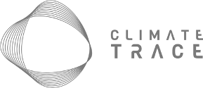

### Mineral Extraction sector: Mining and Quarrying Emissions from Copper, Iron, Bauxite, Rock and Sand

**Krsna Raniga and Aaron Davitt**

*Authors affiliated with WattTime and Climate TRACE*

V5.0.0, Nov. 2025

*Sector status - Beginning Spring 2026, all mineral extraction emissions are estimated post processing.*

#### 1. Introduction

The mining and quarrying sector is concerned with extracting minerals for the purpose of selling primary ores to end-users, such as construction companies and metals refineries, to create an industrial end product. These industries are estimated to be responsible for 4-7% of CO2 emissions globally \[1\]. However, the sector is subject to a lack of reliable emissions monitoring, as most countries do not report mining emissions as part of their commitments under the United Nations Framework Convention on Climate Change (UNFCCC), a treaty to which all UN members are signatories. While the UNFCCC provides a level of emissions reporting requirements, many governments instead rely on end-users to report domestic consumption on their behalf, which likely results in significant underreporting at a national level.

Mineral extraction can be divided into two classes: fuel mineral extraction, which includes lignite, bituminous, sub-bituminous and anthracite coal mining; and non-fuel mineral extraction, which in this case focuses on copper, iron and bauxite ore mining. Mining of these ores represents the majority of global non-fuel mineral extraction. Emissions from non-fuel mineral extraction are primarily produced by the stationary combustion of fuel by fixed and dynamic plant machinery on the extraction site \[2\]. Non-fuel mineral extraction is concentrated in terms of geography. For example, Australia, Brazil, China, India and Russia are responsible for 80% of global iron ore production. Chile alone represents 26% of the global copper ore market, while Australia, Guinea and China comprise over two thirds of the global bauxite ore market \[3\].

Facility-level data for emissions is essential to improve transparency and accountability within the sector. The current method for estimating emissions in the minerals extraction sector is to assume that all diesels bought by mining companies is burned, and therefore, to assign emissions on that basis. However, this may potentially lead to inaccuracies due to discrepancies between volumes of fuel purchased and actually used. Furthermore, many countries simply do not have sector-assigned fuels sales data, and, in some countries, fuel is not bought in the same market in which it is consumed. Reliable reporting of emissions along supply chains is important, as these minerals are primary feed-in products to many industries, such as heavy manufacturing, construction and agriculture. Companies and countries will therefore require data on the emissivity of the primary products used to refine their own outputs to meet their Net Zero targets.

This methodology provides an overview of a technique using Interferometric Synthetic Aperture Radar (InSAR) retrievals from the European Space Agency (ESA) Sentinel-1A and 1B satellites to derive estimates of mining activity over a period of 3 years. In short, the technique involves the development of a series of coherence image pairs as a means of identifying changes in ground surface properties, which are aggregated over periods of 12 months to provide a Normalized Difference Activity Index (NDAI). Variations in NDAI between years are represented using composite RGB images, which can be segmented into a series of color bands to give an estimate of mining activity in each year. A conversion factor can then be applied to this value to infer the relationship between mined area and overall production. However, given the ongoing development of this method, current assessments will be established using empirical relationships between known mine production statistics and observed active mining areas.

Furthermore, Climate TRACE is providing potential emission reduction solutions (ERSs) to understand how sector specific mitigation strategies can reduce emissions for this sector. The ERSs suggested in section 5.4 can potentially reduce emissions in copper, iron, bauxite, and rock and sand mining and quarrying.

#### 2. Materials and Methods

#### 2.1 Datasets

The following ground truth data were employed to develop estimates of emissions from copper, iron and bauxite mines, along with rock/stone and sand/gravel quarries.

#### 2.1.1 Mine and quarry historical capacity data and locations from the US Geological Survey (USGS) Mineral Yearbook

The USGS Mineral Yearbook provides historical capacity data for global mineral extraction at mining and quarrying sites of global significance, based on production levels. Minerals of importance were defined according to their relevance for global economic development. Data were provided as the mass of material ore extracted from the earth in tonnes/kilotonnes for the years 2010 to 2022. This information was used to derive country-level production, then converted to emission estimates by applying representative emission factors averaged to a national or regional level, as determined by the coverage of available emissions data.

#### 2.1.2 Mining Data Online

Mining Data Online (MDO; https://miningdataonline.com) monitors the mining industry to provide information on individual mining operations worldwide, including production data for the masses of extracted primary ores and processed derivative products such as concentrates and finished metals. These production statistics were combined with independent emission factors to derive estimates for CO2 emissions at an asset-level basis.

#### 2.1.3 Additional sources

Where assets were not covered by any of the previous datasets, additional resources were used to quantify mining production. These included the website Mining Technology (https://www.mining-technology.com), developed by GlobalData to provide reporting and analysis of a range of mining sectors worldwide. Further sources for remaining assets included company annual reports, sustainability and climate change reports, financial statements, press releases and newspaper and wider media reports. While a proportion of this data was available explicitly for years up to 2023, not all assets were complemented with up-to-date or year-specific data. Therefore, in a limited number of instances, data from prior years are provided, or annual-average production values established over the operational lifetime of certain assets are given where year-specific data were unavailable.

#### 2.2 Satellite data

#### 2.2.1 Satellite imagery

Satellite imagery resources, including PlanetScope and Google Earth, were used to identify mining sites and to verify geolocation of named assets where accurate coordinates were not provided. For some sites where reported locations were imprecise or poorly defined, additional resources were required to verify exact locations, including written reports and ground-level photographs. Optical satellite images were also used to develop detailed shapefiles of identified facilities, to provide high resolution demarcation of mining areas for use in image processing within the InSAR analysis process (Figure 1).

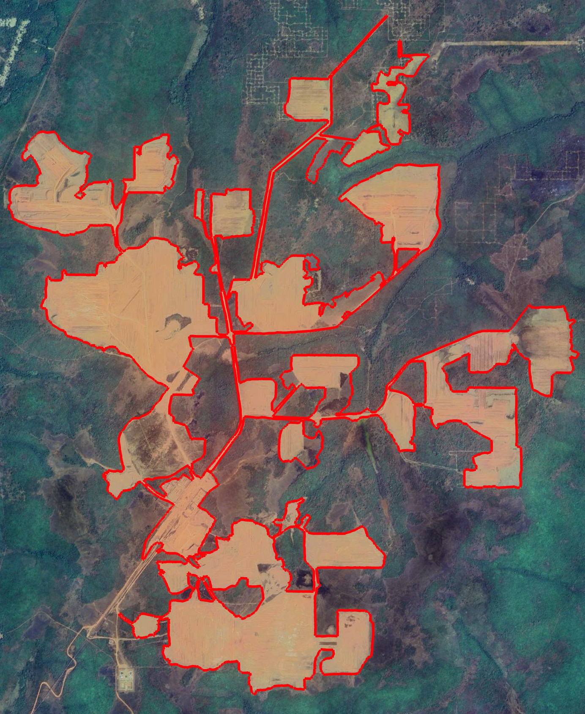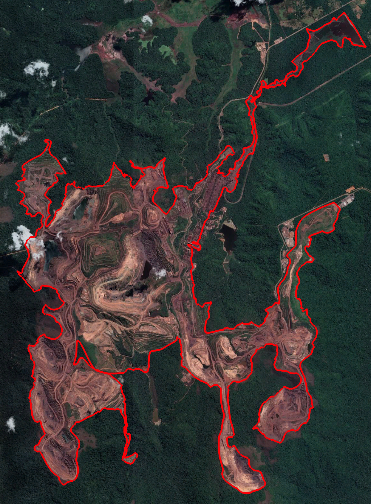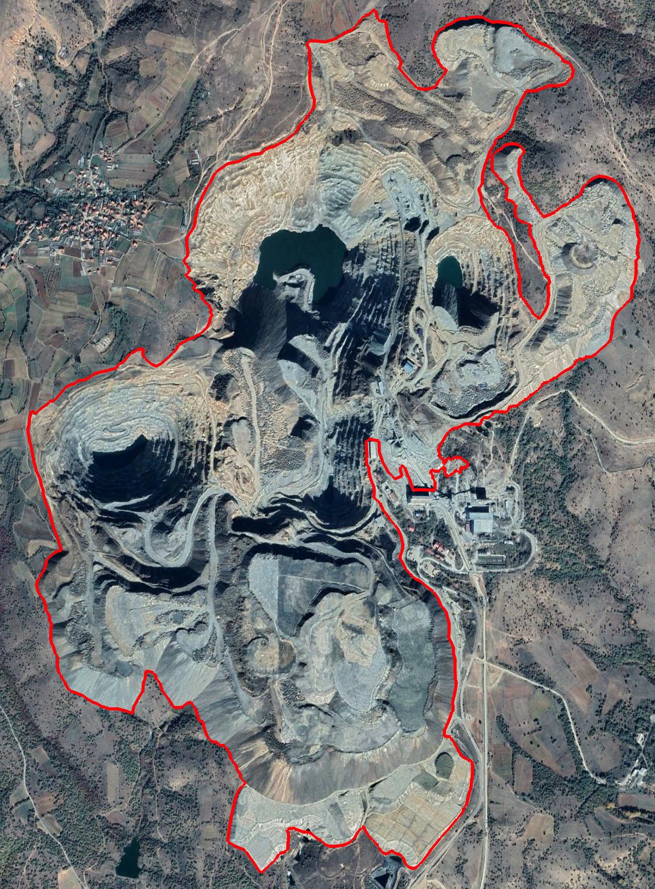

**Figure 1** *Shapefiles outlining the* **(a)** *Buchim copper mine, North Macedonia,* **(b)** *Serra Norte iron mine, Brazil and* **(c)** *Boffa bauxite mine, Guinea.*

#### 2.2.2 Sentinel-1A/B SAR retrievals

As part of ongoing efforts to exploit direct remote sensing observations of mining activity and move away from a dependency on limited or inconsistent third-party reporting, we have begun to develop techniques based on analysis of Interferometric Synthetic Aperture Radar (InSAR) coherence images. This imagery was generated using retrievals from ESA’s Sentinel-1A and 1B SAR instruments. Sentinel-1A was launched on 3rd April 2014 and was deployed in a polar, sun-synchronous orbit at an altitude of 693 km, providing near-global coverage with a repeat interval of 12 days and capacity to observe the land surface day and night, without impact from clouds \[4\]. The launch of Sentinel-1B followed on 25th April 2016. Each satellite is equipped with a C-band SAR instrument operating at a frequency of 5.405 GHz and wavelength of 5.547 cm, providing a number of operational and polarization modes. SAR retrievals over land mainly utilize interferometric wide-swath (IW) mode, which provides a swath width of 250 km with a spatial resolution of 5x20m using the Terrain Observation with Progressive Scans SAR (TOPSAR) technique, whereby bursts from successive passes are synchronized to ensure alignment. These initial images are processed to generate a series of coherence images, which can then be used to develop indices of mining activity within an area of interest.

#### 3. Sentinel-1 processing and InSAR mining detection

In addition to deriving emissions estimates directly from reported production data described in sections 2.1.1 to 2.1.3, an InSAR-based approach has also been applied to around 260 mining assets. While this technique has primarily been applied to provide training data for the development of an emissions model, in a limited number of instances where production data is unavailable, activity data from InSAR analysis has been used to calculate mining production. The locations of mining assets for which InSAR analysis has been carried out are shown in Figure 2 below.

InSAR coherence provides a measure of the correlation between multiple SAR images, with values ranging between 0 (no coherence) and 1 (perfect correlation) \[5\]. A value of zero indicates a change has occurred in the radar signal from the same location, measured at different observation times. A value of one indicates that the location properties have not changed between observations. Different land surfaces give rise to different characteristic coherence values, according to the stability of the surface (Figure 3). Stable surfaces, such as bare land, rocks, and buildings show very high coherence values because there is little change in land surface properties, resulting in a coherence value closer to 1 \[6\]. In contrast, highly dynamic surfaces such as vegetated areas or forests have low coherence values, due to both temporal decorrelation, whereby random movements over time cause changes to scattering properties, and volume decorrelation, which accounts for variations in the height of surface scatterers \[4\]. Coherence values for open-pit mines are quite high due to the removal of topsoil and absence of vegetation, which disturbs the land surface. However, mining activities such as blasting, excavation, and accumulation, can change the reflection characteristics over a short period of time, introducing decorrelation and decreasing coherence values, making them closer to 0 \[6,7\].

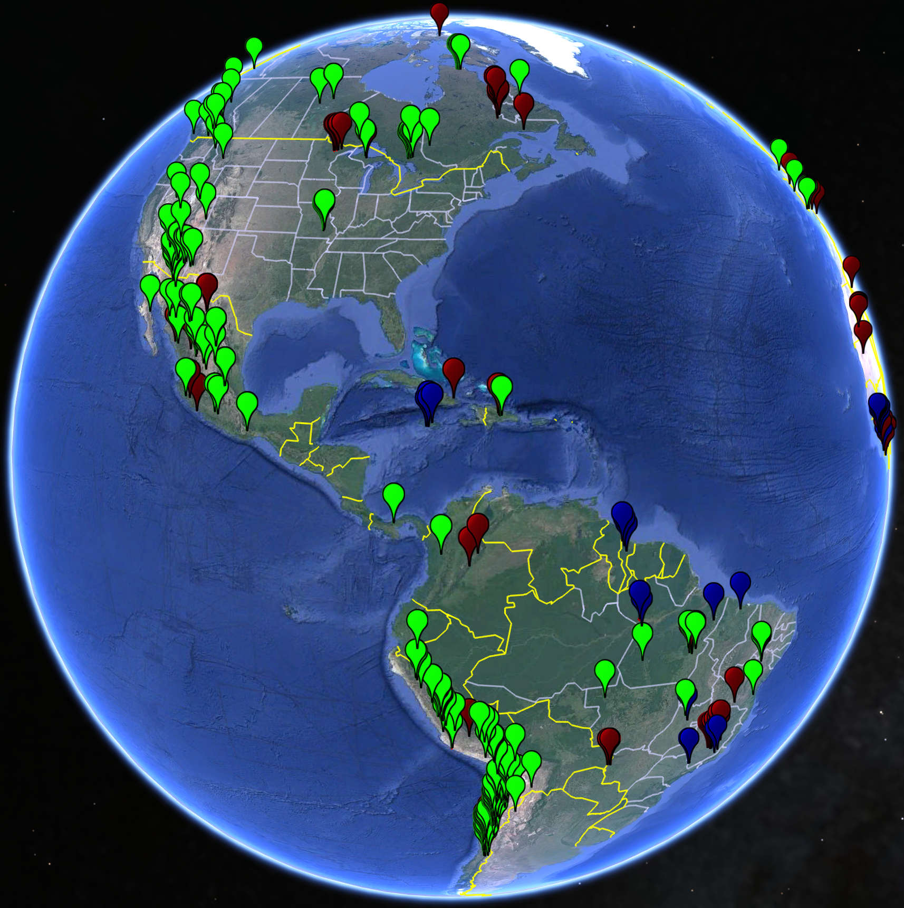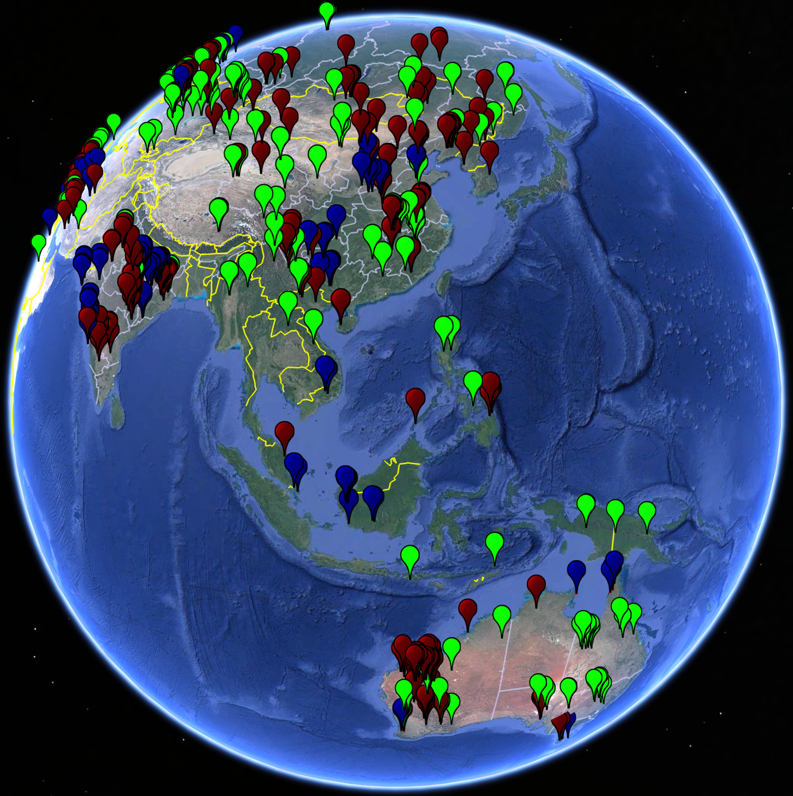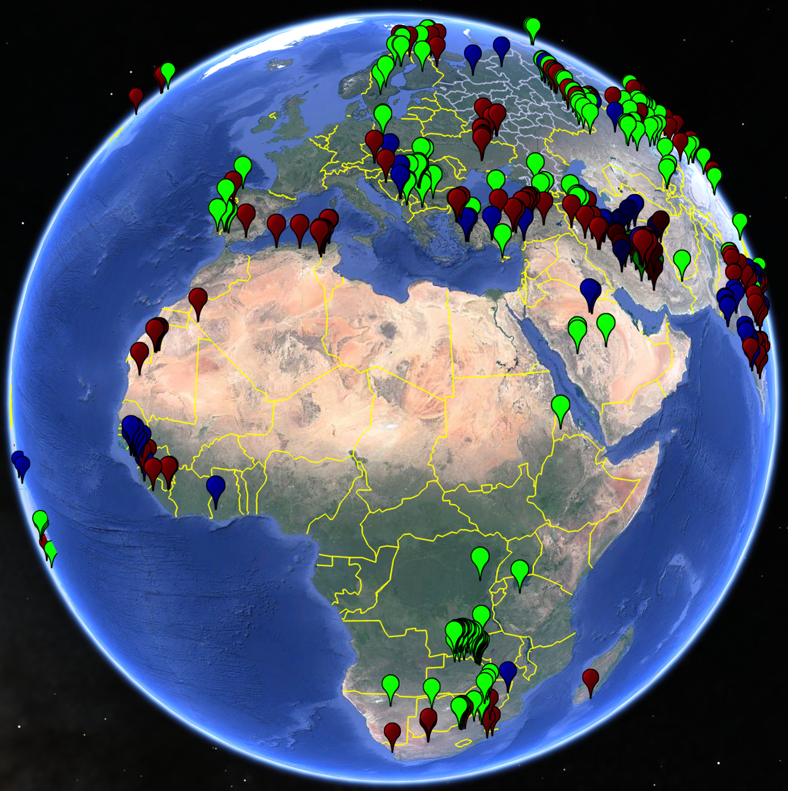

**Figure 2** *Locations of InSAR analyses performed for copper (green), iron (red) and bauxite (blue) mines, represented in Google Earth.*

While coherence images provide a means of detecting mining activity, additional sources of decorrelation can introduce significant uncertainties. These sources include precipitation conditions, as rain or snow can contribute to observed temporal decorrelation between SAR retrievals, and the perpendicular baseline associated with image pairs, which is a function of the lateral offset in satellite position between orbits \[8\]. The impact of these effects can be reduced using a Normalized Difference Activity Index (NDAI) \[6\]. Stable points within the mining area, or areas that have been minimally disturbed, are identified by selecting pixels where time-averaged coherence values are high (close to 1) and standard deviation is low. Subsequently omitting coherence images where the mean values for these points do not meet given thresholds (a minimum coherence of 0.8 and maximum standard deviation of 0.2) is expected to mitigate the effects of precipitation. Analysis of the temporal distribution of such points has shown a strong concentration during winter, indicating uncertainties associated with precipitation effects are largely a consequence of snowfall events \[4,6\]. As decorrelation effects from precipitation and perpendicular baseline are independent of surface properties, any impact on coherence values is expected to be broadly consistent across stable points and target sites. The NDAI can therefore be defined as follows in Eq.1:

$`\text{NDAI} = \frac{\rho^{\text{stable}} - \rho^{\text{activity}}}{\rho^{\text{stable}} + \rho^{\text{activity}}}`$ \[Eq.1\]

Where *ρstable* and *ρtarget* are the spatially-averaged coherence values for stable points and target sites, respectively \[6\]. Resulting NDAI values close to 1 are indicative of active mine areas (low coherence), while values close to zero correspond to stable points (high coherence).

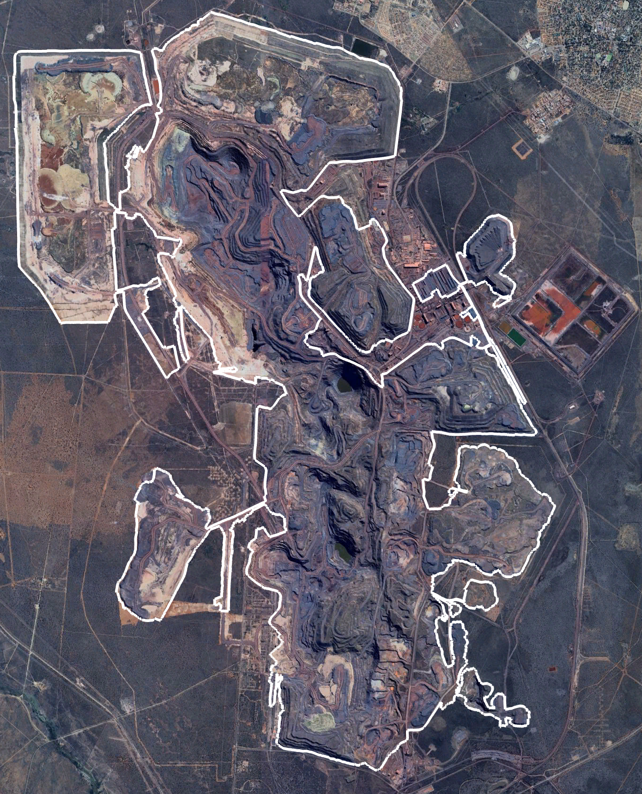

**Figure 3 (a)** *Google Earth imagery of the Anglo American Sishen iron mine, Northern Cape, South Africa.* (**b)** *InSAR coherence image of the Sishen mine generated with ESA’s SNAP toolkit using Sentinel-1A/B interferometric wide swath single-look complex imagery retrievals from 20/12/2019 and 01/01/2020. High coherence values within the mine area are clearly visible as expanses of white pixels, highlighted in the red boxes. Dark areas, in the green boxes, indicate low coherence.*

Mining activity over several years can be represented visually by creating composite RGB images, whereby annually-averaged NDAI values for an area of interest are assigned to a specific color channel. A typical workflow for developing these composite images is shown in Figure 4 below. In this example, NDAI was calculated for the Sishen iron mine in Northern Cape, South Africa from 2021-2023, using a total of 92 coherence images generated over this period using InSAR imagery derived from C-band single-look complex retrievals in descending mode with dual polarization (VV+VH). Image pairs with a typical interval of 12 days were used, although in some instances this increased to 24 days due to missing or unusable images. Scenes with an appropriate perpendicular baseline within the target area were identified, excluding scenes where the lateral offset exceeded 250m, and downloaded using the Alaska Satellite Facility Vertex (https://search.asf.alaska.edu). Coherence images were then generated using ESA’s Sentinel Applications Platform (SNAP), applying the processing framework described by *Moon et al.* \[5\]*.* Each image in every InSAR pair was first split to select only the sub-swath of interest, before orbit information about the position of the satellite during acquisition was applied, in order for images to be back-geocoded to enable their coregistration and ensure alignment of paired images at sub-pixel accuracy. These coregistered images were then used to produce an interferogram, removing flat-earth and topographic phases using Shuttle Radar Topography Mission (SRTM) 1 arc-sec elevation data and applying a 7x2 (range by azimuth) averaging window. The separate bursts comprising each interferogram were then merged to remove seam lines, and Goldstein filtering applied to reduce noise before a terrain correction was performed, again using SRTM 1 arc-sec data. These final image stacks were then cropped to provide a subset for the area of interest and exported as raster images.

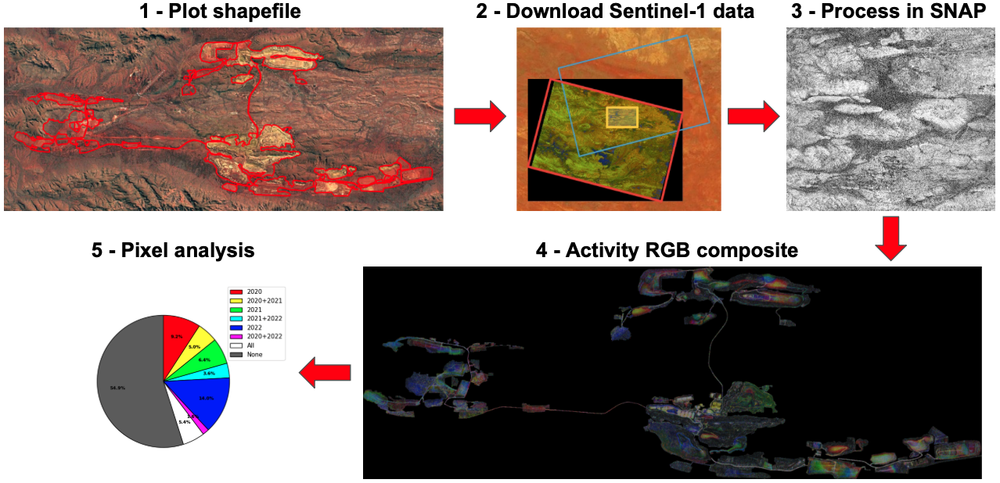

**Figure 4** *Workflow for processing Sentinel-1 InSAR imagery to generate RGB composite representations of NDAI and determine mining activity.*

Prior to the calculation of NDAI values for the Sishen mine, coherence images were masked using a high resolution shapefile plotted using Google Earth imagery. Annually-averaged NDAI were then converted to RGB values and combined to form a composite image, with data from 2021, 2022 and 2023 assigned to red, green and blue channels, respectively, representing mining areas which were active in each respective year (Figure 5). Composite colors of cyan, magenta and yellow subsequently formed by the combination of activities from multiple channels reflect sites that were active in more than one year, as described in Table 1 above. These color bands can then be separated into individual images by converting to HSV (hue, saturation, value) color space and segmenting values using intervals of the hue spectrum corresponding to each color channel (Figure 6).

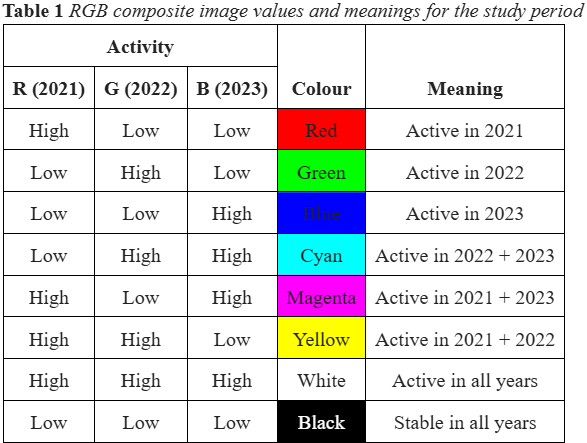

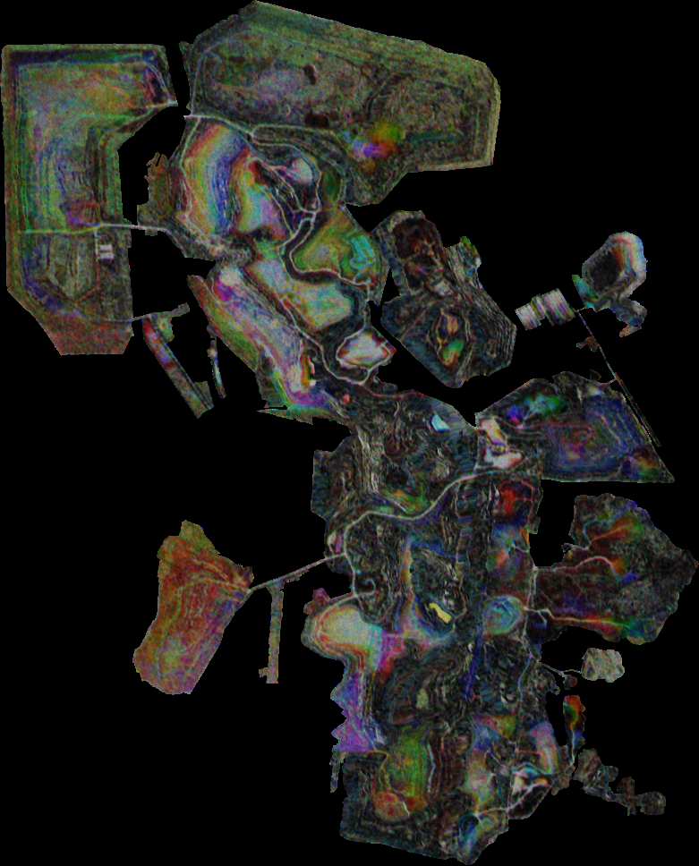

**Figure 5** *RGB composite image of the Sishen iron mine, Northern Cape, South Africa, created by assigning annually-averaged NDAI values for 2021, 2022 and 2023 to red, green and blue color channels, respectively. Mine activity within a specific year, or combination of years, is represented by pixels with the color associated with that year, or the composite color derived from multiple years, as shown in Table 1. White pixels represent locations active across all three years, while black pixels within the mining area reflect an absence of activity within the study period*

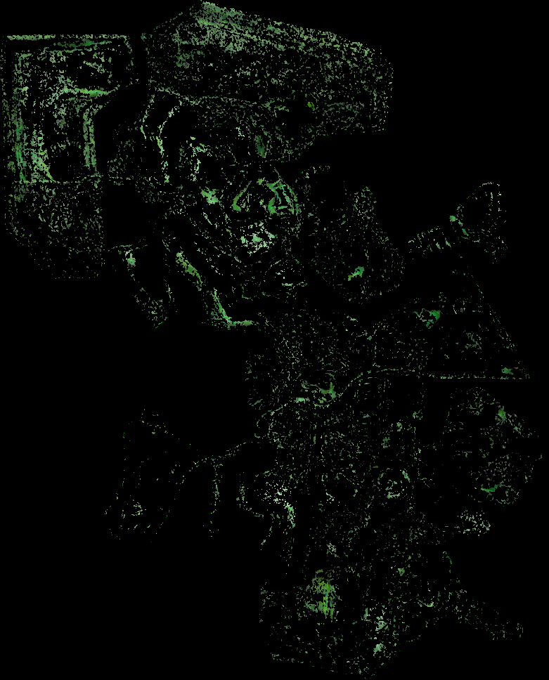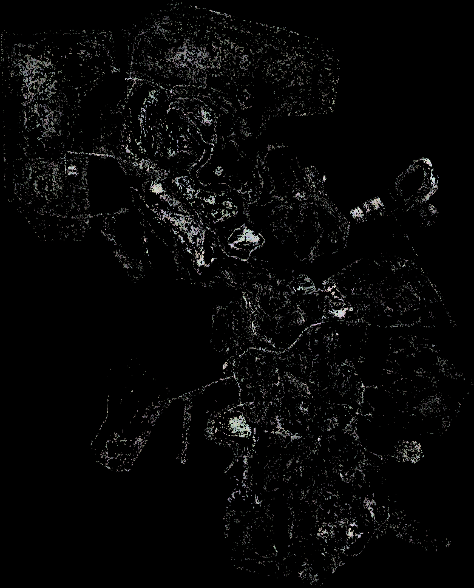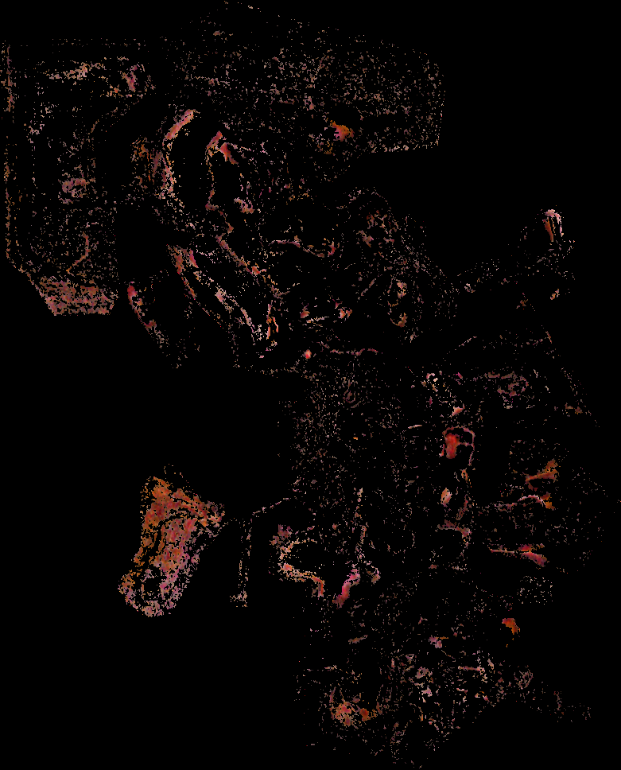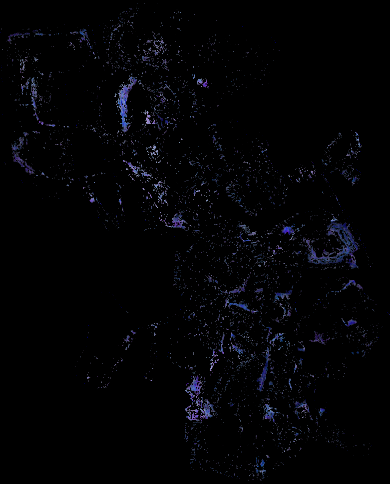

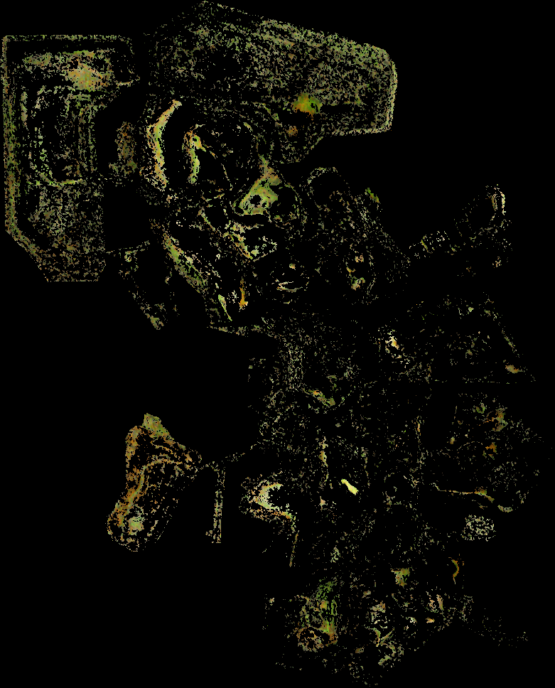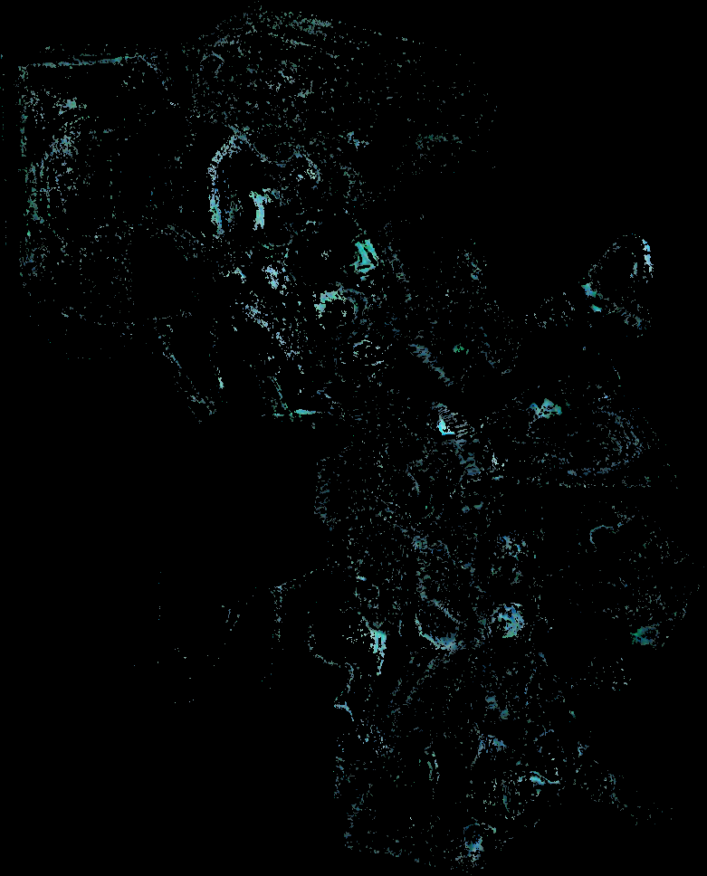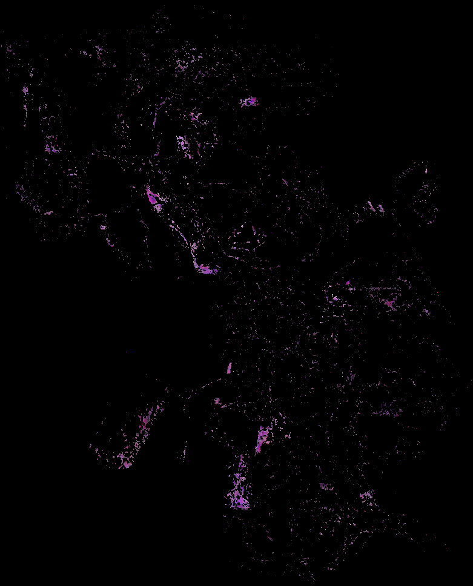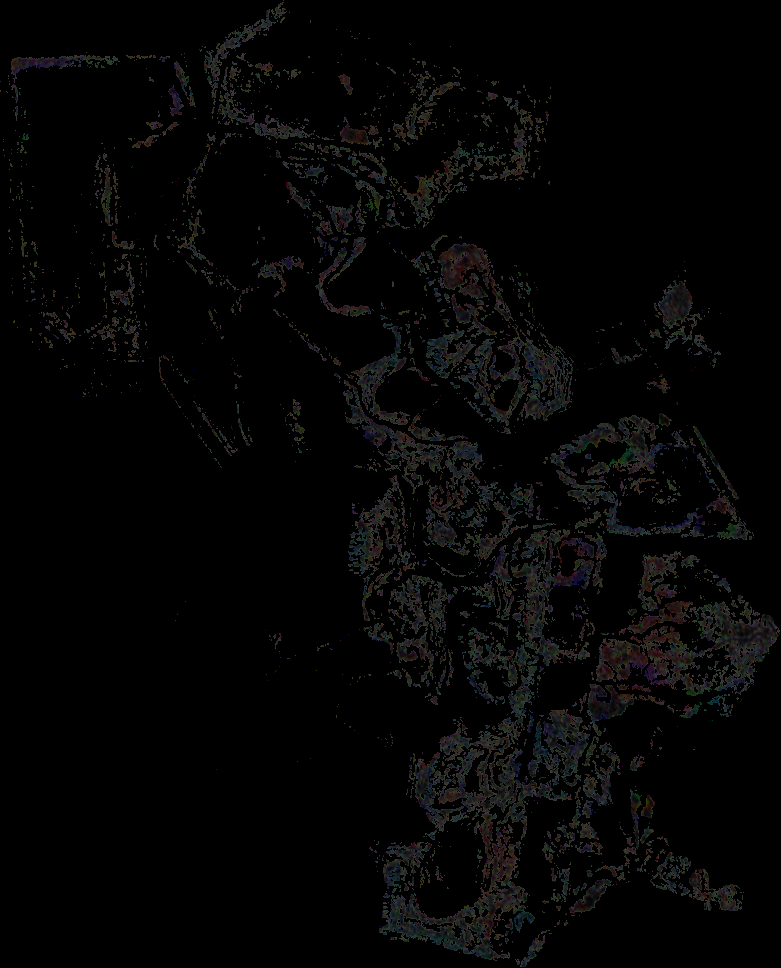

**Figure 6** *Separate color band images of the Sishen mine, Northern Cape, South Africa, for (top row, l-r) red, green, blue, white and (bottom row, l-r) cyan, magenta, yellow and black channels, based on color assignment described in Table 1.*

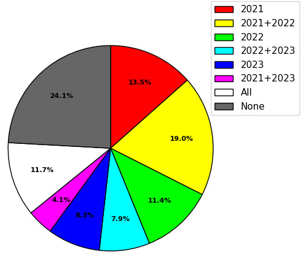

**Figure 7** *Pixel* *color analysis for an RGB composite image of Sishen iron mine, Northern Cape, South Africa based on annually-averaged NDAI values for 2021, 2022 and 2023.*

#### 4. InSAR image analysis

Analysis of the distribution of pixel color values in InSAR images can provide a quantitative assessment of changes in mining activity across a site for a given time period (Figure 7). As a result of the location and setting of the Sishen mine and typical absence of vegetation cover, for the purpose of this analysis white pixels are areas of continuous mining activity, and as such are included in the pixel count for each year. However, this classification may require more rigorous parameterization going forward, particularly for mines in more heavily vegetated regions. Vegetation cover could be quantified more accurately using the normalized difference vegetation index (NDVI) and compared with NDAI to give a more robust assessment of mining activity.

Total pixel counts for each color band are shown in Table 2 below. Total mined areas for each year are calculated using a defined ground surface resolution for the Sentinel-1 IW mode of 5 x 20 m and can then be compared to reported annual production statistics for the asset. MDO reports production values of 37.9 Mt, 39.4 Mt and 39.1 Mt iron ore for 2021, 2022 and 2023 respectively. Total mined area as inferred by InSAR analysis increased by 3.6% between 2021 and 2022, with a corresponding increase in production of 4.0%. Production then decreased by 0.8% between 2022 and 2023, following a 35.9% reduction in mined area. The mass of ore produced per square meter of mined surface remained consistent between 2021 and 2022 (2.04 t/m2), before increasing to 3.18 t/m2 in 2023.

**Table 2** *RGB color band pixel counts for the Sishen Iron Mine, South Africa. Total area is determined by the total number of pixels present within the area delineated by the given shapefile; annual values represent the proportions of this total area that were active in each given year.*

<table><tbody><tr class="odd"><td><strong>Color</strong></td><td><strong>Period</strong></td><td><strong>Pixel count</strong></td><td><strong>Year</strong></td><td><strong>Total count</strong></td><td>
<strong>Area</strong>

<strong>(m2)</strong>
</td><td><strong>Production (t)</strong></td><td><strong>Emission factor (tCO2e/t)</strong></td><td>
<strong>Emissions</strong>

<strong>(t)</strong>
</td></tr><tr class="even"><td>Red</td><td>2021</td><td>51,710</td><td>2021</td><td>185,431</td><td>18,543,100</td><td>37,900,000</td><td>0.0106</td><td>402,000</td></tr><tr class="odd"><td>Green</td><td>2022</td><td>43,786</td><td></td><td></td><td></td><td></td><td></td><td></td></tr><tr class="even"><td>Blue</td><td>2023</td><td>31,823</td><td>2022</td><td>192,185</td><td>19,218,500</td><td>39,400,000</td><td>0.0108</td><td>427,000</td></tr><tr class="odd"><td>Cyan</td><td>2022/2023</td><td>30,505</td><td></td><td></td><td></td><td></td><td></td><td></td></tr><tr class="even"><td>Magenta</td><td>2021/2023</td><td>15,827</td><td>2023</td><td>123,123</td><td>12,312,300</td><td>39,100,000</td><td>0.0108</td><td>424,000</td></tr><tr class="odd"><td>Yellow</td><td>2021/2022</td><td>72,926</td><td></td><td></td><td></td><td></td><td></td><td></td></tr><tr class="even"><td>White</td><td>All</td><td>44,968</td><td>Total area</td><td>369,786</td><td>36,978,600</td><td></td><td></td><td></td></tr></tbody></table>

InSAR analysis was typically not applied in estimations of emissions for mines with reported production statistics, but instead at this stage has been used primarily to develop an understanding of the relationship between detected activity and production. An exception to this occurred in instances where production data were not available for all years considered here but were reported for at least one year. In such instances, the average production per square meter calculated for available years was used to estimate production from detected activity in additional years. For mines with no production data available in any years, the same approach was applied but using generalized average production values from a broader range of mines.

Figure 8 shows the relationship between pixel counts from InSAR analysis of copper and iron mine activity, and reported production data from 2021 to 2023. Linear regressions show the overriding positive correlation between the two values for both minerals, although the relatively low R2 values (0.271 for copper and 0.465 for iron) reflect relatively weak correlations. In both instances numerous outliers are evident, forming several apparent modes within the full data distribution. Although it has not been possible to identify the underlying causes of these multiple modes with the current dataset and available metadata, a more detailed understanding of mining operations will hopefully provide greater insight to sources of variability in these relationships. Factors such as extraction method and mineral grade are likely to influence the amount of ore removed per active unit area, as detected by InSAR retrievals.

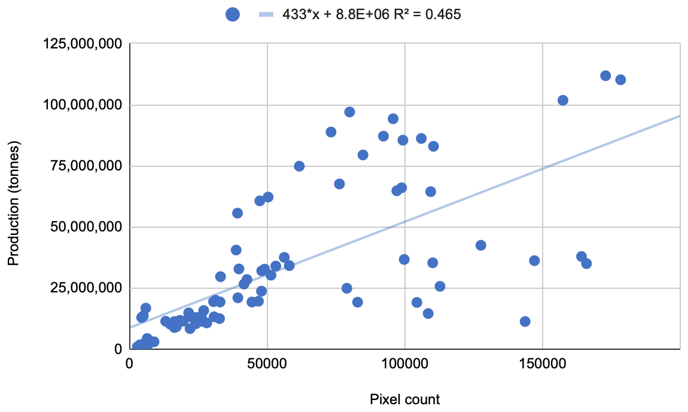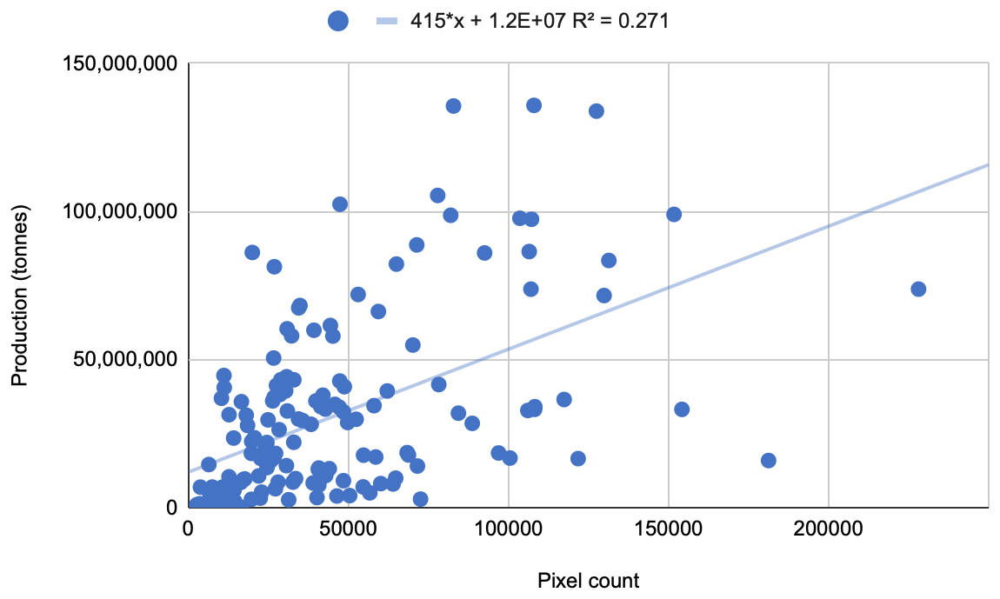

**Figure 8** *Linear regressions between mining production and InSAR-derived pixel count for (top) copper and (bottom) iron mines.*

#### 5. Emissions estimates

Emissions estimates for the mineral extraction sector were derived using a combination of production data and calculated emission factors. However, two different approaches were employed to determine the production component in these estimates. Figure 9 shows a schematic representation of the two complementary pathways used to derive mining emissions estimates.

#### 5.1 Statistical pathway

As InSAR analysis was only performed for a limited number of mines within the full inventory presented here, emissions estimates for most mines were primarily developed using only production statistics. These estimates were developed based on the mass of ore extracted each year, as opposed to amounts of processed or finished products, to provide greater consistency across multiple mineral types. Furthermore, the total ore mass removed represents a better equivalence for detected activity, as the yield of processed or finished product will be affected by additional factors such as mineral grade, processing capacity and the stockpiling of raw material from previous years. Where production from a mine was only reported in terms of another product (for example, mass of copper cathode or iron pellets), a series of conversion factors were developed using data from mines within the inventory where both extracted ore and other product masses were reported. These conversion factors were then averaged at a national or regional level to provide more representative values and used to calculate estimated ore masses.

#### 5.2 InSAR pathway

Estimated ore production values, together with reported ore production data from the sources described in Section 2 above, comprise most activity values for the mining inventory presented here. However, for a limited number of assets for which production data was not available, activity was calculated using the InSAR method described in Sections 3 and 4. This approach uses an emissions model derived from observed relationships between InSAR detection of activity and reported production. At present the model is based on data from a limited subset of around 260 assets, but this number is continuously increasing as part of efforts to develop a larger inventory of InSAR data and collate a wider range of production data, improving understanding of the relationships between these metrics.

#### 5.3 Emission factor calculations

Emission estimates were calculated using a series of emission factors for mineral extraction, derived from annual emissions data reported by a range of mining companies operating worldwide, including BHP, Rio Tinto and Glencore. These data are typically published annually in sustainability or climate change reports available through the relevant company websites. At the most accurate level, emissions were reported for individual facilities each year, and when combined with production data for a given facility, provide a specific asset-level annual emission factor. However, there is a high level of variability in approaches taken to reporting emissions across the mining sector, which is often influenced by the scale of the company involved and the nature of their operations. For example, companies which solely perform extraction and/or processing of ores will typically report emissions relating specifically to mining activity, whereas companies which are also involved in the manufacturing of intermediate or finished metal products are more likely to report emissions on a division or company-wide basis, encompassing all operations. In these instances, reported emissions were used to provide emissions factors for all assets within the given operation, and required additional refinement to account for the wider scope of included emissions sources. This process involved the application of a range of scaling factors derived from more granular reported data, such as emissions segregated by fuel type, which can be attributed to specific operations, or into separate emissions sources, such as mobile vehicles and plant machinery, which can be used as a proxy for mining activity. Calculated emission factors were again averaged at a national or regional level to provide representative values for the full range of assets across all mineral types included within this inventory. These emission factors were then combined with production data derived from either the statistical or InSAR approach to give the final emissions estimate for each asset.

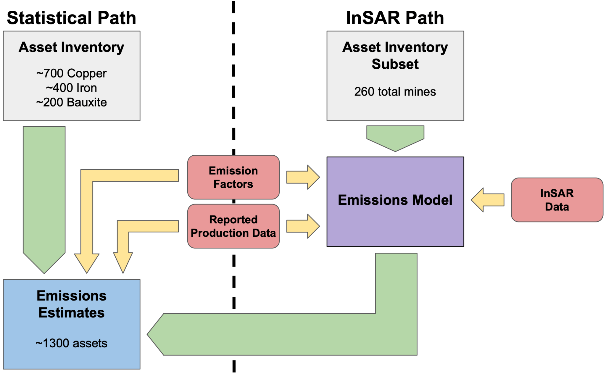

**Figure 9** *Schematic representation of the two complementary pathways for mining emissions estimates, employing a combination of reported production data (left of dashed line) and InSAR retrievals (right of dashed line).*

#### 5.4 Emissions Reduction Solutions Overview and Application

Emissions Reduction Solutions (ERSs) for this sector are two strategies: close inefficient mines and Electrification of mine equipment.

#### 5.4.1 Close Inefficient Mines

This strategy focuses on retiring mines that are no longer viable or efficient, thereby halting all mining activity at the site. By ceasing operations, these mines eliminate emissions at the source, while production is redirected to more efficient facilities. This strategy leverages the principle that shutting down high-emission operations can reduce the overall carbon intensity of the sector.

This strategy assumes a 100% reduction in emissions at the closed mine. However, the total sectoral impact must account for the fact that displaced mining activity may occur at alternative sites, which could generate additional emissions. While emissions are eliminated at the inefficient site, the net reduction depends on the efficiency of replacement operations.

Closing inefficient mines can potentially be applied anywhere in the sector, provided there is capacity at other mines to absorb the displaced production. Factors that could accelerate adoption include the availability of more efficient mines and regulatory or economic incentives to retire underperforming facilities. Conversely, constraints may arise if alternative sites cannot fully accommodate the displaced activity or if the closure of mines threatens local employment or supply chain stability.

#### 5.4.2 Electrification of mine equipment

This strategy involves replacing all diesel-powered mining vehicles and plant machinery with electric equivalents. Where feasible, connecting sites to local electricity grids removes the need for onsite fossil-fuel-powered electricity generation, directly addressing the primary source of sector emissions.

Electrification of mine equipment can significantly reduce greenhouse gas emissions, with the potential to eliminate direct emissions at certain mining sites. The degree of reduction depends on the scale of fleet replacement and access to grid electricity. Full replacement may not always be practical due to factors such as operation size, fleet requirements, and available charging infrastructure.

The adoption of electric mining vehicles is increasing throughout the mineral extraction sector and is well documented by mining companies. Main barriers include high costs for vehicle replacement and operational limitations such as vehicle range and recharging availability. Despite these challenges, electrification remains a widely recognized pathway for decarbonization in mining \[9\].

#### 6. Results and Discussion

Using the approaches detailed in this methodology, activity data has been collated and CO2 emissions calculated from 2020-2024 for a total of 1,335 assets across the copper (712), iron ore (423) and bauxite (200) mining sectors, from a total inventory of 1,941 assets. Note that some assets and production data were not updated to estimate 2024 emissions and are forward filled from previous years. This is stated in specific sections in the results below.

With total assets numbering 914, 754 and 273 for copper, iron and bauxite, respectively, the proportion of assets for which emissions estimates are reported represent coverages of 78%, 56% and 73% for each sector. Assets for which activity data, and hence emissions, were not available or calculated were included to give a measure of the comparative size of each sector and current levels of coverage. Additional metadata is provided with this inventory, including the capacity of assets based on proven mining reserves, the type of mining operation, current operational status, additional minerals extracted and ownership. Asset level production data was not updated for 2024 for copper and iron ore and only updated for a limited number of assets for bauxite, with data largely carried over from 2023. Emission factors were updated for all years and applied retrospectively in emissions estimates for previous years. A summary of global mining emissions from 2020 to 2024 are shown in Table 3 below:

**Table 3** *Summary of global mining emissions 2020-2024*

|          |                   |                     |                    |                         |                  |                   |             |
|----------|-------------------|---------------------|--------------------|-------------------------|------------------|-------------------|-------------|
| **Year** | **Copper mining** | **Iron ore mining** | **Bauxite mining** | **Total emissions (t)** |                  |                   |             |
|          | **Activity (t)**  | **Emissions (t)**   | **Activity (t)**   | **Emissions (t)**       | **Activity (t)** | **Emissions (t)** |             |
| 2020     | 4,978,730,712     | 49,583,731          | 2,917,083,526      | 41,746,261              | 321,374,896      | 3,996,159         | 95,326,151  |
| 2021     | 5,336,443,444     | 51,315,782          | 3,012,785,464      | 42,034,589              | 325,351,124      | 3,784,274         | 97,134,645  |
| 2022     | 5,390,913,578     | 53,893,850          | 3,052,521,833      | 45,766,455              | 319,925,996      | 4,181,935         | 103,842,240 |
| 2023     | 5,235,733,621     | 62,093,311          | 3,190,847,812      | 41,866,097              | 305,106,729      | 4,100,021         | 108,059,429 |
| 2024     | 5,235,284,915     | 53,466,044          | 3,190,847,812      | 32,649,663              | 303,448,771      | 3,990,354         | 90,106,061  |

Total global emissions across all sectors increased consistently between 2020 and 2023, peaking at over 108 Mt in 2023, before decreasing significantly in 2024. While asset level production data has not been widely updated for 2024, the reduction of emissions in 2024 is consistent with trends in reported emissions, which are used as the basis for calculated emission factors. Reported emissions for copper and iron ore assets decreased by 8% and 16% respectively between 2023 and 2024. Within individual sectors there is a greater level of variability in both activity and emissions across this period. Only emissions from copper mining peaked in 2023, with iron ore and bauxite both peaking in 2022. For copper mining, emissions increased in 2023 despite production declining to its lowest level since 2020, possibly reflecting a trend of decreasing ore grades in major operations and the need for increasing levels of extraction to maintain viable ore supplies.

The largest emitters at an asset level across all mineral types for 2024 are shown in Table 4 below:

**Table 4** *Highest emitting mining assets for 2024*

<table><tbody><tr class="odd"><td><strong>Asset name</strong></td><td><strong>Country</strong></td><td><strong>Type</strong></td><td>
<strong>Activity</strong>

<strong>(tonnes)</strong>
</td><td><strong>Emission factor</strong></td><td><strong>CO2 emissions (tonnes)</strong></td></tr><tr class="even"><td>Lebedinsky Mine</td><td>Russia</td><td>Iron ore</td><td>33,408,742</td><td>0.0779</td><td>2,602,541</td></tr><tr class="odd"><td>Sarcheshmeh Complex</td><td>Iran</td><td>Copper</td><td>108,389,603</td><td>0.0240</td><td>2,601,350</td></tr><tr class="even"><td>Antapaccay Mine</td><td>Peru</td><td>Copper</td><td>40,952,630</td><td>0.0455</td><td>1,863,345</td></tr><tr class="odd"><td>Kachkanar-Gusevogorsk Mine</td><td>Russia</td><td>Iron ore</td><td>64,354,472</td><td>0.0283</td><td>1,821,232</td></tr><tr class="even"><td>Dikuluwe-Mashamba West Mine</td><td>DRC</td><td>Copper</td><td>43,262,351</td><td>0.0414</td><td>1,791,061</td></tr><tr class="odd"><td>Grasberg Block Cave Mine</td><td>Indonesia</td><td>Copper</td><td>42,814,500</td><td>0.0372</td><td>1,592,699</td></tr><tr class="even"><td>Letpadaung Mine</td><td>Myanmar</td><td>Copper</td><td>56,179,762</td><td>0.0240</td><td>1,348,314</td></tr><tr class="odd"><td>Tenke Fungurume Mine</td><td>DRC</td><td>Copper</td><td>14,199,200</td><td>0.0944</td><td>1,340,404</td></tr><tr class="even"><td>Sungun Mine</td><td>Iran</td><td>Copper</td><td>49,699,745</td><td>0.0240</td><td>1,192,794</td></tr><tr class="odd"><td>Kansanshi Mine</td><td>Zambia</td><td>Copper</td><td>23,313,000</td><td>0.0454</td><td>1,058,410</td></tr></tbody></table>

Although production data for most assets were not updated for 2024, emissions estimates have still changed from 2023 as emission factors are calculated annually. The highest emitting assets in 2024 are dominated by copper mines, which is consistent with the typically larger size of major copper mining operations. Activity exceeded 50 Mt at 27 copper mines during 2024, and 100 Mt at 8 mines. In contrast these thresholds were exceeded 13 and 2 times respectively at iron mines, with neither threshold exceeded at any bauxite mine. However, it should be noted that the very largest mines typically do not feature in this list, with only one of the ten highest-producing copper mines, and none of the highest-producing iron mines, included here. This is a result of comparatively lower emission factors derived for these larger operations, based on calculations employing reported emissions data rescaled specifically to mining activity. While the factors contributing to variability in emission factors between different operations have not yet been examined in detail, possible drivers include increased automation and efficiencies for the largest operations, along with the uptake of emissions reductions strategies such as the introduction of electric vehicles and other plant machinery.

The largest cumulative emitters at a country level for 2024, including all mineral types, are shown in Table 5 and 6 below. Data in Table 5 is based on contains aggregated asset level data for each country while Table 6 is based on projected country-level emissions derived from USGS national mining production statistics

**Table 5** *Highest emitting mining countries for 2024, based on aggregated asset level data*

<table><tbody><tr class="odd"><td><strong>Country</strong></td><td><strong>Type</strong></td><td><strong>Total activity (tonnes)</strong></td><td><strong>Average emission factor</strong></td><td><strong>CO2 emissions (tonnes)</strong></td></tr><tr class="even"><td>Chile</td><td>Copper/Iron ore</td><td><blockquote>
1,066,771,880
</blockquote></td><td><blockquote>
0.0085
</blockquote></td><td><blockquote>
9,050,230
</blockquote></td></tr><tr class="odd"><td>DRC</td><td>Copper</td><td><blockquote>
198,738,358
</blockquote></td><td><blockquote>
0.0403
</blockquote></td><td><blockquote>
8,012,234
</blockquote></td></tr><tr class="even"><td>Australia</td><td>Copper/Iron ore/Bauxite</td><td><blockquote>
1,287,922,303
</blockquote></td><td><blockquote>
0.0060
</blockquote></td><td><blockquote>
7,690,307
</blockquote></td></tr><tr class="odd"><td>Russia</td><td>Copper/Iron ore/Bauxite</td><td><blockquote>
261,925,469
</blockquote></td><td><blockquote>
0.0289
</blockquote></td><td><blockquote>
7,558,023
</blockquote></td></tr><tr class="even"><td>Iran</td><td>Copper/Iron ore/Bauxite</td><td><blockquote>
314,229,907
</blockquote></td><td><blockquote>
0.0188
</blockquote></td><td><blockquote>
5,913,518
</blockquote></td></tr><tr class="odd"><td>Peru</td><td>Copper/Iron ore</td><td><blockquote>
960,349,375
</blockquote></td><td><blockquote>
0.0059
</blockquote></td><td><blockquote>
5,704,565
</blockquote></td></tr><tr class="even"><td>Brazil</td><td>Copper/Iron ore/Bauxite</td><td><blockquote>
974,536,261
</blockquote></td><td><blockquote>
0.0056
</blockquote></td><td><blockquote>
5,410,380
</blockquote></td></tr><tr class="odd"><td>USA</td><td>Copper/Iron ore</td><td><blockquote>
563,092,899
</blockquote></td><td><blockquote>
0.0093
</blockquote></td><td><blockquote>
5,219,967
</blockquote></td></tr><tr class="even"><td>China</td><td>Copper/Iron ore/Bauxite</td><td><blockquote>
342,713,079
</blockquote></td><td><blockquote>
0.0141
</blockquote></td><td><blockquote>
4,821,557
</blockquote></td></tr><tr class="odd"><td>India</td><td>Copper/Iron ore/Bauxite</td><td><blockquote>
88,263,140
</blockquote></td><td><blockquote>
0.0430
</blockquote></td><td><blockquote>
3,792,200
</blockquote></td></tr></tbody></table>

**Table 6** *Highest emitting mining countries for 2024, based on projected country level data*

<table><tbody><tr class="odd"><td><strong>Country</strong></td><td><strong>Type</strong></td><td><strong>Total activity (tonnes)</strong></td><td><strong>Average emission factor</strong></td><td><strong>CO2 emissions (tonnes)</strong></td></tr><tr class="even"><td><blockquote>
India
</blockquote></td><td>Copper/Iron ore/Bauxite</td><td>263,482,768</td><td>0.0444</td><td>11,689,048</td></tr><tr class="odd"><td><blockquote>
China
</blockquote></td><td>Copper/Iron ore/Bauxite</td><td>720,073,109</td><td>0.0147</td><td>10,564,173</td></tr><tr class="even"><td><blockquote>
Chile
</blockquote></td><td>Copper/Iron ore</td><td>1,249,354,305</td><td>0.0083</td><td>10,411,563</td></tr><tr class="odd"><td><blockquote>
Australia
</blockquote></td><td>Copper/Iron ore/Bauxite</td><td>1,437,080,463</td><td>0.0059</td><td>8,504,427</td></tr><tr class="even"><td><blockquote>
DRC
</blockquote></td><td>Copper</td><td>107,185,388</td><td>0.0403</td><td>4,319,571</td></tr><tr class="odd"><td><blockquote>
Peru
</blockquote></td><td>Copper/Iron ore</td><td>698,794,788</td><td>0.0059</td><td>4,150,784</td></tr><tr class="even"><td><blockquote>
Russia
</blockquote></td><td>Copper/Iron ore/Bauxite</td><td>146,395,060</td><td>0.0268</td><td>3,919,083</td></tr><tr class="odd"><td><blockquote>
Brazil
</blockquote></td><td>Copper/Iron ore/Bauxite</td><td>617,341,439</td><td>0.0058</td><td>3,590,569</td></tr><tr class="even"><td><blockquote>
Kazakhstan
</blockquote></td><td>Copper/Iron ore/Bauxite</td><td>93,428,079</td><td>0.0205</td><td>1,911,688</td></tr><tr class="odd"><td><blockquote>
Guinea
</blockquote></td><td>Bauxite</td><td>96,544,354</td><td>0.0195</td><td>1,882,615</td></tr></tbody></table>

There are several important caveats associated with both datasets, which must be acknowledged when considering the differences resulting from the two approaches. For the aggregated asset level data, production is significantly underestimated for several countries, due to incomplete coverage of assets across all mining sectors. This is particularly notable for India, Russia and China, where the proportion of assets for which data is provided are 55% (219 of 401), 38% (34 of 89) and 37% (67 of 183), respectively. In comparison, the proportion of assets for which data were provided in Australia (86%, 130 of 151), the USA (88%, 49 of 56), Brazil (89%, 82 of 92), Canada (98%, 78 of 80) and Peru (100%, 44 of 44) were all considerably higher. As a result, the total amount of production, and hence emissions, can be expected to increase by potentially as much as a factor of 2 or 3 for some countries as the coverage of assets increases going forward.

The USGS data upon which country level projections are based was last updated on a global basis in 2019, although data for some countries has since been updated up to 2022. Therefore, some more recent entries are derived from forecasting based on linear regressions of annual production from 2010 onwards. As such, this data may fail to accurately represent changes in mining production trends after 2019, particularly the impact of the COVID-19 pandemic in some countries, along with additional factors such as the closure of mines due to depletion of ore reserves, opening of new facilities or the impact of wider economic drivers. As such, for countries where asset level data are also available, the projected country level data is best considered as an indicator for the data gap in asset coverage, and a guide for the potential level of emissions on closure of this gap through inclusion of additional asset data.

#### 7. Future developments

of assets in key producing countries and regions, InSAR data will be more extensively integrated into a refined emissions model, incorporating detected InSAR activity, reported production data and calculated emission factors. This more comprehensive model will reduce the dependence on annually-reported production data to provide emissions estimates and will enable more reliable estimates to be developed for less established assets for which production data is entirely absent. However, several factors could contribute to inconsistencies in the relationship between mined area and production, which will need to be addressed to optimize model outputs. Firstly, reported production values and emissions data are not directly observed, instead relying on self or third-party reporting. Secondly, such data is not available uniformly for all assets and requires use of scaled or averaged values in some instances. Thirdly, there remains some uncertainty with regards to the influence of non-mining operations on detected activity. As discussed previously, the presence of vegetation can have a significant impact on InSAR retrievals and needs to be accounted for more rigorously going forward. However, such effects are largely restricted to mines located within more heavily vegetated environments, such as the tropics, and are less prevalent in more arid settings. Measures can also be taken to limit any influence from vegetation, such as by excluding areas dominated by vegetation cover when plotting the shapefiles used in the InSAR analysis process. Digital elevation models could also be employed to gain further insights into vertical changes in mine morphology and potentially provide a more accurate assessment of mining activity with regards to removal of material and the accumulation of tailings. Finally, understanding of temporal and spatial variability in the relationship between detected activity and production needs to be further improved. Factors contributing to this variability include the grade of ore, which will vary both between different assets in accordance with the properties of specific ore deposits, and over time for individual assets in response to ongoing extraction and subsequent depletion of preferred higher-grade ores.

Dependence on reported data in emission factor calculations could ultimately be removed by directly detecting the presence of emissions sources, such as plant machinery and other vehicles, through satellite imagery. Development within this area is ongoing but is not yet at a stage where it can be reliably used for the purpose of providing emissions estimates.

To date this InSAR-based approach has only been used across a limited number of mines, but in future will be applied to the full range of mining assets identified for their global significance. This will provide the benefit of delivering accurate assessments of activity on mines for which production data of any sort was previously unavailable. Application of independent asset-specific emission factors to these coherence-derived assessments can ultimately provide more reliable, fully independent emissions estimates for the global mining sector, leading to greater transparency and increasing accountability amongst operators who represent a significant contribution to worldwide anthropogenic carbon emissions.

#### Acknowledgements

**We would like to thank Matthew Jolleys for developing the approach to estimate emissions for this sector.**

#### 8. Supplemental metadata section

This dataset provides emissions estimates for open pit and underground copper, iron and bauxite mining assets, based on a combination of production statistics and detected activity. Country-level estimates are based on reported national production or, where available, the aggregated asset level production as determined within a specific country.

**Table S1:** *General dataset information*

<table><tbody><tr class="odd"><td><strong>General Description</strong></td><td><strong>Definition</strong></td></tr><tr class="even"><td><strong>Sector definition</strong></td><td><em>Emissions from extraction of copper, iron and bauxite ores (asset-level/country-level), sand/gravel and rock/stone quarrying</em></td></tr><tr class="odd"><td><strong>UNFCCC sector equivalent</strong></td><td><em>1.A.2.g.iii. Mining (Excluding Fuels) and Quarrying</em></td></tr><tr class="even"><td><strong>Temporal Coverage</strong></td><td><em>2020 – 2025</em></td></tr><tr class="odd"><td><strong>Temporal Resolution</strong></td><td><em>Annual</em></td></tr><tr class="even"><td><strong>Data format(s)</strong></td><td><em>CSV</em></td></tr><tr class="odd"><td><strong>Coordinate Reference System</strong></td><td><em>EPSG:4326, decimal degrees</em></td></tr><tr class="even"><td><strong>Number of assets/countries available for download</strong></td><td>
<em>1,941 assets (914 copper, 754 iron and 273 bauxite)</em>

<em>251 countries</em>
</td></tr><tr class="odd"><td><strong>Ownership</strong></td><td><em>We used permit data and research to identify ownership information</em></td></tr><tr class="even"><td><strong>What emission factors were used?</strong></td><td><em>Industry emission factors</em></td></tr><tr class="odd"><td><strong>What is the difference between a “NULL / none / nan” versus “0” data field?</strong></td><td><em>“0” values are for true non-existent emissions. If we know that the sector has emissions for that specific gas, but the gas was not modelled, this is represented by “NULL/none/nan”</em></td></tr><tr class="even"><td><strong>total_CO2e_100yrGWP and total_CO2e_20yrGWP conversions</strong></td><td>Climate TRACE uses IPCC AR6 CO2e GWPs. CO2e conversion guidelines are here:https://www.ipcc.ch/report/ar6/wg1/downloads/report/IPCC_AR6_WGI_FullReport_small.pdf</td></tr></tbody></table>

**Table S2:** *Asset level metadata description*

|                                   |                                                                        |
|-----------------------------------|------------------------------------------------------------------------|
| **Data attribute**                | **Definition**                                                         |
| **sector**                        | Mineral extraction                                                     |
| **asset\_sub-sector\_name**       | N/A                                                                    |
| **asset definition**              | N/A                                                                    |
| **start\_date**                   | Start date for time period of emissions estimation (YYYY-MM-DD format) |
| **end\_date**                     | End date for time period of emissions estimation (YYYY-MM-DD format)   |
| **asset\_identifier**             | Internal, unique ID for mining asset and mineral type                  |
| **asset\_name**                   | Mining asset                                                           |
| **iso3\_country**                 | ISO 3166-1 alpha-3 country code for asset location                     |
| **location**                      | Well-known text (WKT) MultiPolygon of approximate mine center          |
| **type**                          | Mineral type                                                           |
| **capacity\_description**         | Total mineral reserves                                                 |
| **capacity\_units**               | Tonnes                                                                 |
| **capacity\_factor\_description** | Proportion of capacity accounted for by activity                       |
| **capacity\_factor\_units**       | N/A                                                                    |
| **activity\_description**         | Annual total mass of mineral ore extracted                             |
| **activity\_units**               | Tonnes                                                                 |
| **CO2\_emissions\_factor**        | Tonnes CO2/Tonne ore                                        |
| **CH4\_emissions\_factor**        | N/A                                                                    |
| **N2O\_emissions\_factor**        | N/A                                                                    |
| **other\_gas\_emissions\_factor** | N/A                                                                    |
| **CO2\_emissions**                | Tonnes CO2                                                  |
| **CH4\_emissions**                | N/A                                                                    |
| **N2O\_emissions**                | N/A                                                                    |
| **other\_gas\_emissions**         | N/A                                                                    |
| **total\_CO2e\_100yrGWP**         | Tonnes CO2e                                                 |
| **total\_CO2e\_20yrGWP**          | Tonnes CO2e                                                 |
| **other1\_description**           | Operation type                                                         |
| **other1\_units**                 | {Open Pit, Underground, Both}                                          |
| **other2\_description**           | Operation status                                                       |
| **other2\_units**                 | {Production, Suspended, Closed, Proposed}                              |
| **other3\_description**           | Additional minerals extracted                                          |
| **other3\_units**                 | N/A                                                                    |
| **other4\_description**           | N/A                                                                    |
| **other4\_units**                 | N/A                                                                    |
| **other5\_description**           | N/A                                                                    |
| **other5\_units**                 | N/A                                                                    |
| **other6\_description**           | N/A                                                                    |
| **other6\_units**                 | N/A                                                                    |
| **other7\_description**           | N/A                                                                    |
| **other7\_units**                 | N/A                                                                    |
| **other8\_description**           | N/A                                                                    |
| **other8\_units**                 | N/A                                                                    |
| **other9\_description**           | N/A                                                                    |
| **other9\_units**                 | N/A                                                                    |
| **other10\_description**          | N/A                                                                    |
| **other10\_units**                | N/A                                                                    |

**Table S3:** *Asset level metadata description confidence and uncertainty*

|                                   |                                                                                                                                                                                                                                                                                       |                                                                                                                                        |
|-----------------------------------|---------------------------------------------------------------------------------------------------------------------------------------------------------------------------------------------------------------------------------------------------------------------------------------|----------------------------------------------------------------------------------------------------------------------------------------|
| **Data attribute**                | **Confidence Definition**                                                                                                                                                                                                                                                             | **Uncertainty Definition**                                                                                                             |
| **type**                          | Verified by multiple sources (high)                                                                                                                                                                                                                                                   | N/A                                                                                                                                    |
| **capacity\_description**         | Reserves reported annually (high), reserves reported in multiple years (medium), reserves reported once (low)                                                                                                                                                                         | N/A                                                                                                                                    |
| **capacity\_factor\_description** | Taken as the lower confidence level from Capacity and ‘Activity’                                                                                                                                                                                                                      | N/A                                                                                                                                    |
| **capacity\_factor\_units**       | N/A                                                                                                                                                                                                                                                                                   | N/A                                                                                                                                    |
| **activity\_description**         | Ore mass reported for current year (very high), zero production (high), ore mass scaled from reported non-ore mass for current year/InSAR-derived value (medium), ore mass reported for previous year (low), ore mass scaled from reported non-ore mass from previous year (very low) | ± std dev of scaling factors applied in activity calculation used to determine upper/lower limit of calculated value                   |
| **CO2\_emissions\_factor**        | Emissions factor calculated from reported asset-specific emissions data (high), emissions factor calculated from reported organizational level emissions data (medium), emissions factor averaged at national level (low), emissions factor averaged at regional level (very low)     | ± std dev of emission factors applied in national/regional level calculations used to determine upper/lower limit of calculated value  |
| **CH4\_emissions\_factor**        | N/A                                                                                                                                                                                                                                                                                   | N/A                                                                                                                                    |
| **N2O\_emissions\_factor**        | N/A                                                                                                                                                                                                                                                                                   | N/A                                                                                                                                    |
| **other\_gas\_emissions\_factor** | N/A                                                                                                                                                                                                                                                                                   | N/A                                                                                                                                    |
| **CO2\_emissions**                | Taken as the lower confidence level from ‘Activity’ and ‘CO2\_emissions\_factor’                                                                                                                                                                                           | Product of uncertainty from ‘Activity’ and ‘CO2\_emissions\_factor’ used to determine upper/lower limit of calculated value |
| **CH4\_emissions**                | N/A                                                                                                                                                                                                                                                                                   | N/A                                                                                                                                    |
| **N2O\_emissions**                | N/A                                                                                                                                                                                                                                                                                   | N/A                                                                                                                                    |
| **other\_gas\_emissions**         | N/A                                                                                                                                                                                                                                                                                   | N/A                                                                                                                                    |
| **total\_CO2e\_100yrGWP**         | Taken as the lower confidence level from ‘Activity’ and ‘CO2\_emissions\_factor’                                                                                                                                                                                           | Product of uncertainty from ‘Activity’ and ‘CO2\_emissions\_factor’ used to determine upper/lower limit of calculated value |
| **total\_CO2e\_20yrGWP**          | Taken as the lower confidence level from ‘Activity’ and ‘CO2\_emissions\_factor’                                                                                                                                                                                           | Product of uncertainty from ‘Activity’ and ‘CO2\_emissions\_factor’ used to determine upper/lower limit of calculated value |

**Permissions and Use:** All Climate TRACE data is freely available under the Creative Commons Attribution 4.0 International Public License, unless otherwise noted below.

**Data citation format:** Raniga, K. and Davitt, A. (2026) *Mineral Extraction sector- Mining and Quarrying Emissions from Copper, Iron, Bauxite, Rock and Sand.* Climate TRACE Emissions Inventory. https://climatetrace.org \[Accessed date\]

**Geographic boundaries and names (iso3\_country data attribute):** The depiction and use of boundaries, geographic names and related data shown on maps and included in lists, tables, documents, and databases on Climate TRACE are generated from the Global Administrative Areas (GADM) project (Version 4.1 released on 16 July 2022) along with their corresponding ISO3 codes, and with the following adaptations:

-   HKG (China, Hong Kong Special Administrative Region) and MAC (China, Macao Special Administrative Region) are reported at GADM level 0 (country/national);

-   Kosovo has been assigned the ISO3 code ‘XKX’;

-   XCA (Caspian Sea) has been removed from GADM level 0 and the area assigned to countries based on the extent of their territorial waters;

-   XAD (Akrotiri and Dhekelia), XCL (Clipperton Island), XPI (Paracel Islands) and XSP (Spratly Islands) are not included in the Climate TRACE dataset;

-   ZNC name changed to ‘Turkish Republic of Northern Cyprus’ at GADM level 0;

-   The borders between India, Pakistan and China have been assigned to these countries based on GADM codes Z01 to Z09.

The above usage is not warranted to be error free and does not imply the expression of any opinion whatsoever on the part of Climate TRACE Coalition and its partners concerning the legal status of any country, area or territory or of its authorities, or concerning the delimitation of its borders.

**Disclaimer:** The emissions provided for this sector are our current best estimates of emissions, and we are committed to continually increasing the accuracy of the models on all levels. Please review our terms of use and the sector-specific methodology documentation before using the data. If you identify an error or would like to participate in our data validation process, please [contact us](mailto:coalition@climatetrace.org).

#### 9. References

**\[1\]** Mineral Production to Soar as Demand for Clean Energy Increases, *World Bank*

(https://www.worldbank.org/en/news/press-release/2020/05/11/mineral-production-to-soar-as-demand-for-clean-energy-increases).

**\[2\]** Yearbook of Global Climate Action 2018, *Marrakech Partnership* (https://unfccc.int/sites/default/files/resource/GCA\_Yearbook2018\_Annex04\_Industry\_Snapshot.pdf).

**\[3\]** World Mining Data 2023, *Austrian Federal Ministry of Finance*

(https://www.world-mining-data.info/?World\_Mining\_Data\_\_\_Data\_Section).

**\[4\]** Wang, L.; Yang, L.; Wang, W.; Chen, B.; Sun, X. Monitoring Mining Activities Using Sentinel-1A InSAR Coherence in Open-Pit Coal Mines. *Remote Sens.* 2021, *13*, 4485. https://doi.org/10.3390/rs13214485.

**\[5\]** Tapete, D.; Cigna, F. COSMO-SkyMed SAR for Detection and Monitoring of Archaeological and Cultural Heritage Sites. *Remote Sens.* 2019, *11*, 1326. https://doi.org/10.3390/rs11111326.

**\[6\]** Moon, J.; Lee, H. Analysis of Activity in an Open-Pit Mine by Using InSAR Coherence-Based Normalized Difference Activity Index. *RemoteSens.* 2021, *13*, 1861. https:// doi.org/10.3390/rs13091861.

**\[7\]** Wang, S.; Lu, X.; Chen, Z.; Zhang, G.; Ma, T.; Jia, P.; Li, B. Evaluating the Feasibility of Illegal Open-Pit Mining Identification Using Insar Coherence. *Remote Sens.* 2020, *12*, 367. https://doi.org/10.3390/rs12030367.

**\[8\]** Canaslan Çomut, F. & Üstün, A. Impact of Perpendicular and Temporal Baseline Characteristics on InSAR Coherence Maps. *Proceedings of FIG Working Week, Rome, Italy, 6-10 May 2012*.

**\[9\]** Schmidt, T. et al. (2025) ‘Electrification of mining machinery and vehicles: Potential for decarbonization in mineral extraction’, Journal of Cleaner Production. Available at: https://www.sciencedirect.com/science/article/pii/S095965262500890X (Accessed: 22 October 2025).
