### Power sector: Emissions from Electricity Generation

**Jeremy Freeman1,4, Ali Rouzbeh Kargar1,4, Heather D. Couture2,4, Madison Alvara1,4, Pierre Christian1,4, Zoheyr Doctor1,4, Jeyavinoth Jeyaratnam1,4, Jordan Lewis1,4, Hannes Koenig1,4, Tiffany Nakano3,4, Aaron Davitt1,4, Christy Lewis1,4, and Gavin McCormick1,4**

1\) WattTime, 2) Pixel Scientia Labs, 3) Global Energy Monitor, 4) Climate TRACE

*The methodology provides changes and updates since our February 2024 journal article by Couture et al. (2024): “[Estimating Carbon Dioxide Emissions from Power Plant Water Vapor Plumes Using Satellite Imagery and Machine Learning](https://www.mdpi.com/2072-4292/16/7/1290)” – please see this document for more detailed description of the method employed for this sector.*

#### 1. Introduction

The mission of Climate TRACE is to make meaningful climate action faster and easier. We do this by leveraging all tools at our disposal to track greenhouse gas (GHG) and, for the first time this year, non-GHG air pollutant emissions with high detail and speed, delivering information that is relevant to all parties working to reduce global emissions.

The sector which contributes the most to human-caused climate change is the energy sector. Depending on the data source, from 2015 to 2020, the energy sector contributed, on average, ∼76% of global anthropogenic CO2 emissions, or between 33 and 37 GtCO2 per year \[1,2,3\]. Within the energy sector, electricity generation by combustion power plants (plants which burn fossil fuels, biomass, and/or waste to generate electricity) is responsible for the majority of GHG emissions. This sub-sector alone accounts for an average of ∼15 GtCO2, representing ∼31% of total global GHG emissions from 2015 to 2020 \[1\].

The environmental impact of combustion power plants goes beyond GHGs; however, they also release other harmful pollutants into the air and water which pose a major health hazard to people, animals, and ecosystems \[4\]. Along with GHG emissions, Climate TRACE is providing and tracking the following non-GHG air pollutants associated with combustion power plants: sulfur dioxide (SO2), nitrogen oxides (NOX), and particulate matter smaller than 2.5 microns (PM2.5). Although this method is in its early stages of development, ongoing improvements and collaboration with the scientific community will improve these non-GHG emissions estimates over time.

Climate TRACE has developed a novel approach to independently track individual power plants’ emissions: we use proxy signals in visible satellite imagery (i.e., water vapor plumes co-released with emissions) and a harmonized power plant database pulling from several inventories (see Table 1 below) to estimate power plant electricity generation, which can be translated to emissions. Where available and deemed good quality by a series of data validation tests, we publish electricity generation data from reporting entities (currently ONS for Brazil, ENTSO-E for Europe, CAMPD for the United States, NPP for India, and NEM for Australia; see Table 1). We obtained satellite imagery (Landsat 8 C2, Sentinel-2, and PlanetScope PSScene) for each power plant from 2015 to most recently available imagery, then trained machine learning (ML) models on reported electricity generation data, rather than emissions, as generation is far more widely-available at hourly resolution to align with satellite imagery. Our models are thus designed to estimate electricity generation first and foremost; we then apply power plant specific emissions factors to infer CO2, SO2, NOX, and PM2.5 emissions.

In addition to estimating power plant emissions, we also provide emission reducing solutions (ERS) to understand how changing certain practices and retrofitting equipment can drive the most impact, mainly how solar power generation can reduce power plants emissions. This is discussed further in section 2.3.5.1 “Emissions Reducing Solutions.”

**Table 1** Datasets employed to create a harmonized Global Combustion Power Plant Inventory

| **Dataset Name \[reference\]**                                                                                                                                                                                               | **Plant Metadata Used**                                                                                                                  | **Published (use varying by source/country)**                        |
|------------------------------------------------------------------------------------------------------------------------------------------------------------------------------------------------------------------------------|------------------------------------------------------------------------------------------------------------------------------------------|----------------------------------------------------------------------|
| Brazil ONS (Operador Nacional do Sistema Elétrico) \[20\]                                                                                                                                                                    | electricity generation                                                                                                                   | Source Level Data, Aggregated into Country Level Data                |
| ENTSO-E (European Network of Transmission System Operators for Electricity) \[21\]                                                                                                                                           | electricity generation, operation start/end dates, capacity                                                                              | Source Level Data, Aggregated into Country Level Data                |
| USA CAMPD (Clean Air Markets Program Data) \[22\]                                                                                                                                                                            | electricity generation, operation start/end dates, capacity                                                                              | Source Level Data, Aggregated into Country Level Data                |
| India NPP (National Power Portal) \[23\]                                                                                                                                                                                     | electricity generation                                                                                                                   | Source Level Data, Aggregated into Country Level Data                |
| Australia NEM (National Electricity Market) \[24\]                                                                                                                                                                           | electricity generation                                                                                                                   | Source Level Data, Aggregated into Country Level Data                |
| [US Energy Information Administration EIA-860](https://www.eia.gov/electricity/data/eia860/), [EIA-860m](https://www.eia.gov/electricity/data/eia860m/) \[25\] | Plant Name, Unit Fuel Type, Location, Unit Capacity, Unit Operating Dates, Unit Cooling type, Unit Pollution Control Tech SO2 | Source Level Data, Aggregated into Country Level Data                |
| [World Resources Institute (WRI) Global Power Plant Database (GPPD)](https://datasets.wri.org/dataset/globalpowerplantdatabase) \[26\]                                                        | Plant Name, Plant Fuel Type, Location, Plant Capacity, Plant Operating Dates                                                             | Source Level Data, Aggregated into Country Level Data                |
| [S&P Global/Platts World Electric Power Plant (WEPP) database](https://www.spglobal.com/marketintelligence/en/solutions/market-intelligence-platform) \[27\]                                  | Unit Fuel Type, Unit Capacity, Unit Operating Dates, Unit Cooling Type, Unit Pollution Control Tech SO2                       | The source level dataset is proprietary and is used internally only. |
| [Global Energy Monitor (GEM) Global Coal Plant Tracker (GCPT), Global Oil and Gas Plant Tracker (GGPT), and Global Bioenergy Power Tracker (GBPT)](https://globalenergymonitor.org/) \[28\]   | Plant Name, Unit Fuel Type, Location, Unit Capacity, Unit Operating Dates                                                                | Source Level Data, Aggregated into Country Level Data                |
| Other Sources (e.g., press releases, newspaper articles, company websites)                                                                                                                                                   | All                                                                                                                                      | Source Level Data, Aggregated into Country Level Data                |

Overall, Climate TRACE tracks power plant assets and provides monthly GHG (CO2) and non-GHG (SO2, NOX, and PM2.5) within 2-3 months of recorded activity. We then publish at both the country and the asset level. At the asset level, we publish electricity generation, capacity, capacity factor, emissions intensity, emissions, fuel type, geolocation, and plant names for over 9,000 individual power plant assets that represent 96% of total power plant GHG emissions. The country level totals are then the sum of these asset-level estimates plus estimates for the remaining set of plants based on the harmonized database of sources in Table 1 (but which lack metadata sufficient to publish at the facility-level).

#### 2. Materials and Methods

#### 2.1 Overview

Climate TRACE has published monthly electricity generation, carbon emissions, and non-GHG air pollutants - sulfur dioxide (SO2), nitrogen oxides (NOX) and particulate matter (PM 2.5)emissions at both the country level and at the asset level for global coverage of combustible power plants. We focus on combustible, also called thermal, power because this is the set of power plants that burn fuel to generate electricity and therefore directly generate emissions. Combustible power can be broken into three general categories: fossil (e.g. coal, gas, oil), waste (e.g. municipal garbage, tires) and biomass (e.g. trees, biogas). Burning biomass for power represents \~4% of carbon emissions for the power sector 2015-present, but since biomass carbon emissions are encompassed by Climate TRACE forestry and land use sectors, we subtract biomass-related carbon emissions out from our overall CO2 emissions estimates to avoid double-counting. However, we continue to provide monthly biomass-related carbon emissions via the “other\_4” column of our published asset-level data, which can be summed with the CO2 column to get total combustible CO2 emissions. Note that our capacity, capacity factor, electricity generation and non-GHG air pollutant emissions estimates (SO2, NOX, and PM2.5) do include biomass, however, because these are not accounted for by the other Climate TRACE sectors.

#### 2.2 Methods to Ascertain Electricity Generation

We employ three types of methods to estimate electricity generation: reported electricity generation data, baseline country and fuel specific average capacity factor, and remote sensing machine learning derived inference. Each of these are described in the sections below. For any individual power plant asset and month, one or more of these methods may have an estimate and the final activity estimate is an ensemble combining the electricity generation activity estimates. A map of the power plants and the underlying model types is displayed below in Figure 1.

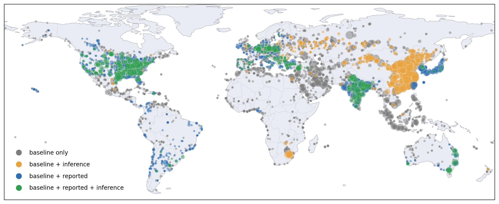

**Figure 1:** Asset-level Climate TRACE carbon dioxide emissions estimates for January 1, 2025, to December 31, 2025, color-coded by the model types underlying each estimate: emissions based on the baseline country-, and fuel- averages alone (gray), baseline combined with remote sensing inference (yellow), baseline combined with reported data (blue), or baseline combined with both reported data and remote sensing inference (green). Each dot represents one powerplant, sized according to the amount of carbon emissions, ranging from roughly 80 to nearly 33,500,000 metric tons of CO₂.

Table 2 reports the share of global asset-level CO2 emissions attributed to each combination of activity-estimation methods, broken down by region. Each cell gives that region-and-method combination's percentage of the worldwide 2025 total; a region's row total reflects its overall contribution to global power-sector emissions, while the "Global" row gives the worldwide method mix.

**Table 2** Regional breakdown of global power-sector CO2 emissions by activity-estimation methods underlying the estimates (2025); cells are percentages of the global total.

| **Region**        | **Baseline Only** | **Baseline + RS/ML Inference** | **Baseline + Reported** | **Baseline + RS/ML Inference + Reported** |
|-------------------|-------------------|--------------------------------|-------------------------|-------------------------------------------|
| **Asia**          | 29.7              | 26.9                           | 10.7                    | 3.7                                       |
| **North America** | 3.2               | 0.7                            | 4.1                     | 6.3                                       |
| **Europe**        | 4.3               | 1.5                            | 1.3                     | 1.7                                       |
| **Africa**        | 2.6               | 1.1                            | 0.0                     | 0.0                                       |
| **Oceania**       | 0.1               | 0.0                            | 0.4                     | 0.6                                       |
| **South America** | 0.4               | 0.0                            | 0.5                     | 0.1                                       |
| **Global**        | 40.4              | 30.1                           | 17.1                    | 12.4                                      |

#### 2.2.1 Reported Electricity Generation Data

Climate TRACE uses electricity generation data from reporting entities (see Table 3 for the list); to inform power plant activity estimates where the data is available, we have linked it to the asset, and the data passes validation. The validation process runs at the linked entity facility - month level and evaluates the reported electricity data for completeness (e.g. missed hours or days of reporting), and consistency with other available data. For reporting entities that publish net generation (gross generation - station own use), we convert it to gross generation. Some reporting entities only provide data for a subset of the power plant, a common case is only units above a reporting threshold are reported. In other cases the reporting entity combines all power generated by a single fuel on a plant into one reported value. When the linked facility data only applies to a subset of the power plant, we use the data to estimate the applicable subset of the power plant and rely on the other methods described in section 2.2. to estimate the remaining subset where a reported data estimate is not available.

The uncertainty of electricity generation is evaluated based on the estimated uncertainty of the net to gross correction combined with a constant uncertainty that reflects the unmeasured uncertainty of the reported generation process related to potential errors, omissions, miscategorization, and incorrect linkage to the asset.

Where a linked reporting facility has reported generation but data is not available for the month being estimated, a reported generation gap filling imputation is performed based on the average of the reported data in the same month for the prior three years and the following year where available. This most commonly occurs in the case where a reporting entity has a delay in reporting. The uncertainty of the gap-filled data is estimated based on the number of months of data available and the evaluated RMSE when compared to historical data.

**Table 3** Reported activity data sources used

| **Country/Region** | **Publishing Entity**                                                          | **Dataset \[reference\]**                                                                                                                                                                                                                                                                                                                |
|--------------------|--------------------------------------------------------------------------------|------------------------------------------------------------------------------------------------------------------------------------------------------------------------------------------------------------------------------------------------------------------------------------------------------------------------------------------|
| ARG                | Compañía Administradora del Mercado Mayorista Eléctrico (CAMMESA)              | [Post-Operative Report - Monthly](https://cammesaweb.cammesa.com/parte-post-operativo/) \[29\]                                                                                                                                                                                                            |
| AUS (NEM)          | Australian Energy Market Operator                                              | [DISPATCH\_UNIT\_SCADA](https://visualisations.aemo.com.au/aemo/nemweb/MMSDataModelReport/Electricity/MMS%20Data%20Model%20Report_files/MMS_123.htm) \[24\]                                                                                                                                               |
| AUS (WEM)          | Australian Energy Market Operator                                              | [Facility SCADA](https://data.wa.aemo.com.au/#facility-scada) \[30\]                                                                                                                                                                                                                                      |
| BRA                | ONS - Operador Nacional do Sistema Elétrico                                    | [Generation per Power Plant on an Hourly Basis](https://dados.ons.org.br/dataset/geracao-usina-2) \[20\]                                                                                                                                                                                                  |
| CAN (Alberta)      | Alberta Electric System Operator                                               | [Historical Generation Data (CSD)](https://www.aeso.ca/market/market-and-system-reporting/data-requests/historical-generation-data/) \[31\]                                                                                                                                                               |
| CAN (Ontario)      | Independent Electricity System Operator                                        | [Hourly Generator Energy Output and Capability Report](https://reports-public.ieso.ca/public/GenOutputCapabilityMonth/) \[32\]                                                                                                                                                                            |
| CHL                | Coordinador Eléctrico Nacional                                                 | [Actual Generation](https://portal.api.coordinador.cl/documentacion?service=sipubv2) \[33\]                                                                                                                                                                                                               |
| COL                | XM Compañía De Expertos En Mercados                                            | [National Dispatch](https://www.xm.com.co/generaci%C3%B3n/informes-despacho/despacho-nacional) \[34\]                                                                                                                                                                                                     |
| DOM                | Organismo Coordinador del Sistema Eléctrico Nacional Interconectado (OC)       | [POST-DELIVERY PER DAY](https://www.oc.org.do/Servicios/Reportes/postdespacho) \[35\]                                                                                                                                                                                                                     |
| Europe             | European Network of Transmission System Operators for Electricity (ENTSO-E)    | [Actual Generation per Generation Unit \[16.1.A\]](https://transparencyplatform.zendesk.com/hc/en-us/articles/16648326220564-Actual-Generation-per-Generation-Unit-16-1-A) \[21\]                                                                                                                         |
| IND                | Central Electricity Authority, Ministry of Power, Government of India          | [National Power Portal - Daily and Monthly Generation Reports](https://npp.gov.in/dgrReports) \[23\]                                                                                                                                                                                                      |
| GBR                | Elexon                                                                         | [Actual Generation Output Per Generation Unit (B1610)](https://bmrs.elexon.co.uk/api-documentation/endpoint/datasets/B1610) \[36\]                                                                                                                                                                        |
| JPN                | Organization for Cross-regional Coordination of Transmission Operators (OCCTO) | [Unit-by-unit power generation performance disclosure system](https://hatsuden-kokai.occto.or.jp/hks-web-public/info/hks) \[37\]                                                                                                                                                                          |
| KOR                | Korea Electric Power Corporation                                               | [Power statistics - Monthly Electricity Statistics](https://www.kepco.co.kr/home/customer/library/electricity-statistics/monthly-stats/boardList.do) \[38\]                                                                                                                                               |
| MYS                | Suruhanjaya Tenaga Malaysia                                                    | [DAILY SYSTEM GENERATION SUMMARY](https://www.st.gov.my/en/web/general/details/364) (page no longer found) \[39\]                                                                                                                                                                                         |
| NGA                | Nigerian Independent System Operator (NISO)                                    | [GENCO Hourly Generation](https://www.niggrid.org/GenerationProfile2) \[40\]                                                                                                                                                                                                                              |
| NIC                | El Centro Nacional de Despacho de Carga (CNDC)                                 | [Post-Dispatch Energy (MWh)](https://www.cndc.org.ni/MEMNDiarios/posdespachoEnergia) \[41\]                                                                                                                                                                                                               |
| PAN                | Empresa De Transmisión Eléctrica, S.A. (ETESA)                                 | [Daily Post-Dispatch](https://www.cnd.com.pa/index.php/informes/categoria/informes-de-operaciones?tipo=60) \[42\]                                                                                                                                                                                         |
| PER                | Comité de Operación Económica del Sistema (COES)                               | [Daily Executed Dispatch](https://www.coes.org.pe/Portal/Operacion/CaractSEIN/DespachoEjecutadoDiario) \[43\]                                                                                                                                                                                             |
| TUR                | Epias Transparency Platform (EPIAS)                                            | [Real-Time Generation](https://seffaflik.epias.com.tr/electricity/electricity-generation/ex-post-generation/real-time-generation) and [Injection Quantity](https://seffaflik.epias.com.tr/electricity/electricity-generation/ex-post-generation/injection-quantity) \[44\] |
| TWN                | Taiwan Power Company                                                           | [Concise Monthly Report](https://www.taipower.com.tw/2289/2345/50429/54971/57690/) \[45\]                                                                                                                                                                                                                 |
| UAE (Dubai)        | Dubai Electricity and Water Authority                                          | [DEWA Gross Power Generation](https://www.dubaipulse.gov.ae/data/dewa-consumption/dewa_gross_power_generation_mwh-open) (page no longer found) \[46\]                                                                                                                                                     |
| USA                | U.S. Environmental Protection Agency (EPA)                                     | [Clean Air Markets Program Data (CAMPD)](https://campd.epa.gov/data) \[22\]                                                                                                                                                                                                                               |
| USA                | U.S. Energy Information Administration                                         | [Form EIA-923 detailed data with previous form data (EIA-906/920)](https://www.eia.gov/electricity/data/eia923/) \[47\]                                                                                                                                                                                   |

#### 2.2.2 Baseline Method

Climate TRACE’s baseline approach for estimating electricity generation at individual power plants is to synthesize the unit-level capacity, fuel, and prime mover information contained in our harmonized power plant inventory for each plant (see [Couture et al 2024](https://www.mdpi.com/2072-4292/16/7/1290), Appendix A.1) with [EIA](https://www.eia.gov/international/overview/world) and [EMBER Yearly Electricity Data](https://ember-climate.org/data-catalogue/yearly-electricity-data/) country-level annual estimates of capacity and generation by fuel type to calculate the annual average fuel-specific capacity factor in each year reported for each country in the world. We then assume the same capacity factors within each country for each part of the plant with the associated fuel-type. This baseline method lacks detail and is therefore reported with higher uncertainties; however, it is helpful as it is applicable to every power plant in the world.

#### 2.2.3 Remote Sensing & Machine Learning Method (RS+ML)

Climate TRACE leverages remote sensing (RS) proxy signals to estimate power generation at the monthly level for individual power plants. By training machine learning (ML) models to understand the association between electricity generation and water vapor plumes from stacks (in layman’s terms, the exhaust pipes of a power plant) with flue gas desulfurization (a common pollution control for coal; Figure 3), wet natural draft cooling towers (the large hyperbolic structures commonly seen primarily at coal plants; Figure 3), and mechanical draft cooling towers (fan-like structures, common across coal and gas; Figure 4). Figure 2 provides an overview of the remote sensing and machine learning (RS+ML) proxy signal approach employed to estimate individual power plant emissions. Figure 3 provides an example of the RS+ML approach applied to two observations of a particular power plant - detecting vapor plumes from stacks and flue gas desulfurization. For more detailed explanations of this proxy signal approach, referred to as “RS+ML” in this document, please see [Couture et al. (2024)](https://www.mdpi.com/2072-4292/16/7/1290). Note however that the structures which produce water vapor plume proxy signals do not exist at every power plant in the world. Yet, the 4% of plants worldwide that do have these structures amount to nearly half (43%) of carbon dioxide emissions from all non-biomass combustion (fossil and waste) power generation 2015-2024.

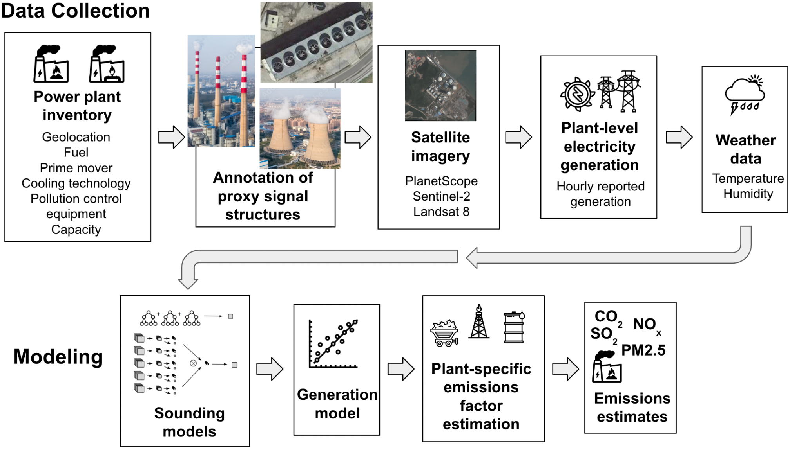

**Figure 2**: Diagram of RS+ML-enabled proxy signal modeling for monitoring power plant activity to estimate emissions.

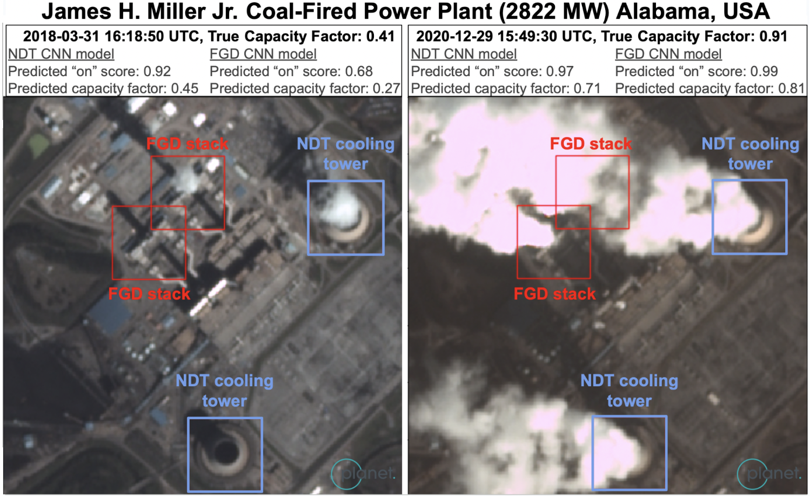

**Figure 3**: ML predictions on the James H. Miller Jr. power plant at low vs. high generation on two observation dates, using PlanetScope PSScene imagery. Separate natural draft cooling tower (NDT) and flue gas desulfurization (FGD) models predicted on NDT (blue) and FGD stacks (red) patches. These predictions were ingested by subsequent models to estimate generation, then CO2, SO2, NOX, and PM2.5, for the plant. © 2023 IEEE \[8\].

#### 2.2.4 Ensemble Electricity Generation Estimate

Our final published electricity generation estimates are an ensemble of the reported generation estimates (where available), the baseline method estimate, and the RS/ML-enabled proxy signal estimates (where possible). The ensemble process combines all available sources of reported generation, any applicable RS/ML model inference predictions, and the baseline model in a weighted ensemble. Each prediction has a point estimate, a root mean square error uncertainty converted to a mean squared error (MSE), and a confidence level. Each prediction is combined in a weighted ensemble, where each is weighted proportionally to its inverse mean squared error, normalized by the total inverse mean squared error of all available estimates, show with the two equations here:

 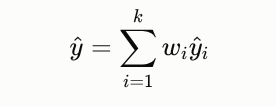

The uncertainty and confidence of the final estimate are combined with the same weighting.

To enable the user to understand what models were used in each power plant emissions estimate, the Climate TRACE asset-level data provides a flag in the “other1” column to indicate if the estimate leveraged: the baseline model (denoted by “a”), the remote sensing and machine learning approach (denoted by “i”), reported generation (denoted by “r”), and/or gap filled reported generation (denoted by “g”). If the plant was non-operational in the period (e.g. the plant is retired or has not yet begun commercial operation), the estimated generation is reported as 0 (denoted in “other1” by “o”). These flags are presented in descending order of the model weight in the final ensemble.

#### 2.3 Methodology Updates

Below we expand upon several updates to the methodology since our [2024 journal article](https://www.mdpi.com/2072-4292/16/7/1290) (based on 2023 Climate TRACE data).

#### 2.3.1 September 2024 Updates

#### 2.3.1.1 Add Non-GHG Air Pollutant Emissions Estimates

The combustion of fossil fuels, biomass, and waste to generate electricity emits air pollutants including sulfur dioxide (SO2), nitrogen oxides (NOX) and particulate matter (PM 2.5) which are linked to adverse health outcomes. We estimate SO2, NOX, and PM 2.5 emission factors at the power plant unit-level based on fuel type, boiler type, and pollution control technology. Emissions factors are sourced from the 2023 EMEP/EEA air pollutant emission inventory guidebook and 2023 EIA Electric Power Annual. We then multiply these emission factors with the Climate TRACE estimated power generation for each unit to obtain SO2, NOX, and PM 2.5 emissions estimates. Fuel, boiler type and pollution control technology are obtained from our harmonized power plant information inventory, while the pollution control technology efficiency is based on the US EPA’s AP-42 as a primary source.

Pollution control technology is relevant because emissions are reduced when a plant operates its control equipment. In the absence of pollution control information, we generally assume that plants lack pollution controls, resulting in higher estimates. The exception is that for coal units with missing SO2 pollution control information, we used the efficiency of the most prevalent type of pollution control in the specific region if the percentage of units with missing pollution control information was less than 50%. This restriction was applied in order to avoid introducing potential bias into the emissions estimates.

We assess uncertainty using the standard deviations of uncontrolled emissions factors across boiler types and assign confidence scores based on data availability. We validated against Europe’s Beyond Fossil Fuels data, US CAMPD-reported SO2 and NOX and EGRID for PM2.5, and Australia’s National Pollutant Inventory, showing a moderate to strong correlation between reported and estimated emissions. Challenges include missing data, uncertainties in reported emissions factors and day-to-day plant operation, while future work could incorporate more specific fuel and boiler type information, regional variations in emissions factors, and extending validation to additional regions. For more information on non-GHG estimates, please [contact us](mailto:coalition@climatetrace.org).

#### 2.3.1.2 Introduce Monthly Resolution Emissions Estimates

Whereas annual resolution was previously the only Climate TRACE deliverable, monthly power plant electricity generation and emissions (CO2, SO2, NOX, and PM2.5) for January 1, 2015 to present (with a 60-day lag) is now published. As opposed to simply assuming equal generation in each month (dividing annual values by 12), we scaled our monthly electricity generation (and thus emissions) estimates based on estimated monthly electricity demand. Monthly demand was estimated for each country, year, and month as the average between the following two approaches:

1.  Synthetic Electricity Demand – adapted by WattTime based on Mattsson et al \[5\].

2.  Estimated Load Profile – created by TransitionZero based on \[6\] and \[7\].

While this monthly data offers increased recency and understanding of seasonal patterns, it does come with the cost of higher uncertainty, driven both by fewer remote sensing observations (for the RS+ML method) and uncertainty in the estimate of monthly generation.

#### 2.3.1.3 Add RS+ML Model for Mechanical Draft Cooling Plants

New to 2024, we added an additional proxy signal, mechanical draft cooling towers, to monitor power plants from satellite imagery. This is the first proxy signal that targets gas plants in addition to coal, given that our existing two proxy signals are largely coal-focused. Mechanical draft cooling towers, like natural draft cooling towers, are evaporative cooling structures used to dissipate heat resulting from the electricity generation process and release steam plumes into the atmosphere (Figure 4). Unlike natural draft cooling towers, mechanical draft is more discreet, simply appearing as large fans on the rooftops of industrial buildings, and the water vapor plume they release is often far fainter and harder to see. Because cooler and wetter ambient conditions produce larger, more visible water vapor plumes, we apply a restricted temperature and humidity filter (stricter than that applied to natural draft). This new signal poses a greater modeling challenge, with our mechanical draft models performing slightly worse than our existing models, yet still well above the country-/fuel-/prime-mover-specific averages model (baseline) described in section 2.2.2.

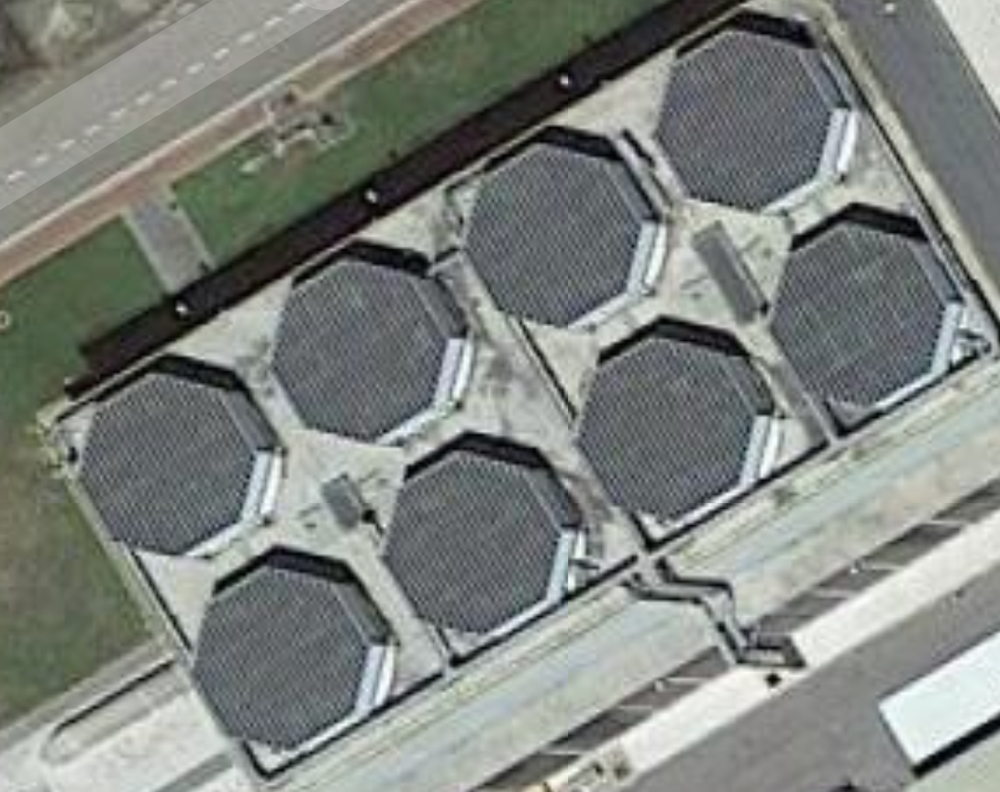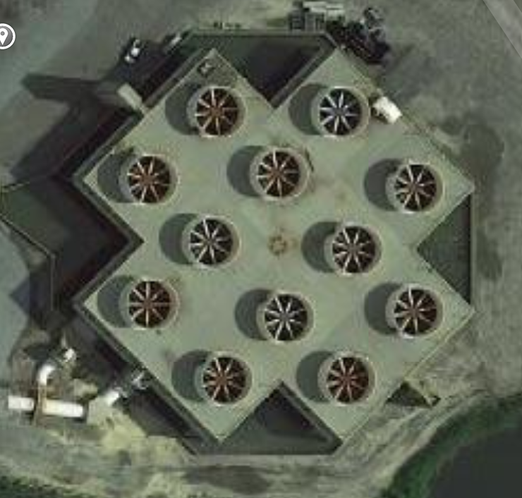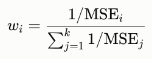

**Figure 4**: Examples of mechanical draft cooling structures (source: Google Maps).

#### 2.3.2 March 2025 Updates

#### 2.3.2.1 Begin Monthly Data Release Schedule

While the first monthly-resolution data was first produced in September 2024, now as of March 2025, Climate TRACE consistently publishes ongoing monthly releases of updated monthly-resolution data with a 60-day lag during the final week of each month.

#### 2.3.3 August 2025 Updates

#### 2.3.3.1 Introduce the use of Reported Electricity Generation Data (Brazil, Europe, US)

Climate TRACE now uses electricity generation data from reporting entities (currently ONS for Brazil, ENTSO-E for Europe, and CAMPD for the United States; see Table 3) to inform power plant activity estimates where the data is available and passes validation. The validation process evaluates the reported electricity data for completeness (e.g. missed hours or days of reporting, units failing or not required to report, unrealistic values), availability for the entire power plant, and consistency with other available data.

**  
2.3.4 October 2025 Updates**

#### 2.3.4.1 Expand the Use of Reported Electricity Generation Data (India, Australia)

Expanded the use of electricity generation data from reporting additional entities (added NPP for India and NEM for Australia; see Table 3) to inform power plant activity estimates where the data is available and passes validation. The validation process evaluates the reported electricity data for completeness (e.g. missed hours or days of reporting, units failing or not required to report, unrealistic values), availability for the entire power plant, and consistency with other available data.

#### 2.3.5 November 2025 Updates

#### 2.3.5.1 Emissions Reducing Solutions

Climate TRACE now publishes emissions reducing solutions (ERSs) to suggest potentially impactful ways to use our data to reduce power plant emissions globally.

#### 2.3.5.1.1 Model Description

An emissions mitigation intervention, such as that employed by an emission reduction solution (ERS), can influence power grid emissions through two main pathways:

1.  By altering the operation of existing grid assets - power plants - thereby changing their emissions profile;

2.  By incentivizing structural changes (such as new generators built or old generators being retired) in the grid itself, leading to a longer-term change in the emissions output of the grid

When the interventions in question are changes in load, or the total electricity demand at a point in time, the first pathway is encapsulated in the marginal operating emissions rate (*MOER*), which is defined as the change in emissions per load keeping the grid structure constant, and the second in the marginal build emissions rate (*MBER*), which is the change in emissions per load due to structural changes in the grid. The total emissions change due to an intervention is in general a nontrivial combined effect of the *MOER* and the *MBER*. The Greenhouse Gas Protocol (GHGP) in the Guidelines for Grid-Connected Electricity Projects proposed a method to estimate this combined effect through the formula (Broekhoff et al., 2007),

$`CMER\  = \ \omega MBER\  + \ (1 - \omega)MOER\ ,`$

Where *CMER* is the combined marginal emissions rate, capturing both the operational, *MOER,* and structural, *MBER*, effects of the ERS on the grid, while ω is a weighting parameter. While in principle different interventions could warrant different values of ω, the GHGP recommended that a single ω=½ be used uniformly across all regions, project types, and time periods.

A key ERS in this sector is to build additional clean generators in the region. For each highly-emitting asset (i.e., with emissions rate over the region’s CMER), a clean plant can be built to match its generation over a specified period (e.g., monthly or annually). While this new clean generation competes economically with the highly-emitting asset, the variability of clean energy generation means its generation profile is unlikely to align with that of the displaced asset. Therefore it is not expected for the asset’s capacity factor (and thus emissions) to fall to zero as a result of this intervention. Instead, the new clean generation displaces emissions at the *system* or *regionally aggregated* level, which can be estimated to be the generation multiplied by the region’s CMER.

Regardless of the ERS chosen, a CMER dataset for each region at a monthly cadence would be necessary. This dataset can be constructed through the GHGP formula from separate datasets of MOER and MBER models averaged with an ω parameter of ½.

#### 2.3.5.1.2 Marginal Operating Emissions Rate (MOER) Model

The MOER dataset used to quantify the grid response in this ERS is obtained from the WattTime API at a 5-minutes cadence, which is then aggregated monthly (https://docs.watttime.org/). The main component of a MOER model is a regression estimator of the increase in emissions in a particular region due to a change in electrical load, assuming that no structural changes in the power grid occurs (Siler-Evans, Azevedo, & Morgan, 2012; Deetjen & Azevedo, 2019; Callaway, Fowlie, & McCormick, 2018). This component, which is referred to as the Short-Run Marginal Emissions Rate (*SRMER*), can be estimated by a regression model:

$`\Delta Emissions = \ (SRMER)(\text{ΔLoad})\  + \ Controls\ ,`$

where *ΔEmissions* is the change in emissions and *ΔLoad* is the change in electricity load in a particular region. The set of *Controls* are variables that are chosen to ensure that the *SRMER* is well-identified, i.e., that the *SRMER* is indeed a measure of the rate of change of emissions *due to* the change in load (and not due to unrelated factors such as changes in temperature). Examples of these variables include the locational marginal pricing (LMP) of electricity, generation by fuel type, and weather data. In more sophisticated models, the implementation of the control variables can also be extended from mere additional constants to nonlinear functions, such as pre-binning the dataset to slices based on the control variables.

In data-rich regions, it is also possible to train a curtailment model - when energy consumption is purposely reduced - that augments the model with curtailment predictions. For example, low LMP is often indicative of available curtailed energy. In these regions, a curtailment probability model can be trained, and the MOER can then be estimated as:

$`MOER\  = \ (1 - P)SRMER`$ ,

Where *P* is the probability for curtailment. In regions where no curtailment model is available, *P* is set to 0 as a default value.

In regions where emissions datasets are unavailable, this regression can be modified to be:

$`\Delta\text{Generatio}n_{\text{fuel}} = \ \beta_{\text{fuel}}(\text{ΔLoad})\  + \ Controls\ ,`$

where $`\Delta`$*Generationfuel* is the change in generation for a particular fuel type, and β*fuel* a measure of the change in the generation of said fuel type due to the change in load. Since the emissions per load of a particular fuel type (the carbon intensity of the fuel type) is known, once the regressions are done for all the main fuel types in the region, the SRMER can then be constructed from the β*fuel*’s measured.

In regions where historical generation by fuel type datasets are not available, the MOER can still be produced by leveraging the principle that similar grids evolve similarly. The annual fuel mix percentages of electricity generation and the electricity demand can be used to group similar grids together. From each group, a representative data-rich power grid can then be chosen to serve as a proxy for the behavior of other grids in the group. In the WattTime implementation of this algorithm, this technique is used for Brazil, Chile, India, Japan, Korea, Malaysia, Nicaragua, Peru, The Philippines, Singapore and Turkey. For regions that lack electricity load data, the real-time load is modelled using weather data via the approach detailed in Mattsson et al (2021).

#### 2.3.5.1.3 Marginal Build Emissions Rate (MBER) Model

The MBER encapsulates the changes in emissions due to structural changes in the power grid (e.g., new renewable power generation being built) that is incentivized by changes in electrical load. Unlike the MOER, which measures emissions rates of currently existing power plants, the MBER estimates the emissions effect of future power plants. The GHGP proposes that the MBER can be estimated by the following algorithm (Broekhoff et al., 2007):

1.  Collect the operation start year, capacity, generation (or capacity factor), and carbon intensity of power generators in a region at an annual level;

2.  Multiply the carbon intensity with the generation to obtain the CO2 emissions of each generator;

3.  Starting from the generators with the most recent operation start year to the oldest, identify the smallest set of start years that accounts for at least 20% of total generation in the region;

4.  If there are less than five generators with these start years, add generators from successively older start years until there are five generators in the group;

5.  Compute the MBER as the sum of the CO2 emissions of each unit in the group divided by the sum of the generation of each unit in the group.

This method can be modified from annual to hourly by changing the period in step 1 from annually to hourly to obtain the hourly MBER. In this ERS, this hourly implementation is further aggregated monthly to obtain monthly MBER values. In regions where generation or capacity factor by fuel types are not readily available at an hourly level, demand and weather data can be used to model these inputs and enable the calculation of hourly MBER. More information on specific data sources used and modeling details can be found in the Global Energy Monitor wiki ([https://www.gem.wiki/MBERs\_methodology](https://www.gem.wiki/MBERs_methodology)).

#### 2.3.5.1.4 Incorporating CMERs into ERS

For the case where clean generation is added to the grid, we consider solar power generation sources and assume they are (a) co-located with the existing power plant, and (b) match the generation of the power plant. Here, the existing power plant is not retired, but the addition of non-fossil generation will lower the emissions in aggregate of the power grid. The net emissions reduction is:

$`R_{\text{Solar}} = \ (CMER)\  \times LOAD\ ,`$

where $`\text{LOAD}`$ is again the existing load supplied by the power plant. Note that in principle, the amount of clean generation to be added to the grid is independent of the parameters of the existing power plant, and could be an arbitrary fraction of the load of the highly-emitting asset in question. The hourly CMER is aggregated monthly using typical solar generation profiles. In regions where historical renewable profiles are not available, these are generated by physics-informed simulations with weather data reanalysis as inputs (see implementation at [renewables.ninja](https://www.renewables.ninja/) for simulations of solar power generation globally). Future work may include ERS other than solar such as wind or shutting down fossil-fuel plants.

#### 2.3.5.1.5 Applying ERS to Power Plants to Estimate Emissions Reduction

We apply the solar power generation ERS and the associated CMERs to individual power generation assets by the strategy parameters defined in the Table S4. The solar strategy adds load equal to the existing power generation by setting the “induced\_activity\_conversion\_rate parameter” to -1 so that net emissions are *reduced* by $`R_{\text{Solar}}`$. The distribution of emissions reduced for all assets is shown in Figure 5. We note one exception for an asset in Democratic Republic of the Congo where the solar CMER is low enough that the emissions reductions are negligible (&lt; 3%) when solar generation is added (see Section 5.1). In this single edge case, we suggest shutting down the plant, which zeroes out the plant’s direct emissions, but induces emissions according to a CMER that is weighted with a flat-in-time generation profile rather than a solar generation profile.

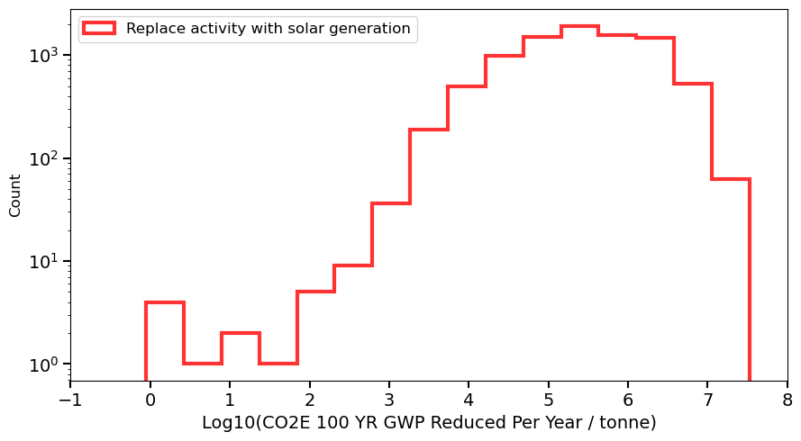

**Figure 5:** Histogram of CO2 equivalent (100-year GWP) emissions reduced per year for electricity-generation assets under the solar-generation strategy.

#### 2.3.6 September 2026 Updates

#### 2.3.6.1 Expand the Use of Reported Electricity Generation Data

Expanded the use of electricity generation data from reporting additional entities to inform power plant activity where the data is available and usable. See Table 3 for a complete list. Added the following sources:

-   ARG - Compañía Administradora del Mercado Mayorista Eléctrico (CAMMESA)

-   AUS (WEM) - Australian Energy Market Operator

-   CAN (Alberta) - Alberta Electric System Operator Historical Generation Data (CSD)

-   CAN (Ontario) - Independent Electricity System Operator

-   CHL - Coordinador Eléctrico Nacional

-   COL - XM Compañía De Expertos En Mercados

-   DOM - Organismo Coordinador del Sistema Eléctrico Nacional Interconectado (OC)

-   GBR - Elexon

-   JPN - Organization for Cross-regional Coordination of Transmission Operators (OCCTO)

-   KOR - Korea Electric Power Corporation

-   MYS - Suruhanjaya Tenaga Malaysia

-   NGA - Nigerian Independent System Operator (NISO)

-   NIC - El Centro Nacional de Despacho de Carga (CNDC)

-   PAN - Empresa De Transmisión Eléctrica, S.A. (ETESA)

-   PER - Comité de Operación Económica del Sistema (COES)

-   TUR - Epias Transparency Platform (EPIAS)

-   TWN - Taiwan Power Company

-   UAE (Dubai) - Dubai Electricity and Water Authority

-   USA - U.S. Energy Information Administration Form EIA-923

#### 2.3.6.2 Ensemble Multiple Generation Model Estimates

Our final published electricity generation estimates are now an ensemble of the reported generation estimates (where available), the baseline method estimate, and the RS/ML-enabled proxy signal estimates (where available). The ensemble process combines all available sources of reported generation, any RS/ML model inference predictions applicable, and the baseline model in a weighted ensemble where each prediction is weighted proportional to its inverse mean squared error normalized to the total inverse mean squared error of all available estimates.

The asset-level data flag in the “other1” column was updated to reflect the ensembling, See section 2.2.4 for more details.

#### 2.3.6.3 Carbon Intensity Estimation

For coal- and gas-fired units, we now apply linear regression models to estimate their average CO2 emission factor (EF) (amount of CO2 emitted per unit of electricity generated; CO2 EF). We developed separate regression models for coal-fired units, for combined-cycle natural gas units, and for simple-cycle natural gas units. For all other units, we continue to use the CO2 EF estimates based on their country, fuel type, and prime mover type. The final plant-level CO2 EF estimate is derived from the combined unit level activity and CO2 emissions.

Our modeling datasets combine annual plant-level electricity generation data with annual plant-level total CO2 emissions data as well as power plant attributes. As some power plants in the training dataset consist of units with widely varying characteristics (age, fuel type, etc.), we only included power plants that are homogeneous across the relevant attributes in order to better estimate the CI as a function of those unit level characteristics. We also excluded data records with unreasonably large or low emissions factors as these likely result from data quality issues.

For each model group, we include features based on the main drivers behind the unit’s CO2 EF. For coal-fired units, these are the unit’s capacity, coal type, co-gen/CHP, and technology type (subcritical, supercritical, ultra-supercritical). For combined-cycle gas units, the features are based on unit capacity and turbine class. For simple-cycle gas units, the features are based on unit capacity, age, co-gen/CHP, and turbine class.

In order to assess uncertainty, we fitted 4 linear regression models for each unit-type across 4 independent folds. The CO2 EF point-estimate is the average of the 4 model predictions. We calculate the uncertainty of our CO2 EF estimates by multiplying the modeled point-estimate with the RMSE expressed as a percentage of the average EF on each model group’s test set. For units with CO2 EF estimates based on country, fuel type, and prime mover type (baseline, see section 2.2.2), we estimate an uncertainty of +-25% of the estimate and report lower confidence.

We plan on publishing a more comprehensive description of the approach in the coming year.

#### 3. Results

Final monthly emissions estimates are generated for electricity generation CO2, SO2, NOX, and PM2.5 for over 35,500 unique power plants worldwide, published monthly within 2-3 months of recorded activity. At the asset level, we publish electricity generation, capacity, capacity factor, emissions intensity, emissions, fuel type, geolocation, and plant names for over 9,000 individual power plant assets that represent 96% of total power plant GHG emissions. The country level totals are then the sum of these asset-level estimates plus estimates for the remaining set of plants based on the harmonized database of sources in Table 1 (but lack metadata sufficient to publish at the facility-level).

#### 3.1 Validation

In Table 4, we compared our modeled emissions against reported emissions CO2, SO2, NOx, and PM 2.5. For CO2, we compared annual Climate TRACE estimates against reported CO2 emissions from the USA (CAMPD, also used for monthly comparisons; and EGRID), India (CEA), Australia (NGER), Europe (EU ETS), Brazil, Canada, Chile, Israel, Malaysia, Mexico, South Africa, South Korea, and Taiwan. For non-GHG air pollutants, we compared Climate TRACE estimates against annual reported SO2 and NOx data from Australia (National Pollutant Inventory), the USA (CAMPD and EGRID), and Canada (GHGRP), as well as PM2.5 reported data from Australia (National Pollutant Inventory), the USA (EGRID), and Canada (GHGRP). A Pearson correlation and root mean squared error was used to compare across all plants successfully matched against the reported data sources mentioned above. All comparisons show a positive correlation with statistically significant p-values (alpha=0.01). Monthly estimates, while more challenging, also do not show any major loss in performance.

**Table 4** Overall asset-level validation against reported emissions data

<table><thead><tr class="header"><th></th><th><strong>CO2</strong></th><th><strong>SO2</strong></th><th><strong>NOx</strong></th><th><strong>PM2.5</strong></th><th></th></tr></thead><tbody><tr class="odd"><td></td><td>
annual

n=22882
</td><td>
monthly

n=174452
</td><td>
annual

n=10101
</td><td>
annual

n=10101
</td><td>
annual

n=1177
</td></tr><tr class="even"><td>Pearson Correlation (R)</td><td>0.95 (p&lt;0.01)</td><td>0.96 (p&lt;0.01)</td><td>0.71 (p&lt;0.01)</td><td>0.77 (p&lt;0.01)</td><td>0.51 (p&lt;0.01)</td></tr><tr class="odd"><td>Root Mean Squared Error (RMSE)</td><td>0.96 MtCO2</td><td>0.055 MtCO2</td><td>1,752 tSO2</td><td>2,034 tNOx</td><td>187 tPM2.5</td></tr><tr class="even"><td>Value Range</td><td>0 - 36.52 MtCO2</td><td>0 - 1.98 MtCO2</td><td>
0 - 37,952

tSO2
</td><td>0 - 34,830 tNOx</td><td>0 - 1,126 tPM2.5</td></tr></tbody></table>

Climate TRACE publishes asset-level (facility-scale) data from January 1, 2019 through the present (with an approximately two-month lag from the current month), so electricity generation and emissions were validated over the same period, subject to data availability (more recent years are sometimes incomplete). For the asset-level validation, Climate TRACE generation estimates were compared against facility-level reported electricity generation — reported at hourly, daily, or monthly resolution depending on the source and summed to monthly and annual totals — from the United States (EIA-923 and CAMPD), Europe (ENTSO-E), India (NPP), Turkiye (EPIAS), the United Kingdom (BSC), Australia (NEM and WEM), South Korea (KEPCO), Japan (OCCTO), Argentina (CAMMESA), Brazil (ONS), Canada (IESO and AESO), Chile (CEN), the Dominican Republic (OC), Colombia (XM), Malaysia (SETC), Nigeria (NISO), Nicaragua (CNDC), Panama (CND), Peru (COES), Taiwan (TEPC) and UAE Dubai (DEWA). Results are shown in Table 5.

Table 5 demonstrates the results of the possible combinations of the three types of activity estimation models in the ensemble over the set of plants where we have the data to run each type of model on the predictive performance for monthly and annual capacity factor, electricity generation, and carbon dioxide emissions. The increase in performance as more informed models are available is clear. While we recognize and caution that the use of the reported generation data in the ensemble and the evaluation of performance represent data leakage in the electricity generation and capacity factor columns for the last two rows, the data is presented for completeness. The evaluation of the model performance for the carbon dioxide columns is not affected in the same way.

**Table 5** Asset-level validation against reported data over the same set of plants, comparing four methods: average-based baseline only; ensembled baseline and RS/ML inference; ensembled baseline and reported data; and an ensemble of the baseline, RS/ML inference, and reported data.

<table><thead><tr class="header"><th><strong>Method</strong></th><th><strong>CAPACITY FACTOR</strong></th><th><strong>ELECTRICITY GENERATION</strong></th><th><strong>CO2</strong></th><th></th><th></th><th></th></tr></thead><tbody><tr class="odd"><td></td><td>
annual

n=5166
</td><td>
monthly

n=65951
</td><td>
annual

n=5166
</td><td>
monthly

n=65951
</td><td>
annual

n=22882
</td><td>
Monthly

n=174452
</td></tr><tr class="even"><td>Baseline only</td><td>
R: 0.35

(p&lt;0.01)

RMSE: 0.22
</td><td>
R: 0.28 (p&lt;0.01)

RMSE: 0.27
</td><td>
R: 0.84 (p&lt;0.01)

RMSE: 2.27 TWh
</td><td>
R: 0.78

(p&lt;0.01)

RMSE: 232.31 GWh
</td><td>
R:0.89 (p&lt;0.01)

RMSE: 1.29 MtCO2
</td><td>
R: 0.81

(p&lt;0.01)

RMSE:0.12 MtCO2
</td></tr><tr class="odd"><td>Ensembled baseline and RS/ML inference</td><td>
R: 0.65

(p&lt;0.01)

RMSE: 0.18
</td><td>
R: 0.58 (p&lt;0.01)

RMSE: 0.23
</td><td>
R: 0.91 (p&lt;0.01)

RMSE: 1.73 TWh
</td><td>
R: 0.86

(p&lt;0.01)

RMSE: 186.93 GWh
</td><td>
R: 0.91 (p&lt;0.01)

RMSE: 1.2 MtCO2
</td><td>
R: 0.85 (p&lt;0.01)

RMSE: 0.11 MtCO2
</td></tr><tr class="even"><td></td><td></td><td></td><td></td><td></td><td></td><td></td></tr><tr class="odd"><td>Ensembled baseline and reported data</td><td>
R: 0.92

(p&lt;0.01)

RMSE: 0.08
</td><td>
R: 0.92 (p&lt;0.01)

RMSE: 0.10
</td><td>
R: 0.98 (p&lt;0.01)

RMSE: 0.69 TWh
</td><td>
R: 0.97

(p&lt;0.01)

RMSE:

72.73 GWh
</td><td>
R: 0.94 (p&lt;0.01)

RMSE:

0.96

MtCO2
</td><td>
R: 0.96 (p&lt;0.01)

RMSE: 0.057 MtCO2
</td></tr><tr class="even"><td>Ensembled baseline, RS/ML inference, and reported data</td><td>
R: 0.95

(p&lt;0.01)

RMSE: 0.07
</td><td>
R: 0.94 (p&lt;0.01)

RMSE: 0.09
</td><td>
R: 0.99 (p&lt;0.01)

RMSE: 0.63 TWh
</td><td>
R: 0.98

(p&lt;0.01)

RMSE:

67.04 GWh
</td><td>
R:0.96

(p&lt;0.01)

RMSE:

0.87

MtCO2
</td><td>
R:0.96

(p&lt;0.01)

RMSE:

0.055

MtCO2
</td></tr></tbody></table>

Since asset-level reporting mechanisms do not include power plants below a certain capacity threshold and the majority of countries do not report on individual power plants, in order to validate Climate TRACE country-total estimates, we compare against EDGAR V8.0 1.A.1.a Main Activity Electricity and Heat Production emissions. This is available for 205 countries, January 1, 2015, through December 31, 2024; see Table 6 below for the comparison.

**Table 6** Country-level (aggregated national total, per time period) RMSE

<table><thead><tr class="header"><th></th><th>
Country-level CO2 Climate TRACE vs.

EDGAR 1.A.1.a Main Activity Electricity and Heat Production
</th></tr></thead><tbody><tr class="odd"><td>
Annual

n=2048
</td><td>
RMSE: 64.03 MtCO2

r: 1

range of abs. differences: 0 - 1254.62 MtCO2
</td></tr><tr class="even"><td>
Monthly

n=24576
</td><td>
RMSE: 6.07 MtCO2

r: 0.99

range of abs. differences: 0 - 164.6 MtCO2
</td></tr></tbody></table>

#### 3.1.1 Verifying modeled ERS emissions estimates

The CMER used in the emissions estimates has been demonstrated to be consistent with direct observations of emissions changes obtained from natural experiments. The MOER was validated in ERCOT using changes in the potential of wind generation in Steinsultz et al. (2024). As wind output fluctuates, the other fuel types in the region adjust to maintain the balance between load and generation, producing a net effect comparable to random variations in load. By treating wind fluctuations as exogenous shocks, the MOER can be estimated empirically without the need of a true randomized controlled trial on the power grid. In this case, the estimation was performed by the following regression:

$`\Delta Emissions\  = \ (MOER)\Delta W\  + \ Controls`$ ,

where ΔW are changes in the wind generation potential, and the set of controls are chosen to ensure the regression is well-identified. This study found that the MOER measured by the statistical regression technique is consistent with the validation data obtained from the wind regression (see Figure 6).

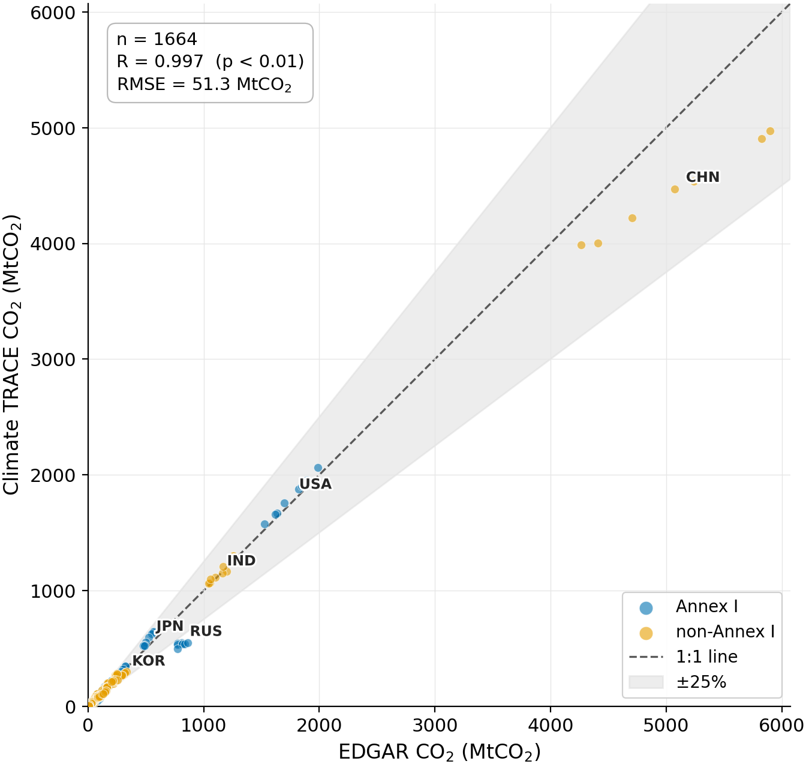

**Figure 6**: Comparison of the MOER measured using a variety of models against natural experiments from wind generation (top); the model used in this ERS is labelled as “Statistical”, and subplots labelled “Heat Rate”, “Dispatch”, “Average”, and “LMP” are alternative MOER models. The close alignment between the “Statistical” model with the empirical data (“Benchmark MEF”) indicates that the Statistical MOER used in this ERS reliably captures real-world emissions impacts. The “Dispatch” model also performed well on this validation test, but can only be utilized in a limited number of grids. See Steinsultz et al., 2024 for details.

Another validation study carried out across several U.S. balancing authorities (TVA, ISONE, DUK, CPLE, CAISO, and FPL; represented by the solid colored bars in Figure 7) further found the MOER model to be consistent with direct observations of emissions changes (Christian et al. 2025a). This study follows a similar approach to Steinsultz et al. (2024), but instead employs nuclear outages as the exogenous shocks. A machine learning model was first trained to predict the emissions of a region with a substantial share of nuclear generation. The model’s predictions (the “Statistical” legend label, grey-hatched bar in Figure 7) were then compared against observed emissions during periods of nuclear outages (solid bars in Figure 7). Because the total generation and load has to remain balanced during the outage, the difference between the prediction and the observed emissions provides an estimate of the emissions change due to a load increase equivalent to the nuclear generation loss. The result of this study, shown in Figure 7, demonstrated that the MOER model (“Statistical” legend label in Figure 7) employed in this ERS is consistent with the MOER measured by this natural experiment.

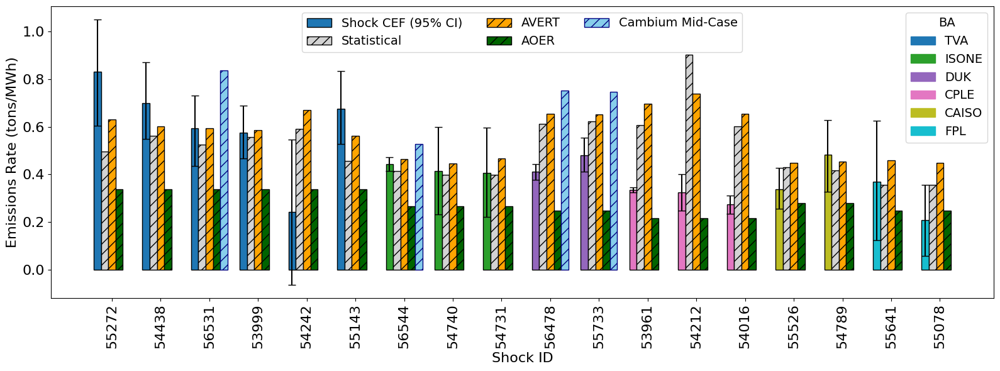

**Figure 7**: Comparison of the MOER measured using a variety of models against natural experiments from nuclear outages; the model used in this ERS is labelled as “Statistical” (Christian et al., 2025a). Empirically observed emissions rate measured during nuclear outages for each balancing authorities are the left-most solid colored bars for each Shock ID that occurred in each Balancing Authority (BA; 95% confidence interval included), separated by the black dashed-lines: TVA = dark blue bar; ISONE = green bar; DUK = purple bar; CPLE = pink bar; CAISO = yellow bar; and FPL = light blue bar. The hatched bars to the right of each solid bar represent different predicted emissions corresponding to different emissions models : Statistical (MOER) model = grey-hatched bar; AVERT = orange-hatched bar; Cambium Mid-case = light blue-hatched bar; and AOER = green-hatched bar.

The CMER constructed using the GHGP weighting parameter method has been validated using a similar method in Christian et al. 2025b, where exogenous load shocks are used to empirically estimate the MOER in PJM, ERCOT, MISO, SPP, ISONE, and NYISO. As shown in Figure 8, the empirical validation signal aligns closely with the CMER (“Model LRMER”), indicating that this formulation of the CMER reliably captures the real-world emissions impacts of load interventions. Christian et al (2025b) also validated the choice of ω=½ recommended by the GHGP guidelines. Comparing a weighting parameter of 0, ½, and 1, this study found that a weighting parameter of 1/2 to be the most consistent with the empirical validation signal and has the lowest error (see Figure 9).

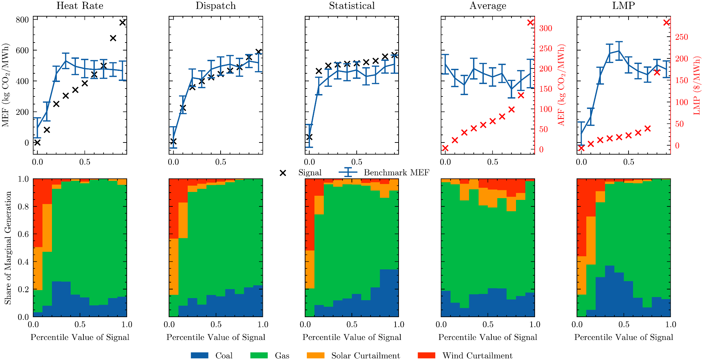

**Figure 8**: Comparison of the CMER utilized in this ERS (“Model LRMER”) and the empirical validation dataset of the emissions effect of load interventions (“Empirical Validation”). The close agreement between the CMER and the empirical validation signal demonstrates that the CMER reliably captures the real-world emissions impacts of load interventions. Cambium LRMER and AOER refers to other models for computing emissions (see Christian et al., 2025b for details).

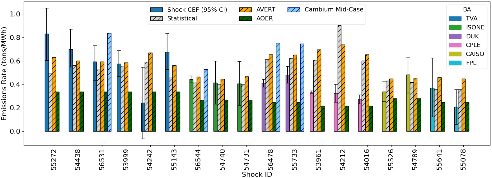

**Figure 9**: The error on the measured CMER signal (compared to an empirical validation baseline) for different weighting parameters (Christian et al., 2025b). Blue bar: weight = 1/2 (LRMER Error 29.73 lbs/MWh); Orange bar: weight = 0 (LRMER Error -249.72 lbs/MWh); Green bar: weight = 1 (LRMER Error 309.18 lbs/MWh).

#### 4. Conclusion

Climate TRACE provides the data that makes it possible to answer questions that drive impactful, precise climate action. Whether the priority is to reduce greenhouse gas emissions or air pollution, or both, this question can be directly answered by plots above and the data continually updated on [climatetrace.org](http://climatetrace.org). Coupled with Climate TRACE data on other sectors - manufacturing, shipping and aviation, etc. - a life cycle analysis is possible along the entire supply chain, of which power generation is just one piece. This enables businesses, investors, governments, and even consumers to quantify the greenhouse gas and/or air pollution footprint(s) of products and compare the trade-offs between one supply chain vs. another. With this information and the lines of thinking enabled by it, we can make climate action faster and easier by uncovering how to slash the maximum total emissions on a global scale with the fastest and easiest actions possible.

Future work includes improving electricity generation, and thus emissions, estimates by incorporating additional data sources and alternate modeling approaches to improve the baseline model as well as expand the set of plants to which we can apply remote sensing and machine learning via additional proxy signals (e.g. heat signatures via thermal satellite imagery). Non-GHG air pollutant emissions estimates, while new and carrying high uncertainties given technology differences across the world, offer an additional lens to explore the intersections between industry, climate change, and environmental justice at high spatial and temporal resolution. We look forward to collaborating to drive increased accuracy and actionable insights.

#### 4.1 Discussion on ERS

Retiring highly-emitting power generators would be the optimal method to reduce the emissions in this sector, especially in regions where the CMER is relatively low. However, several practical barriers limit the widespread implementation of this ERS. The power grid must continuously balance load and generation, meaning that any loss of generation must be compensated by increased output from other generators. In regions with sufficient unused capacity, this can be achieved by raising the capacity factors of existing generators. In contrast, if available capacity is insufficient, new generation assets must be developed to replace the retired capacity. Retiring highly-emitting but serviceable generators is also unattractive from a cost perspective. Consequently, this strategy is likely only viable in regions with ambitious clean energy targets and either ample unused clean capacity or a strong commitment to rapidly building new clean generators.

On the other hand, matching highly-emitting generators with new clean generation is a more broadly applicable strategy. While this generation matching requirement is novel, the underlying concept builds on prior discussions of clean energy matching in the context of *load* matching, where new clean generation is built to match specific loads or emissions associated with those loads. Moreover, numerous power grids are rapidly increasing clean energy investments even in the absence of explicit matching requirements, reflecting a broader commitment to clean energy investments. In some regions, policy measures (e.g., renewable energy targets) and market forces (e.g., the lower operating costs of clean energy) can drive the construction of clean generators, even without this ERS. In such cases, this ERS can be rendered *non-additional*, as it would not produce further emissions reductions beyond those that would have occurred anyway. However, it should be noted that additionality is not a binary. Even in regions where *some* of the emissions avoidance of this ERS is non-additional, its adoption might still drive some incremental emissions avoidance.

#### 5. Supplementary materials metadata

Country-level emissions estimates for electricity generation are available for download at ClimateTRACE.org, and the following table summarizes this data.

**Table S1** General dataset information for “country-climate-trace\_electricity-generation\_{VERSION}.csv”**.**

| **General Description**                                                         | **Definition**                                                                                                                                                                                                                                                                                                                                                                                                                                                                                                                                                                                                                                                                                      |
|---------------------------------------------------------------------------------|-----------------------------------------------------------------------------------------------------------------------------------------------------------------------------------------------------------------------------------------------------------------------------------------------------------------------------------------------------------------------------------------------------------------------------------------------------------------------------------------------------------------------------------------------------------------------------------------------------------------------------------------------------------------------------------------------------|
| **Sector definition**                                                           | *Electricity Generation*                                                                                                                                                                                                                                                                                                                                                                                                                                                                                                                                                                                                                                                                            |
| **UNFCCC sector equivalent**                                                    | *1.A.1.a.i Electricity Generation, 1.A.1.a.ii Combined Heat and Power Generation*                                                                                                                                                                                                                                                                                                                                                                                                                                                                                                                                                                                                                   |
| **Temporal Coverage**                                                           | *January 1, 2015 – present (2 month lag from current month)*                                                                                                                                                                                                                                                                                                                                                                                                                                                                                                                                                                                                                                        |
| **Temporal Resolution**                                                         | *Monthly*                                                                                                                                                                                                                                                                                                                                                                                                                                                                                                                                                                                                                                                                                           |
| **Data format(s)**                                                              | *CSV*                                                                                                                                                                                                                                                                                                                                                                                                                                                                                                                                                                                                                                                                                               |
| **Coordinate Reference System**                                                 | *EPSG:4326, decimal degrees*                                                                                                                                                                                                                                                                                                                                                                                                                                                                                                                                                                                                                                                                        |
| **Number of sources available for download and percent of global emissions**    | *11,543 unique sources across January 1, 2019 - present (2 month lag from current month); totaling 13.32 GtCO2 in 2025, representing 96% of all fossil/waste fuel power plant emissions in 2025.*                                                                                                                                                                                                                                                                                                                                                                                                                                                                                        |
| **Ownership**                                                                   | *Ownership data was obtained from Global Energy Monitor (GEM) and the U.S. Energy Information Administration (EIA) for the U.S.*                                                                                                                                                                                                                                                                                                                                                                                                                                                                                                                                                                    |
| **What emission factors were used?**                                            | *Carbon intensity values for combinations of energy source and prime mover technology were modeled from USA EPA, JRC data and IEA data. Non-GHG air pollutant emissions factors were sourced from the EMEP/EEA air pollutant emission inventory guidebook 2023.*                                                                                                                                                                                                                                                                                                                                                                                                                                    |
| **What is the difference between a “NULL / none / nan” versus “0” data field?** | *“0” values are for true non-existent emissions. If we know that the sector has emissions for that specific gas, but the gas was not modeled, this is represented by “NULL/none/nan”*                                                                                                                                                                                                                                                                                                                                                                                                                                                                                                               |
| **total\_CO2e\_100yrGWP and total\_CO2e\_20yrGWP conversions**                  | *Climate TRACE uses IPCC AR6 CO2e global warming potentials (GWPs). CO2e conversion guidelines are here: <https://www.ipcc.ch/report/ar6/wg1/downloads/report/IPCC_AR6_WGI_FullReport_small.pdf>.*                                                                                                                                                                                                                                                                                                                                                                                                                                             |
| **Do the estimates include emissions from biomass fuels?**                      | *No, due to concerns of overcounting since biomass is accounted for by the Climate TRACE forestry and land use sector. Electricity CO2 emissions reported at the country level are from fossil/waste fuel electricity generation only. Emissions resulting from biomass are not included in the country totals but are available at the source-level for 2019-present year (2 month lag from current month), via the “other\_4” column, and upon request at the country level for 2015-present year (2 month lag from current month). For plants that burn both fossil/waste and biomass, emissions are appropriately broken out based on the power plant’s capacity of each fuel type.* |

Source-level emissions estimates for electricity generation are available for download at ClimateTRACE.org, and the following two tables summarize this data.

**Table S2**: Asset level metadata description for asset-climate-trace\_electricity-generation\_{VERSION}.csv. Note, fields marked with an asterisk (\*) indicate fossil/waste fuel CO2 emissions, and GWP are broken out separately from biomass fuel to avoid double-counting emissions from the Climate TRACE forestry sector. Capacity, capacity factor, generation, SO2 emissions, NOx emissions, PM 2.5 emissions do include biomass, however (they include all combustible fuels – fossil, waste, biomass).

| **Data attribute**               | **Definition**                                                                                                                                                                                                                                                                                                                                   |
|----------------------------------|--------------------------------------------------------------------------------------------------------------------------------------------------------------------------------------------------------------------------------------------------------------------------------------------------------------------------------------------------|
| **sector**                       |  *Electricity Generation*                                                                                                                                                                                                                                                                                                                        |
| **asset definition**             | * Each asset is an individual power plant.*                                                                                                                                                                                                                                                                                                      |
| **start\_date**                  | *\[string\] Gregorian time period start in YYYY-MM-DD format. For example, for the month of January 2024,* start\_date *is* “2024-01-01”.                                                                                                                                                                                                        |
| **end\_date**                    | *\[string\] Gregorian time period end as a string in YYYY-MM-DD format. For example, for the month of January 2024,* end\_date *is* “2024-01-31”.                                                                                                                                                                                                |
| **asset\_identifier**            | *\[string\] Unique identifier for assets (power plants). For example, use the* asset\_identifier *column in* asset *to match to* ownership*‘s* asset\_id *column.*                                                                                                                                                                               |
| **model\_number**                | *\[string\] Date results were produced*                                                                                                                                                                                                                                                                                                          |
| **asset\_name**                  | *\[string\] Power plant name*                                                                                                                                                                                                                                                                                                                    |
| **iso3\_country**                | *\[string\] ISO 3166 Alpha-3 country code*                                                                                                                                                                                                                                                                                                       |
| **location**                     | *\[shapely.Point\] Coordinates x,y (longitude, latitude) for the power plant’s location*                                                                                                                                                                                                                                                         |
| **type**                         | *\[string\] power plant fuel type. note: multiple fuel types are listed in order of prevalence for power plants that burn more than one type of fuel.*                                                                                                                                                                                           |
| **capacity description**         | *\[integer\] power plant fossil/waste/biomass fuel capacity in MW sourced from harmonized power plant database described in Table 1, representing the instantaneous maximum electricity the power plant is capable of generating under normal conditions.*                                                                                       |
| **capacity\_units**              | *megawatts (MW)*                                                                                                                                                                                                                                                                                                                                 |
| **capacity\_factor description** | *\[float\] Climate TRACE estimated power plant average fossil/waste/biomass fuel utilization rate for a given plant and time period calculated as generation / capacity \* hours in time period*                                                                                                                                                 |
| **capacity\_factor\_units**      | *Proportion of power plant utilization multiplied by number of hours in time period, (MWh per MW capacity) on a scale from 0 to 1*                                                                                                                                                                                                               |
| **activity\_description**        | *\[integer\] Climate TRACE estimated power plant total fossil/waste/biomass fuel generation in MWh for a given power plant and time period.*                                                                                                                                                                                                     |
| **activity\_units**              | *megawatt-hour (MWh)*                                                                                                                                                                                                                                                                                                                            |
| **CO2\_emissions\_factor**       | *\[float\] Carbon intensity values for combinations of energy source and prime mover technology were modeled from USA EPA, JRC data and IEA data.*                                                                                                                                                                                               |
| **CH4\_emissions\_factor**       | *NaN (CH4 not tracked for electricity generation)*                                                                                                                                                                                                                                                                                    |
| **N2O\_emissions\_factor**       | *NaN (N2O not tracked for electricity generation)*                                                                                                                                                                                                                                                                                    |
| **SO2\_emissions\_factor**       | *\[float\] We estimate emission factors for SO2, NOx, and PM 2.5 at the power plant unit-level based on fuel type, boiler type, and pollution control technology, according to guidance provided in the 2023 EMEP/EEA air pollutant emission inventory guidebook, 2023 EIA Electric Power Annual, and the US EPA’s AP-42.* |
| **NOX\_emissions\_factor**       |                                                                                                                                                                                                                                                                                                                                                  |
| **PM2\_5\_emissions\_factor**    |                                                                                                                                                                                                                                                                                                                                                  |
| **CO2\_emissions**               | *\[integer\] Climate TRACE estimated power plant total CO2 emissions from fossil/waste fuels\* for a given time period.*                                                                                                                                                                                                              |
| **CH4\_emissions**               | *NaN (CH4 not tracked for electricity generation)*                                                                                                                                                                                                                                                                                    |
| **N2O\_emissions**               | *NaN (N2O not tracked for electricity generation)*                                                                                                                                                                                                                                                                                    |
| **SO2\_emissions**               | *\[integer\] Climate TRACE estimated power plant total SO2 emissions from fossil/waste/biomass fuels for a given time period.*                                                                                                                                                                                                        |
| **NOX\_emissions**               | *\[integer\] Climate TRACE estimated power plant total NOx emissions from fossil/waste/biomass fuels for a given time period.*                                                                                                                                                                                                        |
| **PM2\_5\_emissions**            | *\[integer\] Climate TRACE estimated power plant total PM 2.5 emissions from fossil/waste/biomass fuels for given time period.*                                                                                                                                                                                                                  |
| **total\_CO2e\_100yrGWP**        | *\[integer\] Climate TRACE estimated power plant total fossil/waste fuel\* CO2 100-year global warming potential (GWP), rounded to the nearest integer for a given time period. Since CO2* is *the only gas currently tracked, this is equal to* CO2\_emissions*.*                                                         |
| **total\_CO2e\_20yrGWP**         | *\[integer\] Climate TRACE estimated power plant total fossil/waste fuel\* CO2 20-year global warming potential (GWP), rounded to the nearest integer for a given time period. Since CO2 is the only gas currently tracked, this is equal to* CO2\_emissions*.*                                                            |
| **other1\_description**          | *\[string\] Describes what capacity factor and activity estimation methods were included in the ensemble. These flags are presented in descending order of the model weight in the final ensemble.*                                                                                                                                              |
| **other1\_units**                | a *= baseline activity model;* i *= RS+ML inference approach, r = reported generation, g = gap filled reported generation, o = plant was not operational in the period*                                                                                                                                                                          |
| **other2\_description**          | *\[integer\] power plant biomass-only capacity in MW sourced from harmonized power plant database described in Table 1, representing the instantaneous maximum electricity from biomass the power plant is capable of under normal conditions.*                                                                                                  |
| **other2\_units**                | *megawatts (MW)*                                                                                                                                                                                                                                                                                                                                 |
| **other3\_description**          | *\[integer\] Climate TRACE estimated power plant total biomass-only generation in MWh for a given power plant and time period.*                                                                                                                                                                                                                  |
| **other3\_units**                | *megawatt-hour (MWh)*                                                                                                                                                                                                                                                                                                                            |
| **other4\_description**          | *\[integer\] Climate TRACE estimated power plant total CO2 emissions from biomass-only\* in metric tons (tonnes) for a given time period.*                                                                                                                                                                                            |
| **other4\_units**                | *metric tons (tonnes) abbreviated tCO2*                                                                                                                                                                                                                                                                                               |
| **other5\_description**          | *\[float\] capacity factor*                                                                                                                                                                                                                                                                                                                      |
| **other5\_units**                | *Unitless proportion of power plant utilization, MW per MW, on a scale from 0 to 1*                                                                                                                                                                                                                                                              |
| **other6**                       | *N/A (not used)*                                                                                                                                                                                                                                                                                                                                 |
| **other7\_description**          | *\[float\] grid marginal operating emissions intensity*                                                                                                                                                                                                                                                                                          |
| **other7\_units**                | *tCO2 per MWh*                                                                                                                                                                                                                                                                                                                        |

**Table S3** describes source level metadata description confidence and uncertainty for “confidence-climate-trace\_electricity-generation\_{VERSION}.csv” and “uncertainty-climate-trace\_electricity-generation\_{VERSION}.csv”**.**

**Confidence is defined on a 5-point scale from very low to very high**

<table><thead><tr class="header"><th><strong>Data attribute</strong></th><th><strong>Confidence Definition</strong></th><th><strong>Uncertainty Definition</strong></th></tr></thead><tbody><tr class="odd"><td><strong>type</strong></td><td>Confidence in fuel type reported. Set to 4 = High for all plants because data is sourced from the harmonized power plant inventory as described in Table 1</td><td>N/A</td></tr><tr class="even"><td><strong>capacity_description</strong></td><td>Confidence in capacity reported. Set to 4 = High for all plants because data is sourced from the harmonized power plant inventory as described in Table 1</td><td>Uncertainty in capacity reported. Estimated at 3% for all plants</td></tr><tr class="odd"><td><strong>capacity_units</strong></td><td>megawatts (MW)</td><td>megawatts (MW)</td></tr><tr class="even"><td><strong>capacity_factor_description</strong></td><td>
Capacity factor is electricity generation divided by power plant capacity. The confidence is the weighted ensemble of the confidence where the underlying models take the following confidence:

5 = Very high (reported generation)

4 = High (NDT model inference and gap-filled reported generation)

3 = Medium (FGD and MDT model inference)

2 = Low (baseline model)

1 = Very Low (not used)
</td><td>For reported data: uncertainty is the weighted ensample RMSE from the underlying uncertainty from each model in the ensemble</td></tr><tr class="odd"><td><strong>capacity_factor_units</strong></td><td>on a scale from 0 to 1 (proportion)</td><td>on a scale from 0 to 1 (proportion)</td></tr><tr class="even"><td><strong>activity_description</strong></td><td>uncertainty was calculated as the square root of the sum of the squared fractional uncertainties for capacity and capacity factor, assuming independent random errors. Thus, for electricity generation <em>g</em> = <em>c</em><em>f</em> for capacity <em>c</em> and capacity factor <em>f</em> with independent random errors <em>ϵ</em><em>c</em> and <em>ϵ</em><em>f</em> respectively, the electricity generation uncertainty <em>ϵ</em><em>g</em> = <em>g</em>.</td><td>average between capacity and capacity factor confidences, resulting in some set to 4=“high” (those modeled with ML+satellites and with some amount of NDT) and the remaining majority set to 3=“medium.”</td></tr><tr class="odd"><td><strong>activity_units</strong></td><td> Megawatt-hour (MWh)</td><td>Megawatt-hour (MWh)</td></tr><tr class="even"><td><strong>CO2_emissions_factor</strong></td><td>
3 = “medium” for units where the linear regression model is applicable

2 = “low” for units where country-fuel-prime mover average models are used.
</td><td>Model specific uncertainty from cross validation results for the linear regression models and 25% of the CO2 emissions factor, for units where country-fuel-prime mover average models are used.</td></tr><tr class="odd"><td><strong>CH4_emissions_factor</strong></td><td> N/A</td><td> N/A</td></tr><tr class="even"><td><strong>N2O_emissions_factor</strong></td><td> N/A</td><td> N/A</td></tr><tr class="odd"><td><strong>SO2_emissions_factor</strong></td><td>We assign the confidence score based on the data availability and our fallback approach. If we are able to match the data attributes required for both, uncontrolled EF and pollution control efficiency, without applying our fallback strategy described above, we assign a confidence score of 3 (“medium”). If we have to rely on other fuel types to obtain control efficiencies or average across all boiler types of the unit’s fuel to obtain the uncontrolled EF, we assign a confidence score of 2 (“low”). In all other cases, we assign a confidence score of 1 (“very low”).</td><td>To obtain the uncertainty value, we calculate the standard deviation across a boiler type’s uncontrolled EFs associated with a fuel that belongs to the unit’s fuel type class. For example, we calculate the standard deviation across the EFs of all coals, e.g., lignite, subbituminous, etc. per boiler type. If we are able to match the boiler type from our database to a boiler type available in the source data, we report this standard deviation as the uncertainty. If that match is not available, we calculate the standard deviation across all EFs associated with the fuel type class and report this standard deviation as the uncertainty.</td></tr><tr class="even"><td><strong>NOX_emissions_factor</strong></td><td></td><td></td></tr><tr class="odd"><td><strong>PM2_5_emissions_factor</strong></td><td></td><td></td></tr><tr class="even"><td><strong>CO2_emissions</strong></td><td>taken as the average between the confidence scores for capacity, capacity factor, and CO2 emissions factor.</td><td>For capacity <em>c</em>, capacity factor <em>f</em>, and CO2 emissions factor <em>e</em>, with uncertainties <em>ϵ</em><em>c</em> ,<em>ϵ</em><em>f</em> ,<em>ϵ</em><em>e</em> respectively, CO2 emissions uncertainty <em>ϵ</em><em>m</em> for CO2 emissions <em>m</em> are propagated as the square root of the sum of the squared fractional uncertainties of each of these three factors: <em>ϵ</em><em>m</em> = <em>m</em></td></tr><tr class="odd"><td><strong>CH4_emissions</strong></td><td> N/A </td><td> N/A</td></tr><tr class="even"><td><strong>N2O_emissions</strong></td><td> N/A  </td><td> N/A</td></tr><tr class="odd"><td><strong>SO2_emissions</strong></td><td>taken as the average between the confidence scores for capacity, capacity factor, and CO2 emissions factor</td><td>For capacity <em>c</em>, capacity factor <em>f</em>, and emissions factor <em>e</em>, with uncertainties <em>ϵ</em><em>c</em> ,<em>ϵ</em><em>f</em> ,<em>ϵ</em><em>e</em> respectively, emissions uncertainty <em>ϵ</em><em>m</em> for emissions <em>m</em> are propagated as the square root of the sum of the squared fractional uncertainties of each of these three factors: <em>ϵ</em><em>m</em> = <em>m</em></td></tr><tr class="even"><td><strong>NOX_emissions</strong></td><td></td><td></td></tr><tr class="odd"><td><strong>PM2_5_emissions</strong></td><td></td><td></td></tr><tr class="even"><td><strong>total_CO2e_100yrGWP</strong></td><td>same as CO2 emissions, since the GWP factor for CO2 is 1</td><td>same as CO2 emissions, since the GWP factor for CO2 is 1</td></tr><tr class="odd"><td><strong>total_CO2e_20yrGWP</strong></td><td>same as CO2 emissions, since the GWP factor for CO2 is 1</td><td>same as CO2 emissions, since the GWP factor for CO2 is 1</td></tr></tbody></table>

#### 5.1 Emission Reduction Solutions Information

With electricity generation, the majority of assets received the ERS “Replace activity with solar generation” strategy while one asset received the ERS “Shut down electricity generation” strategy.*Note: Only rank 1 strategies are provided for assets on the Climate TRACE website and additional strategies will be made available in future releases.*

***Democratic Republic of the Congo edge case- Shut down electricity generation asset***

Shutting down electricity generation assets targets the energy sector, which is the largest contributor to global CO2 emissions. This strategy relies on identifying high-emitting power generators in a region using a combined marginal emissions rate (CMER) and asset-level emissions data. This strategy was applied to the power plant edge case identified in the Democratic Republic of the Congo since replacing power generation with the solar CMER produced negligible emissions reductions.

***Replace activity with solar generation***

Table S4 highlights the ERS solar renewable generation applied to the majority of power plants to reduce emissions.

**Table S4:** Electricity generation solar renewable generation strategy metadata

<table><thead><tr class="header"><th><strong>Data attribute</strong></th><th><strong>Definitions</strong></th></tr></thead><tbody><tr class="odd"><td><strong>strategy_name</strong></td><td><blockquote>
Replace activity with solar generation
</blockquote></td></tr><tr class="even"><td><strong>strategy_description</strong></td><td><blockquote>
Replace activity with solar generation
</blockquote></td></tr><tr class="odd"><td><strong>mechanism</strong></td><td><blockquote>
add
</blockquote></td></tr><tr class="even"><td><strong>max_activity_affected_ratio</strong></td><td><blockquote>
1
</blockquote></td></tr><tr class="odd"><td><strong>co2_emissions_factor_new_to_old_ratio</strong></td><td><blockquote>
0
</blockquote></td></tr><tr class="even"><td><strong>ch4_emissions_factor_new_to_old_ratio</strong></td><td><blockquote>
0
</blockquote></td></tr><tr class="odd"><td><strong>n2o_emissions_factor_new_to_old_ratio</strong></td><td><blockquote>
0
</blockquote></td></tr><tr class="even"><td><strong>confidence</strong></td><td><blockquote>
medium
</blockquote></td></tr><tr class="odd"><td><strong>exponential_decay_emissions_factor</strong></td><td><blockquote>
FALSE
</blockquote></td></tr><tr class="even"><td><strong>exponential_decay_activity</strong></td><td><blockquote>
FALSE
</blockquote></td></tr><tr class="odd"><td><strong>induced_sector_1</strong></td><td><blockquote>
electricity-generation
</blockquote></td></tr><tr class="even"><td><strong>induced_sector_1_activity_conversion_rate</strong></td><td><blockquote>
-1
</blockquote></td></tr></tbody></table>

**Permissions and Use:** All Climate TRACE data is freely available under the Creative Commons Attribution 4.0 International Public License, unless otherwise noted below.

> **Data citation format:**
>
> Freeman, J., Rouzbeh Kargar, A., Couture, H., Jeyaratnam, J., Lewis, J., Alvara, M., Koenig, H., Nakano, T., Davitt, A., Lewis, C., McCormick, G., Christian, C., and Doctor, Z. (2026). *Power sector-* *Emissions* *from* *Electricity Generation.* WattTime, USA Transition Zero, UK, Pixel Scientia Labs, USA and Global Energy Monitor, USA, Climate TRACE Emissions Inventory. https://climatetrace.org \[Accessed date\]

**Geographic boundaries and names (iso3\_country data attribute):** The depiction and use of boundaries, geographic names and related data shown on maps and included in lists, tables, documents, and databases on Climate TRACE are generated from the Global Administrative Areas (GADM) project (Version 4.1 released on 16 July 2022) along with their corresponding ISO3 codes, and with the following adaptations:

-   HKG (China, Hong Kong Special Administrative Region) and MAC (China, Macao Special Administrative Region) are reported at GADM level 0 (country/national);

-   Kosovo has been assigned the ISO3 code ‘XKX’;

-   XCA (Caspian Sea) has been removed from GADM level 0 and the area assigned to countries based on the extent of their territorial waters;

-   XAD (Akrotiri and Dhekelia), XCL (Clipperton Island), XPI (Paracel Islands) and XSP (Spratly Islands) are not included in the Climate TRACE dataset;

-   ZNC name changed to ‘Turkish Republic of Northern Cyprus’ at GADM level 0;

-   The borders between India, Pakistan and China have been assigned to these countries based on GADM codes Z01 to Z09.

The above usage is not warranted to be error free and does not imply the expression of any opinion whatsoever on the part of Climate TRACE Coalition and its partners concerning the legal status of any country, area or territory or of its authorities, or concerning the delimitation of its borders.

**Disclaimer:** The emissions provided for this sector are our current best estimates of emissions, and we are committed to continually increasing the accuracy of the models on all levels. Please review our terms of use and the sector-specific methodology documentation before using the data. If you identify an error or would like to participate in our data validation process, please [contact us](mailto:coalition@climatetrace.org).

#### 6. Errata

See the “Known Issues” section of the changelog for each release for information on errata and known issues for each monthly data update published.

#### 7. References

1.  Ge, M.; Friedrich, J. 4 Charts Explain Greenhouse Gas Emissions by Countries and Sectors; World Resources Institute: Washington, DC, USA, 2020. Available online: [https://www.wri.org/blog/2020/02/greenhouse-gas-emissions-by-country-sector](https://www.wri.org/blog/2020/02/greenhouse-gas-emissions-by-country-sector) (accessed on 6 June 2023).

2.  Climate Watch. Climate Watch Historical GHG Emissions; World Resources Institute: Washington, DC, USA, 2022. Available online: [https://www.climatewatchdata.org/ghg-emissions](https://www.climatewatchdata.org/ghg-emissions) (accessed on 1 July 2023).

3.  IEA (International Energy Agency). Greenhouse Gas Emissions from Energy Data Explorer; IEA: Paris, France, 2023. Available online: [https://www.iea.org/data-and-statistics/data-tools/greenhouse-gas-emissions-from-energy-data-explore](https://www.iea.org/data-and-statistics/data-tools/greenhouse-gas-emissions-from-energy-data-explore) (accessed on 1 July 2023).

4.  Vohra, K.; Vodonos, A.; Schwartz, J.; Marais, E.A.; Sulprizio, M.P.; Mickley, L.J. Global mortality from outdoor fine particle pollution generated by fossil fuel combustion: Results from GEOS-Chem. *Environ. Res.* 2021, *195*, 110754. [https://doi.org/10.1016/j.envres.2021.110754](https://doi.org/10.1016/j.envres.2021.110754)

5.  Mattsson, N.; Verendel, V.; Hedenus, F.; Reichenberg, L. An autopilot for energy models—Automatic generation of renewable supply curves, hourly capacity factors and hourly synthetic electricity demand for arbitrary world regions. *Energy Strategy Rev.* **2021**, *33*, 100606. [https://doi.org/10.1016/j.esr.2020.100606](https://doi.org/10.1016/j.esr.2020.100606)

6.  Hampp, J. Euronion/Synde. GitHub. Available online: [https://github.com/euronion/synde](https://github.com/euronion/synde) (accessed on 23 August 2021).

7.  Brinkerink, M.; Ó Gallachóir, B.; Deane, P. Building and Calibrating a Country-Level Detailed Global Electricity Model Based on Public Data. *Energy Strategy Rev.* **2021**, *33*, 100592. [https://doi.org/10.1016/j.esr.2020.100592](https://doi.org/10.1016/j.esr.2020.100592)

8.  Hobbs, M.; Kargar, A.R.; Couture, H.; Freeman, J.; Söldner-Rembold, I.; Ferreira, A.; Jeyaratnam, J.; O'Connor, J.; Lewis, J.; Koenig, H.; et al. Inferring carbon dioxide emissions from power plants using satellite imagery and machine learning. In Proceedings of the IEEE International Geoscience and Remote Sensing Symposium, Pasadena, CA, USA, 16–21 July 2023.

9.  Broekhoff, D.; et al. Guidelines for Quantifying GHG Reductions from Grid-Connected Electricity Projects; World Resources Institute: Washington, DC, USA, 2007. Available online: [https://ghgprotocol.org/sites/default/files/2022-12/Guidelines%20for%20Grid-Connected%20Electricity%20Projects.pdf](https://ghgprotocol.org/sites/default/files/2022-12/Guidelines%20for%20Grid-Connected%20Electricity%20Projects.pdf).

10. Callaway, D.; Fowlie, M.; McCormick, G. Location, location, location: The variable value of renewable energy and demand-side efficiency resources. *J. Assoc. Environ. Resour. Econ.* **2018**, *5*, 39–75.

11. PJM Interconnection. Marginal Emission Rate—A Primer; 2021. Available online: [https://www.pjm.com/-/media/DotCom/etools/data-miner-2/marginal-emissions-primer.ashx](https://www.pjm.com/-/media/DotCom/etools/data-miner-2/marginal-emissions-primer.ashx).

12. Christian, P.; Cofield, J.; Koebrich, S.; McCormick, G. Causal emissions factor benchmarks during contingent nuclear outages. *Environ. Res. Commun.* **2025a**, *7*, 055001. [https://doi.org/10.1088/2515-7620/add1b3](https://doi.org/10.1088/2515-7620/add1b3)

13. Christian, P.; Steinsultz, N.; McCormick, G. On Empirical Validation of Marginal Build Emissions Rates; SSRN Working Paper; **2025b**. Available online: [https://ssrn.com/abstract=5425615](https://ssrn.com/abstract=5425615).

14. Deetjen, T.A.; Azevedo, I.L. Reduced-order dispatch model for simulating marginal emissions factors for the United States power sector. *Environ. Sci. Technol.* **2019**, *53*, 10506–10513.

15. Siler-Evans, K.; Azevedo, I.L.; Morgan, M.G. Marginal emissions factors for the U.S. electricity system. *Environ. Sci. Technol.* **2012**, *46*, 4742–4748.

16. Steinsultz, N.; Christian, P.; Cofield, J.; McCormick, G.; Sofia, S. Validating locational marginal emissions models with wind generation. *Environ. Res. Energy* **2024**, *1*, 035008. [https://doi.org/10.1088/2753-3751/ad72f6](https://doi.org/10.1088/2753-3751/ad72f6)

17. Brandeis, T. Use of Forest Residuals for Energy in Wood Product Manufacturing; USDA Southern Research Station: Asheville, NC, USA, 2024. Available online: [https://srs.fs.usda.gov/pubs/ja/2024/ja\_2024\_brandeis\_002.pdf](https://srs.fs.usda.gov/pubs/ja/2024/ja_2024_brandeis_002.pdf) (accessed on 22 October 2025).

18. Puettmann, M.E.; Lippke, B. Woody biomass substitution for thermal energy at softwood lumber mills in the US Inland Northwest. *For. Prod. J.* **2012**, *62*, 273–279. Available online: [https://fpj.kglmeridian.com/view/journals/fpro/62/4/article-p273.xml\#i0015-7473-62-4-273-t02](https://fpj.kglmeridian.com/view/journals/fpro/62/4/article-p273.xml#i0015-7473-62-4-273-t02) (accessed on 22 October 2025).

19. Couture, H.D.; Alvara, M.; Freeman, J.; Davitt, A.; Koenig, H.; Rouzbeh Kargar, A.; O'Connor, J.; Söldner-Rembold, I.; Ferreira, A.; Jeyaratnam, J.; et al. Estimating Carbon Dioxide Emissions from Power Plant Water Vapor Plumes Using Satellite Imagery and Machine Learning. *Remote Sens.* **2024**, *16*, 1290. [https://doi.org/10.3390/rs16071290](https://doi.org/10.3390/rs16071290)

20. Operador Nacional do Sistema Elétrico (ONS). Generation per Power Plant on an Hourly Basis; ONS: Brasília, Brazil. Available online: [https://dados.ons.org.br/](https://dados.ons.org.br/)

21. European Network of Transmission System Operators for Electricity (ENTSO-E). Actual Generation per Generation Unit \[16.1.A\]; ENTSO-E Transparency Platform. Available online: [https://transparency.entsoe.eu/](https://transparency.entsoe.eu/)

22. U.S. Environmental Protection Agency (EPA). Clean Air Markets Program Data (CAMPD); U.S. EPA Office of Air and Radiation: Washington, DC, USA. Available online: [https://campd.epa.gov/](https://campd.epa.gov/)

23. Central Electricity Authority (CEA), Ministry of Power, Government of India. National Power Portal—Daily and Monthly Generation Reports; CEA: New Delhi, India. Available online: [https://npp.gov.in/](https://npp.gov.in/)

24. Australian Energy Market Operator (AEMO). DISPATCH\_UNIT\_SCADA; AEMO National Electricity Market (NEM): Melbourne, Australia. Available online: [https://www.aemo.com.au/](https://www.aemo.com.au/)

25. U.S. Energy Information Administration (EIA). Form EIA-860 and EIA-860M, Annual Electric Generator Report; EIA: Washington, DC, USA. Available online: [https://www.eia.gov/electricity/data/eia860/](https://www.eia.gov/electricity/data/eia860/)

26. World Resources Institute (WRI). Global Power Plant Database; WRI: Washington, DC, USA. Available online: [https://datasets.wri.org/datasets/global-power-plant-database](https://datasets.wri.org/datasets/global-power-plant-database)

27. S&P Global Commodity Insights. World Electric Power Plants (WEPP) Database; S&P Global: New York, NY, USA. Available online: [https://www.spglobal.com/commodityinsights/](https://www.spglobal.com/commodityinsights/)

28. Global Energy Monitor (GEM). Global Coal Plant Tracker, Global Oil and Gas Plant Tracker, and Global Bioenergy Power Tracker; GEM: San Francisco, CA, USA. Available online: [https://globalenergymonitor.org/](https://globalenergymonitor.org/)

29. Compañía Administradora del Mercado Mayorista Eléctrico (CAMMESA). Post-Operative Report—Monthly; CAMMESA: Buenos Aires, Argentina. Available online: [https://www.cammesa.com/](https://www.cammesa.com/)

30. Australian Energy Market Operator (AEMO). Facility SCADA; AEMO Wholesale Electricity Market (WEM): Perth, Australia. Available online: [https://data.wa.aemo.com.au/\#facility-scada](https://data.wa.aemo.com.au/#facility-scada)

31. Alberta Electric System Operator (AESO). Historical Generation Data (CSD); AESO: Calgary, Canada. Available online: [https://www.aeso.ca/](https://www.aeso.ca/)

32. Independent Electricity System Operator (IESO). Hourly Generator Energy Output and Capability Report; IESO: Toronto, Canada. Available online: [https://www.ieso.ca/](https://www.ieso.ca/)

33. Coordinador Eléctrico Nacional (CEN). Actual Generation; CEN: Santiago, Chile. Available online: [https://portal.api.coordinador.cl/documentacion?service=sipubv2](https://portal.api.coordinador.cl/documentacion?service=sipubv2)

34. XM Compañía de Expertos en Mercados. National Dispatch; XM: Medellín, Colombia. Available online: [https://www.xm.com.co/](https://www.xm.com.co/)

35. Organismo Coordinador del Sistema Eléctrico Nacional Interconectado (OC). Post-Delivery per Day; OC: Santo Domingo, Dominican Republic. Available online: [https://www.oc.org.do/](https://www.oc.org.do/)

36. Elexon. Actual Generation Output per Generation Unit (B1610); Elexon: London, UK. Available online: [https://www.elexon.co.uk/](https://www.elexon.co.uk/)

37. Organization for Cross-Regional Coordination of Transmission Operators (OCCTO). Unit-by-Unit Power Generation Performance Disclosure System; OCCTO: Tokyo, Japan. Available online: [https://www.occto.or.jp/](https://www.occto.or.jp/)

38. Korea Electric Power Corporation (KEPCO). Power Statistics—Monthly Electricity Statistics; KEPCO: Naju, South Korea. Available online: [https://home.kepco.co.kr/](https://home.kepco.co.kr/)

39. Suruhanjaya Tenaga (Energy Commission of Malaysia). Daily System Generation Summary; Suruhanjaya Tenaga: Putrajaya, Malaysia. Available online: [https://www.st.gov.my/](https://www.st.gov.my/)

40. Nigerian Independent System Operator (NISO). GENCO Hourly Generation; NISO: Abuja, Nigeria. Available online: [https://www.niso.ng/](https://www.niso.ng/)

41. Centro Nacional de Despacho de Carga (CNDC). Post-Dispatch Energy (MWh); CNDC: Managua, Nicaragua. Available online: [https://www.cndc.org.ni/](https://www.cndc.org.ni/)

42. Empresa de Transmisión Eléctrica, S.A. (ETESA). Daily Post-Dispatch; ETESA: Panama City, Panama. Available online: [https://www.etesa.com.pa/](https://www.etesa.com.pa/)

43. Comité de Operación Económica del Sistema (COES). Daily Executed Dispatch; COES: Lima, Peru. Available online: [https://www.coes.org.pe/](https://www.coes.org.pe/)

44. Enerji Piyasaları İşletme A.Ş. (EPİAŞ). Real-Time Generation and Injection Quantity; EPİAŞ Transparency Platform: Istanbul, Türkiye. Available online: [https://seffaflik.epias.com.tr/](https://seffaflik.epias.com.tr/)

45. Taiwan Power Company (Taipower). Concise Monthly Report; Taipower: Taipei, Taiwan. Available online: [https://www.taipower.com.tw/](https://www.taipower.com.tw/)

46. Dubai Electricity and Water Authority (DEWA). DEWA Gross Power Generation; DEWA: Dubai, UAE. Available online: [https://www.dewa.gov.ae/](https://www.dewa.gov.ae/)

47. U.S. Energy Information Administration (EIA). Form EIA-923, Power Plant Operations Report (with EIA-906/920 predecessor data); EIA: Washington, DC, USA. Available online: [https://www.eia.gov/electricity/data/eia923/](https://www.eia.gov/electricity/data/eia923/)
