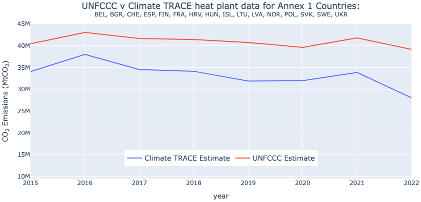

### Power sector: Emissions from Heat Plants

**Jeremy Freeman1,2, Lekha Sridhar1,2, and Madison Alvara1,2**

*1) WattTime, 2) Climate TRACE*

V5.12.0, Oct. 2026

#### 1. Introduction
Heat plants combust fuel to generate heat that is then distributed for thermal comfort or industrial usage via a pipe network to multiple buildings/ units. This is also referred to as “district heating”, which is differentiated from other forms of thermal heating such as onsite fuel usage (the combustion of fuels to produce heat within a single building or residence).

Heat plants are widely used to provide thermal comfort in many countries including Iceland (largest percentage of residents served), China (largest district heating capacity), and several other European countries (Solar Thermal World, 2018). Heat plants can be an effective solution for small towns and college campuses, reducing the necessity of each building installing its own boilers. However, over 90% of the heating supplied by heat plants is currently generated using fossil fuels, making heat plants a globally significant source of greenhouse gas (GHG) emissions (IEA, 2023). In some cases, heat plants can contribute \~0.12% to global emissions which, although a small share globally, represent a significant portion of national totals in some regions, particularly Central Asia and Eastern Europe. That said, there are many opportunities for reducing emissions from heat plants including the use of combined heat and power plants (these are currently included in the Climate TRACE inventory under electricity-production), use of renewable energy to heat (International District Energy Association, n.d.).

This methodology aims to close coverage gaps by estimating country-level heat plants’ emissions. Furthermore, beginning November 2025, Climate TRACE is providing potential emission reduction solutions (ERSs) to understand how this sector’s emissions can be reduced through specific mitigation strategies.

#### 2. Materials and Methods
Heat plant emissions were estimated by applying the Intergovernmental Panel on Climate Change (IPCC) National GHG Inventory Guidelines Tier 1 approach,

EmissionsGHG,fuel = Emission FactorGHG,fuel x Fuel Consumptionfuel

Where:

EmissionsGHG,fuel = emissions of a given GHG by type of fuel (t GHG)

Emission FactorGHG,fuel = default emission factor of a given GHG by type of fuel (t gas/TJ). For CO2, it includes the carbon oxidation factor, assumed to be 1.

Fuel Consumptionfuel = amount of fuel combusted (TJ)

#### 2.1 Datasets employed
Fuel consumption data in heat plants for the years 2015-2024 (2015 is the base year for Climate TRACE’s emissions data and fuel consumption data is only available up to 2024) were obtained from the International Energy Agency’s (IEA) World Energy Balances dataset (2026) which provided energy consumption by fuel type for heat plants. For the purpose of this dataset, the IEA defines heat plants as plants (including heat pumps and electric boilers) designed to produce heat only and who sell heat to a third party (e.g. residential, commercial or industrial consumers) under the provisions of a contract. Main activity producers generate heat for sale to third parties, as their primary activity. They may be privately or publicly owned. Note that the sale need not take place through the public grid (IEA, 2024).

Default emission factors were obtained from the IPCC Emission Factors Database which provides default emission factors for fuel sub-type (IPCC n.d.), which is an update to previous years. Where multiple emission factors were available, an average was used.

Emissions were calculated at country level annually and then were spatially and temporally disaggregated at the county/district level and monthly scale, respectively. In addition, emissions up to present were projected using 2024 emission estimates. To understand the methodology for the spatial and temporal disaggregation, refer to the following documents hosted in the Climate TRACE [Cross-Cutting Methodologies](../../../2-Cross-Cutting/) folder:

-   Collins, G., et al. (2025)- *[Spatial Disaggregation of Spatially Uncertain Emissions](../../../2-Cross-Cutting/spatial-disaggregation/README.md)*.

-   Raniga, K. et al. (2025)- *[Temporal Disaggregation of Emissions Data for the Climate TRACE Inventory](../../../2-Cross-Cutting/temporal-disaggregation/README.md)*.

#### 3. Result Highlights
The global emission total from heat plants for 2025 is 56.7 million tonnes CO2 from 35 countries.

#### 3.1 Validation
16 Annex 1 countries that reported heat plant emissions in their official GHG inventories to the United Nations Framework Convention on Climate Change (UNFCCC) against which Climate TRACE estimates emissions were compared (Figure 1).

**Figure 1** Comparison of emissions from heat plants for 16 Annex 1 countries (aggregated) for which data was available from Climate TRACE and the UNFCCC.

As seen in the Figure 1 comparison, both datasets are largely in agreement on year-on-year emissions trends and magnitude of emissions. This could also be seen at the country level, with the exception of a few countries, where Climate TRACE’s emissions were less than half of what had been officially reported. This may be due to system boundary differences or due to errors in the underlying data.

#### 3.2 Data issues
The underlying IEA activity dataset used to produce emissions estimates has some possible data issues, namely:

1.  Compared to the last release, the IEA has restated some of the countries’ data which is the primary cause of differences between the current data version and previous versions.

2.  There is a large increase in energy consumption in 2021 – it is unclear if this is due to a change in reporting guidelines, a correction of under-reporting in previous years, or an actual increase in heating-based energy consumption in 2021.

3.  One conspicuous absence, both in the UNFCCC reporting and the IEA data is Russia, as the IEA does not provide heat only emissions for the country. In Russia’s official GHG inventory, all emissions under “1.A.1.a. Public electricity and Heat Production” have been attributed to “1.A.1.a.ii. Combined Heat and Power Generation” even though heat plants are known to exist in the country (Power Engineering International, 2009; Reuters, 2024).

#### 4. Conclusion
Climate TRACE aims to address these underlying issues in the data in future iterations by gathering plant level information and other sources of data on energy consumption at heat plants.

#### 5. Emission Reduction Solutions
The Emissions Reduction Solution (ERS) for this sector is one strategy: renewable power to heat. 

***Renewable power to heat***

Current heat technologies include boilers, which are mainly gas-fired and dominate low- to mid-temperature operations up to 500ºC for steam or thermal oil production, and process heaters or furnaces, which produce higher temperatures either directly or indirectly. The solution of using renewable power for heat involves deploying technologies such as solar thermal, geothermal, and industrial waste heat to replace fossil fuel use in these systems.

By substituting conventional fuels with renewable heat sources, emissions from district heating can be reduced by an average of 30% for natural gas systems, with lower or higher reductions depending on the fuel type. Renewable heat projects have been successfully implemented in several countries, including solar heating in Austria and Germany and geothermal installations in Italy and Germany, demonstrating practical feasibility and supporting wider adoption of these technologies (IRENA, 2017; Malcher et al., 2025).

#### 6. Supplementary materials metadata
Country-level emissions estimates for heat plants are available for download at ClimateTRACE.org, and the following table summarizes this data.

**Table S1** General dataset information for “country-climate-trace\_heat-plants\_xxxx24.csv”.

| **General Description**                                                         | **Definition**                                                                                                                                                                                                                                          |
|---------------------------------------------------------------------------------|---------------------------------------------------------------------------------------------------------------------------------------------------------------------------------------------------------------------------------------------------------|
| **Sector definition**                                                           | *Heat Plants*                                                                                                                                                                                                                                           |
| **UNFCCC sector equivalent**                                                    | *1.A.1.a.iii*                                                                                                                                                                                                                                           |
| **Temporal Coverage**                                                           | *January 1, 2015 – current year (2 month lag)*                                                                                                                                                                                                          |
| **Temporal Resolution**                                                         | *Annual (native), monthly after disaggregation*                                                                                                                                                                                                         |
| **Data format(s)**                                                              | *CSV*                                                                                                                                                                                                                                                   |
| **Coordinate Reference System**                                                 | *Not applicable*                                                                                                                                                                                                                                        |
| **Number of sources available for download and percent of global emissions**    | *Country level only, 100% coverage based on what the IEA reports, disaggregated to GADM level 2 regions.*                                                                                                                                               |
| **Ownership**                                                                   | *Not applicable*                                                                                                                                                                                                                                        |
| **What emission factors were used?**                                            | *IPCC Tier 1 emission factors by fuel sub-type*                                                                                                                                                                                                         |
| **What is the difference between a “NULL / none / nan” versus “0” data field?** | *“0” values are for true non-existent emissions. If we know that the sector has emissions for that specific gas, but the gas was not modeled, this is represented by “NULL/none/nan”*                                                                   |
| **total\_CO2e\_100yrGWP and total\_CO2e\_20yrGWP conversions**                  | *Climate TRACE uses IPCC AR6 CO2e global warming potentials (GWPs). CO2e conversion guidelines are here: <https://www.ipcc.ch/report/ar6/wg1/downloads/report/IPCC_AR6_WGI_FullReport_small.pdf>.* |
| **Do the estimates include emissions from biomass fuels?**                      | *No, due to concerns of overcounting since biomass is accounted for by the Climate TRACE forestry and land use sector.*                                                                                                                                 |

**Permissions and Use:** All Climate TRACE data is freely available under the Creative Commons Attribution 4.0 International Public License, unless otherwise noted below.

> **Data citation format:** Freeman, J., Sridhar, L., and Alvara, M. (2026). *Power sector- Emissions from Heat Plants.* WattTime, USA, Climate TRACE Emissions Inventory. https://climatetrace.org \[Accessed date\]

**Geographic boundaries and names (iso3\_country data attribute):** The depiction and use of boundaries, geographic names and related data shown on maps and included in lists, tables, documents, and databases on Climate TRACE are generated from the Global Administrative Areas (GADM) project (Version 4.1 released on 16 July 2022) along with their corresponding ISO3 codes, and with the following adaptations:

-   HKG (China, Hong Kong Special Administrative Region) and MAC (China, Macao Special Administrative Region) are reported at GADM level 0 (country/national);

-   Kosovo has been assigned the ISO3 code ‘XKX’;

-   XCA (Caspian Sea) has been removed from GADM level 0 and the area assigned to countries based on the extent of their territorial waters;

-   XAD (Akrotiri and Dhekelia), XCL (Clipperton Island), XPI (Paracel Islands) and XSP (Spratly Islands) are not included in the Climate TRACE dataset;

-   ZNC name changed to ‘Turkish Republic of Northern Cyprus’ at GADM level 0;

-   The borders between India, Pakistan and China have been assigned to these countries based on GADM codes Z01 to Z09.

The above usage is not warranted to be error free and does not imply the expression of any opinion whatsoever on the part of Climate TRACE Coalition and its partners concerning the legal status of any country, area or territory or of its authorities, or concerning the delimitation of its borders.

**Disclaimer:** The emissions provided for this sector are our current best estimates of emissions, and we are committed to continually increasing the accuracy of the models on all levels. Please review our terms of use and the sector-specific methodology documentation before using the data. If you identify an error or would like to participate in our data validation process, please [contact us](mailto:coalition@climatetrace.org).

#### References
1.  International District Energy Association (undated), District Heating: [https://www.districtenergy.org/topics/district-heating](https://www.districtenergy.org/topics/district-heating) \[last accessed 11 Nov 2024\]

2.  International Energy Agency (2023), District Heating. Available at: [https://www.iea.org/energy-system/buildings/district-heating](https://www.iea.org/energy-system/buildings/district-heating) \[last accessed 11 Nov 2024\]

3.  International Energy Agency (2024), World Energy Balances. Available at: [https://iea.blob.core.windows.net/assets/feea6879-1796-41c1-b8a1-2da8c181cba0/WORLDBAL\_Documentation.pdf](https://iea.blob.core.windows.net/assets/feea6879-1796-41c1-b8a1-2da8c181cba0/WORLDBAL_Documentation.pdf) \[last accessed 11 Nov 2024\]

4.  Intergovernmental Panel on Climate Change (undated), Emission Factors Database. Available at: [https://www.ipcc-nggip.iges.or.jp/EFDB/main.php](https://www.ipcc-nggip.iges.or.jp/EFDB/main.php) \[last accessed 11 Nov 2024\].

5.  IRENA (2017) Renewable energy in district heating and cooling. Available at: [https://www.irena.org/publications/2017/Mar/Renewable-energy-in-district-heating-and-cooling\#:\~:text=As%20this%20REmap%20sector%20study,in%20China%2C%20Denmark%20and%20Germany](https://www.irena.org/publications/2017/Mar/Renewable-energy-in-district-heating-and-cooling#:~:text=As%20this%20REmap%20sector%20study,in%20China%2C%20Denmark%20and%20Germany) (Accessed: 22 October 2025).

6.  Malcher, X., Tenorio-Rodriguez, F.C., Finkbeiner, M. and Gonzalez-Salazar, M. (2025) ‘Decarbonization of district heating: A systematic review of carbon footprint and key mitigation strategies’, *Renewable and Sustainable Energy Reviews*, 215, 115602. Available at: [https://doi.org/10.1016/j.rser.2025.115602](https://doi.org/10.1016/j.rser.2025.115602)

7.  Power Engineering International (Nov 01, 2009), District heating and CHP in Russia: Room for improvement: [https://www.powerengineeringint.com/decentralized-energy/district-energy/district-heating-and/](https://www.powerengineeringint.com/decentralized-energy/district-energy/district-heating-and/) \[last accessed 11 Nov 2024\].

8.  Reuters (January 9, 2024), Russia arrests three officials over heating outages south of Moscow: [https://www.reuters.com/world/europe/three-arrested-over-heating-outages-south-moscow-2024-01-09/](https://www.reuters.com/world/europe/three-arrested-over-heating-outages-south-moscow-2024-01-09/) \[last accessed 11 Nov 2024\].

9.  Solar Thermal World (2018), Top District Heating Countries – Euroheat & Power 2015 Survey Analysis: Available at: [https://solarthermalworld.org/news/top-district-heating-countries-euroheat-power-2015-survey-analysis/](https://solarthermalworld.org/news/top-district-heating-countries-euroheat-power-2015-survey-analysis/) \[last accessed 11 Nov 2024\].
