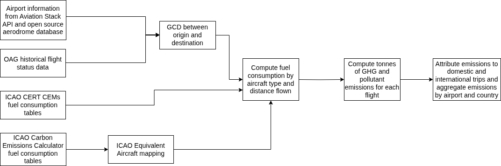
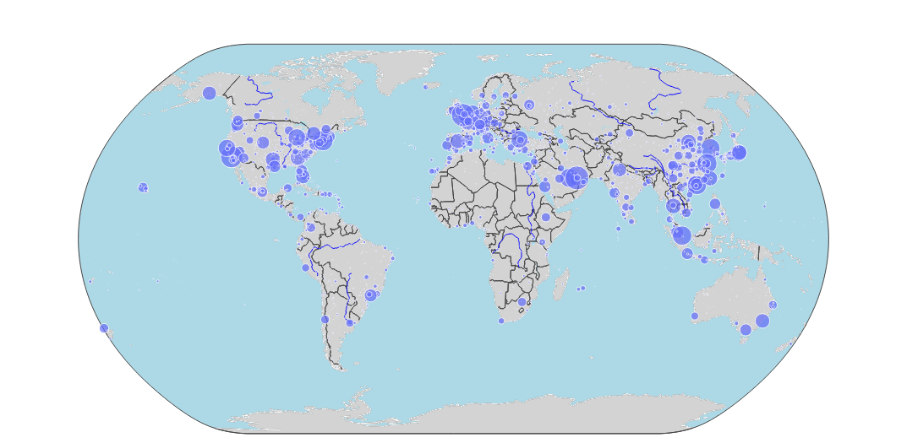

### Transportation sector: Domestic and International Aviation Emissions

**Ishan Saraswat**

*Author affiliated with WattTime and Climate TRACE*

V5.11.0, Sept. 2026

#### 1. Introduction

The aviation sector is considered to be part of the top ten global emitting sectors and emissions are expected to climb due to increased demand for aviation fuel (Perlman, 2018; IEA, 2019). Unfortunately, aviation, along with other transportation sectors, was exempted from the Paris treaty and not considered on track to decrease emissions (Twidale and Saul, 2015; Edie, 2020, Climate Action Tracker, 2020). As a result, current efforts to reduce aviation emissions have proven woefully inadequate (Perlman, 2018).

To improve the monitoring and measuring of global aviation greenhouse gas (GHG) emissions, as well as serving as an input for the environmental management of the sector, Climate TRACE employs the International Civil Aviation Organization’s (ICAO) Carbon Emissions Calculator methodology to estimate both domestic and international aviation emissions. The ICAO methodology uses a Tier 3a approach defined by the Intergovernmental Panel on Climate Change (IPCC). The Tier 3a method, which is more detailed, considers information about aircraft movement, such as origin and destination aerodromes (locations where aircraft operations occur) and aircraft model. This method was applied to estimate fuel consumption and emissions of atmospheric pollutants and GHGs while allowing for their discrimination based on type of movement - domestic or international.

Furthermore, beginning November 2025, Climate TRACE is providing potential emission reduction solutions (ERSs) to understand how sector specific mitigation strategies can reduce emissions for this sector. For aviation, the use of sustainable aviation fuels offers a practical way to reduce the aviation sector’s climate impact. By replacing conventional jet fuel with Sustainable Aviation Fuel (SAF) blends provides an alternative jet fuel made from non-petroleum, renewable sources (e.g. waste cooking oil, agricultural waste, or synthetic fuels from captured carbon). This can be blended with standard jet fuel and used in existing aircraft without engine modifications (DOE, 2023). A second solution is fleet renewal: replacing previous-generation aircraft with current-generation successors — the A320neo family, 737 MAX, A350, 787 and Embraer E2 — which burn about 13% less fuel per flight.

#### 2. Materials and Methods

Climate TRACE used ICAO Carbon Emissions Calculator Methodology, Version 13.1, ICAO CO2 Estimate Models (CEMs) (ICAO CERT, 2019) along with Official Airline Guides (OAG) Historical Flight Status Data for all domestic and international passenger, commercial, private flights and general aviation starting from January 1, 2015, to September 30, 2025. The emissions estimates, based on fuel consumption, include direct GHG emissions: carbon dioxide (CO2), methane (CH4) and nitrous oxide (N2O) and non-GHG emissions of nitrogen oxides (NOx)

This sector does not include the following:

-   Primary pollutants emissions (carbon monoxide, volatile organic compounds, sulfur dioxide and particulate matter);

-   Ethanol-powered aircraft; and

-   The calculations are made for each flight between a origin and destination pair for all national aerodromes, except those referring to helicopters, military aircraft and agricultural aircrafts.

#### 2.1 Datasets employed

The Official Airline Guides (OAG) historical flight status database provides the main source of information for the ICAO method. Additional information was used, such as fuel consumption rates for specific aircraft types and great circle distances, provided by ICAO, and airport data including geographic coordinates of aerodromes from OurAirports.com ([https://ourairports.com/](https://ourairports.com/)) and the Aviation Stack API ([https://aviationstack.com/](https://aviationstack.com/)).

#### 2.1.1 Activity data: aircraft movement

Historical flight records were obtained from OAG ([https://www.oag.com/](https://www.oag.com/)). The data (covering historical flight departures and arrivals) was available on a monthly time scale from Jan 2015 - Sep 2025 allowing for the creation of a database containing flights from 2015 to 2025. The following attributes were available:

-   The monthly frequency of a particular flight between a pair of origin and destination airports;

-   IATA aircraft type code;

-   ICAO code of origin and destination airports;

-   Airline/flight operator; and

-   Flight origin and destination country codes which can be used to classify into domestic or international trips

#### 2.1.2 ERS Data on Sustainable Aviation Fuels

Since SAF usage is not directly measured in our original datasets, we rely on industry and government reports to characterize SAF supply and adoption. Key sources include U.S. Department of Energy (DOE) and Environmental Protection Agency (EPA) data on SAF production and consumption. For example, U.S. EPA data indicate that approximately 24.5 million gallons of SAF were consumed in 2023 (DOE, 2023). Commercial SAF production is still small but growing. Leading airlines and airports are beginning to use SAF: for instance, United Airlines announced it will procure 1 million gallons of SAF from Neste for use at Chicago O’Hare in 2024, and JetBlue secured a multi-year supply of about 5 million gallons for New York JFK airport (Mok, 2024). Policies are also driving SAF uptake - like the EU’s ReFuelEU Aviation regulation mandates that jet fuel contain increasing SAF blends (e.g. 2% by 2025, rising to 6% by 2030) (Directorate-General for Mobility and Transport, 2025).

#### 2.2 Model

Figure 1 provides an overview of the model applied by Climate TRACE along with the main data sources to calculate GHG emissions by domestic and international aviation.

**Figure 1** Flow of inputs and outputs to generate aviation emissions. Steps are described in section 2.3.

#### 2.2.1 ERS Modeling

To incorporate SAF as an ERS in our model, we calculated the estimated emissions reductions based on the assumed SAF fraction and its emissions factor. In our estimates we assume SAF yields about 75% less life-cycle CO2 than fossil jet fuel. Some SAF feedstocks can achieve up to 80% lifecycle CO2 reductions (IATA, 2025). Thus, each kilogram of SAF contributes only 25% of the CO2 of the same mass of fossil fuel. We also assume a 10% SAF blend with conventional jet fuel. This assumption is aggressive but realistic and aligns with current SAF adoption examples. For instance, Airbus reports that for its internal operations—including delivery flights and employee shuttles—it has been using Sustainable Aviation Fuel blends of around 34 % on the Hamburg–Toulouse route since 2022 (Airbus, 2025). Similar high-blend demonstrations indicate that 10 % SAF scenarios are well within current operational feasibility.

#### 2.3 Methodology

The aviation stack API, open source aerodrome database and OAG historical flight status data were used to calculate the Great Circle Distance (GCD) between every origin and destination pair using airport location data (latitude and longitude) from these sources. The specific aircraft type IATA code was then used to match the ICAO CO2 Estimation Models (CEMs) based on the great circle distance. (Table A-1.2.a: ICAO CERT 2019). These fuel consumption rates are based on actual airline operational data from the CORSIA CERT Group (CCG) Operations and Fuel Database (COFdb). Those aircraft types which did not find a match in the CEMs fuel tables, were mapped to an equivalent aircraft type using ICAO’s Equivalent Aircraft Mapping (Appendix B: ICAO Carbon Emissions Calculator Methodology) and matched to the respective entry in the ICAO fuel consumption table. (Appendix C: ICAO Carbon Emissions Calculator Methodology). A correction factor was applied to the GCD for these aircraft types to account for distance flown in excess of the GCD due to stacking, traffic and weather-driven factors as per the ICAO methodology.

Next, the CEMs fuel tables and the ICAO fuel consumption tables were used to estimate fuel consumption by aircraft type and distance flown for each trip between an origin and destination. Lastly, the fuel burned for each trip was converted to the equivalent GHG emissions using an aviation fuel emissions factor of 3.16 kg of CO2 emitted per kilogram of fuel combusted.

Finally, the resulting GHG emissions were either attributed fully to a country, if the route was domestic, or divided in half between countries in case of an international route. For airport source level emissions attribution, the GHG was divided in half between airports and the trip was classified into domestic or international category. The emissions for each country and airport were then aggregated by year and month to give the total aviation emissions by country and airport for 2015-2025. Figure 2 provides an example of the airport coverage and relative emissions generated at each one.

**Figure 2:** Visualization of global airport coverage. Size of circle represents annual total CO2e 100-year Global Warming Potential (GWP100) emissions in 2024.

#### 2.3.1 Landing and Take Off (LTO) Cycle emissions

For each airport we also report the share of emissions produced during the landing and take-off (LTO) cycle — taxi, take-off, climb-out, approach and taxi-in, all below roughly 3,000 feet. These are the emissions relevant to local air quality, as distinct from the cruise emissions spread along the route.

Since our fuel burn figures are gate-to-gate (they already include the LTO cycle), we estimate each flight's LTO share rather than adding it on top. The share, per aircraft type, comes from the EMEP/EEA Air Pollutant Emission Inventory Guidebook 2023 (data © EUROCONTROL 2023), which tabulates LTO and climb/cruise/descent fuel and emissions by type and distance.

The origin and destination airports split the LTO emissions by the standard half-cycle convention (ICAO Doc 9889): the departure airport takes taxi-out, take-off and climb-out (about 70% of LTO CO₂, 80% of LTO NOx), the arrival airport takes approach and taxi-in. Per-airport LTO CO₂ and NOx appear in the ‘other1’ and ‘other2’ fields. Across the fleet, LTO accounts for about 12% of aviation CO₂.

#### 2.3.2 Incorporating SAF as an emissions reducing solution

We incorporate SAF into the emissions model by applying a reduction factor to the calculated fuel burn for each flight. Concretely, if a flight burns *F* kg of fuel and a fraction *f* of that fuel is SAF, we reduce the CO2 emissions by f × Δ, where Δ is the fractional reduction in life-cycle CO2 intensity of SAF relative to conventional fuel. This linear blending approach transparently reflects how incremental SAF use cuts emissions. Our method is illustrative – it uses theoretical assumptions from literature and industry (e.g. assuming Δ=0.75 and a 10% blend) and scales emissions accordingly.

#### 2.3.3 Fleet Renewal as emissions reducing solution

The second emissions-reducing solution models replacing previous-generation aircraft with current-generation, in-production successors — the A320neo family, 737 MAX, A350, 787 and Embraer E2. These burn about 13% less fuel per flight, a deliberately conservative figure (industry sources report 15–20% per seat). For each airport we estimate the share of activity flown by previous-generation aircraft and apply the reduction to that share.

#### 2.4 Uncertainty in measurements

There is uncertainty connected to all computed data attributes as part of the modeling process. The uncertainty is defined in terms of standard deviation for each data attribute and provided as *data\_attribute\_value +/- uncertainty\_value*.

**Table 1: Uncertainty definition for metadata**

| **Data Attribute**        | **Uncertainty Definition**                                                                                                                                                                                                                                                                                                                                                                                                                                            |
|---------------------------|-----------------------------------------------------------------------------------------------------------------------------------------------------------------------------------------------------------------------------------------------------------------------------------------------------------------------------------------------------------------------------------------------------------------------------------------------------------------------|
| **Capacity**              | 0\. Capacity is defined as the number of flights between two aerodromes and comes from actual historical records of flights that have taken place.                                                                                                                                                                                                                                                                                                                    |
| **Activity**              | Activity is defined as the amount of fuel consumption in tonnes. There is uncertainty in various steps of the ICAO carbon emissions methodology to estimate fuel consumption like the actual distance covered by each flight which is estimated by the Great Circle Distance with a correction factor and the fuel consumption based on the distance traveled computed from ICAO data on specific aircraft types. Estimated at ±10% for all flights. \[3\] |
| **Capacity Factor**       | Propagated from capacity and activity uncertainty                                                                                                                                                                                                                                                                                                                                                                                                                     |
| **CO2 Emissions Factor**  | Estimated at ±5% \[8\]                                                                                                                                                                                                                                                                                                                                                                                                                                     |
| **CH4 Emissions Factor**  | Estimated at ±78.5% \[9\]                                                                                                                                                                                                                                                                                                                                                                                                                                  |
| **N2O Emissions Factor**  | Estimated at ±110% \[9\]                                                                                                                                                                                                                                                                                                                                                                                                                                   |
| **CO2 Emissions**         | Propagated from activity and CO2 emissions factor uncertainty                                                                                                                                                                                                                                                                                                                                                                                                         |
| **CH4 Emissions**         | Propagated from activity and CH4 emissions factor uncertainty                                                                                                                                                                                                                                                                                                                                                                                                         |
| **N2O Emissions**         | Propagated from activity and N2O emissions factor uncertainty                                                                                                                                                                                                                                                                                                                                                                                                         |
| **CO2e 20 yr Emissions**  | Propagated from CO2, CH4 and N2O emissions uncertainties                                                                                                                                                                                                                                                                                                                                                                                                              |
| **CO2e 100 yr Emissions** | Propagated from CO2, CH4 and N2O emissions uncertainties                                                                                                                                                                                                                                                                                                                                                                                                              |

#### 3. Supplemental data

**Table S1** Metadata for *Domestic and International Aviation Emissions.* For users, these terms translate to the following: Capacity = total number of flights between two aerodromes; Capacity factor = fuel burnt per flight in tonnes; Activity = total fuel consumption on a route monthly or annually. Note, Capacity *x* Capacity factor = Activity.

| **General Description**                                                     | **Definition**                                                                                                                                                                                                               |
|-----------------------------------------------------------------------------|------------------------------------------------------------------------------------------------------------------------------------------------------------------------------------------------------------------------------|
| **Sector definition**                                                       | *Domestic and International Aviation emissions*                                                                                                                                                                              |
| **UNFCCC sector equivalent**                                                | *1.A.3.a - Domestic Aviation and Memo items - International aviation*                                                                                                                                                        |
| **Temporal Coverage**                                                       | *2015 – July 2026 (as of V5.11, 2 month lag with submitted data)*                                                                                                                                                            |
| **Temporal Resolution**                                                     | *Monthly*                                                                                                                                                                                                                    |
| **Data format**                                                             | *CSV*                                                                                                                                                                                                                        |
| **Coordinate Reference System**                                             | *None. ISO3 country code and airport locations (lat, long) provided*                                                                                                                                                         |
| **Number of emitters available for download**                               | *\~5,150 airport locations in 236 countries*                                                                                                                                                                                 |
| **Ownership**                                                               | *All operations include airline/operator level ownership information.*                                                                                                                                                       |
| **What emission factors were used?**                                        | *IPCC CH. 3*                                                                                                                                                                                                                 |
| **What is the difference between a “0” versus “NULL/none/nan” data field?** | *“0” values are for non-existent emissions. If the sector has emissions for that specific gas, but the gas was not modeled, this is represented by “NULL” or blanks.*                                                        |
| **total\_CO2e\_100yrGWP and total\_CO2e\_20yrGWP conversions**              | *Climate TRACE uses IPCC AR6 CO2e GWPs. CO2e conversion guidelines are here: https://www.ipcc.ch/report/ar6/wg1/downloads/report/IPCC\_AR6\_WGI\_FullReport\_small.pdf* |

**Table S2** ERS Table for aviation emissions. The main ERS employed for this sector is using Sustainable Aviation Fuel (SAF) blends.

| **strategy\_id**                                | SAF\_10\_75                                                                    | FLEET\_RENEW\_&lt;n&gt;                                                                                                                       |
|-------------------------------------------------|--------------------------------------------------------------------------------|-----------------------------------------------------------------------------------------------------------------------------------------------|
| **strategy\_name**                              | Sustainable Aviation Fuel                                                      | Fleet renewal to current-generation aircraft                                                                                                  |
| **strategy\_description**                       | 10% SAF blend at the airport with 75% Lifecycle CO2 reduction per unit of fuel | Replace previous-generation aircraft (≥n% of activity at this airport) with in-production successors; 13% lower fuel burn per affected flight |
| **mechanism**                                   | retrofit                                                                       | retrofit                                                                                                                                      |
| **co2\_emissions\_factor\_new\_to\_old\_ratio** | 0.925                                                                          | 0.87                                                                                                                                          |
| **ch4\_emissions\_factor\_new\_to\_old\_ratio** | 1.0                                                                            | 0.87                                                                                                                                          |
| **n2o\_emissions\_factor\_new\_to\_old\_ratio** | 1.0                                                                            | 0.87                                                                                                                                          |
| **confidence**                                  | high                                                                           | high                                                                                                                                          |

**Permissions and Use:** All Climate TRACE data is freely available under the Creative Commons Attribution 4.0 International Public License, unless otherwise noted below.

**Citation format:** Saraswat, I. (2026). *Transportation sector - Domestic and International Aviation Emissions.* WattTime, USA, Climate TRACE Emissions Inventory. https://climatetrace.org \[Accessed date\]

**Geographic boundaries and names (iso3\_country data attribute):** The depiction and use of boundaries, geographic names and related data shown on maps and included in lists, tables, documents, and databases on Climate TRACE are generated from the Global Administrative Areas (GADM) project (Version 4.1 released on 16 July 2022) along with their corresponding ISO3 codes, and with the following adaptations:

-   HKG (China, Hong Kong Special Administrative Region) and MAC (China, Macao Special Administrative Region) are reported at GADM level 0 (country/national);

-   Kosovo has been assigned the ISO3 code ‘XKX’;

-   XCA (Caspian Sea) has been removed from GADM level 0 and the area assigned to countries based on the extent of their territorial waters;

-   XAD (Akrotiri and Dhekelia), XCL (Clipperton Island), XPI (Paracel Islands) and XSP (Spratly Islands) are not included in the Climate TRACE dataset;

-   ZNC name changed to ‘Turkish Republic of Northern Cyprus’ at GADM level 0;

-   The borders between India, Pakistan and China have been assigned to these countries based on GADM codes Z01 to Z09.

The above usage is not warranted to be error free and does not imply the expression of any opinion whatsoever on the part of Climate TRACE Coalition and its partners concerning the legal status of any country, area or territory or of its authorities, or concerning the delimitation of its borders.

> **Disclaimer:** The emissions provided for this sector are our current best estimates of emissions, and we are committed to continually increasing the accuracy of the models on all levels. Please review our terms of use and the sector-specific methodology documentation before using the data. If you identify an error or would like to participate in our data validation process, please [contact us](mailto:coalition@climatetrace.org).

#### References

1.  Airbus, 2025. *Deploying SAF in our operations.* Airbus. Available at: [https://www.airbus.com/en/newsroom/stories/2025-03-deploying-saf-in-our-operations](https://www.airbus.com/en/newsroom/stories/2025-03-deploying-saf-in-our-operations?utm_source=chatgpt.com) \[Accessed 7 Nov. 2025\].

2.  Climate Action Tracker, 2020. *International shipping and aviation emissions goals both “Critically insufficient”.* Climate Action Tracker. Available at: [https://climateactiontracker.org/press/international-shipping-and-aviation-emissions-goals-both-critically-insufficient/](https://climateactiontracker.org/press/international-shipping-and-aviation-emissions-goals-both-critically-insufficient/) \[Accessed 27 Aug. 2022\].

3.  Directorate-General for Mobility and Transport (European Commission), 2025. *New report shows progress in sustainable aviation fuel uptake across the EU.* European Commission. Available at: [https://transport.ec.europa.eu/news-events/news/new-report-shows-progress-sustainable-aviation-fuel-uptake-across-eu-2025-10-22\_en\#:\~:text=According%20to%20the%20findings%2C%20implementation,in%202030%2C%20which%20is%206](https://transport.ec.europa.eu/news-events/news/new-report-shows-progress-sustainable-aviation-fuel-uptake-across-eu-2025-10-22_en?utm_source=chatgpt.com#:~:text=According%20to%20the%20findings%2C%20implementation,in%202030%2C%20which%20is%206) \[Accessed 7 Nov. 2025\].

4.  DOE, 2023. *Sustainable Aviation Fuel.* U.S. Department of Energy, Alternative Fuels Data Center. Available at: [https://afdc.energy.gov/fuels/sustainable-aviation-fuel](https://afdc.energy.gov/fuels/sustainable-aviation-fuel) \[Accessed 6 Nov. 2025\].

5.  Edie, 2020. *Shipping, aviation and carmakers failing to align with Paris Agreement.* Edie. Available at: [https://www.edie.net/shipping-aviation-and-carmakers-failing-to-align-with-paris-agreement/](https://www.edie.net/shipping-aviation-and-carmakers-failing-to-align-with-paris-agreement/) \[Accessed 27 Aug. 2022\].

6.  International Civil Aviation Organization (ICAO), 2019. *ICAO CORSIA CO₂ Estimation and Reporting Tool (CERT).* Montreal, Canada: ICAO. Available at: [https://www.icao.int/environmental-protection/CORSIA/CERTTool/ICAO%20CORSIA%20CERT%20version%202019%20-%20Design,%20Development%20and%20Validation.pdf](https://www.icao.int/environmental-protection/CORSIA/CERTTool/ICAO%20CORSIA%20CERT%20version%202019%20-%20Design,%20Development%20and%20Validation.pdf) \[Accessed 27 Aug. 2022\].

7.  International Civil Aviation Organization (ICAO), 2024. *ICAO Carbon Emissions Calculator Methodology Version 13.1.* Montreal, Canada: ICAO. Available at: [https://applications.icao.int/icec/Methodology%20ICAO%20Carbon%20Emissions%20Calculator\_v13\_Final.pdf](https://applications.icao.int/icec/Methodology%20ICAO%20Carbon%20Emissions%20Calculator_v13_Final.pdf) \[Accessed 27 Aug. 2022\].

8.  International Energy Agency (IEA), 2019. *World Energy Outlook 2019.* Paris: IEA. Available at: [https://www.iea.org/reports/world-energy-outlook-2019](https://www.iea.org/reports/world-energy-outlook-2019) \[Accessed 27 Aug. 2022\].

9.  Intergovernmental Panel on Climate Change (IPCC), 2006. *Table 3.6.5: Non-CO₂ emission factors.* In: *2006 IPCC Guidelines for National Greenhouse Gas Inventories, Volume 2: Energy, Chapter 3: Mobile Combustion,* p.3.67. IPCC. Available at: [https://www.ipcc-nggip.iges.or.jp/public/2006gl/pdf/2\_Volume2/V2\_3\_Ch3\_Mobile\_Combustion.pdf](https://www.ipcc-nggip.iges.or.jp/public/2006gl/pdf/2_Volume2/V2_3_Ch3_Mobile_Combustion.pdf) \[Accessed 27 Aug. 2022\].

10. Mok, A., 2024. *United Airlines set to start using low-carbon jet fuel at O’Hare airport.* Canary Media. Available at: [https://www.canarymedia.com/articles/transportation/united-airlines-gives-sustainable-aviation-fuel-a-lift](https://www.canarymedia.com/articles/transportation/united-airlines-gives-sustainable-aviation-fuel-a-lift?utm_source=chatgpt.com) \[Accessed 7 Nov. 2025\].

11. Perlman, K., 2018. *Contribution of the global aviation sector to achieving Paris Agreement climate objectives.* Climate Action Network. Available at: [https://policycommons.net/artifacts/2120603/contribution-of-the-global-aviation-sector-to-achieving-paris-agreement-climate-objectives/2875901/](https://policycommons.net/artifacts/2120603/contribution-of-the-global-aviation-sector-to-achieving-paris-agreement-climate-objectives/2875901/) \[Accessed 27 Aug. 2022\].

12. Rypdal, K., 2000. *Aircraft Emissions.* In: *Good Practice Guidance and Uncertainty Management in National Greenhouse Gas Inventories.* Intergovernmental Panel on Climate Change (IPCC). Available at: [https://www.ipcc-nggip.iges.or.jp/public/gp/bgp/2\_5\_Aircraft.pdf](https://www.ipcc-nggip.iges.or.jp/public/gp/bgp/2_5_Aircraft.pdf) \[Accessed 27 Aug. 2022\].

13. Twidale, S. and Saul, J., 2015. *Off the radar? Shipping, aviation dropped from Paris climate text.* Reuters. Available at: [https://www.reuters.com/article/us-climatechange-summit-shipping-idUSKBN0TT2PQ20151209](https://www.reuters.com/article/us-climatechange-summit-shipping-idUSKBN0TT2PQ20151209) \[Accessed 27 Aug. 2022\].

14. European Environment Agency (EEA), 2023. EMEP/EEA air pollutant emission inventory guidebook 2023 — 1.A.3.a Aviation. Copenhagen: European Environment Agency. Available at: [https://www.eea.europa.eu/en/analysis/publications/emep-eea-guidebook-2023/part-b-sectoral-guidance-chapters/1-energy/1-a-combustion/1-a-3-a-aviation](https://www.eea.europa.eu/en/analysis/publications/emep-eea-guidebook-2023/part-b-sectoral-guidance-chapters/1-energy/1-a-combustion/1-a-3-a-aviation) \[Accessed 12 Sep. 2026\].
