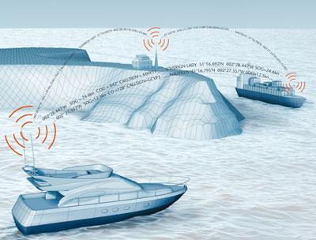
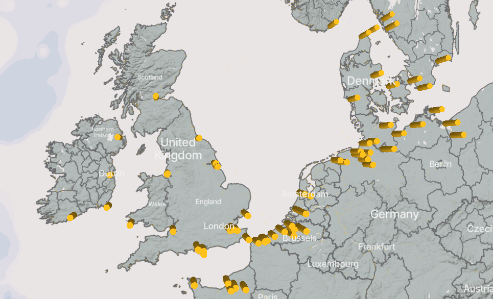
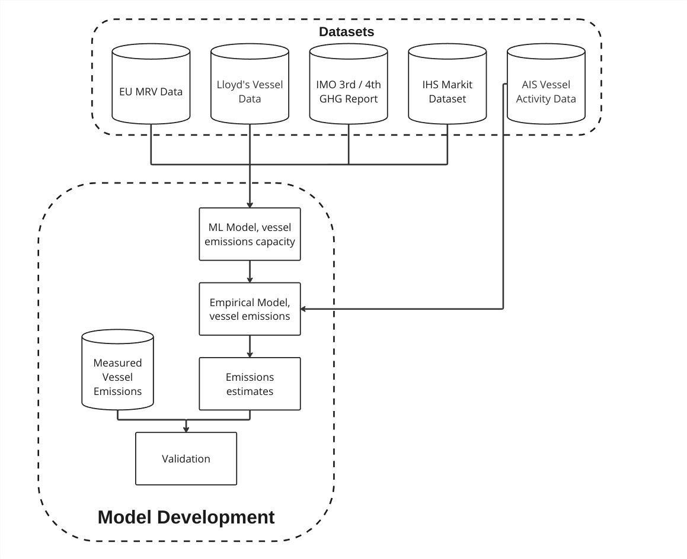
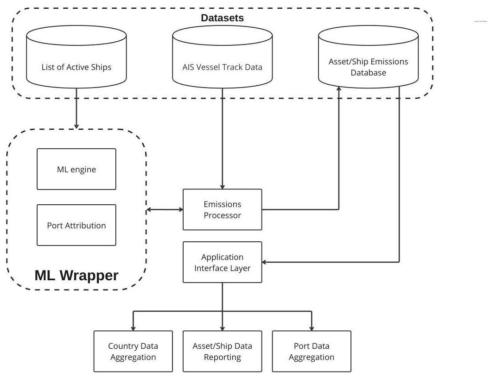
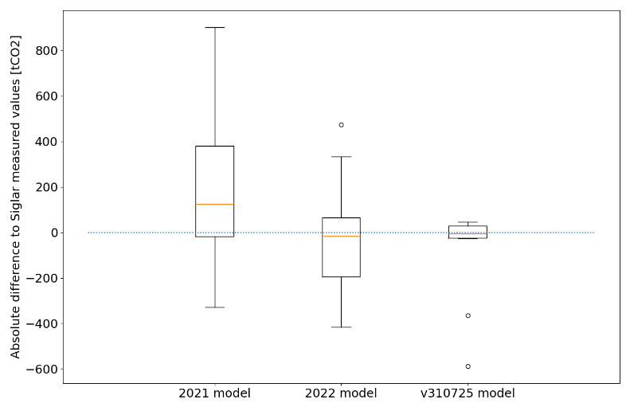
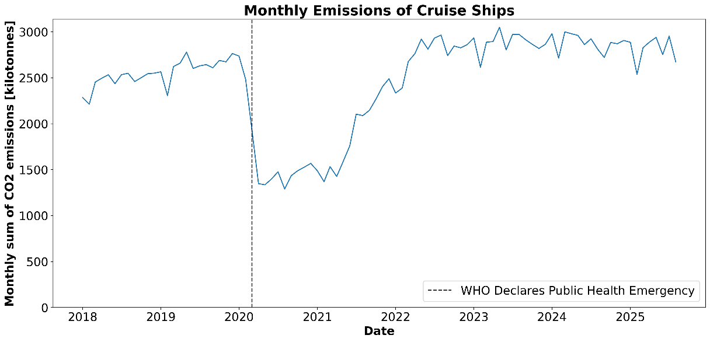
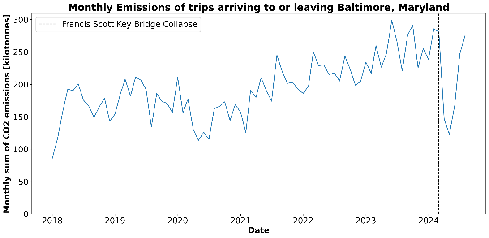

### Transportation sector: Domestic and International Shipping Emissions

**Brett Mayes1,3, Trevor Thomas1,3, Martina Masanova1,3, Melanie Tuckerman1,3, Mark Powell1,3, Dan Knights2,3, Max Schofield1,3 and Ted Mackereth1,3**

*1) OceanMind, 2) University of Minnesota, 3) Climate TRACE*

#### Introduction

In the IMO’s 2021 4th greenhouse gas (GHG) study, GHG emissions from global shipping are estimated to be just below 3% of total anthropogenic GHG emissions (IMO 2021). Despite the significance of this level of emissions, international shipping, along with international aviation, is not explicitly mentioned as part of the Nationally Determined Contributions that countries must submit as part of the Paris Climate Agreement (UNFCCC 2016). This means that, at the moment, other authorities are taking responsibility for decarbonizing shipping. The International Maritime Organization (IMO) is the United Nations (UN) body with authority to regulate international shipping. Positive progress has been made by the IMO to encourage decarbonisation, with adoption of their revised decarbonation strategy in July 2023 (IMO 2023).However, there is contention as to whether this strategy will be sufficient to achieve the level of decarbonisation required to meet the Paris agreement temperature goals, with projections that shipping emissions could account for 17% of global emissions by 2050 (Halim et al. 2018).

Some shipping companies are demonstrating leadership and taking steps towards decarbonization, which includes voluntary actions to disclose GHG and non-GHG emissions, decarbonization pledges, and development of tools and approaches to support decarbonization. The Ship it Zero campaign is an example of efforts to support low emissions shipping (Ship it Zero 2021). Such mechanisms have been effective in providing tangible benefits for industry leaders in other industries that implement socially beneficial policies that may increase costs in the short term (Virdin et al. 2022). But not all shipping companies are proactive, and binding requirements may be necessary to achieve shipping emissions reduction consistent with the Paris Accord. To further encourage emission reductions in the sector, the IMO has devised a further strategy to support the shipping industry in achieving net-zero emissions (IMO 2025). This strategy includes fines for vessels that aren’t meeting targets for the use of cleaner fuels and using the collected money to fund research and innovation in net-zero technologies. Information on shipping emissions has also been produced to inform decarbonization and investment decisions. The results of these emissions evaluations have been presented as carbon efficiency levels aggregated at the level of sectors or transit routes(Clean Cargo Working Group (CCWG) 2017; Poseidon Principles 2021; RightShip, n.d.). Agreements like this will be essential in pushing forward decarbonisation trajectories in the sector, however discussions in 2025 have deferred the implementation of this strategy until late 2026.

Studies of emissions from global shipping include comprehensive estimates of total shipping emissions commissioned by the IMO (IMO 2015, 2021), and studies by others (Olmer et al. 2017). In addition, the European Union has created a monitoring, reporting and verification program and publishes ship emissions data annually for ships that call on EU ports (EMSA, n.d.). Results from these studies include global emissions totals for all ships and by shipping subsector (e.g., container ships, oil tankers, vehicle carriers, etc.). These studies also included emissions by operational phase (cruising speed, berth, anchor, manoeuvring) and analysis of factors that can influence emissions such as vessel speed. None of these studies provide emissions estimates for individual vessels.

The best current publicly accessible source of emissions from individual vessels is the European Union Monitoring, Reporting, and Validation (EU MRV) database with data on emissions from individual vessels that call on EU ports, which claims to include about 25% of the world’s commercial shipping fleet each year. It is the only large-scale published record of individual vessel emissions, but gaps remain for the remaining 75% of vessels that do not call on EU ports. The MRV data is part of the EU effort to encourage decarbonization by monitoring emissions and potentially establishing a cost for carbon emissions from shipping. To date, the EU MRV has published 7 years of emissions data and now contributes to the EU Emissions Trading System (ETS) (European Commission 2020). This program gives out an ‘allowance’ each year of how many tonnes of CO2 are allowed to be emitted that year to stay in line with the EU decarbonisation trajectories. These allowances are auctioned off and can be traded between companies, but the allocation reduces each year, to encourage companies to reduce their emissions over time. If a company breaks the allowance that they have purchased, they can be fined for each additional tonne of CO2 emitted. As of January 2024, CO2 emissions from shipping are now being considered as contributing towards these allowances, with methane and nitrous oxide emissions now added as of 2026.

All this information shows that an extensive, reliable dataset of emissions data at the vessel level is still lacking, as most public facing datasets are aggregated either temporally (only yearly totals per vessel), at a fleet level (one emissions number for all vessels), or both. OceanMind has developed an approach that makes use of readily available data and modelling to close the gap in ship emissions reporting. Recent advances in machine learning (ML), increased access to ship data via Automatic Identification System (AIS), and cloud processing allow for improved estimation of ship emissions for greater transparency. We used the EU MRV data and published emissions models from studies by the IMO and International Council on Clean Transportation to develop our model (IMO 2015, 2021; Olmer et al. 2017). Our model relied on two components. First, a ML model was developed using the EU MRV data that predicted the engine power required at a vessel’s cruising speed based on ship characteristics such as vessel size, maximum engine power, year built, and other factors (see section 2.2 below). This power is then used, along with the activity and speed data to estimate the amount of energy required for a vessel to carry out journeys and manoeuvres. With the vessel’s fuel type known, this amount of energy can then be converted into an amount of fuel burnt, and eventually an emissions estimate.

From the descriptions above, it is evident that there is a lot of momentum currently in the shipping sector to drive forward emissions reductions. As a result, OceanMind investigated how vessels loitering outside ports contributes to ‘wasted’ emissions. The idea for this emissions reduction solution (ERS) was born from noticing how vessels would often conduct journeys of a few days, followed by multiple weeks of loitering outside a port, either at anchor or sometimes steaming and drifting. This ERS and further ERS solutions that target using alternative fuels and implementing slow steaming are discussed in Section 2.7.

Together, these techniques were used to estimate emissions for CO2, CH4, N2O, and six different non-GHGs per vessel for over 58,000 vessels. This data is reported on the Climate TRACE website as individual trips, as well as aggregated data by ports for over 12,000 ports and at the country level. Alongside this, emissions reductions data is available aggregated to the port level ([https://climatetrace.org/](https://climatetrace.org/)).

#### Methodology

The following section describes the datasets employed and the methodology used by OceanMind to develop a model for estimating GHG emissions from the shipping industry. The model was developed in three stages:

1.  **ML Model** - The ML part of the model was developed to estimate the cruising engine power of a vessel.

2.  **Energy estimation** - Combining the cruising engine power with the variation of drag based on speed and the effects of acceleration/deceleration to estimate the energy required to move the vessel.

3.  **Fuel and emissions estimates** - Taking the amount of energy required and the specific fuel consumption values for various fuels, the amount of fuel and therefore the amount of emissions can be estimated based on known emissions factors.

#### 1.  Datasets employed

OceanMind used a variety of data sources for various tasks throughout the process of developing the model. Data was needed not only to train the ML model, but as a validation tool to ensure the emissions estimates were realistic and sensible. Each of the data sources will be described below, as well as how the data was used in the development process.

#### IMO GHG Reports and Committee Documentation

The IMO produced models which combine vessel characteristics with their activity to understand the physical processes that affect the output of emissions for vessels, in what they refer to as a ‘bottom up’ approach. In their GHG reports the IMO published the aggregated results of this methodology, showing the trends across different vessel types and shipping sectors (IMO 2015, 2021).From these studies, OceanMind used the auxiliary engine power demand by ship type, size, and operational phase to inform the emissions of vessels when they are in port and running on auxiliary engine power. Specific fuel oil consumption values and emissions factors for various gases were also taken from the IMO GHG reports as well as various documentation from the IMO Marine Environment Protection Committee (MEPC) meetings. Where these documents have been used will be specified throughout this document.

#### Lloyd’s List Intelligence Data

Lloyd’s List Intelligence provides a multitude of vessel characteristics such as their size, maximum engine power and age ([Data and Analytics \| Lloyd's List Intelligence (lloydslistintelligence.com)](https://www.lloydslistintelligence.com/services/data-and-analytics)). This data was the primary source of input data for the ML models used by OceanMind. The full list of characteristics used in the model can be found in Table 1.

#### S&P Global IHS Markit Maritime Database

The IHS Markit database provides characteristics data equivalent to that found in the Lloyd’s List Intelligence data. This data source was used in the same way as the Lloyd’s List Intelligence data to collect characteristics information on new vessels which were added to our available tracked vessels in the 2024 release. This data source helped to fill gaps for vessels that are smaller than 500 GT as well as including newer vessels that have been commissioned since the last refresh of Lloyd’s List Intelligence data.

#### Ship GHG emissions data from the European Union’s Monitoring, Reporting, and Validation (EU MRV) dataset

As mentioned previously, the EU MRV dataset is the largest publicly available set of emissions data for individual vessels ([THETIS-MRV (europa.eu)](https://mrv.emsa.europa.eu/#public/emission-report)). This dataset provides self-reported vessel emissions, as well as the time spent at sea and amount of cargo transported for individual vessels available. The emissions factors, given in units of kgCO2/nautical mile (nmi) travelled, from this dataset were used as a target label for development of the ML aspect of this model, which were then converted to cruising engine power using the carbon content of the known fuel types of the vessels. The full dataset also served as useful validation data for confirming estimates.

The detailed information is limited to vessels that made port calls in ports within the economic area (EEA) and involved the loading or unloading of cargo or passengers. This means that estimating emissions for vessels outside of this subset would have to include some form of extrapolation without further data. Also, this dataset only contains a subset of the trips a vessel undergoes, making the identification of a vessel’s activity slightly more difficult to cross reference with other data sources.

The EU MRV dataset has yearly releases of data but also has continuous updates to the data, resulting in multiple versions of the same year of data. Where this data has been used, the version numbers will be notated.

#### Vessel activity and characteristics data from Automatic Identification System (AIS)

*Figure 1 - Showing the process of vessels relaying AIS messages via an in-land tower (‘AIS Transponders’, n.d.).*

AIS is a system that collects positional data from thousands of ships, originally for the purpose of ship safety, to avoid collisions at sea. Figure 1 shows a representation of vessels relaying the positional data that they get from onboard equipment to each other and to a relay tower in-land. OceanMind has been using this technology to track vessels’ activity for many different purposes, in this case to estimate the distance travelled by vessels to inform emissions estimates. AIS systems generally report a vessel's position, speed and heading very frequently, ranging from several times per minute, to several times per day. Using a combination of data from Orbcomm and Spire, a total of over 58,000 unique vessels are tracked using AIS for the purpose of estimating their emissions. Other messages transmitted on the AIS system not only tell the position of the vessel but also include some information about the characteristics of the vessel. This data was used to validate and fill gaps in the characteristics data we had on vessels.

#### Vessel operational data from ship owners and other sources

Validation data for individual vessel emissions is not widely available, but several sources were used in the development process, these included:

-   Vessel characteristics, activity and measured GHG emissions from an owner of 2 container vessels and 3 fishing vessels. This data remains confidential and was used only to assist in expanding the knowledge and understanding of the model. This is hereafter referred to as “vessel ground truth data”. For privacy reasons the comparisons to this data could not be shown in this document.

-   ‘Bottom-up’ emissions model results from an anonymous source that were used for comparison and validation of the model output. For privacy reasons the comparisons to this data could not be shown in this document.

-   Siglar, an “independent provider of actionable insights leading to substantial reduction in CO2 emissions in the shipping industry” provided operational data for several vessels (‘Siglar – Carbon Efficient Chartering’, n.d.). Two thirds of this data was used in the development of the model, with the remainder reserved for validation. Siglar also provided consultation on opportunities for model improvements. The validation using this data can be seen in Section 3.1.1.

-   Various online sources of vessel characteristics data were used to fill gaps and validate vessel characteristics where appropriate.

1.  ### Global Fishing Watch (GFW) Emissions Data

Global Fishing Watch, working with the Environmental Markets Lab (emLab) at the University of California, Santa Barbara, is a contributing data provider to the Climate TRACE shipping inventory. GFW's models cover two vessel populations that fall outside the scope of OceanMind's model: AIS-broadcasting vessels for which insufficient characteristics data is available to support OM's approach, and 'dark' vessels that are detected by satellite synthetic aperture radar but are not broadcasting on AIS. The GFW methodology is documented separately ("[Emissions From Non-Broadcasting Vessels](https://github.com/climatetracecoalition/methodology-documents/tree/main/2025/Transportation)"), with further detail available at [https://emlab-ucsb.github.io/ocean-ghg/](https://emlab-ucsb.github.io/ocean-ghg/).

The collaboration began as a pilot project during 2024. GFW estimates are now delivered on a continuing basis and merged with the OceanMind dataset ahead of each release, producing the combined inventory described in Section 2.5.

#### Shipping sector inventory data

Another method used for verification of OceanMind’s modelled emissions estimates was to compare to other emissions inventories. Where possible, the emissions estimates were adjusted to match the coverage of the relevant inventory, with this process described in section 3.1.2. The following inventories were included for comparison:

-   IMO Fourth GHG Study (IMO 2021) compared global emissions from all shipping.

-   Emissions Database for Global Atmospheric Research (EDGAR) (European Commission. Joint Research Centre. 2023) compared emissions from all shipping.

1.  ### Data on port locations

In addition to estimating vessel emissions, port emissions were estimated by aggregating emissions from vessel trips and port stays. The locations of ports were taken from a multitude of sources. These include the World Port Index (‘Maritime Safety Information’, n.d.), Pew Charitable Trusts (‘The Pew Charitable Trusts’, n.d.), along with a ports database that OceanMind has been building for many years. OceanMind’s Port database is constantly growing and adapting based on new information gained from satellite imagery as well as clustering analysis being carried out on vessel behaviour. An example of port locations and attributions is shown in Figure 2. As of September 2026, OceanMind provides aggregated emissions data for over 12,000 ports globally.

*Figure 2 - A) Climate TRACE UI displaying the attribution of 2025 emissions to ports, where each circle represents a port and the size of the circle is dependent on the relative emissions of that port. Red box indicates B) the River Thames with known ports highlighted.*

#### Data preparation

With data coming from various sources, and some of the sources relying on self-reported data, several stages of data preparation were required to make sure the data was reliable and fit for the purpose of training a ML algorithm. Primarily the EU MRV and Lloyd’s List Intelligence datasets were used in this stage of development.

#### Data Cleaning

To assemble a set of vessels that were suitable for training the ML model, the vessels available in the EU MRV’s datasets for 2018 (v261), 2019 (v193) and 2020 (v67) reports were collected. This comprises 16,665 unique vessels, with a total of 36,180 unique entries across the three years of reports. Of those 16,665 vessels, 16,516 had data on vessel characteristics available in Lloyd's List Intelligence, reducing the unique entries to 35,981. The AIS data for these vessels was then obtained, for the purpose of removing vessels from the training set that had poor quality tracking data available, as they would be impossible to validate. Ship entries were removed if they fell into the following categories where annual time at sea of less than 1 week of greater than 1 year and/or annual distance travelled of less than 1000 km, removing 1,799 unique entries.

Following this, outlier detection was performed on the vessel characteristics data. Vessels were removed that had values greater than three times the interquartile range above the 75th percentile, or three times the interquartile range below the 25th percentile for the following characteristics: reported fuel efficiency, deadweight, gross tonnage, breadth, maximum engine power, auxiliary engine power, calculated average speed, reported cruising speed, and calculated distance travelled. This resulted in removing 329 additional entries, leaving 33,853 entries from 15,855 unique ships, with 11,198, 11,709, and 10,946 ships reporting fuel efficiency in 2018, 2019, and 2020, respectively.

The final stage of data cleaning was to add three engineered variables to aid in the predictive modelling process. These three variables are as follows (see Table 1):

-   **FlagNameBin**: The top 15 most common flags are retained, with any others being binned into an “Other” category.

-   **ShipTypeEU**: A binned version of the vessel type from the Lloyd’s List Intelligence category i.e., all different types of bulk carrier mapped to the “Bulk carrier” category.

-   **Length**: Vessel length taken as the maximum value of the LengthOverallLOA or LengthRegistered in the metadata files.

1.  ### Imputation of missing information

Once the data had been cleaned and engineered to be fit for purpose, there was another barrier before model development could be carried out. This was that the vessel characteristics metadata was not complete for all vessels. To rectify this, models were trained on vessels with complete records, to be able to predict and impute the values for vessels that had information missing.

The *R* (R Core Team, n.d.) package for Multivariate Imputation by Chained Equations a.k.a. *mice* (Buuren and Groothuis-Oudshoorn 2011) was used for this purpose. The nature of the *mice* algorithm allows for iterative improvements to be made on each round of imputation, then the entire process can be repeated and improved further. After some optimisation the number of iterations per repetition and the number of repetitions, were set to 2 and 20 respectively.

*Table 1 - List of input variables used for training the ML models, along with the percentage of vessels for which each variable was imputed.*

| **Predictor Name ** | **Description **                                       | **Example **   | **% imputed ** |
|---------------------|--------------------------------------------------------|----------------|----------------|
| FlagName            | Flag State (Country which the vessel is registered to) | Japan          |                |
| FlagNameBin         | Top 15 flags, with remainder grouped as OTH (other)    | JPN            |                |
| ShipTypeEU          | High level ship type group                             | Oil tanker     |                |
| YearOfBuild         | Year vessel built                                      | 2009           |                |
| Deadweight          | Vessel Deadweight                                      | 63,800 tonnes  | 2.2 %          |
| GrossTonnage        | Vessel GrossTonnage                                    | 50,300 tonnes  | 0 %            |
| Speed               | Vessel Service Speed                                   | 12.1 knots     | 14.3 %         |
| Length              | Vessel length                                          | 96 m           | 1.6 %          |
| Breadth             | Vessel width                                           | 16.61 m        | 10.5 %         |
| Draught             | Vessel Draught                                         | 7.41 m         | 2.9 %          |
| PowerKwMax          | Maximum power of main engines                          | 1,491 Kw       | 20.1 %         |
| PowerKwAux          | Power of auxiliary engines                             | 830.8 Kw       | 65.3 %         |

#### Model Development

After preparing the data sufficiently, development of the model could commence. The first stage was selecting a ML algorithm that would be capable of predicting a vessel's emissions factor (kg CO2 /nmi) and converting that to a power required at cruising speed. Using this power requirement along with the vessel activity the amount of energy, and therefore the amount of fuel, required to carry out activities can be estimated. The following sections describe the process carried out to achieve both steps.

#### ML Model

Several ML algorithms were tested with the dataset, to determine which was the best suited to the problem. These algorithms were random forests, extreme gradient boosting, ridge-penalised regression on continuous variables, and linear regression using the PowerKwMax variable. The RStudio packages used to implement these were randomForest, xgboost, caret, and base, respectively.

It was found that a separate model being trained for each vessel type category gave optimal performance during initial testing. Building from this, each algorithm was tuned to optimise its performance. Each package and algorithm have many parameters that can be tuned to adapt the algorithm for specific applications, please refer to the documentation for each named package for an explanation of these tunable parameters.

A process known as 5-fold cross-validation was used in the training process, where the training data is split into 5 subsets and the training is carried out 5 times, reserving one subset of the data for validation in each iteration. This allows validation to be carried out on the fly and improves the generalisation of the algorithm as it is less likely to over train on the training dataset. One third of the total dataset was kept to one side for final testing to validate the results. To quantify the performance of the algorithms, the root-mean-squared-error was used, which is a commonly used performance measure.

The final model used to estimate the emissions factor after the entire testing process was a random forest model with 2,000 trees (*ntree*), 8 nodes per tree (*nodesize*) and 15 variables sampled at each branching (*mtry*). The major change that occurred in model version v310725 was the combination of the output of this model with the specific fuel oil consumption (SFOC) and CO2 emissions factors (from Table 2) of the known fuel type of a vessel and the cruising speed of the vessel to estimate the required engine power at cruising speed.

*Table 2 - Table of specific fuel oil consumption and emissions factors for the fuel types considered in this study. Sourced from MEPC.364(79) (IMO 2022) unless signified by \[a\] IMO 4th GHG Study (IMO 2021) \[b\] MEPC.281(70) (IMO 2016). \[c\](McKinlay et al. 2024) \[d\](IMO 2024) \[e\](Dong et al. 2024) \[f\](Encyclopedia, n.d.) \[g\](‘EFDB - Basic Search’, n.d.) \[h\](Brynolf et al. 2014)*

|                             |                   | Grams of pollutant per gram of fuel |                    |                     |                |               |                |                  |                    |               |
|-----------------------------|-------------------|-------------------------------------|--------------------|---------------------|----------------|---------------|----------------|------------------|--------------------|---------------|
| Fuel Type                   | SFOC (kJ/kg)      | CO2                      | CH4     | N2O      | SOx | CO            | NOx | PM2.5 | PM10    | VOCS          |
| Heavy Fuel Oil (HFO)        | 15000a | 3.114b                   | 0.00005            | 0.00018             | 0.05083        | 0.00288       | 0.07590        | 0.00694          | 0.00755            | 0.00320       |
| Marine Diesel Oil (MDO)     | 15720a | 3.206b                   | 0.00005            | 0.00018             | 0.00137        | 0.00259       | 0.05671        | 0.00083          | 0.00090            | 0.00240       |
| Liquefied Natural Gas (LNG) | 18000a | 2.750b                   | 0.01196            | 0.00010             | 0.00003        | 0.00397       | 0.01344        | 0.00010          | 0.00011            | 0.00159       |
| Hydrogen                    | 65219c | 0d                       | 0e      | 0e       | 0e  | 0e | 0e  | 0e    | 0.0233e | 0e |
| Nuclear                     | 5x109f | 0g                       | 0g      | 0g       | 0g  | 0g | 0g  | 0g    | 0g      | 0g |
| Methanol (for ERS)          | 10000a | 1.375b                   | 0h      | 0h       | \-             | \-            | \-             | \-               | \-                 | \-            |
| Bio-LNG (for ERS)           | 18000a | 2.621g                   | 0.0002g | 0.00005g | \-             | \-            | \-             | \-               | \-                 | \-            |

#### Energy and Emissions Estimation

Once the power required to propel the vessel as cruising speed is known, the next stage was to then estimate the relationship between the speed of the vessel and the required power at that speed. A study carried out to investigate the power relationship between the speed of a vessel and the power required to overcome the frictional resistance of the vessel travelling through the water found that the power relationship fell somewhere between 2 and 3.5 dependent on vessel type and the draught of the vessel at the time (Berthelsen and Nielsen 2021). Based on these values, a basic comparison between the speed of a vessel at various exponents and the amount of fuel consumed as reported in the EU MRV dataset was done for the set of vessels described above. The exponent that minimised the error on this comparison was 2.8, so that was the value used in this first version of the model. A more in-depth investigation into this relationship, as well as additional dependencies on the draught of the vessel is something that will be investigated deeper going forward, as outlined in Section 0.

On top of this, we wanted to account for the effect of acceleration and deceleration in our energy estimates. To do so, the kinetic energy of the vessel was estimated using the dead weight tonnage of the vessel. When accelerating the difference in kinetic energy was added to the energy required to overcome the frictional resistance of the vessel at the speed it was travelling at. When decelerating, the change in kinetic energy is compared to the energy required to overcome the frictional resistance, and if the change in kinetic energy is larger than that number then the vessel is likely to be actively decelerating using engine power. Any excess here is then used as the energy required to slow the vessel for that time period.

Another factor that must be accounted for when estimating emissions is the power output of the auxiliary engines of a vessel. As mentioned in 2.1.1, this information was gathered from the 3rd and 4th IMO GHG studies (IMO 2015, 2021) for each vessel type. The auxiliary engines also run while a vessel is at anchor, and often while it is at berth, which is accounted for in the model by taking the average of the auxiliary engine demand in these two operating phases and multiplying by the amount of time spent in port based on a linear relationship between the auxiliary engine power demand and the emissions from those engines.

Using the combined energy consumption from the above sources, the total energy consumption is then converted to an amount of fuel burnt based on the SFOC values in Table 2, and further into pollutant estimates based on the emissions factors in the same table.

*Figure 3 - Flowchart of the model development process, showing the datasets employed in this stage.*

#### Model Deployment

Using vessel data from Lloyd's List Intelligence as well as new vessel information gathered from the IHS Markit database and other sources, any vessels that had sufficient AIS data could be inserted into the model to estimate their emissions. This resulted in emissions estimates on a per trip/port stay basis for over 58,000 unique vessels spanning the period 2015-2026, an improvement of over 10,000 vessels since our 2023 data release. This data will continue to be updated on a monthly basis as more AIS data is processed by our model. As part of the reporting process, these emissions were attributed to ports as described below in section 2.4.1, followed by aggregation to the country level described in section 2.4.2. Figure 4 shows a flowchart of how the data passes through various layers of the pipeline to arrive at the Climate TRACE website. For a visualisation of the emissions, as well as the option to download the data, please visit the [Climate TRACE website](https://www.climatetrace.org/). A description of the column definitions can be found in the tables provided in Appendix B: Metadata descriptions.

#### Port Attribution

To improve the visualisation of geographical emissions estimates, two terms were used to define a monitoring period, relating to whether a vessel has been travelling between ports (trip) or staying at a singular port (port stay):

**Trip: **A journey that starts with the vessel within one port and ends with a vessel in another port. The emissions from a trip are divided equally between the origin and destination ports.

**Port Stay: **A period that a vessel spends within a single port region. All emissions from a port stay are attributed to the holding port.

To determine when a vessel visits a port, OceanMind developed a novel model referred to henceforth as the ‘berthing algorithm’. This model uses clustering techniques to determine the navigational status of a vessel, i.e. at berth, at anchor, in transit. Using these operational modes, along with the location of berthing or anchorage events allows for the identification of beginning and end points of trips. This model update was paramount to being able to also identify activities where a vessel is loitering before and after stopping at port, which is necessary for the calculation of the ERS strategy. Another benefit of this approach is that events where a vessel has on/offloaded cargo using offshore infrastructure/techniques is still captured as a port stay and can be adequately attributed to the port/country that is nearest to the offshore area.

If a vessel was seen to exhibit behaviour consistent with a port stay in an area where OceanMind currently has no labelled port then a port stay is still generated, and the emissions are instead attributed to the nearest Global Data Lab (GDL) region (GlobalDataLab, n.d.) to the event location for the purpose of country level aggregation.

#### Country aggregation

The final level of aggregation available for vessel emissions is at the country level. To achieve this, all emissions that were assigned to ports were also assigned to the country associated with that port. It should be noted that the temporal aggregation is done based on the end time of a trip, so monthly totals are based on trips that ended within that month.

*Figure 4 - Flowchart showing the model deployment process, with the datasets employed at the top and the output reports at the bottom.*

#### Combined dataset with Global Fishing Watch (GFW) data

In 2024 GFW completed a pilot project with Climate TRACE to attempt to capture emissions from lower information and dark vessels that aren’t captured by OM’s model. The details of the GFW methodology can be found on their website ([https://emlab-ucsb.github.io/ocean-ghg/](https://emlab-ucsb.github.io/ocean-ghg/)) or a summary is available from the ClimateTRACE website. To integrate their dataset with the OM dataset, first each trip entry was checked to see if its IMO or MMSI number matched any which were already covered in the OM dataset, to minimise the risk of double counting emissions across both datasets. Once the dataset had been deduplicated the start and end points of each trip was then attributed to the closest port in the OM ports database. This combined dataset aims to have increased coverage, covering over 570,000 unique vessels across the 2015-2026 period. Many of these vessels are small, low information vessels which have had their type and characteristics estimated using GFW’s algorithms.

Section 2.6.1 discusses the OM methodology for uncertainty and confidence. For consistency this methodology was also mostly adopted by GFW for their data, and when combining the confidences of the two datasets at the port level this decreased the confidence on the port level estimates as there is a higher concentration of low information, low confidence vessels on a global scale.

As part of the pilot project, GFW also attempted to estimate the emissions of the ‘dark’ fleet globally, with their methods described in the document linked above. ‘Dark’ in this context refers to the vessels which are active on the ocean but are not seen to be transmitting on AIS for any given reason. These emissions have been assigned to the iso3 code ‘UNK’ as they cannot be attributed to any specific country.

#### Uncertainty and Confidence

Part of the most recent Climate TRACE data release was to provide uncertainty and confidence estimates for the asset level emissions data. The following sections describe the process used by OceanMind to provide this information.

#### Uncertainty and Confidence Methodology

For a first pass at estimating uncertainty on emissions data, each variable for vessels is assumed to be normally distributed and the provided values for uncertainty are the calculated standard deviation of the distributions. In future, more time is needed to explore the distributions of each variable in depth to improve the uncertainty estimates, which will be discussed in section 4.1. At the port level, standard error propagation was used to combine the uncertainty values of vessels that contributed to the port’s emissions for that reporting period.

The confidence levels used are generally defined as a measure of how well the data is understood and how trustworthy the data source might be, i.e.:

-   **Very High:** The data is measured directly, from a trustworthy source, or several independent sources agree reasonably well.

-   **High:** Interpolated estimates within the bounds of a well trusted dataset i.e., using a ML algorithm with datasets very closely related to the training data.

-   **Medium:** Extrapolated from well trusted datasets to assets of a similar nature or measured directly but with no confirmation of trustworthiness or secondary sources to compare with.

-   **Low:** Extrapolated largely from the original dataset on an asset that may not be entirely similar or based somewhat on assumptions.

-   **Very Low:** Many assumptions made or low possibility of validation.

Using this basis, confidence values were assigned to the data for each asset individually. For vessels, the confidence levels can be seen in Appendix C: Confidence and Uncertainty, where values in brackets are for vessels which do not appear in the EU MRV dataset. The difference here is because vessels that appear in the EU MRV dataset are well understood by the underlying ML algorithms as the EU MRV dataset was used for training. Lower confidence was assigned to any vessel that does not appear in the EU MRV dataset for the emissions estimates as it requires the assumption that these vessels follow a similar efficiency to those within the EU MRV dataset, which cannot be confirmed within the bounds of this model.

For confidence on ports, a similar ethos was used, with ports that lie within countries that are in the European Economic Area (EEA) being assigned slightly higher confidence values. This is because of the higher volume of vessels visiting these ports that are within the EU MRV dataset. The overall confidence levels for ports are lower, as the port level data is an aggregation of a vast number of trips and port stays for thousands of vessels, where the distribution of which vessels visit certain ports is not entirely understood.

#### Emissions Reduction Solutions

Emissions Reduction Solutions (ERSs) for this sector include three base strategies: just in time arrivals, alternative fuel and energy sources, and slow steaming. There are also combinations of these strategies which will be processed to understand how combining these strategies could impact the overall emissions saved.

*Note: Only rank 1 strategies are provided for assets on the Climate TRACE website and additional strategies will be made available in future releases. Rank 1 strategies favour the highest emissions reduction solution strategy possible.*

#### Just in Time Arrivals

Vessels can spend a lot of time loitering outside ports, often waiting for a berth to be free to unload or onload cargo. Sometimes this is done at anchor, where a vessel’s auxiliary engines are required to power onboard systems. In other cases, the vessel will cyclically steam some distance and then drift back, with some ports even having designated areas for this activity. The emissions from these loitering activities are essentially ‘wasted’ emissions as the vessels are not doing anything productive but still emitting GHGs and other pollutants. Improving port to port logistics to ensure that vessels undertake trips that arrive at a port at a time where a berth is already open for them to dock means that these activities can be reduced.

The ERS strategy dataset applied to this sector is based on the combined dataset as described in Section 2.5 and, as such, includes two different methodologies as OM and GFW used slightly different approaches and definitions to identify loitering activity. In OM’s case, loitering is identified using clustering methods (as described in Section 2.4.1) on periods of activity before and after port visits which contain significant amounts of slow movement or anchoring. These methods identify vessels that are at anchor as well as those that have periods of slow movement amongst periods of faster movement (steaming and drifting as described above). Emissions from these portions of the journeys are then attributed as loitering emissions to either the departure or arrival port dependent on which port the vessel was in the vicinity of when carrying out this loitering activity.

GFW data provides trip and port-visit information separately. Therefore, trips and port-visits are treated differently when defining loitering. Within a trip, loitering is defined as any period when vessel speeds fall below 2 knots for at least 4 hours, excluding overlaps with encounters, fishing events, or port visits. Additional loitering may occur at anchorages, some of which constitute offshore staging areas. Activity in these, or in port-associated anchorages more than 400 m from shore, are classified as loitering. Emissions are then assigned using the GFW AIS-based model by matching pings within identified trip and port-visit loitering times. Additionally, the analysis is restricted to shipping vessels to avoid including 'apparent' loitering unrelated to port inefficiencies.

Ports which currently have observable loitering activities could see emissions reductions of around 8% on average. This is estimated by assuming that any identified loitering activities are avoided, so these portions of a trip are removed from the emissions of the trip. If every port which has loitering activities were to eradicate all emissions from loitering it could reduce global shipping emissions by around 2%. It should be noted that a large impact from this strategy is not only the overall emissions reduction but the focus on reducing emissions nearer to ports, where the public health concern from air pollutants is most prevalent, with some ports being able to reduce the emissions significantly this could help drive change at these ports.

#### Alternative fuel and energy sources

Over 90% of the fuels burned in the shipping sector are still marine diesel or heavy fuel oils, which are highly polluting fossil fuels. Replacing these fuels with alternatives which are less polluting and have more sustainable supply chains could help reduce the fleet’s emissions significantly.

Extensive research was carried out on the major factors to be considered when choosing new fuels for the shipping sector. These factors include; the ease of transition to the fuel for the vessels, the availability of the fuels and infrastructure surrounding them, the full life cycle emissions of the fuel, and the full emissions profile of the fuel including non-GHGs. After considering these factors, our recommendation for alternative fuels is for vessels using HFO/MDO to switch to methanol, and for vessels using liquefied natural gas (LNG) to switch to liquefied biogas (Bio-LNG).

Applying this technique has the potential to reduce emissions by \~35% fleet wide, with the Methanol switch being the more impactful swap (see Table 2 for emissions factors of the fuels for comparison). These fuels were chosen based on their emissions savings, availability and ease of retrofitting. Bio-diesel was considered but not recommended due to uncertainty around well to wake emissions being potentially higher than regular MDO. Note that the shipping sector data is made up of a combination of OceanMind (OM) and GlobalFishingWatch (GFW) data, only OM data is affected by this ERS.

#### Slow Steaming

A potentially effective solution for reducing the emissions of the shipping sector is to reduce the speed of vessels, known as slow steaming. Because of the roughly cubic relationship between speed and fuel usage, a 20% reduction in speed could save up to 50% of emissions on an hourly basis. The reduction in speed means that for a given distance you would see emissions savings of 30-40% given the time to travel would be longer.

We have decided to firstly target vessels that spend a lot of their time loitering upon entrance/exit of ports to understand how much they could slow down by whilst still carrying out the same trips in the same amount of time. This is achieved by taking the overall trip a vessel has undertaken and simulating what the emissions could have been if the vessel had reduced its speed such that it still arrives at the destination port at the same time. Applying this technique has the potential to reduce emissions by at least 17% globally, with individual vessels potentially saving much more depending on the amount of loitering they engage in. A lower speed limit of 70% of the top speed of a vessel has been applied as low load conditions can affect the emissions profile and maintenance cycle of the engine.

#### Summary of Dataset

To summarise, OceanMind, in collaboration with GFW delivers a comprehensive dataset of the emissions data from over 500,000 vessels in the global fleet, including vessels with readily available data, lower information vessels as well as the so called ‘dark fleet’. This data includes estimates for CO2, CH4, N2O, as well as several non-GHGs like NOx, SOx and particulate matter. The trips that vessels carry out are documented on a trip by trip basis, and are also aggregated up to the port and country level, documenting the emissions attributable to over 12,000 ports.

Additional to the emissions dataset, emissions reduction solutions are provided for the strategies of just in time arrivals, alternative fuel sources, and slow steaming. This provides some insight into ways that vessel operators and ports could be working to reduce the emissions impact of shipping.

#### Results and Validation

The output achieved by the model can be found in section 2.4, which explains the various levels of aggregated data that are published by Climate TRACE. Another dataset delivered is the uncertainty and confidence on the reported values of each asset’s emissions data, described in section 2.6. Several techniques were then used to validate the results of the model against other data sources, described in section 3.1.

*Note: These results are based on the OceanMind and GFW shipping data in Climate TRACE release 5.11*

#### Validation

To validate the emissions estimates, a few different techniques were used. Firstly, a comparison to measured values from ship owners (section 3.1.1) was used to test if there was sufficient agreement between the estimated emissions and those measured from highly granular data collected directly from vessels. Secondly, using time series analysis (section 3.1.1) shows that trends in the data match expected results from known events. Finally, the data in the combined OM and GFW dataset is compared to other inventories (section 3.1.2).

#### Comparison to measured values

The measured emissions values described in section 2.1.6 were obtained for the purpose of validating emissions estimates from the model. Siglar provided a sample of 12 vessels for this study, which were compared to the previous versions of the OceanMind model (2021 and 2022) as well as the model version developed in 2025 (v310725).

Table 3 shows the comparison values for single voyages carried out by each vessel in the sample dataset. The measured values provided by Siglar, the estimates from the OceanMind model versions, and the differences from the measured values for each model are shown. The normalised root mean squared error (nRMSE) is a way to measure the overall difference between two datasets and is displayed in Table 4 based on the total error on all 12 vessels. The error has consistently reduced over the various model versions, with a significant improvement in the most recent version.

*Table 3 - Comparison the 2021, 2022 and 2025 (v310725) versions of the OceanMind emissions model with measured emissions from Siglar vessels.*

| Vessel \# | Siglar measured tCO2 | 2021 Model tCO2 | Difference 2021 - Siglar | 2022 Model tCO2 | Difference 2022 - Siglar | Model v310725 tCO2 | Difference v310725 - Siglar |
|-----------|---------------------------------|-----------------|--------------------------|-----------------|--------------------------|--------------------|-----------------------------|
| 1         | 4999                            | 5,673           | 674                      | 5333            | 334                      | 4635               | -364                        |
| 2         | 4641                            | 5,543           | 902                      | 5116            | 475                      | 4052.4             | -588.6                      |
| 3         | 2845                            | 2,737           | -108                     | 2732            | -113                     | 2878.5             | 33.5                        |
| 4         | 2018                            | 2,363           | 345                      | 1816            | -202                     | 2003.8             | -14.2                       |
| 5         | 1581                            | 1,253           | -328                     | 1165            | -416                     | 1584.5             | 3.5                         |
| 6         | 1483                            | 1,973           | 490                      | 1291            | -192                     | 1458.1             | -24.9                       |
| 7         | 1254                            | 1,404           | 150                      | 923             | -331                     | 1232.2             | -21.8                       |
| 8         | 1112                            | 1,234           | 122                      | 1068            | -44                      | 1120.5             | 8.5                         |
| 9         | 587                             | 403             | -184                     | 598             | 11                       | 560.3              | -26.7                       |
| 10        | 261                             | 274             | 13                       | 344             | 83                       | 307.4              | 46.4                        |
| 11        | 223                             | 265             | 42                       | 279             | 56                       | 262.4              | 39.4                        |
| 12        | 205                             | 331             | 126                      | 265             | 60                       | 231.6              | 26.6                        |

*Table 4 - nRMSE values for the 2021, 2022 and 2025 (v310725) of the OceanMind model outputs compared to the Siglar output from the data shown in Table 3.*

| **Model version** | 2021   | 2022   | v310725 |
|-------------------|--------|--------|---------|
| **nRMSE**         | 22.10% | 13.90% | 4.57%   |

Figure 5 shows a box and whisker plot made using the data from Table 3, with 0 on the y-axis referring to when the estimated emissions match the measured emissions exactly. The boxes represent data that falls into the 2nd and 3rd quartiles, and the whiskers span to the value of the last data point that lies within 1.5 times the interquartile range from the boundary of the box (quartile 1 or 3 boundary) with the small circles representing outliers that lie outside this range. The line within each box represents the median value. Although the 2022 model clearly bought the median value much closer to 0, the variance of the errors was much higher than in model version v310725 which introduced the benefits of incorporating the fuel type used by vessels, which has helped to narrow the variance of emissions estimates. The improved port attribution methods outlined in section 2.4.1 have likely also contributed to these comparisons being improved as the trips are closer matched to the trips reported by Siglar. The two outliers in the most recent model are both from the longest trips observed so proportionally those estimates are within 13% of the true values, but this could be an indicator that the newest model may underestimate the emissions for very long trips on larger vessels.

*Figure 5 - Box and whisker plot showing the distribution of the differences between measured emissions values for 12 vessels from Siglar and the emissions estimates of the same vessels from OceanMind mode with versions from 2021, 2022, and 2025 (v310725).*

#### Comparison to Other Inventories

Table 5 shows the total estimated global emissions from the Climate TRACE emissions database, including international and domestic emissions, based on the combined dataset supplied in collaboration between OM and GFW (as described in Section 2.5). To compare similar emission estimates from other sources (Table 6), most recent years available for several inventories were used.

*Table 5 - Climate TRACE estimated global emissions from international and domestic shipping with the percentage increase compared to the previous year for the years 2015-2025.*

| **Year** | **Million tonnes CO2e 100yr GWP** | **Percentage change** |
|----------|----------------------------------------------|-----------------------|
| **2015** | 555.2                                        | \-                    |
| **2016** | 658.5                                        | 19%                   |
| **2017** | 734.5                                        | 12%                   |
| **2018** | 796.2                                        | 8%                    |
| **2019** | 854.5                                        | 7%                    |
| **2020** | 873.6                                        | 2%                    |
| **2021** | 972.7                                        | 11%                   |
| **2022** | 1057.6                                       | 9%                    |
| **2023** | 1074.9                                       | 2%                    |
| **2024** | 1098.2                                       | 2%                    |
| **2025** | 1083.8                                       | -1%                   |

*Table 6 - Table showing inventory comparisons of CT data to IMO and EDGAR datasets for years 2015-2025 where data is available for each given inventory.*

<table><thead><tr class="header"><th></th><th><strong>Millions of Tonnes CO2e 100yr GWP</strong></th><th></th><th></th><th></th><th></th></tr></thead><tbody><tr class="odd"><td><strong>Year</strong></td><td><strong>CT</strong></td><td><strong>IMO</strong></td><td>
<strong>% difference</strong>

<strong>(CT-IMO)</strong>
</td><td><strong>EDGAR</strong></td><td>
<strong>% difference</strong>

<strong>(CT-EDGAR)</strong>
</td></tr><tr class="even"><td><strong>2015</strong></td><td>555.2</td><td>1,008</td><td>-45%</td><td>830.1</td><td>-33%</td></tr><tr class="odd"><td><strong>2016</strong></td><td>658.5</td><td>1,045</td><td>-37%</td><td>851.1</td><td>-23%</td></tr><tr class="even"><td><strong>2017</strong></td><td>734.5</td><td>1,083</td><td>-32%</td><td>889.6</td><td>-17%</td></tr><tr class="odd"><td><strong>2018</strong></td><td>796.2</td><td>1,076</td><td>-26%</td><td>895.1</td><td>-11%</td></tr><tr class="even"><td><strong>2019</strong></td><td>854.5</td><td> </td><td> </td><td>883.2</td><td>-3%</td></tr><tr class="odd"><td><strong>2020</strong></td><td>873.6</td><td> </td><td> </td><td>805.4</td><td>8%</td></tr><tr class="even"><td><strong>2021</strong></td><td>972.7</td><td> </td><td> </td><td>840.9</td><td>16%</td></tr><tr class="odd"><td><strong>2022</strong></td><td>1057.6</td><td> </td><td> </td><td>845</td><td>25%</td></tr><tr class="even"><td><strong>2023</strong></td><td>1074.9</td><td> </td><td> </td><td>898.6</td><td>20%</td></tr><tr class="odd"><td><strong>2024</strong></td><td>1098.2</td><td> </td><td> </td><td>868.5</td><td>26%</td></tr><tr class="even"><td><strong>2025</strong></td><td>1083.8</td><td> </td><td> </td><td> </td><td> </td></tr></tbody></table>

This comparison shows that the CT dataset has a closer agreement with the dataset from EDGAR than the data from the IMO for the years where both are available. Both comparisons however show that the agreement was at its worst in 2015-2016 which is likely due to lower AIS coverage in that period. The agreement between IMO and CT for the 4 years of overlap was steadily improving, with the 2022-2025 years of CT data being within 5% of the last year of IMO estimates. The CT database seems to be growing faster than EDGAR estimates the emissions from shipping are growing, the cause for this is not currently known, but it could be that the growth of the fleet is underestimated in EDGAR’s dataset. Note that EDGAR has not released data for the 2025 period as of August 2026, and the IMO are not set to release another GHG study until 2028.

#### Time Series Analysis

An important aspect of validating the emissions estimates is not only to understand the accuracy of individual voyages’ estimates but to show that larger scale trends can be observed in the data. For this purpose, OceanMind carried out a study on cruise shipping during the COVID-19 pandemic. The World Health Organisation (WHO) declared COVID-19 an international pandemic in the week of March 16th, 2020, which coincided with greatly reduced activity from cruise ships (Sampson 2020; March et al. 2021). Figure 6 shows the observed trend of the CO2 emissions estimates for cruise ships that appear in the Climate TRACE database. The Climate TRACE emissions estimates follow the expected trend, with emissions dropping significantly from March 2020, reaching a low point in August 2020, and approaching pre-COVID levels again by the end of 2021. Over the period of March 2020 to December 2021 an estimated 22.5 million tonnes of CO2 was saved compared to the monthly average emissions outside of this time period.

A more recent example of these trends being visible in the emissions data is shown in Figure 7, which shows a huge downturn in the emissions which were attributed to the port of Baltimore, Maryland following Francis Scott Key Bridge collapse on March 26, 2024 (vertical dashed line in Figure 7). Previously, port emissions were increasing from mid-2020, which then saw a rapid decrease March 2024, due to ships unable to enter the port. The ability to observe these events can help us to understand the impact of the emissions in the areas surrounding the event.

*Figure 6 - Monthly sum of estimated CO2 emissions, in tonnes, from all cruise ships in the OM database from 2018-2025. The black dashed line represents the date that the World Health Organization declared COVID-19 a public health emergency.*

*Figure 7 - Monthly emissions totals for the port of Baltimore, Maryland from January 2020 to July 2024 based on the OM emissions model. The black dashed line represents the date of the Francis Scott Key Bridge Collapse (March 26th, 2024).*

#### Country Emissions Results

Table 7 shows the table of the top 10 countries ordered by their CO2e emissions in 2025. The top 10 countries emit a total of 585 million tonnes of CO2e, which accounts for 54% of all shipping emissions in that period. This shows that targeting certain areas of the world could help to drive significant impact in reducing global shipping emissions.

*Table 7 - The top 10 countries by CO2 emissions in 2025*

| **Country**           | **2025 CO2e 100yr-GWP emissions (million tonnes)** |
|-----------------------|---------------------------------------------------------------|
| **China**             | 223.3                                                         |
| **USA**               | 94.1                                                          |
| **Japan**             | 51.5                                                          |
| **Republic of Korea** | 37.3                                                          |
| **Brazil**            | 34.4                                                          |
| **Australia**         | 33.8                                                          |
| **Indonesia**         | 32.5                                                          |
| **Spain**             | 28.8                                                          |
| **Singapore**         | 25.8                                                          |
| **India**             | 23.8                                                          |

#### Discussion and Conclusion

Climate TRACE provides emissions data at a lower latency compared to other GHG inventories. As a result, the OceanMind model for estimating shipping emissions changes, sometimes quite significantly. The underlying ML model has not yet changed but the way in which the output is used is now very different, with the transition to estimating emissions using energy and fuel-based calculations. The port attribution algorithm has also been fully replaced with the berthing algorithm, which has greatly improved the reliability of identifying port visit events. The aim with these changes is to more accurately represent shipping emissions, as well as improving the attribution of emissions to the respective ports that a vessel visits. These changes help us to lay the groundwork for additional adjustment factors based on the effect on the amount of power required by a vessel.

#### Model Limitations and Improvements

An important part of developing any estimation model is to be able to reflect on the work carried out and realise where it could have been done differently. There are many factors that could contribute to uncertainties in emissions estimation, and this section aims to highlight and summarise those that are known to OceanMind at the time of writing. Where possible and applicable, improvements that could mitigate or eliminate these limitations are also discussed.

-   The model used to estimate the vessels’ emissions factors is trained only on data from EU vessels that appear in the EU MRV dataset. This means that estimating the emissions factor for vessels outside of this dataset requires the assumption that EU vessels are representative of the global fleet. In studies by the IMO (IMO 2021), it was found to be the case that those vessels were reasonably representative of the global fleet, but more work would be needed to fully understand this. Another possibility for improvement is to move to an alternative data source that does not rely on vessel location.

-   A limitation of the emissions factors in the EU MRV dataset is that they are calculated based on the total CO2 emissions of a vessel, divided by the total distance travelled by a vessel. This means that vessels that spend a lot of time in port, with their auxiliary engines switched on, may have disproportionately high emissions factors due to a lower activity value. This propagates into the estimation model as it uses these emissions factors as a target label, and it is non-trivial to extract to what degree this has an effect. Reconsidering the ML target label would be the main way to overcome this limitation.

-   The current AIS processing pipeline uses a vessel’s Maritime Mobile Service Identity (MMSI) number to match with the characteristics database, which is inadequate as vessels are prone to changing MMSI number for reasons such as reflagging. This means that vessels drop out of the model’s coverage when they change their MMSI number for any reason. In future, the model will be changed to use the IMO number of a vessel instead as these should never change for an individual vessel.

-   There are a certain number of unfinished trips that are from vessels that never go to a port or have never been observed to visit a port in the 10.5 years of data available. There are many possibilities for explaining this behaviour, one of which is that some large tanker vessels have been repurposed into offshore storage facilities. Some of these static facilities are now defined as ports in the OM port database, but there is still work to be done to fully rectify this matter.

-   This release included a preliminary look into the uncertainty associated with the emissions estimates (section 2.6). It is known that this was a naïve approach, and more work is to be done to understand the actual underlying distributions and uncertainty associated with each layer of the model.

-   If there are large data gaps, the engine will interpolate between the data points. This however leads to some inaccurate data when erroneous AIS messages are separated from actual transmissions by enough time. Several different things can cause flawed AIS messages, for example, vessels spoofing their MMSI or location, and data corruption. These erroneous AIS messages are easy to spot when a vessel is actively transmitting as they produce impossible speeds and can be removed. However, with enough temporal separation this separation is not so trivial. This is an ongoing issue which is being worked on and will be fixed in a future version of the model.

-   Occasionally, two AIS devices will transmit on the same MMSI. Again, these simultaneous tracks can often be separated, although it is sometimes difficult to distinguish which is the ‘correct’ track. A symptom of this is that a trip will have high activity recorded, however this does not affect the emissions for these journeys.

-   For the new calculations of capacity factor and emissions factor as outlined by CT (described in the tables in Appendix A) vessels that were staying in ports with an activity value of 0 caused issues in the calculations due to dividing by 0. Because of this, activity in ports is set to 1 nautical mile if it is less than 1 nautical mile. This does not affect the emissions.

#### 1.  ERS Discussion

The ERS presented in Section 2.7 are theoretical strategies that could reduce the emissions from the shipping sector. Below is a discussion of examples where these strategies have been tested or implemented successfully as well as consideration of some of the factors that could affect the widespread adoption of the strategies.

#### Just in Time Arrivals

There have been trials and examples of attempts at implementation of ‘Just in Time’ arrivals, notably at the ports of Rotterdam and Singapore. In a trial done in 2020 by the port of Rotterdam, their Just-In-Time arrival system saved 8-9% of fuel burned on average for the ships (Port Technology Team 2020). Following this, in October 2024 the port of Rotterdam implemented a strategy to encourage just in time arrivals by giving vessels a designated berth time when they enter the geo-fenced area (Port of Rotterdam 2024). As of January 2024 Singapore has also implemented Just-In-Time arrivals strategies for various terminals in the port, giving vessels 72 hours of notice on their specific berthing (UK P&I 2024).

In the CT ERS data delivered for 2024, an estimated 2% of emissions at the port of Rotterdam were attributed to loitering. Given their just-in-time system was implemented part way through the year this lower amount than the 8-9% observed in their test could either be a sign that their strategy has already started working, but it could also be indicative that the current loitering algorithms OM has developed are underestimating the amount of loitering occurring. Further investigation into this will be carried out in the future, as this discrepancy could mean that there are even more emissions to be saved globally using this strategy.

There is potential for this ERS strategy, however there are some barriers to wider adoption of the strategy including; visibility to the vessel operators of terminal availability in a port, data sharing and standardisation between port authorities and vessel operators, contractual obligations for vessel operators (PortXchange, 2023; IMO GreenVoyage2050, no date). For full adoption of this ERS to be possible, a global port network would need to be established, where all major ports and vessel operators communicate their intentions in real time to establish scheduled arrival times for all vessels.

#### Alternative Fuels and Energy Sources

There are already some vessels in the dataset using fuels like methanol and hydrogen, which is a great step towards these fuels being more widely adopted. However, according to the predicted fuel type in the OceanMind database, this currently amounts to fewer than 10 vessels using these fuels thus far. The key factors in the adoption of future fuels for the shipping sector is their cost, availability, and the infrastructure needed to get the fuels onboard vessels. This is where bio-fuels tend to win out as existing infrastructure can be almost reused with minimal cost, however the production cost of the fuels is much higher (‘Low-Carbon Fuels for Shipping and Maritime Transport’, n.d.). However, fuels like ammonia, methanol and hydrogen have interest in them, and thus the infrastructure is being developed but it may be up to the first mover to cause a shift towards one of those alternatives (‘How Infrastructure Will Lay the Foundations for Alternative Fuels \| Marine & Offshore’, n.d.).

Methanol, ammonia and hydrogen also hold the flag for true net zero fuels, but that depends on the supply chain to produce them (‘Enhanced Modelling of Maritime’s Future Fuel Mix’, n.d.). For the fuels to be truly net zero, sustainable supply chains need to be established using renewable energy, producing so called ‘green’ fuels.

#### Slow Steaming

Slow steaming has been discussed in shipping since at least 2007, when some operators implemented the strategy following high oil prices (Maersk 2012). However, one of the major concerns with slow steaming is the reduction of the fleet capacity, i.e. if vessels move slower then fewer journeys can be completed per year. By applying this ERS on journeys where loitering occurs only, this shows how slow steaming can be applied and save emissions without reducing fleet capacity as all trips can be carried out in at least the same time frame as they originally were.

#### Conclusions

OceanMind has developed a model using a combination of ML and empirical techniques to estimate emissions for over 58,000 vessels over 10.5 years of activity, with monthly updates to continue through 2026 and into 2027. The dataset is the first of its kind to offer free, publicly available emissions data that is granular down to the individual vessel trips. Another unique aspect of our model is that it provides flexible attribution to individual vessels, vessel owners, flag states, areas of operation, or other aspects of shipping. This allows data users to customise emissions estimates to suit their purpose. Climate TRACE aims to be able to produce an inventory that can give a global picture of GHG emissions from the entire shipping sector. Work is being carried out to improve estimations of the uncertainty and coverage gaps so the emissions data can be as reliable as possible. Additionally, Climate TRACE aims to be able to provide up to date information that is consistently updated so that worrying trends can be addressed promptly. A combined dataset of OM and GFW estimations has also been gathered, covering over 570,000 vessels globally. This is a step towards 100% coverage which will hopefully be achievable with model progressions from both parties.

As part of the Climate TRACE initiative, OM has investigated the emissions that could be saved by reducing the time vessels spend loitering outside ports. This emissions reduction strategy showed that, on average, ports that have loitering activity near them could reduce their emissions by around 8% for international and domestic shipping combined. On a global scale, this could save around 2% of shipping emissions given current estimates, but we believe there could be even more savings achieved with better identification of loitering activity. This ERS is particularly important as it focuses on reducing emissions near ports, where there is a greater risk of adverse impacts on human health in the area due to particulate matter and other pollutants. Two further ERS have been added to the ClimateTRACE as part of the 2025 work, introducing alternative fuel sources and slow steaming. These two ERS are more straightforward but could have major impacts on the global shipping emissions, with savings of 35% and 17% respectively.

To improve our model, next steps include improved accuracy in estimates for individual ships and developing new ways to provide the full details of model results to data users. This includes more frequent updates of emissions for over 58,000 vessels. Model accuracy will be improved through acquisition of more training and validation data to improve the reliability and accuracy of the shipping model, as well as improvements to the characteristics data that is used for input to the models. Model coverage will be improved by acquiring more data on the number of vessels not covered by the datasets employed by the model.

The Climate TRACE dataset is available freely so that users can leverage the dataset to directly make impacts within the shipping sector. Table 5 shows the emissions increases by year for the Climate TRACE dataset, with roughly a 90% increase in emissions from 2015-2025. This large increase could also be related to the increase in AIS coverage over the years, but even in the last few years (2021-2025) an increase of around 10% has been seen. There has been an observed downturn in emissions for the year of 2025, but it is unknown at this stage whether this is caused by reflagging or if global events like tariff tensions and regional instability around the Red Sea may have had a noticeable impact on the shipping sector. Organisations like the IMO are turning their focus towards implementing regulations on shipping emissions to bring them into line with the Paris Accord, with their net-zero framework to come into effect in 2027. The hope is that our dataset can be used to help inform and drive conversation on this topic, highlighting the rapid increase in the emissions from global shipping to encourage policy change.

#### Appendix A: Data Summary

OceanMind and GFW’s combined dataset provides the following data on the Climate TRACE website:

-   Emissions estimates for over 500,000 vessels that transmit on AIS, including CO2, CH4, N2O and 6 non GHG gases.

-   Emissions for the ‘dark fleet’ vessels that do not transmit on AIS, based on satellite imagery.

Emissions estimates were generated monthly for years 2015 to 2026 with the Climate TRACE websites providing only 2021 - 2025 years. The emissions described here overlap with: “1.A.3.d Water-borne Navigation, 1.A.5.b.ii Mobile (Water-borne Component)”. Country level data is obtained by summing all emissions which have been attributed to ports that are located within, or associated with a specific country. All data is freely available on the Climate TRACE website (https://climatetrace.org/). A detailed description of what is available is described in the following appendices.

*Table A.1 - Summary of the Climate TRACE shipping dataset.*

| **General Description**                                                         | **Definition**                                                                                                                                                                             |
|---------------------------------------------------------------------------------|--------------------------------------------------------------------------------------------------------------------------------------------------------------------------------------------|
| **Sector definition**                                                           | Shipping                                                                                                                                                                                   |
| **UNFCCC sector equivalent**                                                    | 1.A.3.d Water-borne Navigation, 1.A.5.b.ii Mobile (Water-borne Component)                                                                                                                  |
| **Temporal Coverage**                                                           | 2015 – Ongoing monthly releases                                                                                                                                                            |
| **Temporal Resolution**                                                         | Per vessel: trip based temporal resolution. Country/Port: Monthly resolution                                                                                                               |
| **Data format(s)**                                                              | CSV                                                                                                                                                                                        |
| **Coordinate Reference System**                                                 | EPSG:4326, decimal degrees                                                                                                                                                                 |
| **Number of emitters available for download**                                   | Over 500,000 individual vessels, \~12,000 ports                                                                                                                                            |
| **Ownership**                                                                   | We used ownership data provided by Lloyd’s List Intelligence                                                                                                                               |
| **What emission factors were used?**                                            | A combination of modelled engine power estimations with IMO reported fuel emissions factors.                                                                                               |
| **What is the difference between a “NULL / none / nan” versus “0” data field?** | “0” values are for true non-existent emissions. If we know that the sector has emissions for that specific gas, but the gas was not modelled, this is represented by “NULL/none/nan”       |
| **total\_CO2e\_100yrGWP and total\_CO2e\_20yrGWP conversions**                  | Climate TRACE uses IPCC AR6 CO2e GWPs. CO2e conversion guidelines are here:https://www.ipcc.ch/report/ar6/wg1/downloads/report/IPCC\_AR6\_WGI\_FullReport\_small.pdf |

#### Appendix B: Metadata descriptions

*Table B.1 - Asset level metadata description for asset-climate\_trace\_domestic (international)-shipping-ship\_MMDDYY*

| **Data attribute**                | **Definition**                                                                                                                                                                                    |
|-----------------------------------|---------------------------------------------------------------------------------------------------------------------------------------------------------------------------------------------------|
| **sector**                        | Shipping                                                                                                                                                                                          |
| **asset\_sub-sector\_name**       | Domestic/International Shipping                                                                                                                                                                   |
| **asset definition**              | Vessels                                                                                                                                                                                           |
| **start\_date**                   | The date and time of the start of a trip / port stay (YYYY-MM-DD HH:mm:ss)                                                                                                                        |
| **end\_date**                     | The date and time of the end of a trip / port stay (YYYY-MM-DD HH:mm:ss)                                                                                                                          |
| **model\_number**                 | Version of model used to produce data                                                                                                                                                             |
| **asset\_identifier**             | Unique identification number for a vessel                                                                                                                                                         |
| **asset\_name**                   | Vessel name                                                                                                                                                                                       |
| **iso3\_country**                 | ISO3 country code with which the vessel is flagged                                                                                                                                                |
| **location**                      | Lat/Lon of the departure and arrival ports given as a linestring                                                                                                                                  |
| **type**                          | Vessel type                                                                                                                                                                                       |
| **capacity\_description**         | Gross Tonnage of the vessel                                                                                                                                                                       |
| **capacity\_units**               | Gross Tonnes                                                                                                                                                                                      |
| **capacity\_factor\_description** | Ratio of distance travelled to gross tonnage (Activity / Capacity)                                                                                                                                |
| **capacity\_factor\_units**       | Nautical Miles per Gross Tonnes                                                                                                                                                                   |
| **activity\_description**         | The distance travelled by a vessel                                                                                                                                                                |
| **activity\_units**               | Nautical Miles                                                                                                                                                                                    |
| **CO2\_emissions\_factor**        | The emissions per nautical mile calculated from CO2 emissions divided by activity                                                                                                                 |
| **CH4\_emissions\_factor**        | The emissions per nautical mile calculated from CH4 emissions divided by activity                                                                                                                 |
| **N2O\_emissions\_factor**        | The emissions per nautical mile calculated from N2O emissions divided by activity                                                                                                                 |
| **other\_gas\_emissions\_factor** | The emissions per nautical mile calculated from the emissions of the relevant gas divided by activity (including SOx, NOx, VOCS, PM2.5, PM10, and CO) |
| **CO2\_emissions**                | CO2 emissions estimated using the model                                                                                                                                                |
| **CH4\_emissions**                | CH4 emissions estimated using the model                                                                                                                                                |
| **N20\_emissions**                | N2O emissions estimated using the model                                                                                                                                                |
| **other\_gas\_emissions**         | Other gas emissions estimated using the model (including SOx, NOx, VOCS, PM2.5, PM10, and CO)                                                         |
| **total\_CO2e\_100yrGWP**         | The effective CO2 emissions over the next 100 year period                                                                                                                              |
| **total\_CO2e\_20yrGWP**          | The effective CO2 emissions over the next 20 year period                                                                                                                               |
| **other1\_description**           | Duration of the trip / port stay                                                                                                                                                                  |
| **other1\_units**                 | Hours : Minutes : Seconds                                                                                                                                                                         |
| **other2\_description**           | Departure Port Name                                                                                                                                                                               |
| **other2\_units**                 | N/A                                                                                                                                                                                               |
| **other3\_description**           | Arrival Port Name                                                                                                                                                                                 |
| **other3\_units**                 | N/A                                                                                                                                                                                               |
| **other4\_description**           | Departure Port ISO3 Country Code                                                                                                                                                                  |
| **other4\_units**                 | N/A                                                                                                                                                                                               |
| **other5\_description**           | Arrival Port ISO3 Country Code                                                                                                                                                                    |
| **other5\_units**                 | N/A                                                                                                                                                                                               |

| **Data attribute**       | **Definition**                                                  |
|--------------------------|-----------------------------------------------------------------|
| **other6\_description**  | Departure Port Unique ID                                        |
| **other6\_units**        | N/A                                                             |
| **other7\_description**  | Arrival Port Unique ID                                          |
| **other7\_units**        | N/A                                                             |
| **other8\_description**  | ’isTrip’ flag, True if trip, False if Port Stay                 |
| **other8\_units**        | Boolean                                                         |
| **other9\_description**  | Departure Port EEZ                                              |
| **other9\_units**        | N/A                                                             |
| **other10\_description** | Arrival Port EEZ                                                |
| **other10\_units**       | N/A                                                             |
| **other11\_description** | Deadweight of vessel (where available)                          |
| **other11\_units**       | Tonnes                                                          |
| **other12\_description** | CO2 emissions factor from the machine learning model |
| **other12\_units**       | kg CO2 / Nautical Mile                               |

*Table B.2 - Port level metadata description for asset-climate\_trace\_domestic (international)-shipping-port\_MMDDYY.*

| **Data attribute**                | **Definition**                                                                                                                                                                                                                                                      |
|-----------------------------------|---------------------------------------------------------------------------------------------------------------------------------------------------------------------------------------------------------------------------------------------------------------------|
| **sector**                        | Shipping                                                                                                                                                                                                                                                            |
| **asset\_sub-sector\_name**       | Domestic / International Shipping                                                                                                                                                                                                                                   |
| **asset definition**              | Ports                                                                                                                                                                                                                                                               |
| **start\_date**                   | The date and time of the start of the reporting period (YYYY-MM-DD HH:mm:ss)                                                                                                                                                                                        |
| **end\_date**                     | The date and time of the end of the reporting period (YYYY-MM-DD HH:mm:ss)                                                                                                                                                                                          |
| **asset\_identifier**             | Unique Port ID generated by OceanMind                                                                                                                                                                                                                               |
| **asset\_name**                   | Port name where available                                                                                                                                                                                                                                           |
| **iso3\_country**                 | ISO 3 country code of the country the port is associated with                                                                                                                                                                                                       |
| **location**                      | Lat / Lon of the centre of the port location                                                                                                                                                                                                                        |
| **type**                          | N/A                                                                                                                                                                                                                                                                 |
| **capacity\_description**         | Number of vessels that visited the port during the recording period                                                                                                                                                                                                 |
| **capacity\_units**               | Integer                                                                                                                                                                                                                                                             |
| **capacity\_factor\_description** | Nautical miles per trip / port stay during the reporting period                                                                                                                                                                                                     |
| **capacity\_factor\_units**       | Nautical miles / Number of trips or stays                                                                                                                                                                                                                           |
| **activity\_description**         | Sum of the distance travelled by the vessels that visited the port during the recording period                                                                                                                                                                      |
| **activity\_units**               | Nautical miles                                                                                                                                                                                                                                                      |
| **CO2\_emissions\_factor**        | Total CO2 emissions from all trips port stays divided by the total activity of all vessels that visited during the reporting period                                                                                                                      |
| **CH4\_emissions\_factor**        | Total CH4 emissions from all trips port stays divided by the total activity of all vessels that visited during the reporting period                                                                                                                      |
| **N2O\_emissions\_factor**        | Total N2O emissions from all trips port stays divided by the total activity of all vessels that visited during the reporting period                                                                                                                      |
| **other\_gas\_emissions\_factor** | Total emissions of other gases from all trips port stays divided by the total activity of all vessels that visited during the reporting period (including SOx, NOx, VOCS, PM2.5, PM10, and CO)                          |
| **CO2\_emissions**                | Total CO2 emissions attributed to the port. 50% of vessel trips that originate/arrive at this port, as well as 100% of port stays that occur at this port.                                                                                               |
| **CH4\_emissions**                | Total CH4 emissions attributed to the port. 50% of vessel trips that originate/arrive at this port, as well as 100% of port stays that occur at this port.                                                                                               |
| **N20\_emissions**                | Total N2O emissions attributed to the port. 50% of vessel trips that originate/arrive at this port, as well as 100% of port stays that occur at this port.                                                                                               |
| **other\_gas\_emissions**         | Total emissions of other gases attributed to the port. 50% of vessel trips that originate/arrive at this port, as well as 100% of port stays that occur at this port.as (including SOx, NOx, VOCS, PM2.5, PM10, and CO) |
| **total\_CO2e\_100yrGWP**         | The effective CO2 emissions over the next 100 year period                                                                                                                                                                                                |
| **total\_CO2e\_20yrGWP**          | The effective CO2 emissions over the next 20 year period                                                                                                                                                                                                 |
| **other1\_description**           | Exclusive Economic Zone associated with the port                                                                                                                                                                                                                    |
| **other1\_units**                 | N/A                                                                                                                                                                                                                                                                 |

*Table B.3 - Country level metadata description for country-climate\_trace\_domestic (international)-shipping\_MMDDYY.*

| **Data attribute**                | **Definition**                                                                                                                                                          |
|-----------------------------------|-------------------------------------------------------------------------------------------------------------------------------------------------------------------------|
| **sector**                        | Shipping                                                                                                                                                                |
| **start\_date**                   |  The date and time of the start of the reporting period (YYYY-MM-DD HH:mm:ss)                                                                                           |
| **end\_date**                     | The date and time of the end of the reporting period (YYYY-MM-DD HH:mm:ss)                                                                                              |
| **iso3\_country**                 |  ISO3 code for the country reported on                                                                                                                                  |
| **CO2\_emissions\_tonnes**        | Total CO2 emissions attributed to this country (after scaling)                                                                                               |
| **CH4\_emissions\_tonnes**        | Total CH4 emissions attributed to this country (after scaling)                                                                                               |
| **N20\_emissions\_tonnes**        | Total N2O emissions attributed to this country (after scaling)                                                                                               |
| **other\_gas\_emissions\_tonnes** | Total emissions from other gases attributed to this country (after scaling) (including SOx, NOx, VOCS, PM2.5, PM10, and CO) |
| **total\_CO2e\_100yrGWP**         |  The effective CO2 emissions over the next 100 year period                                                                                                   |
| **total\_CO2e\_20yrGWP**          |  The effective CO2 emissions over the next 20 year period                                                                                                    |

*Table B.4 – Description of the metadata for the ERS strategy file strategy-climate-trace\_domestic(international)-shipping\_MMYY\[month of data\]\_MMDDYY\[delivery date\]. Note: Only rank 1 strategies are provided for assets on the Climate TRACE website and additional strategies will be made available in future releases.*

| **Data attribute**                                 | **Definition**                                                                                                     |
|----------------------------------------------------|--------------------------------------------------------------------------------------------------------------------|
| **strategy\_name**                                 | Just-in-time Arrivals                                                                                              |
| **strategy\_description**                          | Vessels arrive just in time to go straight into a berth, so there is no longer loitering activity outside the port |
| **mechanism**                                      | retrofit                                                                                                           |
| **asset\_type\_new**                               | N/A                                                                                                                |
| **max\_activity\_affected\_absolute**              | N/A                                                                                                                |
| **max\_activity\_affected\_ratio**                 | 1 (activity difference is not accounted for in this ERS framework)                                                 |
| **co2\_emissions\_factor\_new\_absolute**          | N/A                                                                                                                |
| **co2\_emissions\_factor\_new\_to\_old\_ratio**    | Ratio of the new emissions factor for the asset and the original emissions factor before accounting for loitering  |
| **ch4\_emissions\_factor\_new\_absolute**          | N/A                                                                                                                |
| **ch4\_emissions\_factor\_new\_to\_old\_ratio**    | Ratio of the new emissions factor for the asset and the original emissions factor before accounting for loitering  |
| **n2o\_emissions\_factor\_new\_absolute**          | N/A                                                                                                                |
| **n2o\_emissions\_factor\_new\_to\_old\_ratio**    | Ratio of the new emissions factor for the asset and the original emissions factor before accounting for loitering  |
| **confidence**                                     | Low (As there are few examples of the strategy being implemented fully)                                            |
| **exponential\_decay\_emissions\_factor**          | N/A                                                                                                                |
| **exponential\_decay\_activity**                   | N/A                                                                                                                |
| **induced\_sector\_1**                             | N/A                                                                                                                |
| **induced\_sector\_1\_activity\_conversion\_rate** | N/A                                                                                                                |
| **induced\_sector\_2**                             | N/A                                                                                                                |
| **induced\_sector\_2\_activity\_conversion\_rate** | N/A                                                                                                                |
| **induced\_sector\_3**                             | N/A                                                                                                                |
| **induced\_sector\_3\_activity\_conversion\_rate** | N/A                                                                                                                |
| **benchmark\_asset\_id**                           | N/A                                                                                                                |

#### Appendix C: Confidence and Uncertainty

*Table C.1 - Describing the confidence and uncertainty for each attribute for vessels in the Climate TRACE dataset. “other\_gas” refers to any other gases reported by OM that aren’t explicitly listed.*

<table><thead><tr class="header"><th><strong>Data attribute</strong></th><th><strong>Confidence Definition</strong></th><th><strong>Uncertainty Definition</strong></th></tr></thead><tbody><tr class="odd"><td><strong>type</strong></td><td>Very High</td><td>Standard deviation</td></tr><tr class="even"><td><strong>capacity</strong></td><td>High</td><td>Standard deviation</td></tr><tr class="odd"><td><strong>capacity_factor</strong></td><td>High</td><td>Standard deviation</td></tr><tr class="even"><td><strong>activity</strong></td><td>High</td><td>Standard deviation</td></tr><tr class="odd"><td><strong>CO2_emissions_factor</strong></td><td>
High (in EU MRV)

Low (not in EU MRV)
</td><td>Standard deviation</td></tr><tr class="even"><td><strong>CH4_emissions_factor</strong></td><td>Very Low</td><td>Standard deviation</td></tr><tr class="odd"><td><strong>N2O_emissions_factor</strong></td><td>Very Low</td><td>Standard deviation</td></tr><tr class="even"><td><strong>other_gas_emissions_factor</strong></td><td>Very Low</td><td>Standard deviation</td></tr><tr class="odd"><td><strong>CO2_emissions</strong></td><td>
Medium (in EU MRV)

Very Low (not in EU MRV)
</td><td>Standard deviation</td></tr><tr class="even"><td><strong>CH4_emissions</strong></td><td>Very Low</td><td>Standard deviation</td></tr><tr class="odd"><td><strong>N2O_emissions</strong></td><td>Very Low</td><td>Standard deviation</td></tr><tr class="even"><td><strong>other_gas_emissions</strong></td><td>Very Low</td><td>Standard deviation</td></tr><tr class="odd"><td><strong>total_CO2e_100yrGWP</strong></td><td>
Low (in EU MRV)

Very Low (not in EU MRV)
</td><td>Standard deviation</td></tr><tr class="even"><td><strong>total_CO2e_20yrGWP</strong></td><td>
Low (in EU MRV)

Very Low (not in EU MRV)
</td><td>Standard deviation</td></tr></tbody></table>

*Table C.2 - Describing the confidence and uncertainty for each attribute for ports in the Climate TRACE dataset*

<table><thead><tr class="header"><th><strong>Data attribute</strong></th><th><strong>Confidence Definition</strong></th><th><strong>Uncertainty Definition</strong></th></tr></thead><tbody><tr class="odd"><td><strong>Capacity</strong></td><td>Medium</td><td>N/A</td></tr><tr class="even"><td><strong>capacity_factor</strong></td><td>Medium</td><td>N/A</td></tr><tr class="odd"><td><strong>Activity</strong></td><td>Medium</td><td>N/A</td></tr><tr class="even"><td><strong>CO2_emissions_factor</strong></td><td>
Medium (in EEA)

Very Low (not in EEA)
</td><td>N/A</td></tr><tr class="odd"><td><strong>CH4_emissions_factor</strong></td><td>Very Low</td><td>N/A</td></tr><tr class="even"><td><strong>N2O_emissions_factor</strong></td><td>Very Low</td><td>N/A</td></tr><tr class="odd"><td><strong>other_gas_emissions_factor</strong></td><td>Very Low</td><td>N/A</td></tr><tr class="even"><td><strong>CO2_emissions</strong></td><td>
Low (in EEA)

Very Low (not in EEA)
</td><td>N/A</td></tr><tr class="odd"><td><strong>CH4_emissions</strong></td><td>Very Low</td><td>N/A</td></tr><tr class="even"><td><strong>N2O_emissions</strong></td><td>Very Low</td><td>N/A</td></tr><tr class="odd"><td><strong>other_gas_emissions</strong></td><td>Very Low</td><td>N/A</td></tr><tr class="even"><td><strong>total_CO2e_100yrGWP</strong></td><td>
Low (in EEA)

Very Low (not in EEA)
</td><td>N/A</td></tr><tr class="odd"><td><strong>total_CO2e_20yrGWP</strong></td><td>
Low (in EEA)

Very Low (not in EEA)
</td><td>N/A</td></tr></tbody></table>

**Permissions and Use:** All Climate TRACE data is freely available under the Creative Commons Attribution 4.0 International Public License, unless otherwise noted below.

**Data citation format:** Brett Mayes, Trevor Thomas, Martina Masanova, Melanie Tuckerman, Mark Powell, Dan Knights, Max Schofield and Ted Mackereth (2025). *Transportation sector - Domestic and International Shipping Emissions.* OceanMind, UK and the University of Minnesota, USA, Climate TRACE Emissions Inventory. https://Climate TRACE.org \[Accessed date\]***. ***

**Geographic boundaries and names (iso3\_country data attribute):** The depiction and use of boundaries, geographic names and related data shown on maps and included in lists, tables, documents, and databases on Climate TRACE are generated from the Global Administrative Areas (GADM) project (Version 4.1 released on 16 July 2022) along with their corresponding ISO3 codes, and with the following adaptations:

-   HKG (China, Hong Kong Special Administrative Region) and MAC (China, Macao Special Administrative Region) are reported at GADM level 0 (country/national);

-   Kosovo has been assigned the ISO3 code ‘XKX’;

-   XCA (Caspian Sea) has been removed from GADM level 0 and the area assigned to countries based on the extent of their territorial waters;

-   XAD (Akrotiri and Dhekelia), XCL (Clipperton Island), XPI (Paracel Islands) and XSP (Spratly Islands) are not included in the Climate TRACE dataset;

-   ZNC name changed to ‘Turkish Republic of Northern Cyprus’ at GADM level 0;

-   The borders between India, Pakistan and China have been assigned to these countries based on GADM codes Z01 to Z09.

The above usage is not warranted to be error free and does not imply the expression of any opinion whatsoever on the part of Climate TRACE Coalition and its partners concerning the legal status of any country, area, or territory or of its authorities, or concerning the delimitation of its borders.

**Disclaimer:** The emissions provided for this sector are our current best estimates of emissions, and we are committed to continually increasing the accuracy of the models on all levels. Please review our terms of use and the sector-specific methodology documentation before using the data. If you identify an error or would like to participate in our data validation process, please [contact us](mailto:coalition@climatetrace.org).

#### References

1.  ‘AIS Transponders’. n.d. Accessed 1 November 2023. https://www.imo.org/en/OurWork/Safety/Pages/AIS.aspx.

2.  Berthelsen, Frederik H., and Ulrik D. Nielsen. 2021. ‘Prediction of Ships’ Speed-Power Relationship at Speed Intervals below the Design Speed’. *Transportation Research Part D: Transport and Environment* 99 (October): 102996. https://doi.org/10.1016/j.trd.2021.102996.

3.  Brynolf et al., Selma. 2014. ‘Environmental Assessment of Marine Fuels: Liquefied Natural Gas, Liquefied Biogas, Methanol and Bio-Methanol’. *Journal of Cleaner Production* 74 (July): 86–95.

4.  Buuren, Stef van, and Karin Groothuis-Oudshoorn. 2011. ‘Mice: Multivariate Imputation by Chained Equations in R’. *Journal of Statistical Software* 45 (December): 1–67. https://doi.org/10.18637/jss.v045.i03.

5.  Clean Cargo Working Group (CCWG). 2017. *2016 Global Maritime Trade Lane Emissions Factors*. https://www.bsr.org/reports/BSR\_CCWG\_2016\_Global\_Maritime\_Trade\_Lane\_Emissions\_Factors.pdf.

6.  Dong, Duc Tuan, Alessandro Schönborn, Anastasia Christodoulou, Aykut I. Ölcer, and José González-Celis. 2024. ‘Life Cycle Assessment of Ammonia/Hydrogen-Driven Marine Propulsion’. *Proceedings of the Institution of Mechanical Engineers, Part M: Journal of Engineering for the Maritime Environment* 238 (3): 531–42. https://doi.org/10.1177/14750902231207159.

7.  ‘EFDB - Basic Search’. n.d. Accessed 14 August 2026. https://www.ipcc-nggip.iges.or.jp/efdb/find\_ef.php?reset=.

8.  EMSA. n.d. ‘EU MRV Dataset’. Accessed 6 July 2023. https://mrv.emsa.europa.eu/\#public/eumrv.

9.  Encyclopedia, Energy. n.d. ‘Lecture - Nuclear Fuel and the Nuclear Fuel Cycle - Learning - Energy Encyclopedia’. Accessed 14 August 2026. https://www.energyencyclopedia.com/en/learning/nuclear-energy-courses/2-3-nuclear-fuel-and-the-nuclear-fuel-cycle/lecture.

10. ‘Enhanced Modelling of Maritime’s Future Fuel Mix’. n.d. Accessed 13 August 2026. https://www.dnv.com/expert-story/maritime-impact/Enhanced-modelling-of-maritimes-future-fuel-mix/.

11. European Commission. 2020. ‘Reducing Emissions from the Shipping Sector’. https://climate.ec.europa.eu/eu-action/transport-emissions/reducing-emissions-shipping-sector\_en.

12. European Commission. Joint Research Centre. 2023. *GHG Emissions of All World Countries: 2023.* Publications Office. https://data.europa.eu/doi/10.2760/953322.

13. GlobalDataLab. n.d. ‘GDL Code & Shapefiles - Global Data Lab’. Accessed 13 October 2025. https://globaldatalab.org/mygdl/downloads/shapefiles/.

14. Halim, Ronald A., Lucie Kirstein, Olaf Merk, and Luis M. Martinez. 2018. ‘Decarbonization Pathways for International Maritime Transport: A Model-Based Policy Impact Assessment’. *Sustainability* 10 (7): 7. https://doi.org/10.3390/su10072243.

15. ‘How Infrastructure Will Lay the Foundations for Alternative Fuels \| Marine & Offshore’. n.d. Accessed 13 August 2026. https://marine-offshore.bureauveritas.com/insight/how-infrastructure-will-lay-foundations-alternative-fuels.

16. IMO. 2015. ‘Third IMO GHG Study 2014’. https://www.imo.org/en/ourwork/environment/pages/greenhouse-gas-studies-2014.aspx.

17. IMO. 2016. ‘MEPC.281(70).Pdf’. October. https://wwwcdn.imo.org/localresources/en/KnowledgeCentre/IndexofIMOResolutions/MEPCDocuments/MEPC.281(70).pdf.

18. IMO. 2021. ‘Fourth Greenhouse Gas Study’. https://www.imo.org/en/ourwork/Environment/Pages/Fourth-IMO-Greenhouse-Gas-Study-2020.aspx.

19. IMO. 2022. ‘MEPC.364(79)’.

20. IMO. 2023. ‘​Revised GHG Reduction Strategy for Global Shipping Adopted’. July 7. https://www.imo.org/en/MediaCentre/PressBriefings/pages/Revised-GHG-reduction-strategy-for-global-shipping-adopted-.aspx.

21. IMO. 2024. ‘Mepc-81-16-Add-1---Report-of-the-Marine-Environment-Protection-Committeeon-Its-Eighty-First-Session-(Secretariat).Pdf’. April 10. https://www.mpa.gov.sg/docs/mpalibraries/mpa-documents-files/shipping-division/mepc-reports/mepc-81-16-add-1---report-of-the-marine-environment-protection-committeeon-its-eighty-first-session-(secretariat).pdf?sfvrsn=380a771b\_0.

22. IMO. 2025. ‘IMO Approves Net-Zero Regulations for Global Shipping’. April 11. https://www.imo.org/en/mediacentre/pressbriefings/pages/imo-approves-netzero-regulations.aspx.

23. ‘Low-Carbon Fuels for Shipping and Maritime Transport’. n.d. Accessed 13 August 2026. https://nepc.raeng.org.uk/policy-work/net-zero/low-carbon-fuels-for-shipping-and-maritime-transport/.

24. Maersk. 2012. ‘Slow Steaming: The Full Story’. November 2. https://web.archive.org/web/20121102073152/http://www.maersk.com/Innovation/WorkingWithInnovation/Documents/Slow%20Steaming%20-%20the%20full%20story.pdf.

25. March, David, Kristian Metcalfe, Joaquin Tintoré, and Brendan J. Godley. 2021. ‘Tracking the Global Reduction of Marine Traffic during the COVID-19 Pandemic’. *Nature Communications* 12 (1): 1. https://doi.org/10.1038/s41467-021-22423-6.

26. ‘Maritime Safety Information’. n.d. Accessed 24 October 2023. https://msi.nga.mil/Publications/WPI.

27. McKinlay, Charles J., Stephen R. Turnock, Dominic A. Hudson, and Panagiotis Manias. 2024. ‘Hydrogen as a Deep Sea Shipping Fuel: Modelling the Volume Requirements’. *International Journal of Hydrogen Energy* 69 (June): 863–73. https://doi.org/10.1016/j.ijhydene.2024.05.054.

28. Olmer, Naya, Bryan Comer, Biswajoy Roy, Xiaoli Mao, and Dan Rutherford. 2017. *Greenhouse Gas Emissions from Global Shipping, 2013–2015*. October.

29. Port of Rotterdam. 2024. ‘Rotterdam Port Introduces Geofence for Just-in-Time Sailing \| Port of Rotterdam’. October 29. https://www.portofrotterdam.com/en/news-and-press-releases/rotterdamse-haven-introduceert-geofence-voor-just-time-varen.

30. Port Technology Team. 2020. ‘Port of Rotterdam Hails Just-in-Time Success - Port Technology International’. December 14. https://www.porttechnology.org/news/port-of-rotterdam-hails-just-in-time-success/.

31. Poseidon Principles. 2021. ‘Annual Disclosure Report’. https://www.poseidonprinciples.org/finance/wp-content/uploads/2021/12/Poseidon-Principles-Annual-Disclosure-Report-2021.pdf.

32. R Core Team. n.d. ‘R: The R Project for Statistical Computing’. Accessed 6 July 2023. https://www.r-project.org/.

33. RightShip. n.d. ‘Technical Information’. Accessed 6 July 2023. https://rightship.com/technical-information?section=rightship-s-ghg-rating.

34. Sampson, Hannah. 2020. ‘All Major Cruise Lines Halt Sailings Temporarily in Response to Coronavirus’. *Washington Post*, March 14. https://www.washingtonpost.com/travel/2020/03/12/princess-viking-cruise-lines-halt-all-sailings-temporarily-response-coronavirus/.

35. Ship it Zero. 2021. ‘Home - Ship It Zero’. https://shipitzero.org/.

36. ‘Siglar – Carbon Efficient Chartering’. n.d. Accessed 19 October 2023. https://www.siglarcarbon.com/.

37. ‘The Pew Charitable Trusts’. n.d. Accessed 24 October 2023. https://www.pewtrusts.org/en?id=298.

38. UK P&I. 2024. ‘Implementation of Just-in-Time Arrival in Singapore - UK P&I’. January 11. https://www.ukpandi.com/news-and-resources/news/article/articles/2024/implementation-of-just-in-time-arrival-in-singapore/.

39. UNFCCC. 2016. ‘Shipping Aviation and Paris’. May 18. https://unfccc.int/news/shipping-aviation-and-paris.

40. Virdin, John, Tibor Vegh, Blake Ratcliff, Elizabeth Havice, Jack Daly, and Jack Stuart. 2022. ‘Combatting Illegal Fishing through Transparency Initiatives : Lessons Learned from Comparative Analysis of Transparency Initiatives in Seafood, Apparel, Extractive, and Timber Supply Chains’. *Marine Policy* 138 (April): 104984. https://doi.org/10.1016/j.marpol.2022.104984.
