### Transportation Sector: Global Road Emissions

**Kevin Foster<sup>1,2</sup>, Patrick Sicurello<sup>1,2</sup>, Paul Markakis<sup>1,2</sup>, and Elizabeth Reilly<sup>1,2</sup>**

*1) The Johns Hopkins University Applied Physics Laboratory (JHU/APL), 2) The Climate TRACE Coalition*

V5.11.0, Fall 2026

#### 1. Introduction

Transportation contributed 28.5% of anthropogenic greenhouse gas (GHG) emissions in the United States of America (USA) for 2022, higher than any other sector, and 14.7% of all global GHG emissions in 2023 (US EPA 2024b; United Nations Environment Programme 2024). The primary source of transportation sector emissions are on-road vehicles, accounting for approximately 74% of global transportation emissions in 2023 (United Nations Environment Programme Copenhagen Climate Centre (UNEP-CCC) and Common Futures 2024). Quantifying the distribution of on-road transportation emissions and creating timely emissions inventories are vital to identify trends, track mitigation efforts, and inform policy decisions.

Previous efforts have developed detailed bottom-up on-road emission inventories for the USA (C. Gately, L. Hutyra, and I. Wing 2019; Gurney et al. 2020), but do not easily extend globally due to the reliance on vehicle traffic and road data that is not always readily available. The Emissions Database for Global Atmospheric Research (EDGAR) provides a global inventory for transportation that uses road density as a proxy to spatially distribute emissions (M. Crippa et al. 2025). However, some emission estimates for urban centers in EDGAR deviated from other bottom-up inventories by 500%, indicating that road density is not a sufficient proxy for global high-resolution inventories (C. K. Gately, L. R. Hutyra, and I. S. Wing 2015). Carbon Monitor is a global emissions inventory that utilizes a variety of activity data to estimate daily GHG emissions, however the reliance on proprietary traffic data in the ground transportation sector limits the ability to extend to locations where this data is not available (Liu et al. 2020). Other methods have used machine learning (ML) to directly predict emissions, but their ability to generalize globally is unclear (Mukherjee et al. 2021; Scheibenreif, Mommert, and Borth 2021).

JHU/APL has developed an approach to estimate road transportation emissions, and applied this methodology globally. Our “hybrid" algorithm leverages the strengths of ML applied to remote sensing data, in addition to incorporating region-specific emissions factors (EFs) data to create scalable and transparent emissions estimations globally. A detailed description of our method, data sources, and validation results is contained herein.

Additionally, several emission reduction strategies (ERS) for this sector were analyzed and quantified. A primary opportunity to reduce emissions within the road transportation sector is the adoption of battery-powered electric vehicles (BEVs). These vehicles, instead of burning fuel directly for motive power, store and use energy drawn from the local electrical grid, which can be composed of lower-emitting power sources (e.g., solar, wind, etc.) resulting in a net emission reduction. Several of the analyzed strategies focus on the effects if internal combustion engines (ICEs) vehicles are replaced by BEVs. Another analyzed strategy to reduce emissions is by reducing activity, either by increasing carpooling or by replacing vehicle transport with non-motorized transport (e.g., walking and bicycling). The final strategy considered is by switching more passengers from personal vehicles to bus transit, reducing light duty vehicle activity.

#### 2. Data and Methods

#### 2.1 Overview

Our hybrid emissions estimation method was primarily composed of three parts: a set of ML models trained to predict road transport activity, an activity estimation pipeline that ensembles, aggregates, and interpolates the ML results, and an emissions factors (EFs) pipeline that converts activity predictions to emissions estimates. This approach combines the strengths of satellite imagery and ML with traditional “bottom-up" emissions inventories that directly incorporate vehicle fleet mix, fuel efficiency, and other EF data. Separating the machine learning and activity estimation from the emission factors pipelines affords continuous improvement of each as newer and better data become available. A high-level system architecture is shown below in Figure 1. A separate method is used to backproject these estimates to historical time periods (2015-2020; see Section 2.3.9).

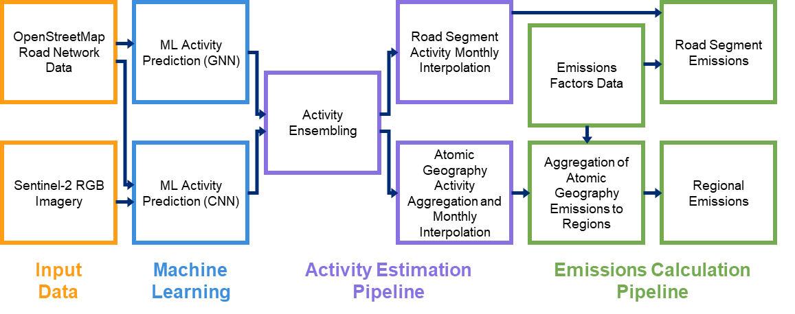

**Figure 1** 2021-2024 emissions estimation architecture overview.

Quarterly remote sensing and geospatial data were fed to two different families of ML models, convolutional neural network (CNN) based models and graph neural network (GNN) based models, producing two separate average annual daily traffic (AADT) estimations on a per-road segment basis. Separate models from each family are used for rural and urban areas, as defined by the European Union Joint Research Center Global Human Settlement Layer Urban Centers Database (GHSL-UCDB) dataset for a globally consistent representation of urban center extent (Florczyk et al. 2023); see Section 2.2.1. Output values from the two different model families were ensembled via averaging within each quarter, and then averaged across quarters within a year to produce a yearly AADT estimate for each road segment (Section 2.4.5). The annual AADT estimate is then converted to the activity value of total vehicle kilometers traveled (VKT) using the known length (capacity) of each road segment. For computational efficiency reasons, the pipeline is then split into two; in one pipeline, the activity estimates per-road segment are interpolated to monthly values, while in the other the activity estimates and capacities are summed per road type within each atomic geography prior to interpolation. Atomic geographies are non-overlapping geometries that cover the populated landmasses of the world, whose boundaries are the unique combinations of GADM Level-2 boundaries, GHSL-UCDB urban center boundaries, and a half degree latitude/longitude grid; an example of atomic geographies are shown in Figure 2. EFs were computed on a per-atomic geography basis a priori from environmental factors and a curated database of road and vehicle-related factors, assigning EF values to each type of road in an area; Sections 2.2.6 through 2.2.10 describe the data sources used for the factors. Activity values were then multiplied by the appropriate EF for each road type to produce emissions estimates. Emission estimates for the atomic geographies were then aggregated to regions (GADM Levels 0-2) to produce monthly emission estimates from 2021 onward. This process is explained in detail in Section 2.3. Additionally, estimates for 2015-2020 were made by leveraging EDGAR v2025 GHG data (M. Crippa et al. 2025) (Section 2.6) to backproject estimates as discussed in Section 2.3.9. ERS estimates were made by applying BEV efficiencies by market segment (e.g. small car, large SUV) to the per-market segment sales figures for gasoline-powered passenger vehicles; this is described more fully in Section 2.7.

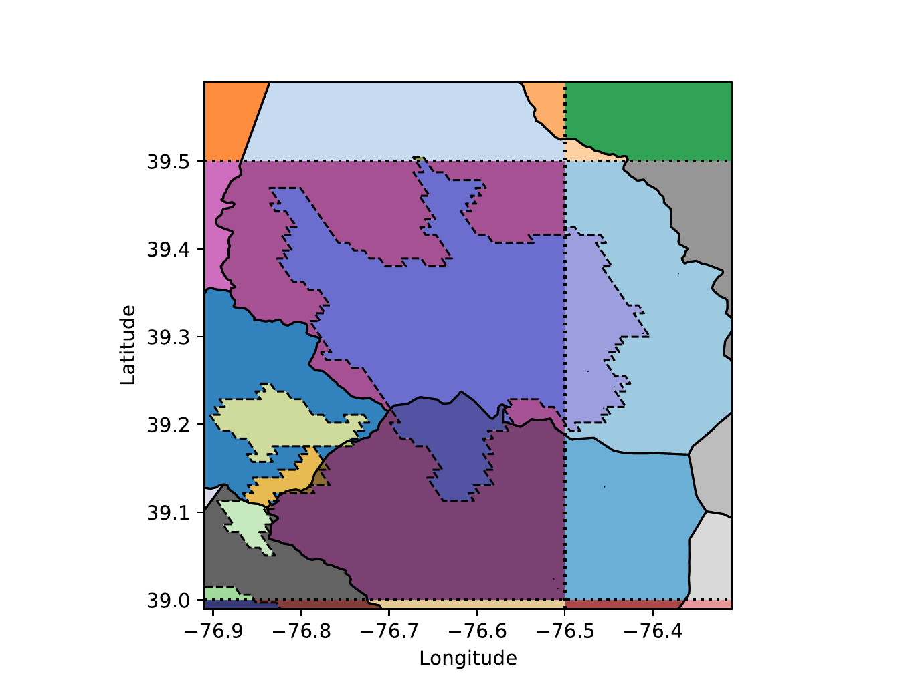

**Figure 2** Example atomic geographies in the Baltimore, Maryland region of the USA. Each color is a different atomic geography; solid lines are GADM Level-2 boundaries, dashed lines are GHSL-UCDB urban center boundaries, and dotted lines are half degree latitude/longitude grid boundaries.

#### 2.2 Data

#### 2.2.1 Urban Centers

We utilized the European Union Joint Research Center Global Human Settlement Layer Urban Centers Database (GHSL-UCDB) dataset for a globally consistent representation of urban center extent (Florczyk et al. 2023). This database contains approximately 13,000 urban centers worldwide, and utilizes a definition of urban center based on population density and built-up area. Specifically, an urban center was defined as “the spatially-generalized high-density clusters of contiguous grid cells of 1 km2 with a density of at least 1,500 inhabitants per km2 of land surface or at least 50% built-up surface share per km2 of land surface, and a minimum population of 50,000." (Florczyk et al. 2023). Due to this definition, urban center geometries in UCDB often have significantly different shapes and sizes as compared to official administrative bounds of cities, e.g., from OpenStreetMap (OpenStreetMap Contributors 2020) or Global Administrative Areas (GADM) (Global Administrative Areas n.d.). Examples of these differences are shown below in Figure 3-Figure 5.

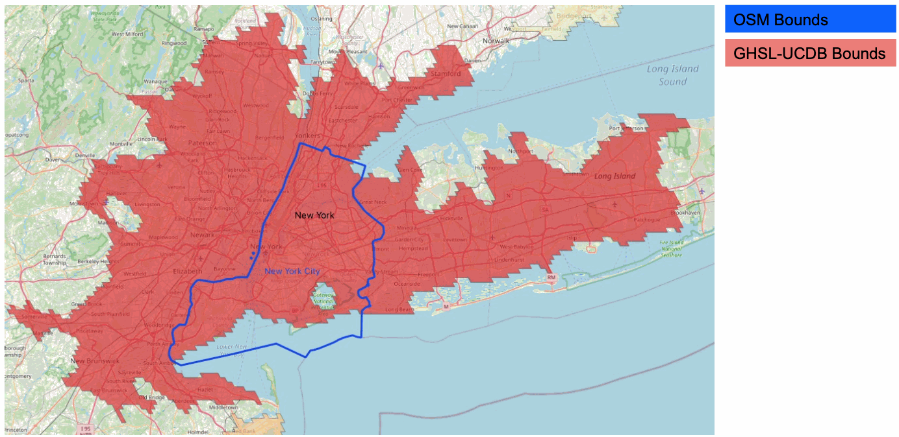

**Figure 3** Comparison of OSM administrative bounds (blue boundary) and GHSL-UCDB city bounds (red area) for New York City, USA.

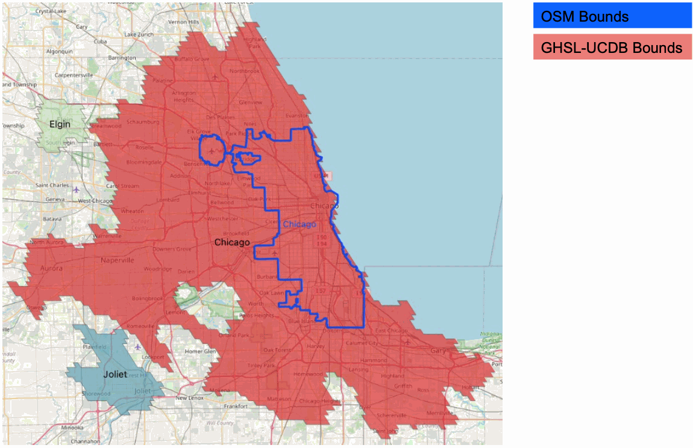

**Figure 4** Comparison of OSM administrative bounds (blue boundary) and GHSL-UCDB city bounds (red area) for Chicago, USA.

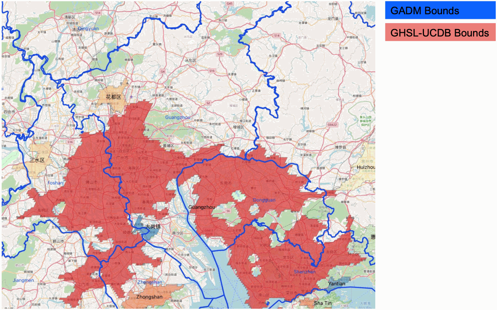

**Figure 5** Comparison of GADM level 2 administrative boundaries (blue boundaries) and GHSL-UCDB urban center bounds (red area) for Guangzhou, China.

#### 2.2.2 Regional Administrative Boundaries

The Climate TRACE coalition decided to assign emissions based on Global Administrative Areas (GADM) (Global Administrative Areas 2022) at the country (Level 0), state/province (Level 1) and county (Level 2) levels. Here, “county" is the USA based English-version name of the typical administrative area. In other countries, other English-translated names are used. The coalition used a slightly modified version of GADM v4.1; details are described in Section 7.3.

#### 2.2.3 Visual Satellite Imagery

Remote sensing imagery from the Sentinel-2A/B satellites were used as input data in our ML modeling approach to predict road transportation activity (see Section 2.3 below). The European Space Agency’s (ESA) Sentinel-2 mission comprises two satellites- Sentinel-2A, launched in 2015, and Sentinel-2B, launched in 2017 (Main-Knorn et al. 2017). Each Sentinel-2 satellite has a 10-day revisit time with a 5-day combined revisit. Both satellites are equipped with a multispectral (MSI) instrument which provides 13 spectral band measurements, blue to shortwave infrared (SWIR) wavelengths ( 442 nm to  2202 nm) reflected radiance. We used the Sentinel-2 Level-2A product at 10 m x 10 m resolution, using bands 4 (red), 3 (green), and 2 (blue) (Drusch et al. 2012).

Sets of images are selected on a per Sentinel-2 Level-2A tile (or granule) basis every quarter, with preference given to unclouded images that best span the tile, with additional unclouded images selected as needed to bring the tile coverage to 90%. If there are insufficient unclouded images, an additional image with up to 10% cloud coverage may be used to improve the tile coverage.

#### 2.2.4 Road Network Data

Using the open-source tools Osmium (Topf 2023) and OSMnx (Boeing 2017) and custom filters, OpenStreetMap data was filtered to the set of roads that carry normal vehicular traffic (see Section 2.2.6 below for details). A multi-directed graph of the road network was created from that data, and the total edge length (meaning the road length for each direction of traffic is counted separately) was computed to yield the capacity, or road network length, in kilometers. Example road networks for select GHSL UCDB urban centers are visualized in Figure 6. A plot of road network length for differing urban centers is provided in Figure 7; only the top 20 GHSL UCDB urban centers are displayed for visual clarity, though OSM produces road network data outside of urban centers, as well.

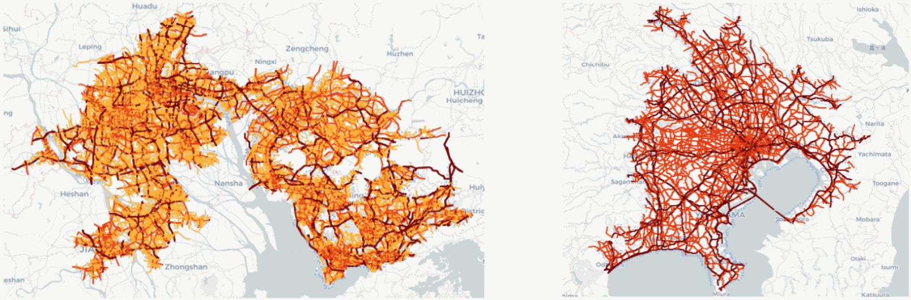

**Figure 6** Example road network data for Guangzhou, China (left) and Tokyo, Japan (right). Highways are in dark red, arterial roads in orange, and local roads in yellow. Local roads are intentionally not displayed for Tokyo due to their large count.

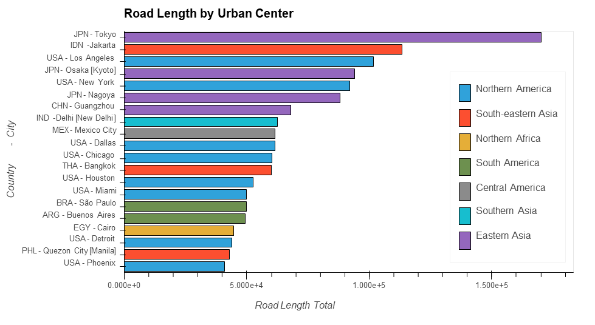

**Figure 7** Total road length for the top 20 GHSL UCDB urban centers (“cities") colored by region.

Roads and associated metadata (including coordinates, number of lanes, etc.) are constantly changing around the world. OpenStreetMap is updated continuously in an attempt to keep an atlas that reflects reality. While most road segments are consistent between quarters, some road segments appear, some road segments disappear, and some have properties that change. We attempt to deal with these changes by using one snapshot of data from OpenStreetMap per quarter per year. For our activity estimates, we use model inference ensembling to combine four quarters of data; more details are given in Section 2.4.5.

#### 2.2.5 Road Segment Type

Road segment types (categories) were derived from OpenStreetMap data for all public roads. The current supported road types are highway, arterial, and local, which were chosen to align with other similar emissions inventories and traffic-related databases. The mapping between these road types and their respective OSM tags is provided in Table 1. Road type categorization is important in the emissions factor calculation for a given road segment as other emissions factors variables, including vehicle fleet mix and fuel efficiency, could vary significantly across different types of roads. These classes are also used within the modeling effort to distinguish roads (see Section 2.4.2).

**Table 1** Road segment type association with OpenStreetMap tags

| **Road Class** | **OpenStreetMap Tags** |
|---|---|
| Highway | motorway, motorway\_link, trunk, trunk\_link |
| Arterial | primary, primary\_link, secondary, secondary\_link |
| Local | tertiary, tertiary\_link, residential, living\_street, unclassified |

#### 2.2.6 Emissions Factors

Calculating emissions factors for a given area was a complex process, due to the fact that an area can actually contain potentially hundreds of thousands of individual road segments, which might be considered “sub-sources". Transportation emissions factors are dependent on many variables, including (but not limited to) road category, vehicle type, fuel type, nominal fuel efficiency and environmental factors. Data collection for each of these variables across the globe was a significant undertaking. Thus, this version of estimated emissions factors focused on collecting data at the country level. A detailed description of the emissions factor calculation is provided in Section 2.3 below. Sources for each type of data required for the emissions factor calculation are shown below in Table 2, with descriptions of each data type provided in subsequent sections.

**Table 2** Primary emissions factors data sources used.

| **Data Type** | **Source(s)** |
|---|---|
| Road Segment Type | OpenStreetMap (OpenStreetMap Contributors 2020), see Section 2.2.5 above |
| Vehicle Fleet Mix | Various, see additional information in Section 2.2.7 and Section 6.1 |
| Fuel Type | CURB (World Bank Group 2019), see Section 2.2.8 below |
| Nominal Fuel Efficiencies | CURB (World Bank Group 2019), see Section 2.2.8 below |
| Monthly Gridded Temperatures | Climatic Research Unit gridded Time Series v4.07 (Harris et al. 2020), See Section 2.2.9 below |
| GHG Emissions Factors | U.S. EPA GHG Emissions Factors Hub (US EPA 2024a), see Section 2.2.10 below |
| Non-GHG Emissions Factors | U.S. DOT Bureau of Transportation Statistics (US BTS 2024), see Section 2.2.10 below |

#### 2.2.7 Vehicle Fleet Mix

Vehicle fleet mix refers to the distribution of total vehicles in a given country across various vehicle types. The supported vehicle types were: passenger cars, light duty trucks, single unit trucks, combination trucks, motorcycles, and buses. Country-specific vehicle distribution numbers do not always share these same categories. There might be one, two or more country-specific categories mapping to one supported type or there might be no country-specific category that matches a supported type. These differences were dealt with on a per-country basis. For example, in countries which only reported “trucks" as a single category, we used regional averages of the percentage of trucks in each category to interpolate the single reported category into the three standard truck types.

In general, there are two categories of information available on vehicle fleet mixes: registration data and proportions of kilometers traveled by vehicle category. Our vehicle fleet mix encompasses both types of data and does not distinguish between them in accuracy.

For example, the U.S. Federal Highway Administration (FHWA) provides estimates of both registered cars by state in Table MV-1 (US FHWA 2024c) and vehicle-miles traveled in Table VM-4 (US FHWA 2024b). These differ in the percentages of vehicles in each standard type. We would argue that the former (vehicle-miles traveled) is the better distribution of vehicle types to use, as we are attempting to estimate emissions from vehicles actually traveling on roads. Within the US for example, relying on registration data would result in the combination truck class being weighted 5x too low and motorcycles 5x too high (US FHWA 2024a). However, we have not found such specific information for many countries. Instead, we use the following prioritized list to estimate the vehicle mix in each country:

1.  Distribution of vehicle-km traveled categories: as described above

2.  Distribution of registration types: as described above

3.  Neighboring country average of vehicle fleet mix: use the average vehicle fleet mix from any countries whose GADM Level 0 border touches the target country

4.  US FHWA estimate: when all else fails, use the US FHWA estimate for the USA

Future releases will try to close the gap between mixes based on registration data and distance-traveled data. Country-specific vehicle fleet data was found for 118 countries. A full listing of the countries with country-specific data and their respective sources is provided in the supplementary material (see Section 6.1). Vehicle fleet mix values are currently the same across all supported road types but will be updated as sources of road type-specific data are identified. When available, regional vehicle fleet data is used in place of country data.

For each country with specific vehicle fleet data, when sufficient samples were available, the data was linearly interpolated / extrapolated to cover the modeled time period; otherwise, the data is forward-/backward-filled to cover the time period.

For countries without vehicle specific fleet data, fleet estimates were averaged from any neighboring countries with available data or, failing that, from an average across the UN defined region for the country. For the UN regions of Micronesia and Polynesia, no country data was available, so vehicle fleet data from Melanesia was used as a substitute.

#### 2.2.8 Fuel Type and Nominal Efficiencies

Due to the fact that different fuel types have different emissions factors, it is important to know the relative mix of fuel types for each type of vehicle traveling on a given road segment. The types of supported fuels are:

-   Gasoline: no distinction is made between different sub-categories such as (in the US) 87, 89, and 91 octane gasoline or ethanol-free gasoline.

-   Diesel: no distinction is made between sulfur-free diesel, bio-diesel or other sub-categories

-   Compressed natural gas (CNG)

-   Liquefied petroleum gas (LPG)

-   Plug-in hybrid: no distinction is made between hybrids that run on different liquid fuels

-   Battery electric vehicle (BEV)

-   Other fuels (e.g., biogas, ethanol)

The primary source of this data is the Climate Action for Urban Sustainability (CURB) tool (World Bank Group 2019), which provides a global database of fuel type mix by country. Future updates may include updated country or city-specific fuel type data. CURB was also the primary source of nominal fuel efficiency data for all countries. CURB fuel efficiency values are reported in units of kilometers per liter and were extracted for all supported fuel and vehicle types described above. Fuel efficiencies were the same across all supported road types (highway, arterial, and local) in this release, but may be continuously updated as better country or region-specific datasets are located.

#### 2.2.9 Fuel Efficiency Environmental Adjustments

Fuel consumption varies under external environmental factors. A study by Lohse-Busch et al. 2013, conducted several tests investigating fuel consumption for several conventional vehicles. These tests included:

-   Urban and highway driving tests at 72° F

-   Cold urban driving tests at 20° F

-   Hot urban driving tests at 95° F and “sunny" skies

These tests broadly found that fuel consumption increases at low temperatures due to heater use and cooler fluids, and fuel consumption also increases at high temperatures due to air conditioning. The results from the study were grouped by vehicle fuel type and road segment category and averaged to produce representative fuel consumption increases at 20° F and 90° F relative to nominal consumption at 72° F, as listed in Table 3 and Table 4.

**Table 3** Increase in fuel consumption for arterial and local roads. Values were derived from Lohse-Busch et al. 2013, by averaging across UDDS and US06 tests, then averaging across vehicles with the same fuel type.

| **Vehicle Fuel Type** | **Increase at 20° F** | **Increase at 95° F** |
|---|---|---|
| Battery Electric | 59% | 11% |
| Diesel | 7% | 25% |
| Gasoline | 5% | 20% |
| Plug-In Hybrid | 23% | 43% |

**Table 4** Increase in fuel consumption for highways. Values were derived from Lohse-Busch et al. 2013, by averaging across HWY and US06 tests, then averaging across vehicles with the same fuel type.

| **Vehicle Fuel Type** | **Increase at 20° F** | **Increase at 95° F** |
|---|---|---|
| Battery Electric | 34% | 3% |
| Diesel | 4% | 16% |
| Gasoline | 5% | 14% |
| Plug-In Hybrid | 10% | 22% |

These fuel consumption increases were used to estimate a temperature-dependent fuel consumption modifier function, with the modifier linearly interpolated from 20° F to 72° and 72° F to 90° F, and values outside that range clipped to the values at the bounds, as shown in Figure 8.

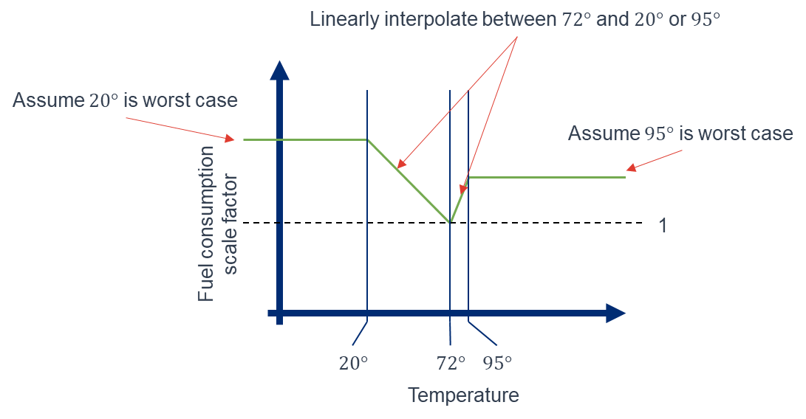

**Figure 8** Design of temperature dependent fuel consumption scale factor function; implemented functions use scale factors found in Table 3 and Table 4

Temperature values on a half degree latitude/longitude grid and monthly basis were pulled from the Climatic Research Unit gridded Time Series (CRU TS) v4.10 dataset (Harris et al. 2020). We used this dataset due to its standard usage in the literature; the 2020 paper and the 2014 paper for v3.x of the dataset have been cited nearly 12,000 times together. The dataset includes temperatures from 1901 to 2025; the values from 2025 were repeated to provide temperature estimates for 2026.

#### 2.2.10 Vehicle GHG and non-GHG Emissions Factors

GHG emissions factors refer to how much of a given greenhouse gas is emitted per unit of fuel burned and varies by fuel type. Our data focuses on carbon dioxide (CO<sub>2</sub>), nitrous oxide (N<sub>2</sub>O), and methane (CH<sub>4</sub>) emissions factors, using data from the U.S. Environmental Protection Agency (US EPA 2024a).

For nitrous oxide and methane, the emissions factors for each gas were given in units of grams of each gas per mile driven. This led to a different emission factor calculation for these gases than for carbon dioxide; details are given in Section 2.3.

Emission factors for non-GHGs follow a similar methodology as nitrous oxide (N<sub>2</sub>O) and methane emissions using data immediately sourced from the U.S. DOT Bureau of Transportation Statistics (US BTS 2024), though ultimately derived from the U.S. EPA. The non-GHGs estimated include other nitrogen oxides (NOx), carbon monoxide (CO), particulate matter (PM<sub>2.5</sub>), and other non-GHG hydrocarbons (HC). PM<sub>2.5</sub> emissions are provided both as a total and broken out as separate contributions from brakewear, tirewear, and exhaust.

#### 2.2.11 Light-Duty Electric Vehicle Efficiency by Market Segment

While direct (scope 1) greenhouse gas emissions from BEVs are zero, for the purposes of reporting energy consumption and evaluating the proposed emissions reduction strategies the electric energy efficiency of BEVs and PHEVs (in terms of kWh of electricity used per vehicle-kilometer traveled) was required. Data collected by the Global Fuel Economy Initiative (GFEI) (Cazzola, Paoli, and Teter 2024) provides on an annual, per-country basis the specific energy consumption of light-duty BEVs and PHEVs across 7 different market segments (small car, medium car, large car, small SUV, large SUV, light commercial vehicle and unclassified) in units of Lge (litre of gasoline equivalent) per 100km; these are converted to kWh/km using the equivalent energy content of gasoline of 9.3kWh/Lge (Cazzola, Paoli, and Teter 2023). The small, medium and large car GFEI market segments were mapped to our passenger car class, while the light commercial vehicle and small and large SUV market segments were mapped to our light-duty truck class (Section 2.2.7); values from the unclassified market segment were dropped.

In the annex to the GFEI report (Cazzola, Paoli, and Teter 2023), the authors describe applying a "best estimate" Utility Factor to calculate the electric consumption data for PHEVs, with a default value of 0.5 when the best estimate value is unavailable. However, we note that in the released data (Cazzola, Paoli, and Teter 2024), the reported electricity efficiency numbers for PHEV powertrain vehicles were all exactly half of the BEV values. Currently, we continue to use that same 0.5 value, however recent work by Plötz et. al. (Plötz et al. 2026) based on On-Board Fuel Consumption Monitoring (OBFCM) data from the European Environment Agency (EEA) suggests a utility factor nearer 0.3 might be more representative. A future iteration will re-examine the selected utility factor and update if warranted.

After restricting the provided GFEI dataset to the newest values after 2020, removing outliers and values based on fewer than 1,000 sales, the dataset included values across 35 different countries. In a similar manner to the vehicle fleet mix (Section 2.2.7), missing values for countries were filled first by interpolating among neighboring countries, then within the United Nations defined region, then within the continent, and then over the globe if necessary.

#### 2.2.12 Light-Duty Vehicle Sales by Market Segment and Powertrain

As efficiency of electric vehicles vary with vehicle size, it was necessary to be able to quantify the proportion of current light-duty vehicles for each market segment. In addition to the electric vehicle efficiency data discussed in the previous section, the data collected by GFEI (Cazzola, Paoli, and Teter 2024) also provides on the same annual, per-country basis the sales numbers for light-duty vehicles among the same 7 different market segments per powertrain (internal combustion engine (ICE), mild hybrid, hybrid, plug-in hybrid, battery electric, and fuel cell hydrogen).

For the purposes of the ERS, the sales numbers for powertrains that still have a combustion engine (ICE, mild hybrid, hybrid, and plug-in hybrid) were summed together; for normal electricity consumption data, sales numbers for battery electric and plug-in hybrid vehicles were tracked separately. Furthermore, while the sales figures for ICE vehicles included both gasoline and diesel fuel types, since these values are only used to produce a relative proportion of the different market segments, the figures for the combined set are useful as a proxy for just gasoline-powered ICE vehicles.

Similar to the EV efficiency data (Section 2.2.11), the dataset was cleaned by restricting data values to the most recent year after 2020 that had sales figures of at least 1,000 vehicles in the relevant market segments. This left a dataset with 40 different countries, which was filled out to cover other countries in the exact same manner as the EV efficiency values.

#### 2.2.13 Electric Motorcycle Efficiency

Data for electric motorcycle efficiency was obtained from Spritmonitor.de (Spritmonitor.de 2026). Spritmonitor.de is a website where users can upload information about vehicle fuel and electricity consumption and vehicle mileage to track energy efficiency and cost information. It provides empirical, aggregated information for energy efficiency across their user base which currently includes more than 1.3 million vehicles. It has been used in several publications to compare official and real-world energy consumption values (Tietge, Mock, et al. 2017,Tietge, Dı́az, et al. 2019,Dornoff, Valverde Morales, and Tietge 2024).

At the time of access, the website reported an average consumption rate of 51.1 Wh/km for electric two-wheelers with greater than 1000 km of logged distance traveled. This is broadly consistent with several other data sources that are more limited in scope. A study for city driving in India modeled electrical consumption at 33 Wh/km for scooters and 61 Wh/km for 3-wheelers (Saxena, Gopal, and Phadke 2014). A conference paper which included a survey of electric bicycle, mopeds, and e-scooters available in Vietnam implies consumption rates between 10 and 24 Wh/km based on battery and range specifications (Nguyen Huu and Ngoc 2021). A 2015 review tabulated rates of 15$`\pm`$<!-- -->5 Wh/km for ebikes, 45$`\pm`$<!-- -->2 Wh/km for mid-size electric two-wheelers, and 70$`\pm`$<!-- -->30 Wh/km for large electric two-wheelers (Weiss et al. 2015). The average consumption rate of 51.1 Wh/km from Spritmonitor.de is thus used as a reasonable estimate of real-world electric motorcycle efficiency.

#### 2.2.14 Electric Bus Efficiency

While no large scale, real-world dataset for electricity consumption rates of the population of battery electric buses (BEBs) exists, there have been several regional studies that have reported energy consumption values. A study in Montreal reported a mean rate of 1.48 kWh/km, with seasonal variation ranging from 1.36 kWh/km in the warm summer months to 1.72 kWh/km in winter (Tian et al. 2025). A study in the mountainous province of South Tyrol in Italy provides an average value of 1.4 kWh/km for a fleet consisting of three Solaris Urbino 12 Electric and two Solaris Urbino 18 Electric buses (Estrada Poggio et al. 2023). A demonstration study in Jaworzno, Poland from October, 2020 to February, 2021 found energy consumption rates varying from 0.71 to 1.27 kWh/km, with an overall average of 0.95 kWh/km (Al-Saadi et al. 2021). A data collection from January through May 2019 in Shenzhen, China found median electricity consumption values between 1.1 and 1.2 kWh/km (Li et al. 2021), while a 2023 survey of e-bus fleets across 8 cities in China reported energy consumption rates between 0.8 and 1.2 kWh/km (Mao and Rodrı́guez 2024). Based on the available data, the median value of 1.2 kWh/km was chosen as the baseline electricity consumption rate for BEBs.

#### 2.2.15 Electric Single Unit and Combined Truck Efficiency

Relative to the other vehicle types, less information is available for single unit and combined truck real world electricity consumption. After a literature review, the authors of Shoman et al. 2023 used an average rate of 1.2 kWh/km for urban roads and 1.8 kWh/km for highway roads. The value of 1.8 kWh/km is likewise adopted here for highways, while the value of 1.2 kWh/km is used for all arterial and local roads, not just urban roads, as this was the best analogue currently available.

#### 2.2.16 Electricity Consumption Environmental Adjustments

Similar to the environmental adjustments for fuel consumption discussed in Section 2.2.9, electric vehicles also demonstrate a temperature dependency for electricity consumption rates. The Vehicle Energy Dataset (VED) (Oh, Leblanc, and Peng 2022) is a large scale public dataset that contains detailed logs of the energy consumption of trips of personal cars from November 2017 to 2018, including the ambient air temperature. This dataset was augmented by the Extended Vehicle Dataset (eVED) (Zhang et al. 2025), which among other things refined the GPS traces of the vehicle trips, resulting in more accurate trip distances. The dataset was filtered to trips by PHEVs where the engine was unused and to trips by EVs, and after removing a small number of outliers resulted in a subset of data containing 2,427 trips for 26 different vehicles. The mean energy consumption rate (in kWh/km) was computed for each vehicle, and the scaled energy consumption rate for each trip was calculated by dividing by the mean rate for that trip’s vehicle. The data was plotted against the mean ambient air temperature for each trip (Figure 9), and a quadratic curve was fitted to the data. The fitted curve is $`\eta_{scaled}=7.91\times 10^{-4} \times T^2-0.0356\times T+1.26`$, with temperature $`T`$ in degrees Celsius. Rather than extrapolating the quadratic curve to temperatures beyond that supported by the data, beyond the 5th and 95th percentiles of the data (corresponding to $`-3^\circ`$ C and $`30^\circ`$ C respectively) the fit is extrapolated linearly.

A study looking at the effect of temperature and HVAC use on electric vehicles (American Automobile Association 2019) performed dynamometer testing of 5 different models at $`20^\circ`$F, $`75^\circ`$F, and $`95^\circ`$F. Relative to the baseline at $`75^\circ`$F, they saw a 39% decrease in MPGe at $`20^\circ`$F and a 17% decrease at $`95^\circ`$F. Those values are very comparable to the fitted curve values, with the scaled rates corresponding to MPGe reductions of 44% and 11% reductions at $`20^\circ`$F and $`95^\circ`$F respectively.

In this model, the fitted curve is only applied to passenger cars, light duty trucks and buses, as the other vehicle classes have much different HVAC needs (if any).

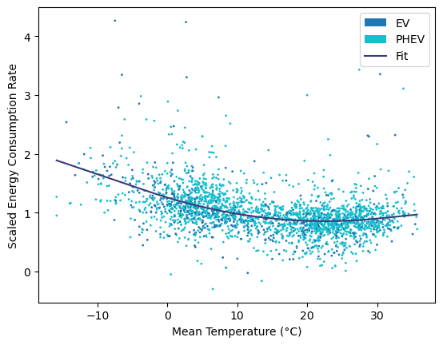

**Figure 9** Scaled energy consumption rate vs mean temperature for EVs and PHEVs in the VED/eVED datasets, along with the fitted curve used for implementing the temperature dependent scale factor for passenger electric vehicles

#### 2.3 Emissions Calculations

The road transportation sector reports emissions, emissions factor, activity, capacity, and capacity factor on a per month and per GHG basis for GADM Level 1 and GADM Level 2 regions, and on an annual and per greenhouse gas basis for GADM Level 0 regions. These variables are defined at different levels, from individual road segments to GADM Level 0, and are defined in the following sections such that the following general equations hold true:

-   **Emissions** = **Activity** \* Emissions Factor

-   **Activity** = **Capacity** \* Capacity Factor

Values in **bold** are considered the independent variables, with calculations defined in more detail in Sections 2.3.1 through 2.3.6, while dependent variables are described in more detail in Section 2.3.8.

#### 2.3.1 Region Emissions

Road transportation emissions ($`E`$) are reported on a monthly basis for GADM Level 1 (state/province) and GADM Level 2 (county) regions, and on an annual basis for GADM Level 0 (country) regions. Emissions are calculated by summing over the emissions for the atomic geographies within each region $`r`$, where atomic geographies are unique combinations of GADM Level 2 areas, GHSL UCDB urban areas (or no urban area), and a half degree global grid. The sum for GADM Level 0 regions is:

```math
E_{r,g,y}=\sum_{a\in r,j\in y}{AE_{a,g,j}} \qquad (1)
```

for GADM Level 0 regions, where $`AE_{a,g,j}`$ is the road transportation emissions ($`AE`$) for each emission type $`g`$, for month $`j`$, for an atomic geography area $`a`$, and $`y`$ is the year. Emissions for GADM Level 1 and 2 regions are similar:

```math
E_{r,g,j}=\sum_{a\in r}{AE_{a,g,j}} \qquad (2)
```

Emissions ($`E_{r,g,j}`$, $`E_{r,g,y}`$) are reported in units of metric tonnes (per month or year).

#### 2.3.2 Atomic Geography Emissions

Total road transportation emissions ($`AE`$) for each GHG or non-GHG emission type $`g`$ for month $`j`$ for an atomic geography area $`a`$ could be calculated as:

```math
AE_{a,g,j}=\sum_{i\in a}{SE_{g,i,j}} \qquad (3)
```

where $`SE_{g,i,j}`$ is the “segment emissions" for a road segment $`i`$, and the sum is over any road segment which is contained by the atomic geography area $`a`$. Each $`SE_{g,i,j}`$ is calculated as:

```math
SE_{g,i,j}=\alpha\cdot N_j\cdot AADT_{i,j}\cdot l_{i,j}\cdot SEF_{g,i,j} \qquad (4)
```

where:

-   $`\alpha`$ is an activity scale factor to align emissions with EDGAR estimates (See Section 2.3.7)

-   $`N_j`$ is the number of days in month $`j`$

-   $`AADT_{i,j}`$ is the average annual daily traffic of the road segment $`i`$ for month $`j`$, in units of vehicles per day (See Section 2.4.5)

-   $`l_{i,j}`$ is the length of the road segment $`i`$ in month $`j`$, in units of kilometers

-   $`SEF_{g,i,j}`$ is the segment emission factor for greenhouse gas $`g`$, road segment $`i`$ and month $`j`$ in units of mass per vehicle kilometer

However, this formulation is somewhat computationally inefficient, with a computational complexity of $`O(G*I)`$, where $`G`$ is the number of gases (on the order of 10) and $`I`$ is the number of road segments (on the order of 4e8 globally). A more computationally efficient approach $`O(I)`$ calculates emissions as:

```math
AE_{a,g,j} = \sum_c{CACT_{a,c,j}*CEF_{a,c,g,j}} \qquad (5)
```

where $`CACT_{a,c,j}`$ is the monthly activity within the atomic geography per road-segment category $`c`$, and $`CEF_{a,c,g,j}`$ is the monthly road-segment category emission factor (Section 2.3.3). Each $`CACT_{a,c,j}`$ is calculated as:

```math
CACT_{a,c,j}=\alpha\cdot N_j\cdot \sum_{i\in a,c}{AADT_{i,j}\cdot l_{i,j}} \qquad (6)
```

And $`CEF_{a,c,g,j}`$ is equivalent to $`SEF_{g,i,j}`$ where $`c`$ is the road segment category of $`i`$ and $`a`$ is the atomic geography that contains $`i`$.

#### 2.3.3 Segment Category Emission Factor

Emission factors are currently calculated in two different paths, as the source emission factors from the EPA are expressed in units of $`\mathrm{\langle mass\rangle/\langle volume\ fuel\rangle}`$ for carbon dioxide, and units of $`\mathrm{\langle mass\rangle/\langle distance\ traveled\rangle}`$ for other greenhouse and non-greenhouse gases.

For carbon dioxide, the emission factor for each road segment category is calculated as:

```math
CEF_{a,g=CO_2,c,j}=\sum_f{t_{a,c,j,f}\cdot\left(\sum_v{\eta_{a,v,f}\cdot m_{\gamma(a),j\in y,v,f}\cdot egv_{j\in y,v,f}}\right)} \qquad (7)
```

-   $`\eta_{a,v,f}`$ is the fuel efficiency, in units of liters of fuel per km, for a vehicle type $`v`$, fuel type $`f`$, and atomic geography $`a`$. Fuel efficiencies are currently estimated on a per-country basis (Section 2.2.8).

-   $`m_{\gamma(a),j\in y,v,f, r}`$ is the vehicle mix, as a fraction, typically present in atomic geography $`a`$ based on the vehicle type $`v`$, fuel type $`f`$, vehicle mix region level $`\gamma`$ and year $`y`$ of month $`j`$. The index $`\gamma \in \{0,1\}`$ denotes the geographic level from which the vehicle mix assigned to $`a`$ is obtained, where $`\gamma=0`$ indicates a country-level source and $`\gamma=1`$ indicates a sub-country-level source. Specifically, we require that $`\sum_{v,f,r}m_{\gamma(a),j\in y,v,f}=1`$. Vehicle mix is estimated on an annual per-country, or sub-country when data is available, basis (Section 2.2.7).

-   $`egv_{j\in y,v,f}`$ is the CO<sub>2</sub> emissions factor, in grams of CO<sub>2</sub> per liter of fuel, for the vehicle type $`v`$, fuel type $`f`$, and year $`y`$ of month $`j`$. The CO<sub>2</sub> emissions factor is estimated on an annual basis (Section 2.2.10).

-   $`t_{a,c,j,f}`$ is a unitless, temperature-dependent and road-segment category-dependent modifier to fuel efficiency. It is calculated on a monthly, half-degree grid basis (Section 2.2.9).

For other greenhouse and non-greenhouse gases, the emission factors are independent of road segment category and are calculated on an annual basis as follows:

```math
CEF_{a,g\neq CO_2,c,j}=m_{\gamma(a),j\in y,v,f}\cdot egd_{g,j\in y,v,f} \qquad (8)
```

where $`egd_{g,j\in y,v,f}`$ is the gas emissions factor, in grams of gas per vehicle kilometer, for the vehicle type $`v`$, fuel type $`f`$, and year $`y`$ of month $`j`$ (Section 2.2.10). The gas emissions factors are estimated on an annual basis.

#### 2.3.4 Capacity

Capacity is simply defined as the total length of the road network in an asset area for month $`j`$ for any region $`r`$:

```math
CAP_{r,j}=\sum_{a\in r}{ACAP_{a,j}} \qquad (9)
```

where $`ACAP_{a,j}`$ is the atomic geography road segment capacity in units of kilometers, and is given as:

```math
ACAP_{a,j}=\sum_{i\in a}{l_{i,j}} \qquad (10)
```

Similarly, we can define a capacity for any given road segment $`i`$ as $`SCAP_{i,j}`$:

```math
SCAP_{i,j}=l_{i,j} \qquad (11)
```

Note that because OSM data (Section 2.2.4) can change over time, it is possible for length (and therefore capacity) of a road segment to also change over time.

#### 2.3.5 Activity

Activity ($`ACT`$) for any region $`r`$ is the number of vehicle kilometers traveled in month $`j`$:

```math
ACT_{r,j}=\sum_{a\in r}{AACT_{a,j}} \qquad (12)
```

where

```math
AACT_{r,j}=\alpha\cdot N_j\cdot\sum_{i\in a}{AADT_{i,j}}\cdot l_{i,j} \qquad (13)
```

For segment level activity, we similarly define $`SACT_{i,j}`$:

```math
SACT_{i,j}=\alpha\cdot N_j\cdot AADT_{i,j}\cdot l_{i,j} \qquad (14)
```

#### 2.3.6 Segment Capacity Factor

Only the *segment* capacity factor is independent, the region capacity factor is defined in Equation (19) below. The segment capacity factor ($`SCF`$) is defined as the ratio of activity to capacity:

```math
\begin{gathered}
    SCF_{i,j}=\frac{SACT_{i,j}}{SCAP_{i,j}\cdot N_j} \\
    SCF_{i,j}=\frac{\alpha\cdot N_j\cdot AADT_{i,j}\cdot l_{i,j}}{l_{i,j}}=\alpha\cdot N_j\cdot AADT_{i,j}
\end{gathered} \qquad (15)
```

This variable provides a direct view into the predicted AADT.

#### 2.3.7 Activity Scale Factor

To better align our estimates with EDGAR v2025 (M. Crippa et al. 2025), an activity scale factor was introduced. While a portion of the difference between EDGAR and our estimates may ultimately be due to emission factors, due to biases in the training data (Section 2.4.1) our raw, region activity estimates are expected to be high, so the scale factor was chosen to be introduced to the activity component of the emissions estimation. The scale factor is calculated as follows:

```math
\alpha = \frac{\sum_{r,y}{G_{r,y}}}{\sum_{r,y}{\hat E_{r,CO_2,y}}} \qquad (16)
```

Where $`\hat E_{r,CO_2,y}`$ are our annual GADM Level-0 CO<sub>2</sub> emission estimate calculated with an initial activity scale factor of 1, and $`G_{r,y}`$ are the annual country level EDGAR v2025 road transportation CO<sub>2</sub> emission estimates. The sums are over the countries and years (2021 and 2022) in common between our estimates and EDGAR v2025. Using this methodology, the activity scale factor was calculated to be 0.7882.

#### 2.3.8 Dependent Variables

The reported region emissions factors ($`EF`$) are defined as the emissions divided by the activity for emission type $`g`$ in month $`j`$ for any aggregation area $`a`$:

```math
EF_{r,g,j}=\frac{E_{r,g,j}}{ACT_{r,j}} \qquad (17)
```

This can equivalently be viewed as a segment activity-weighted average emissions factor:

```math
EF_{r,g,j}=\frac{\alpha\cdot N_j\cdot\sum_{i\in r}{AADT_{i,j}\cdot l_{i,j}\cdot SEF_{g,i,j}}}
    {\alpha\cdot N_j\cdot\sum_{i\in r}{AADT_{i,j}\cdot l_{i,j}}} \qquad (18)
```

The reported region capacity factor ($`CF`$) is defined as the activity in month $`j`$ ($`ACT_j`$) divided by capacity ($`CAP_j`$) for any region $`r`$:

```math
CF_{r,j}=\frac{ACT_{r,j}}{CAP_{r,j}} \qquad (19)
```

This can equivalently be viewed as a segment length-weighted average of vehicles per month:

```math
EF_{r,g,j}=\frac{\alpha\cdot N_j\cdot\sum_{i\in r}{AADT_{i,j}\cdot l_{i,j}}}
    {\sum_{i\in r}l_{i,j}} \qquad (20)
```

#### 2.3.9 Emissions Back-propagation

Our current methodology would have several challenges to overcome if it was to be applied to periods before 2021. Due to its crowd-sourced nature, OSM data coverage and quality decreases the farther back in time one looks. Additionally, the time period covering the response to the COVID-19 pandemic in 2020 is also expected to challenge our methodology, as no direct indicators of traffic volume during that time were used. Instead, in order to provide historical, country level (GADM Level-0) emission estimates back to 2015, EDGAR v2025 data was used as a basis to anchor emission estimates.

For those countries that were included in the EDGAR v2025 dataset (as identified by their ISO-3 country code, see Section 7.3), historical estimates are given as follows:

```math
E_{r,g,y'}=\left(\frac{G_{r,y'}}{\frac{1}{2}\sum_{y=2021,2022}G_{r,y}}\right)\left(\frac{1}{2}\sum_{y=2021,2022}E_{r,g,y}\right) \qquad (21)
```

Where the first term is the ratio between the EDGAR v2025 CO<sub>2</sub> emissions for the historical year $`y'`$ and the average annual CO<sub>2</sub> emissions for 2021-2022, and the second term is the average estimated GHG or non-GHG emissions for gas $`g`$ over the same time period.

For those countries that are omitted from the EDGAR v2025 dataset, historical estimates are instead given by:

```math
E_{r,g,y'}=\left(\frac{\sum_r{G_{r,y'}}}{\frac{1}{2}\sum_{r,y=2021,2022}G_{r,y}}\right)\left(\frac{1}{2}\sum_{y=2021,2022}E_{r,g,y}\right) \qquad (22)
```

Where the first term is now the ratio between the global total of EDGAR v2025 CO<sub>2</sub> emissions for the historical year $`y'`$ and the average global annual CO<sub>2</sub> emissions for 2021-2022.

#### 2.4 Machine Learning Models

As part of our hybrid modeling approach, machine learning (ML) models were trained to predict AADT from satellite imagery and road network data. These predictions were required in the absence of global, openly available, and high-quality traffic activity data and is a significant departure from existing methods.

#### 2.4.1 Ground Truth Road Activity Data

To train our ML models, we utilized the U.S. Highway Performance Monitoring System Average Annual Daily Traffic (AADT) data from 2017 and 2018 (US FHWA 2017). This AADT data was recorded using road-side devices and was provided by each state independently. We utilized the total AADT measure in our work, measured in vehicles per day. AADT data was not available for every road segment and was typically only recorded on major highways and arterial (collector) roads. Where possible, the AADT values are aligned to OSM roads to use as ground truth when training the neural networks.

#### 2.4.2 Convolutional Neural Network (CNN)

Our first machine learning approach used semantic segmentation CNNs to predict AADT. Specifically, we input visual satellite imagery in combination with rasterized road network data to predict AADT on a per-pixel basis (Figure 10). This approach was informed by previous work in directly regressing road transport CO<sub>2</sub> emissions (Mukherjee et al. 2021). Models were trained using the Sentinel-2 Level-2A product at 10 m x 10 m resolution, using bands 4 (red), 3 (green), and 2 (blue) (Drusch et al. 2012), and separate models were trained and used on urban and non-urban areas respectively (Section 2.2.1).

Road network data was retrieved from OpenStreetMap and rasterized for the corresponding extent of each visual image tile. Each standardized road type (*highway, secondary, local*, see Sections 2.2.4 and 2.2.5) was rasterized independently, and the resulting raster channels are concatenated together to form a three-channel image. This image was then combined with the visual image to form a six-channel input image that was input to the CNN. Thus, the CNN model is tasked with predicting the number of vehicles traveling on a road segment as a function of visual satellite image features and road location and type information. We primarily used MAnet-based architectures (Fan et al. 2020) for our segmentation models, based on the findings of similar previous work (Mukherjee et al. 2021).

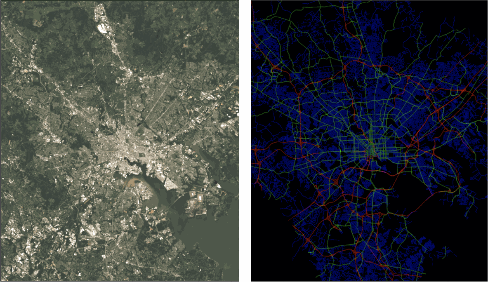

**Figure 10** Example Sentinel-2 visual (RGB) satellite image (left) and corresponding rasterized OSM road network data (right) for Baltimore, Maryland USA. The OSM raster colors represent different road types: highways (red), secondary roads (green), and local roads (blue).

When the model was used within the overall emissions calculation pipeline, pixel-based AADT predictions were post-processed to associate predicted values with their corresponding road segment. Ten evenly spaced locations along the length of each road segment were selected to measure the AADT prediction; locations that were not marked as cloudy by the Sentinel-2 Level-2A scene classification map were averaged to produce a single AADT value for that road segment within each image; these AADT values were then averaged across all images within the quarter to produce the final prediction for the CNN models.

The loss function used to train the model has two components, the first of which is a fully-supervised mean square log error term calculated on unclouded pixels containing nonzero truth AADT values. Log predictions and errors are used to account for the many orders of magnitudes AADT values span. The second component is a semi-supervised loss term to address locations where the truth AADT is zero. For this loss term, the same image is passed through the model multiple times using different flips/rotations, and the loss then seeks to reduce the variance between the pixel level AADT predictions after undoing those flips/rotations.

#### 2.4.3 Graph Neural Network (GNN)

Another type of ML model trained to predict AADT was graph neural networks (GNNs) (Bronstein et al. 2017). Road networks inherently take the form of a graph structure, and GNNs can capture road activity across a range of scales more easily than the image-based convolutional neural network (CNN) segmentation models. CNN-based solutions constrain the spatial area that can be covered during inference, making it difficult to capture potential dependencies on features in neighboring or distant locations. GNNs can easily leverage various features assigned to nodes and efficiently reason over the full road network graph to provide more robust predictions of on-road activity.

For this work, a GNN was trained using OpenStreetMap road network data, including a number of road features: the number of lanes, road length, road type, link or not (such as an exit ramp), and the directional angle between roads. Separate models were trained for both urban and non-urban areas (Section 2.2.1). The Graph Attention v2 (GATv2) network (Brody, Alon, and Yahav 2022) architecture was used as it allows for both edge and node input features, and was set up to predict log-AADT values. We note that the GNN does not use visual imagery as input and is able to learn a relationship between road types and configurations to the density of traffic on those roads.

The loss function used to train the GNN network, like the CNN network, also has two components; the first is a fully-supervised L1 loss on the log error of AADT values (for road segments with AADT truth values), and the second is a semi-supervised relative consistency loss. The consistency loss is computed per-intersection, and is formulated as the net traffic flow into an intersection (i.e., sum of predicted AADT for road segments entering the intersection minus the sum of predicted AADT for road segments exiting the intersection) divided by the average flow through the intersection (i.e., the average of the sum of predicted AADT for road segments entering and the sum for roads exiting the intersection).

#### 2.4.4 Model Training Datasets

Training data was increased compared to previous years to include rural areas for training GNN and CNN models targeted to rural areas. Table 5 shows the details of the various data sources used for training the GNN and CNN models.

**Table 5** *Training details and comparison between the 2023 and 2025 release of the road transportation emissions datasets*

| **Model** | ****Training Data**** | **2023 Dataset** | **2025 Dataset** |
|---|---|---|---|
| GNN-Urban | US HPMS AADT | 2017 and 2018 | 2017 and 2018 |
| \* | OpenStreetMap Dataset Date | 4 quarters each in 2017 and 2018 | 4 quarters each in 2017 and 2018 |
| \* | Areas | 308 urban areas for each quarter of 2017, and 307 urban areas for each quarter of 2018; total 2460 samples | 305 urban areas for each quarter of 2017, and 311 urban areas for each quarter of 2018; total 2464 samples |
| GNN-Rural | US HPMS AADT | N/A | 2017 and 2018 |
| \* | OpenStreetMap Dataset Date | N/A | 4 quarters each in 2017 and 2018 |
| \* | Areas | N/A | 1204 rural areas for each quarter of 2017 and 1071 rural areas for each quarter of 2017; areas are aligned to Sentinel-2 tiles |
| CNN-Urban | US HPMS AADT | 2017 and 2018 | 2017 and 2018 |
| \* | Sentinel-2 Imagery | One image per urban area, per quarter for a total of 2028 images | Nominally one image per tile with urban areas per quarter (some locations have multiple images to ensure close to full coverage after taking into consideration clouds), for a total of 2438 images |
| \* | OpenStreetMap Dataset Date | 4 quarters each in 2017 and 2018 | 4 quarters each in 2017 and 2018 |
| \* | Areas | 308 urban areas for each quarter of 2017, and 307 urban areas for each quarter of 2018; total 2460 samples | 252 tiles covering 308 urban areas |
| CNN-Rural | US HPMS AADT | N/A | 2017 and 2018 |
| \* | Sentinel-2 Imagery | N/A | Nominally one image per tile per quarter (some tiles have multiple images to ensure close to full coverage after taking into consideration clouds), for a total of 11994 images |
| \* | OpenStreetMap Dataset Date | N/A | 4 quarters each in 2017 and 2018 |
| \* | Areas | N/A | 1019 unique areas; areas are aligned to Sentinel-2 tiles and cover the United States |

#### 2.4.5 Model Inference & Ensembling

The data sources for inference has expanded greatly compared to previous years due to covering additional years and all global regions. In Table 6 we highlight the differences between the 2023 dataset release and the current 2025 dataset.

**Table 6** *Inference details and comparison between the 2023 and 2025 road transportation emissions dataset releases.*

| **Model** | **Inference Data** | **2023 Dataset** | **2025 Dataset** |
|---|---|---|---|
| GNN-Urban | OpenStreetMap Dataset Date | 4 quarters each in 2021 and 2022 covering 10k urban areas | 19 quarters between 2021 Q1 and 2025 Q3 covering almost 13k urban areas |
| GNN-Rural | OpenStreetMap Dataset Date | N/A | 19 quarters between 2021 Q1 and 2025 Q3, broken into approximately 15k rural road networks per quarter |
| CNN-Urban | OpenStreetMap Dataset Date | 4 quarters each in 2021 and 2022 covering 10k urban areas | 19 quarters between 2021 Q1 and 2025 Q3 covering almost 13k urban areas |
| \* | Sentinel-2 Imagery | A total of 37885 images covering 10k urban areas spread over the 8 quarters of 2021 and 2022 (multiple urban areas can be covered by the same image, and multiple images may be needed to cover a single urban area) | A total of 84596 images covering almost 13k urban areas over the 19 quarters between 2021 Q1 and 2025 Q3 (multiple urban areas can be covered by the same image, and multiple images may be needed to cover a single urban area) |
| CNN-Rural | OpenStreetMap Dataset Date | N/A | 19 quarters between 2021 Q1 and 2025 Q3, broken into approximately 15k rural road networks per quarter, one per Sentinel-2 tile |
| \* | Sentinel-2 Imagery | N/A | A total of 394286 images covering almost 19k tiles over the 19 quarters between 2021 Q1 and 2025 Q3 (approximately 4k tiles do not actually contain roads) |

For each area (urban or rural), for each year, we ended up with up to eight predictions of AADT for every road segment; 2025, having only three quarters of available data, has a maximum of six predictions. However, as discussed in Section 2.2.4, OpenStreetMap data is continuously updated, and so not every road-segment is present across all eight predictions (four from the CNN, four from the GNN). Additionally, some CNN predictions were not possible due to persistent cloud cover. To create a more robust and predictive yearly AADT prediction model, ensembling was performed using the CNN and GNN models.

To ensemble the eight, possibly non-identical, sets of road-segment AADT predictions, we employed the following routine:

1.  For each model, each AADT prediction for an OSM road segment was assigned to possibly multiple atomic road segments. Atomic road segments were OSM road segments that have been split at our atomic geographies; the unique ID of an atomic road will change if the underlying OSM road changes in either geometry or metadata.

2.  For each model, the atomic road AADT predictions within a year were averaged together

3.  The yearly atomic road AADT predictions for each model were then averaged together. For cases where a road is only present in the GNN due to clouds in the CNN image, this effectively sets the data for that segment to the mean GNN predicted value

The daily activity estimates (AADT \* road length) and capacities (road lengths) were then aggregated within each atomic geography by road segment category to produce annual estimates. In the aggregation, the contribution from each atomic road segment is weighted by the portion of each year each atomic road segments is valid for (e.g., a road segment that is only valid for the first quarter will only contribute about $`{1}/{4}`$ of its values to the total). This effectively weighs the road segments that only appear in one quarter as contributing lower to our estimate of emissions than road segments that are present in all four quarters.

From these daily activity and capacity at yearly intervals, we linearly interpolate to produce estimates at monthly intervals. Months before July 2nd, 2021 or after the midpoint of the elapsed portion of the current year were backward/forward filled from the nearest estimate.

An example ensemble AADT output from the 2023 dataset can be seen below in Figure 11.

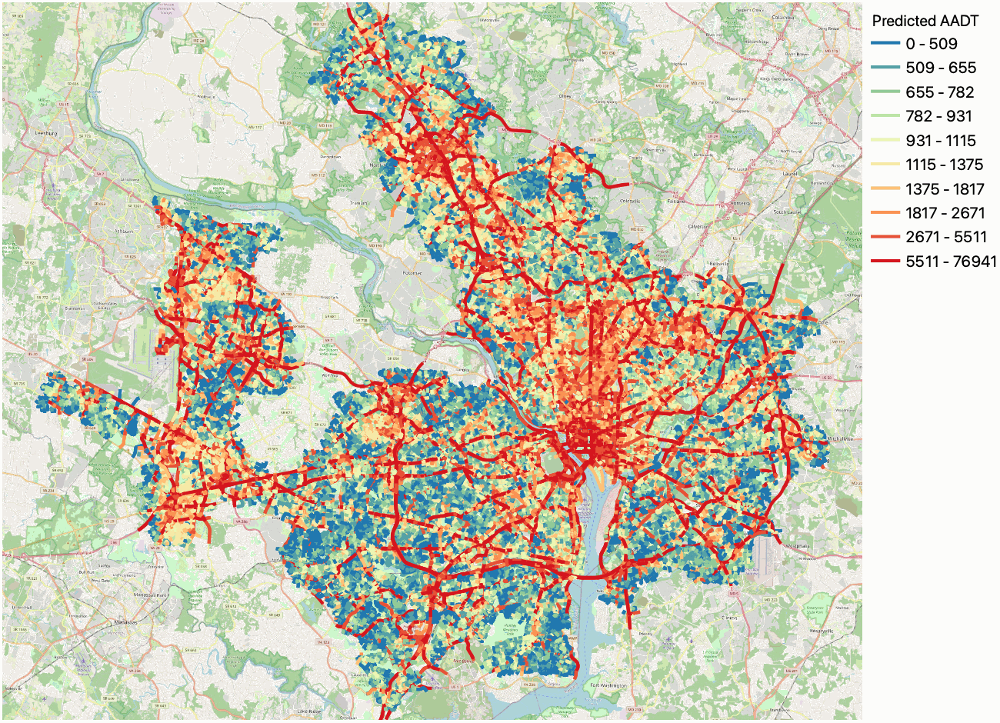

**Figure 11** Ensemble-predicted AADT for 2021, measured in vehicles per day, for Washington, D.C. Cooler colored road segments indicate relatively less AADT compared to warmer colored road segments.

#### 2.5 Uncertainty & Confidence

The 2025 dataset includes an updated methodology for the estimates of uncertainty in emissions estimates. In this section, we discuss our methods for quantifying uncertainty in assets.

#### 2.5.1 Uncertainty Overview

In addition to CO<sub>2</sub>, N<sub>2</sub>O, and CH<sub>4</sub> emissions estimates, we provide estimates of activity, capacity, and other values at aggregated geographies. A full dataset description is in Section 6.2. In Table 7 below, we summarize the approach taken to estimate the uncertainty in each value.

In the following subsections, we provide details on the estimation process in detail.

**Table 7** Summary of methods to estimate uncertainty per column of aggregated data

| **Column** | **Method** |
|---|---|
| capacity | Bootstrapping using per-road-segment data |
| activity | Bootstrapping using per-road-segment data |
| capacity\_factor | Propagation of error from capacity and activity |
| CO2\_emissions\_factor | Propagation of error from CO2\_emissions and activity |
| CH4\_emissions\_factor | Propagation of error from CH4\_emissions and activity |
| N2O\_emissions\_factor | Propagation of error from N2O\_emissions and activity |
| other\_gas\_emissions\_factor | Propagation of error from other\_gas\_emissions and activity |
| CO2\_emissions | Bootstrapping using per-road-segment data |
| CH4\_emissions | Bootstrapping using per-road-segment data |
| N2O\_emissions | Bootstrapping using per-road-segment data |
| other\_gas\_emissions | Bootstrapping using per-road-segment data |
| total\_CO2e\_100yrGWP | Propagation of error from CO2\_emissions, CH4\_emissions, and N2O\_emissions, including constants |
| total\_CO2e\_20yrGWP | Propagation of error from CO2\_emissions, CH4\_emissions, and N2O\_emissions, including constants |

#### 2.5.2 Bootstrapping Approach

The machine learning inference process (see Section 2.4.5) provides estimates of AADT on a road-segment level (see Section 2.2.4) per segment category (see Section 2.2.5), and includes the road-segment length. These road segments are tied to specific aggregation areas (such as GADM 0, 1, 2; see (Section 2.2.1, Section 2.2.2, and Figure 2)). In order to estimate the uncertainty in the total activity, capacity, or emissions for an aggregated area, a bootstrapping approach is used (Efron and Tibshirani 1994). Specifically, we use the bootstrapping technique as implemented by the [scipy package](https://docs.scipy.org/doc/scipy/reference/generated/scipy.stats.bootstrap.html) with the “basic” method option due to the number of road segments in many large aggregated regions. This replaces the prior Monte Carlo approach, removing reliance on distributional assumptions which break down in rural regions, while also reducing computational overhead.

In this approach, we first calculate the activity and emissions for each road segment as shown in Equations 14 and 4 respectively, using the inferred AADT per road segment. The bootstrap is calculated against the total activity, capacity, and emissions for each segment type and month for each aggregated area. The algorithm in brief is:

1.  Choose a set of road segments, of the same size as the original dataset, with replacement

2.  Calculate the total activity, capacity, and emissions

3.  Repeat steps 1 and 2 one thousand times, and estimate the mean, median, standard deviation, and the 2.5<sup>th</sup> and 97.5<sup>th</sup> percentiles.

The Climate TRACE coalition has decided to use a single value to describe the uncertainty in a particular value. In order to estimate this single value instead of providing lower and upper confidence interval bounds, we use the following:

```math
\sigma = \frac{CI_{97.5}-CI_{2.5}}{\mu} \qquad (23)
```

where $`\mu`$ is the bootstrap mean. While the bootstrap standard deviation can be helpful as a single value uncertainty estimate, the confidence interval will likely provide a better estimate of uncertainty with non-normal data.

The bootstrap technique provides estimates for the following properties:

-   Activity

-   Capacity

-   Emissions (for each of 10 emissions types)

These are calculated per aggregate region, per month, per segment category.

#### 2.5.3 Correlations

While the bootstrap calculation provides estimates for the activity, capacity, and emissions directly, there are many secondary properties, such as emissions factor and capacity factor, that require propagation of uncertainty from these three values. To more accurately calculate the propagation of errors, we estimate the correlations between these values. Specifically, using the same per-road-segment data for activity, capacity, and emissions, we estimate the Pearson $`\rho`$ correlation coefficient between these two pairs of values for every aggregation area and every segment type:

-   activity and emissions (for each emission type separately)

-   activity and capacity

While the activity and capacity vary in correlation, activity and emissions are very strongly correlated. Although emissions depends on the multiplication of activity with the segment category emissions factor (SCEF), the activity varies significantly more than the SCEF. Therefore, activity and emissions are typically strongly correlated with a coefficient near 1.

#### 2.5.4 Uncertainty Aggregation

The standard method for combining uncertainties for a given model (e.g., calculating emissions from emissions factors and activity) is to propagate the sources of uncertainties by any linear or non-linear differentiable function $`f`$ of $`n`$-variables $`x_i`$:

```math
\sigma_{f}^2=J\Sigma^xJ^T=\sum_i^n\sum_j^n\frac{\partial f}{\partial x_i}\frac{\partial f}{\partial x_j} \rho_{x_ix_j}\sigma_{x_i}\sigma_{x_j} \qquad (24)
```

where $`\sigma_{f}`$ is the uncertainty of the variable of interest, and $`\sigma_{x_i}`$ are the uncertainties of the sources, and $`\rho_{x_ix_j}`$ is the correlation between the variables. Additionally, we explicitly assume that errors are uncorrelated between the segment categories $`c`$. For variables that can be expressed as a linear sum of per-segment-category values, the per-segment-category errors can be added in quadrature to calculate the final per-region, per-month uncertainty estimate, for example as with activity:

```math
\sigma_{ACT_{r,j}}^2=\sum_{c=1}^3\sigma_{ACT_{r,j,c}}^2 \qquad (25)
```

#### 2.5.5 Emissions Factors Uncertainty

For emissions factors $`EF_{r,g,j}`$, their definitions ( Equation (17)) can be re-expressed as in terms of per-segment-category values for emissions ($`E_{r,g,j,c}`$) and activity ($`ACT_{r,j,c}`$):

```math
EF_{r,g,j}=\frac{E_{r,g,j}}{ACT_{r,j}}=\frac{\sum_c{E_{r,g,j,c}}}{\sum_c{ACT_{r,j,c}}} \qquad (26)
```

Under the same, previous assumption that errors are uncorrelated between the segment categories $`c`$, combining Equations 26 with 24 and simplifying gives the following formula for emissions factor uncertainties:

```math
\begin{aligned}
& \sigma_{EF_{r,g,j}}^2=\sum_c\left[
    \left( \frac{\sigma_{E_{r,g,j,c}}}{ACT_{r,j}}\right)^2 + 
    \left(\sigma_{ACT_{r,j,c}} \frac{E_{r,g,j}}{ACT_{r,j}^2} \right)^2 \right. \\
& \left.- 2\rho_{E_{r,g,j,c}ACT_{r,j,c}}\left( \frac{\sigma_{E_{r,g,j,c}}}{ACT_{r,j}}\right)\left(\sigma_{ACT_{r,j,c}} \frac{E_{r,g,j}}{ACT_{r,j}^2} \right)
    \right]
\end{aligned} \qquad (27)
```

#### 2.5.6 Capacity Factor Uncertainty

Similarly, capacity factor $`CF_{r,j}`$ can be re-expressed in terms of segment categories:

```math
CF_{r,j}=\frac{ACT_{r,j}}{CAP_{r,j}}=\frac{\sum_c{ACT_{r,j,c}}}{\sum_c{CAP_{r,j,c}}} \qquad (28)
```

with an associated equation for uncertainty:

```math
\begin{aligned}
& \sigma_{CF_{r,j}}^2=\sum_c\left[
    \left( \frac{\sigma_{ACT_{r,j,c}}}{CAP_{r,j}}\right)^2 + 
    \left(\sigma_{CAP_{r,j,c}} \frac{ACT_{r,j}}{CAP_{r,j}^2} \right)^2 \right. \\
& \left.- 2\rho_{ACT_{r,j,c}CAP_{r,j,c}}\left( \frac{\sigma_{ACT_{r,j,c}}}{CAP_{r,j}}\right)\left(\sigma_{CAP_{r,j,c}} \frac{ACT_{r,j}}{CAP_{r,j}^2} \right) \right]
\end{aligned} \qquad (29)
```

#### 2.5.7 Total Equivalent CO<sub>2</sub>: 20 and 100 Year Baselines

These two columns are calculated from propagation of error of the total:

```math
TOT_Z=CO2+CH4\cdot CO2e_{CH4,Z}+N2O\cdot CO2e_{N2O,Z} \qquad (30)
```

where $`Z\in {20,100}`$ are the two different baselines, $`CO2e_{CH4,Z}`$ is the equivalent CO<sub>2</sub> emissions for methane, and $`CO2e_{N2O,Z}`$ the equivalent CO<sub>2</sub> emissions for nitrous oxide. We use the propagation of error along with the standard IPCC definitions of error in the equivalent CO2 emissions such that:

```math
\sigma_{TOT_Z}^2=\sigma_{CO2}^2+
    CH4^2\sigma_{CO2e_{CH4,Z}}^2+CO2e_{CH4,Z}^2\sigma_{CH4}^2+
    N2O^2\sigma_{CO2e_{N2O,Z}}^2+CO2e_{N2O,Z}^2\sigma_{N2O}^2 \qquad (31)
```

#### 2.5.8 Confidence

As described above, there are many assumptions and rough approximations made in order to estimate uncertainties of many different parameters calculated from our models. We judge, based on subject matter expertise and knowledge that this initial calculation while useful, can be improved in many ways. As such, all uncertainty parameters calculated here have a LOW confidence using standard IPCC confidence ranges.

#### 2.6 International Emissions Inventories

We have performed comparison against one international emissions inventory globally, EDGAR v2025 (M. Crippa et al. 2025). Although we use EDGAR to get a global scale factor, this comparison is still valid to check the distribution of model performance and dependencies on input features. Specifically, the estimated global scale factor affects primarily the mean of our model output. EDGAR provides a global inventory for transportation that uses road density as a proxy to spatially distribute emissions. Other possible inventories, such as Google EIE or Carbon Monitor, for example, do not have open data sources that we could easily download across our entire dataset. As a public, gridded product, the EDGAR dataset is somewhat more amenable to comparisons against our datasets.

Our emissions estimates were compared against EDGAR v2025, both within the USA and globally. This comparison is performed for initial validation of our data; it is not used for uncertainty estimates. EDGAR v2025 separates CO<sub>2</sub> emissions by long-cycle (IEA-EDGAR CO2) and short-cycle (EDGAR CO2bio) sources; these are summed together for comparison to our data. EDGAR v2025 also reports CO<sub>2</sub> emissions on a 0.1 degree grid, while we report our estimates on a 0.5 degree grid. To provide a consistent estimate across the two datasets, we aggregate the 0.1 grids to the nearest 0.5 grid and compare results on that.

See Section 3.3 for a discussion of the results of the comparison.

#### 2.7 Emission Reduction Strategy (ERS)

Three primary categories of emission reduction strategies were analyzed for the road transportation sector, including conversion of internal combustion engine (ICE) vehicles to battery-powered electric vehicles (BEVs) (Section 2.7.1), reduced passenger vehicle activity through increased carpooling or non-motorized transportation (Section 2.7.2), and reduced passenger vehicle activity through increased urban bus transit (Section 2.7.3).

The ERS values as computed are based on aggregated road emissions and induced activity values across all of 2025, the last full year of data available as of writing. The net reduction $`R_{r,g}`$ in road emissions in a given region $`r`$ for a greenhouse gas $`g`$ is defined by the following equation:

```math
R_{r,g}=\sum_{j\in y=2025}E_{r,g,j}\cdot\left(1-\rho_{r,g}\right)-ACT_{r,j}\left(\alpha_{1,r}MER_{1,r,g}+\alpha_{2,r}MER_{2,r,g}\right) \qquad (32)
```

where:

-   $`E_{r,g,j}`$ is the per-month emissions within the region as given by Equation (2)

-   $`\rho_{r,g}`$ is the ratio between scope 1 emissions in the ERS scenario relative to the baseline emissions; see Section 2.7.1.1

-   $`ACT_{r,j}`$ is the per-month activity within the region as given by Equation (12)

-   $`\alpha_{1,r}`$ is the induced activity conversion rate for the electricity generation sector in units of MWh per vehicle kilometers traveled (VKT); see Section 2.7.1.2

-   $`\alpha_{2,r}`$ is the induced activity conversion rate for the oil & gas production sector in units of barrels of oil (BBL) per VKT; see Section 2.7.1.3

-   $`MER_{1,r,g}`$ and $`MER_{2,r,g}`$ are the marginal emissions rates for the electricity generation and oil & gas production sectors respectively

It is important to note that the induced activity is at point-of-use; transmission or transportation losses are accounted for with the $`MER`$ values for the respective sectors. While the derivation of the $`MER`$ values are out-of-scope for this document, they can be found within the individual sectors’ methodology documentation within the broader ClimateTRACE coalition.

For each region where multiple emission reduction strategies have been modeled, the strategies are ranked primarily by confidence (prioritizing higher confidence strategies), before ranking by the total reduction in scope 1 emissions of CO<sub>2</sub>.

#### 2.7.1 ICE Vehicle Conversion to BEVs Strategy

The initial ERS analyzed for the road transportation sector is the conversion of internal combustion engine (ICE) vehicles to battery-powered electric vehicles (BEVs). The overall change in emissions under this scenario for this sector are driven by the reduction in scope 1 emissions due to the removal of ICEs, but are partially negated by increases in scope 2 emissions due to the energy used by BEVs coming from the local electrical grid. An additional reduction in scope 2 emissions occurs due to the reduced need for gasoline production from the oil- and gas-refining sector. Unmodeled is the response within the ethanol fuel industry, which would see reduced demand from the road transportation sector and might respond by either reducing corn or sugarcane production or shifting production towards other sectors.

The ERS solutions were diversified by analyzing the conversion of each vehicle class, as well as classes in conjunction. The vehicle classes passenger car and light duty trucks were always analyzed together, as the definitions and uses for those classes tend to overlap. The sets of vehicle classes analyzed are:

-   Passenger Car & Light Duty Trucks

-   Motorcycles

-   Buses

-   Single-Unit and Combined Trucks

-   Passenger Car, Light Duty Trucks and Motorcycles

-   Passenger Car, Light Duty Trucks, Motorcycles and Buses

-   All Vehicle Classes

Additionally, confidence values were selected to indicate the feasibility of the ERS within each region. For passenger cars, light duty trucks, and motorcycles, while the strategy relies on currently available, proven technology, the financial burden of implementation, both in terms of replacement vehicles and the supporting electric grid, makes the strategy more attainable for countries with a higher income. As such, the country income classifications by the World Bank (The World Bank 2026) are used to set confidence (feasibility) levels; high-income countries are limited to a high confidence; upper- and lower-middle income countries a medium confidence, and low-income countries a low confidence.

For buses, while financial burdens are shifted from individuals to public and private entities, there exist more technical challenges in implementing a full fleet of electric buses, particularly for long-haul and rural bus routes. For strategies incorporating buses, confidence was set no higher than medium.

Similarly, for single-unit and combined trucks, in addition to fewer models being readily available, there are more significant technical hurdles given the increased vehicle weight and long-haul nature of many truck operations. Given that, confidence is set to low for any strategies incorporating single-unit and combined trucks.

#### 2.7.1.1 Estimating Decrease in Scope 1 Emissions

Scope 1 emission changes are easily accounted for within the emission factor calculations by shifting the proportion of passenger vehicles that are gasoline powered to BEV, and computing the difference in the final emission tallies. Specifically, we adjust the vehicle mix values $`m_{a,j,v,f}`$ in Equations 7 and 8 such that the adjusted values $`m_{a,j,v=passenger\_cars,f}'`$ are given as:

```math
\begin{aligned}
&m_{a,j,v,f\neq bev}' =0 \\
&m_{a,j,v,f=bev}' =m_{a,j,v,f=bev}+m_{a,j,v,f\neq bev}
\end{aligned} \qquad (33–34)
```

The remainder of the emissions equations remain the same to produce an updated emission estimate $`E_{r,g,j}'`$ under the ERS scenario for each region $`r`$. The emissions ratio $`\rho_{r,g}`$ is then given as:

```math
\rho_{r,g} = \frac{\sum_{j\in y=2025}{E_{r,g,j}'}}{\sum_{j\in y=2025}{E_{r,g,j}}} \qquad (35)
```

#### 2.7.1.2 Induced Increase in Electricity Generation

As a result of switching from ICE vehicles to BEVs, there will be an increase in electricity used to power the new BEVs. The rate of new, induced electrical energy usage per VKT of activity will vary from region to region, as there are clear preferences in different countries for differently sized vehicles, and there is a negative correlation between vehicle weight and efficiency (Cazzola, Paoli, and Teter 2023). Furthermore, the current average efficiency of BEVs within a country is not necessarily a good proxy for the expected efficiency under the ERS scenario, as the current fleets of BEVs are skewed by the preferences of early adopters. As such, for passenger car and light duty trucks we use the latest vehicle sales figures per market segment (Section 2.2.12) of the ICE vehicles to compute a weighted average of the BEV efficiencies (Section 2.2.11):

```math
\bar\beta_{r}=\frac{\sum_k{\beta_{r,k}\cdot n_{r,k}}}{\sum_k{n_{r,k}}} \qquad (36)
```

where $`\bar\beta_{r}`$ is the weighted average for region $`r`$, $`\beta_{r,k}`$ is the BEV efficiency for market segment $`k`$, and $`n_{r,k}`$ is the vehicle sales number for ICE vehicles within the region’s country.

For other vehicle classes, the per market segment breakdowns are not readily available, so the current BEV efficiencies are used for modeling the increased electricity demand (Section 2.2.13, Section 2.2.14, Section 2.2.15).

In order to match the format of $`\alpha_1`$ within Equation (32), $`\bar\beta_{r}`$ needs to be scaled by the ratio of the activity of the affected vehicles relative to the total activity within a region. This is calculated as:

```math
\alpha_{1,r} =\frac{\sum_{a\in r, j\in y=2025}{AACT_{a,j}\cdot m_{a,j,v,f\neq BEV}}}{\sum_{a\in r, j\in y=2025}{AACT_{a,j}}}\bar\beta_{r} \qquad (37)
```

where $`AACT_{a,j}`$ is the activity within the atomic geography area in units of vehicle kilometers traveled (Equation (13)).

#### 2.7.1.3 Induced Decrease in Gasoline Production

As switching from gasoline-powered ICE vehicles to BEVs reduces the amount of motor gasoline consumed, there is expected to be a corresponding decrease in the amount of gasoline produced from the oil & gas production sector. Using mostly previously defined emission factors, the nominal amount of gasoline consumed per unit of activity $`G_{a,c,j}`$ is calculated as:

```math
G_{a,c,j}=t_{a,c,j,f}\cdot\left(\sum_v{\eta_{a,v,f}\cdot m_{a,j\in y,v,f}}\right) \qquad (38)
```

for $`f`$=gasoline, with a corresponding $`G_{a,c,j}'`$ calculated when using the modified $`m'`$ values (Equation (33)) under the ERS scenario.

Similar to the scale factor derived in Section 2.3.7, a scale factor $`s_G`$ is introduced to ensure the estimated total motor gasoline consumed globally is consistent with other estimates. International Energy Agency 2026 reports a demand of 27,863 thousand barrels of motor gasoline per day in 2025. However, motor gasoline consumed at the fuel pump is not produced purely from petroleum; rather, it is often blended with ethanol. Ramsey et al. 2023 reports 27.6 billion gallons of fuel ethanol consumed globally relative to a total consumption of 403.3 billion gallons of motor gasoline in 2018, with the remaining $`(1-27.6/403.3)=0.932`$ fraction coming from petroleum-derived sources. Using a conversion factor of $`6.2898\times10^{-3}`$ liters of motor gasoline per barrel (British Petroleum 2022), the scale factor is calculated as:

```math
s_G=\frac{0.932*27863e3*365}{6.2898\times10^{-3}\sum_{a,c,j\in y=2025}{G_{a,c,j}\cdot CACT_{a,c,j}}}=0.866 \qquad (39)
```

The induced activity ratio can then be calculated as:

```math
\alpha_{2,r} =s_G\cdot 6.2898\times10^{-3}\cdot\frac{\sum_{a\in r, c, j\in y=2025}{\left(G_{a,c,j}'-G_{a,c,j}\right)\cdot CACT_{a,c,j}}}{\sum_{j\in y=2025}{ACT_{r,j}}} \qquad (40)
```

#### 2.7.2 Increased Carpooling and Non-Motorized Transportation (NMT) Strategy

A second strategy to reduce emissions within the road transportation sector is through policies that directly reduce on-road vehicle activity and emissions by encouraging non-motorized transportation (walking/biking) and carpooling. While there are challenges encouraging the use of these alternatives (Namakula et al. 2025,Cellina et al. 2024), these are less technical in nature and are often best addressed by various policy efforts. For the purposes of this analysis, the effects on emissions are evaluated by modeling a 10% reduction of activity from passenger cars, light duty trucks, and motorcycles due to offsets from increased carpooling and non-motorized transport. Similar to the calculations in Section 2.7.1, the various factors required for Equation (32) were calculated by modeling a 10% reduction in the vehicle mix for the vehicle classes (irrespective of fuel type). The confidence for this strategy was assessed as medium globally, given the lack of technical challenges but the existence of more policy oriented challenges.

#### 2.7.3 Increased Urban Bus Transit

A third possible strategy to reduce emissions is through increased bus transit. While other mass transit options can be utilized to decrease emissions (e.g. subways and passenger rail), they often require significant resources and time to develop the required infrastructure. As bus transit makes use of existing road infrastructure, initial costs can be minimized. For modeling this strategy, the scope is limited to urban areas, where population density more readily supports mass transit. It is recognized that exact emission savings depend on a large number of local factors, including specific bus routing, stop locations, frequency of buses, policies encouraging ridership and many others. The strategy analyzed here is a simplified model that evaluates changes in activity on a per-road segment based on its type.

The underlying modeling assumption is that there is a 10% reduction in passenger car and light duty truck activity on urban roads due to policies enabling increased bus ridership. For local roads, the assumption is the 10% reduction in activity is replaced by pedestrian activity to the nearest bus stops on arterial roads/highways. On the arterial roads/highways, the 10% reduction in activity is replaced by an increase in bus activity at a 1:15 ratio. That ratio is the adopted representative value for the conversion of light duty vehicle-kilometers to bus vehicle-kilometers, where it was chosen after examining data on average per-kilometer light duty vehicle and bus ridership. As in Section 2.7.2, the factors for computing emission reductions were calculated by modeling the decrease in the vehicle mix for the light duty vehicle classes, and increasing the activity for the bus vehicle class on urban, arterial & highway roads by the reduced activity in the light duty vehicle classes divided by 15. As in the carpooling and NMT strategy, the challenges are more implementation and policy in nature, so the confidence for this strategy is assessed as medium.

#### 3. Results

In this section, we highlight top-level trends and differences between dataset release years. Specific information on per-urban-area emissions is available in the released dataset.

#### 3.1 Machine Learning Model Ground Truth Comparison

While each trained ML model reduces the difference between the ground truth AADT values and the inferred values, it is worthwhile comparing a visual representation of the kinds of differences we see. Figures 12 and 13 below display a hexbin plot of predicted vs ground truth AADT values for the CNN Model, the GNN Model, and the ensemble for both the urban models (Figure 12) and the rural models (Figure 13).

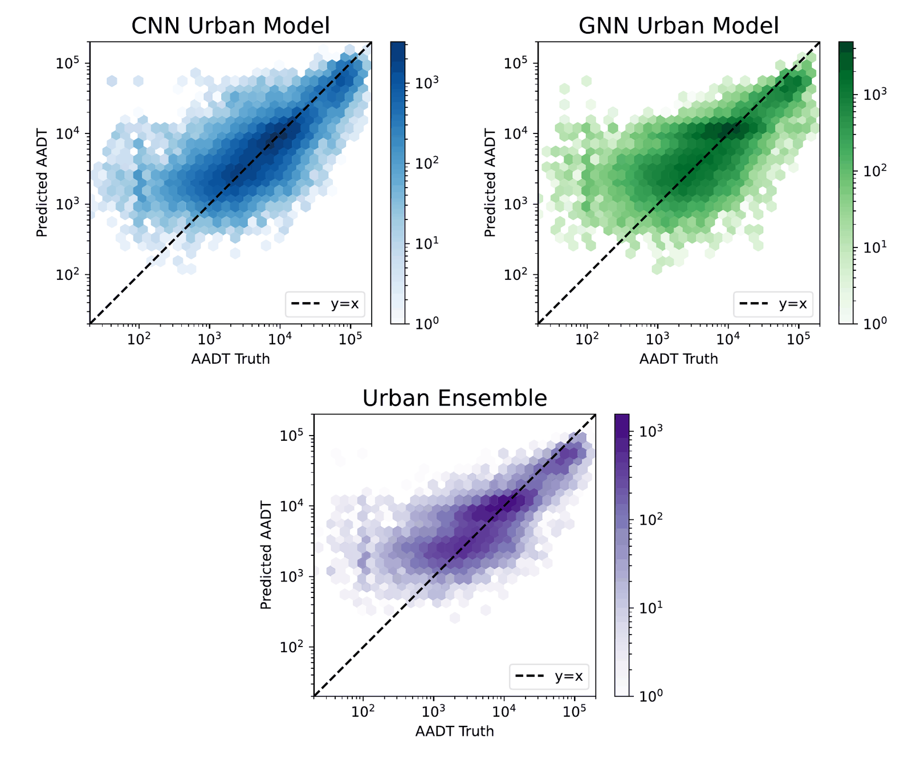

**Figure 12** Comparison of predicted AADT vs. ground truth across a set of 14 test cities in the USA for 2017 and 2018.

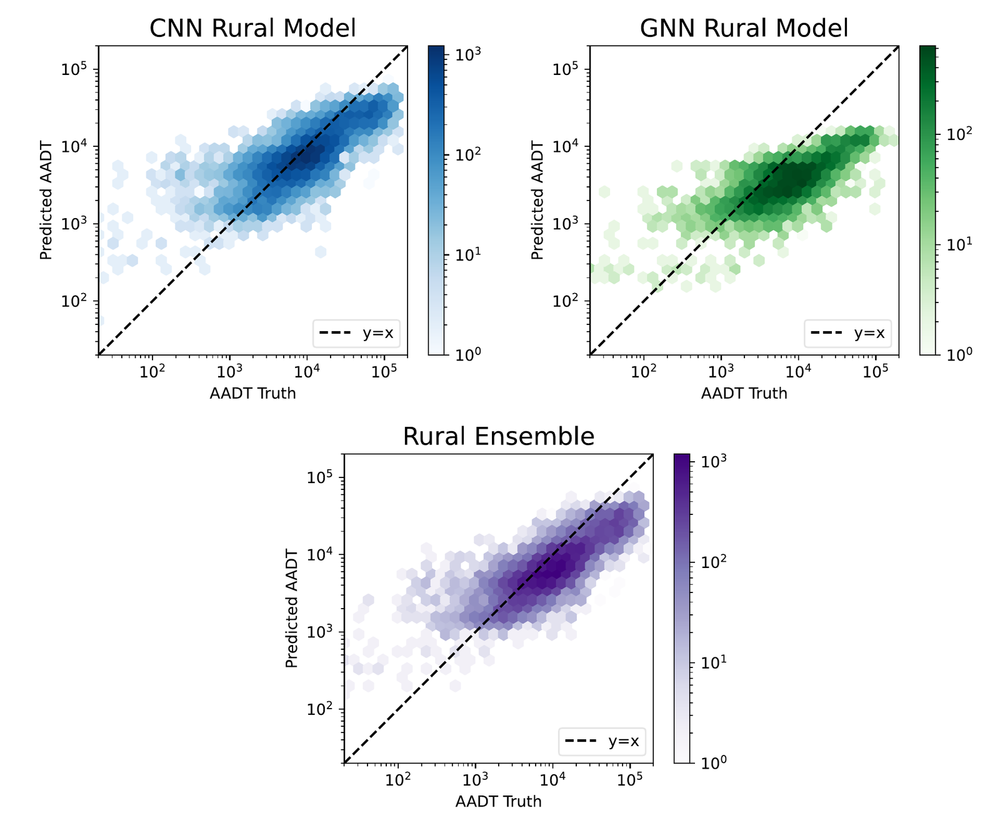

**Figure 13** Comparison of predicted AADT vs. ground truth across a set of 85 rural areas from 2017 and 77 rural areas from 2018 in the USA.

The dashed lines in the plots indicate the line along with predicted and ground truth AADT values are equal. Bins within the plot that have a darker color are places which have more instances in that bin according to the color scale presented. We note in general, all models tend to overestimate AADT for low true AADT values, and models tend to slightly underestimate at the highest true AADT values. The underestimation at low AADT values is expected to be largely due to the bias in available truth AADT values towards more highly trafficked roads. Of special note, the GNN rural model more significantly underestimates true AADT values, though this is largely alleviated through ensembling with the CNN model.

#### 3.2 Global Emissions Inventories Comparison

Figure 14 shows the comparison between the EDGAR v2025 dataset and our release of emissions estimates for the entire globe. EDGAR v2025 emissions data is aggregated from a 0.1 degree grid to a 0.5 degree grid for comparison. We compare only for year 2021 and aim to look at the dependencies of model performance on UN Region and on our rural/urban split. While there is a strong correlation across all emissions, there are also significant differences in areas with lower emissions. For example, where EDGAR broadly predicts $`10^1`$ to $`10^3`$ tons, our methodology predicts more. Where EDGAR broadly predicts $`10^4`$ to $`10^6`$ tons, our methodology predicts less.

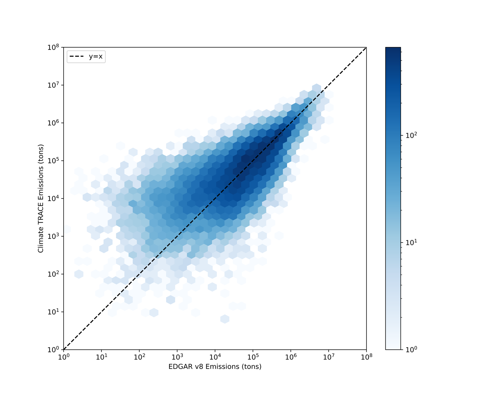

**Figure 14** Comparison of EDGAR v2025 emissions and estimates described in this methodology across our global 0.5 degree grid. Darker blues indicate that the most common comparison between the two databases indicates that our methodology over-estimates emissions in lower values, and under-estimates larger values relative to EDGAR.

Figure 14 shows our scaled emissions estimates compared with EDGAR v2025 data. The global scale factor derived from EDGAR enforces that our estimates have a similar means, but we demonstrate that our emissions are similar in their dependency on other factors in the data as well. We further explore the discrepancies from EDGAR by determining whether the error is largely attributed to rural or urban areas. For each grid we calculate the fraction of the total urban area over the total area, with urban areas being defined using GHSL boundaries. Figure 15 shows the percent difference across various urban fraction bins. We primarily notice largest variance in our deviations from EDGAR at lower urban fractions, which is expected given the lack of data availability in rural areas.

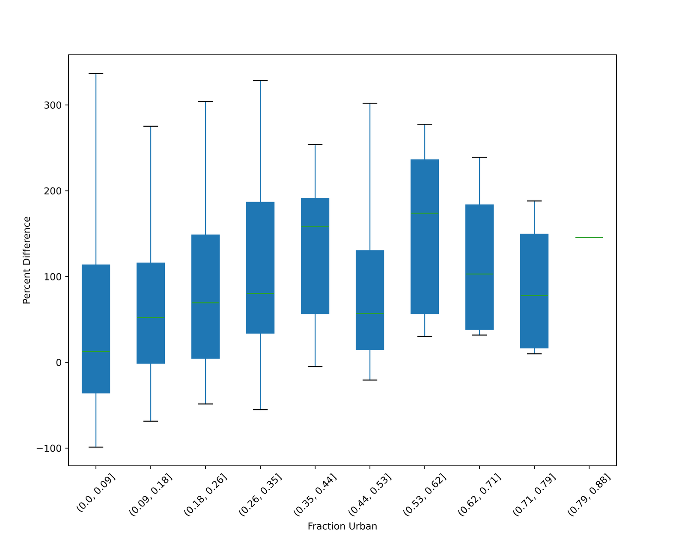

**Figure 15** Signed percent difference between EDGAR v2025 and estimates across various urban fraction values.

To further explore this difference in Figure 15, a Mann-Whitney U-test is performed between our error distributions for urban and rural areas. For this analysis, we choose grid points with urban fractions one standard deviation above the mean to be “urban”, and all other points to be “rural”. Figure 16 shows the result of this split. According to this threshold, rural areas contribute the most to our emissions. We sample 1,000 points without replacement from both the urban and rural distributions of the signed difference and signed percent difference between our model estimates and EDGAR. For the signed percent difference, there was a significant difference between the urban ($`\mu = 155.89`$, $`\sigma = 826.53`$) and rural ($`\mu = 144.93`$, $`\sigma = 851.41`$) distributions ($`U = 725{,}921`$, $`p = 1.55 \times 10^{-68}`$). For the signed difference, there was also a significant difference between the urban ($`\mu = 628{,}447.89`$, $`\sigma = 1{,}452{,}477.77`$) and rural ($`\mu = -32{,}678.04`$, $`\sigma = 152{,}666.48`$) distributions ($`U = 756{,}328`$, $`p = 1.10 \times 10^{-87}`$). Although the mean signed percentage differences were similar between urban and rural regions, the Mann–Whitney U statistic indicates that urban regions tend to exhibit larger signed percentage discrepancies relative to EDGAR. A similar pattern is observed for signed emissions differences, for which urban regions exhibit substantially more positive mean discrepancies than rural regions. Together, these results suggest systematic urban–rural differences in the spatial distribution of emissions between our inventory and EDGAR, with our model generally estimating higher emissions relative to EDGAR in urban areas.

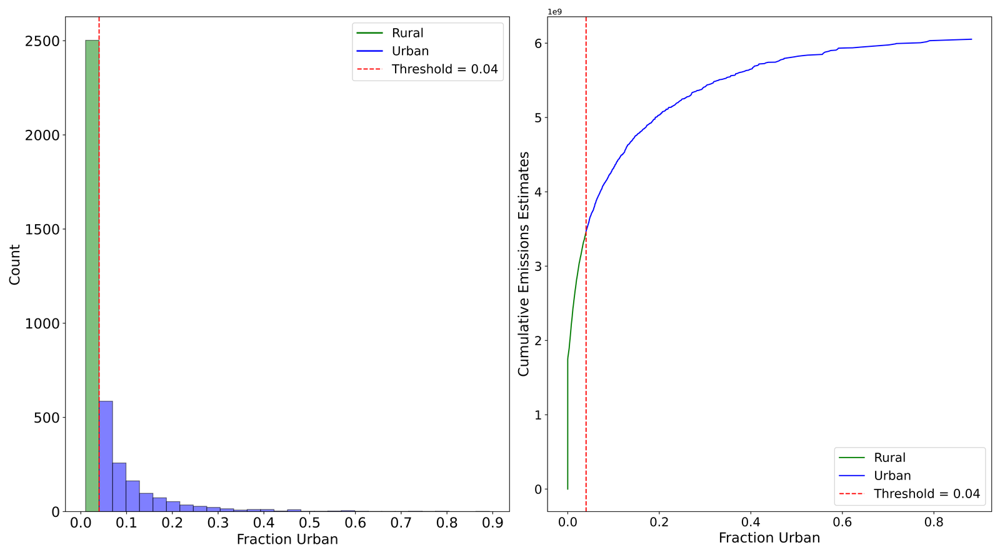

**Figure 16** Urban/rural split according to a 1-standard deviation above the mean for a given grid’s fraction of urban atomic geometries.

Lastly, we look at the difference between our estimates and EDGAR according to UN regions. Figure 17 below shows the absolute difference per each UN region, split up in rural and urban regions. The urban and rural regions are determined using the same method as above. For rural areas, our estimates differ the most in Eastern Asia, Southern Europe, and Western Europe. For urban areas, the largest difference is in Southern Asia and South-eastern Asia. Differences for all UN regions are provided in the appendix below (Figure 30).

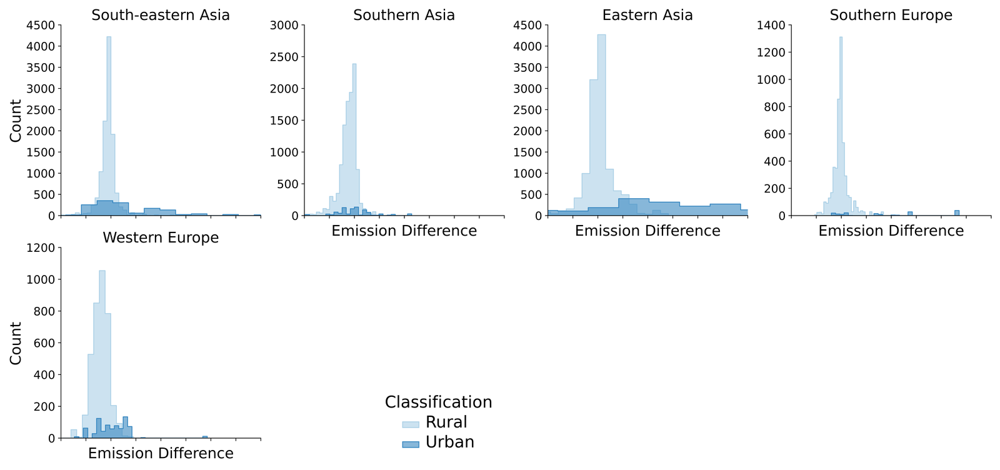

**Figure 17** Comparison of actual difference between estimates and EDGAR for key UN regions, split between rural and urban regions.

Further international validation for both AADT and resulting emissions estimates is necessary, including a deeper understanding of all potential sources of differences (e.g., emission factors uncertainty, varying total road network length included, etc.). We aim to continue to incorporate international AADT datasets, where available, into our model training and validation process. The addition of more real-time data (e.g., traffic and mobility) will help address the temporal ambiguity of our estimates. Finding publicly available data of this type remains a significant challenge.

#### 3.3 Worldwide Emissions Results

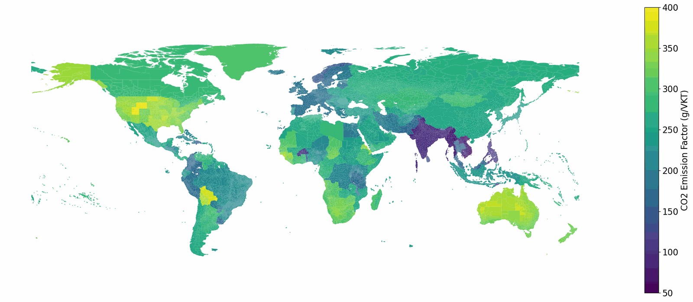

**Figure 18** Global map of the January 2025 emission factors in the released data set. Units are grams per VKT. Regions shown are GADM Level-2 when available, GADM Level-1 otherwise.

Figure 18 shows an overview of the emission factors for January, 2025 ($`EF`$, see Section 2.3.8). One interesting highlight from our data is the fact that areas in India have a much lower EF than countries such as China and the USA. This is mostly due to our data sources for vehicle fleet mix in those countries, which indicate that a vast majority of vehicles in those two countries are motorcycles. This is highlighted in Figure 19 below: India has vehicle registrations around 75% for motorcycles. Another thing to note is the regional EF variation within the USA, which is due to differences in state-level vehicle fleet mix as seen in Figure 20. For example, Wyoming has a larger percentage of light duty and combination trucks compared to passenger vehicles, a pattern different from other states such as New York or California.

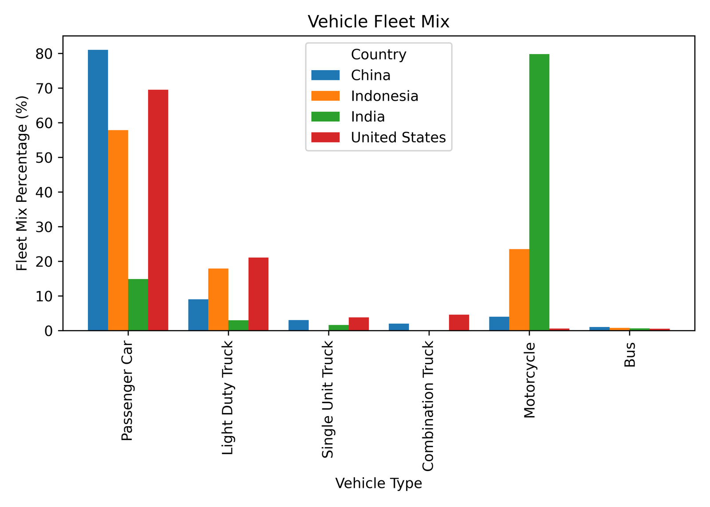

**Figure 19** Vehicle fleet mix for four countries highlighting the difference in motorcycle usage.

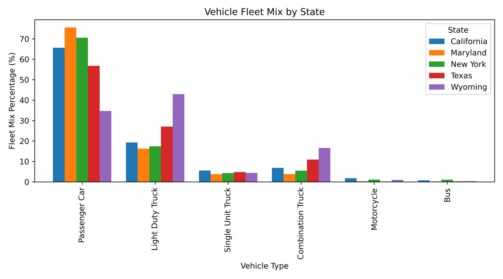

**Figure 20** State-level vehicle fleet mix in the USA to highlight regional differences.

In Figure 21, the effects of the temperature-based adjustments to fuel efficiency are shown (Section 2.2.9) by plotting the difference between the emission factors between July and January 2025. In locations such as the Southern U.S., there is a clear increase in the emission factor as January (winter) temperatures are close to the nominal 72° F and July (summer) temperatures are much higher than nominal. In locations such as Northern Australia, with summer in January, the reverse is true. More subtly, locations on the southern extremes of the southern continents show a higher emission factor in January than July; this is because the January temperatures are close to nominal (72° F) and the July temperatures are much colder (see Figure 8 for more details).

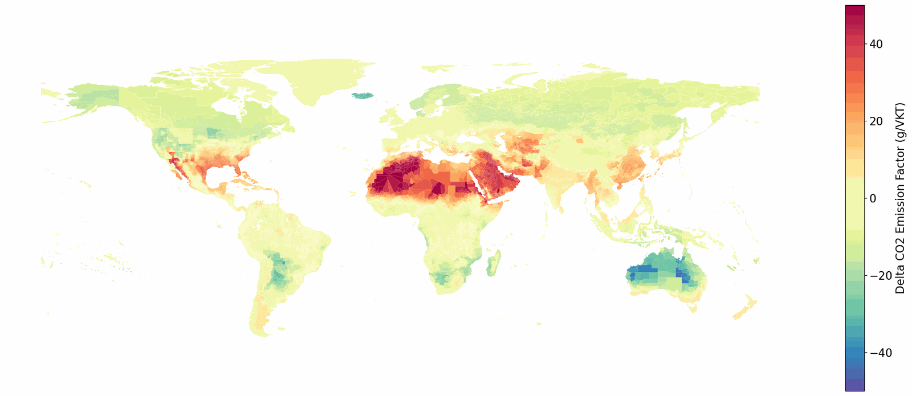

**Figure 21** Difference in CO<sub>2</sub> Emission Factors between July, 2025 and January, 2025. Units are grams per VKT. Regions shown are GADM Level-2 when available, GADM Level-1 otherwise.

Additionally, Figure 22 displays the estimated total CO<sub>2</sub> emissions for 2025. Not unexpectedly, some of the highest emitting regions are in the U.S., Europe, and China. In contrast to Figure 18, the emissions in India and Indonesia are much more typical, as the comparatively low emission factors are balanced by higher activity.

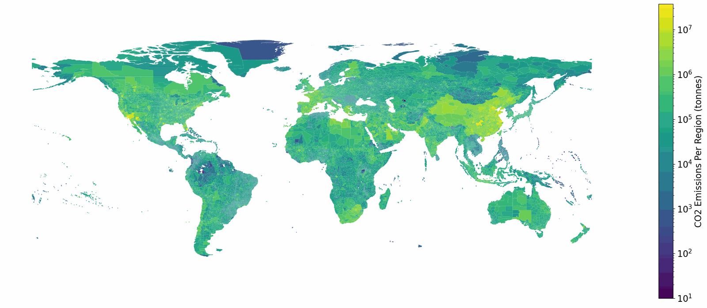

**Figure 22** Total estimated annual CO<sub>2</sub> emissions for 2025 under the 2026-08 data release. Units are tonnes. Regions shown are GADM Level-2 when available, GADM Level-1 otherwise. Note emissions are shown per region; locations where an area is broken into many small GADM Level-2 regions will show much lower emissions than an equivalently emitting location of the same area contained within just one GADM Level-2 region.

Figure 23 shows the estimated emissions on a monthly basis for six of the top emitting countries for all twelve of the modeled GHG and non-GHG emissions. As these are plots of the total emissions for each month, there are month-to-month variations due to the number of days in each month, especially noticeable as a dip in February each year. CO<sub>2</sub> and CO2e are more dynamic than the other emissions as the model has a temperature-dependence for CO<sub>2</sub> but not the other factors (Section 2.3.3). In general, increases are largely due to increased activity; noticeable decreases in emissions such as NO<sub>x</sub>, CO, and Exhaust PM<sub>2.5</sub> are driven by improved emissions controls. The largest individual country contributions to emissions are from the U.S. and China, with the exception of Brazil which due to its uniquely heavy use of ethanol fuel has a significant contribution to the total hydrocarbon (Total HC) emissions.

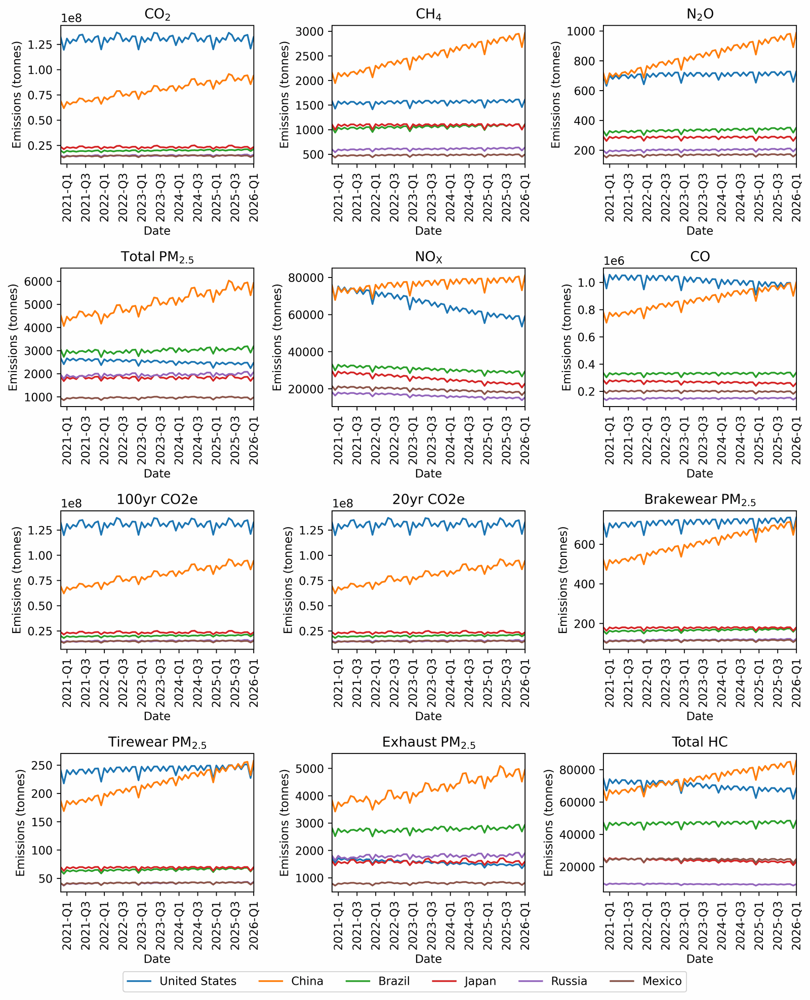

**Figure 23** Monthly emissions for the top 6 emitting countries (by 100yr CO2e in 2024) for all estimated gases

Additional highlights include:

-   We estimate that between 2024 and 2025, an extra $`97\times10^6`$ tonnes of CO<sub>2</sub> were emitted from road transportation; this is a 1.5% increase

-   Per country income class (as defined by the World Bank The World Bank 2026), between 2024 and 2025 we estimate High Income Countries (HIC) saw a decrease of $`2.4\times10^6`$ tonnes of CO<sub>2</sub>, while Upper-Middle Income Countries (UMIC) increased by $`69\times10^6`$ tonnes, Lower-Middle Income Countries (LMIC) by $`25\times10^6`$ tonnes, and Low Income Countries (LIC) by $`5.7\times10^6`$ tonnes

-   Of the 2025 estimated emissions, 49% is from HIC, 37% UMIC, 11% LMIC, and 3% LIC

#### 3.4 Emission Reduction Strategy Results

While a full understanding of the emission reduction potential of the proposed emission reduction strategy requires a cross-sector analysis, net emissions are projected to be reduced except in a small minority of countries where the current electrical grid is exceptionally dirty. Those regions are still expected to result in a net decrease however if the induced activity is met with new, clean electrical power sources. In this document, presented results will be focused on results solely within the road transportation sector, namely scope 1 emissions and the induced activity rates used for calculating scope 2 emissions. Additionally, unless otherwise specified, this analysis will focus on the ERS strategy that converts ICE light duty vehicles (passenger cars and light duty trucks) and motorcycles to BEV vehicles. Additional plots for the other EV strategies are available in Section 6.5.

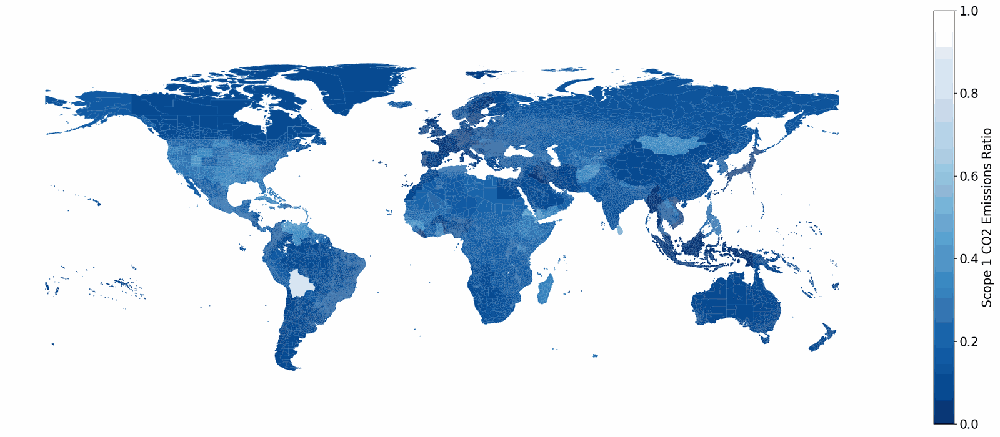

**Figure 24** Global map of the ratio $`\rho_{r,g=CO_2}`$ (Equation (35)) of 2025 CO<sub>2</sub> emissions under the EV Light Duty Vehicles and Motorcycles ERS strategy compared to baseline 2025 values; darker blue shades indicate greater relative emissions reduction potential. Regions shown are GADM Level-2 when available, GADM Level-1 otherwise.

Figure 24 shows the computed CO<sub>2</sub> emissions ratio $`\rho_{r,g=CO_2}`$ for the year 2025. 2025 was used as it was the last full year as of writing, and the reference values for emissions and activity in Equation (32) are from 2025. Locations with extreme values largely match those in Figure 18 and for much the same reasons. Locations such as India and Indonesia have low proportions of passenger cars within their vehicle fleet, so there is comparatively less reductions available under the ERS scenario, and thus the emissions ratio is higher. In contrast, China for instance stands out with a low ratio (comparatively large reduction available) due to the high proportion of passenger vehicles within its vehicle fleet (Figure 19).

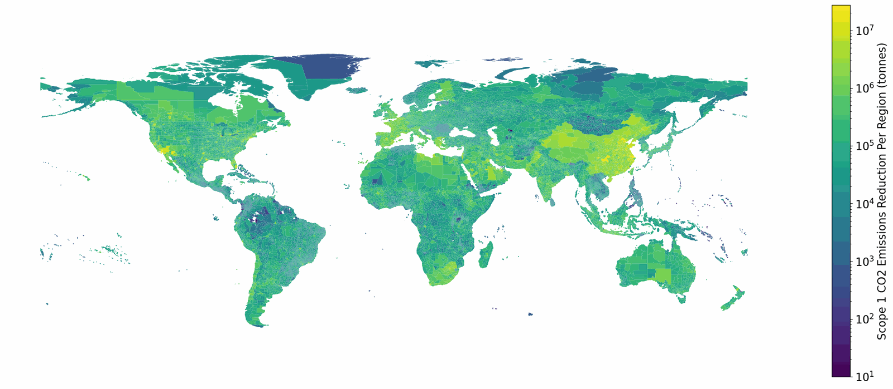

**Figure 25** Total estimated annual reduction per region in CO<sub>2</sub> emissions under the ERS strategy for 2025 values; lighter colors indicate higher emissions reduction potential. Units are tonnes per year.

Multiplying 1 minus the emissions ratio by the total CO<sub>2</sub> emissions (Figure 22) yields the reduction in scope 1 road transportation CO<sub>2</sub> emissions, plotted in Figure 25. While there are some subtle differences, the figure is visually similar to Figure 22, indicating broad potential to reduce scope 1 emissions. Summing the emissions reduction across the entire globe suggests a total reduction in scope 1 CO2e emissions of $`5.8\times10^9`$ tonnes, or 86% by converting ICE light duty vehicles and motorcycles to BEVs. We note this is a higher proportion of road transportation emissions than in other sources; Righi et al. 2026 reports 58% of global road transportation CO2e emissions come from these classes, while European Environment Agency 2026 reports 73% of road transportation CO2e emissions in the EU-27 are from these classes. This is likely due to our use of registrations for fleet mix data when distance-based values are unavailable (Section 2.2.7), which can result in under-representation of truck vehicle classes.

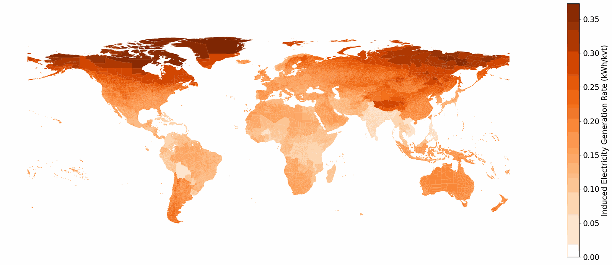

**Figure 26** Global map of the induced electricity generation rate $`\alpha_{1,r}`$ (Equation (35)) due to new BEVs under the ERS strategy; darker orange shades indicate higher induced electricity usage rates. Units are in kWh per kilometer vehicle traveled.

Figure 26 indicates the rate at which additional electricity generation is required per unit of activity (across all vehicle types). The most obvious trend in this image is the larger induced rates in colder regions, which is consistent with Section 2.2.16. The second item of interest is in areas such as India and southeast Asia there are low induced rates; this is due to the high proportion of motorcycles there, which have a much lower electricity consumption rate than passenger cars or light duty trucks. Figure 27 shows the increase in electricity usage by multiplying the annual activity in each region by the induced rate $`\alpha_{1,r}`$. Globally, there is an increased usage of electricity of approximately 4800 TWh annually as a result of the ERS, with the largest contributions occurring in the USA, China, and Europe where there are both high activity values and high values of the induced rate $`\alpha_{1,r}`$.


**Figure 27** Global map of the increase in electricity usage per region due to new BEVs under the ERS strategy; lighter colors indicate higher induced electricity usage. Units are in GWh per year.

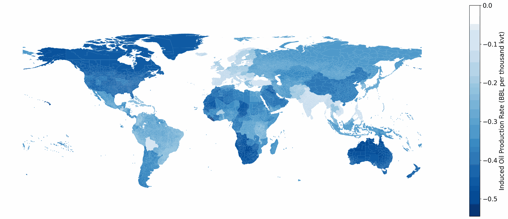

**Figure 28** Global map of the induced oil & gas production rate $`\alpha_{2,r}`$ (Equation (35)) due to the removal of gasoline-powered light duty vehicles and motorcycles under the ERS strategy; darker blue shades indicate greater reductions in oil demand rates. Values are negative indicating a decrease in oil demand, with units in barrels per thousand vehicle-kilometers traveled.

Figure 28 shows the rate $`\alpha_{2,r}`$ at which the demand for oil & gas production decreases within the ERS scenario. This largely tracks Figure 24 as expected. Figure 29 shows the decrease in total demand given by multiplying $`\alpha_{2,r}`$ by the total activity within a region. Summing over the entire globe suggests a total reduction of $`9.0\times10^9`$ barrels of oil per year as a result of the emissions reduction strategy.

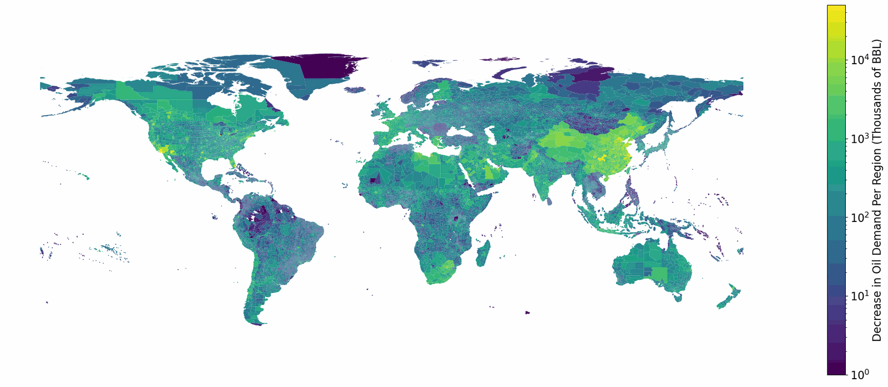

**Figure 29** Global map of the decrease in oil demand due to the removal of gasoline-powered light duty vehicles and motorcycles under the ERS strategy; lighter colors indicate greater reductions in oil demand. Units are in thousands of barrels per year.

Lastly, Table 8 details the global totals for emissions reductions, increased electricity usage, and change in oil & gas production for all of the various ERS strategies.

**Table 8** Global scope 1 emission reductions, induced electricity, and oil production changes for each ERS.

| **Emission Reduction Strategy** | **Scope 1 CO2e Emission Reductions (tonnes)** | **Induced Electricity Usage (TWh)** | **Oil & Gas Production Changes (BBL)** |
|---|---|---|---|
| EV Passenger Cars & Light Duty Trucks | $`5.5\times 10^9`$ | 4500 | $`-8.4\times 10^9`$ |
| EV Motorcycles | $`3.1\times 10^8`$ | 240 | $`-5.6\times 10^8`$ |
| EV Buses | $`1.3\times 10^8`$ | 400 | $`-8.5\times 10^7`$ |
| EV Single-Unit and Combination Trucks | $`6.7\times 10^8`$ | 1600 | $`-3.1\times 10^8`$ |
| EV Passenger Cars, Light Duty Trucks & Motorcycles | $`5.8\times 10^9`$ | 4800 | $`-9.0\times 10^9`$ |
| EV Passenger Cars, Light Duty Trucks, Motorcycles & Buses | $`6.0\times 10^9`$ | 5200 | $`-9.1\times 10^9`$ |
| All Electric Vehicles | $`6.8\times 10^9`$ | 7300 | $`-9.4\times 10^9`$ |
| Increased Carpooling and Non-Motorized Transport | $`5.8\times 10^8`$ | $`-5.0`$ | $`-9.0\times 10^8`$ |
| Increased Urban Bus Transit | $`1.9\times 10^8`$ | $`-1.4`$ | $`-3.0\times 10^8`$ |

#### 4. Discussion and Conclusions

We have presented a hybrid road transportation emissions estimation method that is detailed, scalable, and easy to update. The ability to calculate emissions per road segment can be further refined to reach an unprecedented level of detail and global coverage. Where available, the integration of real-time traffic data would increase the temporal resolution and accuracy of our models. This type of actionable emissions monitoring data will be critical to ensuring we meet global emissions reduction targets and may inspire new ways of mitigating the effects of climate change. Finally, more local vehicle registration or usage data would improve our emissions estimates regardless of a change in the underlying model predictions of average traffic.

We have also developed an uncertainty quantification pipeline (see Section 2.5) that integrates IPCC’s Approach 1 (propagation of uncertainty) and Approach 2 (Monte Carlo simulations) for combining uncertainties. Various areas for further exploration remain, including improving aspects of the data and the uncertainty quantification process. One opportunity for reducing uncertainty is to improve the spatial and temporal resolution of the variables contributing to emission factors, and extending emissions factors by vehicle years. In extending uncertainty analyses, we will continue exploring the uncertainties of urban and rural regions separately. We noted that the distribution of emissions factors varied by urban and region areas, with rural emissions factors often dominating the overall distribution of emissions factors and separate treatment of those distributions may be beneficial. Sensitivity analyses to identify the contributions to uncertainty of each variable will be helpful, as well as assessing uncertainty in trends.

Emission reduction strategies for the road transportation sector, including converting vehicles to BEVs, increasing carpooling and non-motorized transportation, and increasing bus transit, have also been presented and analyzed, with estimations of effects to scope 1 and scope 2 emissions. While BEV adoption is occurring organically in various locales, challenges can be addressed and widespread adoption aided through policy; references from GFEI (Cazzola, Paoli, and Teter 2023, Cazzola, Teter, and Craglia 2025) and MIT Center for Energy and Policy Research (Knittel and Tanaka 2025) provide some guidance. How any policy shift is structured will impact the specific emission impacts; e.g. replacing all ICE vehicles immediately has a different net impact than if ICE vehicles are replaced at end-of-life, and policies can be structured to encourage smaller, more efficient BEVs. Furthermore, the nature of the global supply chain for this sector makes scope 3 estimations difficult, however some estimates for full life-cycle costs for specific use cases are available (Smith et al. 2025). Carpooling policies are often discussed as just one solution within the broader context of mobility management, and can be incentivized by public policies such as dedicated HOV lanes or plate restrictions, or by employer-based policies such as rideshare matching and guaranteed ride home services (Sustainable Urban Transport Project 2009). Increasing the use of walking and cycling transportation has a number of co-benefits beyond reducing emissions, as it can improve the public health, reduce traffic congestion, and boost local economies (World Health Organization 2025). A large number of resources are available on how to encourage these modalities (Welle et al. 2015, Institute for Transportation and Development Policy 2026, and United Nations Environment Programme and FIA Foundation 2017). Bus transit is a relatively cost-effective approach to increasing mass transit capacity, with bus rapid transit (BRT) concepts able to achieve benefits similar to light rail systems at lower costs (Institute for Transportation and Development Policy 2017). These strategies offer great opportunities to reduce GHG emissions within the road transportation sector.

#### 5. Acknowledgements

Thanks to Aaron Davitt and Lekha Sridhar from WattTime for their help in reviewing our methodology. We thank previous team members for their contributions to the road transportation emissions sector:

-   Melat Ghebreselassie

-   Marisa Hughes

-   Tomek Kott

-   Carlos Levya Capote

-   Wayne Loschen

-   Christine Piatko

-   Marisel Villafane-Delgado

-   Kevin Zhang

#### 6. Supplementary Materials

#### 6.1 Vehicle Fleet Mix Sources

**Table S1** *List of Vehicle Fleet Mix Sources for specific countries*

| ****Reference:** ACEA dataset: (ACEA - European Automobile Manufacturers’ Association 2022)** |  |
|---|---|
| \* -   Russian Federation -   Republic of Turkiye -   United Kingdom of Great Britain and Northern Ireland -   Federal Republic of Germany -   French Republic -   Kingdom of Spain -   Italian Republic -   Republic of Poland | -   Kingdom of the Netherlands -   Portuguese Republic -   Kingdom of Belgium -   Kingdom of Sweden -   Czech Republic -   Kingdom of Denmark -   Ireland -   Republic of Finland |
| **Reference:** UNECE dataset: (UNECE - United Nations Economic Commission for Europe 2022) |  |
| \* -   Hellenic Republic -   Republic of Belarus -   State of Israel -   Republic of Azerbaijan -   Swiss Confederation -   Republic of Hungary -   Republic of Austria -   Republic of Bulgaria -   Republic of Croatia -   Republic of Lithuania -   Republic of Moldova | -   Bosnia and Herzegovina -   Republic of Latvia -   Republic of Cyprus -   Republic of Estonia -   Republic of Slovenia -   Republic of Malta -   Republic of Iceland -   Grand Duchy of Luxembourg -   Montenegro |
| **Reference:** ASEANStat dataset: (ASEANstats Data Portal 2025) |  |
| \* -   Republic of Indonesia -   Republic of Philippines -   Kingdom of Cambodia -   Lao People’s Democratic Republic -   Malaysia | -   Singapore -   Thailand -   Vietnam -   Myanmar -   Brunei -   India |
| **Reference:** WHO dataset (World Health Organization 2018) |  |
| \* -   Japan -   Arab Republic of Egypt -   Islamic Republic of Iran -   Republic of Colombia -   Republic of Iraq -   Bolivarian Republic of Venezuela -   Republic of the Sudan -   Kingdom of Morocco -   Republic of Peru -   Republic of Ghana -   Commonwealth of Australia -   United Republic of Tanzania -   Islamic Republic of Afghanistan -   Republic of Ecuador -   Republic of Cote d’Ivoire -   Republic of Senegal -   Syrian Arab Republic -   Republic of Kazakhstan -   United Arab Emirates -   Democratic Socialist Republic of Sri Lanka -   Dominican Republic -   Romania -   Plurinational State of Bolivia -   Federal Democratic Republic of Nepal -   Republic of Tunisia -   Burkina Faso -   Republic of Cuba -   Republic of Guinea -   Republic of Zimbabwe -   Republic of Benin -   State of Palestine | -   Lebanese Republic -   Togolese Republic -   Republic of Paraguay -   State of Libya -   Republic of Honduras -   Republic of El Salvador -   Kingdom of Cambodia -   Republic of Madagascar -   Republic of Costa Rica -   Republic of Burundi -   Republic of Panama -   Oriental Republic of Uruguay -   Republic of South Sudan -   State of Eritrea -   Republic of Liberia -   Sultanate of Oman -   Republic of Rwanda -   Mongolia -   Kingdom of Norway -   Republic of the Gambia -   Slovak Republic -   Republic of Botswana -   Republic of Trinidad and Tobago -   Republic of Mauritius -   Republic of Namibia -   Democratic Republic of Timor-Leste -   Co-operative Republic of Guyana -   Republic of Suriname -   Republic of Maldives -   Barbados -   Belize |

Other countries for which we have specific data:

-   Albania (ALB): (Institute of Statistics (INSTAT) 2025)

-   Argentina (ARG): (ADEFA n.d.)

-   Australia (AUS): (Australian Bureau of Statistics 2021)

-   Brazil (BRA): (Fleet Size of the Auto Industry in Brazil by Type 2021 2022)

-   Canada (CAN): (Statistics Canada 2017)

-   Chile (CHL)

-   People’s Republic of China (CHN)

-   Guatemala (GTM)

-   Japan (JPN)

-   Kuwait (KWT)

Other countries for which we use non-CURB fuel mix data:

-   Great Britain (GBR) (Department for Transport and Driver and Vehicle Licensing Agency 2026)

-   Hong Kong (HKG) (Transport Department, Hong Kong Special Administrative Region Government 2026)

-   Singapore (SIN)(Land Transport Authority 2016a)

-   Uruguay (URY) (Ministerio de Industria, Energı́a y Minerı́a 2025)

-   United States (USA) (US FHWA 2024c)

#### 6.2 Supplementary Materials Metadata

**Table S2** *General dataset information*

| **General Description** | **Definition** |
|---|---|
| Sector definition | Emissions from all road-based transportation such as cars, buses, motorcycles, and trucks. |
| UNFCCC sector equivalent | 1.A.3.b (“Road Transportation") |
| Temporal Coverage | January 2015 – July 2026 |
| Temporal Resolution | Monthly |
| Data format(s) | CSV |
| Coordinate Reference System | EPSG:4326, decimal degrees |
| Number of sources available for download and percent of global emissions (as of 2025) | Almost 48,000 GADM Level-2 regions covering the entire globe with the exception of Antarctica for nearly 100% coverage |
| Total emissions for 2025 | $`6.78\times10^9`$ tonnes of 100yr CO2e |
| Ownership | N/A: estimates rely on modeling individual vehicles; no ownership is possible. |
| What emission factors were used? | Model based |
| What is the difference between a “NULL / none / nan" versus “0" data field? | “0" values are for true non-existent emissions. If we know that the sector has emissions for that specific gas, but the gas was not modeled, this is represented by ‘NULL/none/nan" |
| total\_CO2e\_100yrGWP and total\_CO2e\_20yrGWP conversions | Climate TRACE uses IPCC AR6 CO2e GWPs (CO2e conversion guidelines available from Climate Change (IPCC) 2021) |

**Table S3** *Asset level metadata description*

| **Data Attribute** | **Definition** |
|---|---|
| sector | Transportation |
| asset\_sub-sector\_name | Road transportation |
| asset definition | Emissions from on-road transportation by GADM based administrative regions. See Section 2.2.2. |
| start\_date | Start date for time period of emissions estimation (YYYY-MM-DD format) |
| end\_date | End date for time period of emissions estimation (YYYY-MM-DD format) |
| asset\_identifier | GADM Level-1 or GADM Level-2 GADM ID |
| model\_number | String identifying model & source data version |
| asset\_name | GADM Level-1 or GADM Level-2 name |
| iso3\_country | ISO 3166-1 alpha-3 country code for city taken from GADM ADM\_2 layer value |
| location | GADM Level-1 or GADM Level-2 GADM ID |
| type | Not used; N/A |
| capacity\_description | Total road network length for each region. See Section 2.3.4 |
| capacity\_units | kilometers |
| capacity\_factor\_description | Monthly activity divided by capacity for each region. See Section 2.3.8 |
| capacity\_factor\_units | vehicles per month |
| activity\_description | Total vehicle kilometers traveled (VKT) per month for each region. See Section 2.3.5 |
| activity\_units | vehicle-kilometers per month |
| CO2\_emissions\_factor | tonnes CO<sub>2</sub>/VKT; see Section 2.3.8 |
| CH4\_emissions\_factor | tonnes CH<sub>4</sub>/VKT; see Section 2.3.8 |
| N2O\_emissions\_factor | tonnes N<sub>2</sub>O/VKT; see Section 2.3.8 |
| PM2\_5\_emissions\_factor | tonnes Total PM<sub>2.5</sub>/VKT; see Section 2.3.8 |
| NOX\_emissions\_factor | tonnes Total NO<sub>X</sub>/VKT; see Section 2.3.8 |
| CO\_emissions\_factor | tonnes Total CO/VKT; see Section 2.3.8 |
| CO2\_emissions | tonnes CO<sub>2</sub>; see Section 2.3.1 |
| CH4\_emissions | tonnes CH<sub>4</sub>; see Section 2.3.1 |
| N2O\_emissions | tonnes N<sub>2</sub>O; see Section 2.3.1 |
| PM2\_5\_emissions | tonnes Total PM<sub>2.5</sub>; see Section 2.3.1 |
| NOX\_emissions | tonnes NO<sub>X</sub>; see Section 2.3.1 |
| CO\_emissions | tonnes CO; see Section 2.3.1 |
| total\_CO2e\_100yrGWP | tonnes 100yr CO2e; see Section 2.3.1 |
| total\_CO2e\_20yrGWP | tonnes CO2e; see Section 2.3.1 |
| other1\_description | The GADM ID of the parent region; for GADM Level-2 assets, this is the GADM Level-1 ID; for GADM Level-1 assets, this is the GADM Level-0 ID |
| other1\_units | N/A |
| other2\_description | The GADM ID of the asset |
| other2\_units | N/A |
| other3\_description | The GADM level of the asset |
| other3\_units | N/A |
| other4\_description | PM2.5 emissions from brakewear |
| other4\_units | tonnes |
| other5\_description | PM2.5 emissions from tirewear |
| other5\_units | tonnes |
| other6\_description | PM2.5 emissions from exhaust |
| other6\_units | tonnes |
| other7\_description | Total non-GHG HC emissions |
| other7\_units | tonnes |
| other8\_description | N/A |
| other8\_units | N/A |
| other9\_description | N/A |
| other9\_units | N/A |
| other10\_description | N/A |
| other10\_units | N/A |

**Table S4** *Asset level metadata description confidence and uncertainty*

| **Data Attribute** | **Confidence Definition** | **Uncertainty Definition** |
|---|---|---|
| type | Not used; N/A | Not used; N/A |
| capacity\_description | See Section 2.5.8 | See Section 2.5.2 |
| capacity\_units | See Section 2.5.8 | Kilometers |
| capacity\_factor\_description | See Section 2.5.8 | See Section 2.5.6 |
| capacity\_factor\_units | See Section 2.5.8 | N/A |
| activity\_description | Section 2.5.8 | See Section 2.5.2 |
| activity\_units | See Section 2.5.8 | vehicle-kilometers |
| CO2\_emissions\_factor | See Section 2.5.8 | See Section 2.5.5 |
| CH4\_emissions\_factor | See Section 2.5.8 | See Section 2.5.5 |
| N2O\_emissions\_factor | See Section 2.5.8 | See Section 2.5.5 |
| other\_gas\_emissions\_factor | See Section 2.5.8 | See Section 2.5.5 |
| CO2\_emissions | See Section 2.5.8 | See Section 2.5.2 |
| CH4\_emissions | See Section 2.5.8 | See Section 2.5.2 |
| N2O\_emissions | See Section 2.5.8 | See Section 2.5.2 |
| other\_gas\_emissions | See Section 2.5.8 | See Section 2.5.2 |
| total\_CO2e\_100yrGWP | See Section 2.5.8 | See Section 2.5.7 |
| total\_CO2e\_20yrGWP | See Section 2.5.8 | See Section 2.5.7 |

#### 6.3 Emission Reduction Strategy (ERS) Tables

**Table S5** *Strategy ERS Table: each row in the data file represents the same strategy of replacing gasoline-powered passenger cars with BEVs, only differing in specific values that vary by region*

| **Column** | **Definition** |
|---|---|
| strategy\_id | String formatted as “\[F\]c\[CCC\]m\[MMM\]n\[NNN\]wh\[EEE\]g\[GGG\]" where the values in brackets are as follows: -   : $`H`$, $`M`$, or $`C`$ to match confidence attribute -   : $`10^3\times co2\_emissions\_factor\_new\_to\_old\_ratio`$ -   : $`10^3\times ch4\_emissions\_factor\_new\_to\_old\_ratio`$ -   : $`10^3\times n2o\_emissions\_factor\_new\_to\_old\_ratio`$ -   : $`10^6\times induced\_sector\_1\_activity\_conversion\_rate`$ -   : $`-10^6\times induced\_sector\_2\_activity\_conversion\_rate`$ |
| strategy\_name | “Transition to EVs" |
| strategy\_description | “Replace gasoline passenger cars with electric vehicles" |
| mechanism | “retrofit" |
| max\_activity\_affected \_ratio | 1 |
| co2\_emissions\_factor\_new \_to\_old\_ratio | $`\rho_{r,g=CO_2}=10^{-3}\cdot [CCC]`$; see Equation (32) |
| ch4\_emissions\_factor\_new \_to\_old\_ratio | $`\rho_{r,g=CH_4}=10^{-3}\cdot [MMM]`$; see Equation (32) |
| n2o\_emissions\_factor\_new \_to\_old\_ratio | $`\rho_{r,g=N_2O}=10^{-3}\cdot [NNN]`$; see Equation (32) |
| confidence | One of “high", “medium", or “low"; see Section 2.7 |
| induced\_sector\_1 | “electricity-generation" |
| induced\_sector\_1\_activity \_conversion\_rate | $`\alpha_{1,r}=10^{-6}\cdot [EEE]`$; see Equation (37) |
| induced\_sector\_1\_activity \_conversion\_rate\_units | “MWh per KVT" |
| induced\_sector\_2 | “electricity-generation" |
| induced\_sector\_2\_activity \_conversion\_rate | $`\alpha_{2,r}=-10^{-6}\cdot [GGG]`$; see Equation (40) |
| induced\_sector\_2\_activity \_conversion\_rate\_units | “BBL per KVT" |

**Table S6** *Example rows from Strategy Crosswalk Table. Table links asset\_identifiers (for either GADM Level-1, GADM Level-2, or GHS FUA assets) to specific strategy\_ids in the Strategy table. Currently, strategy\_rank values are always 1, as only one strategy is defined.*

| **asset\_identifier** | **strategy\_id** | **strategy\_rank** |
|---|---|---|
| ARM.1\_1 | Mc315m702n586wh114g307 | 1 |
| ARM.2\_1 | Mc315m702n586wh114g308 | 1 |
| ARM.3\_1 | Mc315m702n586wh114g307 | 1 |
| ... | ... | ... |
| ghs-fua\_10542 | Mc822m952n959wh017g038 | 1 |

#### 6.4 Difference Between Estimates and EDGAR

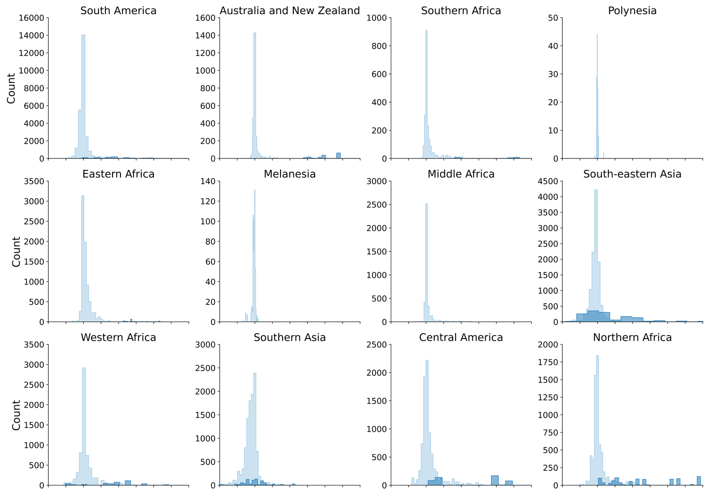

**Figure 30** Comparison of actual difference between estimates and EDGAR for all UN regions, split between rural and urban regions.

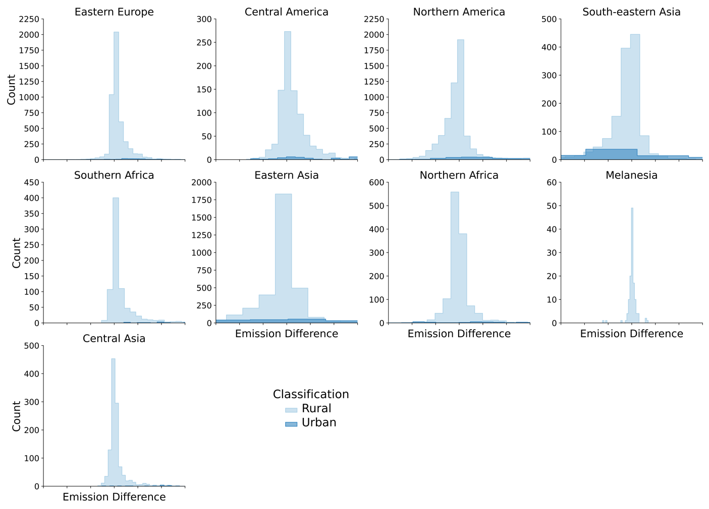

**Figure 30** (continued) Comparison of actual difference between estimates and EDGAR for all UN regions, split between rural and urban regions.

#### 6.5 Additional ERS Figures

<table><tr><td align="center">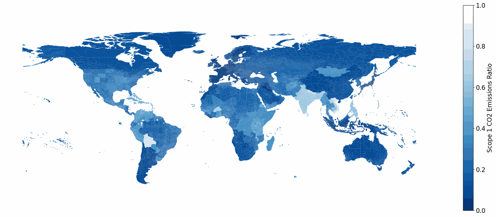<br><em>(a) EV Passenger Cars &amp; Light Duty Trucks</em></td><td align="center">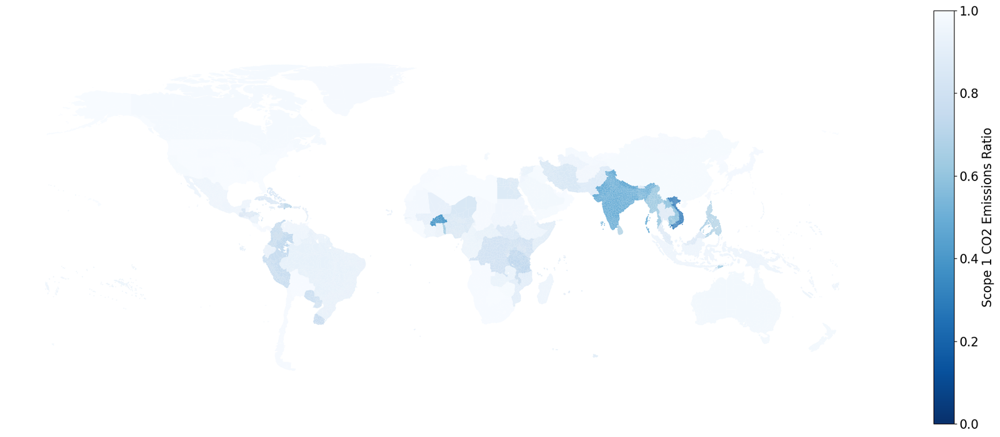<br><em>(b) EV Motorcycles</em></td></tr><tr><td align="center">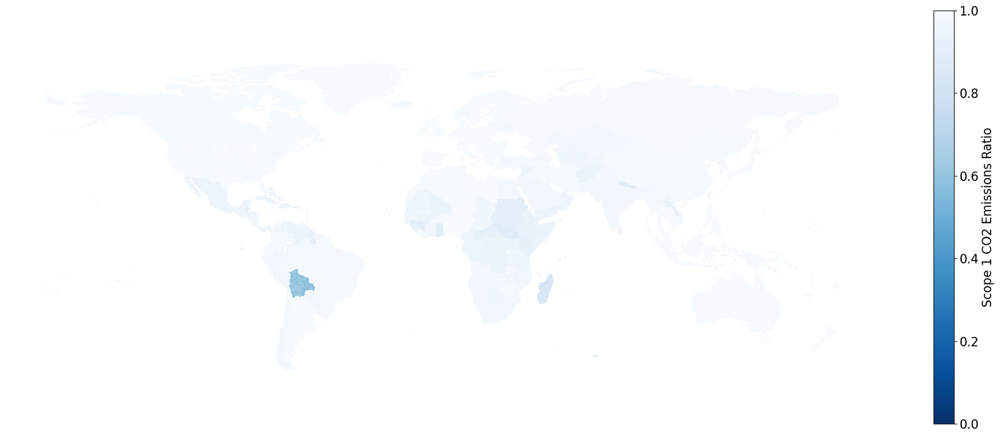<br><em>(c) EV Buses</em></td><td align="center">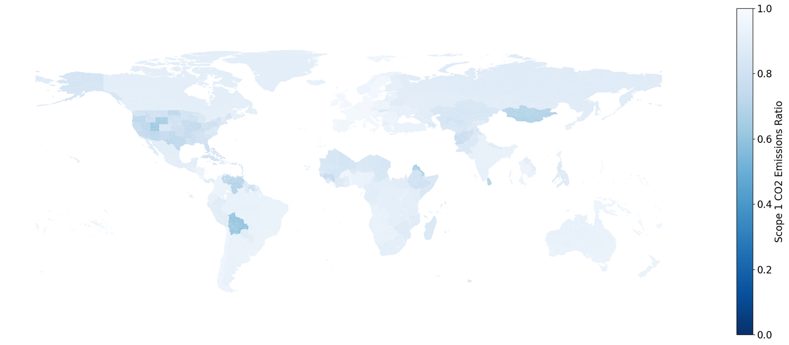<br><em>(d) EV Single-Unit and Combination Trucks</em></td></tr><tr><td align="center"><br><em>(e) EV Passenger Cars, Light Duty Trucks &amp; Motorcycles</em></td><td align="center"><br><em>(f) EV Passenger Cars, Light Duty Trucks, Motorcycles &amp; Buses</em></td></tr></table>

**Figure 31** Global maps of the ratio $`\rho_{r,g=CO_2}`$ (Equation (35)) of 2025 CO<sub>2</sub> emissions under the various ERS strategies compared to baseline 2025 values; darker blue shades indicate greater relative emissions reduction potential. Regions shown are GADM Level-2 when available, GADM Level-1 otherwise.

#### 7. Administrative Concerns

#### 7.1 Permissions and Use

All Climate TRACE data is freely available under the Creative Commons Attribution 4.0 International Public License, unless otherwise noted below.

#### 7.2 Citation format

> **Data citation format:** Kevin Foster, Patrick Sicurello, Paul Markakis, and Elizabeth Reilly (2026). Transportation Sector: Global Road Emissions. The Johns Hopkins University Applied Physics Laboratory (JHU/APL), Laurel, MD, USA, Climate TRACE Emissions Inventory. https://climatetrace.org \[Accessed date\]

#### 7.3 Geographic boundaries and names (iso3\_country data attribute)

The depiction and use of boundaries, geographic names and related data shown on maps and included in lists, tables, documents, and databases on Climate TRACE are generated from the Global Administrative Areas (GADM) project (Version 4.1 released on 16 July 2022) along with their corresponding ISO3 codes, and with the following adaptations:

-   HKG (China, Hong Kong Special Administrative Region) and MAC (China, Macao Special Administrative Region) are reported at GADM level 0 (country/national);

-   Kosovo has been assigned the ISO3 code ‘XKX’;

-   XCA (Caspian Sea) has been removed from GADM level 0 and the area assigned to countries based on the extent of their territorial waters;

-   XAD (Akrotiri and Dhekelia), XCL (Clipperton Island), XPI (Paracel Islands) and XSP (Spratly Islands) are not included in the Climate TRACE dataset;

-   ZNC name changed to ‘Turkish Republic of Northern Cyprus’ at GADM level 0;

-   The borders between India, Pakistan and China have been assigned to these countries based on GADM codes Z01 to Z09.

The above usage is not warranted to be error free and does not imply the expression of any opinion whatsoever on the part of Climate TRACE Coalition and its partners concerning the legal status of any country, area or territory or of its authorities, or concerning the delimitation of its borders.

#### 7.4 Disclaimer

The emissions provided for this sector are our current best estimates of emissions, and we are committed to continually increasing the accuracy of the models on all levels. Please review our terms of use and the sector-specific methodology documentation before using the data. If you identify an error or would like to participate in our data validation process, please [contact us](https://climatetrace.org/contact).

#### 8. References

1. ACEA - European Automobile Manufacturers’ Association (2022). *Report - Vehicles in Use, Europe 2022*. URL: [https://www.acea.auto/files/ACEA-report-vehicles-in-use-europe-2022.pdf](https://www.acea.auto/files/ACEA-report-vehicles-in-use-europe-2022.pdf)
2. ADEFA (n.d.). *Anuario 2020 — Estadísticas*. Accessed December 14, 2022. URL: [http://adefa.org.ar/es/estadisticas-anuarios-interno?id=55](http://adefa.org.ar/es/estadisticas-anuarios-interno?id=55)
3. American Automobile Association (Feb. 2019). *AAA Electric Vehicle Range Testing: AAA Proprietary Research Into the Effect of Ambient Temperature and HVAC Use on Driving Range and MPGe*. Tech. rep. American Automobile Association. URL: [https://newsroom.aaa.com/wp-content/uploads/2019/06/AAA-Electric-Vehicle-Range-Testing-Report.pdf](https://newsroom.aaa.com/wp-content/uploads/2019/06/AAA-Electric-Vehicle-Range-Testing-Report.pdf)
4. *ASEANstats Data Portal* (2025). Indicators used: ASE.TRP.ROD.B.006; ASE.TRP.ROD.B.007; ASE.TRP.ROD.B.008; ASE.TRP.ROD.B.009; ASE.TRP.ROD.B.011; URL: [https://data.aseanstats.org](https://data.aseanstats.org)
5. Australian Bureau of Statistics (2021). *Motor Vehicle Census, Australia, 31 Jan 2021*. URL: [https://www.abs.gov.au/statistics/industry/tourism-and-transport/motor-vehicle-census-australia/latest-release](https://www.abs.gov.au/statistics/industry/tourism-and-transport/motor-vehicle-census-australia/latest-release)
6. Boeing, Geoff (2017). “OSMnx: New methods for acquiring, constructing, analyzing, and visualizing complex street networks”. In: *Computers, Environment and Urban Systems* 65, pp. 126–139. ISSN: 0198-9715. DOI: [https://doi.org/10.1016/j.compenvurbsys.2017.05.004](https://doi.org/10.1016/j.compenvurbsys.2017.05.004)
7. British Petroleum (2022). *bp Statistical Review of World Energy*. 71st ed. URL: [https://www.bp.com/content/dam/bp/business-sites/en/global/corporate/pdfs/energy-economics/statistical-review/bp-stats-review-2022-full-report.pdf](https://www.bp.com/content/dam/bp/business-sites/en/global/corporate/pdfs/energy-economics/statistical-review/bp-stats-review-2022-full-report.pdf)
8. Brody, Shaked, Uri Alon, and Eran Yahav (2022). “How Attentive are Graph Attention Networks?” In: *International Conference on Learning Representations*. URL: [https://openreview.net/forum?id=F72ximsx7C1](https://openreview.net/forum?id=F72ximsx7C1)
9. Bronstein, Michael M. et al. (2017). “Geometric Deep Learning: Going beyond Euclidean data”. In: *IEEE Signal Processing Magazine* 34.4, pp. 18–42. DOI: [https://doi.org/10.1109/MSP.2017.2693418](https://doi.org/10.1109/MSP.2017.2693418)
10. Cazzola, Pierpaolo, Leonardo Paoli, and Jacob Teter (2023). *Trends in the Global Vehicle Fleet 2023: Managing the SUV and the EV Transition*. Global Fuel Economy Initiative (GFEI). DOI: [https://doi.org/10.7922/G2HM56SV](https://doi.org/10.7922/G2HM56SV) URL: [https://www.globalfueleconomy.org/data-and-research/publications/trends-in-the-global-vehicle-fleet-2023](https://www.globalfueleconomy.org/data-and-research/publications/trends-in-the-global-vehicle-fleet-2023)
11. — (Nov. 2024). *Trends in global fuel economy of new vehicles: 2005 - 2022*. Zenodo. DOI: [https://doi.org/10.5281/zenodo.14046031](https://doi.org/10.5281/zenodo.14046031) URL: [https://doi.org/10.5281/zenodo.14046031](https://doi.org/10.5281/zenodo.14046031)
12. Cazzola, Pierpaolo, Jacob Teter, and Matteo Craglia (June 2025). *Small and electric - The international case to move away from combustion SUVs*. European Transport and Energy Research Centre, Institute of Transportation Studies, University of California, Davis. URL: [https://www.globalfueleconomy.org/resources/gfei-working-paper-25-small-and-electric-the-international-case-to-move-away-from-combustion-suvs](https://www.globalfueleconomy.org/resources/gfei-working-paper-25-small-and-electric-the-international-case-to-move-away-from-combustion-suvs)
13. Cellina, Francesca et al. (2024). “Trust me if you can: Practical challenges affecting the integration of carpooling in Mobility-as-a-Service platforms”. In: *Travel Behaviour and Society* 37, p. 100832. ISSN: 2214-367X. DOI: [https://doi.org/10.1016/j.tbs.2024.100832](https://doi.org/10.1016/j.tbs.2024.100832) URL: [https://www.sciencedirect.com/science/article/pii/S2214367X24000954](https://www.sciencedirect.com/science/article/pii/S2214367X24000954)
14. Climate Change (IPCC), Intergovernmental Panel on (June 2021). *Climate Change 2021 – The Physical Science Basis: Working Group I Contribution to the Sixth Assessment Report of the Intergovernmental Panel on Climate Change*. Cambridge University Press. ISBN: 9781009157896. DOI: [https://doi.org/10.1017/9781009157896](https://doi.org/10.1017/9781009157896)
15. Crippa, M. et al. (2025). *GHG emissions of all world countries: 2025 Report*. JRC143227. Publications Office of the European Union. DOI: [https://doi.org/10.2760/9816914](https://doi.org/10.2760/9816914)
16. Crippa, Monica et al. (Apr. 2020). “High Resolution Temporal Profiles in the Emissions Database for Global Atmospheric Research”. In: *Scientific Data* 7.1. ISSN: 2052-4463. DOI: [https://doi.org/10.1038/s41597-020-0462-2](https://doi.org/10.1038/s41597-020-0462-2)
17. Department for Transport and Driver and Vehicle Licensing Agency (2026). *Vehicle Licensing Statistics Data Tables*. UK Government. URL: [https://www.gov.uk/government/statistical-data-sets/vehicle-licensing-statistics-data-tables](https://www.gov.uk/government/statistical-data-sets/vehicle-licensing-statistics-data-tables)
18. Dornoff, Jan, Victor Valverde Morales, and Uwe Tietge (Jan. 2024). *On the Way to “Real- World” CO* 2*Values? The European Passenger Car Market After 5 Years of WLTP*. White Paper. International Council on Clean Transportation. URL: [https://theicct.org/wp-content/uploads/2024/01/ID-76-%E2%80%93-EU-WLTP_final.pdf](https://theicct.org/wp-content/uploads/2024/01/ID-76-%E2%80%93-EU-WLTP_final.pdf)
19. Drusch, M. et al. (2012). “Sentinel-2: ESA’s Optical High-Resolution Mission for GMES Operational Services”. In: *Remote Sensing of Environment* 120. The Sentinel Missions - New Opportunities for Science, pp. 25–36. ISSN: 0034-4257. DOI: [https://doi.org/10.1016/j.rse.2011.11.026](https://doi.org/10.1016/j.rse.2011.11.026)
20. Efron, Bradley and R.J. Tibshirani (May 1994). *An Introduction to the Bootstrap*. Chapman and Hall/CRC. ISBN: 9780429246593. DOI: [https://doi.org/10.1201/9780429246593](https://doi.org/10.1201/9780429246593)
21. Estrada Poggio, Aaron et al. (2023). “Monitored data and social perceptions analysis of battery electric and hydrogen fuelled buses in urban and suburban areas”. In: *Journal of Energy Storage* 72, p. 108411. ISSN: 2352-152X. DOI: [https://doi.org/10.1016/j.est.2023.108411](https://doi.org/10.1016/j.est.2023.108411) URL: [https://www.sciencedirect.com/science/article/pii/S2352152X2301808X](https://www.sciencedirect.com/science/article/pii/S2352152X2301808X)
22. European Environment Agency (2026). *Sustainability of Europe’s Mobility Systems 2025*. Tech. rep. European Environment Agency. DOI: [https://doi.org/10.2800/4890019](https://doi.org/10.2800/4890019) URL: [https://doi.org/10.2800/4890019](https://doi.org/10.2800/4890019)
23. Fan, Tongle et al. (2020). “MA-Net: A Multi-Scale Attention Network for Liver and Tumor Segmentation”. In: *IEEE Access* 8, pp. 179656–179665. DOI: [https://doi.org/10.1109/ACCESS.2020.3025372](https://doi.org/10.1109/ACCESS.2020.3025372)
24. *Fleet Size of the Auto Industry in Brazil by Type 2021* (2022). Statista. URL: [https://www.statista.com/statistics/787327/automobile-industry-fleet-size-brazil-vehicle-type/](https://www.statista.com/statistics/787327/automobile-industry-fleet-size-brazil-vehicle-type/)
25. Florczyk, Aneta et al. (2023). *GHS-UCDB R2019A - GHS Urban Centre Database 2015, Multitemporal and Multidimensional Attributes*. European Commission, Joint Research Centre (JRC). DOI: [https://doi.org/10.2905/53473144-B88C-44BC-B4A3-4583ED1F547E](https://doi.org/10.2905/53473144-B88C-44BC-B4A3-4583ED1F547E)
26. Gately, C., L.R. Hutyra, and I.S. Wing (2019). *DARTE Annual On-road CO2 Emissions on a 1-km Grid, Conterminous USA, V2, 1980-2017*. en. ORNL Distributed Active Archive Center. DOI: [https://doi.org/10.3334/ORNLDAAC/1735](https://doi.org/10.3334/ORNLDAAC/1735)
27. Gately, Conor K., Lucy R. Hutyra, and Ian Sue Wing (2015). “Cities, traffic, and CO<sub>2</sub>: A multidecadal assessment of trends, drivers, and scaling relationships”. In: *Proceedings of the National Academy of Sciences* 112.16, pp. 4999–5004. DOI: [https://doi.org/10.1073/pnas.1421723112](https://doi.org/10.1073/pnas.1421723112)
28. Global Administrative Areas (n.d.). *GADM Database of Global Administrative Areas, Version 4.1*. URL: [https://www.gadm.org](https://www.gadm.org)
29. Gurney, Kevin R. et al. (2020). “The Vulcan Version 3.0 High-Resolution Fossil Fuel CO2 Emissions for the United States”. In: *Journal of Geophysical Research: Atmospheres* 125.19, e2020JD032974. DOI: [https://doi.org/10.1029/2020JD032974](https://doi.org/10.1029/2020JD032974)
30. Harris, Ian et al. (Apr. 2020). “Version 4 of the CRU TS monthly high-resolution gridded multivariate climate dataset”. In: *Scientific Data* 7.1. ISSN: 2052-4463. DOI: [https://doi.org/10.1038/s41597-020-0453-3](https://doi.org/10.1038/s41597-020-0453-3)
31. Institute for Transportation and Development Policy (2017). *The BRT Planning Guide*. Planning Guide. Fourth edition. Institute for Transportation and Development Policy (ITDP). URL: [https://brtguide.itdp.org/branch/master/guide/pdf/the-brt-planning-guide.pdf](https://brtguide.itdp.org/branch/master/guide/pdf/the-brt-planning-guide.pdf)
32. — (2026). *How to Develop a Non-Motorised Transport Strategy or Policy*. Institute for Transportation and Development Policy (ITDP). URL: [https://nmttoolkit.itdp.org/](https://nmttoolkit.itdp.org/) (visited on 11/02/2026).
33. Institute of Statistics (INSTAT) (2025). *Transport, Accidents and Characteristics of road vehicles — Statistical tables*. Tables used: Road vehicles by type. Institute of Statistics (INSTAT). URL: [https://www.instat.gov.al/en/themes/industry-trade-and-services/transport-accidents-and-characteristics-of-road-vehicles/#tab3](https://www.instat.gov.al/en/themes/industry-trade-and-services/transport-accidents-and-characteristics-of-road-vehicles/#tab3)
34. International Energy Agency (Mar. 2019). *Transport Sector CO2 Emissions by Mode in the Sustainable Development Scenario, 2000-2030 – Charts – Data & Statistics*. IEA. URL:*Emissions modeling by The Johns Hopkins University Applied Physics Laboratory. Version: Fall 2026, v5.11* 74 [https://www.iea.org/data-and-statistics/charts/transport-sector-co2-emissions-by-mode-in-the-sustainable-development-scenario-2000-2030](https://www.iea.org/data-and-statistics/charts/transport-sector-co2-emissions-by-mode-in-the-sustainable-development-scenario-2000-2030)
35. International Energy Agency (May 2026). *Oil Market Report - 13 May 2026*. IEA. URL: [https://iea.blob.core.windows.net/assets/2b89a47b-34a2-40e0-90ff-68f7ccd80715/-13MAY2026__OilMarketReport_publicversion.pdf](https://iea.blob.core.windows.net/assets/2b89a47b-34a2-40e0-90ff-68f7ccd80715/-13MAY2026__OilMarketReport_publicversion.pdf)
36. Knittel, Christopher R. and Shinsuke Tanaka (June 2025). “Challenges to expanding EV adoption and policy responses”. In: *Handbook on Electricity Regulation*. Edward Elgar Publishing, pp. 405–447. ISBN: 9781035314355. DOI: [https://doi.org/10.4337/9781035314355.00025](https://doi.org/10.4337/9781035314355.00025) URL: [http://dx.doi.org/10.4337/9781035314355.00025](http://dx.doi.org/10.4337/9781035314355.00025)
37. Land Transport Authority (2016a). *Annual Motor Vehicle Population by Type of Fuel Used*. data.gov.sg. URL: [https://data.gov.sg/datasets/d_7a0847fef60362e46e59d0f844c938ba/view](https://data.gov.sg/datasets/d_7a0847fef60362e46e59d0f844c938ba/view)
38. — (2016b). *Motor Vehicle Population Statistics by Type of Fuel Used*. data.gov.sg. URL: [https://data.gov.sg/datasets/d_b876ece1b4a3bb5ebdc33c4394a236a2/view](https://data.gov.sg/datasets/d_b876ece1b4a3bb5ebdc33c4394a236a2/view)
39. Li, Pengshun et al. (2021). “The effects of dynamic traffic conditions, route characteristics and environmental conditions on trip-based electricity consumption prediction of electric bus”. In: *Energy* 218, p. 119437. ISSN: 0360-5442. DOI: [https://doi.org/10.1016/j.energy.2020.119437](https://doi.org/10.1016/j.energy.2020.119437) URL: [https://www.sciencedirect.com/science/article/pii/S0360544220325445](https://www.sciencedirect.com/science/article/pii/S0360544220325445)
40. Liu, Zhu et al. (Nov. 2020). “Carbon Monitor, a near-real-time daily dataset of global CO2 emission from fossil fuel and cement production”. In: *Scientific Data* 7.1. ISSN: 2052-4463. DOI: [https://doi.org/10.1038/s41597-020-00708-7](https://doi.org/10.1038/s41597-020-00708-7)
41. Lohse-Busch, Henning et al. (Apr. 2013). “Ambient Temperature (20°F, 72°F and 95°F) Impact on Fuel and Energy Consumption for Several Conventional Vehicles, Hybrid and Plug-In Hybrid Electric Vehicles and Battery Electric Vehicle”. In: *SAE Technical Paper Series*. SAE International. DOI: [https://doi.org/10.4271/2013-01-1462](https://doi.org/10.4271/2013-01-1462)
42. Main-Knorn, Magdalena et al. (2017). “Sen2Cor for Sentinel-2”. In: *Image and Signal Processing for Remote Sensing XXIII*. Ed. by Lorenzo Bruzzone. Vol. 10427. International Society for Optics and Photonics. SPIE, p. 1042704. DOI: [https://doi.org/10.1117/12.2278218](https://doi.org/10.1117/12.2278218)
43. Mao, Shiyue and Felipe Rodríguez (Oct. 2024). *Electrifying public transit: Zero-emission bus operations, charging, and maintenance in Chinese cities*. Working Paper. International Council on Clean Transportation. URL: [https://theicct.org/wp-content/uploads/2024/10/ID-137-%E2%80%93-China-e-buses_final2.pdf](https://theicct.org/wp-content/uploads/2024/10/ID-137-%E2%80%93-China-e-buses_final2.pdf)
44. Microsoft Bing Maps (2023). *Road Detections*. Microsoft. URL: [https://github.com/microsoft/RoadDetections](https://github.com/microsoft/RoadDetections)
45. Ministerio de Industria, Energía y Minería (2025). *Parque vehicular 2017–2025*. Ministerio de Industria, Energía y Minería, Uruguay. URL: [https://www.gub.uy/ministerio-industria-energia-mineria/datos-y-estadisticas/estadisticas/parque-automotor](https://www.gub.uy/ministerio-industria-energia-mineria/datos-y-estadisticas/estadisticas/parque-automotor)
46. Mukherjee, Ryan et al. (2021). “Towards Indirect Top-Down Road Transport Emissions Estimation”. In: *2021 IEEE/CVF Conference on Computer Vision and Pattern Recognition Workshops (CVPRW)*, pp. 1092–1101. DOI: [https://doi.org/10.1109/CVPRW53098.2021.00120](https://doi.org/10.1109/CVPRW53098.2021.00120)
47. Namakula, Hidaya et al. (2025). “Systematic review of factors influencing non-motorized transport in urban settings: Barriers and perceptions”. In: *Transportation Research Interdisciplinary Perspectives* 34, p. 101727. ISSN: 2590-1982. DOI: [https://doi.org/10.1016/j.trip.2025.101727](https://doi.org/10.1016/j.trip.2025.101727) URL: [https://www.sciencedirect.com/science/article/pii/S2590198225004063](https://www.sciencedirect.com/science/article/pii/S2590198225004063)
48. Nguyen Huu, Duc and Van Ngoc (Feb. 2021). “A Research on the Trend of Transport Electrification in Vietnam and the Feasibility of PV-Integrated Charging Station for Electric Twowheelers at Electric Power University”. In: pp. 255–260. DOI: [https://doi.org/10.1109/CPEEE51686.2021.9383333](https://doi.org/10.1109/CPEEE51686.2021.9383333)
49. Oh, Geunseob, David J. Leblanc, and Huei Peng (Apr. 2022). “Vehicle Energy Dataset (VED), A Large-Scale Dataset for Vehicle Energy Consumption Research”. In: *Trans. Intell. Transport. Sys.* 23.4, pp. 3302–3312. ISSN: 1524-9050. DOI: [https://doi.org/10.1109/TITS.2020.3035596](https://doi.org/10.1109/TITS.2020.3035596) URL: [https://doi.org/10.1109/TITS.2020.3035596](https://doi.org/10.1109/TITS.2020.3035596)
50. OpenStreetMap Contributors (2020). *OpenStreetMap: User-Generated Street Maps*. URL: [https://planet.osm.org](https://planet.osm.org)
51. Plötz, P. et al. (2026). *Regulatory Adjustments for Plug-in Hybrid Vehicles in Europe*. Tech. rep. 14-BE-2203. Karlsruhe, Berlin, and Heidelberg: Scientific Support for Climate Policy and Action Program.
52. Ramsey, Steven et al. (Feb. 2023). *Global Demand for Fuel Ethanol Through 2030*. BIO-05. U.S. Department of Agriculture, Economic Research Service.
53. Righi, M. et al. (2026). “The ELK global emission inventory for the transport sectors”. In: *Earth System Science Data* 18.2, pp. 1619–1664. DOI: [https://doi.org/10.5194/essd-18-1619-2026](https://doi.org/10.5194/essd-18-1619-2026) URL: [https://essd.copernicus.org/articles/18/1619/2026/](https://essd.copernicus.org/articles/18/1619/2026/)
54. Al-Saadi, Mohammed et al. (2021). “Slow and Fast Charging Solutions for Li-Ion Batteries of Electric Heavy-Duty Vehicles with Fleet Management Strategies”. In: *Sustainability* 13.19. ISSN: 2071-1050. DOI: [https://doi.org/10.3390/su131910639](https://doi.org/10.3390/su131910639) URL: [https://www.mdpi.com/2071-1050/13/19/10639](https://www.mdpi.com/2071-1050/13/19/10639)
55. Saxena, Samveg, Anand Gopal, and Amol Phadke (2014). “Electrical consumption of two-, threeand four-wheel light-duty electric vehicles in India”. In: *Applied Energy* 115, pp. 582– 590. ISSN: 0306-2619. DOI: [https://doi.org/10.1016/j.apenergy.2013.10.043](https://doi.org/10.1016/j.apenergy.2013.10.043) URL: [https://www.sciencedirect.com/science/article/pii/S0306261913008738](https://www.sciencedirect.com/science/article/pii/S0306261913008738)
56. Scheibenreif, Linus M., Michael Mommert, and Damian Borth (2021). “Estimation of Air Pollution with Remote Sensing Data: Revealing Greenhouse Gas Emissions from Space”. In: *Emissions modeling by The Johns Hopkins University Applied Physics Laboratory. Version: Fall 2026, v5.11* 76*ICML 2021 Workshop on Tackling Climate Change with Machine Learning*. URL: [https://www.climatechange.ai/papers/icml2021/23](https://www.climatechange.ai/papers/icml2021/23)
57. Shoman, Wasim et al. (2023). “Battery electric long-haul trucks in Europe: Public charging, energy, and power requirements”. In: *Transportation Research Part D: Transport and Environment* 121, p. 103825. ISSN: 1361-9209. DOI: [https://doi.org/10.1016/j.trd.2023.103825](https://doi.org/10.1016/j.trd.2023.103825) URL: [https://www.sciencedirect.com/science/article/pii/S1361920923002225](https://www.sciencedirect.com/science/article/pii/S1361920923002225)
58. Smith, Elizabeth et al. (Aug. 2025). “Greenhouse Gas Reductions Driven by Vehicle Electrification across Powertrains, Classes, Locations, and Use Patterns”. In: *Environmental Science & Technology* 59.37, pp. 19768–19780. ISSN: 1520-5851. DOI: [https://doi.org/10.1021/acs.est.5c05406](https://doi.org/10.1021/acs.est.5c05406)
59. Spritmonitor.de (2026). *Two-wheeler Electricity Consumption Data*. Data retrieved May 26, 2026. URL: [https://www.spritmonitor.de/en/overview/0-All_manufactures/0-All_models.html?fueltype=5%5C&vehicletype=2%5C&minkm=1000](https://www.spritmonitor.de/en/overview/0-All_manufactures/0-All_models.html?fueltype=5%5C&vehicletype=2%5C&minkm=1000) (visited on 05/26/2026).
60. Statistics Canada (2017). *Vehicle Registrations, by Type of Vehicle*. Government of Canada. DOI: [https://doi.org/10.25318/2310006701-ENG](https://doi.org/10.25318/2310006701-ENG) URL: [https://www150.statcan.gc.ca/t1/tbl1/en/tv.action?pid=2310006701](https://www150.statcan.gc.ca/t1/tbl1/en/tv.action?pid=2310006701)
61. Sustainable Urban Transport Project (2009). *Transportation Demand Management*. Technical Report. Sustainable Urban Transport Project (SUTP), first edition. Deutsche Gesellschaft für Technische Zusammenarbeit (GTZ). URL: [https://sutp.org/publications/transportation-demand-management/](https://sutp.org/publications/transportation-demand-management/)
62. The World Bank (July 2026). *World Bank Country and Lending Groups*. URL: [https://datahelpdesk.worldbank.org/knowledgebase/articles/906519](https://datahelpdesk.worldbank.org/knowledgebase/articles/906519) (visited on 08/19/2026).
63. Tian, Xuelin et al. (2025). “Assessment of energy efficiency of battery electric buses in cold regions”. In: *Transportation Research Part D: Transport and Environment* 147, p. 104934. ISSN: 1361-9209. DOI: [https://doi.org/10.1016/j.trd.2025.104934](https://doi.org/10.1016/j.trd.2025.104934) URL: [https://www.sciencedirect.com/science/article/pii/S136192092500344X](https://www.sciencedirect.com/science/article/pii/S136192092500344X)
64. Tietge, Uwe, Sonsoles Díaz, et al. (2019). *From Laboratory to Road: A 2018 Update of Official and “Real-World” Fuel Consumption and CO* 2*Values for Passenger Cars in Europe*. White Paper. International Council on Clean Transportation. URL: [https://theicct.org/wp-content/uploads/2021/06/Lab_to_Road_2018_fv_20190110.pdf](https://theicct.org/wp-content/uploads/2021/06/Lab_to_Road_2018_fv_20190110.pdf)
65. Tietge, Uwe, Peter Mock, et al. (2017). “From laboratory to road: Modeling the divergence between official and real-world fuel consumption and CO2 emission values in the German passenger car market for the years 2001–2014”. In: *Energy Policy* 103, pp. 212– 222. ISSN: 0301-4215. DOI: [https://doi.org/10.1016/j.enpol.2017.01.021](https://doi.org/10.1016/j.enpol.2017.01.021) URL: [https://www.sciencedirect.com/science/article/pii/S0301421517300320](https://www.sciencedirect.com/science/article/pii/S0301421517300320)
66. Topf, Jochen (2023). *Osmium: Command Line Tool for Working with OpenStreetMap Data Based on the Osmium Library*. URL: [https://osmcode.org/osmium-tool/](https://osmcode.org/osmium-tool/)
67. Transport Department, Hong Kong Special Administrative Region Government (Feb. 2026). *Registration and Licensing of Vehicles by Fuel Type*. Table 4.4, Monthly Traffic and Transport Digest. URL: [https://www.td.gov.hk/en/transport_in_hong_kong/transport_figures/monthly_traffic_and_transport_digest/2026/202602/index.html](https://www.td.gov.hk/en/transport_in_hong_kong/transport_figures/monthly_traffic_and_transport_digest/2026/202602/index.html)
68. UNECE - United Nations Economic Commission for Europe (2022). *Road Vehicle Fleet at 31 December by Fuel Type, Type of Vehicle,Country and Year*. URL: [https://w3.unece.org/PXWeb2015/pxweb/en/STAT/STAT__40-TRTRANS__03-TRRoadFleet/03_en_TRRoadFuelFlt_r.px/](https://w3.unece.org/PXWeb2015/pxweb/en/STAT/STAT__40-TRTRANS__03-TRRoadFleet/03_en_TRRoadFuelFlt_r.px/)
69. United Nations Environment Programme (2024). *Emissions Gap Report 2024: No More Hot Air... Please! With a Massive Gap Between Rhetoric and Reality, Countries Draft New Climate Commitments*. Tech. rep. Nairobi: United Nations Environment Programme. DOI: [https://doi.org/10.59117/20.500.11822/46404](https://doi.org/10.59117/20.500.11822/46404) URL: [https://doi.org/10.59117/20.500.11822/46404](https://doi.org/10.59117/20.500.11822/46404)
70. United Nations Environment Programme and FIA Foundation (2017). *Share the Road: Design for Walking and Cycling*. Technical Guideline. United Nations Environment Programme and FIA Foundation, p. 12. URL: [https://wedocs.unep.org/handle/20.500.11822/17036](https://wedocs.unep.org/handle/20.500.11822/17036)
71. United Nations Environment Programme Copenhagen Climate Centre (UNEP-CCC) and Common Futures (2024). *Bridging the Gap: Sectoral Greenhouse Gas Mitigation Potentials in 2035*. Tech. rep. UNEP Copenhagen Climate Centre. URL: [https://unepccc.org/wp-content/uploads/2024/10/sectoral-greenhouse-gas-emissions-reductions-potentials-in-2035.pdf](https://unepccc.org/wp-content/uploads/2024/10/sectoral-greenhouse-gas-emissions-reductions-potentials-in-2035.pdf)
72. US BTS (2024). “Table 4-43 - Estimated U.S. Average Vehicle Emissions Rates per Vehicle by Vehicle Type Using Gasoline, Diesel, and Electric”. In: *National Transportation Statis- Emissions modeling by The Johns Hopkins University Applied Physics Laboratory. Version: Fall 2026, v5.11* 78*tics*. U.S. DOT Bureau of Transportation Statistics. URL: [https://www.bts.gov/sites/bts.dot.gov/files/2024-06/table_04_43_062724.xlsx](https://www.bts.gov/sites/bts.dot.gov/files/2024-06/table_04_43_062724.xlsx)
73. US EPA (2022). *GHG Emissions Factors Hub*. URL: [https://www.epa.gov/system/files/documents/2022-04/ghg_emission_factors_hub.pdf](https://www.epa.gov/system/files/documents/2022-04/ghg_emission_factors_hub.pdf)
74. — (2023). *Inventory of U.S. Greenhouse Gas Emissions and Sinks: 1990-2021*. URL: [https://www.epa.gov/ghgemissions/inventory-us-greenhouse-gas-emissions-and-sinks-1990-2021](https://www.epa.gov/ghgemissions/inventory-us-greenhouse-gas-emissions-and-sinks-1990-2021)
75. — (2024a). *GHG Emissions Factors Hub*. URL: [https://www.epa.gov/system/files/documents/2024-02/ghg-emission-factors-hub-2024.pdf](https://www.epa.gov/system/files/documents/2024-02/ghg-emission-factors-hub-2024.pdf)
76. — (2024b). *Inventory of U.S. Greenhouse Gas Emissions and Sinks: 1990-2022*. URL: [https://www.epa.gov/system/files/documents/2024-04/us-ghg-inventory-2024-main-text_04-18-2024.pdf](https://www.epa.gov/system/files/documents/2024-04/us-ghg-inventory-2024-main-text_04-18-2024.pdf)
77. US FHWA (2017). *Highway Performance Monitoring System (HPMS) Data*. URL: [https://www.fhwa.dot.gov/policyinformation/hpms](https://www.fhwa.dot.gov/policyinformation/hpms)
78. — (2024a). *Annual Vehicle Distance Traveled in Miles and Related Data by Highway Category and Vehicle Type (Table VM-1)*. URL: [https://www.fhwa.dot.gov/policyinformation/statistics/2024/vm1.cfm](https://www.fhwa.dot.gov/policyinformation/statistics/2024/vm1.cfm)
79. — (2024b). *Distribution of Annual Vehicle Distance Traveled - Percentage by Vehicle Type Rural/Urban (Table VM-4)*. URL: [https://www.fhwa.dot.gov/policyinformation/statistics/2024/vm4.cfm](https://www.fhwa.dot.gov/policyinformation/statistics/2024/vm4.cfm)
80. — (2024c). *State Motor-Vehicle Registrations (Table MV-1)*. URL: [https://www.fhwa.dot.gov/policyinformation/statistics/2024/mv1.cfm](https://www.fhwa.dot.gov/policyinformation/statistics/2024/mv1.cfm)
81. Weiss, Martin et al. (2015). “On the electrification of road transportation – A review of the environmental, economic, and social performance of electric two-wheelers”. In: *Transportation Research Part D: Transport and Environment* 41, pp. 348–366. ISSN: 1361-9209. DOI: [https://doi.org/10.1016/j.trd.2015.09.007](https://doi.org/10.1016/j.trd.2015.09.007) URL: [https://www.sciencedirect.com/science/article/pii/S1361920915001315](https://www.sciencedirect.com/science/article/pii/S1361920915001315)
82. Welle, Ben et al. (July 2015). *Cities Safer by Design: Urban Design Recommendations for Healthier Cities, Fewer Traffic Fatalities*. Tech. rep. Washington, DC: World Resources Institute, p. 104. URL: [https://www.wri.org/research/cities-safer-design](https://www.wri.org/research/cities-safer-design)
83. World Bank Group (2019). *CURB: Climate Action for Urban Sustainability, Version 2.1*. URL: [https://datacatalog.worldbank.org/search/dataset/0042029](https://datacatalog.worldbank.org/search/dataset/0042029)
84. World Health Organization (2018). *Global Status Report on Road Safety 2018*. Genève, Switzerland: World Health Organization. ISBN: 9789241565684. URL: [https://www.who.int/publications-detail-redirect/9789241565684](https://www.who.int/publications-detail-redirect/9789241565684)
85. — (May 2025). *Promoting Walking and Cycling: A Toolkit of Policy Options*. Tech. rep. Geneva: World Health Organization, p. 79. URL: [https://iris.who.int/server/api/core/bitstreams/a66e049b-c6b3-497f-b315-d17787b80210/content](https://iris.who.int/server/api/core/bitstreams/a66e049b-c6b3-497f-b315-d17787b80210/content)
86. World Resources Institute (2022). *Greenhouse Gas (GHG) Emissions — Climate Watch*. URL: [https://www.climatewatchdata.org/ghg-emissions](https://www.climatewatchdata.org/ghg-emissions)
87. Zhang, Shiliang et al. (2025). “Extended Vehicle Energy Dataset (eVED): An Enhanced Large-Scale Dataset for Vehicle Energy Consumption Analysis”. In: *2025 IEEE 101st Vehicular Technology Conference (VTC2025-Spring)*, pp. 01–07. DOI: [https://doi.org/10.1109/VTC2025-Spring65109.2025.11174415](https://doi.org/10.1109/VTC2025-Spring65109.2025.11174415)*Emissions modeling by The Johns Hopkins University Applied Physics Laboratory. Version: Fall 2026, v5.11* 80