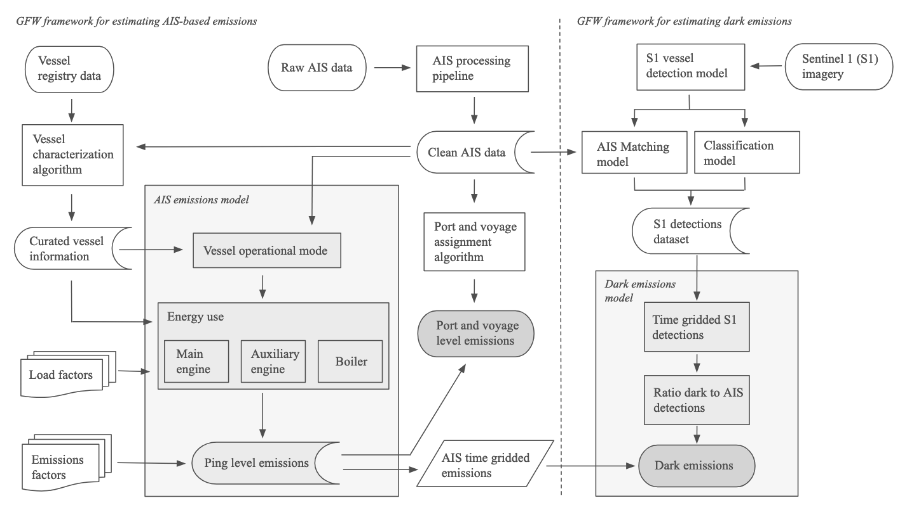
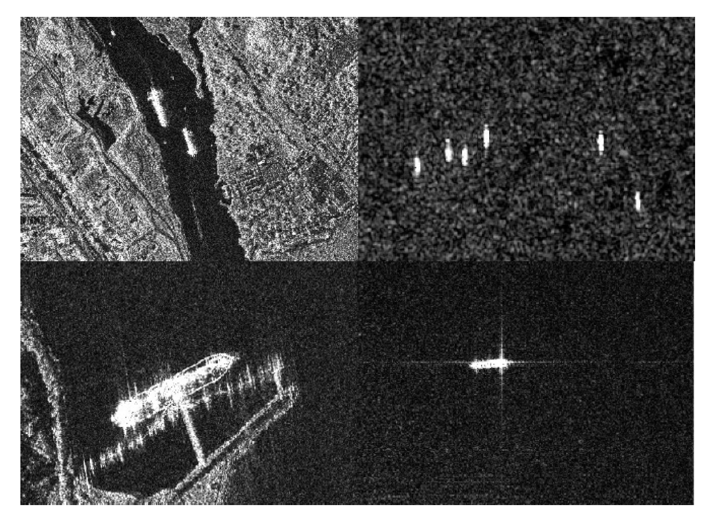
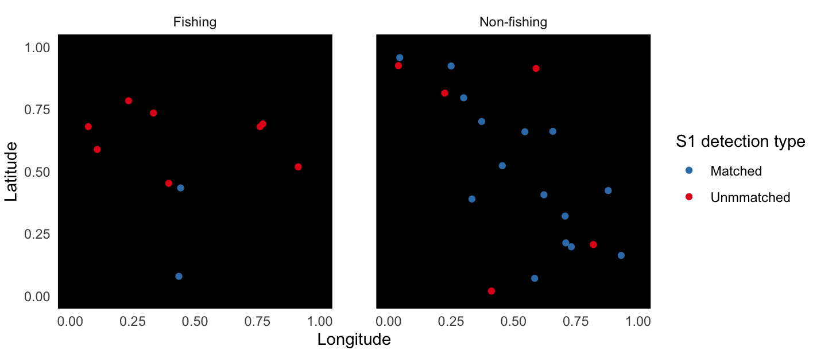
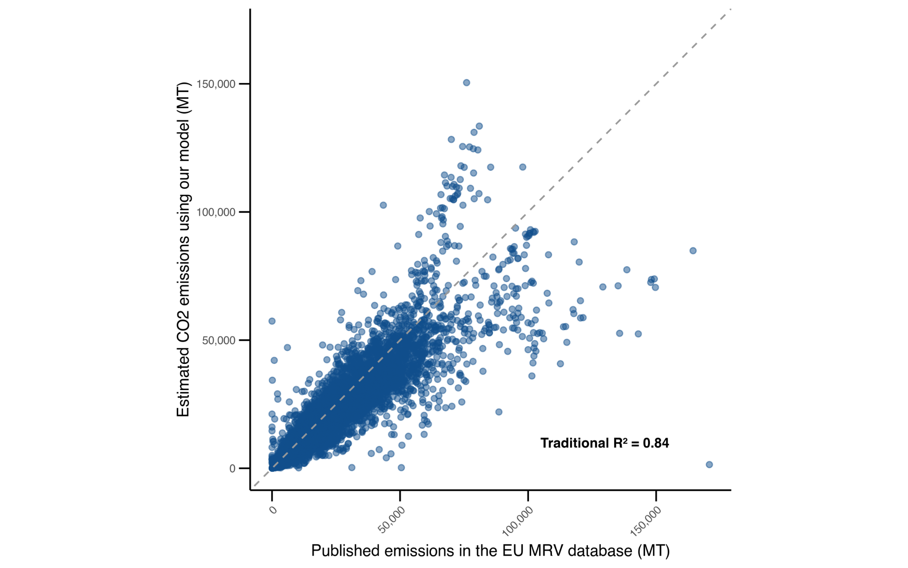
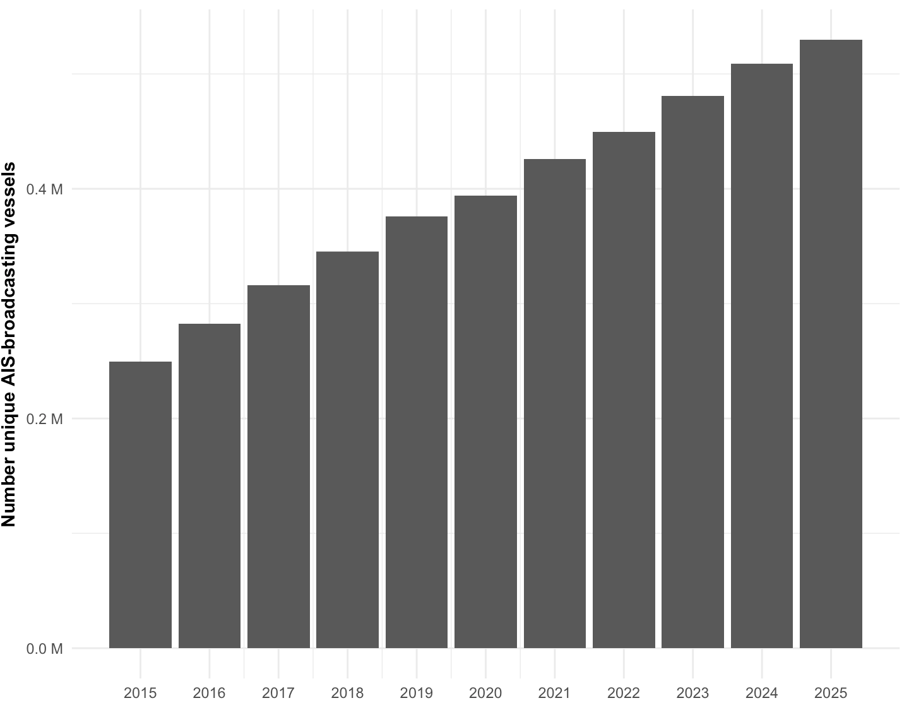
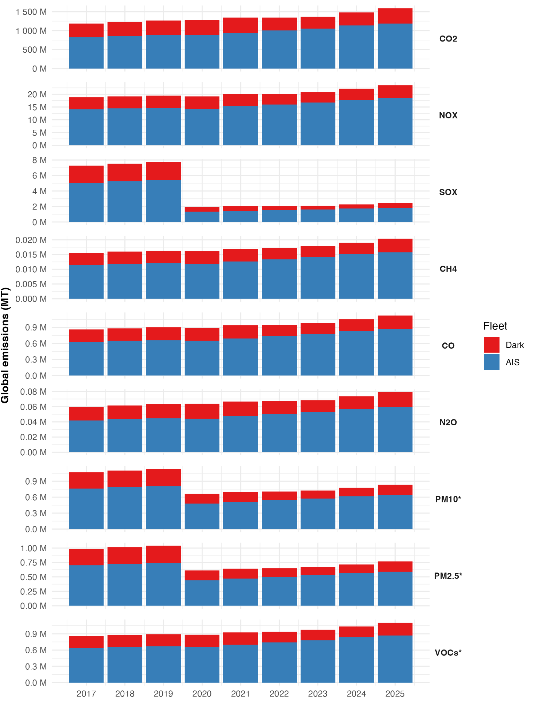
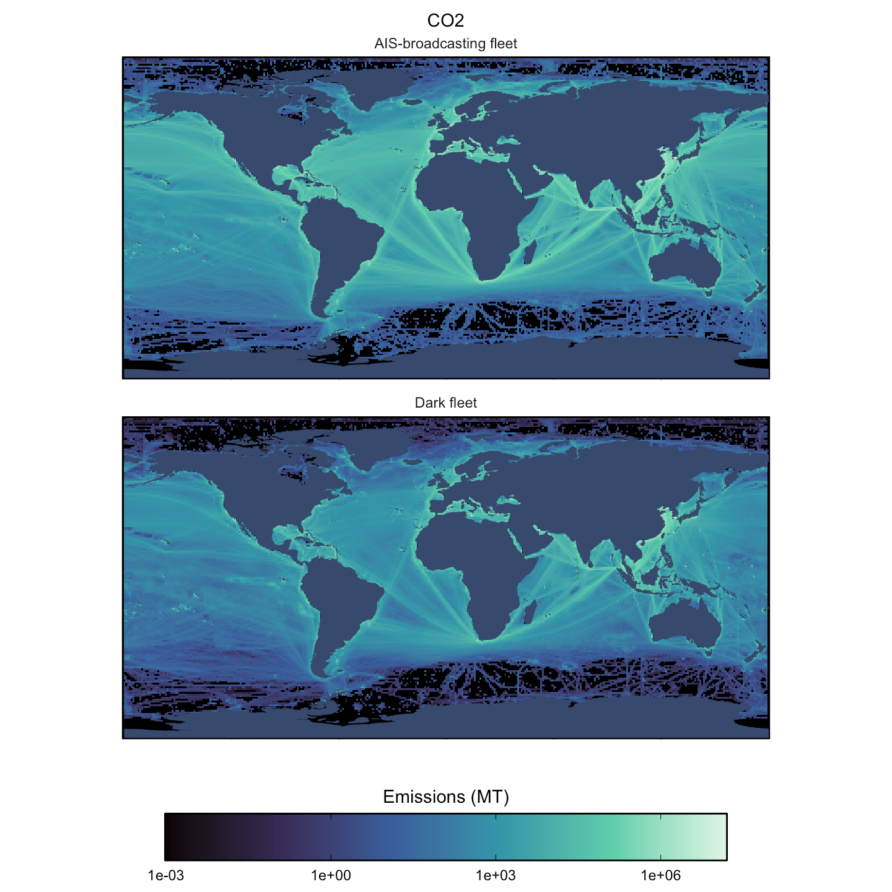

**Transportation sector: Emissions From Non Broadcasting Vessels** 

**Gavin McDonald, David Kroodsma, Pol Carbo-Mestre, Mark Powell, and Zihan Wei**

*All authors affiliated with Global Fishing Watch, emLab, and Climate TRACE*

**1. Introduction**

Shipping is a large and growing source of greenhouse gases and air pollutants. The Fourth IMO GHG Study estimated that total shipping—international, domestic and fishing—emitted 1,076 million tonnes of CO₂e in 2018, or about 2.9% of global anthropogenic GHG emissions, up from 2.76% in 2012 (Faber et al., 2020). Every global inventory behind figures like these, including Climate TRACE's, ultimately rests on the Automatic Identification System (AIS): a vessel is counted because it broadcasts its position. This makes the inventory only as complete as the broadcast, and satellite imagery shows the shortfall is substantial. Mapping coastal waters with Sentinel-1 (S1) Synthetic Aperture Radar (SAR) from 2017 to 2021, Paolo et al. (2024) found that 72-76% of industrial fishing vessels and 21-30% of transport and energy vessel activity did not appear in public tracking systems. These "dark" vessels burn fuel and emit in the same way as any other ship, but because they are invisible to AIS their emissions have been absent from published shipping inventories. The magnitude of that omission is unknown, and so is its trend: if the dark fleet is changing at a different rate than the tracked fleet, an inventory built on AIS alone will misstate not only the level of global shipping emissions but the direction they are moving. Closing this gap requires a detection source that does not depend on a vessel choosing to be seen.

Global Fishing Watch (GFW) and the Environmental Markets Lab (emLab) team at the University of California, Santa Barbara (UCSB) are contributing new information to the shipping sector emissions estimates, in collaboration with OceanMind. This work provides emissions estimates for all vessels, including estimates for vessels with low information availability, as well as an emissions reduction strategy focused on port loitering and speed reduction. There are two types of low information vessels: 1) vessels that transmit activity through the Automatic Identification System (AIS) but have little information publicly available on vessel characteristics such as size and engine power, and 2) non-broadcasting vessels, often called “dark” vessels because they go unobserved by conventional AIS-based monitoring, whether due to gaps in AIS reception, deliberate hiding of their activity, or because they are not mandated to carry AIS. At the time of this work, this is the first time that emissions have been estimated for the ocean-going dark fleet, allowing us to quantify a previously undisclosed source of emissions.

Please note that the methodology and results presented in this document represent emissions estimates based on the July 1, 2026 version of the model. The GFW and UCSB team are actively refining and improving the model’s methodology and emissions estimates. To see the most up-to-date version of the methodology and results, and also to read in more detail about the methods and data, please refer to our GitHub [notebook](https://emlab-ucsb.github.io/ocean-ghg/) which we update regularly (please note that the methods and results in the GitHub notebook may be different than what are presented in this document, and should be considered preliminary and subject to change).

This methodology here presents a high level summary of the data used, approach, and resulting greenhouse gas (GHG) and non-GHG air pollutant emissions estimates produced by the GFW and emLab team. OceanMind’s methodology “*Domestic and International Shipping Emissions*” (Mayes et al., 2024), hosted in the Climate TRACE [GitHub methodology repository](https://github.com/climatetracecoalition/methodology-documents/tree/main/2025/Transportation), describes how results from each organization were integrated to produce the overall shipping sector emissions estimates.

Furthermore, in November 2025, the Climate TRACE coalition introduced emissions reduction solutions (ERS) for each emitting sector. For shipping, loitering outside ports was identified as a source of 'wasted' emissions, and mitigation options for this behavior were assessed. Specifically, a vessel speed reduction scenario was evaluated, in which vessels reduce cruising speed so that time otherwise spent loitering is instead absorbed into the voyage. The potential for alternative fuels and energy sources to reduce shipping emissions was also considered. Refer to OceanMind's methodology for further detail on the ERS applied to this sector.

**2. Methodology**

The following section describes the datasets and methodology used to estimate GHG emissions from the shipping industry. The methodology used in this work is presented in more detail in GFW and emLab ([2026](https://emlab-ucsb.github.io/ocean-ghg/)). The methodology is presented in two parts (and visualized in Figure 1): 1. the AIS-based emissions model and 2. the “dark” vessels emissions model which uses Sentinel-1 (S1) Synthetic Aperture Radar (SAR) imagery to identify these vessels. While the focus of this methodology is to estimate emissions from non-broadcasting vessels, doing so requires three main steps: 1) modeling emissions from AIS-broadcasting vessels, 2) classifying S1 detections as broadcasting or non-broadcasting, and 3) attributing emissions to the non-broadcasting segment based on the broadcasting one. Thus, in this document we present the methodology for modeling emissions from both AIS-broadcasting and non-broadcasting vessels, along with the results for each.

**Figure 1.** GFW framework for estimating emissions using the AIS-based emissions model and the non-broadcasting (dark vessel) emissions model.

### **2.1 AIS-based emissions model description**

The methodology uses an engineering bottom-up approach, based on vessel activity data from ships’ automatic identification system (AIS), which is required as a safety feature for most large vessels. Compliance issues and inadequate message reception can limit the availability of AIS data on vessel activity. Models also rely on vessel characteristic information, such as vessel type and main engine power, which is obtained from a variety of sources (see [notebook](https://emlab-ucsb.github.io/ocean-ghg/)), and a range of emission factors. Here we describe the model, how it is applied to GFW activity and vessel characteristics data, and any deviations made from the published methodologies. This approach closely follows the methodology described in the 2020 International Maritime Organization’s (IMO) “Fourth Greenhouse Gas Study” (Faber et al., [2020](https://emlab-ucsb.github.io/ocean-ghg/references.html#ref-FourthIMOGHGStudy2020)) and the 2017 ICCT “Greenhouse Gas Emissions From Global Shipping” study (Olmer et al., [2017](https://emlab-ucsb.github.io/ocean-ghg/references.html#ref-Olmer2017Greenhouse)). Here, in overview, is how emissions using AIS data, where available, are calculated:

1.  For each individual AIS message (i.e., each ping that broadcasts the vessel’s location, identity information, and a timestamp), we calculate the main engine power use and auxiliary engine power use for the time elapsed since the previous ping.

2.  Using emissions factors (EFs) for main, auxiliary, and boiler engines for nine pollutants, including carbon dioxide (CO2), methane (CH4), nitrous oxide (N2O), nitrogen oxides (NOx), sulfur oxides (SOx), carbon monoxide (CO), particulate matter 10 (PM10), particulate matter 2.5 (PM2.5), and non-methane volatile organic compounds (NMVOC) we calculate the estimated emissions of each pollutant for each AIS ping for the main, auxiliary, and boiler engines. Emissions factors are corrected for reduced engine efficiency and increased emissions at low main engine loads, and lower sulfur fuel required by regulations after Jan. 1, 2020.

3.  For each pollutant and each AIS ping, we sum the emissions estimate across the main, auxiliary, and boiler engines.

4.  With ping-level estimated emissions, we are then able to aggregate emissions estimates by vessel, by voyage, by port visit, by time, by space, etc.

These data are then delivered to OceanMind, who integrates the low-information vessels absent from their shipping dataset before final delivery to Climate TRACE.

### **2.2 AIS-based emissions model data**

#### **2.2.1 Individual AIS messages**

For AIS data, GFW relies on an automated process for parsing, cleaning, augmenting, and publishing of raw AIS data (Kroodsma et al., [2018](https://emlab-ucsb.github.io/ocean-ghg/references.html#ref-kroodsma2018tracking)). This process provides data from 2015 to present, with the most recent date provided in the ‘non-broadcasting-vessels’ changelog hosted on the Climate TRACE GitHub repo. We currently leverage the most advanced V4 version of GFW data processing pipeline from February 2026 (GFW, [2026](https://globalfishingwatch.org/platform-update/version-4-data-pipeline-release/)). Using these data as our starting point, we are able to estimate emissions from all analyzed pollutants for every single AIS message starting in 2015. These ping-level emissions can then later be aggregated as desired (e.g., by vessel, by voyage, by destination or arrival port, by time, by space, etc.).

#### **2.2.2 Vessel characteristics**

GFW has a comprehensive vessel characteristics database. These data were used by the IMO in their 4th GHG Study (Faber et al., 2020). The GFW vessel database provides metadata for all vessels detected by GFW. The information for each vessel is based on: 1) data purchased from S&P Global, a commercial provider of vessel registry and characteristics data; 2) where S&P Global data are not available, official registry information when available (Park et al., [2023](https://emlab-ucsb.github.io/ocean-ghg/references.html#ref-park2023tracking)); or 3) algorithm-derived vessel characteristics such as vessel class, engine power, maximum speed, and gross tonnage, when S&P or registry data are not available (Kroodsma et al., [2018](https://emlab-ucsb.github.io/ocean-ghg/references.html#ref-kroodsma2018tracking)). The GFW vessel characteristics database leverages extensive work that has been done to scrape and aggregate many publicly available vessel registries (Park et al., [2023](https://emlab-ucsb.github.io/ocean-ghg/references.html#ref-park2023tracking)). We are currently using a cutting edge version of this database, which uses a new random forest algorithm for inferring certain vessel characteristics when they are not available in S&P data or official vessel registries (vessel class, main engine power, maximum speed, length, gross tonnage, design speed, engine type, engine build-year).

#### **2.2.3 Voyages and port stays**

GFW also produces a dataset that contains information for port-to-port voyages made by vessels. This table leverages extensive work done by the GFW team to: 1) define ports, 2) determine when vessels arrive at or depart from a port, 3) determine port stays that are defined as the period between a port arrival and port departure, and 4) determine voyages that are defined by a port departure and a port arrival (GFW, 2021). From 2015-01-01 to 2025-06-30, we had 123,251,770 unique port visits across 786,670 unique vessels, and 166,310,424 unique voyages across 790,482 unique vessels. These port visit trips occurred in 14,703 unique ports across 209 unique countries.

### **2.3 Non-broadcasting ‘dark fleet’ emissions model**

We have developed a new model to estimate emissions from so-called “dark” vessels that do not broadcast AIS signals, and therefore are not captured in AIS-based datasets (Rowlands et al., 2019). These vessels have not been included in previous shipping emissions estimates, including Climate TRACE’s database, and their activity and emissions are now revealed with this new model.

The dark vessel model uses synthetic aperture radar (SAR) data to estimate non-broadcasting emissions from 2017 to 2025. We used the European Space Agency (ESA) Copernicus Sentinel-1 (S1) SAR satellites (Paolo et al., 2024), whose microwave SAR instruments provide all-weather, day-and-night imagery of the Earth's surface since 2017. Images are sourced from two satellites (S1A and, formerly, S1B, which stopped operating in December 2021) that orbit 180° out of phase with each other in a polar, sun-synchronous orbit. Each satellite has a repeat cycle of 12 days, so that, together, they provide a global mapping of coastal waters approximately every 6 days. The number of images per location, however, varies greatly depending on mission priorities, latitude, and the degree of overlap between adjacent satellite passes. S1 carries a microwave SAR instrument to provide an all-weather, day-and-night supply of imagery of the entire Earth’s surface every 12 days. SAR detects vessels because it is sensitive to the metal hull of a ship, which produces a strong backscatter return against the water surface (Figure 2). Detection does not depend on AIS broadcasting: any vessel imaged during a S1 pass will backscatter the radar signal and appear in the resulting scene. The full methodology used in this dark vessel emissions model is presented in detail in the GitHub notebook in this [section](https://emlab-ucsb.github.io/ocean-ghg/qmd/dark_fleet_model.html).

To estimate emissions from the dark fleet, we spatiotemporally extrapolated our AIS-based emissions estimates to the dark fleet based on spatiotemporal vessel detections from S1. For every S1 detection, GFW has determined whether or not the vessel is matched to an AIS vessel that was broadcasting at the same location and time, allowing us to determine the number of broadcasting and non-broadcasting (i.e., dark) vessels in a given location and time. In short, if an S1 vessel detection is matched to an AIS signal, it is classified as a broadcasting vessel. If it cannot be matched to an AIS signal, then it is considered a non-broadcasting, or dark, vessel. We are also able to make this extrapolation disaggregated by vessel type and size, since the GFW S1 model can determine if each dark fleet detection is a fishing or non-fishing vessel, and can also estimate the length of the detected vessel.

**Figure 2.** Example of SAR scenes showing vessels as bright returns against smoother, darker water, in both open ocean and near land and port infrastructure. Adapted from Chang et al. (2019).

Our approach for estimating emissions from the dark fleet are as follows (see Figure 3 below for a visual):

1.  Grid the ocean to 1x1 degree pixels.

2.  Use a monthly temporal aggregation unit.

3.  For each vessel type (fishing and non-fishing), use length percentiles from the distribution of S1 unmatched detections to define ten size classes.

4.  For each 1x1 degree pixel, month, vessel type (fishing or non-fishing), and vessel size class, use our AIS-based emissions model to determine the amount of AIS-based emissions for each pollutant (CO2, CH4, N2O, NOX, SOX, CO, PM2.5, PM10, NMVOC).

5.  For each 1x1 degree pixel, month, vessel type, and vessel size class, S1 data was used to determine: 1) the number vessel detections that are matched to an AIS-broadcasting vessel included in our AIS-based emissions estimates, 2) the number vessel detections that are not matched to those AIS-broadcasting vessels (i.e., the number of dark vessels), and 3) the ratio of dark vessels to AIS-broadcasting vessels.

6.  S1 does not cover the whole ocean each month, so many pixels have no observed ratio. We fill these with k-nearest neighbors (KNN): the average dark-to-broadcasting ratio of the 8 nearest pixels that do have an observed value, matched to the same month, vessel type, and size class. This applies both to pixels inside the S1 footprint that have detections but no AIS match, and to pixels outside the footprint entirely.

7.  Using the ratios generated in Steps 5-6, we multiply our AIS-based emissions estimates by the ratio of dark vessels to AIS-broadcasting vessels, for each pollutant by month, pixel location, vessel type, and vessel size group. We use a hierarchy for which ratio to use: 1) the monthly pixel-level ratio from Step 5 if available; 2) the within-footprint KNN ratio from Step 6 if the pixel was covered by S1 but had no matched AIS-broadcasting vessels to form a denominator; 3) the outside-footprint KNN ratio from Step 6 if the pixel was not covered by S1 in that month.

8.  This then gives us, for every month and location for which we have AIS-based emissions estimates, corresponding dark fleet estimates. Adding these two numbers together gives us monthly gridded total emissions estimates from across the AIS-broadcasting and dark fleets.

As an example, we can look at a hypothetical 1x1 degree pixel, in a hypothetical month, representing the S1 detections corresponding to a specific vessel size bin (Figure 3). We can see detections for fishing vessels and non-fishing vessels (e.g., cargos, tankers, etc). First, we consider fishing vessels (left panel). Here we can see that S1 had two detections that we were able to match to AIS-broadcasting vessels included in our AIS-based emissions model, and 8 detections which were unmatched (e.g., these are from non-broadcasting vessels). Therefore, the ratio of dark-to-broadcasting vessels is 8/2 = 4, for every AIS-matched detection there will be four non-broadcasting. For this pixel, month, vessel type, and size bin, we would therefore take our AIS-broadcasting emissions and multiply it by 4 to obtain our non-broadcasting emissions estimate. If our observed AIS-broadcasting emissions for fishing vessels was 5 metric tonnes of *CO2*, our non-broadcasting emissions would be 5\*4 = 20 metric tonnes of *CO2*. This calculation is done for each of the nine pollutants.

Next, we consider non-fishing vessels (Figure 3, right panel). Here we can see that S1 had 15 detections that we were able to match to AIS-broadcasting vessels, and 5 detections which were unmatched (e.g., these are from non-broadcasting vessels). Therefore, the ratio of dark-to-broadcasting vessels is 5/15 = 0.33, for every \~3 AIS-matched detections, there will be \~1 non-broadcasting vessel. For this pixel, month, size bin, we would therefore take our AIS-broadcasting emissions and multiply it by 0.33 to obtain our non-broadcasting emissions estimate. If our observed AIS-broadcasting emissions were 45 metric tonnes of *CO2* for non-fishing vessels, our non-broadcasting emissions would be 45\*0.33 = 15 metric tonnes of *CO2*. This calculation is done for each of the nine pollutants.

**Figure 3:** Hypothetical example showing the Sentinel-1 detections in a given 1x1 degree pixel, month, and for a vessel size bin, disaggregated by vessel type (fishing or non-fishing). For fishing vessels (left image), we observe 2 matched detections, 8 unmatched detections, and therefore have a dark-to-broadcasting ratio of 8/2=4. For nonfishing vessels (right image), we observe 15 matched detections, 5 unmatched detections, and therefore have a dark-to-broadcasting ratio of 5/15=0.33.

These data are shared directly with Climate TRACE as a single global non-broadcasting emissions estimate for each of our nine pollutants (unlike our AIS-broadcasting emissions estimates, which are first delivered to OceanMind who combines our estimates with theirs before delivering the final AIS-broadcasting emissions estimates to Climate TRACE.  
  
The dark fleet emissions modeling approach presented here reflects the current methodology and dataset delivered to Climate TRACE. An updated machine learning approach that supersedes the current method is presented in a companion paper currently under peer review. Following publication, the updated methodology and associated emissions dataset will be incorporated into Climate TRACE releases.

### **2.4 Emissions Reduction Strategy**

The emissions reduction strategy for this sector focuses on port loitering to show the potential emissions benefits of "Just in Time" arrivals, which could decrease global emissions by as much as 7.15%. A modeled speed reduction scenario, in which vessels slow their cruising speed so that part of the time otherwise spent loitering is absorbed into the voyage, would avoid 32.7% of loitering emissions—2.34% of the sector total. See [our methodology](https://emlab-ucsb.github.io/ocean-ghg-ct-ers/) for more details. Similarly, OceanMind estimates "Just in Time" using their approach and the two are combined into a final estimate. Refer to OceanMind's methodology and results for further detail on the ERS applied to this sector.

### **3. Results**

Detailed results are presented in the GitHub [notebook](https://emlab-ucsb.github.io/ocean-ghg/). The AIS-based emissions estimates correspond to version v20260714, while the non-broadcasting emissions model corresponds to version v20250701. An overview of our results is presented below.

**3.1 AIS emissions model validation**

To validate the model used to estimate emissions from AIS-broadcasting vessels, we used the CO2 emissions data from maritime transport provided by the European Maritime Safety Agency (EMSA, [2025](https://data.europa.eu/data/datasets/co2-emissions-data?locale=en)), which is part of the monitoring, reporting, and verification program of carbon emissions from maritime transport, set by the [Regulation (EU) 2015/757](https://eur-lex.europa.eu/legal-content/EN/TXT/?uri=CELEX:02015R0757-20161216). Vessels with certain characteristics and certain trips made by such vessels operating in the sea ports of the European Economic Area (EEA), must report their emissions on an annual basis. Our model aligned well with the voyage-level EU validation data, achieving an R2 of 0.84 (Figure 4). Validation results from the EU data are presented in more detail in the GitHub notebook in [this section](https://emlab-ucsb.github.io/ocean-ghg/qmd/ais_model.html#validation-results). We also validated our model against a registered dataset of vessels' main engine fuel consumption, measured during sea trials over a 24 hour period, on a sample of 15,679 vessels, achieving an R2 of 0.85. Details on this validation are presented in a companion paper currently under peer review.

**Figure 4.** Comparison of annual vessel-level CO2 emissions estimated using our AIS-based model with published emissions from the EU MRV database (EMSA, 2025). The sample includes 27,657 observations from yearly aggregated vessel trips where hours at sea differ by no more than 15% between our data and the MRV dataset. The dashed line represents the 1:1 line.

**3.2 Dark fleet emissions model validation**

There is no existing validation dataset for measured dark fleet emission (i.e., those vessels that do not use AIS). We therefore assessed the likely performance of the S1 dark fleet model by simulation, using the AIS-broadcasting fleet for which emissions are known from our AIS-based model as a stand-in. Within each 1x1 degree pixel, month, vessel type, and size class, we randomly designated a subset of AIS-broadcasting vessels as "dark" and withheld them, drawing each vessel's designation with probability equal to the empirically observed S1 detection fraction for its vessel type and size class, so that the simulated dark share matched the share observed in the S1 data. We then applied the model exactly as described above and compared the resulting estimate against the known emissions of the withheld vessels. This yielded an R² of 0.99, indicating the model's performance in recovering a simulated dark fleet drawn from the AIS sample, not its accuracy against actual dark fleet emissions.

The ratio approach has structural limits: it assumes broadcasting vessels represent dark vessels within a size class, which no available data can test; outside the S1 footprint it assigns ratios on spatial proximity alone, ignoring distance to shore, ports, routes and vessel characteristics; and it estimates no dark activity where broadcasting vessels are absent. These limits point to a method that learns the drivers of dark activity rather than interpolating between observations of it. The approach presented here is therefore superseded by a fully developed machine learning approach, presented in a companion paper currently under peer review.

### **3.3 AIS-broadcasting fleet time series trend**

First, we look at the total global number of active vessels that are detected broadcasting AIS for which we estimate emissions, per year from 2015-2025 (corresponding to GitHub notebook [figure 1.10](https://emlab-ucsb.github.io/ocean-ghg/qmd/ais_model.html#fig-global-annual-vessels) and [table 1.7](https://emlab-ucsb.github.io/ocean-ghg/qmd/ais_model.html#tbl-global-annual-vessels)).

**Figure 5.** Total number of AIS-broadcasting vessels, by year, for which we estimate emissions.

Next, we look at total annual global emissions (metric tonnes, MT) for each pollutant from 2015-2025 (corresponding to GitHub notebook [figure 1.13](https://emlab-ucsb.github.io/ocean-ghg/qmd/ais_model.html#fig-global-annual-emissions-summary) and [table 1.10](https://emlab-ucsb.github.io/ocean-ghg/qmd/ais_model.html#tbl-global-annual-emissions-summary)).

**Table 1.** Summary of global annual AIS-based emissions estimates in tonnes (t) by pollutant.

| **year** | **CO2**       | **NOX**    | **SOX**   | **CH4** | **CO**  | **N2O** | **PM10** | **PM2\_5** | **NMVOCS** |
|----------|---------------|------------|-----------|---------|---------|---------|----------|------------|------------|
| 2015     | 687,187,536   | 12,093,759 | 4,180,377 | 9,797   | 534,100 | 34,915  | 640,827  | 589,561    | 552,161    |
| 2016     | 752,723,804   | 13,095,485 | 4,584,913 | 10,620  | 579,962 | 38,228  | 699,654  | 643,681    | 596,068    |
| 2017     | 824,218,655   | 14,107,633 | 5,025,029 | 11,473  | 627,651 | 41,785  | 761,982  | 701,023    | 640,725    |
| 2018     | 861,417,974   | 14,503,805 | 5,247,862 | 11,845  | 648,872 | 43,550  | 791,224  | 727,926    | 660,289    |
| 2019     | 884,081,785   | 14,601,273 | 5,389,357 | 12,030  | 659,256 | 44,566  | 807,368  | 742,779    | 668,481    |
| 2020     | 879,054,702   | 14,277,525 | 1,344,155 | 11,823  | 648,498 | 44,247  | 480,261  | 441,841    | 655,818    |
| 2021     | 941,098,607   | 15,219,708 | 1,440,008 | 12,594  | 691,790 | 47,391  | 513,630  | 472,539    | 699,712    |
| 2022     | 1,004,524,398 | 16,021,251 | 1,539,676 | 13,383  | 735,331 | 50,428  | 545,481  | 501,843    | 742,249    |
| 2023     | 1,054,249,167 | 16,739,653 | 1,617,398 | 14,150  | 775,723 | 52,905  | 573,653  | 527,761    | 781,788    |
| 2024     | 1,139,197,974 | 17,866,397 | 1,749,804 | 15,131  | 830,746 | 57,062  | 615,808  | 566,544    | 834,948    |
| 2025     | 1,189,412,753 | 18,473,718 | 1,829,501 | 15,760  | 864,984 | 59,523  | 640,958  | 589,681    | 867,643    |

### **3.4 Estimates with dark fleet emissions included**

Total annual global emissions for each pollutant over time for all detected vessels, including AIS detections and S1 dark fleet detections are shown in Figure 6, and Tables 1 and 2 (corresponding to GitHub notebook [figure 2.5.](https://emlab-ucsb.github.io/ocean-ghg/qmd/dark_fleet_model.html#fig-global-annual-emissions-summary-dark) and [table 2.2](https://emlab-ucsb.github.io/ocean-ghg/qmd/dark_fleet_model.html#tbl-global-annual-emissions-summary-dark)). We observe an increase in total emissions over time, as shown by the sum of emissions for AIS-detected vessels and dark vessels detected only by S1 SAR.

**Table 2.** Summary of total global annual dark emissions estimates in tonnes (t) by pollutant.

| **year** | **CO2**     | **NOX**   | **SOX**   | **CH4** | **CO**  | **N2O** | **PM10** | **PM2\_5** | **NMVOCS** |
|----------|-------------|-----------|-----------|---------|---------|---------|----------|------------|------------|
| 2017     | 364,562,636 | 4,698,819 | 2,249,855 | 4,146   | 232,011 | 17,779  | 308,759  | 284,057    | 215,639    |
| 2018     | 367,487,679 | 4,677,139 | 2,268,136 | 4,145   | 232,237 | 17,893  | 310,249  | 285,454    | 215,329    |
| 2019     | 383,013,802 | 4,832,674 | 2,360,853 | 4,296   | 240,697 | 18,618  | 322,277  | 296,534    | 223,795    |
| 2020     | 404,097,021 | 4,864,227 | 622,013   | 4,340   | 245,085 | 19,536  | 185,386  | 170,554    | 225,574    |
| 2021     | 403,137,472 | 4,852,577 | 620,423   | 4,328   | 244,245 | 19,483  | 184,932  | 170,142    | 225,325    |
| 2022     | 340,536,428 | 4,197,183 | 525,142   | 3,766   | 211,518 | 16,498  | 159,434  | 146,680    | 196,588    |
| 2023     | 314,402,041 | 4,092,491 | 484,806   | 3,691   | 205,317 | 15,357  | 153,256  | 141,014    | 192,485    |
| 2024     | 341,609,976 | 4,275,709 | 527,078   | 3,870   | 216,508 | 16,594  | 162,514  | 149,521    | 201,426    |
| 2025     | 397,161,771 | 5,082,072 | 612,987   | 4,601   | 256,374 | 19,361  | 191,915  | 176,578    | 240,632    |

**Figure 6.** Summary of total global annual emissions over time, by pollutant and fleet. All emissions units are in metric tonnes, disaggregated by the AIS-broadcasting fleet and the dark fleet as detected by S1.

The total CO2 emissions estimate for 2025 is 1.6 billion metric tonnes, including 1.19 billion metric tonnes from AIS-broadcasting vessels and 397 million metric tonnes from dark vessels detected by S1. Other pollutants follow trends similar to those of CO2 , with the exception of sulphur-bearing pollutants. SOx declines sharply in 2020 and remains well below its pre-2020 level, reflecting the IMO 2020 global sulphur cap. PM10 and PM2.5 exhibit a similar step change, although less pronounced, since only a portion of particulate matter originates from fuel sulphur. Both subsequently resume their upward trends as activity increases.

### **3.5 Spatial maps of emissions**

### Figure 7 shows spatial maps showing the CO2 emissions globally by the AIS-broadcasting fleet and by the dark fleet. For each 1x1 degree pixel (the spatial resolution of the dark fleet model), we aggregate emissions separately for each pollutant for 2025. Global maps for all pollutants estimated by GFW can be found [here](https://emlab-ucsb.github.io/ocean-ghg/qmd/dark_fleet_model.html#spatial-maps-of-emissions). 

### 

**Figure 7.** Map of 2025 CO2 emissions, aggregated across all vessel classes, at 1x1 degree spatial resolution, disaggregated by the dark fleet and AIS-broadcasting fleet.

**4. Discussion and Conclusion**

Our model provides unprecedented coverage of global shipping, including vessels with little information publicly available. This includes vessels that broadcast AIS but are not found in public vessel information databases, and vessels that are not detected using AIS (“dark” vessels). Our model can provide results in near real time for vessels broadcasting AIS, and our sector-leading vessel characteristics database allows maximal coverage of low information vessels. Future refinements discussed below should improve the accuracy and vessel coverage of estimated emissions.

Some of our key findings so far include:

-   Maritime vessels' GHG emissions have grown about 33% between 2017 and 2025, increasing about five times faster than global carbon dioxide (CO2) emissions from fossil fuels.

-   The vessels we detected and modeled were responsible for about 1.6 billion tons of CO2 emissions in 2025.

-   The vast majority of emissions were by vessels that use AIS to broadcast their positions (75% in 2025), but understanding dark vessel activity is critical to estimating the total emissions and especially to estimating the change in emissions. Emissions from dark vessels (i.e., those not mapped by AIS) increased by about 9% over 2017-2025, while emissions from vessels with AIS increased by about 44% over the same time period. The larger increase in AIS-based emissions relative to dark-fleet emissions may partly reflect improved AIS carriage and reception, whereas the increase in dark-fleet emissions more directly reflects a change in the actual activity detected.

### **4.1 AIS-based model, areas of potential model refinement**

We have identified a number of areas for potential model refinement. They are all related to the need for improved vessel characteristics metadata:

1.  Vessel classification: Continue to align GFW vessel classes with IHS vessel classes: Some GFW and IHS vessel classes are currently categorized slightly differently (for example, those related to passenger vessels), meaning that we need to translate and aggregate certain information that is provided by the ICCT and IMO for IHS vessel classes (i.e., auxiliary engine power by vessel type) into the GFW vessel classes.

2.  Vessel size units conversion: The inclusion of the four operational phases requires the use of auxiliary engine and boiler energy demand values by vessel size. As described earlier, this entails setting unit conversion expressions that can be refined to better capture energy demand, especially those for TEU, DWT, and CBM conversion.

3.  Draft correction factor: Currently, we use the same draft correction factor for all vessels. This single draft correction factor is currently an average of vessel class-specific correction factors, weighted by the total emissions by each vessel class. Future model iterations may want to use vessel class-specific draft factors.

4.  LNG-fueled vessels: No vessel is currently assigned LNG emissions factors, because the only per-vessel fuel-type field available to us is a model prediction whose performance we do not trust, and assigning LNG factors from unreliable labels risks large CH4 errors (LNG-Otto methane slip is nearly three orders of magnitude above oil-engine CH4). The consequence is that the \~3,250 genuinely LNG- or boil-off-fueled vessels (\~0.4% of the fleet by count, more by activity) receive oil or turbine factors: CH4 is understated (no methane slip) and CO2 and SOX slightly overstated for these vessels. A registry-based fuel-type and engine-type assignment is a planned follow-up.

5.  Turbine SFC: We use the gas-turbine SFC row of Table 19 (305/300 g/kWh) for all turbine vessels, although registry Turbine vessels skew toward steam turbines (whose Table 19 SFC is 340/320 g/kWh, \~8% higher fuel consumption). Splitting steam versus gas turbines is a deferred refinement.

6.  Exotic fuels: Vessels using fuels without published factor columns (methanol, LPG, ethane, hydrogen, ammonia, nuclear; \~850 vessels) inherit standard oil or turbine factors.

7.  PM low-load treatment: PM10 and PM2.5 emissions factors are fuel/sulphur-based in magnitude but use the energy-based EPA low-load correction factors below 20% load (rather than the load-dependent SFC correction)—a documented hybrid approximation, consistent with EPA practice.

8.  Vessel-class-weighted fuel mix: The blend is applied uniformly to every oil/reciprocating vessel, from trawlers to VLCCs. A natural refinement is to weight the blend components by vessel class and size (large ocean-going classes skew residual fuel pre-2020 and VLSFO post-2020; fishing vessels and small craft skew distillate), or by a registry-based fuel-type assignment once a trusted source is available.

### **4.2 Dark fleet model-areas of potential refinement**

We have identified an area for potential refinement of the dark fleet emissions model

1.  The dark fleet emissions modeling approach presented here is limited and reflects the current methodology and data delivered to Climate TRACE. A fully developed machine learning approach that supersedes the current method has already been developed and it is presented in a companion paper currently under peer review. Upon publication, we will provide both the updated methodology and the corresponding updated dark fleet emissions estimates.

2.  Sentinel-2 data: Currently, we use S1 SAR data for our dark fleet emissions estimates. We tested extending this methodology to also incorporate Sentinel-2 (S2) optical imagery data. However, differences in detection capacity, coverage and noise, prevent a direct integration of S2 with S1. Future work should focus on combining both datasets to complement each other’s strengths.

**Supplemental Metadata**

**Table 3.** General dataset information for Emissions from Non Broadcasting Vessels. There are two types of low information vessels: 1) vessels that transmit activity through the Automatic Identification System (AIS) but have little information publicly available on vessel characteristics such as size and engine power, and 2) non-broadcasting vessels that have no detectable AIS signals or registry information and are therefore not detectable through traditional means of detection.

<table><thead><tr class="header"><th><strong>General Description</strong></th><th><em><strong>Definition</strong></em></th></tr></thead><tbody><tr class="odd"><td>Sector Definition</td><td><blockquote>
<em>Shipping</em>
</blockquote></td></tr><tr class="even"><td>UNFCCC sector equivalent</td><td><blockquote>
<em>1.A.3.d Domestic Navigation, 1.C.3 Other, International Navigation</em>
</blockquote></td></tr><tr class="odd"><td>Temporal Coverage</td><td><blockquote>
<em>AIS-based emissions: Jan 1, 2015-June 30, 2026; Dark vessel emissions: Jan 1, 2017-June 30, 2026</em>
</blockquote></td></tr><tr class="even"><td>Temporal Resolution</td><td><blockquote>
<em>Monthly</em>
</blockquote></td></tr><tr class="odd"><td>Data format(s)</td><td><blockquote>
<em>CSV</em>
</blockquote></td></tr><tr class="even"><td>Coordinate Reference System</td><td><blockquote>
<em>EPSG:4326, decimal degrees</em>
</blockquote></td></tr><tr class="odd"><td>Number of vessels available for download and percent of global emissions (as of July 2026)</td><td><blockquote>
<em>AIS-broadcasting vessels: 864,738 unique vessels across 235 unique flags and 166,310,424 distinct trips and 123,251,770 unique port visits. Dark fleet emissions estimates are global and cannot be disaggregated by vessel, flag, trip, or port visit.</em>
</blockquote></td></tr><tr class="even"><td>Total emissions for 2025</td><td><blockquote>
<em>AIS transmitting vessels: 1,189 million tons CO2; Dark vessels: 397 million tons CO2</em>
</blockquote></td></tr><tr class="odd"><td>What emissions factors were used?</td><td><blockquote>
<em>Olmer et al., 2017</em>
</blockquote></td></tr><tr class="even"><td>What is the difference between a "null/none/nan" vs "0" data field</td><td><blockquote>
<em>"0” values are for true non-existent emissions. If we know that the sector has emissions for that specific gas, but the gas was not modelled, this is represented by “NULL/none/nan”</em>
</blockquote></td></tr><tr class="odd"><td>total_CO2e_100yrGWP and total_CO2e_20yrGWP conversions</td><td><blockquote>
<em>Climate TRACE uses IPCC AR6 CO2e GWPs. CO2e conversion guidelines are here: 
<a href="https://www.ipcc.ch/report/ar6/wg1/downloads/report/IPCC_AR6_WGI_FullReport_small.pdf">https://www.ipcc.ch/report/ar6/wg1/downloads/report/IPCC_AR6_WGI_FullReport_small.pdf</a></em>
</blockquote></td></tr></tbody></table>

**Table 4.** AIS-based estimates, confidence, and uncertainty. Low and high information vessels described in Table 3 caption.

<table><thead><tr class="header"><th><strong>Data attribute</strong></th><th><strong>Confidence</strong></th><th><strong>Uncertainty</strong></th></tr></thead><tbody><tr class="odd"><td>asset_identifier</td><td>Very high</td><td>NULL</td></tr><tr class="even"><td>asset_name</td><td>
Very high (high-information vessels)

Low (low-information vessels)
</td><td>NULL</td></tr><tr class="odd"><td>type</td><td>
Very high (high-information vessels)

Low (low-information vessels)
</td><td>NULL</td></tr><tr class="even"><td>capacity</td><td>
Very high (high-information vessels)

Low (low-information vessels)
</td><td>Standard deviation</td></tr><tr class="odd"><td>capacity_factor</td><td>
Very high (high-information vessels)

Low (low-information vessels)
</td><td>Standard deviation</td></tr><tr class="even"><td>activity</td><td>Very high</td><td>Standard deviation</td></tr><tr class="odd"><td>CO2_emissions_factor</td><td>
Medium (high-information vessels)

Very low (low-information vessels)
</td><td>Standard deviation</td></tr><tr class="even"><td>CH4_emissions_factor</td><td>
Medium (high-information vessels)

Very low (low-information vessels)
</td><td>Standard deviation</td></tr><tr class="odd"><td>N2O_emissions_factor</td><td>
Medium (high-information vessels)

Very low (low-information vessels)
</td><td>Standard deviation</td></tr><tr class="even"><td>SOX_emissions_factor</td><td>
Medium (high-information vessels)

Very low (low-information vessels)
</td><td>Standard deviation</td></tr><tr class="odd"><td>NOX_emissions_factor</td><td>
Medium (high-information vessels)

Very low (low-information vessels)
</td><td>Standard deviation</td></tr><tr class="even"><td>CO_emissions_factor</td><td>
Medium (high-information vessels)

Very low (low-information vessels)
</td><td>Standard deviation</td></tr><tr class="odd"><td>PM2_5_emissions_factor</td><td>
Medium (high-information vessels)

Very low (low-information vessels)
</td><td>Standard deviation</td></tr><tr class="even"><td>PM10_emissions_factor</td><td>
Medium (high-information vessels)

Very low (low-information vessels)
</td><td>Standard deviation</td></tr><tr class="odd"><td>NMVOC_emissions_factor</td><td>
Medium (high-information vessels)

Very low (low-information vessels)
</td><td>Standard deviation</td></tr><tr class="even"><td>CO2_emissions</td><td>
Medium (high-information vessels)

Very low (low-information vessels)
</td><td>Standard deviation</td></tr><tr class="odd"><td>CH4_emissions</td><td>
Medium (high-information vessels)

Very low (low-information vessels)
</td><td>Standard deviation</td></tr><tr class="even"><td>N2O_emissions</td><td>
Medium (high-information vessels)

Very low (low-information vessels)
</td><td>Standard deviation</td></tr><tr class="odd"><td>SOX_emissions</td><td>
Medium (high-information vessels)

Very low (low-information vessels)
</td><td>Standard deviation</td></tr><tr class="even"><td>NOX_emissions</td><td>
Medium (high-information vessels)

Very low (low-information vessels)
</td><td>Standard deviation</td></tr><tr class="odd"><td>CO_emissions</td><td>
Medium (high-information vessels)

Very low (low-information vessels)
</td><td>Standard deviation</td></tr><tr class="even"><td>PM2_5_emissions</td><td>
Medium (high-information vessels)

Very low (low-information vessels)
</td><td>Standard deviation</td></tr><tr class="odd"><td>PM10_emissions</td><td>
Medium (high-information vessels)

Very low (low-information vessels)
</td><td>Standard deviation</td></tr><tr class="even"><td>NMVOC_emissions</td><td>
Medium (high-information vessels)

Very low (low-information vessels)
</td><td>Standard deviation</td></tr><tr class="odd"><td>total_CO2e_100yrGWP</td><td>
Medium (high-information vessels)

Very low (low-information vessels)
</td><td>Standard deviation</td></tr><tr class="even"><td>total_CO2e_20yrGWP</td><td>
Medium (high-information vessels)

Very low (low-information vessels)
</td><td>Standard deviation</td></tr></tbody></table>

**Permissions and Use:** All Climate TRACE data is freely available under the Creative Commons Attribution 4.0 International Public License, unless otherwise noted below.

> **Data citation format:**
>
> McDonald, G., Kroodsma, Carbo-Mestre, P., D., Powell, M., and Wei, Z. (2026). *Transportation sector: Emissions From Non Broadcasting Vessels.* Global Fishing Watch, USA, Climate TRACE Emissions Inventory. https://climatetrace.org \[Accessed date\]

**Geographic boundaries and names (iso3\_country data attribute):** The depiction and use of boundaries, geographic names and related data shown on maps and included in lists, tables, documents, and databases on Climate TRACE are generated from the Global Administrative Areas (GADM) project (Version 4.1 released on 16 July 2022) along with their corresponding ISO3 codes, and with the following adaptations:

-   HKG (China, Hong Kong Special Administrative Region) and MAC (China, Macao Special Administrative Region) are reported at GADM level 0 (country/national);

-   Kosovo has been assigned the ISO3 code ‘XKX’;

-   XCA (Caspian Sea) has been removed from GADM level 0 and the area assigned to countries based on the extent of their territorial waters;

-   XAD (Akrotiri and Dhekelia), XCL (Clipperton Island), XPI (Paracel Islands) and XSP (Spratly Islands) are not included in the Climate TRACE dataset;

-   ZNC name changed to ‘Turkish Republic of Northern Cyprus’ at GADM level 0;

-   The borders between India, Pakistan and China have been assigned to these countries based on GADM codes Z01 to Z09.

The above usage is not warranted to be error free and does not imply the expression of any opinion whatsoever on the part of Climate TRACE Coalition and its partners concerning the legal status of any country, area or territory or of its authorities, or concerning the delimitation of its borders.

**Disclaimer:** The emissions provided for this sector are our current best estimates of emissions, and we are committed to continually increasing the accuracy of the models on all levels. Please review our terms of use and the sector-specific methodology documentation before using the data. If you identify an error or would like to participate in our data validation process, please [contact us](mailto:coalition@climatetrace.org).

**References**

1.  Chang, Y. L., Anagaw, A., Chang, L., Wang, Y. C., Hsiao, C. Y., & Lee, W. H. (2019). Ship detection based on YOLOv2 for SAR imagery. *Remote Sensing*, *11*(7), 786.

2.  European Maritime Safety Agency. 2025. “CO2 emissions data from maritime transport.” [https://data.europa.eu/data/datasets/co2-emissions-data?locale=en](https://data.europa.eu/data/datasets/co2-emissions-data?locale=en)

3.  Faber, S. Z., S. Hanayama and H. Xing. 2020. Fourth IMO GHG Study 2020. *International Maritime Organization*, full report.

4.  Global Fishing Watch. 2021. *Anchorages, Ports and Voyages Data.* [https://globalfishingwatch.org/datasets-and-code-anchorages/](https://globalfishingwatch.org/datasets-and-code-anchorages/).

5.  Global Fishing Watch. 2026. *Version 4 data pipeline release*. [https://globalfishingwatch.org/platform-update/version-4-data-pipeline-release/](https://globalfishingwatch.org/platform-update/version-4-data-pipeline-release/)

6.  Global Fishing Watch & Environmental Markets Lab. 2026. *Quantifying ocean-based greenhouse gas emissions*. Retrieved September 29, 2026, from [https://emlab-ucsb.github.io/ocean-ghg/](https://emlab-ucsb.github.io/ocean-ghg/)

7.  Kroodsma, D. A., J. Mayorga, T. Hochberg, N. A. Miller, K. Boerder, F. Ferretti, A. Wilson, et al. 2018. “Tracking the Global Footprint of Fisheries.” *Science* 359 (6378): 904–8.

8.  Mayes, B., Thomas, T., Masanova, M., Tuckerman, M., Powell, M., Knights, D., Schofield, M., & Mackereth, T. 2024. Transportation sector: Domestic and international shipping emissions \[Methodology\]. OceanMind & University of Minnesota; Climate TRACE

9.  Olmer, N., B. Comer, B. Roy, X. Mao and D. Rutherford. 2017. “Greenhouse Gas Emissions from Global Shipping, 2013–2015 Detailed Methodology.” *International Council on Clean Transportation: Washington, DC, USA*, 1–38.

10. Paolo, F. S., D. Kroodsma, J. Raynor, T. Hochberg, P. Davis, J. Cleary, L. Marsaglia, S. Orofino, C. Thomas, and P. Halpin, 2024. “Satellite mapping reveals extensive industrial activity at sea.” *Nature* 625, 85-91.

11. Park, J., J. Van Osdel, J. Turner, C. M. Farthing, N. A. Miller, H. L. Linder, G. O. Crespo, G. Carmine, and D. A. Kroodsma, 2023. Tracking Elusive and Shifting Identities of the Global Fishing Fleet. *Science Advances* 9 (3): eabp8200.

12. Rowlands, Gwilym, Judith Brown, Bradley Soule, Pablo Trueba Boluda, and Alex D. Rogers. 2019. "Satellite surveillance of fishing vessel activity in the ascension island exclusive economic zone and marine protected area." Marine Policy 101: 39-50.
