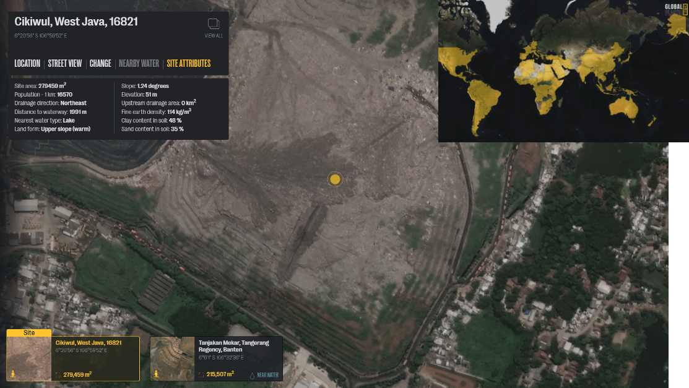
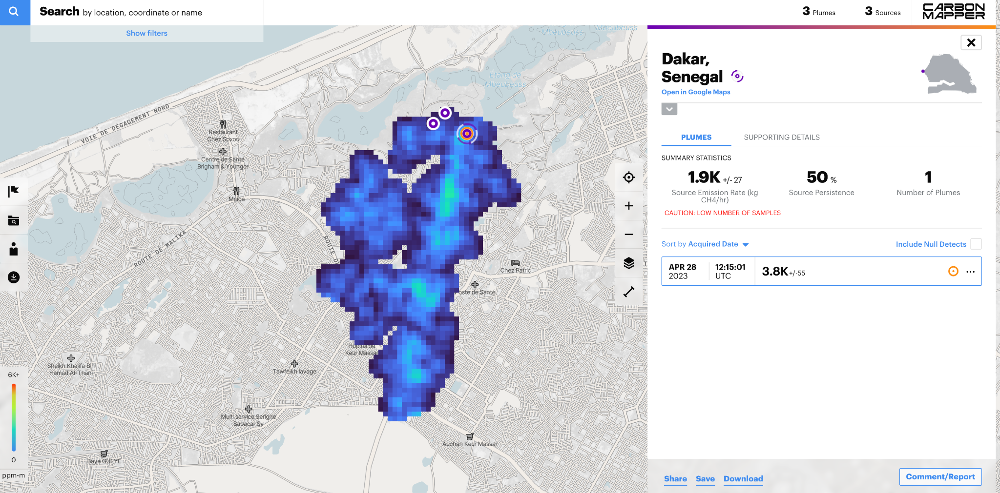
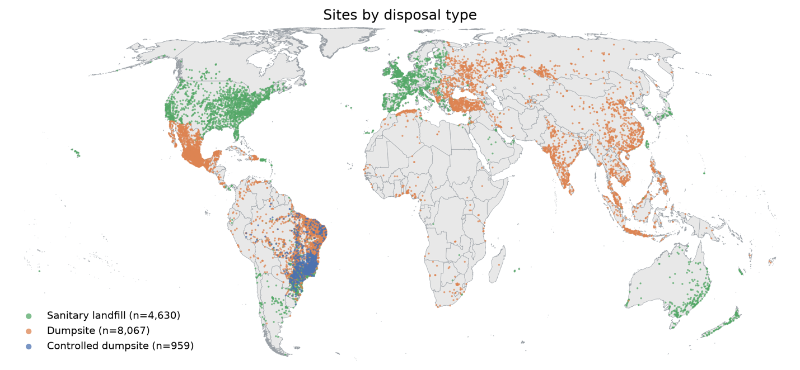
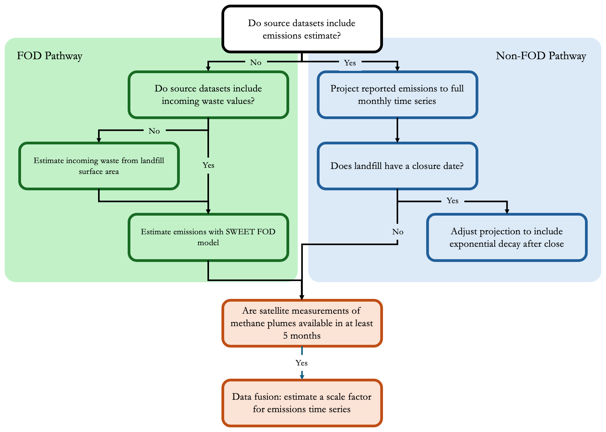
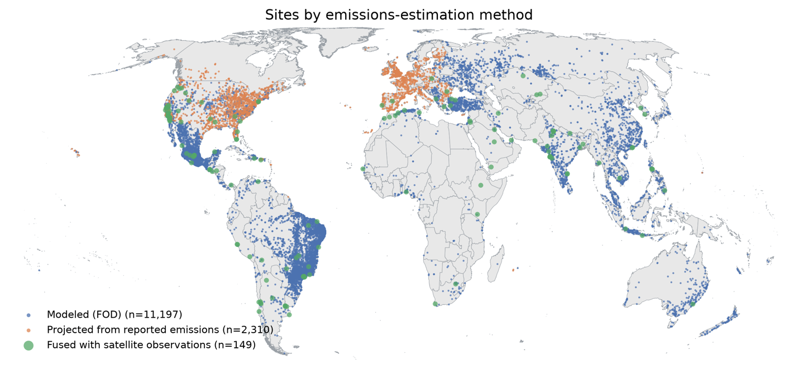
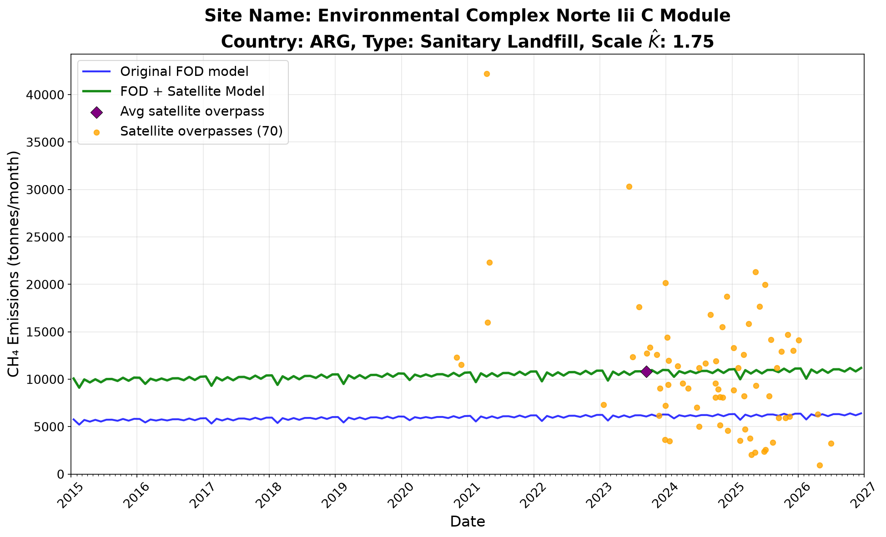
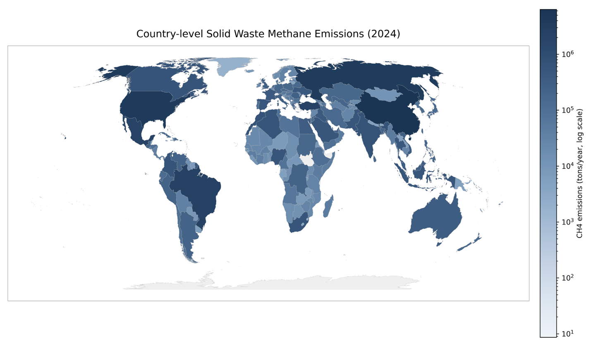
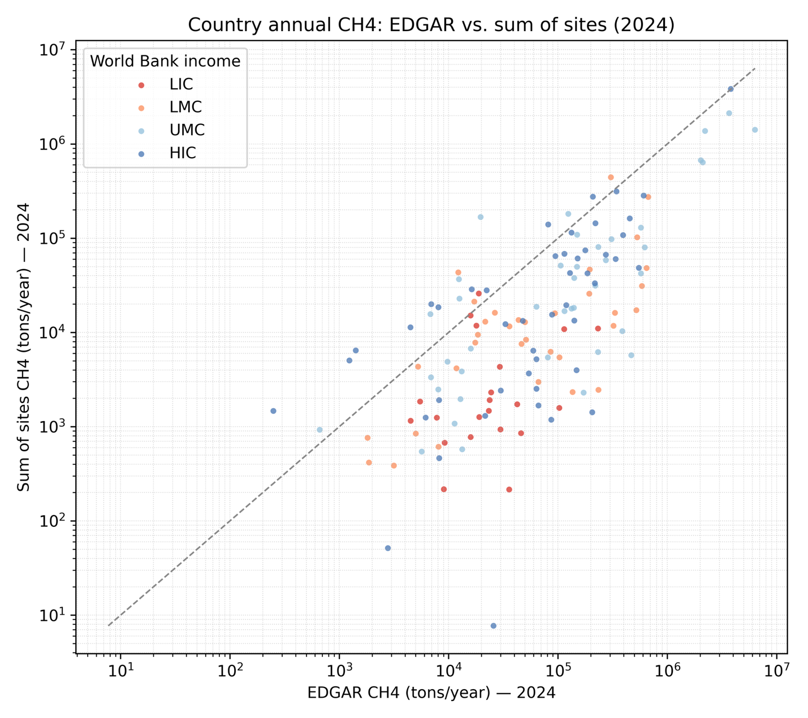
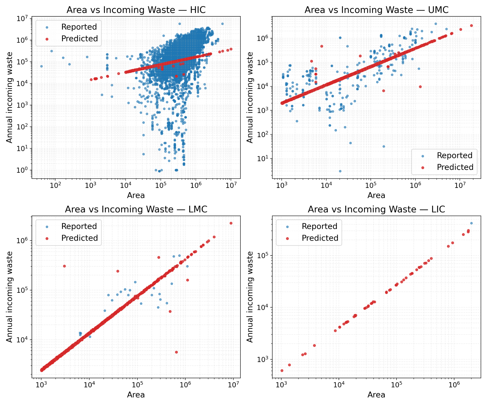

### Waste Sector: Estimating CH4 Emissions from Solid Waste Disposal Sites

**Hugh Runyan1,3, Yuchen Wu1,3, Andre Scheinwald1,3, CJ Yetman1,3, Adefunke Sonaike1,3, Tom Frankiewicz1,3, John McGrath1,3, Krsna Raniga2,3, and Yuan (Rose) Wang1,3\***

1\) RMI, 2) WattTime, 3) Climate TRACE

\* Email address: rwang@rmi.org

#### 1. Introduction

Methane (CH4) is a potent greenhouse gas responsible for 30% of global warming since the industrial revolution and is 27 times more potent than carbon dioxide over a 100-year timespan (Ayandele et al., 2022). Solid waste disposal sites (SWDS) are the third largest human-generated source responsible for increasing atmospheric methane worldwide, after fossil fuels and enteric fermentation; SWDS accounted for 12% of total global anthropogenic methane emissions in 2020 (UNEP/CCAC, 2022). In the U.S., SWDS contribute 14.5% of methane greenhouse gas generation (U.S. EPA, 2022). Emissions from SWDS are generated by anaerobic decomposition of organic waste.

Globally, 37% of waste is landfilled, while 33% is openly dumped, 19% is diverted before reaching SWDS, and 11% is incinerated for energy recovery (Kaza et al., 2018). Definitions and management standards of SWDS vary widely by income level. Sanitary landfills are engineered facilities designed with liners, leachate control, and often methane capture, whereas open dumpsites are uncontrolled waste disposal areas lacking environmental safeguards. In low-income countries, roughly 93% of waste is openly dumped, with limited collection coverage, access to controlled landfilling, or centralized waste treatment (Kaza et al., 2018).

Data on SWDS, which is crucial for understanding and mitigating methane emissions, are frequently fragmented, inconsistent, or incomplete. While a few countries provide site-level methane emissions data—such as the U.S. Environmental Protection Agency’s (EPA) Greenhouse Gas Reporting Program (GHGRP), the European Pollutant Release and Transfer Register (E-PRTR), and Canada’s Greenhouse Gas Reporting Program (Canada GHGRP)—these remain the exception rather than the rule. Most countries do not report at this level of granularity, leaving significant gaps in global coverage. Moreover, the U.S. EPA issued a proposed rule in September 2025 to reconsider the GHGRP. The proposal would remove reporting requirements for multiple source categories, including municipal solid waste landfills (Subpart HH), as part of a broader effort to streamline or suspend reporting obligations until 2034 (U.S. EPA, 2025d), which would further limit the availability of facility-level reported data. However, this rule has not yet been finalized, and landfill facilities remain obligated to report under the current GHGRP framework, as of September 2026, until a final decision is published. Similarly, the EPA’s Landfill Methane Outreach Program (LMOP), Mexico’s National Institute of Statistics and Geography (INEGI), and Brazil’s National Solid Waste Management Information System (SINIR) offer insights into waste quantities and management practices, but the absence of direct emissions data limits their utility in creating a comprehensive emissions profile.

Global-scale data collection efforts like OpenStreetMap (OSM), though broad in scope, suffer from issues of verification. A small sample of cataloged OSM SWDS we examined contained incorrectly labeled sites. Global Plastic Watch introduced a novel approach employing satellite remote sensing to identify plastic-rich waste sites all over the globe, but its focus on plastic might overlook SWDS with low plastic content. Waste Atlas (another global catalog) is outdated, having last been updated in 2013.

Considering the complexity of the waste data landscape, the SWDS Climate TRACE methodology for national and asset-level emissions estimation uses a three-step approach: 1) Aggregate and deduplicate waste disposal sites data from various sources; 2) Fill gaps in input sources with modeled values or IPCC defaults; 3) Emissions estimation, which comprises multiple pathways depending on site-specific data availability, including fusion with satellite-based measurements where available. The methodology is outlined below.

Based on the asset-level emissions estimates, the authors also recommend emissions reduction solutions (ERSs) for each SWDS based on site type, economic conditions of the country where each SWDS is located, and other available site-specific information to demonstrate the methane mitigation potential of implementing increased waste diversion from disposal sites as well as improved site management practices.

#### 2. Materials and Methods

The approach described below was used to estimate methane emissions for 13,656 solid-waste disposal sites in 157 countries, monthly from 2015 to 2026. It produces two sets of estimates. Site-level estimates give each site’s monthly CH₄ emissions, with uncertainty and confidence, and a ranked set of emissions reduction strategies (Section 2.4). Country-level estimates give monthly CH₄ emissions for 215 of 252 countries and territories, built from the site estimates and the EDGAR inventory (Section 2.3).

Waste datasets were selected based on comprehensive data availability for three key parameters: surface area, annual incoming waste, and methane emissions data from self-reported programs and remote sensing measurements. Where none of these were available, the SWDS was omitted from the final composite dataset. The composite dataset was contingent on a combination of data richness, source reliability, and recency, where a hierarchy of preference in data source was implemented if multiple datasets overlapped on certain SWDS (see Section 2.1.4).

The Climate TRACE landfill inventory relies on mechanistic first-order decay (FOD) models for estimating methane emissions. The advantage of this approach lies in interpretability – making it easy to understand the driving forces behind emissions. In addition, it enables the design of more targeted emissions reduction strategies, as the model can leverage site-specific data to inform actionable mitigation pathways. A Python version of EPA’s Solid Waste Emissions Estimation Tool (SWEET) created by RMI (RMI, 2026) is used as the backbone of modeling. Where satellite or reported emissions data was available, they were used preferentially or incorporated into the modeling process.

#### 2.1 Constructing the Facility Waste Dataset

Constructing the facility dataset required pre-processing and integrating a variety of solid waste data sources, which varied in their completeness and geographical coverage. The primary goal was to construct a unified dataset composed of unique waste sites, while incorporating the most comprehensive information available per location. The datasets were constructed in the following stages:

1.  Pre-modeling inventory: This stage involved creating a deduplicated, filtered concatenation of all individual contributing datasets, deploying a hierarchy of source preference when multiple sources reported on the same site. A unique asset identifier was assigned to each site.

2.  Plume matching: In this stage, satellite plume data were spatially matched with waste sites.

3.  Final dataset: This stage involved filling data gaps with modeled or default values. Incoming waste amount data were filled where needed by the area-to-incoming-waste model (section 2.2.2), and parameters such as methane correction factors, unavailable in any dataset, were filled with IPCC country-level or regional defaults.

#### 2.1.1 Core datasets employed

*U.S. EPA GHGRP*: The U.S. EPA’s Greenhouse Gas Reporting Program (GHGRP) requires over 8,000 large-emitter facilities emitting &gt;25,000 metric tonnes CO2 equivalent annually to report their greenhouse gas emissions each year (U.S. EPA, 2025a). This is the broadest and most comprehensive dataset publicly available on U.S. waste disposal sites. The reported data was acquired through the EPA’s GraphQL API (https://enviro.epa.gov/query-builder/ghg), which includes data such as annual accepted waste, emissions, and cover types from 2010-2023.

*U.S. EPA LMOP*: SWDS data were collected from the Landfill Methane Outreach Program (LMOP; [https://www.epa.gov/lmop](https://www.epa.gov/lmop)), whose sources include facility self-reports and partner reports, and data are publicly available (U.S. EPA, 2025b). Beyond surface area, waste-in-place, annual capacity, and operating years, many sites published landfill gas generation (LFG) and collection values. For US sites that did not meet the EPA’s GHGRP criteria, the net published LFG values (LFG generated minus LFG collected) in LMOP data were utilized to estimate methane emissions.

*Canada GHGRP*: Similar to the U.S. EPA GHGRP, Canada requires annual reports from facilities that emit at least 10,000 tonnes of carbon dioxide equivalent per year (https://www.canada.ca/en/environment-climate-change/services/climate-change/greenhouse-gas-emissions/facility-reporting/data.html). 133 unique locations reported emissions between 2004-2021. The program only publishes annual emissions quantities and ownership information (Government of Canada, 2026).

*E-PRTR*: The European Pollutant Release and Transfer Register reports pollutant releases, including greenhouse gas emissions, from industrial facilities in the European Union (EU, 2026; [https://industry.eea.europa.eu/](https://industry.eea.europa.eu/)). Between 2007 and 2021, 1,426 landfills reported emissions. The E-PRTR only publishes landfill locations and annual emissions quantities.

*INEGI*: Mexico’s National Institute of Statistics and Geography (INEGI) published landfill locations, waste quantities, and practices in 2017 under its “National Census of Municipal and Delegational Governments 2017” (Mexico National Institute of Statistics and Geography (INEGI), 2017; [https://en.www.inegi.org.mx/](https://en.www.inegi.org.mx/)). This dataset reports on 2,204 active landfills since 2016, and publishes information including their opening dates, annual incoming waste, existence of landfill cover, and existence of gas collection systems.

*Waste Atlas*: This dataset is presented as an interactive map with data compiled through crowdsourcing and scientific research for 2013 (Waste Atlas, 2013; <http://www.atlas.d-waste.com/>). The information available per location is a mix of waste-in-place, annual capacity, and operating status. Between sanitary landfills and dumpsites, there are 662 unique locations.

*OpenStreetMap*: The OpenStreetMap (OSM) dataset is composed of labels, locations, and areas (OpenStreetMap Foundation, 2026; https://www.openstreetmap.org). It is important to note that not every location in this dataset was confirmed as a SWDS. Due to the dataset's size and the visual similarities between SWDS and some other types of facilities, manual verification was impractical. The team is progressively removing sites that do not appear to be waste sites through high-res satellite imagery and greatly appreciates partners, such as researchers in UNEP’s International Methane Emissions Observatory (IMEO) program, for their support on this process.

*SINIR*: The Sistema Nacional de Informações sobre a Gestão dos Resíduos Sólidos (SINIR) is publicly available data collected by the Federative Republic of Brazil (Federative Republic of Brazil, 2019; [https://relatorios.sinir.gov.br/relatorios/municipal/](https://relatorios.sinir.gov.br/relatorios/municipal/)). The data is a time series of 3,914 landfills from 2014-2019. It includes information such as landfill locations (generally just city center geocoordinates), annual incoming waste, landfill type, and open and close dates.

*CATF*: The Clean Air Task Force (Clean Air Task Force (CATF), 2025; https://www.catf.us/) data were provided by CATF through their country engagement work in Mexico and Ecuador. The dataset is a time series of 4 landfills from 2012-2023; it includes fields such as landfill locations, annual incoming waste, waste in place, facility cover, percent coverage, and waste composition.

*Global Plastic Watch (GPW)*: This database consists of plastic-containing waste sites identified by a system of neural networks created to analyze spectral, spatial, and temporal components of Sentinel-2 satellite data to find terrestrial waste aggregations (Global Plastic Watch, 2021). Following identification, the footprint of each site was calculated and monitored at monthly intervals. This approach has detected nearly 1,738 waste sites over 1,000 m2 in 26 countries (Figure 1). The GPW method generated contours to estimate the areas of detected waste aggregations, updated at a monthly cadence from the Sentinel-2 observation period between 2017 and early-2021. As no specific timestamp was available for each site when the data was downloaded to use for this work, all areas were treated as 2021 data.

**Figure 1.** An example of a large waste site in Indonesia as shown on GPW, showing available site attributes when selected (top left corner of the image) and the countries with locations identified in yellow (inset right).

#### 2.1.2 Supplemental datasets:

*World Bank*: Each site was assigned the World Bank income group of its country (low, lower-middle, upper-middle or high income) from the country-level dataset of “What a Waste 2.0: A Global Snapshot of Solid Waste Management to 2050” (Kaza et al., 2018). Income groups are used in the area-to-incoming-waste model (Section 2.2.2) and to set the income-based assumptions of the emissions reduction strategies (Section 2.4).

*WorldClim:* The methane generation rate constant (k-value) was calculated using precipitation and temperature data based on the methodology published by Wang et al. (2024). Facility geocoordinates were used to find the nearest weather data. This data is sourced from World Clim and covers 2000-2021 (WorldClim, 2026; https://www.worldclim.org/).

*United Nations Population Data:* Population growth rates are used to estimate changes in variables such as waste generation rates through time. The population data comes from the UN Population Division, Department of Economic and Social Affairs (United Nations, Department of Economic and Social Affairs, Population Division, 2025; https://population.un.org/dataportal/).

#### 2.1.3 Remote Sensing Data

*Carbon Mapper*

The Carbon Mapper Open Data Portal provides plume detections from various sensors located on different platforms on aircraft and spacecraft (Carbon Mapper, 2026; https://carbonmapper.org/data). Figure 2 shows an example of a detected methane plume. The following sensors, totals plumes, and date ranges were accessed:

1.  Tanager – 11,423 plumes from 9/19/2024 - 6/11/2026.

2.  ISS: EMIT – 3,606 plumes from 8/10/2022 - 11/12/2025

3.  Global Airborne Observatory – 8,232 plumes from 10/10/2019 - 6/12/2024

4.  AVIRIS-3 (Airborne Visible InfraRed Imaging Spectrometer) campaigns – 2,221 plumes from 3/19/2023- 4/2/2024

5.  AVIRIS-NG campaigns – 4,284 plumes from 9/10/2016 – 3/19/2023

*SRON/GHGSat*: A total of 463 satellite plume detections were available from SRON’s TWOS initiative (Space Research Organisation Netherlands Targeting Waste emissions Observed from Space) spanning from 9/22/2020-1/28/2026 (Maasakkers & Aben, 2025; https://www.sron.nl/en/pillars/science/earth/targeting-waste-emissions-observed-from-space/). Plumes were only used if spatially matched to known SWDS. Original plume imagery is from GHGSat satellites (GHGSat, 2026; https://www.ghgsat.com/).

*IMEO*: We ingested 195 additional EnMAP (Environmental Mapping and Analysis Program) plumes from the International Methane Emissions Observatory (IMEO) data portal, with 21 identified as coal mining, 171 oil & gas, and 3 from solid waste (UNEP, 2021; [https://www.unep.org/topics/energy/methane/international-methane-emissions-observatory](https://www.unep.org/topics/energy/methane/international-methane-emissions-observatory)). The data spans from 3/19/2023-12/26/2024. Plumes were only used if spatially matched to a known waste site.

**Figure 2.** A methane plume example from a waste site (landfill) in Senegal from the Carbon Mapper website.

Only plumes spatially matched to a known SWDS were used, and it is that spatial match, rather than the portal's own sector label, which determines whether a detection informs a site. The estimates in this release were produced from an earlier extract of these archives, in which 5,538 detections matched a known SWDS. Because several detections can share a site and a timestamp, these aggregate to 3,959 distinct overpasses across 608 sites, of which 149 sites had coverage in at least five separate months and were therefore carried into the scale factor fusion.

#### 2.1.4 Filtering & deduplication for the pre-modeling inventory

In order to create a harmonized SWDS inventory, sources reporting direct emissions were prioritized, such as the EPA datasets, Canada GHGRP, and E-PRTR. When reconciling overlapping data from the LMOP and EPA GHGRP datasets, GHGRP data were preferred because they contain directly reported emissions estimates. Figure 3 shows all facility locations, colored by site type.

OSM sites smaller than 10,000 square meters were excluded to filter out potential false positives. The threshold for GPW sites was set lower—1,000 square meters—due to the greater reliability of GPW’s remote-sensing techniques. Further refinement on OSM data required first decoding Unicode contents in the JSON labels and translating non-English labels. Sites were removed based on a list of keywords for non-MSW identifiers, such as “construction” or “tailings”.

**Figure 3.** Global Solid Waste Sites by Type: green dots = sanitary landfill, orange dots = dumpsites, and purple dots = controlled dumpsite.

Spatial deduplication was necessary both within source datasets and between them. The initial composite dataset, concatenated from all the individual contributing datasets, was spatially matched to itself using a clustering recursion in Postgres using PostGIS. The largest overlapping site (based on a 1,500-meter radius) from the same source was retained. For datasets with no reported areas, OSM areas from matching locations were used.

Finally, OSM, GPW, and Waste Atlas sites overlapping with locations from more informative sources like EPA GHGRP, EPA LMOP, Canada GHGRP, E-PRTR, and INEGI were merged to fill in gaps. Consequently, a single waste site in the final training datasets could encompass multi-source data, including area, capacity, and emissions.

Where more than one source reported an area for the same site, a single canonical area was chosen by source quality rather than by whichever record survived deduplication. Directly reported facility areas — the US and Canadian GHGRP, EPA LMOP, Waste Atlas, and Mexico’s INEGI — rank first, and where several of them describe one site their areas are averaged. OpenStreetMap footprints rank next, then any source not explicitly ranked, and GPW last. SINIR is ranked with GPW.

#### 2.2 Model development

An overview of the Climate TRACE solid waste methane emissions estimation process is illustrated in Figure 4. Beginning at the top of the flow chart, if the source datasets for the site included reported emissions, those emission estimates were projected to a time series using average country-level historical and projected future population growth rates. This modeling pathway will be referred to as the no-FOD pathway (top-right of flowchart), with FOD standing for first-order decay. Details of the projection methodology are provided in Section 2.2.1.

**Figure 4.** Waste emission modeling flowchart.

Where emissions estimates were not reported, they were generated through a two-stage estimation process referred to as the FOD pathway (top-left of flowchart). First, when annual incoming waste values were unavailable, they were estimated using a modeled relationship between landfill surface area and annual incoming waste. This model, referred to as the area-to-incoming-waste model, is described in section 2.2.2. Second, the Python implementation of the U.S. EPA SWEET model was used to estimate methane emissions from incoming waste and other source dataset parameters (RMI, 2026; U.S. EPA, 2025c). Where reported values were missing, IPCC country-level or regional default parameters were applied. Because SWEET is a first-order decay model, this modeling approach is referred to as the FOD pathway, and it is explained in more depth in section 2.2.3.

After the input data went through the above two pathways, all landfills with adequate source data had associated emissions estimates. If Carbon Mapper provided methane plume measurements at a site that were available for at least 5 months, they were used to inform and update the emissions estimates with a scale factor fusion strategy: emissions estimates were combined with satellite measurements through an uncertainty-informed fusion process.

This satellite stage is described in detail in section 2.2.4.

#### 2.2.1 Projection of reported emissions and annual incoming waste (no-FOD pathway)

Where emissions were reported in official government sources like the U.S. EPA, they were assumed to be more accurate than emissions estimated with the FOD pathway due to our lack of comprehensive activity data for many sites. Climate TRACE publishes monthly emissions estimates from 2015-2026, and many landfills either lacked reported emissions for some of the timeframe or the last reported values were dated before the starting year of Climate TRACE data, so in some cases it was desirable to project reported emissions estimates through time. Simple carry-forward and carry-backward methods were used to do so: the earliest reported value was repeated backwards in time to the landfill opening date, and also carried forward to the date of the second reported value, after which the second value was carried forward until the date of the third value, etc.

Where landfill closure dates were available, site-specific exponential decay rates *k* were estimated with the method described in Wang et al. (2024). For sites with emissions reported after the reported closure date, we assumed exponential decay of the waste remaining at the time of closure and re-estimated a new decay rate $`k`$ by fitting an exponential decay model to the reported post-closure emissions using least-squares. This was justified by our assumption that reported emissions provide a more accurate representation of post-closure landfill behavior than decay rates estimated from waste characteristics and environmental parameters.

**2.2.2 Predicting annual incoming waste from the area** **(FOD pathway)**

First-order decay methane emissions models predict, given some input waste, how much of that incoming mass will break down into methane gas and over what time scale. Unfortunately, the source datasets did not contain incoming waste mass values for all SWDS. Where possible, we estimated these values from more widely available landfill surface area data using a hierarchical Bayesian regression model. This framework relates incoming waste to area while accounting for variability across World Bank income groups, which serve as a proxy for differences in waste management intensity and density.

The model was implemented in PyMC and sampled with the No-U-Turn Sampler (NUTS)**.** Model performance was evaluated through leave-one-out cross-validation (LOO-CV), which showed that the hierarchical model modestly outperformed a simpler linear alternative. Posterior predictive simulations were then used to estimate annual incoming waste for landfills lacking reported values, with credible intervals converted to approximate coefficients of variation to summarize uncertainty.

Full model equations, priors, likelihood structure, validation results, and diagnostic plots are provided in the Supplemental Information (Section SI.2).

#### 2.2.3 SWEET Modeling (FOD pathway)

After running the area-to-incoming-waste model, all sites in the FOD pathway (i.e., those without emissions estimates in source datasets) had associated reported or estimated annual incoming waste values. Methane emissions for these sites were then estimated using the Python implementation of the U.S. EPA SWEET model, created by RMI (RMI, 2026; U.S. EPA, 2025c; [https://github.com/RMI/SWEET\_python](https://github.com/RMI/SWEET_python)). The SWEET model uses parameters such as incoming waste mass, waste composition, carbon contents, and decay rates to predict a time series of landfill emissions (Table 1). It follows a first-order decay model similar to the standard IPCC first-order decay equation for estimating methane emissions from decaying waste. Parameter values from source datasets were used where available; otherwise, IPCC default values at the country or regional level were applied (IPCC, 2006). Site-specific decay rates were determined with the Wang et al. (2024) model.

**Table 1** Parameters used in SWEET python model

<table><thead><tr class="header"><th><blockquote>
<em>i</em>
</blockquote></th><th>Month index</th></tr></thead><tbody><tr class="odd"><td><blockquote>
<em>j</em>
</blockquote></td><td>Waste disposal month</td></tr><tr class="even"><td><blockquote>
<em>c</em>
</blockquote></td><td>Waste component (food, wood, etc)</td></tr><tr class="odd"><td><blockquote>
<em>u</em>
</blockquote></td><td>Month index in the cumulative sum</td></tr><tr class="even"><td><blockquote>
<em>wj,c</em>
</blockquote></td><td>Mass of component c deposited in month j</td></tr><tr class="odd"><td><blockquote>
<em>L0,c</em>
</blockquote></td><td>Methane potential of component <em>c</em></td></tr><tr class="even"><td><blockquote>
<em>kc</em>(<em>i</em>)
</blockquote></td><td>Decay constant for component <em>c</em> in month <em>i</em></td></tr><tr class="odd"><td><blockquote>
Δ<em>ti</em>
</blockquote></td><td>Month length in years (days in month / days in year)</td></tr><tr class="even"><td><blockquote>
MCF(<em>i</em>)
</blockquote></td><td>Methane correction factor in month <em>i</em></td></tr><tr class="odd"><td><blockquote>
<em>g</em>(<em>i</em>)
</blockquote></td><td>Gas capture efficiency in month <em>i</em></td></tr><tr class="even"><td><blockquote>
<em>f</em>(<em>i</em>)
</blockquote></td><td>Flare efficiency in month <em>i</em></td></tr><tr class="odd"><td><em>OX</em>(<em>i</em>)</td><td>Oxidation factor in month <em>i</em></td></tr></tbody></table>

**Equation for calculating methane emissions.**

|                                                                   |         |
|-------------------------------------------------------------------|---------|
| Let $`S_{c}\left( i \right) = \ k_{c}\left( u \right)\Delta t_{u}`$ | (Eq. 1) |

The decay factor *Dc*(*i*,*j*) represents the fraction of waste of component *c* disposed in month j that remains undecomposed, and contributes to methane generation in a later month *i* ≥ *j*:

| $`D_{c\left( i,j \right)} = \exp( - \left\lbrack S_{c}(i - 1) - S_{c}(j - 1) - 1/2k_{c}(j) \right\rbrack,\ i \geq j\ ,`$                                                    | (Eq.2)  |
|---------------------------------------------------------------------------------------------------------------------------------------------------------------------------|---------|
| $`Q_{c}\left( i \right) = \ \left\lbrack L_{0,c}w_{j,c}D_{c\left( i,j \right)} \right\rbrack\left( k_{c}\left( i \right)\Delta t_{i} \right)\text{MCF}\left( i \right)\ ,`$ | (Eq. 3) |
| $`E(i) = {Q_{c}(i)\left\lbrack 1 - g(i)f(i) \right\rbrack\left\lbrack 1 - OX(i) \right\rbrack}`$                                                                         | (Eq. 4) |

A tonne of waste cannot release more methane in a single year than it will ever produce over its lifetime. Summed over the waste components, that lifetime potential gives an upper bound of 0.1434 t CH4 per tonne of waste, and the published site emission factor — annual methane divided by waste in place — is capped there. Where a site exceeded the ceiling, the emissions estimate was treated as the trustworthy quantity and the waste-in-place estimate as the under-counted one, so waste in place was inflated until the ceiling was satisfied and the emissions were held fixed. Affected sites therefore carry a larger reported activity and capacity factor, and are flagged as such in the published files.

Two guards are placed on the resulting decay rate. It is floored at 0.04 yr-1, and the temperature factor entering it is clamped to its valid range. Without them, cold and dry sites produced implausibly near-zero decay rates and became hypersensitive to small differences in temperature. Warm, wet sites are unaffected.

#### 2.2.4 Incorporating remote sensing measurements

Advances in air- and spaceborne hyperspectral sensors have enabled high-spatial-resolution detection of methane plumes. Prominent data providers include Carbon Mapper and GHGSat, whose instruments combine low detection limits with high spatial resolution, enabling detection and quantification of relatively small plumes. Many of these plumes can be confidently associated with source infrastructure (e.g., O&G pipeline leakages, landfills, animal feeding operations). While the number of landfills being investigated for methane plumes is still orders of magnitude smaller than the total number of landfills on earth, and the temporal frequency of measurements at individual landfills is often low, there are enough satellite measurements at some landfills to meaningfully contribute to waste methane emissions estimation efforts on time scales longer than the instantaneous measurements themselves.

#### 2.2.4.1 Bayesian scale factor estimation – fusion method

At every site with enough matched plume observations, we used a Bayesian scale factor estimation model to combine information from both 1) “bottom-up” reported/FOD-modeled emissions estimates, and 2) “top-down” satellite measurements, into a single predicted emissions time series for that landfill.

Specifics of the scale factor fusion model are explained in Supplemental Information SI.3. The final fused emissions time series estimate is $`\widehat{K}Q_{t}^{\text{base}}`$, where $`Q_{t}^{\text{base}}`$ is the baseline emissions time series predicted by the FOD model and $`\widehat{K}`$ is a scale factor predicted with satellite data and the fusion model. Figure 5 displays the locations where the fusion method was and wasn’t applied.

**Figure 5.** Global Solid Waste Sites by Emission Estimation Methodology Type.

#### 2.2.5 Particulate matter estimations

Particulate matter emissions were estimated for sites with flaring. For sites in the FOD pathway (those without reported emissions), monthly PM emissions were calculated directly from the volume of methane flared as estimated by the SWEET model. For sites with reported methane emissions, the volume of methane destroyed by flaring was estimated using SWEET default values for landfill gas capture efficiency, flare destruction efficiency, oxidation, temperature, and pressure. Sites without flaring were assigned PM emissions of zero. PM₂.₅ emissions are set equal to PM₁₀ emissions, consistent with EPA methodology, which assumes that the majority of particulate matter emitted from landfill flares is under 1 micron in size, and statistically 100% of particulate matter is under 2.5 microns.

The equation used to estimate particulate matter emissions was:

|                                                    |         |
|----------------------------------------------------|---------|
| PMt = VF,t ⋅ EFPM | (Eq. 5) |

where PMt is PM2.5 or PM10 emissions in month t, VF,t is the volume of methane destroyed by flaring in month t, and EFPM is the particulate matter emission factor. For this study, we adopted the SWEET model convention and set EFPM equal to 2.4×10−4 kg m−3 methane flared. PM2.5 or PM10 were assumed to be equal and were therefore calculated using the same emission factor.

#### 2.2.6 Confidence

Each published estimate is accompanied by a categorical confidence label, supplied in a separate confidence file that mirrors the asset file row for row: one row per site per month, keyed by asset identifier and reporting period, with a label in place of every numeric field.

Confidence is derived mechanically from the relative uncertainty computed for that same field, so the two files are consistent by construction rather than by judgement. A field whose relative uncertainty is below 0.5 is labelled high; between 0.5 and 1.0, medium; at or above 1.0, low. Where a field carries no uncertainty — for example the CO2 and N2O columns, which this sector does not estimate — the confidence entry is left empty rather than being given a default. The labels therefore inherit the uncertainty model described above, and no separate confidence model exists.

#### 2.3 Country-level emissions estimates

Country-level estimates were produced monthly from 2015 to 2026 for 215 of the 252 countries and territories in the Climate TRACE roster. The remaining 37, mostly microstates and small or uninhabited territories, have neither an inventoried site nor an EDGAR value and are left blank. Country-level estimates draw on two sources. The first is the sum of our site-level estimates in each country (Section 2.2). The second is the national solid waste disposal inventory (IPCC category 4.A) from the EDGAR Community GHG Database (European Commission JRC, 2024). That release ends in 2023, so EDGAR values for 2024 to 2026 were extended from 2023 using each country’s annual population growth rate (Section 2.1.2).

Our inventory does not include every disposal site in every country, so the site total is treated as a lower bound on national emissions. For each country and year:

-   **Sites and EDGAR both available:** the larger of the two was published. A site total above EDGAR was capped at three times the EDGAR value. The cap affected three small countries: Luxembourg, New Caledonia, and Tonga.

-   **EDGAR only** (no inventoried site in the country): the EDGAR value was published.

-   **Neither available:** no estimate was published.

Where the site total was published, monthly values follow the sites’ own monthly emissions. Where EDGAR was published, its annual value was split evenly across the twelve months.

#### 2.4 Emissions Reduction Strategies (ERS)

Methane mitigation strategies from SWDS generally follow two complementary pathways. The first is midstream waste diversion, which treats organic waste through biological processes such as composting or anaerobic digestion. This approach reduces the quantity of biodegradable material disposed of at SWDS and, consequently, the potential for anaerobic decomposition and methane generation in the long term. The second is downstream improvement of SWDS operations and management, which focuses on enhancing landfill gas (LFG) capture, control, and utilization from waste that is already disposed. The specific mitigation strategies adopted under this pathway, such as installation of a gas collection and control system (GCCS) and destruction of methane through flaring or utilization in an energy project, or oxidation of methane through the use of soil cover or biocover, depend on the engineering and operational characteristics of the site. Importantly, these two pathways are not mutually exclusive; rather, integrated implementation of midstream diversion and downstream gas management has been shown to deliver the greatest overall reduction in methane emissions across the waste sector (Ayandele et al., 2022).

Accordingly, the ERS framework includes both compound and individual strategies for waste diversion and disposal improvements. Strategies 1–14 are compound strategies that combine income-based food waste prevention and organic waste diversion assumptions with a disposal-site intervention. Strategy 15 is the food waste prevention and organic waste diversion strategy, while Strategies 16–29 are the corresponding standalone disposal-site strategies. A range of up to five ranked strategies for each site is provided for each asset on the Climate TRACE website.

#### 2.4.1 Food waste prevention and organics diversion

An effective way to reduce methane emissions from SWDS is to prevent food waste and divert organic waste from disposal to composting and anaerobic digestion (AD) facilities. Achievable prevention and diversion rates depend on both the implementation timeline and the current and projected deployment of these approaches. Each SWDS is assigned food waste prevention and organic waste diversion assumptions based on the [World Bank income classification](https://datahelpdesk.worldbank.org/knowledgebase/articles/906519-world-bank-country-and-lending-groups) of the country in which it is located. Food waste prevention assumptions range from 0% to 15%, while organic waste diversion assumptions range from 2% to 18%, with higher-income countries expected to have greater capacity to prevent and treat organic waste. See Table 2 for the assumptions by income group.

Similarly, the split between composting and AD technology deployment differs by income groups. This respective split assigned to each income group is also detailed in Table 2 and assessed through literature review of current and projected composting and AD technology deployment in anchor countries (Kaza et al., 2018; Babu et al., 2021; Ulloa-Murillo et al., 2022; BMUV, 2023; World Biogas Association, 2019; Kamau & Andati, 2025; McGaughy et al., 2024; Pizzanelli et al., 2023; Jin et al., 2021). Modeling of induced emissions at composting and AD facilities follows the methodology used in the U.S. EPA’s SWEET. Generally, countries in lower income groups divert more waste to composting and less to anaerobic digestion facilities due to the cost and complexities of AD technology and lack of local technical and financial resources.

**Table 2**: ERS Food waste prevention, organics diversion rate to composting vs. AD facilities, and biocover oxidation rate by income group.

| **World Bank Country Classification by Income** | **Food Waste Prevention (% of food waste generated)** | **Organic Waste Diversion Rate (% of total waste generated)** | **Composting / AD split** | **Biocover oxidation rate** |
|-------------------------------------------------|-------------------------------------------------------|---------------------------------------------------------------|---------------------------|-----------------------------|
| High Income                                     | 15%                                                   | 17.7%                                                         | 70% / 30%                 | 75%                         |
| Upper Middle Income                             | 10%                                                   | 12.5%                                                         | 80% / 20%                 | 60%                         |
| Lower Middle Income                             | 4%                                                    | 12%                                                           | 90% / 10%                 | 50%                         |
| Low Income                                      | 0%                                                    | 1.6%                                                          | 100% / 0%                 | 30%                         |

#### 2.4.2 Improved methane control at SWDS

We characterize SWDS into three types: open dumpsites, controlled dumpsites, and sanitary landfills. Open dumpsites are unmanaged areas where mixed waste is disposed of without liners or cover systems, allowing anaerobic decomposition under uncontrolled conditions that lead to diffuse methane emissions. Controlled dumpsites represent an incremental improvement, with some operational measures such as compaction, limited soil cover, or restricted access. These reduce nuisances but still allow substantial fugitive methane emissions, making retrofitted bio-oxidation or small-scale gas collection systems suitable mitigation strategies. Sanitary landfills, by contrast, are fully engineered facilities with liners, leachate management, and some also with extensive gas collection to enable systematic methane capture, control, and utilization, significantly reducing overall emissions (Kaza et al., 2018).

Broadly speaking, the list of disposal site improvements that can mitigate methane emissions include 1) adding gas capture systems, 2) improving the efficiency of existing gas capture systems, and 3) improving cover integrity or deploying additional cover and biocover to promote methane oxidation. Table 3 shows the ERS assigned to each SWDS type based on site characteristics and available data, as well as the sources supporting each strategy and its assumptions.

The emissions reduction from a compound strategy is smaller than the sum of the reductions from its two parts, because strategy impact is applied as a percentage and the parts act in sequence. If the first and second parts of a compound strategy reduce methane by 10% each, the second part only applies to 90% of the original total, because the first reduction already happened and there’s less methane to reduce. For example, at the 318 non-US sanitary landfills assigned Strategy 7, food waste prevention and organics diversion alone (Strategy 15) reduce methane emissions by 21% on average, and adding a GCCS alone (Strategy 22) reduces them by 76%. Applied together, the GCCS removes 76% of the 79% of methane that remains after diversion, so emissions fall to about 0.79 × 0.24 ≈ 19% of the baseline. That is a reduction of about 81%, not the 97% that adding the two figures would suggest. Cover and biocover combine with diversion in the same way, since they oxidize a share of the methane that is created by undiverted waste. Prevention and diversion rates are set by income group, so the effect of Strategy 15 at the sites a given compound applies to ranges from about 11% to 22%; multiplying the Table 3 rows directly will not reproduce the compound values exactly.

For controlled dumpsites that started accepting waste before 2015 or have an unknown start year and are located in regions with annual precipitation &gt;1,500 mm, adding a GCCS is the only assigned downstream strategy. For eligible newer or drier controlled dumpsites and sanitary landfills, biocover is recommended as a parallel alternative to normal soil cover across all income groups. Strategies 5 and 6, 9 and 10, and 13 and 14 are the three pairs of normal-cover and biocover parallel alternatives in the set of compound strategies; the corresponding downstream-only pairs are Strategies 20 and 21, 24 and 25, and 28 and 29. Based on expert input, income classification is used to determine the oxidation-rate assumption applied in biocover modeling to account for the differences in locally available resources and technical expertise to build and operate a full, multi-layered biocover system. Empirical studies have shown that well-maintained biocovers can achieve methane oxidation rates of 30–90%, substantially higher than the 10–20% typically observed in standard soil covers (Scheutz et al., 2017; Abichou et al., 2009). However, this technology has not yet reached commercial-scale deployment. Its broader adoption in the coming decade will likely depend on enabling factors such as policy incentives, financial mechanisms, and local regulatory support.

**Table 3:** ERS disposal strategies and corresponding thresholds for SWDS. Strategies 15-29 contain a single change, while strategies 1-14 are compounds of multiple changes.

<table><thead><tr class="header"><th><strong>Strategy ID</strong></th><th><strong>Strategy Name</strong></th><th><strong>Applicable SWDS</strong></th><th><strong>Strategy Description</strong></th><th><strong>Number of Sites Assigned this ERS</strong> </th><th><strong>Methane mitigation</strong></th><th><strong>Sources</strong></th></tr></thead><tbody><tr class="odd"><td><strong>1</strong></td><td>Reduce incoming organic waste amount &amp; Close small open dumpsites</td><td>Active open dumpsites with WIP missing or WIP ≤ 250,000 tonnes</td><td>Reduce waste disposal using the Strategy 15 income-based food waste prevention and organic diversion settings, then close these small dumpsites and divert remaining incoming waste to a controlled dumpsite with gas capture and control systems (50% capture efficiency).</td><td>6,214</td><td>20.7%</td><td>IPCC, 2006; IPCC, 2019; U.S. EPA, 2025c</td></tr><tr class="even"><td><strong>2</strong></td><td>Reduce incoming organic waste amount &amp; Convert to controlled dumpsites</td><td>Active open dumpsites with known WIP &gt; 250,000 tonnes</td><td>Reduce waste disposal using the Strategy 15 income-based food waste prevention and organic diversion settings, then convert these sites to controlled dumpsites by adding normal soil cover and gas capture systems (50% capture efficiency).</td><td>1,482</td><td>28.2%</td><td>IPCC, 2019; UNFCCC, 2019; U.S. EPA, 2025c</td></tr><tr class="odd"><td><strong>3</strong></td><td>Reduce incoming organic waste amount &amp; Add GCCS to controlled dumpsites</td><td>Active controlled dumpsites that started accepting waste before 2015 or at an unknown date, lack GCCS, and are located in regions with annual precipitation &gt; 1,500 mm</td><td>Reduce waste disposal using the Strategy 15 income-based food waste prevention and organic diversion settings, then add GCCS with a capture efficiency of 50% to these controlled dumpsites.</td><td>118</td><td>60.6%</td><td>IPCC, 2019; UNFCCC, 2019; U.S. EPA, 2025c</td></tr><tr class="even"><td><strong>4</strong></td><td>Reduce incoming organic waste amount &amp; Improve GCCS at controlled dumpsites</td><td>Active controlled dumpsites with an active GCCS in place</td><td>Reduce waste disposal using the Strategy 15 income-based food waste prevention and organic diversion settings, then improve the current GCCS to a capture efficiency of at least 50% and a flaring efficiency of 98%.</td><td>0</td><td>–</td><td>IPCC, 2019; UNFCCC, 2019; U.S. EPA, 2025c</td></tr><tr class="odd"><td><strong>5</strong></td><td>Reduce incoming organic waste amount &amp; Improve cover</td><td>Active controlled dumpsites that started accepting waste in 2015 or later or are located in regions with annual precipitation ≤ 1,500 mm. Strategies 5 &amp; 6 apply to the same sites.</td><td>Reduce waste disposal using the Strategy 15 income-based food waste prevention and organic diversion settings, then improve cover practices using normal soil cover through early application / more frequent inspection for cover integrity etc. to increase the oxidation rate by 10 percentage points.</td><td>569</td><td>24.1%</td><td>IPCC, 2006; IPCC, 2019; U.S. EPA, 2025c</td></tr><tr class="even"><td><strong>6</strong></td><td>Reduce incoming organic waste amount &amp; Deploy biocover</td><td>Active controlled dumpsites that started accepting waste in 2015 or later or are located in regions with annual precipitation ≤ 1,500 mm. Strategies 5 &amp; 6 apply to the same sites.</td><td>Reduce waste disposal using the Strategy 15 income-based food waste prevention and organic diversion settings, then use biocover as intermediate cover to increase the oxidation rate to the value associated with the site’s World Bank income group (Table 2).</td><td>569</td><td>64.3%</td><td>
Abichou et al., 2009; Scheutz et al., 2017;

World Bank Group, 2025
</td></tr><tr class="odd"><td><strong>7</strong></td><td>Reduce incoming organic waste amount &amp; Add GCCS to sanitary landfills</td><td>Active non-US sanitary landfills without an active GCCS that started accepting waste before 2015 or at an unknown date and are located in regions with annual precipitation &gt; 1,500 mm</td><td>Reduce waste disposal using the Strategy 15 income-based food waste prevention and organic diversion settings, then add GCCS with a capture efficiency of 75% and flaring efficiency of 98%.</td><td>318</td><td>81.5%</td><td>IPCC, 2019; UNFCCC, 2019; U.S. EPA, 2025c</td></tr><tr class="even"><td><strong>8</strong></td><td>Reduce incoming organic waste amount &amp; Improve GCCS at sanitary landfills</td><td>Active non-US sanitary landfills with an active GCCS in place</td><td>Reduce waste disposal using the Strategy 15 income-based food waste prevention and organic diversion settings, then improve the current GCCS capture efficiency to at least 75% and flaring efficiency to 98%.</td><td>6</td><td>27.3%</td><td>IPCC, 2019; UNFCCC, 2019; U.S. EPA, 2025c</td></tr><tr class="odd"><td><strong>9</strong></td><td>Reduce incoming organic waste amount &amp; Improve cover</td><td>Active non-US sanitary landfills without an active GCCS that started accepting waste in 2015 or later or are located in regions with annual precipitation ≤ 1,500 mm. Strategies 9 and 10 apply to the same sites.</td><td>Reduce waste disposal using the Strategy 15 income-based food waste prevention and organic diversion settings, then improve cover practices using normal soil cover through early application / more frequent inspection for cover integrity etc. to increase the oxidation rate by 10 percentage points.</td><td>2,244</td><td>26.7%</td><td>IPCC, 2019; UNFCCC, 2019; U.S. EPA, 2025c</td></tr><tr class="even"><td><strong>10</strong></td><td>Reduce incoming organic waste amount &amp; Deploy biocover</td><td>Active non-US sanitary landfills without an active GCCS that started accepting waste in 2015 or later or are located in regions with annual precipitation ≤ 1,500 mm. Strategies 9 &amp; 10 apply to the same sites.</td><td>Reduce waste disposal using the Strategy 15 income-based food waste prevention and organic diversion settings, then use biocover as intermediate cover to increase the oxidation rate to the value associated with the site’s World Bank income group (Table 2).</td><td>2,244</td><td>72.3%</td><td>
Abichou et al., 2009; Scheutz et al., 2017

World Bank Group, 2025
</td></tr><tr class="odd"><td><strong>11</strong></td><td>Reduce incoming organic waste amount &amp; Improve GCCS at sanitary landfills</td><td>Active US sanitary landfills with an active GCCS.</td><td>Reduce waste disposal using the Strategy 15 income-based food waste prevention and organic diversion settings, then improve the current GCCS capture efficiency to at least 75% and flaring efficiency to 99%.</td><td>717</td><td>36.2%</td><td>U.S. EPA, 2016; CARB, 2010</td></tr><tr class="even"><td><strong>12</strong></td><td>Reduce incoming organic waste amount &amp; Add GCCS to sanitary landfills</td><td>Active US sanitary landfills without an active GCCS and with WIP ≥ 450,000 tonnes</td><td>Reduce waste disposal using the Strategy 15 income-based food waste prevention and organic diversion settings, then add GCCS with a capture efficiency of 75% and flaring efficiency 98%.</td><td>228</td><td>59.0%</td><td>U.S. EPA, 2016; CARB, 2010</td></tr><tr class="odd"><td><strong>13</strong></td><td>Reduce incoming organic waste amount &amp; Improve cover</td><td>Active US sanitary landfills without an active GCCS and with WIP &lt; 450,000 tonnes. Strategies 13 &amp; 14 apply to the same sites.</td><td>Reduce waste disposal using the Strategy 15 income-based food waste prevention and organic diversion settings, then improve cover practices using normal soil cover through early application / more frequent inspection for cover integrity etc. to increase the oxidation rate by 10 percentage points.</td><td>231</td><td>27.7%</td><td>U.S. EPA, 2016; CARB, 2010; IPCC, 2019</td></tr><tr class="even"><td><strong>14</strong></td><td>Reduce incoming organic waste amount &amp; Deploy biocover</td><td>Active US sanitary landfills without an active GCCS and with WIP &lt; 450,000 tonnes. Strategies 13 &amp; 14 apply to the same sites.</td><td>Reduce waste disposal using the Strategy 15 income-based food waste prevention and organic diversion settings, then use biocover as intermediate cover to increase the oxidation rate to the value associated with the site’s World Bank income group (Table 2).</td><td>231</td><td>77.0%</td><td>
Abichou et al., 2015; Pehme et al., 2020;

World Bank Group, 2025
</td></tr><tr class="odd"><td></td><td></td><td></td><td></td><td></td><td></td><td></td></tr><tr class="even"><td><strong>15</strong></td><td>Reduce incoming organic waste amount</td><td>All sites</td><td>Reduce incoming organic waste amount using the assumptions detailed in Table 2</td><td>12,127</td><td>15.4%</td><td>World Bank, 2026</td></tr><tr class="odd"><td><strong>16</strong></td><td>Close small open dumpsites</td><td>Active open dumpsites with WIP missing or WIP ≤ 250,000 tonnes</td><td>Close these small dumpsites and divert incoming waste to a controlled dumpsite with gas capture and control systems (50% capture efficiency).</td><td>6,214</td><td>7.6%</td><td>IPCC, 2006; IPCC, 2019; U.S. EPA, 2025c</td></tr><tr class="even"><td><strong>17</strong></td><td>Convert to controlled dumpsites</td><td>Active open dumpsites with known WIP &gt; 250,000 tonnes</td><td>Convert these sites to controlled dumpsites by adding normal soil cover and gas capture systems (50% capture efficiency).</td><td>1,482</td><td>19.7%</td><td>IPCC, 2019; UNFCCC, 2019; U.S. EPA, 2025c</td></tr><tr class="odd"><td><strong>18</strong></td><td>Add GCCS to controlled dumpsites</td><td>Active controlled dumpsites that started accepting waste before 2015 or at an unknown date, lack GCCS, and are located in regions with annual precipitation &gt; 1,500 mm</td><td>Add GCCS with a capture efficiency of 50% to these controlled dumpsites.</td><td>118</td><td>51.7%</td><td>IPCC, 2019; UNFCCC, 2019; U.S. EPA, 2025c</td></tr><tr class="even"><td><strong>19</strong></td><td>Improve GCCS at controlled dumpsites</td><td>Active controlled dumpsites with an active GCCS in place</td><td>Improve the current GCCS at these controlled dumpsites to a capture efficiency of at least 50% and a flaring efficiency of 98%.</td><td>0</td><td>–</td><td>IPCC, 2019; UNFCCC, 2019; U.S. EPA, 2025c</td></tr><tr class="odd"><td><strong>20</strong></td><td>Improve cover</td><td>Active controlled dumpsites that started accepting waste in 2015 or later or are located in regions with annual precipitation ≤ 1,500 mm. Strategies 20 &amp; 21 apply to the same sites.</td><td>Improve cover practices using normal soil cover at these controlled dumpsites through early application / more frequent inspection for cover integrity etc. to increase the oxidation rate by 10 percentage points.</td><td>569</td><td>10.5%</td><td>IPCC, 2006; IPCC, 2019; U.S. EPA, 2025c</td></tr><tr class="even"><td><strong>21</strong></td><td>Deploy biocover</td><td>Active controlled dumpsites that started accepting waste in 2015 or later or are located in regions with annual precipitation ≤ 1,500 mm. Strategies 20 &amp; 21 apply to the same sites.</td><td>Use biocover as intermediate cover at these controlled dumpsites to increase the oxidation rate to the value associated with the site’s World Bank income group (Table 2).</td><td>569</td><td>57.9%</td><td>
Abichou et al., 2015; Scheutz et al., 2017

World Bank Group, 2025
</td></tr><tr class="odd"><td><strong>22</strong></td><td>Add GCCS to sanitary landfills</td><td>Active non-US sanitary landfills without an active GCCS that started accepting waste before 2015 or at an unknown date and are located in regions with annual precipitation &gt; 1,500 mm</td><td>Add GCCS with a capture efficiency of 75% and flaring efficiency 98%.</td><td>318</td><td>76.3%</td><td>IPCC, 2019; UNFCCC, 2019; U.S. EPA, 2025c</td></tr><tr class="even"><td><strong>23</strong></td><td>Improve GCCS at sanitary landfills</td><td>Active non-US sanitary landfills with an active GCCS in place</td><td>Improve the current GCCS capture efficiency to at least 75% and flaring efficiency to 98%.</td><td>6</td><td>9.4%</td><td>IPCC, 2019; UNFCCC, 2019; U.S. EPA, 2025c</td></tr><tr class="odd"><td><strong>24</strong></td><td>Improve cover</td><td>Active non-US sanitary landfills without an active GCCS that started accepting waste in 2015 or later or are located in regions with annual precipitation ≤ 1,500 mm. Strategies 24 &amp; 25 apply to the same sites.</td><td>Improve cover practices using normal soil cover at these landfills through early application / more frequent inspection for cover integrity etc. to increase the oxidation rate by 10 percentage points.</td><td>2,244</td><td>11.1%</td><td>IPCC, 2019; UNFCCC, 2019; U.S. EPA, 2025c</td></tr><tr class="even"><td><strong>25</strong></td><td>Deploy biocover</td><td>Active non-US sanitary landfills without an active GCCS that started accepting waste in 2015 or later or are located in regions with annual precipitation ≤ 1,500 mm. Strategies 24 &amp; 25 apply to the same sites.</td><td>Use biocover as intermediate cover at these landfills to increase the oxidation rate to the value associated with the site’s World Bank income group (Table 2).</td><td>2,244</td><td>66.9%</td><td>
Abichou et al., 2015; Scheutz et al., 2017

World Bank Group, 2025
</td></tr><tr class="odd"><td><strong>26</strong></td><td>Improve GCCS at sanitary landfills</td><td>Active US sanitary landfills with an active GCCS.</td><td>Improve the current GCCS capture efficiency to at least 75% and flaring efficiency to 99%.</td><td>717</td><td>18.1%</td><td>U.S. EPA, 2016; CARB, 2010</td></tr><tr class="even"><td><strong>27</strong></td><td>Add GCCS to sanitary landfills</td><td>Active US sanitary landfills without an active GCCS and with WIP ≥ 450,000 tonnes</td><td>Add GCCS with a capture efficiency of 75% and flaring efficiency of 98%.</td><td>228</td><td>47.9%</td><td>U.S. EPA, 2016; CARB, 2010</td></tr><tr class="odd"><td><strong>28</strong></td><td>Improve cover</td><td>Active US sanitary landfills without an active GCCS and with WIP &lt; 450,000 tonnes. Strategies 28 &amp; 29 apply to the same sites.</td><td>Improve cover practices using normal soil cover at these landfills through early application / more frequent inspection for cover integrity etc. to increase the oxidation rate by 10 percentage points.</td><td>231</td><td>11.3%</td><td>U.S. EPA, 2016; CARB, 2010; IPCC, 2019</td></tr><tr class="even"><td><strong>29</strong></td><td>Deploy biocover</td><td>Active US sanitary landfills without an active GCCS and with WIP &lt; 450,000 tonnes. Strategies 28 &amp; 29 apply to the same sites.</td><td>Use biocover as intermediate cover at these landfills to increase the oxidation rate to the value associated with the site’s World Bank income group (Table 2).</td><td>231</td><td>71.9%</td><td>Abichou et al., 2015; Pehme et al., 2020; World Bank Group, 2025</td></tr></tbody></table>

Given the availability of more detailed site characteristics and emissions data through GHGRP and LMOP in the United States, the authors have proposed separate ERS thresholds for U.S. sanitary landfills, informed by the California Landfill Methane Regulation (CARB, 2010). The regulation uses 450,000 tonnes of waste-in-place as an important screening point, together with additional landfill-gas heat-input and surface-methane criteria. For modeling consistency, the ERS framework uses 450,000 tonnes of waste-in-place as a simplified assignment threshold for active U.S. sanitary landfills without an active GCCS. The U.S. sanitary-landfill strategies are Strategies 11–14 in the compound set and Strategies 26–29 in the downstream-only set. For a more detailed discussion of the emissions reduction potential of each strategy, see the results section.

Strategies 4 and 19 are part of the framework for conceptual coherence and thoroughness, but no sites met their criteria in this release. They apply only to controlled dumpsites with an active gas collection system, and no controlled dumpsite in the inventory has one recorded.

#### 3. Result Highlights and Discussion

This section highlights the results of the site- and country-level methane emissions estimates in the Climate TRACE solid waste dataset and summarizes the mitigation potential of the recommended ERS. It offers key findings on how tailored ERS can inform data-driven mitigation strategies for SWDS worldwide.

#### 3.1 Site-level emissions estimates

The Climate TRACE global landfill dataset comprises methane emissions estimates for 13,656 solid-waste disposal sites spanning 157 countries for years 2015 to 2026. Of these, 11,304 sites (83%) were generated with the first-order decay (FOD) modelling pathway, while 2,352 were generated with the population-based-projection no-FOD approach. A subset of 149 sites had independent methane measurements from airborne or satellite observations in at least five months, and for every one of them the scale factor fusion method was used to generate a new composite methane emissions time series. 107 of those 149 were FOD pathway landfills and 42 were no-FOD pathway sites.

Across all sites, the average methane emission rate was approximately 986 t CH₄ yr⁻¹ in 2024, with a median of 142 t CH₄ yr⁻¹ and an average relative uncertainty of about 0.8 (dimensionless, representing the ratio of the 1 σ standard deviation to the mean). High uncertainty is expected, as the quality and quantity of available data for most global landfills are low. When expressed as CO₂ equivalent, the mean annual emission is 26,620 t CO₂e yr⁻¹ (100-year GWP) and 78,579 t CO₂e yr⁻¹ (20-year GWP). The surface area of sites averaged 203,829 m², and their biodegradable waste in place averaged 691,371 t. The emission intensity, defined as the tonnes of methane emitted per tonne of biodegradable waste in place, averaged 0.00144 t CH₄ t⁻¹.No-FOD estimates carried lower uncertainty (\~0.3), because that method involves only minor additional adjustments to reasonably high-quality estimates reported by site operators, generally in the United States or the EU. FOD estimates carried a higher uncertainty (\~0.9) due to a combination of uncertainty in input data, local environmental data, use of country-level or regional defaults to fill missing input values, and the modeling process itself.

When satellite plume measurements were used to improve initial emissions estimates, the adjustments tended to be large. The median scale factor K̂ from the scale factor fusion pathway was 1.8, meaning that at a typical one of the 149 sites that qualified for that analytical strategy, the inclusion of satellite data roughly doubled our emissions estimate; the fusion raised the estimate at 123 of the 149. The distribution is strongly right-skewed — the interquartile range is 1.2 to 4.2 and the largest scale factor is near 148 — so the mean of 11.8 is not representative. Figure 6 is an example of how scale factors influence methane emission time series, along with the corresponding satellite data used in the fusion. Figure 6 shows the Environmental Complex Norte III C module, a large landfill in Buenos Aires often featured in waste methane discussions.

**Figure 6.** Fusion of satellite observations and modeled data for Environmental Complex Norte III C Module in Argentina. The green curve represents the final fused emission estimates, integrating modeling results (blue curve) and satellite-based observations (yellow dots).

#### 3.2 Country-level emissions estimates

The country-level dataset includes methane emissions estimates for 215 countries and territories from 2015 to 2026. The values are shown in Figure 7. The full Climate TRACE roster contains 252 countries; 37 have neither site data nor an EDGAR value and therefore have no published estimate. 157 countries contain at least one Climate TRACE site. Across the 3,024 country-years covered, the published value was the aggregated site total in 377, EDGAR in 2,203, and neither was available in 444. The mean annual methane emission was 175,504 t CH4 yr-1, while the median value was 22,042 t CH4 yr-1. Summed over all countries, the 13,656 inventoried sites account for roughly a third of the published country-level total: 13.6 of 40.0 Mt CH₄ in 2024 (34%), and between 34% and 36% in every year from 2015 to 2026. The remainder comes from EDGAR, used in the country-years where its estimate exceeds the sum of assets.

**Figure 7.** Map of country-level methane emissions.

For years and countries where both EDGAR and asset-aggregated estimates existed, EDGAR was the larger value about 86% of the time, with a median factor of 5.3. Figure 8 is a visual comparison of the relationship between asset-aggregated estimates and EDGAR estimates for each country. For the remaining 14%, asset totals were larger than EDGAR by a median factor of 1.8. The countries where EDGAR most exceeded our asset totals were Singapore, Benin, and Burkina Faso; large differences tended to occur in small countries outside the traditional West. Climate TRACE estimates tended to be closer to EDGAR for larger, wealthier countries: in 2021 EDGAR exceeded our asset total for the USA by 1.05 and for Great Britain by 1.30, while in South Korea our site total exceeded EDGAR. Other large countries were further apart; EDGAR exceeded our asset totals in France by 4.7 and in China by 10.1.

#### 3.3 Emissions Reduction Solutions

In the Climate TRACE data release for September 2026, we recommended an ERS for each SWDS based on available data, including location, income level of the country a given SWDS is in, and other site-specific information, such as GCCS availability, gas collection, and flaring efficiency. Each ERS is either a compound strategy combining both diversion and disposal-site interventions or a single strategy approach of either diversion or disposal-site interventions. *Note: A range of strategies from rank 1 to 5 are provided for assets on the Climate TRACE website.*

**Figure 8.** Country-level methane emissions estimates generated by aggregating Climate TRACE assets ( y-axis) compared against EDGAR estimates (x-axis). Each country dot is labeled as HIC = High Income Country (dark blue dots); UMC = Upper Middle Income Country (light blue dots); LMC = Lower Middle Income Country (orange dots); LIC = Low Income Country (red dots).

Table 3 summarizes the number and criteria of eligible sites for each strategy, along with the corresponding estimated methane mitigation potential. Some sites have more than one recommended strategy, particularly among the three sets of equivalent cover strategies described in Section 2.4.2. Of the 13,656 SWDS, 1,529 are not currently accepting waste, and thus weren't assigned an ERS. For the remaining 12,127 sites, about two-thirds are open dumpsites that were assigned a disposal improvement strategy to either close and route incoming waste to a larger site for better environmental control or convert the open dumpsite to a controlled dumpsite through the use of covers and basic GCCS. These two ERS (Strategies \#1 and \#2) could cut methane emissions from these sites by 21%-28%, assuming that the gas collection efficiency can reach 50%.

For SWDS identified as controlled dumpsites, ERS implementation could cut methane emissions by 24%-64%, depending on the ERS chosen. Holding waste diversion percentages the same, the use of biocover would achieve significantly higher methane emissions reduction than the use of normal soil cover due to higher oxidation rates (Strategy \#5 versus \#6).

For SWDS identified as sanitary landfills, ERS would cut methane emissions by 27%-82% (Strategy \#7-\#14). Holding diversion percentages the same, the implementation of GCCS with a high collection efficiency combined with high-efficiency flares for methane destruction would lead to the highest percentage of methane mitigation at sanitary landfills, and this is especially suitable for older sites located in relatively humid weather (e.g. strategy \#7 among strategies \#7-\#10, and strategy \#12 among strategies \#11-\#14). Similar to controlled dumpsites, the use of biocover as intermediate cover would achieve a higher emissions mitigation than the use of normal soil cover (Strategy \#9 versus \#10 for non-U.S. sanitary landfills, and Strategy \#13 versus \#14 for sanitary landfills in the US).

It is worth noting that the top ERS recommended is constrained to one compound strategy per site. This simplification has not yet accounted for greater variation in site conditions in reality. For example, larger dumpsites may see the concurrent implementation of multiple strategies at different parts of the same site, depending on specific conditions. Relatedly, the cut points of an ERS recommendation are limited by the availability of site-level information, which has been discussed above. With more site-specific information available, such as gas collection and flaring efficiency at sanitary landfills, cover materials and compaction practices at dumpsites, finer distinctions can be made to determine the suitability of GCCS installation, efficiency improvements, and biocover use, and thus a more accurate estimate of emission reduction potential can also be made.

Finally, each strategy to reduce emissions has not yet accounted for local political will for strategy implementation for both diversion and disposal improvements, or the project economics for incorporating specific technologies, such as the deployment of biocover. For more locally tailored strategies, see the [WasteMAP site decision support tool (DST)](https://wastemap.earth/sdst?id=1c456807-8d4f-4506-984c-62aae81dac40) that allows users to estimate the emissions mitigation potential using local data and can assist in simulating a greater number of mitigation scenarios for a single site.

#### 4. Conclusion

The approach adopted by Climate TRACE for the 2026 data release represents a pivotal advancement toward building a seamless pipeline—from developing a comprehensive, global-scale inventory of SWDSs to generating interpretable and observation-informed emissions estimates. A key methodological enhancement over last year’s version is the integration of the mechanistic first-order decay model (SWEET model), which enables emissions estimation for individual sites where activity data are available. This advancement supports the design of site-specific Emission Reduction Strategies that target the underlying drivers of emissions. The SWEET model also serves as the foundation for WasteMAP’s decision-support tools, which facilitate customized, data-driven decision-making using local information (RMI, 2026). In addition to this mechanistic framework, another major improvement in this year’s data pipeline was the incorporation of more site-level point-source methane satellite observations, and a wholesale change in how they are incorporated into analysis. Where sufficient observations exist, these data are used to calibrate the SWEET model or fuse with reported/modeled emissions, improving the overall accuracy of estimates. As satellite coverage expands over time, our estimates will increasingly converge with observed emissions, enhancing both precision and reliability.

The first step toward improving the emissions accounting for solid waste disposal sites is to develop a higher-confidence, global dataset that comprehensively maps all medium to large landfills and dumpsites. This enhancement is critical because the Climate TRACE 2026 inventory currently relies on multiple data sources with varying levels of confidence regarding site classification, with particularly low reliability in OpenStreetMap-derived data. A more robust inventory would require a greater number of accurately identified and independently verified sites.

Beyond improving site coverage and spatial accuracy, incorporating detailed activity data—such as incoming waste quantities, waste composition, and operational characteristics (e.g., whether a site is a sanitary landfill equipped with gas capture or an unmanaged dumpsite)—is essential for driving the mechanistic model. At present, the modeling pipeline infers incoming waste mass primarily from the landfill area, introducing substantial uncertainty. Enhancing this component of the data pipeline would significantly improve emission estimation accuracy.

Finally, it is important to emphasize that the impact of expanded and more accurate emissions estimates and the added emission reduction solutions in Climate TRACE’s data release goes far beyond greenhouse gas emissions mitigation. Solid waste disposal sites, especially open dumpsites common in developing countries, can pose complex environmental and social risks. Communities often live adjacent to or even within these sites, where they are exposed to methane and other harmful gases, pathogens, airborne particulates, toxic leachate, and more. The buildup of unmanaged waste can also lead to spontaneous fires, releasing toxic smoke and further endangering nearby residents. Recognizing these intertwined environmental, health, and safety risks underscores the broader importance of strengthening data and management capacity in the waste sector—efforts that can simultaneously advance climate, public health, and community well-being.

#### Acknowledgments

The authors would like to express their sincere gratitude to Ebun Ayandele from RMI, Dr. Xunchang Fei from Nanyang Technological University, Dr. Tia Scarpelli from Carbon Mapper, Dr. Bram Maasakkers from SRON, Dr. Malika Menoud from IMEO, Krsna Raniga and Dr. Aaron Davitt from WattTime, Kait Siegel and Paula Garcia Holley from CATF, and Paul Tulloch, for their valuable contributions to data sharing, discussions on methodology, and insights that greatly enhanced this work. Their expertise and collaboration were instrumental in refining the analysis and ensuring the rigor and relevance of the study.

**Permissions and Use:** All Climate TRACE data is freely available under the Creative Commons Attribution 4.0 International Public License, unless otherwise noted below.

> **Data citation format:** Runyan, H., Wu, Y., Scheinwald, A., Yetman, CJ, Sonaike, A., Frankiewicz, T., McGrath, J., Raniga, K., & Wang, Y. (2026). *Solid Waste Sector- Estimating CH4 Emissions from Solid Waste Disposal Sites.* RMI, USA, Climate TRACE Emissions Inventory. [https://climatetrace.org](https://climatetrace.org) \[Accessed date\]

**Geographic boundaries and names (iso3\_country data attribute):** The depiction and use of boundaries, geographic names and related data shown on maps and included in lists, tables, documents, and databases on Climate TRACE are generated from the Global Administrative Areas (GADM) project (GADM, 2022, Version 4.1 released on 16 July 2022) along with their corresponding ISO3 codes, and with the following adaptations:

-   HKG (China, Hong Kong Special Administrative Region) and MAC (China, Macao Special Administrative Region) are reported at GADM level 0 (country/national);

-   Kosovo has been assigned the ISO3 code ‘XKX’;

-   XCA (Caspian Sea) has been removed from GADM level 0 and the area assigned to countries based on the extent of their territorial waters;

-   XAD (Akrotiri and Dhekelia), XCL (Clipperton Island), XPI (Paracel Islands) and XSP (Spratly Islands) are not included in the Climate TRACE dataset;

-   ZNC name changed to ‘Turkish Republic of Northern Cyprus’ at GADM level 0;

-   The borders between India, Pakistan and China have been assigned to these countries based on GADM codes Z01 to Z09.

The above usage is not warranted to be error free and does not imply the expression of any opinion whatsoever on the part of Climate TRACE Coalition and its partners concerning the legal status of any country, area or territory or of its authorities, or concerning the delimitation of its borders.

> **Disclaimer:** The emissions provided for this sector are our current best estimates of emissions, and we are committed to continually increasing the accuracy of the models on all levels. Please review our [terms of use](https://climatetrace.org/terms) and the sector-specific [methodology documentation](https://github.com/climatetracecoalition/methodology-documents/tree/main/2025) before using the data. If you identify an error or would like to participate in our data validation process, please [contact us](mailto:coalition@climatetrace.org).

#### Supplementary Information

**Section SI.1: Solid Waste Emissions Metadata**

The solid waste emissions dataset reports CH4, and 20- and 100-year GWP emissions from individual solid waste disposal sites, as well as PM2.5 and PM10. CO2 and N2O are not provided.

Site-level emissions estimates were reported for the years 2015-2026. Country-level emissions estimates span 2015-2026 and reflect a combination of the sum of site-level emissions by country and EDGAR data where EDGAR was larger or no sites were inventoried. All data is freely available on the Climate TRACE website ([https://climatetrace.org/](https://climatetrace.org/)). A detailed description of what is available for download is described in Tables S1 and S2.

**Table S1** General dataset information for *Estimating CH4 Emissions from Solid Waste Disposal Sites*

<table><thead><tr class="header"><th><strong>General Description</strong></th><th><strong>Definition</strong></th></tr></thead><tbody><tr class="odd"><td><strong>Sector definition</strong></td><td><em>Individual landfill and solid waste disposal site emissions</em></td></tr><tr class="even"><td><strong>UNFCCC sector equivalent</strong></td><td><em>5.A Solid Waste Disposal</em></td></tr><tr class="odd"><td><strong>Temporal Coverage</strong></td><td><em>2015-2026 at facility-level, 2015-2026 at country-level</em></td></tr><tr class="even"><td><strong>Temporal Resolution</strong></td><td><em>Monthly</em></td></tr><tr class="odd"><td><strong>Data format(s)</strong></td><td><em>CSV</em></td></tr><tr class="even"><td><strong>Coordinate Reference System</strong></td><td><em>EPSG:4326, decimal degrees</em></td></tr><tr class="odd"><td><strong>Number of site and countries available for download</strong></td><td><em>13,656 solid waste disposal sites, from 157 countries.</em></td></tr><tr class="even"><td><strong>Ownership</strong></td><td><em>We used public data and research to identify ownership information</em></td></tr><tr class="odd"><td><strong>What emission factors were used?</strong></td><td><em>Model-based emissions factors, motivated by IPCC’s first-order decay method from updated 2019 guidelines</em></td></tr><tr class="even"><td><strong>What is the difference between a “NULL / none / nan” versus “0” data field?</strong></td><td><em>“0” values are for true non-existent emissions. If we know that the sector has emissions for that specific gas, but the gas was not modeled, this is represented by “NULL/none/nan”</em></td></tr><tr class="odd"><td><strong>total_CO2e_100yrGWP and total_CO2e_20yrGWP conversions</strong></td><td>
<em>20 year GWP: 79.7</em>

<em>100 year GWP: 27.0</em>
</td></tr></tbody></table>

**Table S2** Facility level metadata description confidence and uncertainty for *Estimating CH4 Emissions from Solid Waste Disposal Sites.*

| **Data attribute**            | **Confidence Definition**                                                                         | **Uncertainty Definition**                                                                                                                             |
|-------------------------------|---------------------------------------------------------------------------------------------------|--------------------------------------------------------------------------------------------------------------------------------------------------------|
| **type**                      | High where the site type comes from a source; medium where it was inferred from national context. | Not used; N/A                                                                                                                                          |
| **capacity**                  | Derived from uncertainty value                                                                    | 0.25 or 1.00 by area source; blank at the 7,148 sites with no area                                                                                     |
| **capacity\_factor**          | Derived from uncertainty value                                                                    | Quadrature sum of the activity and capacity terms, since capacity factor is their ratio.                                                               |
| **activity**                  | Derived from uncertainty value                                                                    | 0.25 or 1.0 by source.                                                                                                                                 |
| **CH4\_emissions\_factor**    | Derived from uncertainty value                                                                    | Propagated from the FOD parameter terms surviving in the EF — DOC and its degradable fraction, methane fraction, MCF, decay rate, recovery, oxidation. |
| **CH4\_emissions**            | Derived from uncertainty value                                                                    | 0.25 at reported sites; at modelled sites the activity and EF terms in quadrature, median 0.56                                                         |
| **total\_CO2e\_100yrGWP**     |  Same as CH4\_emissions                                                                           | Same as CH4\_emissions                                                                                                                                 |
| **total\_CO2e\_20yrGWP**      |  Same as CH4\_emissions                                                                           | Same as CH4\_emissions                                                                                                                                 |
| **PM2\_5\_emissions**         | Medium                                                                                            | 0.5 at every site. A provisional value, not yet propagated from the inputs.                                                                            |
| **PM10\_emissions**           | Same as PM2\_5\_emissions                                                                         | Same as PM2\_5\_emissions                                                                                                                              |
| **PM2\_5\_emissions\_factor** | Same as PM2\_5\_emissions                                                                         | Same as PM2\_5\_emissions                                                                                                                              |
| **PM10\_emissions\_factor**   | Same as PM2\_5\_emissions                                                                         | Same as PM2\_5\_emissions                                                                                                                              |

Table S3 contains descriptions of the column headings found in Climate TRACE ERS strategy data files, while Table S4 contains example values. More details concerning selecting and ranking strategies can be found in section 3.3 and Table 3.

**Table S3** An overview of the ERS schema and column heading descriptions. *Note: A range of strategies from rank 1 to 5 are provided for assets on the Climate TRACE website.*

<table><thead><tr class="header"><th><strong>Column Heading</strong></th><th><strong>Description</strong></th></tr></thead><tbody><tr class="odd"><td>strategy_id</td><td>A unique ID for each asset+strategy combination. E.g., rmi_7596_7. Here 7596 is the asset_identifier, and 7 is the strategy reference number.</td></tr><tr class="even"><td>strategy_name</td><td>A descriptive name of the mitigation strategy. E.g., Reduce incoming organic waste amount &amp; Close small open dumpsites.</td></tr><tr class="odd"><td>strategy_description</td><td>A short description of the ERS strategy.</td></tr><tr class="even"><td>mechanism</td><td>
The mechanism by which the strategy will reduce emissions. It can be one of the following:

- `subtract` : Turning off some or all activity at an asset.

- `retrofit` : Changing the technology type or practices of an existing asset.

All strategies in this release use retrofit.
</td></tr><tr class="odd"><td>asset_type_new</td><td>The new asset type, if the strategy involves converting an asset to a new type.</td></tr><tr class="even"><td>ch4_emissions_factor_new_to_old_ratio</td><td>The ratio of the emissions factor in a scenario where the strategy is applied to a baseline over where the strategy is not applied, e.g., 0.77</td></tr></tbody></table>

**Table S4** ERS table example for strategy 1. Table 3 reports the average methane mitigation across all 6,214 sites assigned Strategy 1 (20.7%, equal to 1 minus the average ch4\_emissions\_factor\_new\_to\_old\_ratio of 0.793), while this table gives the value for one site.

| **Column Heading**                          | **Description**                                                                                                                                                                                                                                                             |
|---------------------------------------------|-----------------------------------------------------------------------------------------------------------------------------------------------------------------------------------------------------------------------------------------------------------------------------|
| strategy\_id                                | rmi\_10474\_1                                                                                                                                                                                                                                                               |
| strategy\_name                              | Reduce incoming organic waste amount & Close small open dumpsites                                                                                                                                                                                                           |
| strategy\_description                       | Reduce waste disposal using the Strategy 15 income-based food waste prevention and organic diversion settings, then close these small dumpsites and divert remaining incoming waste to a controlled dumpsite with gas capture and control systems (50% capture efficiency). |
| mechanism                                   | retrofit                                                                                                                                                                                                                                                                    |
| asset\_type\_new                            | controlled\_dumpsite                                                                                                                                                                                                                                                        |
| ch4\_emissions\_factor\_new\_to\_old\_ratio | 0.760                                                                                                                                                                                                                                                                       |

**Section SI.2: Area-to-incoming-waste model**

Source datasets did not contain annual incoming waste values for all landfills, and landfill surface areas were much more widely available than annual incoming waste. We chose to estimate annual incoming waste from surface area with a hierarchical Bayesian regression framework. Hierarchical (or multilevel) models are designed to handle grouped data, accounting for shared variability within groups and allowing for partial pooling between them. In this case, landfills were nested within World Bank income groups, because landfill waste densities are often contingent on management intensity, and management intensity correlates with country/region income (Kaza et al., 2018).

We assume that the expected incoming waste for a landfill grows proportionally with area. To reflect this proportionality, the model is specified on the logarithmic scale: the logarithm of incoming waste is modeled as an income-group-specific intercept plus an income-group-specific slope multiplying the logarithm of area, with a site-level intercept drawn from a shared zero-mean normal distribution. Both the slopes and the intercepts are given normal priors, each centered on a shared population mean with a shared spread, so that income groups pool partially towards one another rather than being fitted independently. A slope of 1 corresponds to incoming waste growing in direct proportion to area, and the prior is centered there. The observational model uses a Student’s t likelihood on the log scale, which has heavier tails than a Gaussian distribution and is therefore less sensitive to outliers (Gelman & Hill, 2006; Lange et al., 1989).

Let *Ai\ *denote the area of a landfill where *i* is an index of all combinations of area and annual incoming waste values, *Yi*​ the observed annual incoming waste, *gi*​ the World Bank income-group index, and *si* the landfill index. Each landfill $`\text{s\ }`$can have multiple indices denoted by $`i`$ corresponding to different years.

**Slopes and intercepts by income group.** Each income group $`g = 1,\ \ldots,\ N_{\text{income}}`$ has its own log-space slope $`\kappa_{g}`$ and intercept $`\alpha_{g}`$. Define the slope group-level priors as

|                                                                                                                                                                |      |
|----------------------------------------------------------------------------------------------------------------------------------------------------------------|------|
| $`\mu_{\kappa}\ \sim\ N\left( 1\ ,\ 1 \right),`$ $`\sigma_{\kappa}\sim\ HN\left( 1 \right)\ ,`$ $`\kappa_{g}\sim N\left( \mu_{\kappa},\ \sigma_{\kappa} \right)`$ | (S1) |

Compute an initial estimate ​*β*0 as the median ratio of incoming waste to area in the training data. Define the intercept group-level priors as

|                                                                                                                                                                                                 |      |
|-------------------------------------------------------------------------------------------------------------------------------------------------------------------------------------------------|------|
| $`\mu_{\alpha}\ \sim\ N\left( \log\ \beta_{0}\ ,\ 0.5 \right)\ ,`$ $`{\ \sigma}_{\alpha}\sim\ HN\left( 0.5 \right)\ ,`$ $`{\text{\ \ }\alpha}_{g}\sim N\left( \mu_{\alpha},\ \sigma_{\alpha} \right)`$ | (S2) |

The group-level priors allow each income group its own slope and intercept while pooling them towards a common mean, capturing differences in waste density between income groups without fitting each group in isolation.

**Random Intercepts.** To account for persistent site-level deviations, random intercepts were introduced:

|                                                                                                                                                    |      |
|----------------------------------------------------------------------------------------------------------------------------------------------------|------|
| $`\alpha_{\text{site}\left\lbrack s \right\rbrack}\ \sim\ N\left( 0,\ \tau_{\text{site}} \right)`$, $`\tau_{\text{site}}\sim\ HN\left( 0.4 \right)`$ | (S3) |

These terms are included for each site *s*. They preserve the boundary condition that zero area implies zero waste, because the multiplicative factors vanish when *Ai* = 0.

**Mean structure.** Express the expected incoming waste on the log scale as

|                                                                                                                                                                     |      |
|---------------------------------------------------------------------------------------------------------------------------------------------------------------------|------|
| $`\log\ \mu_{i} = \alpha_{g}\  + \ \ \kappa_{g_{i}}\log\ \left( A_{i} + \ \epsilon \right) + \ \alpha_{\text{site}\left\lbrack s_{i} \right\rbrack}\ \text{\ \ \ },`$ | (S4) |

where ϵ = 10-12 is a small constant to avoid taking the logarithm of zero. On the original scale, this becomes

|                                                                                                                                                  |      |
|--------------------------------------------------------------------------------------------------------------------------------------------------|------|
| $`\mu_{i} = \ {exp(\alpha}_{g_{i}})\ \left( A_{i} + \ \epsilon \right)^{\kappa_{g_{i}}}exp(\alpha_{\text{site}\left\lbrack s_{i} \right\rbrack})`$ | (S5) |

**Likelihood.** Model the observations with a Student’s *t* distribution on the log scale:

|                                                                                                                                                                                                                                                                                                                                       |      |
|---------------------------------------------------------------------------------------------------------------------------------------------------------------------------------------------------------------------------------------------------------------------------------------------------------------------------------------|------|
| $`\log\ Y_{i}\sim\ \ \mathsf{S}\mathsf{t}\mathsf{u}\mathsf{d}\mathsf{e}\mathsf{n}\mathsf{t}\mathsf{T}(\nu,\log\ \mu_{i},\ \sigma)`$, $`\ \nu\ \sim\mathsf{E}\mathsf{x}\mathsf{p}\mathsf{o}\mathsf{n}\mathsf{e}\mathsf{n}\mathsf{t}\mathsf{i}\mathsf{a}\mathsf{l}\left( \frac{1}{10} \right) + 2`$, $`\ \sigma\ \sim\ HN\left( 0.3 \right)`$ | (S6) |

The heavy-tailed Student’s *t* distribution reduces the influence of outliers.

The model is implemented in PyMC (Abril-Pla et al., 2023) and sampled with the No-U-Turn Sampler (Hoffman & Gelman, 2014), an adaptive Hamiltonian Monte Carlo variant that is widely used as a default for general-purpose Bayesian inference. Posterior distributions for the parameters were obtained via Markov chain Monte Carlo sampling. Posterior predictive simulations were then used to estimate incoming waste for landfills with known area but missing incoming waste data. Most such landfills do not appear in the fitting data at all and therefore have no intercept of their own. Rather than assign them an improvised site term, these sites draw their site effect from the shared prior, which carries the population-level spread of site intercepts into the prediction without asserting site-specific knowledge the data does not contain. For each landfill, we calculated the posterior predictive median along with 89% credible intervals (central highest density intervals). To summarize uncertainty as a single metric, we converted these bounds to an approximate one-sigma coefficient of variation (relative uncertainty) under a log-normal approximation to the posterior predictive distribution (Limpert et al., 2001; Proost, 2019). Figure S1 compares the model's predictions with reported values for each income group.

**Figure S1:** Plots of area vs incoming waste showing reported values and predictions from the area-to-incoming-waste model. a) High income countries, b) Upper middle income, c) Lower middle income, d) Lower income.

**Section SI.3: Scale factor fusion**

The following paragraphs explain the mathematical arrangement of the Bayesian scale factor fusion model.

**Definition of the posterior model.**  
Let $`Q_{t}^{\text{base}}`$ denote the baseline model emissions at month *t* from either the FOD or no-FOD pathway, and *yt* be the plume-derived emissions measurement at month *t*. We seek a multiplicative scale factor *K* such that the scaled emissions $`KQ_{t}^{\text{base}}`$ include information from both mechanistic “bottom-up” FOD modeling and also “top-down” satellite measurements (Gelman et al., 2013; Kennedy & O’Hagan, 2001; Poole & Raftery, 2000).

The arrangement of the model is explained in the following paragraphs. Define the parameters$`\Theta\  = (\log K\ ,\log s)\ ,`$ where s &gt; 0 is the standard deviation, on the log scale, of the scatter between the scaled model and the measurements beyond each measurement's reported error.

**Baseline mean.** For each observation month *t,* the pre-satellite modeled baseline mean on the log scale is

|                                            |      |
|--------------------------------------------|------|
| $`\mu_{t} = \log\ (K\ Q_{t}^{\text{base}})`$ | (S7) |

We treat emissions as strictly positive. Modeling log emissions as Gaussian ensures positivity of the emissions and yields a lognormal distribution on the original scale.

**Priors.** We place a gaussian prior on log *K* with location *m*0 and standard deviation *s*0. We model *s* with a half-normal prior,

|                                                                                                          |      |
|----------------------------------------------------------------------------------------------------------|------|
| $`\log\ K\ \ \sim\ N\left( m_{0},s_{0}^{2} \right)\ ,`$ $`\ s\sim\ HN\left( \sigma_{\text{prior}} \right)`$, | (S8) |

meaning the density of *s* is proportional to a normal density with mean zero and standard deviation *σ*prior, truncated to *s* &gt; 0. We use m₀ = 0, so that K = 1 (no rescaling) is the prior expectation, s₀ = log 2, and *σ*prior = 0.7.

**Likelihood for detections.** If *yt* is a detected plume, we assume that its logarithm is normally distributed around *μt* with variance *s*2 + *vt*:

|                                                |      |
|------------------------------------------------|------|
| $`\log\ y_{t}\ \sim N(\mu_{t},\ s^{2} + v_{t})`$ | (S9) |

Here *vt* is the measurement variance on the log scale approximated by the delta method (van der Vaart, 1998),

|                                                                                                                       |       |
|-----------------------------------------------------------------------------------------------------------------------|-------|
| $`v_{t} = \mathsf{V}\mathsf{a}\mathsf{r}\left( \log\ y_{t}\  \right) \approx \left( \frac{SE_{t}}{y_{t}} \right)^{2},`$ | (S10) |

where SE*t* is the reported standard error of the plume measurement. The contribution of a detected observation to the negative log-likelihood is

|                                                                                                                                                                           |       |
|---------------------------------------------------------------------------------------------------------------------------------------------------------------------------|-------|
| $`l_{\text{detect}}\left( \Theta \right) = \frac{1}{2}\frac{\left( \log\ y_{t}\  - \mu_{t} \right)^{2}}{s_{eff,\ t}^{2}} + \log\ s_{eff,t}\  + \frac{1}{2}\log\ 2\pi\ \ ,`$ | (S11) |

with $`s_{eff,\ t}^{2} = s^{2} + v_{t}`$.

**Likelihood for non-detections**. When a satellite images a landfill but no methane plume is detected, we do not know that emissions were 0; we only know that emissions were below the detection limit *L*. We treat this as left-censored data from a log-normal distribution (Helsel, 2012). For a non-detection, the likelihood contribution is the log of the cumulative distribution function (CDF):

|                                                                                  |       |
|----------------------------------------------------------------------------------|-------|
| $`l_{non - detect}\left( \Theta \right) = \  - \log\ \Phi\left( c_{t} \right)\ ,`$ | (S12) |

where

|                                                            |       |
|------------------------------------------------------------|-------|
| $`c_{t} = \ \frac{\log\ L_{t} - \ \mu_{t}\ }{s_{eff,t}}\ ,`$ | (S13) |

and Φ is the standard normal CDF (Amemiya, 1984).

**Total negative log posterior.** Combining the priors and likelihood contributions across all observation months, the negative log posterior is:

<table><tbody><tr class="odd"><td>
$`\text{NLP}\left( \Theta \right) = \frac{1}{2}\frac{\left( \log\ K\  - m_{0} \right)^{2}}{s_{0}^{2}} + \log\ s_{0}\  + \frac{1}{2}\log\ 2\pi\  + \ \lbrack l_{\text{𝖽𝖾𝗍𝖾𝖼𝗍}}\left( \Theta \right)\rbrack`$
<blockquote>
$`\ \  + \lbrack l_{\mathsf{n}\mathsf{o}\mathsf{n} - \mathsf{d}\mathsf{e}\mathsf{t}\mathsf{e}\mathsf{c}\mathsf{t}}\left( \Theta \right)\rbrack\ \ \  + \frac{1}{2}\left( \frac{s}{\sigma_{\text{prior}}} \right)^{2} - \log\text{s\ }`$
</blockquote></td><td>(S14)</td></tr></tbody></table>

The final −log *s* term arises because the optimization is carried out over log *s* rather than *s*.

**Maximum a posteriori estimation.** We obtain the maximum a posteriori (MAP) estimate $`\widehat{\Theta} = \left( \log\ \widehat{K},\log\ \widehat{s}\text{\ \ } \right)`$ by minimizing the negative log posterior (Eq. S14) with the L-BFGS-B algorithm, with log *K* bounded to \[−5, 5\] and log *s* to \[−5, 3\] (Nocedal & Wright, 2006). Let

|                                                                                                                                        |       |
|----------------------------------------------------------------------------------------------------------------------------------------|-------|
| $`H = \frac{\partial^{2}\mathsf{N}\mathsf{L}\mathsf{P}(\Theta)}{\partial(\log\text{\ K})^{2}}`$ evaluated at $`\Theta = \widehat{\Theta}`$ | (S15) |

be the curvature of the negative log posterior with respect to log *K* at the MAP, holding log *s* at its MAP value. Under the Laplace (normal) approximation, the posterior of log *K* is approximately normal with standard deviation sd(log *K*) ≈ $`1/`$ (Bishop, 2006; Tierney & Kadane, 1986). This aligns with asymptotic likelihood theory, where the inverse observed information gives the variance (van der Vaart, 1998). Exponentiating the log-scale endpoints gives an approximate 95% interval for K:

|                                                                                                                                                                                     |       |
|-------------------------------------------------------------------------------------------------------------------------------------------------------------------------------------|-------|
| $`\text{K\ }\epsilon\ \left\lbrack \widehat{K} \cdot \exp( - 1.96\ \mathsf{s}\mathsf{d}(\log\ K\ )),\ \widehat{K} \cdot \exp(1.96\ \mathsf{s}\mathsf{d}(\log\ K\ ))\  \right\rbrack`$ | (S16) |

The final scaled estimated emissions time series is then calculated with $`\widehat{K}Q_{t}^{\text{base}}`$.

#### References

1.  Abichou, T., Mahieu, K., Yuan, L., Chanton, J., & Hater, G. (2009). Effects of compost biocovers on gas flow and methane oxidation in a landfill cover. *Waste Management*, *29*(5), 1595–1601. [https://doi.org/10.1016/j.wasman.2008.11.007](https://doi.org/10.1016/j.wasman.2008.11.007)

2.  Abichou, T., Kormi, T., Yuan, L., Johnson, T., & Francisco, E. (2015). Modeling the effects of vegetation on methane oxidation and emissions through soil landfill final covers across different climates. *Waste Management*, 36, 230–240. [https://www.sciencedirect.com/science/article/abs/pii/S0956053X14005182](https://www.sciencedirect.com/science/article/abs/pii/S0956053X14005182)

3.  Abril-Pla, O., Andreani, V., Carroll, C., Dong, L., Fonnesbeck, C. J., Kochurov, M., Kumar, R., Lao, J., Luhmann, C. C., Martin, O. A., Osthege, M., Vieira, R., Wiecki, T., & Zinkov, R. (2023). PyMC: A modern, and comprehensive probabilistic programming framework in Python. *PeerJ Computer Science*, *9*, e1516. [https://doi.org/10.7717/peerj-cs.1516](https://doi.org/10.7717/peerj-cs.1516)

4.  Amemiya, T. (1984). Tobit models: A survey. *Journal of Econometrics*, *24*(1), 3–61. [https://doi.org/10.1016/0304-4076(84)90074-5](https://doi.org/10.1016/0304-4076(84)90074-5)

5.  Ayandele, E., Huffman, K., Jungclaus, M., Tseng, E., Duren, R., Cusworth, D. and Fisher, B., 2022. *Key Strategies for Mitigating Methane Emissions from Municipal Solid Waste*, RMI, [https://rmi.org/insight/mitigating-methane-emissions-from-municipal-solid-waste/](https://rmi.org/insight/mitigating-methane-emissions-from-municipal-solid-waste/) \[Accessed 01 September 2022\].

6.  Babu, R., Prieto Veramendi, P. M., & Rene, E. R. (2021). Strategies for resource recovery from the organic fraction of municipal solid waste. *Case Studies in Chemical and Environmental Engineering*, *3*, 100098. [https://doi.org/10.1016/j.cscee.2021.100098](https://doi.org/10.1016/j.cscee.2021.100098)

7.  Bishop, C. M. (2006). *Pattern Recognition and Machine Learning*. Springer Science+Business Media, LLC.

8.  BMUV (2023) *Waste Management in Germany 2023: Facts, data, figures*. Berlin: Federal Ministry for the Environment, Nature Conservation, Nuclear Safety and Consumer Protection. Available at: [https://www.bundesumweltministerium.de/fileadmin/Daten\_BMU/Pools/Broschueren/abfallwirtschaft\_2023\_en\_bf.pdf](https://www.bundesumweltministerium.de/fileadmin/Daten_BMU/Pools/Broschueren/abfallwirtschaft_2023_en_bf.pdf) (Accessed: 30 September 2026).

9.  California Air Resources Board (CARB). (2010). Methane Emissions from Municipal Solid Waste Landfills. Cal. Code Regs. tit. 17, §§ 95460–95476. [https://ww2.arb.ca.gov/sites/default/files/barcu/regact/2009/landfills09/landfillfinalfro.pdf](https://ww2.arb.ca.gov/sites/default/files/barcu/regact/2009/landfills09/landfillfinalfro.pdf)

10. Carbon Mapper, Inc. (2026). *Carbon Mapper* \[Dataset\]. [https://carbonmapper.org/data](https://carbonmapper.org/data) \[08/01/2026\]

11. Clean Air Task Force (CATF). (2025). *CATF Waste Database* \[Dataset\]. [https://www.catf.us/](https://www.catf.us/) \[08/01/2026\]

12. European Commission, Joint Research Centre (JRC), 2024. EDGAR (Emissions Database for Global Atmospheric Research) Community GHG Database, version EDGAR\_2024\_GHG. https://edgar.jrc.ec.europa.eu/dataset\_ghg2024

13. European Union (2026). *European Pollutant Release and Transfer Register* \[Dataset\]. [https://industry.eea.europa.eu/](https://industry.eea.europa.eu/) \[08/01/2026\]

14. Federative Republic of Brazil. (2019). *The Sistema Nacional de Informações sobre a Gestão dos Resíduos Sólidos (SINIR)* \[Dataset\]. [https://relatorios.sinir.gov.br/relatorios/municipal/](https://relatorios.sinir.gov.br/relatorios/municipal/) \[08/01/2026\]

15. GADM. (2022). Database of Global Administrative Areas (Version 4.1) \[Dataset\]. https://gadm.org

16. Gelman, A., Carlin, J. B., Stern, H. S., Dunson, D. B., Vehtari, A., & Rubin, D. B. (2013). *Home page for the book, “Bayesian Data Analysis”* (3rd ed.). Chapman & Hall (CRC Press). [https://sites.stat.columbia.edu/gelman/book/](https://sites.stat.columbia.edu/gelman/book/)

17. Gelman, A., & Hill, J. (2006). *Data Analysis Using Regression and Multilevel/Hierarchical Models*. Cambridge Aspire Website; Cambridge University Press. [https://doi.org/10.1017/CBO9780511790942](https://doi.org/10.1017/CBO9780511790942)

18. GHGSat. (2026). *GHGSat Inc.* [https://www.ghgsat.com/en/](https://www.ghgsat.com/en/)

19. Global Plastic Watch. (2021). *Global Plastic Watch (GPW)* \[Dataset\]. [https://www.globalplasticwatch.org/](https://www.globalplasticwatch.org/) \[08/01/2026\]

20. Government of Canada. (2026). *Canada Greenhouse Gas Reporting Program (GHGRP)* \[Dataset\]. [https://www.canada.ca/en/environment-climate-change/services/climate-change/greenhouse-gas-emissions/facility-reporting.html](https://www.canada.ca/en/environment-climate-change/services/climate-change/greenhouse-gas-emissions/facility-reporting.html) \[08/01/2026\]

21. Helsel, D. R. (2012). *Statistics for Censored Environmental Data Using Minitab and R* (2nd ed.). John Wiley & Sons, Inc. [https://www.wiley.com/en-us/Statistics+for+Censored+Environmental+Data+Using+Minitab+and+R%2C+2nd+Edition-p-9780470479889](https://www.wiley.com/en-us/Statistics+for+Censored+Environmental+Data+Using+Minitab+and+R%2C+2nd+Edition-p-9780470479889)

22. Hoffman, M. D., & Gelman, A. (2014). The No-U-turn sampler: Adaptively setting path lengths in Hamiltonian Monte Carlo. *J. Mach. Learn. Res.*, *15*(1), 1593–1623.

23. IPCC (Intergovernmental Panel on Climate Change), 2006. *2006 IPCC Guidelines for National Greenhouse Gas Inventories, Volume 5, Waste* (Chapter 3). IGES.

24. IPCC (Intergovernmental Panel on Climate Change), 2019. 2019 Refinement to the 2006 IPCC Guidelines for National Greenhouse Gas Inventories, Volume 5: Waste. Calvo Buendia, E., et al. (eds). IPCC, Switzerland. [https://www.ipcc-nggip.iges.or.jp/public/2019rf/vol5.html](https://www.ipcc-nggip.iges.or.jp/public/2019rf/vol5.html)

25. Jin, C., Sun, S., Yang, D., Sheng, W., Ma, Y., He, W., & Li, G. (2021). Anaerobic digestion: An alternative resource treatment option for food waste in China. *The Science of the Total Environment*, *779*, 146397. [https://doi.org/10.1016/j.scitotenv.2021.146397](https://doi.org/10.1016/j.scitotenv.2021.146397)

26. Kamau, M. J., & Andati, W. G. (2025). Sustainable Management of Organic Waste in Municipalities: Pathways to Bio-Energy, Bio-Fertilizer Production, and Climate Action. *Journal of Environmental Ecology*, *1*(1), 1–9. [https://doi.org/10.64229/xjnt7f33](https://doi.org/10.64229/xjnt7f33)

27. Kaza, S., Yao, L., Bhada-Tata, P., & Van Woerden, F. (2018). *What a Waste 2.0: A Global Snapshot of Solid Waste Management to 2050*. [https://doi.org/10.1596/978-1-4648-1329-0](https://doi.org/10.1596/978-1-4648-1329-0) \[08/01/2026\]

28. Kennedy, M. C., & O’Hagan, A. (2001). Bayesian calibration of computer models. *Journal of the Royal Statistical Society: Series B (Statistical Methodology)*, *63*(3), 425–464. [https://doi.org/10.1111/1467-9868.00294](https://doi.org/10.1111/1467-9868.00294)

29. Lange, K. L., Little, R. J. A., & Taylor, J. M. G. (1989). Robust Statistical Modeling Using the t Distribution. *Journal of the American Statistical Association*, *84*(408), 881–896. [https://doi.org/10.1080/01621459.1989.10478852](https://doi.org/10.1080/01621459.1989.10478852)

30. Limpert, E., Stahel, W. A., & Abbt, M. (2001). Log-normal Distributions across the Sciences: Keys and Clues: On the charms of statistics, and how mechanical models resembling gambling machines offer a link to a handy way to characterize log-normal distributions, which can provide deeper insight into variability and probability—normal or log-normal: That is the question. *BioScience*, *51*(5), 341–352. https://doi.org/10.1641/0006-3568(2001)051%5B0341:LNDATS%5D2.0.CO;2

31. Maasakkers, B., & Aben, I. (2025). *Targeting Waste emissions Observed from Space (TWOS)* \[Dataset\]. [https://www.sron.nl/en/pillars/science/earth/targeting-waste-emissions-observed-from-space/](https://www.sron.nl/en/pillars/science/earth/targeting-waste-emissions-observed-from-space/) \[08/01/2026\]

32. McGaughy, K., Morelli, B., Martell, A., Ana, J. S., & Ingwersen, W. W. (2024). Food waste end-of-life management for the United States: Parameterized life cycle inventory datasets. *Data in Brief*, *57*, 111174. [https://doi.org/10.1016/j.dib.2024.111174](https://doi.org/10.1016/j.dib.2024.111174)

33. Mexico National Institute of Statistics and Geography (INEGI). (2017). *National Census of Municipal and Delegational Governments* \[Dataset\]. [https://en.www.inegi.org.mx/](https://en.www.inegi.org.mx/) \[08/01/2026\]

34. Nocedal, J., & Wright, S. J. (2006). *Numerical Optimization*. Springer New York. [https://doi.org/10.1007/978-0-387-40065-5](https://doi.org/10.1007/978-0-387-40065-5)

35. OpenStreetMap Foundation. (2026). *OpenStreetMap* (Version 2026) \[Dataset\]. [https://www.openstreetmap.org/\#map=5/38.01/-95.84](https://www.openstreetmap.org/#map=5/38.01/-95.84) \[08/01/2026\]

36. Pehme, K.-M., Orupõld, K., Kuusemets, V., Tamm, O., Jani, Y., Tamm, T., & Kriipsalu, M. (2020). Field Study on the Efficiency of a Methane Degradation Layer Composed of Fine Fraction Soil from Landfill Mining. *Sustainability*, 12(15), 6209. [https://doi.org/10.3390/su12156209](https://doi.org/10.3390/su12156209)

37. Pizzanelli, S., Calucci, L., Forte, C., & Borsacchi, S. (2023). Studies of Organic Matter in Composting, Vermicomposting, and Anaerobic Digestion by 13C Solid-State NMR Spectroscopy. *Applied Sciences*, *13*(5), 2900. [https://doi.org/10.3390/app13052900](https://doi.org/10.3390/app13052900)

38. Poole, D., & Raftery, A. E. (2000). Inference for Deterministic Simulation Models: The Bayesian Melding Approach. *Journal of the American Statistical Association*, *95*(452), 1244–1255. [https://doi.org/10.1080/01621459.2000.10474324](https://doi.org/10.1080/01621459.2000.10474324)

39. Proost, J. H. (2019). Calculation of the Coefficient of Variation of Log-Normally Distributed Parameter Values. *Clinical Pharmacokinetics*, *58*(9), 1101–1102. [https://doi.org/10.1007/s40262-019-00760-6](https://doi.org/10.1007/s40262-019-00760-6)

40. RMI. (2026). *RMI/SWEET\_python* \[Python\]. RMI. [https://github.com/RMI/SWEET\_python](https://github.com/RMI/SWEET_python)

41. Scheutz, C., Cassini, F., De Schoenmaeker, J., & Kjeldsen, P. (2017). Mitigation of methane emissions in a pilot-scale biocover system at the AV Miljø Landfill, Denmark: 2. Methane oxidation. *Waste Management*, *63*, 203–212. [https://doi.org/10.1016/j.wasman.2017.01.012](https://doi.org/10.1016/j.wasman.2017.01.012)

42. Tierney, L., & Kadane, J. B. (1986). Accurate Approximations for Posterior Moments and Marginal Densities. *Journal of the American Statistical Association*, *81*(393), 82–86. [https://doi.org/10.1080/01621459.1986.10478240](https://doi.org/10.1080/01621459.1986.10478240)

43. Ulloa-Murillo, L. M., Villegas, L. M., Rodríguez-Ortiz, A. R., Duque-Acevedo, M., & Cortés-García, F. J. (2022). Management of the Organic Fraction of Municipal Solid Waste in the Context of a Sustainable and Circular Model: Analysis of Trends in Latin America and the Caribbean. *International Journal of Environmental Research and Public Health*, *19*(10), 6041. [https://doi.org/10.3390/ijerph19106041](https://doi.org/10.3390/ijerph19106041)

44. UNEP. (2021). *International Methane Emissions Observatory (IMEO)* \[Dataset\]. [https://www.unep.org/topics/energy/methane/international-methane-emissions-observatory](https://www.unep.org/topics/energy/methane/international-methane-emissions-observatory) \[08/01/2026\]

45. United Nations, Department of Economic and Social Affairs, Population Division. (2025). *UN Population Division Data Portal* \[Dataset\]. [https://population.un.org/dataportal/](https://population.un.org/dataportal/) \[08/01/2026\]

46. United Nations Environment Programme/Climate and Clean Air Coalition. (2022). *Global Methane Assessment: 2030 Baseline Report*. Nairobi. ISBN 978-92-807-3978-7. [https://www.globalmethanepledge.org/sites/default/files/documents/2023-11/UNEP%20CCAC(2022)GMA%20BASELINE%20EMISSIONS%20REPORT%20-%20FULL.pdf](https://www.globalmethanepledge.org/sites/default/files/documents/2023-11/UNEP%20CCAC(2022)GMA%20BASELINE%20EMISSIONS%20REPORT%20-%20FULL.pdf)

47. UNFCCC. (2019). *ACM0001: Flaring or use of landfill gas* (Version 19.0). Clean Development Mechanism Executive Board, EB 103, Annex 1. [https://cdm.unfccc.int/methodologies/](https://cdm.unfccc.int/methodologies/)

48. U.S. EPA. (2016). Standards of Performance for Municipal Solid Waste Landfills (40 CFR Part 60, Subpart XXX) and Emission Guidelines and Compliance Times for Municipal Solid Waste Landfills (40 CFR Part 60, Subpart Cf). [https://www.ecfr.gov/current/title-40/part-60/subpart-XXX](https://www.ecfr.gov/current/title-40/part-60/subpart-XXX)

49. U.S. EPA. (2022). *Basic Information about Landfill Gas.* [https://www.epa.gov/lmop/basic-information-about-landfill-gas](https://www.epa.gov/lmop/basic-information-about-landfill-gas). \[09/01/2022\]

50. U.S. EPA. (2025a). *Greenhouse Gas Reporting Program (GHGRP)* \[Dataset\]. [https://www.epa.gov/ghgreporting](https://www.epa.gov/ghgreporting) \[08/01/2026\]

51. U.S. EPA. (2025b). *Landfill Methane Outreach Program* (Version 2025) \[Dataset\]. [https://www.epa.gov/lmop](https://www.epa.gov/lmop) \[08/01/2026\]

52. U.S. EPA. (2025c). Solid Waste Emissions Estimation Tool (SWEET) *Global Methane Initiative*. [https://www.globalmethane.org/](https://www.globalmethane.org/).

53. U.S. EPA. (2025d). Reconsideration of the Greenhouse Gas Reporting Program \[Proposed rule\]. *Federal Register*, 90 FR 44591, September 16, 2025. Docket EPA-HQ-OAR-2025-0186. [https://www.federalregister.gov/documents/2025/09/16/2025-17923/reconsideration-of-the-greenhouse-gas-reporting-program](https://www.federalregister.gov/documents/2025/09/16/2025-17923/reconsideration-of-the-greenhouse-gas-reporting-program)

54. van der Vaart, A. W. (Ed.). (1998). Delta Method. In *Asymptotic Statistics* (pp. 25–34). Cambridge University Press. [https://doi.org/10.1017/CBO9780511802256.004](https://doi.org/10.1017/CBO9780511802256.004)

55. Wang, Y., Fang, M., Lou, Z., He, H., Guo, Y., Pi, X., Wang, Y., Yin, K., & Fei, X. (2024). Methane emissions from landfills differentially underestimated worldwide. *Nature Sustainability*, *7*(4), 496–507. [https://doi.org/10.1038/s41893-024-01307-9](https://doi.org/10.1038/s41893-024-01307-9)

56. Waste Atlas. (2013). *Waste Atlas* \[Dataset\]. [http://www.atlas.d-waste.com/](http://www.atlas.d-waste.com/) \[08/01/2026\]

57. World Bank. (2026). What a Waste 3.0: Global Snapshot of Solid Waste Management toward Circularity until 2050. World Bank, Washington, DC. [https://www.worldbank.org/en/publication/what-a-waste](https://www.worldbank.org/en/publication/what-a-waste)

58. World Bank Group. (2025). World Bank Country and Lending Groups (FY2026). [https://datahelpdesk.worldbank.org/knowledgebase/articles/906519-world-bank-country-and-lending-groups](https://datahelpdesk.worldbank.org/knowledgebase/articles/906519-world-bank-country-and-lending-groups)

59. World Biogas Association. (2019). *Report—Global potential of biogas \| 2019*. Retrieved October 28, 2025, from [https://www.worldbiogasassociation.org/wp-content/uploads/2019/09/WBA-globalreport-56ppa4\_digital-Sept-2019.pdf](https://www.worldbiogasassociation.org/wp-content/uploads/2019/09/WBA-globalreport-56ppa4_digital-Sept-2019.pdf)

60. WorldClim. (2026). *WorldClim* \[Dataset\]. [https://www.worldclim.org/](https://www.worldclim.org/) \[08/01/2026\].
