### Waste sector: Wastewater Treatment Plant Emissions

**Shelby Anderson1,4, Alex Chen1,4, Karl Otness1,4, Shriyan Reyya1,4, Jason Lee1,4, Shannon Wasko1,4, Gary Collins1,4, Paul Tulloch2,4, Lekha Sridhar3,4, Christine Piatko1,4, and Elizabeth Reilly1,4**

*1) The Johns Hopkins University Applied Physics Laboratory, 2) Machine Learning and Env., Applied Research Consultant - Ottawa, Canada, 3) WattTime, 4) Climate TRACE*

#### 1. Introduction

Wastewater is water that has been used for domestic or industrial purposes. In domestic settings, wastewater contains human waste, food scraps and residue, and household chemicals. In industrial settings, wastewater may contain a broad range of contaminants resulting from activities such as mining, oil and gas extraction, steelmaking, pulp and paper production, food processing, textile manufacturing, and chemical and pharmaceutical manufacturing (UNESCO, 2017). For the purposes of this analysis, a wastewater treatment plant (WWTP) is defined as a centralized wastewater treatment system used to treat either domestic or industrial wastewater. WWTPs may include any or all treatment processes (primary, secondary, and advanced) that occur onsite between inflow of untreated wastewater and outflow of treated wastewater (i.e., effluent). WWTPs that conduct primary treatment utilize mechanical processes, such as screening, grit removal, and sedimentation, to remove larger solids from the wastewater. Secondary treatment harnesses biological processes to break down contaminants with the help of microorganisms. Advanced wastewater treatment builds upon the biological processes used in secondary treatment to further purify the water through enhanced biological nutrient removal (nitrification and denitrification) or through advanced physical and chemical processes. Untreated wastewater or raw sewage must be treated before release to the environment in order to mitigate the spread of disease (UNICEF, 2022) and environmental pollutants.

Wastewater is a non-trivial source of greenhouse gas (GHG) emissions: specifically, methane (CH4), nitrous oxide (N2O), and carbon dioxide (CO2), although the latter is typically not estimated since biogenic CO2 is excluded from national GHG inventories (Bartram et al., 2019). The EPA estimates that wastewater accounted for 6.1% of global non-CO2 emissions in 2025 and anticipates emissions from this sector will rise by 6% between 2020 and 2030 (EPA, n.d., 2025). However, several studies point to the likelihood that wastewater emissions are significantly underestimated (Foy et al., 2023; Moore et al., 2023; Song et al., 2023).

There are numerous techniques currently used for estimating wastewater emissions (DSEWPC, 2011), including:

-   *Direct measurement approach*: Relies on measured emissions using ground-based emissions monitoring sensors;

-   *Mass balance approach*: Emissions are calculated as the difference between input and output of the quantity of substance going in or out of an entire facility. For wastewater, this would be the flowrate and influent/ effluent liquid phase pollutant concentrations.

-   *Emission factor method*: Emissions are calculated by multiplying activity data (amount of organic waste generated) by an emissions factor that characterizes the extent to which this waste generates GHGs.

Each of the above methods has advantages and disadvantages: for instance, while direct measurement provides accurate data that is specific to individual facilities, key information such as the regional population served by a wastewater treatment pathway are not readily available globally (WHO, 2018). When such data is available, it typically focuses on centralized WWTPs in high-income countries while ignoring decentralized treatment pathways (e.g., lagoons, septic systems, latrines) and untreated waste[1]. The emission factor approach, on the other hand, can generate an estimate for any wastewater treatment pathway at the level of the individual asset or at the country level, though this approach tends to have higher uncertainties due to the use of average emission factors.

In order to address some of the issues with current approaches to estimating emissions from wastewater, Climate TRACE has developed a novel approach for detecting WWTPs using satellite imagery in order to expand the dataset of known WWTPs. This inventory of centralized asset locations was augmented with region-level assets representing the total population within a subnational region whose waste is untreated or managed by latrine or septic systems. This work currently focuses on the two GHGs covered by the Intergovernmental Panel on Climate Change (IPCC) emissions guidelines: CH4 and N2O (Bartram et al., 2019). To estimate monthly CH4 and N2O emissions from wastewater at the level of individual wastewater treatment (WWT) assets (i.e., centralized or decentralized wastewater treatment sites), two asset-level models and two country-level models are employed, one each for domestic and industrial wastewater. The asset-level model for domestic wastewater relies on the locations of wastewater assets and metadata which were either modeled or sourced from WWTP inventories described in Section 2.1.1. The domestic country-level model calculates emissions based on the World Health Organization (WHO) / United Nations Children's Fund (UNICEF) sanitation statistics, which detail the portions of a country’s population that use various wastewater treatment pathways.

Meanwhile, the industrial asset- and country-level models use Climate TRACE asset information from the steel and pulp and paper sectors to better represent the emissions from these WWTP systems. As both the domestic and the industrial models lean on methodology outlined in IPCC emissions guidelines and both share assumptions, equations, and emissions reduction strategies, this document encompasses both the domestic and industrial wastewater sectors (Bartram et al., 2019).

Lastly, for every WWTP in the dataset, one or more Emissions Reduction Strategies (ERS) was assigned, depending on the plant’s technology level. The ERS demonstrates how WWTP emissions could be lowered if different treatment processes were applied. For example, if a WWTP that uses only primary treatment processes were retrofitted to be capable of secondary treatment, and the change in technology level results in emissions with a lower CO2 Equivalent (CO2e) for 100-year Global Warming Potential (GWP), the WWTP will be assigned a Primary to Secondary ERS. When more than one ERS is applicable to a WWTP, each ERS is assigned a ranking based on the CO2 Equivalent for 100-year Global Warming Potential (GWP). There are ten different ERS, each of which is described in greater detail in section 2.1.9. All ten of these strategies apply to domestic WWTPs, while only Intelligent Management applies to industrial WWTPs.

#### 2. Materials and Methods

The following datasets and methods were employed to (a) locate and identify wastewater WWT assets (b) estimate wastewater CH4 and N2O emissions for individual domestic and industrial WWT assets globally for years 2015 to mid-year 2026, at a monthly time scale, (c) estimate wastewater emissions at a country level, incorporating both centralized and decentralized treatment, and (d) assign one or more ranked ERS for each WWTP. Section 2.6 provides a summary of asset and country-level emissions data produced.

#### 2.1 Datasets employed

#### 2.1.1 Wastewater treatment plants data collection

The HydroWASTE dataset provided by HydroSHED (HydroWASTE, 2022) was used to source images required for training the binary classification machine learning model. HydroWASTE provides spatially explicit locations and estimates for the population served, level of technology used, and outfall location for 58,502 centralized WWTPs around the globe (Macedo et al., 2022a). These asset-level metadata on population served and technology level were used to estimate GHG emissions. Figure A4.1 of Appendix 4 contains the distribution of all centralized WWTPs in HydroWASTE that are not labeled “Closed” or “Not Operational”.

The HydroWASTE database was developed by combining national and regional WWTP reporting inventories with auxiliary information to derive or complete missing WWTP characteristics. However, due to the limitations of underlying inventories, the locations and metadata for some assets in the HydroWASTE dataset are highly uncertain, and the dataset does not capture many WWTPs, especially in countries without any officially published datasets.

National inventories of wastewater treatment data, including the European Environment Agency’s (EEA) Urban Waste Water Treatment Directive reported data (EEA, 2023) and the United States Environmental Protection Agency (EPA) National Sewershed Dataset (EPA, 2022a) were utilized for asset inventory verification and augmentation purposes (see Section 2.2.2). The EEA dataset includes all the urban wastewater treatment plants as reported by the Member States on the implementation of the directive from the European Commission. The German subset was used to compare the model results to reported data in the top 80 cities, by population, in Germany (see Section 3.1).

#### 2.1.2 Satellite Imagery

Satellite imagery hosted in the Google Map Statics Application Programming Interface (API) (Google, n.d.) was used for WWTP model training. Google Maps Static API hosts satellite imagery datasets at various zoom levels: from composite imagery provided by the Landsat and Copernicus programs to finer spatial resolutions consisting of Maxar and Airbus imagery (Figure 1). The API returns an image based on a given coordinate, size, scale, zoom, and map type (satellite); size defines the rectangular dimensions of the image in pixels; scale affects the number of pixels returned, with scale = 1 retaining the dimensions defined by the size parameter; zoom defines the zoom level of the map, which determines the magnification level. Using reported WWTPs, images of the locations were extracted using the Maps Static API, then were manually sorted to create the initial training dataset. For this research, the input image from Google Maps Static API is set to a size of 400\*400 pixels (px), which amounts to 583m by 583m for this location, a scale of 1, and a zoom level of 16.

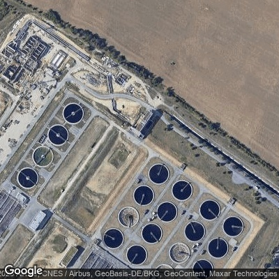

**Figure 1.** An example of the Google Maps Static API for the Berlin Water Works wastewater treatment plant, Waßmannsdorf, at 400\*400 pixels, scale 1, and zoom level 16 input image. Coordinates: latitude = 52.3886, longitude = 13.47396.

#### 2.1.3 IPCC emission factors

Emissions factors (EFs) from “Chapter 6: Wastewater Treatment and Discharge” in “Volume 5: Waste” of the 2019 Refinement to the *2006 IPCC Guidelines for National Greenhouse Gas Inventories* were used for estimating emissions for WWT assets (Bartram et al., 2019). For each WWTP, both the treatment of influent wastewater and the discharge of treated effluent yield emissions, and different pathways have different emissions factors for CH4 and N2O. For both species, Tier 2 approaches are used for estimating the emissions from treatment, whereas Tier 1 approaches were used for discharge (see IPCC Tables 6.3 and 6.8A for CH4 and N2O, respectively). Country-specific population behavior and demographics and asset-specific technology levels were used to estimate the total amount of waste in the influent wastewater treated at a WWT asset, which denotes Tier 2. No differentiation between discharge receiving water bodies (i.e., rivers, lakes, hypoxic/nutrient-impacted) is made, which denotes Tier 1.

#### 2.1.4 Population Data

Regional population data is used to scale HydroWASTE or government-reported population served data for centralized WWT assets for use across the full data period, to generate population served estimates for WWT assets for which this information is not reported in the datasets described in Section 2.1.1, and to estimate country-level emissions. Year-to-year regional population estimates are obtained from WorldPop 2025, which covers 242 countries (Bondarenko et al., 2025). Regional population estimates for locations not covered by WorldPop data were estimated as 0, and decentralized asset emissions were not calculated for these regions (see Appendix 8 for details). Monthly temporalization is discussed in Appendix 7.

For WWTPs newly identified through the satellite imagery-based ML model, these regional population estimates were used to calculate the WWTP’s population served using the same basic approach described by the HydroWASTE datasets authors in Section 2.1.4 of their 2022 paper (Macedo et al., 2022a). Specifically, a circle with an 11km radius is set around each WWTP’s coordinates, and the total number of people ascribed to WorldPop population cells within that circle’s area is then calculated. When the 11km catchment areas for two WWTPs overlap, the overlapping WorldPop cells are attributed to the plant that is closer. The resulting population is then scaled by the percentage of the regional WorldPop population which WASH survey data indicates to be using a sewer system. This methodology provides a rough estimate of the number of people served by each plant while a population estimation methodology involving characteristics of the regional built environment, population density, and other factors is under development.

The HydroWASTE dataset authors created assets within the U.S. and EU using the EPA and EEA national wastewater inventory versions published in 2012 and 2017, respectively, with some discharge information for EU WWTPs sourced from a 2020 EEA dataset update (Macedo et al., 2022a). Population data for assets within these regions were updated to the most recent numbers made available by the EPA and EEA after first aligning HydroWASTE assets with assets in the latest national inventory versions where possible to preserve historic continuity within the domestic asset inventory. Asset alignment was determined by searching for coordinates in the vicinity and by matching metadata such as WWTP name.

The WHO/UNICEF Joint Monitoring Programme for Water Supply, Sanitation, and Hygiene WASH data was used to estimate the population within subnational regions whose waste is left untreated or managed via a decentralized pathway, specifically, by septic system or latrine (WHO/UNICEF, 2023). These estimates enabled the creation of untreated and decentralized region-level “assets” whose GHG emissions could be modeled and added to those of centralized assets to obtain a more accurate global total (see Section 2.3.1).

#### 2.1.5 Technology Level Data

The incorporation of publicly available information on the percentage of waste being managed using different pathways (i.e., septic, latrine, sewer, untreated) within urban regions was trialed using a deep dive into major Philippine cities. Statistics from the Republic of the Philippines Philippine Statistics Authority (Philippine Statistics Authority, 2023b, 2023a), as well as from the Manila water utility and contractor (Manila Water Company, Inc., n.d.; The WABAG Group, n.d.) were used to supplement the country-level wastewater pathway percentages from WHO/JMP WASH data. Administrative boundaries for Philippine cities were pulled from the Humanitarian Data Exchange (HDX) (HDX, 2026).

For WWTPs newly identified through the satellite imagery-based ML model, wastewater treatment level (i.e., primary, secondary, or advanced) was estimated using the same basic approach determined through statistical analysis by the HydroWASTE datasets authors in Section 2.1.4 of their 2022 paper (Macedo et al., 2022a). Specifically, the treatment level for a WWTP is assigned based on the World Bank’s Gross National Income (GNI) levels and the plant’s population served (World Bank Group, 2025). For plants located within high-income countries, if the population served is greater than 3,000 people, the treatment level is set to advanced; if the population served is less than 3,000, the treatment level is set to secondary. For plants located within lower-middle- or upper-middle-income countries, the treatment level is set to secondary. Finally, plants within low-income countries are assumed to operate at a primary treatment level. These assumptions are preliminary, especially in the case of low-income countries for which government-reported data on treatment level for WWTPs is lacking.

#### 2.1.6 Additional Datasets used for the Country-Level Model

For the new country-level model, WorldPop 2025 population data (Bondarenko et al., 2025) are combined with WHO/UNICEF Joint Monitoring Programme WASH data to determine the country-level population treated by different wastewater pathways, as well as the country-level population whose waste is untreated or the result of open defecation (WHO/UNICEF, 2023). Industrial wastewater was determined at a country-level by using FAOSTAT estimates for various food and alcohol production (Food and Agriculture Organization of the United Nations (FAO), n.d.).

#### 2.1.7 Climate TRACE Data Used

Climate TRACE data for steel and pulp and paper production are used as the source of location and activity information for industrial wastewater treatment assets. Asset-level data for wastewater associated with other industries is not currently modeled.

#### 2.1.8 Gap-filling and Forward-filling

Regions with low WASH data coverage (less than 5% of the population assigned a sanitation category) were mapped to other regions with similar geographical, historical, or cultural ties or assigned a fixed estimate. For example, Åland, an autonomous region of Finland, is not covered by WASH and was mapped to Finland. Appendix 9 contains the complete mapping. For each country, years without WASH data were filled by linear interpolation and values were then forward- and backward-filled as needed to complete data ranges for years from 2015 through 2026.

#### 2.1.9 Datasets for Emissions Verification

U.S. and E.U. WWTPs’ emissions estimates were verified with the most recent emissions inventory by the U.S. Environmental Protection Agency (EPA) (EPA, 2023) and national-level emissions estimates for E.U. countries (Parravicini et al., 2022).

#### 2.1.10 ERS Context and Sourcing

EFs from Tables 6.3 and 6.8A of “Chapter 6: Wastewater Treatment and Discharge” in “Volume 5: Waste” of the 2019 Refinement to the *2006 IPCC Guidelines for National Greenhouse Gas Inventories* were used for estimating CH4 and N2O emissions, respectively, for WWT assets to which ERS had been applied (Bartram et al., 2019). Brief descriptions of each ERS, as well as context surrounding the current use of these strategies in practice, are provided below:

#### UP: Untreated to Primary

This strategy involves constructing one or more centralized WWTPs with at least primary treatment capability in order to manage the currently untreated wastewater within a region.

#### CL: Covered Lagoon

This strategy is applied to domestic assets and represents an effective, low-cost approach to reducing the large amounts of methane produced in lagoons, also known as waste stabilization ponds, where waste is digested anaerobically. The U.S. EPA recommends covering municipal wastewater treatment lagoons in its 2022 compliance advisory (EPA, 2022).

#### VL: Ventilated Latrine

This strategy involves retrofitting all pit latrines within a region with ventilation systems.

#### SP: Septic to Primary

This strategy involves bypassing all septic tanks within a region and connecting to sewer systems for treatment in a centralized WWTP with at least primary treatment capability.

#### SS: Septic to Secondary

This strategy involves bypassing all septic tanks within a region and connecting to sewer systems for treatment in a centralized WWTP with at least secondary treatment capability.

#### SA: Septic to Advanced

This strategy involves bypassing all septic tanks within a region and connecting to sewer systems for treatment in a centralized WWTP with advanced treatment capability.

#### PS: Primary to Secondary

This strategy is applied to domestic assets and involves constructing secondary treatment structures (e.g., trickling filters, aeration tanks, secondary clarifiers) and connecting them with the existing primary treatment effluent.

#### PA: Primary to Advanced

This strategy is applied to domestic assets and involves constructing advanced treatment structures (e.g., denitrifying filters) and connecting them with the existing primary treatment effluent.

#### 2A: Secondary to Advanced

This strategy is applied to domestic assets and involves constructing secondary treatment structures (e.g., aeration tanks) and advanced treatment structures (e.g., denitrifying filters) and connecting them with the existing primary treatment effluent.

#### IM: Intelligent Management

Adopting intelligent management technologies which optimize chemical dosing and biological oxygen levels can increase treatment efficiency and reduce emissions (see Appendix 2 for further details). This strategy is applied to both domestic and industrial assets.

#### 2.2 Methods

#### 2.2.1. Machine Learning for Verifying and Detecting Wastewater Treatment Facilities

The HydroWASTE dataset was used to produce a facility-level dataset of WWTP emissions for Phase 5 of Climate TRACE; however, the confidence level with which the dataset’s authors rated facility location coordinates varied from asset to asset. In order to verify HydroWASTE locations and detect unidentified WWTPs, a vision transformer (ViT) machine learning model was developed.

This ViT model was trained to detect WWTP characteristics such as clarifiers in visual (red, blue, and green bands or RGB) satellite imagery with a country-based, Swin Tiny classifier (Liu et al., 2021) – this is shown in Figure 2. The initial training set consisted of previously verified HydroWASTE locations, as well as non-WWTP images from Open Street Maps sampled by land-use category. When applied to a specific region, human verification was used to identify true positives and false positives from the classifier, which were bootstrapped for retraining. This model was first used to verify HydroWASTE locations, and then deployed globally to identify assets previously unaccounted for. Overall, the model verified the locations of approximately 58,000 assets and uncovered approximately 16,600 newly identified candidate domestic wastewater treatment facilities. Importantly, the version of the ViT model described here, while confirming the location of a facility with infrastructure commonly used by WWTPs, does not confirm whether the facility is used for domestic wastewater treatment or for another purpose. Further verification and filtering of this candidate WWTP dataset was performed in subsequent analyses described in Section 2.2.2 and Appendix 4. Figure 3.a. shows the HydroWASTE WWTP locations, Figure 3.b. shows the locations of newly identified candidate WWTPs, and Figure 3.c. shows the combined locations.

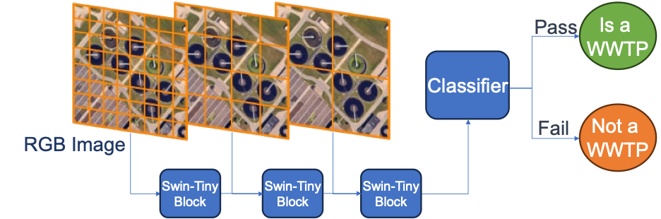

**Figure 2**: A block diagram of the wastewater facility classifier.

<table><thead><tr class="header"><th>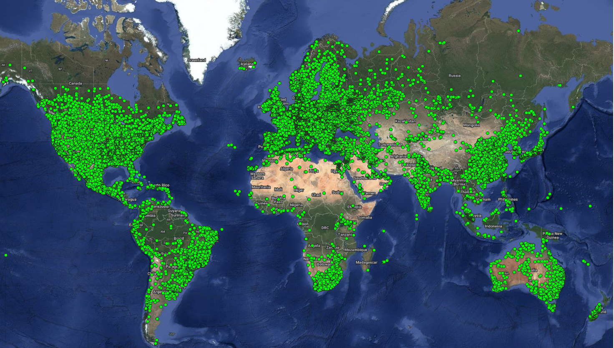</th></tr></thead><tbody><tr class="odd"><td><ol type="a"><li><blockquote>
<strong>HydroWASTE WWTP locations (58,502)</strong>
</blockquote></li></ol></td></tr><tr class="even"><td>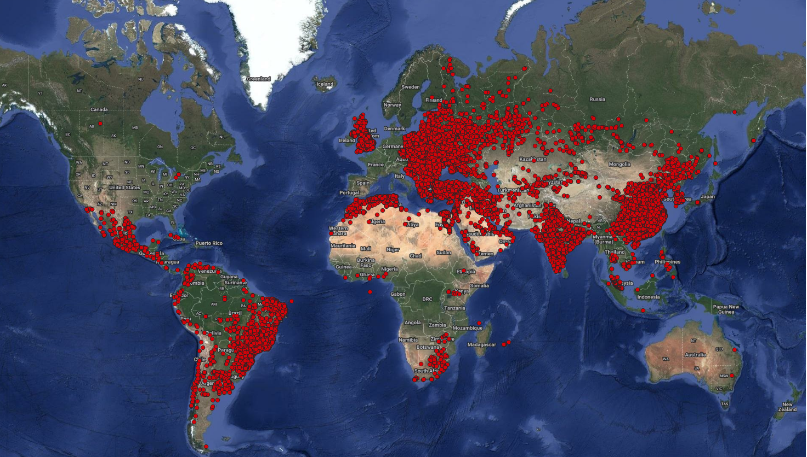</td></tr><tr class="odd"><td><ol start="2" type="a"><li><blockquote>
<strong>All locations detected by the model to be at more than 50 meters’ distance from a HydroWASTE location (~16,600)</strong>
</blockquote></li></ol></td></tr><tr class="even"><td>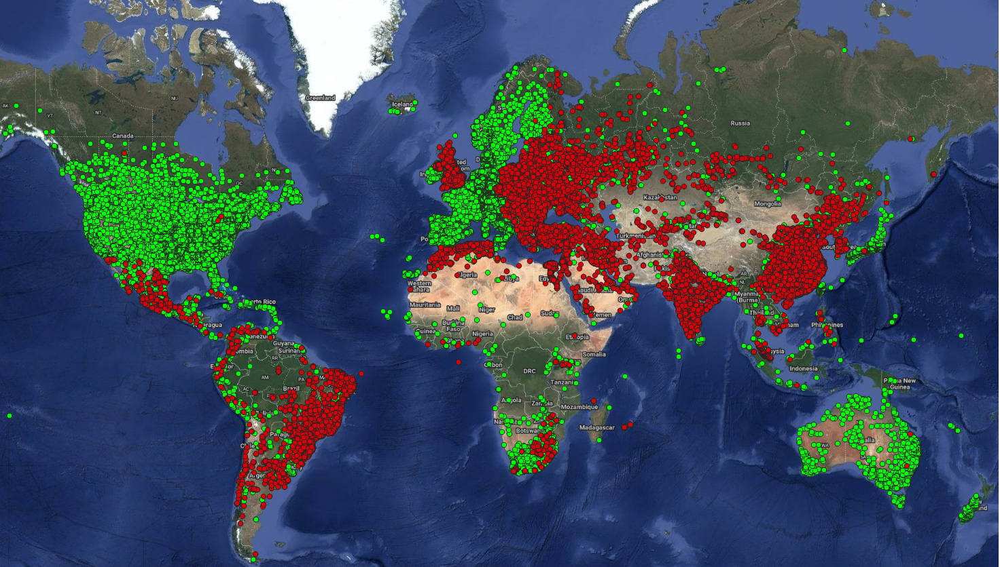</td></tr><tr class="odd"><td><ol start="3" type="a"><li><blockquote>
<strong>Combined HydroWASTE and newly detected WWTP locations</strong>
</blockquote></li></ol></td></tr></tbody></table>

**Figure 3**: A comparison between the 2024 and 2026 candidate asset data.

In addition to the WWTP detector, an AI model using a fusion framework was developed and is undergoing testing to support global deployment of a wastewater lagoon detection model. The segmentation component of the model uses SegFormer, a hierarchical vision transformer that extracts image features at multiple spatial scales and combines them through a lightweight decoder to generate pixel-level predictions (Xie et al., 2021). The model was trained to generate predictions of wastewater lagoons using annotated lagoon imagery and negative examples, including visually similar non-wastewater ponds, with a combined binary cross-entropy and Dice loss. Predicted masks are converted into candidate polygons for assessment using segmentation confidence, Sentinel-2 spectral evidence, and context on the geographic wastewater catchment area (i.e., the geographic area encompassing the population which the WWTP serves).

The spectral component uses Sentinel-2 satellite imagery to characterize water presence, algae-related optical properties, turbidity-related signals, and seasonal variability within candidate polygons (Copernicus Data Space Ecosystem, n.d.). These characteristics provide supporting classification evidence to distinguish wastewater lagoons from irrigation and drinking-water supply ponds.

The geographic component incorporates population wastewater catchment areas constructed by combining Kontur population estimates on an H3 hexagonal grid with Global Human Settlement Layer (GHSL) settlement information (Kontur, 2020; Pesaresi et al., 2024). Contiguous populated cells and connected settlement areas define proxy wastewater service areas, linked to the global population framework through GADM level-2 administrative units. Wastewater catchment area membership, proximity, and population provide contextual evidence for candidate classification and guide deployment around smaller towns and villages. Segmentation, spectral, and geographic evidence are combined to refine wastewater lagoon predictions. Testing uses geographically separated evaluation datasets to assess the individual and combined contributions of these components to detection precision and recall.

#### 2.2.2 Validating and updating HydroWASTE WWTP characteristics

In order to improve the accuracy of country-level emissions estimates, analyses were conducted to validate the characteristics of WWTPs in the HydroWASTE dataset. 87 assets were identified for which the ISO3 value and the country were misaligned. Reasons for this misalignment may include shifting geopolitical borders or inaccurate reporting of the WWTP coordinates in the original dataset. For example, in some regions, the site of the effluent outfall may have been reported as the WWTP location, leading to coordinates in bodies of waters along international boundary lines. For each of the misaligned assets, a visual inspection of the satellite imagery for the asset’s coordinates was conducted in order to clarify which country the asset was located in. The satellite imagery provided sufficient information to correct 82 of these assets, leaving 5 which require further investigation. Asset locations for 66 assets provided by HydroWASTE contained integer values for at least one of the coordinates and were likewise investigated; in 53 cases, satellite imagery and known characteristics such as WWTP name provided sufficient information to increase the precision of the WWTP coordinates; l3 cases require further investigation.

The 2016 and 2022 EPA Sewersheds datasets include the locations, treatment level, and population served for WWTPs and lagoons in U.S. states and territories (EPA, 2022a). These government-reported data were used to update the U.S. assets, originally sourced from the HydroWASTE dataset: 1,989 new U.S. assets with associated metadata were added to the inventory, and 115 assets were determined to be closed and removed from the inventory. The EPA dataset provides a snapshot view of the state of U.S. WWTPs between dataset publication years (2012, 2016, 2022), and so the dates for asset operating and closure events noted in the Climate TRACE event file are set as multi-year ranges.

#### 2.3 Estimating Asset-level Domestic Emissions

Each centralized WWTP sourced from the HydroWASTE dataset is associated with an estimated population served and technology level. For untreated and decentralized wastewater assets, as well as for centralized WWTPs identified by satellite model, these characteristics were modeled. For all assets, population served and technology level were used with methodologies described in “Chapter 6: Wastewater Treatment and Discharge” in “Volume 5: Waste” of the 2019 Refinement to the *2006 IPCC Guidelines for National Greenhouse Gas Inventories* (Bartram et al., 2019), which will be subsequently referred to by “IPCC” and the “IPCC guidelines”, to estimate the monthly CH4 and N2O emissions. The IPCC methodologies were derived for estimating country-level emissions based on population and demographics and not for individual assets; however, simple modifications were performed to adapt these methods for this level of granularity. All modifications are summarized in the following text and explicitly described in Appendix 1. Figure 4 contains a flow diagram of the methodology used to obtain source-level emissions estimates for WWTPs in the filtered HydroWASTE dataset. Relevant sections are indicated for each part of the emissions model.

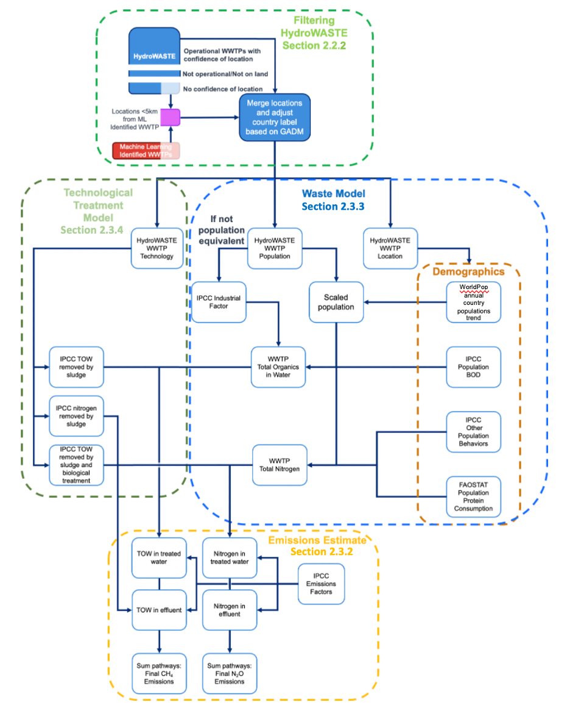

**Figure 4.** Flow diagram of emissions. HydroWASTE data is filtered based on operationality and location quality. Filtered locations are recovered if identified by machine learning model. Population, technology level, and location are used to develop emissions.

HydroWASTE reports three separate types of “population served” estimations, and since population served affects all calculations, it is important to describe these differences here. Population data that was sourced from authoritative bodies was either labeled as “population served” or “population equivalent” (PE). The first are numbers of people who live in areas where the sewer system connects to the corresponding WWTP. For example, almost all of U.S. data in HydroWASTE comes from the EPA which reports “population served”. The second are population estimates arising from (typically) normalization of measurements of the biological oxygen demand (BOD) in untreated wastewater (influent), according to,

$`PE\  = \ \ \frac{\text{g\ BOD}}{54\ g\ BOD/\ capita}`$ (Eq. 1).

As this is a measured quantity, *PE* of a WWTP may include waste from industrial/commercial sources that entered sewer systems and may therefore be larger than the population that resides in the region served by the corresponding WWTP. To account for this, all additional scaling factors for industrial waste were treated as a unit value when PE is reported. Finally, HydroWASTE estimated the population served by WWTPs that have no reported population from authoritative bodies. These values were treated like “population served”; however, they have a significantly higher level of uncertainty.

All population data in HydroWASTE were valid for 2022 and thus need to be extended back to 2015 in order to provide emissions over time. This was achieved with linear scaling based on country-level population changes within the country where a WWTP is located. Country-level population values were taken from WorldPop (see section 2.1.4).

#### 2.3.1 Decentralized Asset Inventory

A proof of concept was conducted to estimate CH4 and N2O emissions from untreated and decentralized wastewater at the GADM2 level, beginning with the Philippines, for which 69% of wastewater is treated by septic system, and with all countries in the WHO/UNICEF WASH data for which over 50% of wastewater is untreated and which have sufficient population and sanitation data to support interpolation (Appendix 8) (WHO/UNICEF, 2023).

WASH survey data provides the percentage of each country’s population that uses sewers, septic systems, latrines and other improved sanitation facilities, and unimproved sanitation facilities, as well as the percentage of the population practicing open defecation. For the purposes of this model, “unimproved sanitation” and “open defecation” percentages were combined to obtain the percentage of untreated wastewater, as WASH classifies sanitation technologies leading to “open drains” or “elsewhere” as “unimproved”, while technologies by which waste was piped to septic or sewer systems were classified as “improved” (WHO/UNICEF, 2023). Wastewater piped to sewer is assumed to be treated at a WWTP with the use of either primary, secondary, or advanced treatment technology.

The population whose waste is managed through decentralized treatment or left untreated was derived by summing the population served values of WWTPs and lagoons within the same GADM2 region to obtain GADM2-level totals. Regional population totals were calculated by mapping gridded WorldPop country-level population data to GADM2 boundaries. Then, the GADM2-level population served totals for centralized wastewater treatment assets were subtracted from the WorldPop regional population totals to obtain the regional “decentralized” population (i.e., the population whose waste is managed by the septic, latrine, or untreated pathway). For each decentralized wastewater management pathway, the regional “population served” for the pathway was estimated by multiplying the regional decentralized population with the proportion of the country’s decentralized population using that pathway.

Assets with a treatment level of “Untreated” were assigned a value of zero for the following model parameters: wastewater treatment nitrogen removal fraction and fraction of total wastewater organics removed during wastewater treatment. These untreated assets were then combined with the set of domestic assets for emissions calculation.

#### 2.3.2 Emissions Estimates

Generally speaking, there are two sources of emissions from WWTPs: 1., the treatment of the water to remove suspended solids and hazardous by-products of waste and industry; and 2., the discharge of treated water (effluent) with some remaining waste into water systems, where biochemical reactions that release emissions occur. The IPCC guidelines provide methods for estimating the emissions of these individual pathways for both CH4 and N2O. See Appendix 1 for a detailed explanation of the methodology and formulae used, including a discussion of uncertainty quantification and confidence (Appendix 1.e.).

#### 2.3.3 Waste Model

Uniting the treatment and discharge pathways are models predicting the amount of organic waste and nitrogen in the influent water treated by centralized WWTPs (the *Waste Model*; Figure 4) and how that treatment influences the emissions based on the technology level of a plant (the *Technological Treatment Model*; Figure 4). See Appendix 1.b. for further details.

#### 2.3.4 Technological Treatment Model

At centralized WWTPs, sludge is the by-product of water treatment and is produced at each level of treatment (primary, secondary, advanced). In addition, different forms of biological treatments are available at plants at different levels of treatment. For a detailed explanation of the Technological Treatment Model, see Appendix 1.c.

#### 2.4 Estimating Asset-level Industrial Emissions

Wastewater emissions are estimated for the assets included in the current year’s Climate TRACE pulp and paper and steel asset inventories. Figure 5 shows the locations of the 1,027 steel assets and 848 pulp and paper assets for which industrial wastewater emissions were estimated.

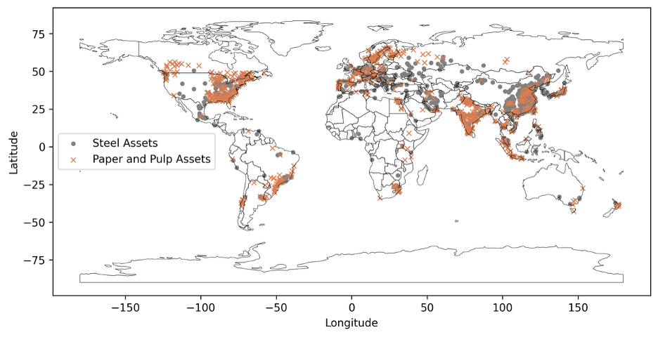

**Figure 5.** Global distribution of steel (gray dots) and pulp and paper (orange x markers) assets for which wastewater emissions were estimated.

Conveniently, the activity for industrial wastewater emissions – tonnes of product – is the same as that for the emissions from the industrial process. As is the case for domestic wastewater, industrial wastewater produces GHGs during both treatment and in disposal. See Appendix 1.f. for the formulae used in modeling treatment of CH4 and N2O emissions.

#### 2.5 Estimating Country-Level Emissions

Decentralized treatment constitutes the majority of wastewater emissions, where precise spatial identification of emissions is difficult. For this reason, a country-level approach which models both centralized and decentralized emissions is needed to reach a holistic understanding of the total wastewater emissions.

#### 2.5.1 Domestic Wastewater

Like other inventories (e.g., EDGAR and CEDS), Climate TRACE’s country-level domestic wastewater emissions were estimated by partitioning country-level populations into separate treatment pathways and applying pathway-specific emissions factors. This is expressed for methane and country by,

$`Em_{c} = \Sigma_{\rho}{(\alpha}_{\rho} \cdot P_{c} \cdot BOD_{c} - S_{\rho}) \cdot \text{EF}_{CH4,\rho} - R_{\rho}`$, (Eq. 2),

where $`\rho`$ is a specific wastewater pathway, $`P_{c}`$ is the population of country $`c`$, and $`\text{BO}D_{c}`$ is the per capita biochemical oxygen demand of the wastewater of country $`c`$. For all pathways, $`R_{\rho} = 0`$ which is the IPCC Tier 1 default. Nitrous oxide emissions were modeled with,

$`Em_{c} = \Sigma_{\rho}\alpha_{\rho} \cdot P_{c} \cdot N_{c} \cdot EF_{N2O,\ \rho} \cdot \frac{44}{28}`$, (Eq. 3),

where $`N_{c}`$ is the per capita nitrogen content of wastewater, $`EF_{N2O,\ \rho}`$ is the nitrous oxide emission factor, and $`\frac{44}{28}`$ is a nitrogen to nitrous oxide mass-balance factor. The per capita nitrogen content is computed in an identical way as it is for asset-level emissions wherein protein per capita and other country-dependent factors are used. Wastewater effluent emissions were also modeled in the same manner as described earlier.

As diagrammed in Figure 6, the pathways modeled are *Sewer*, *Septic*, *Latrine*, and *No Treatment* and the proportion of each population that is served by each pathway $`\alpha_{\rho}`$ was determined by the product of the country-level population and a proportion estimated by WASH.

Two distinguishing features of the Climate TRACE country-level model are that 1., population treated by centralized treatment is appropriately divided into primary, secondary, and advanced treatment categories based on Climate TRACE asset data, and 2., that a monthly climatology model is used to determine latrine emissions factors.

> 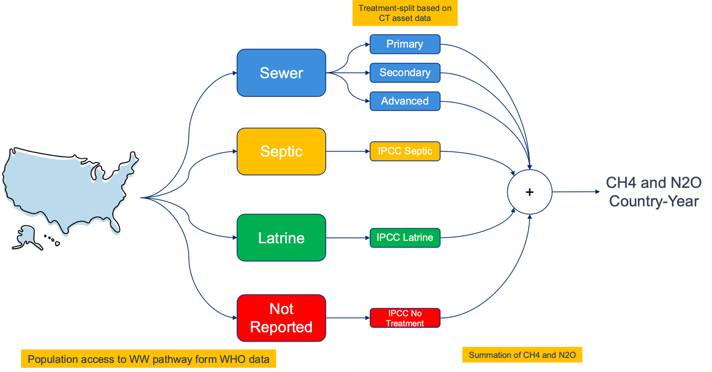
>
> **Figure 6.** Flow diagram of domestic, country-level emissions model.

The IPCC guidelines differentiate latrines’ emissions based on wet versus dry climates. In order to incorporate this difference into the country-level model, IPCC climate zones are determined at a monthly basis and integrated with a global population density grid from the Global Human Settlement Layer (Schiavina et al., 2023). This provides a means of determining the country-level proportion of individuals who live in wet versus dry conditions and, consequently, the appropriate emissions factors to use. This IPCC climate zone model was also used for determining emissions factors for reservoirs, and more detail about the model is contained in the methodology document *Reservoir sector: Emissions from Reservoirs* methodology document. Table 1 shows the partition of the 13 IPCC climate zones into wet and dry climate zones.

> **Table 1.** Aggregated categorization of IPCC Climate Zones for use in estimating latrine emissions.

<table><thead><tr class="header"><th><strong>IPCC Climate Zones</strong></th><th><strong>Aggregate Climate Zones</strong></th><th><strong>IPCC Climate Zones</strong></th><th><strong>Aggregate Climate Zones</strong></th></tr></thead><tbody><tr class="odd"><td><em>Boreal moist</em></td><td><em>Wet</em></td><td><blockquote>
Boreal dry
</blockquote></td><td>Dry</td></tr><tr class="even"><td><em>Polar moist</em></td><td></td><td><blockquote>
Polar dry
</blockquote></td><td></td></tr><tr class="odd"><td><em>Cool temperate moist</em></td><td></td><td><blockquote>
Cool temperate dry
</blockquote></td><td></td></tr><tr class="even"><td><em>Warm temperate moist</em></td><td></td><td><blockquote>
Warm temperate dry
</blockquote></td><td></td></tr><tr class="odd"><td><em>Tropical montane</em></td><td></td><td></td><td></td></tr><tr class="even"><td><em>Tropical Moist</em></td><td></td><td><blockquote>
Tropical dry
</blockquote></td><td></td></tr><tr class="odd"><td><em>Tropical Wet</em></td><td></td><td></td><td></td></tr></tbody></table>

The IPCC guidelines also differentiate emissions from latrines in dry climates based on whether the latrine is communal or serves a small family of three to five persons. The model currently assumes all latrines are communal.

#### 2.5.2 Industrial Wastewater

Industrial wastewater treatment emissions were estimated at a country level along with effluent disposal emissions for several industries: meat production, pulp and paper, petroleum refinery and petrochemical manufacturing, steel production, fruit and vegetable production, beer production, and ethanol refining. All values are obtained from FAOStat with the exception of steel, pulp and paper, and petroleum refining, which all used Climate TRACE production estimates. It is assumed that aerobic advanced treatment is used, as with the asset-level estimates.

#### 2.5.3 Incorporating ERS into model

This section details the method used to generate emissions for each of the 10 ERS described in section 2.1.10. *Note: Only rank 1 strategies are provided for assets on the Climate TRACE website and additional strategies will be made available in future releases.*

The methods are based on the theoretical assumption that more advanced wastewater treatment processes lead to lower CO2e emissions, and – in the case of the Covered Lagoon ERS, Ventilated Latrine ERS, and Intelligent Management ERS – parameters were calibrated based on real-world examples. For other strategies – the Untreated to Primary ERS, the Septic to Primary ERS, the Septic to Secondary ERS, the Septic to Advanced ERS, the Primary to Secondary ERS, the Primary to Advanced ERS, and the Secondary to Advanced ERS – emissions factors relied on IPCC 2019 methodology.

In order for an ERS to be considered appropriate for a particular WWTP, it must assume an initial treatment level corresponding with that of the plant and result in CO2e emissions with reduced 100-yr GWP.

#### UP: Untreated to Primary

Emissions factors for this ERS were generated by changing the treatment level from *Untreated* to *Primary*, running the model as usual, dividing the output CH4 and N2O emissions estimates for these plants at the *Untreated* level from the emissions estimates for these plants at the *Primary* level, and taking the median value.

Importantly, nitrous oxide may be generated during wastewater treatment in centralized, secondary treatment plants through processes such as biological nitrogen removal (BNR), a form of secondary, biological treatment (Law et al., 2012). Thus, this strategy recommends the construction of primary treatment infrastructure, which does not involve secondary, biological treatment.

All assets with a treatment level of *Untreated* are assigned the *UP* ERS for the strategy ID.

#### VL: Ventilated Latrine

The CH4 emission factor for this ERS was based on the results of a 2025 study of methane emissions from pit latrines in Malawi, which found that the installation of a ventilation pipe reduced methane emissions by 95% (Sande et al., 2025). Malawi has a high water table, and it is important to note that the amount of methane reduced may vary in regions and cases where groundwater does not reach the pit. Further analysis is required to confirm the effect of ventilation on GHG emissions in different environments. Nitrous oxide is not considered by this ERS.

All assets with a treatment level of Latrine are assigned the VL ERS for the strategy ID.

#### SP: Septic to Primary

Emissions factors for this ERS were generated by changing the treatment level from *Septic* to *Primary*, running the model as usual, dividing the output CH4 and N2O emissions estimates for these plants at the *Septic* level from the emissions estimates for these plants at the *Primary* level, and taking the median value.

All assets with a treatment level of *Septic* are assigned the *Septic to Primary* ERS, the *Septic to Secondary* ERS and the *Septic to Advanced* ERS. The priority ranking for each of these three strategies is determined by multiplying the CH4 and N2O emissions factor ratios by the asset’s CH4 and N2O emissions factors, respectively, as well as by the asset’s activity value, then converting the results to their CO2e (100-yr GWP) and summing them together to get the total CO2e reduction value for each ERS. The ERS are then assigned priority levels 1, 2, and 3, with the ERS leading to the highest CO2e reduction value given a priority of 1.

#### SS: Septic to Secondary

Emissions factors for this ERS were generated by changing the treatment level from *Septic* to *Secondary*, running the model as usual, dividing the output CH4 and N2O emissions estimates for these plants at the *Septic* level from the emissions estimates for these plants at the *Secondary* level, and taking the median value.

#### SA: Septic to Advanced

Emissions factors for this ERS were generated by changing the treatment level from *Septic* to *Advanced*, running the model as usual, dividing the output CH4 and N2O emissions estimates for these plants at the *Septic* level from the emissions estimates for these plants at the *Advanced* level, and taking the median value.

#### CL: Covered Lagoon

The CH4 emission factor for this ERS was based on the theoretical assumption that recapturing biogas is 100% effective. However, it is important to note that, due to fugitive emissions, it is expected that 10% of the methane produced from covered lagoons will leak (United Nations Framework Convention on Climate Change, n.d.). Nitrous oxide is not considered by this ERS.

All assets with a treatment level of *Lagoon* are assigned the *CL* ERS for the strategy ID.

#### PS: Primary to Secondary

Emissions factors for this ERS were generated by changing the treatment level from *Primary* to *Secondary*, running the model as usual, dividing the output CH4 and N2O emissions estimates for these plants at the *Primary* level from the emissions estimates for these plants at the *Secondary* level, and taking the median value.

All assets with a treatment level of *Primary* are assigned both the *Primary to Secondary* ERS and the *Primary to Advanced* ERS. The priority ranking for each of these two strategies is determined by multiplying the CH4 and N2O emissions factor ratios by the asset’s CH4 and N2O emissions factors, respectively, as well as by the asset’s activity value, then converting the results to their CO2e (100-yr GWP) and summing them together to get the total CO2e reduction value for each ERS. The ERS with the highest CO2e reduction value is given a priority of 1, while the ERS with the lower CO2e reduction value is given a priority of 2.

#### PA: Primary to Advanced

Emissions factors for this ERS were generated by changing the treatment level from *Primary* to *Advanced*, running the model as usual, dividing the output CH4 and N2O emissions estimates for these plants at the *Primary* level from the emissions estimates for these plants at the *Advanced* level, and taking the median value.

#### 2A: Secondary to Advanced

Emissions factors for this ERS were generated by changing the treatment level from *Secondary* to *Advanced*, running the model as usual, dividing the output CH4 and N2O emissions estimates for these plants at the *Secondary* level from the emissions estimates for these plants at the *Advanced* level, and taking the median value.

All assets with a treatment level of *Secondary* are assigned the *2A* ERS for the strategy ID.

#### IM: Intelligent Management

This strategy, based on calculations from a 2024 assessment of GHG mitigation strategies for 3,444 WWTPs in China (Tong et al., 2024), assumes the implementation of both intelligent aeration technology and intelligent dosing technology. This study calculates the mitigation potential of direct GHG emissions when applying intelligent aeration and dosing technology to be 60% (see Table S4 in Tong et al.). The average nitrous oxide reductions for intelligent aeration and intelligent dosing are 62.5% and 60%, respectively, as given by Tong et al., which notes that “over 60% of N2O productions were determined to be reduced by the controlled supplies of chemicals in some laboratory studies”, and as calculated by taking the average of the 35- 90% range provided by Duan et al. for intelligent aeration (Duan et al., 2021; Tong et al., 2024). An average CH4 emissions retention percentage of 53.72% can then be extrapolated given the average percentage of carbon dioxide equivalent (CO2e) accounted for by CH4 within our dataset’s subset of advanced WWTPs (65%).

All assets with a treatment level of *Advanced* are assigned the *IM* ERS for the strategy ID.

#### 2.6. Summary

In all, there are four models that were developed for estimating CH4 and N2O emissions from wastewater from 2015 to mid-year 2026 at a monthly time-scale: two asset-level models and two country-level models for domestic and industrial wastewater. The domestic asset-level model used locations and metadata which were sourced from HydroWASTE, identified by satellite, and modeled, with emissions calculated per IPCC guidelines, whereas the industrial asset-level model estimated emissions for Climate TRACE assets using IPCC guidelines. The domestic country-level model used sanitization statistics from the WHO/UNICEF WASH data, whereas the industrial country-level model combined Climate TRACE industrial data along with FAOSTAT food production statistics. Year-to-year population data were splined to produce population estimates for wastewater assets at a monthly scale.

#### 3. Results

#### 3.1. Domestic WWTPs emissions estimates

The WWTP inventory comprises 59,325 centralized assets for the years 2015 to mid-year 2026, including lagoons and other centralized facilities with primary, secondary, and advanced treatment capabilities. For the year 2025, it is estimated that these centralized sources account for 154.3 MT of CO2e. Figure 7. shows the global distribution of centralized WWTPs and their GHG emissions in terms of global warming potential (GWP) over a 100-year period.

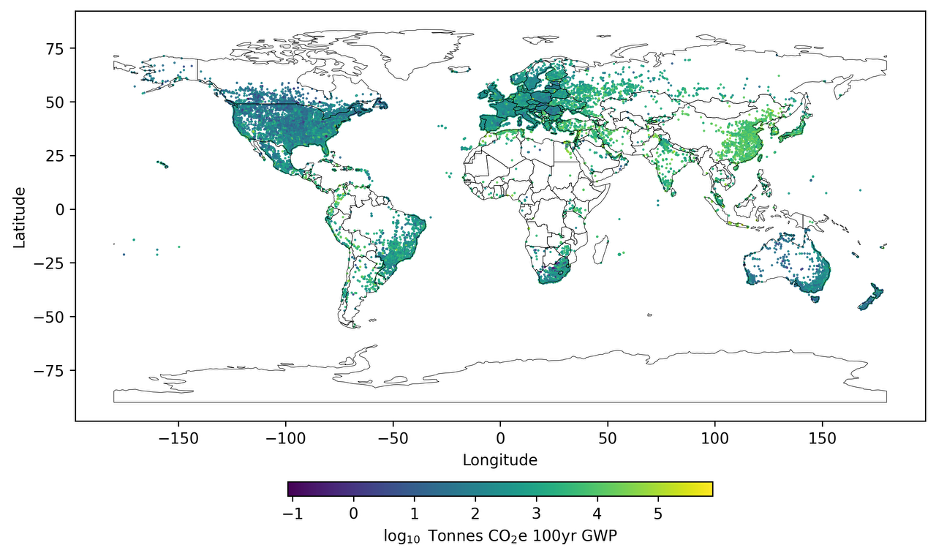

**Figure 7.** Global distribution of centralized domestic wastewater treatment plants colored based on emissions in 2025.

A majority of centralized WWT assets produce less than one kT of CO2e annually as shown by Figure 8; however, almost all emissions come from WWT assets producing more than 1 kT of CO2e. As emissions are a function of population, it is expected that the higher emissions assets are also assets that serve larger populations, and so reduction in emissions by centralized WWT assets will primarily need to come from adoption of cleaner WWT technologies at larger facilities.

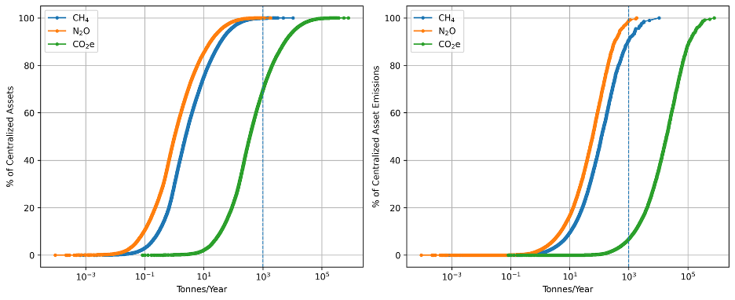

**Figure 8.** Cumulative distribution of emissions across centralized WWT assets (left) and across centralized WWT asset emissions (right) in 2025. The left plot demonstrates that a majority of WWT assets produce less than one kT (103 Tonnes/year or 1000 Tonnes) of CO2eq (100-year global warming potential) whereas the plot on the right demonstrates that almost all emissions (roughly 93%) come from assets that produce more than 1 kT of CO2eq.

The effect of using country-level population changes to extend the range of centralized WWT asset emissions estimates can be seen in Figure 9. A majority of plants (82%) saw an increase in their emissions between 2015 and 2025. Approximately 57% of those saw more than a 5% increase in emissions. Approximately 18% of plants saw a decrease in emissions which reflects decreased population. Further, approximately 40% of plants saw a &lt;5% absolute change in emissions from 2015 to 2025.

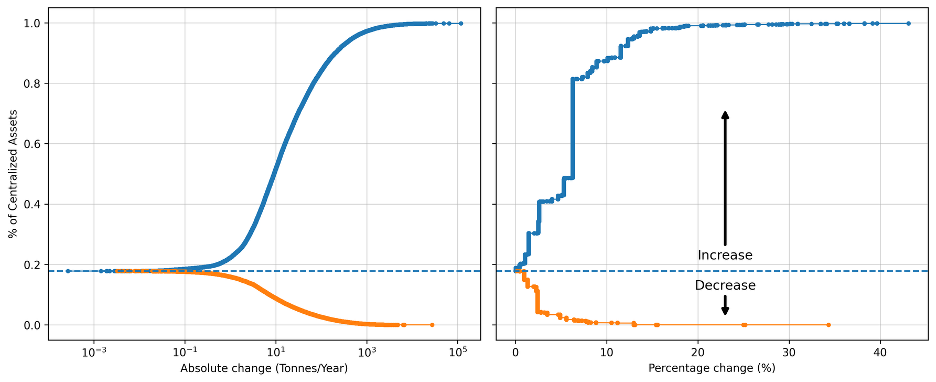

**Figure 9.** Distribution of change in emissions between 2015 and 2025. 82% of centralized WWT assets saw an increase in emissions whereas approximately 18% saw a decrease. Approximately 40% of WWTPs had &lt;5% absolute change of emissions.

Uncertainty of emissions estimates is very high. For the majority of centralized WWT assets in the inventory, the standard deviation of the emissions distribution derived by Monte Carlo simulation is one or more orders of magnitude greater than the asset’s corresponding emissions estimate as shown by Figure 10. The uncertainty of the emissions from WWT assets whose populations are reported is linearly related to their estimated emissions. For centralized WWT assets where population served is estimated, the standard deviation of the emissions from Monte Carlo is initially constant and becomes aligned with the reported population for WWT assets at around 10,000 people served, as shown in Figure 11.

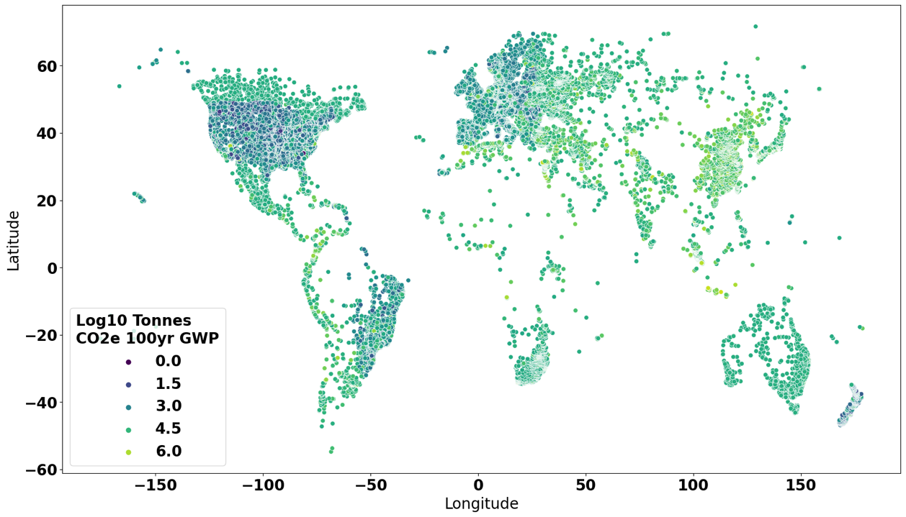

**Figure 10.** Uncertainty of CO2eq distributed globally.

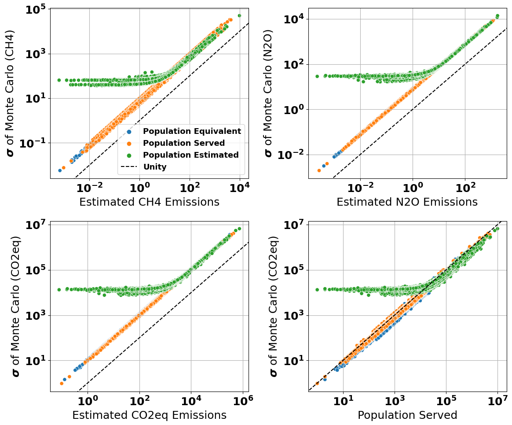

**Figure 11.** Uncertainty of emissions compared to emissions estimated disaggregated by population type (population served, population equivalent, estimated population) and uncertainty of CO2e as a function of population. For lower emissions estimates, uncertainty for emissions of WWTPs with estimated populations is significantly higher than those with reported populations. Overall, uncertainty of emissions is significantly higher than the estimated value.

#### 3.2. Verification of results

The country-level integrations of the GHG emissions from asset-level centralized WWTPs was compared to U.S. and E.U. GHG inventories. This allows for the verification of the emissions model for WWTPs where population served and *PE* is provided, as U.S. WWTPs are mostly associated with population served values and EU WWTPs mostly associated with *PE* values in HydroWASTE. A verification of emissions for WWTPs where estimated population served quantities were provided was not performed, as these have very high uncertainties. Model limitations which may impact how well Climate TRACE asset-level data align with emissions estimates for the U.S. and EU are discussed in Section 4.

#### 3.2.1 Comparison of Estimated Emissions to U.S. and EU Inventories

The EPA produces annual emissions estimates for the entirety of the U.S. using IPCC methodology. For verification, a comparison for CH4 and N2O emissions from centralized WWTP in 2021 was made using the EPA inventory published in 2023 (EPA, 2023). The EPA disaggregates domestic wastewater treatment into 4 categories: Septic Systems, Centrally-Treated Aerobic Systems, Centrally-Treated Anaerobic Systems, and Centrally-Treated Wastewater Effluent. For this comparison, the Centrally-Treated Aerobic and Centrally-Treated Anaerobic Systems emissions were combined and compared to treatment emissions from the Climate TRACE sources, and the effluent emissions from the EPA inventory were compared to the effluent emissions from the Climate TRACE sources. The Septic Systems emissions are not used for comparison here. Table 2 has the comparisons for both treatment and effluent emissions, as well as the CO2 equivalent (CO2e) 100 year global warming potential in kilotonnes.

**Table 2.** Comparison between EPA inventory and Climate TRACE (CT) sources of centralized WWTP for the U.S. in 2021 in kilotonnes. CO2e is the 100-year global warming potential of the species. EPA treatment values are the aggregation of both Centrally-Treated Aerobic and Centrally-Treated Anaerobic Systems emissions.

|               |       | **CH4** | **N2O** | **CO2e** |
|---------------|-------|--------------------|--------------------|---------------------|
| **Treatment** | *EPA* | 193                | 58                 | 21,084              |
|               | *CT*  | 134                | 57                 | 19,287              |
| **Effluent**  | *EPA* | 73                 | 16                 | 6,354               |
|               | *CT*  | 83                 | 6.7                | 4,076               |
| **Total**     | *EPA* | 266                | 74                 | 27,438              |
|               | *CT*  | 217                | 63.4               | 23,363              |

Overall, the Climate TRACE source-level estimation for the U.S. aligns well with the EPA for CH4 effluent and N2O treatment, decently for CH4 treatment, and poorly for N2O effluent. This results in Climate TRACE source-level estimations having a good alignment in CO2eq in treatment emissions and a decent alignment in effluent emissions. N2O effluent misalignment can be attributed to the use of different methodology tiers. For Climate TRACE sources, the lowest tier emission factor for N2O from effluent discharged is used. The EPA uses the third tier, which has separate emissions factors for hypoxic/nutrient-impaired receiving water systems and for healthy receiving water systems. The emissions factor associated with hypoxic/nutrient-impaired systems are 4 times larger than the emissions factor used here. It is expected that the lack of disaggregation between aerobic and anaerobic systems and the lack of recovered gas estimates plays a significant role in the misalignment of CH4 emissions from treatment. Further, this lack of disaggregation does not affect the N2O emissions from treatment estimates as anaerobic treatment does not result in a significant increase in N2O emissions.

Parravicini *et al.* utilized IPCC methodologies with chemical-process specific methodologies along with disaggregation of WWTP technologies to produce an estimate of CO2eq emissions for EU countries (Parravicini et al., 2022). Their technological disaggregation was based on the PE of the influent water treated by the plant. Climate TRACE integrated source-level estimates for CO2eq 100 year global warming potential estimates align very well with Parravicini *et al.* for all countries as shown in Figure 12 with the exception of Croatia (HRV). However, it should be noted that the values from Parravicini *et al.* were obtained using a plot digitizer. The total estimates for the EU also agree with 33.96 MT CO2eq from Climate TRACE and 34.36 MT CO2eq from Parravicini *et al.* A labeled country-by-country comparison is shown in Figure A5.1 of Appendix 5.

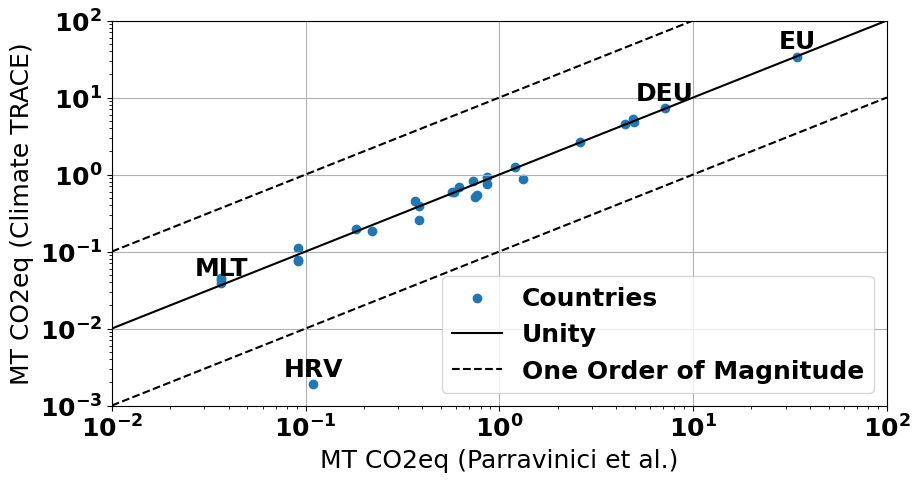

**Figure 12.** A country-by-country comparison of emissions from centralized, domestic WWTPs between Parravicini et al. and integrated Climate TRACE sources. The countries with the highest and lowest emissions from WWTPs are labeled, as well as the EU summation and outliers. All countries align very well with the exception of Croatia (HRV).

#### 3.2.2 Satellite verification of ERS implementation

In the future, we may be able to verify the construction of new WWTP facilities or the upgrading of WWTP infrastructure at the asset level using satellite imagery. While this method of verification likely will not allow us to determine whether certain technology, such as intelligent chemical dosing systems, has been implemented, it does grant us the opportunity to check for the existence of new structures, lagoon covers, etc. in accordance with an ERS. Where ERS implementation cannot necessarily be verified by satellite, further information may become available at the asset, regional, or national level in the form of reports issued by governments or other institutions. In these cases, caution will need to be taken to disambiguate the terms used by various sources to describe treatment levels and technologies.

#### 3.3 Emissions estimates for Country-level emissions

As shown in Figure 13, applying WASH pathway utilization percentages to WorldPop country-level population estimates reveals that, as of the most recent WASH estimates from 2024, most of the world’s domestic wastewater is collected in sewers, by which it is presumably routed to WWTPs for treatment, followed by collection in septic systems, then in latrines and other improved sanitation pathways. Almost 11% of the world’s wastewater is accounted for by open defecation or unimproved sanitation pathways. Figure 14 shows the subsequent emissions for countries for which the Climate TRACE inventory includes decentralized assets (see Appendix 8). In these regions, methane and nitrous oxide emissions from untreated waste and from decentralized assets (latrines and septic systems) compose a majority of the methane emissions from domestic wastewater. Untreated wastewater, which represents the highest GHG source of any wastewater pathway, poses a significant risk to human and agricultural health.

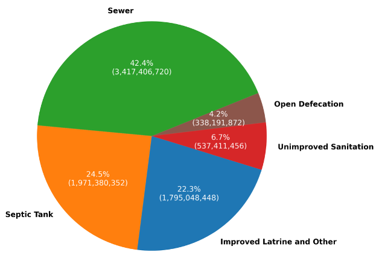

**Figure 13.** Global breakdown of wastewater pathways as estimated by the WHO. A plurality of the world’s population is connected to sewers, which leads to reduced emissions and cleaner, safer water systems.

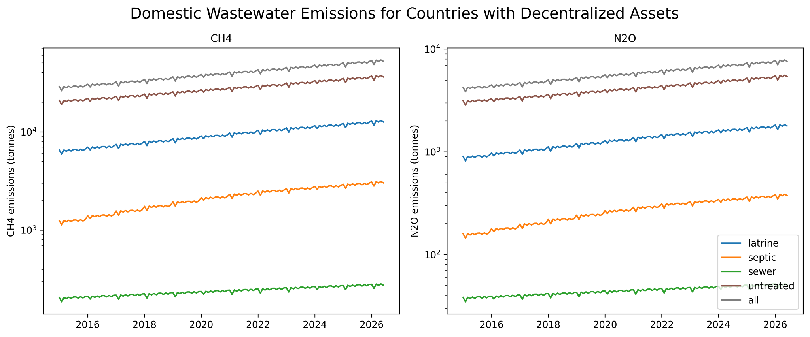

**Figure 14.** Domestic wastewater emissions are broken down into different pathways. Untreated wastewater contributes significantly to CH4 and N2O emissions (plot above). Note, the y-axes of the two panels have different ranges.

Table 3 shows validation results for the domestic emissions model compared to the EPA’s National Inventory for the U.S. in 2022 where the *Sewer* category for the EPA is a combination of their aerobic treatment, anaerobic treatment, sludge digestion, and effluent categories (EPA, 2023). Overall, values for both septic and sewer emissions align well with the EPA; however, the very low utilization of latrines in the U.S. and the difficulty of finding reliable latrine emissions estimates leaves them currently unvalidated.

**Table 3.** Validation of a country-level model to the EPA estimates for 2022 (EPA, 2023).

| **Pathway** | **Climate TRACE CH4 Emissions (kT)** | **EPA CH4 Emissions (kT)** | **Climate TRACE N2O Emissions (kT)** | **EPA N2O Emissions (kT)** |
|-------------|-------------------------------------------------|---------------------------------------|-------------------------------------------------|---------------------------------------|
| Sewer       | 245.7                                           | 270                                   | 89                                              | 77                                    |
| Septic      | 251                                             | 215                                   | 2.12                                            | 3                                     |

Industrial emissions align well to the EPA’s National Inventory for most sectors as shown in Figure 15. However, EPA does not estimate the nitrous oxide emissions from steel and ethanol production which Climate TRACE estimates to be large contributors to industrial emissions.

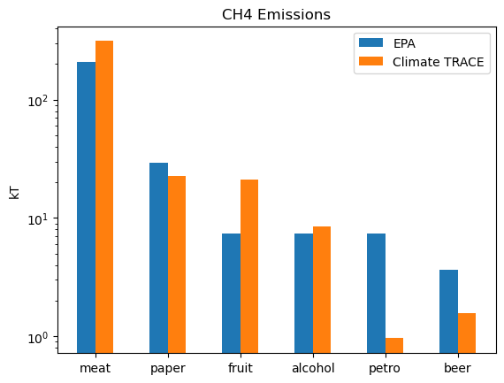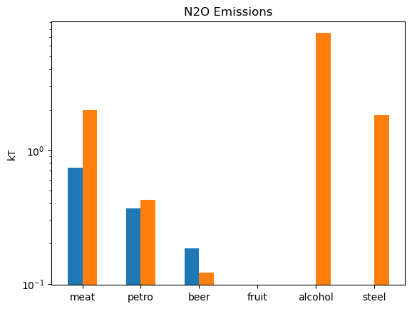

**Figure 15.** Industrial wastewater comparison with the EPA estimates for 2022 (EPA, 2023).

In comparison to EDGAR (European Commission, 2023), while correlated, Climate TRACE country-level emissions are significantly smaller for methane emissions and significantly larger for nitrous oxide emissions as shown in Figure 16. The discrepancy for methane is difficult to assess given that EDGAR does not differentiate domestic from industrial wastewater emissions, and EDGAR’s methodology description for wastewater lacks the detail necessary to easily recreate the analysis (Janssens-Maenhout et al., 2019). However, the nitrous oxide discrepancy is likely due to EDGAR using the 2006 IPCC guidelines (IPCC, 2006), which has an order of magnitude smaller emissions factor for domestic emissions (de Haas & Andrews, 2022). This is discussed in the Phase 5 methodology document.

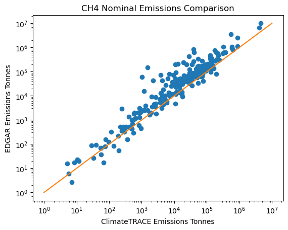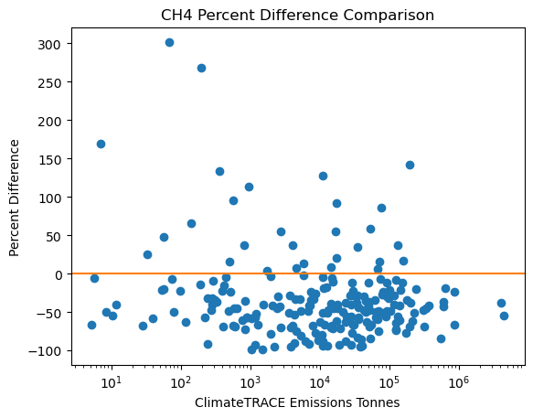

**Figure 16 cont.**

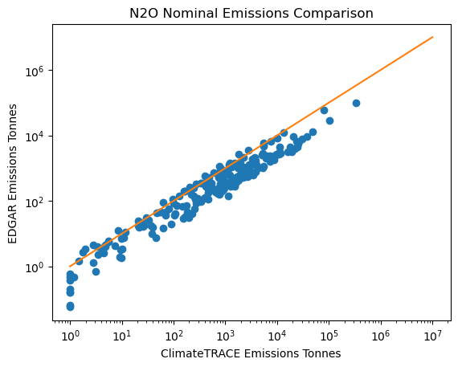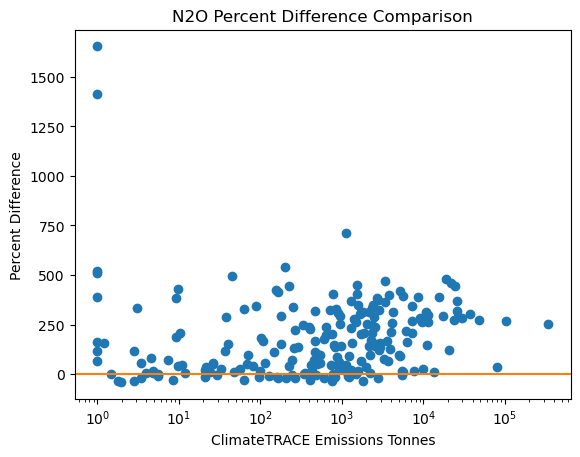

**Figure 16.** Country-to-country emissions comparison with EDGAR. Overall, the correlation between Climate TRACE and EDGAR is positive, EDGAR estimates a significantly higher methane emissions estimate, whereas Climate TRACE produces larger nitrous oxide estimates. The former difference is difficult to explain as EDGAR’s emissions estimates are not reproducible, whereas the latter can be explained by EDGAR using outdated methodologies.

#### 3.3.1 ERS impact on emissions

Comparing the average CH4 and N2O emissions reductions for WWTPs before and after the simulated application of ERS can help us understand the impact of the ERS. Table 4 lists the average emissions reduction percentage for methane and nitrous oxide for each ERS for all assets identified for this sector. *Note: Only rank 1 strategies are provided for assets on the Climate TRACE website and additional strategies will be made available in future releases.*

**Table 4.** Average emissions reduction percentage for methane and nitrous oxide for each ERS. The percentage is calculated from literature for the CL and IM strategies, and from the Climate TRACE dataset of WWTP assets for all other strategies. See section 2.5.3 for details on the methodology used to calculate emissions factors.

| **ERS**                        | **Average CH4 Emissions Reduction (%)** | **Average N2O Emissions Reduction (%)** |
|--------------------------------|----------------------------------------------------|----------------------------------------------------|
| **UP: Untreated to Primary**   | 30.91                                              | 2.38                                               |
| **CL: Covered Lagoon**         | 90                                                 | 0                                                  |
| **VL: Ventilated Latrine**     | 95                                                 | 0                                                  |
| **SP: Septic to Primary**      | 10.93                                              | 2.38                                               |
| **SS: Septic to Secondary**    | 68.28                                              | 9.52                                               |
| **SA: Septic to Advanced**     | 74                                                 | 19.05                                              |
| **PS: Primary to Secondary**   | 62.45                                              | 7.32                                               |
| **PA: Primary to Advanced**    | 68.77                                              | 17.07                                              |
| **2A: Secondary to Advanced**  | 16.83                                              | 10.53                                              |
| **IM: Intelligent Management** | 46.3                                               | 62.5                                               |

Specific examples of ERS implementation are detailed below for the *Covered Lagoon* and *Intelligent Management* ERS, yet every ERS has been applied in the real world as communities take steps to update their WWT technology and to meet various GHG emissions targets. The construction of centralized WWTPs to manage currently untreated sewage, for example, is encouraged by a number of global initiatives such as the UN’s Sustainable Development Goals (United Nations Department of Economic and Social Affairs, n.d.) and the World Bank’s “Wastewater: From Waste to Resource” initiative (World Bank Group, 2020). While such initiatives often aim to promote the development of wastewater treatment infrastructure capable of at least secondary treatment, the construction of primary treatment infrastructure represents a significant step towards those aims.

As of 2025, the T. E. Maxson Wastewater Treatment Facility (TEMWTF) in Memphis, Tennessee, has been covering facultative lagoons, recapturing the biogas, and flaring the biogas (Shelby County Health Department, 2024). By doing so, TEMWTF anticipates a methane destruction efficiency of at least 98% as well as reductions of other pollutants and odor. Another co-benefit of covering lagoons is the ability to use the captured biogas for facility operations or sale of the fuel.

A July 2024 paper examined the potential benefits of implementing intelligent management strategies for wastewater treatment in China, which possesses the world’s largest municipal wastewater treatment infrastructure (Tong et al., 2024). The analysis concludes that WWTPs which adopt intelligent aeration and dosing technology can expect a 60% reduction in direct greenhouse gas (GHG) emissions, specifically N2O and CH4.

#### 4. Limitations and Future Directions

The largest limitations in the methane analysis described in Appendix 1 are that the model does not distinguish between aerobic and anaerobic digestion and that Equation 2 does not include flaring/recovery estimates. Anaerobic digestion produces significantly higher CH4 emissions than aerobic digestion; and although anaerobic digestion is only used at a small percentage of plants, these plants are often treating large volumes of wastewater. In the U.S., only 10% of WWTPs use anaerobic digestion, yet these plants account for 55% of all centralized treated wastewater (Song et al., 2023). Further, there is no approach for estimating flaring/recovery of collected CH4 which is expected to be substantial at larger plants.

For N2O emissions, our approach currently lacks a distinction between effluent discharge into healthy receiving water systems and into hypoxic/nutrient-impaired receiving water systems (Tier 3 approach); instead, all receiving bodies are treated as healthy (Tier 1 approach). Discharge into hypoxic/nutrient-impaired water systems is expected to result in significantly higher N2O emissions due to the higher rates of nitrification, and hence our N2O emissions from effluent is likely an underestimate.

The version of the satellite imagery-based ML model used to identify new WWTPs for addition to the 2026 domestic WWT asset inventory was not specifically trained to distinguish between domestic and industrial WWTPs, leading to false positives. Drinking water purification facilities with similar infrastructure to WWTPs may also appear as false positives in the dataset. While a multi-class ML classifier to distinguish between true domestic WWTPs and other facility types is under development, the current assumption that all identified plants treat primarily municipal wastewater leads to elevated domestic emissions estimates for some regions. As part of an in-depth model validation effort, all WWTPs identified in the Philippines were manually verified to be domestic WWTPs.

WWTP population scaling based on country-level changes does not account for changes in population distribution throughout a country; therefore, emissions estimates for assets with population estimates sourced from HydroWASTE decrease in accuracy for years further away from the HydroWASTE dataset publication date of 2022.

Latrine and septic system emissions are both highly dependent on environmental conditions such as ambient temperature. In future, the incorporation of seasonal temperature and groundwater level data at a regional level will enable more accurate emissions estimation for decentralized WWT assets. Additionally, the consideration of regional population density data may allow for more accurate latrine emissions, since the model currently assumes all latrines are communal.

Practical challenges to the implementation of all ERS include the upfront cost associated with the construction of more advanced treatment structures or the implementation of new technology such as intelligent chemical dosing systems. In the case of the *Untreated to Primary* ERS, the *Septic to Primary* ERS, the *Septic to Secondary* ERS, and the *Septic to Advanced* ERS, although the upfront cost is likely to be significant, centralizing wastewater treatment carries economic benefits (e.g., through the reuse of wastewater in agriculture, industry, or even as drinking water, depending on the sanitation level ultimately achieved), which may help offset this cost.

#### 5. Conclusion

HydroWASTE – a global dataset of WWTPs published in 2022 – was used to obtain population served estimates, treatment technologies, and locations for a set of centralized WWTPs that was filtered to exclude facilities which failed validation checks. These asset-specific metadata were then used with modified IPCC methodologies in order to derive emissions estimates. Country-level population trends were used to create emissions estimates from 2022 back to 2015 and extend forward to mid-year 2026. Overall, emissions estimates align well with country-level estimates for the U.S. and the E.U. However, the uncertainty in emissions estimates is very high. A Monte Carlo approach was used to estimate the uncertainty of emissions estimates, and for most WWT assets, the standard deviation of the Monte Carlo samples was an order of magnitude higher than the actual emissions estimate.

Despite the high uncertainty, the emissions estimation methodology presented here represents an initial attempt to create an asset-level dataset of emissions from centralized, domestic wastewater treatment plants. Future improvements should focus on the limitations listed in Section 4; primarily the identification of technology used at WWTPs (aerobic/anaerobic) and estimations of flaring and recovery would improve CH4 emissions estimates, whereas determination of hypoxic/nutrient-impaired receiving bodies will improve N2O emissions estimates. Further, using more fine-grained population changes to extend emissions estimates in time would improve overall emissions estimates. Inclusion of wastewater treatment in industrial facilities outside the paper and steel sectors will improve overall coverage.

The Emissions Reduction Strategies described in this document represent a data-driven attempt to estimate the impact of system and process advancements in WWT assets around the globe, regardless of their current technology level. These ERS align with current government and community initiatives aimed at improving sanitation and protecting natural resources. For example, the need to protect local groundwater reserves is driving the conversion of wastewater treatment from decentralized to centralized processes in some regions of the world (Copenhaver, 2023; Pinellas County, 2026), and retrofitting simple pit latrines with a ventilation pipe is typically done to improve the comfort of facility users and reduce health risks (Reed, 2014; Vasudeva & Parikh, 2025). Adoption of intelligent management strategies may be accelerated by national policies aimed at decreasing GHG emissions, as in China (Tong et al., 2024).

#### Supplementary materials

Table S2 describes the source-level data for WWTPs. These data are in the form of comma separated values files with names “source-climate-trace\_waste-water-treatment\_MMDDYY.csv” where MMDDYY is the month-day-year of the starting date of the annual emissions estimate for centralized WWTPs. For example, “010122” is the annual emissions estimate for centralized WWTPs for 2022. Table S3 describes how confidence and uncertainty data is provided. Appendix 1.e describes the methodology used to produce uncertainty and confidence values. These files are named “confidence/uncertainty-climate-trace\_waste-water-treatment\_MMDDYY.csv” where MMDDYY is the date when the files were created.

**Table S1** General dataset information for domestic wastewater treatment plants**.**

| **General Description**                                                         | **Definition**                                                                                                                                                                                                               |
|---------------------------------------------------------------------------------|------------------------------------------------------------------------------------------------------------------------------------------------------------------------------------------------------------------------------|
| **Sector definition**                                                           | *Emissions from the processing of wastewater in domestic, centralized wastewater treatment plants*                                                                                                                           |
| **UNFCCC Sector Equivalent**                                                    | *5.D Wastewater treatment and handling*                                                                                                                                                                                      |
| **Temporal Coverage**                                                           | *2015 – August 2026*                                                                                                                                                                                                         |
| **Temporal Resolution**                                                         | *Monthly*                                                                                                                                                                                                                    |
| **Data format(s)**                                                              | *CSV*                                                                                                                                                                                                                        |
| **Coordinate Reference System**                                                 | *WKT\_Point*                                                                                                                                                                                                                 |
| **Total emissions for 2022**                                                    | *976.70kT CH4, 450.74 kT N2O, 149.62 MT CO2e 100yr GWP*                                                                                                                                     |
| **Ownership**                                                                   | *No ownership data available*                                                                                                                                                                                                |
| **What emission factors were used?**                                            | *Tier 2 emissions factors for influent treatment and Tier 1 emissions factor for effluent discharge from* (IPCC 2019)                                                                                                        |
| **What is the difference between a “NULL / none / nan” versus “0” data field?** | *“0” values are for true non-existent emissions. If we know that the sector has emissions for that specific gas, but the gas was not modeled, this is represented by “NULL/none/nan”*                                        |
| **total\_CO2e\_100yrGWP and total\_CO2e\_20yrGWP conversions**                  | *Climate TRACE uses IPCC AR6 CO2e GWPs. CO2e conversion guidelines are here: https://www.ipcc.ch/report/ar6/wg1/downloads/report/IPCC\_AR6\_WGI\_FullReport\_small.pdf* |

**Table S2** Source-level metadata description for “asset-climate-trace\_domestic-wastewater-treatment\_MMDDYY.csv”**.**

| **Data attribute**                | **Definition**                                                                          |
|-----------------------------------|-----------------------------------------------------------------------------------------|
| **sector**                        | Waste                                                                                   |
| **source\_sub-sector\_name**      | 5.D Wastewater Treatment and Discharge                                                  |
| **source definition**             | Emissions from domestic, centralized, wastewater treatment plants                       |
| **start\_date**                   | YYYY-MM-DD                                                                              |
| **end\_date**                     | YYYY-MM-DD                                                                              |
| **source\_identifier**            | Internal identifier id of the WWTP.                                                     |
| **source\_name**                  | Name of WasteWater Plant (if available)                                                 |
| **iso3\_country**                 | ISO 3166-1 alpha-3 code of the region the WWTP resides in based on GADM boundaries      |
| **location**                      | WKT\_point\_location                                                                    |
| **type**                          | “domestic centralized aerobic \[\[Technology Level\]\]”                                 |
| **capacity\_description**         | Population served/Population Equivalent                                                 |
| **capacity\_units**               | Capita                                                                                  |
| **capacity\_factor\_description** | Unit quantity                                                                           |
| **capacity\_factor\_units**       | Unitless                                                                                |
| **activity\_description**         | Population served/Population Equivalent                                                 |
| **activity\_units**               | Capita                                                                                  |
| **CO2\_emissions\_factor**        | 0, CO2 emissions are not significant                                         |
| **CH4\_emissions\_factor**        | CH4 per Capita, driven by population and technology factors                  |
| **N2O\_emissions\_factor**        | N2O per Capita, driven by population and technology factors                  |
| **other\_gas\_emissions\_factor** | NaN                                                                                     |
| **CO2\_emissions**                | 0, CO2 emissions are not significant                                         |
| **CH4\_emissions**                | Annual CH4 emissions in Tonnes                                               |
| **N2O\_emissions**                | Annual N2O emissions in Tonnes                                               |
| **other\_gas\_emissions**         | NaN                                                                                     |
| **total\_CO2e\_100yrGWP**         | CO2 Equivalent for 100 year Global Warming Potential (Tonnes)                |
| **total\_CO2e\_20yrGWP**          | CO2 Equivalent for 20 year Global Warming Potential (Tonnes)                 |
| **other1\_description**           | HydroWASTE reported Dilution Factor of Effluent Water                                   |
| **other1\_units**                 | (Q of Effluent + Q of Discharging Body)/(Q of Effluent) where Q is volumetric flow rate |
| **other2\_description**           | Population Served value from HydroWASTE                                                 |
| **other2\_units**                 | Capita                                                                                  |
| **other3\_description**           | Population Equivalent – same as other 2 if HydroWASTE reports PE, different otherwise   |
| **other3\_units**                 | Capita                                                                                  |
| **other4\_description**           | Plant Identification Method                                                             |
| **other4\_units**                 | ‘hydrowaste’, ‘satellite\_detected’, ‘government\_reported’, ‘modeled’                  |
| **other5\_description**           | Lagoon Surface Area                                                                     |
| **other5\_units**                 | Square meters                                                                           |

**Table S3** Source level metadata description confidence and uncertainty for confidence/uncertainty-climate-trace\_domestic-wastewater-treatment\_MMDDYY.csv**.**

| **Data attribute**                | **Confidence Definition**                                                                          | **Uncertainty Definition**             |
|-----------------------------------|----------------------------------------------------------------------------------------------------|----------------------------------------|
| **type**                          | Medium if reported, low if estimated                                                               | Not provided                           |
| **capacity\_description**         | Medium if reported Low if estimated for 2022. Then reduced by 1 level at 2020, and another at 2018 | Standard deviation from Monte Carlo    |
| **capacity\_factor\_description** | Very high confidence as it is a chosen unitless value                                              | 0, as it is a chosen unitless value    |
| **capacity\_factor\_units**       | Unitless                                                                                           | Unitless                               |
| **activity\_description**         | Same confidence as capacity                                                                        | Standard deviation from Monte Carlo    |
| **CO2\_emissions\_factor**        | Very high                                                                                          | 0, negligible CO2 emissions |
| **CH4\_emissions\_factor**        | Medium as it comes from IPCC                                                                       | Standard deviation from Monte Carlo    |
| **N2O\_emissions\_factor**        | Medium as it comes from IPCC defaults                                                              | Standard deviation from Monte Carlo    |
| **other\_gas\_emissions\_factor** | NaN                                                                                                | NaN                                    |
| **CO2\_emissions**                | Very high                                                                                          | 0, negligible CO2 emissions |
| **CH4\_emissions**                | Medium for 2021-2022, and Low prior                                                                | Standard deviation from Monte Carlo    |
| **N2O\_emissions**                | Medium                                                                                             | Standard deviation from Monte Carlo    |
| **other\_gas\_emissions**         | NaN                                                                                                | NaN                                    |
| **total\_CO2e\_100yrGWP**         | Low                                                                                                | Standard deviation from Monte Carlo    |
| **total\_CO2e\_20yrGWP**          | Low                                                                                                | Standard deviation from Monte Carlo    |

**Table S4** General dataset information for industrial wastewater treatment plants**.**

| **General Description**                                                         | **Definition**                                                                                                                                                                                                             |
|---------------------------------------------------------------------------------|----------------------------------------------------------------------------------------------------------------------------------------------------------------------------------------------------------------------------|
| **Sector definition**                                                           | *Emissions from the processing of wastewater in industrial, centralized wastewater treatment plants*                                                                                                                       |
| **UNFCCC Sector Equivalent**                                                    | *5.D Wastewater treatment and handling*                                                                                                                                                                                    |
| **Temporal Coverage**                                                           | *2015 – August 2026*                                                                                                                                                                                                       |
| **Temporal Resolution**                                                         | *Monthly*                                                                                                                                                                                                                  |
| **Data format(s)**                                                              | *CSV*                                                                                                                                                                                                                      |
| **Coordinate Reference System**                                                 | *WKT\_Point*                                                                                                                                                                                                               |
| **Total emissions for 2022**                                                    | *68.27kT CH4, 29.32kT N2O, 9.86 MT CO2e 100yr GWP*                                                                                                                                        |
| **Ownership**                                                                   | *No ownership data available*                                                                                                                                                                                              |
| **What emission factors were used?**                                            | *Tier 2 emissions factors for influent treatment and Tier 1 emissions factor for effluent discharge from* (IPCC 2019)                                                                                                      |
| **What is the difference between a “NULL / none / nan” versus “0” data field?** | *“0” values are for true non-existent emissions. If we know that the sector has emissions for that specific gas, but the gas was not modeled, this is represented by “NULL/none/nan”*                                      |
| **total\_CO2e\_100yrGWP and total\_CO2e\_20yrGWP conversions**                  | Climate TRACE uses IPCC AR6 CO2e GWPs. CO2e conversion guidelines are here: https://www.ipcc.ch/report/ar6/wg1/downloads/report/IPCC\_AR6\_WGI\_FullReport\_small.pdf |

**Table S5** Source level metadata description for “source-climate-trace\_industrial-wastewater-treatment\_MMDDYY.csv”**.**

| **Data attribute**                | **Definition**                                                                                                                |
|-----------------------------------|-------------------------------------------------------------------------------------------------------------------------------|
| **sector**                        | Waste                                                                                                                         |
| **source\_sub-sector\_name**      | 5.D Wastewater Treatment and Discharge                                                                                        |
| **source definition**             | Emissions from industrial, centralized, wastewater treatment plants                                                           |
| **start\_date**                   | YYYY-MM-DD                                                                                                                    |
| **end\_date**                     | YYYY-MM-DD                                                                                                                    |
| **source\_identifier**            | Internal identifier id of the WWTP.                                                                                           |
| **source\_name**                  | Name of WasteWater Plant (if available)                                                                                       |
| **iso3\_country**                 | ISO 3166-1 alpha-3 code of the region the WWTP resides in based on GADM boundaries                                            |
| **location**                      | WKT\_point\_location                                                                                                          |
| **type**                          | “\[\[INDUSTRY\]\], industrial centralized aerobic \[\[Technology Level\]\]”                                                   |
| **capacity\_description**         | Tonnage of product                                                                                                            |
| **capacity\_units**               | Tonnage                                                                                                                       |
| **capacity\_factor\_description** | Chosen to be 1 i.e. unitless                                                                                                  |
| **capacity\_factor\_units**       | Unitless                                                                                                                      |
| **activity\_description**         | Tonnage of product                                                                                                            |
| **activity\_units**               | Tonnage                                                                                                                       |
| **CO2\_emissions\_factor**        | 0, CO2 emissions are not significant                                                                               |
| **CH4\_emissions\_factor**        | Maximum CH4 producing capacity multiplied by the methane correction factor see IPCC Eq. 6.5 (Bartram et al., 2019) |
| **N2O\_emissions\_factor**        | See IPCC Table 6.8a (Bartram et al., 2019)                                                                                    |
| **other\_gas\_emissions\_factor** | NaN                                                                                                                           |
| **CO2\_emissions**                | 0, CO2 emissions are not significant                                                                               |
| **CH4\_emissions**                | Annual CH4 emissions in Tonnes                                                                                     |
| **N2O\_emissions**                | Annual N2O emissions in Tonnes                                                                                     |
| **other\_gas\_emissions**         | NaN                                                                                                                           |
| **total\_CO2e\_100yrGWP**         | CO2 Equivalent for 100 year Global Warming Potential (Tonnes)                                                      |
| **total\_CO2e\_20yrGWP**          | CO2 Equivalent for 20 year Global Warming Potential (Tonnes)                                                       |

**Table S6** Source level metadata description confidence and uncertainty for “confidence/uncertainty-climate-trace\_industrial-wastewater-treatment\_MMDDYY.csv**”.**

| **Data attribute**                | **Confidence Definition**                             | **Uncertainty Definition**             |
|-----------------------------------|-------------------------------------------------------|----------------------------------------|
| **type**                          | high                                                  | Not provided                           |
| **capacity\_description**         | medium                                                | Standard deviation from Monte Carlo    |
| **capacity\_factor\_description** | Very high confidence as it is a chosen unitless value | 0, as it is a chosen unitless value    |
| **capacity\_factor\_units**       | Unitless                                              | Unitless                               |
| **activity\_description**         | Same confidence as capacity                           | Standard deviation from Monte Carlo    |
| **CO2\_emissions\_factor**        | Very high                                             | 0, negligible CO2 emissions |
| **CH4\_emissions\_factor**        | Medium as it comes from IPCC                          | Standard deviation from Monte Carlo    |
| **N2O\_emissions\_factor**        | Medium as it comes from IPCC defaults                 | Standard deviation from Monte Carlo    |
| **other\_gas\_emissions\_factor** | NaN                                                   | NaN                                    |
| **CO2\_emissions**                | Very high                                             | 0, negligible CO2 emissions |
| **CH4\_emissions**                | Low                                                   | Standard deviation from Monte Carlo    |
| **N2O\_emissions**                | Low                                                   | Standard deviation from Monte Carlo    |
| **other\_gas\_emissions**         | NaN                                                   | NaN                                    |
| **total\_CO2e\_100yrGWP**         | Low                                                   | Standard deviation from Monte Carlo    |
| **total\_CO2e\_20yrGWP**          | Low                                                   | Standard deviation from Monte Carlo    |

**Table S7** Strategy ERS Table employed for domestic and industrial wastewater treatment plants. Native strategy ids (i.e. CL, 2A, PS etc.) occur before “strategy\_name”. *Note: Only rank 1 strategies are provided for assets on the Climate TRACE website and additional strategies will be made available in future releases.*

| **UP**                                      | **Definitions**                                                                                                                              |
|---------------------------------------------|----------------------------------------------------------------------------------------------------------------------------------------------|
| strategy\_name                              | Untreated to Primary Treatment                                                                                                               |
| strategy\_description                       | Construction of Primary Treatment Structures to Manage Previously Untreated Wastewater                                                       |
| mechanism                                   | retrofit                                                                                                                                     |
| asset\_type\_new                            | centralized, primary treatment                                                                                                               |
| max\_activity\_affected\_ratio              | 1                                                                                                                                            |
| ch4\_emissions\_factor\_new\_to\_old\_ratio | 0.690876                                                                                                                                     |
| n2o\_emissions\_factor\_new\_to\_old\_ratio | 0.97619                                                                                                                                      |
| confidence                                  | low                                                                                                                                          |
| **VL**                                      | **Definitions**                                                                                                                              |
| strategy\_name                              | Ventilated Latrine                                                                                                                           |
| strategy\_description                       | Retrofitting simple pit latrines with a ventilation system                                                                                   |
| mechanism                                   | retrofit                                                                                                                                     |
| asset\_type\_new                            | latrine                                                                                                                                      |
| max\_activity\_affected\_ratio              | 1                                                                                                                                            |
| ch4\_emissions\_factor\_new\_to\_old\_ratio | 0.05                                                                                                                                         |
| n2o\_emissions\_factor\_new\_to\_old\_ratio | 1                                                                                                                                            |
| confidence                                  | low                                                                                                                                          |
| **SP**                                      | **Definitions**                                                                                                                              |
| strategy\_name                              | Septic to Primary                                                                                                                            |
| strategy\_description                       | Bypassing septic tanks and connecting to sewer for treatment in a centralized wastewater treatment plant with primary treatment capability   |
| mechanism                                   | retrofit                                                                                                                                     |
| asset\_type\_new                            | centralized, primary treatment                                                                                                               |
| max\_activity\_affected\_ratio              | 1                                                                                                                                            |
| ch4\_emissions\_factor\_new\_to\_old\_ratio | 0.890727                                                                                                                                     |
| n2o\_emissions\_factor\_new\_to\_old\_ratio | 0.97619                                                                                                                                      |
| confidence                                  | low                                                                                                                                          |
| **SS**                                      | **Definitions**                                                                                                                              |
| strategy\_name                              | Septic to Secondary                                                                                                                          |
| strategy\_description                       | Bypassing septic tanks and connecting to sewer for treatment in a centralized wastewater treatment plant with secondary treatment capability |
| mechanism                                   | retrofit                                                                                                                                     |
| asset\_type\_new                            | centralized, secondary treatment                                                                                                             |
| max\_activity\_affected\_ratio              | 1                                                                                                                                            |
| ch4\_emissions\_factor\_new\_to\_old\_ratio | 0.317182                                                                                                                                     |
| n2o\_emissions\_factor\_new\_to\_old\_ratio | 0.904762                                                                                                                                     |
| confidence                                  | low                                                                                                                                          |
| **SA**                                      | **Definitions**                                                                                                                              |
| strategy\_name                              | Septic to Advanced                                                                                                                           |
| strategy\_description                       | Bypassing septic tanks and connecting to sewer for treatment in a centralized wastewater treatment plant with advanced treatment capability  |
| mechanism                                   | retrofit                                                                                                                                     |
| asset\_type\_new                            | centralized, advanced treatment                                                                                                              |
| max\_activity\_affected\_ratio              | 1                                                                                                                                            |
| ch4\_emissions\_factor\_new\_to\_old\_ratio | 0.26                                                                                                                                         |
| n2o\_emissions\_factor\_new\_to\_old\_ratio | 0.809524                                                                                                                                     |
| confidence                                  | low                                                                                                                                          |
| **CL**                                      | **Definitions**                                                                                                                              |
| strategy\_name                              | Covered Lagoon                                                                                                                               |
| strategy\_description                       | Covering the Lagoon and Capturing Methane Emissions in the Form of Biogas                                                                    |
| mechanism                                   | retrofit                                                                                                                                     |
| asset\_type\_new                            | centralized, secondary treatment                                                                                                             |
| max\_activity\_affected\_ratio              | 1                                                                                                                                            |
| ch4\_emissions\_factor\_new\_to\_old\_ratio | 0.1                                                                                                                                          |
| n2o\_emissions\_factor\_new\_to\_old\_ratio | 1                                                                                                                                            |
| confidence                                  | medium                                                                                                                                       |
| **2A**                                      | **Definitions**                                                                                                                              |
| strategy\_name                              | Secondary Treatment to Advanced Treatment                                                                                                    |
| strategy\_description                       | Construction of Advanced Treatment Structures and Connection with Existing Secondary Treatment Effluent                                      |
| mechanism                                   | retrofit                                                                                                                                     |
| asset\_type\_new                            | centralized, advanced treatment                                                                                                              |
| max\_activity\_affected\_ratio              | 1                                                                                                                                            |
| ch4\_emissions\_factor\_new\_to\_old\_ratio | 0.831683                                                                                                                                     |
| n2o\_emissions\_factor\_new\_to\_old\_ratio | 0.894737                                                                                                                                     |
| confidence                                  | low                                                                                                                                          |
| **PS**                                      | **Definitions**                                                                                                                              |
| strategy\_name                              | Primary Treatment to Secondary Treatment                                                                                                     |
| strategy\_description                       | Construction of Secondary Treatment Structures and Connection with Existing Primary Treatment Effluent                                       |
| mechanism                                   | retrofit                                                                                                                                     |
| asset\_type\_new                            | centralized, secondary treatment                                                                                                             |
| max\_activity\_affected\_ratio              | 1                                                                                                                                            |
| ch4\_emissions\_factor\_new\_to\_old\_ratio | 0.375465                                                                                                                                     |
| n2o\_emissions\_factor\_new\_to\_old\_ratio | 0.926829                                                                                                                                     |
| confidence                                  | low                                                                                                                                          |
| **PA**                                      | **Definitions**                                                                                                                              |
| strategy\_name                              | Primary Treatment to Advanced Treatment                                                                                                      |
| strategy\_description                       | Construction of Secondary and Advanced Treatment Structures and Connection with Existing Primary Treatment Effluent                          |
| mechanism                                   | retrofit                                                                                                                                     |
| asset\_type\_new                            | centralized, advanced treatment                                                                                                              |
| max\_activity\_affected\_ratio              | 1                                                                                                                                            |
| ch4\_emissions\_factor\_new\_to\_old\_ratio | 0.312268                                                                                                                                     |
| n2o\_emissions\_factor\_new\_to\_old\_ratio | 0.829268                                                                                                                                     |
| confidence                                  | low                                                                                                                                          |
| **IM**                                      | **Definitions**                                                                                                                              |
| strategy\_name                              | Intelligent Management                                                                                                                       |
| strategy\_description                       | Utilization of Intelligent Aeration and Intelligent Dosing Technology for WWTP Management                                                    |
| mechanism                                   | retrofit                                                                                                                                     |
| asset\_type\_new                            | centralized, advanced treatment                                                                                                              |
| max\_activity\_affected\_ratio              | 1                                                                                                                                            |
| ch4\_emissions\_factor\_new\_to\_old\_ratio | 0.537154                                                                                                                                     |
| n2o\_emissions\_factor\_new\_to\_old\_ratio | 0.375                                                                                                                                        |
| confidence                                  | low                                                                                                                                          |

**Permissions and Use:** All Climate TRACE data is freely available under the Creative Commons Attribution 4.0 International Public License, unless otherwise noted below.

> **Acknowledgements:**

Thanks to former collaborators Aryan Jain, Patrick Sicurello, Elliott Kirwan, Adriana Peña, Carah Katz, and Marisa Hughes for their work in previous years to refine this dataset and the methodology used to generate it. We also thank our colleagues at the Heidelberg Institute for Geoinformation Technology (HeiGIT), especially Sukanya Randhawa, Maria Martin, and Erin Aygün, for their contributions in augmenting the HydroWASTE dataset.

OpenAI ChatGPT assisted with code development, debugging, and documentation. All AI-assisted code was reviewed, tested, and validated by the authors.

> **Data citation format:** Anderson, S., Chen, A., Otness, K., Reyya, S., Lee, J., Wasko, S., Collins, G., Tulloch, P., Sridhar, L., Piatko, C., Reilly, E., (2026). *Waste sector: Wastewater Emissions and Emissions Reduction Strategies*. Johns Hopkins Applied Physics Laboratory, USA, Climate TRACE Emissions Inventory. https://climatetrace.org \[Accessed date\]

**Geographic boundaries and names (iso3\_country data attribute):** The depiction and use of boundaries, geographic names and related data shown on maps and included in lists, tables, documents, and databases on Climate TRACE are generated from the Global Administrative Areas (GADM) project (Version 4.1 released on 16 July 2022) along with their corresponding ISO3 codes, and with the following adaptations:

-   HKG (China, Hong Kong Special Administrative Region) and MAC (China, Macao Special Administrative Region) are reported at GADM level 0 (country/national);

-   Kosovo has been assigned the ISO3 code ‘XKX’;

-   XCA (Caspian Sea) has been removed from GADM level 0 and the area assigned to countries based on the extent of their territorial waters;

-   XAD (Akrotiri and Dhekelia), XCL (Clipperton Island), XPI (Paracel Islands) and XSP (Spratly Islands) are not included in the Climate TRACE dataset;

-   ZNC name changed to ‘Turkish Republic of Northern Cyprus’ at GADM level 0;

-   The borders between India, Pakistan and China have been assigned to these countries based on GADM codes Z01 to Z09.

The above usage is not warranted to be error free and does not imply the expression of any opinion whatsoever on the part of Climate TRACE Coalition and its partners concerning the legal status of any country, area or territory or of its authorities, or concerning the delimitation of its borders.

> **Disclaimer:** The emissions provided for this sector are our current best estimates of emissions, and we are committed to continually increasing the accuracy of the models on all levels. Please review our terms of use and the sector-specific methodology documentation before using the data. If you identify an error or would like to participate in our data validation process, please [contact us](mailto:coalition@climatetrace.org).

#### Appendix 1: Detailed Explanation of Emissions Estimation Methodology

#### Appendix 1.a.: Estimating the Effect of Treatment and Effluent Emissions:

Aerobic and anaerobic treatment all result in CH4 emissions as natural and induced biochemical processes consumes organics in the wastewater, resulting in emissions. Hence, the total organics in the influent wastewater $`\text{TOW}`$ and how it is treated are the main drivers of CH4 emissions. The effect of treatment on methane emissions is represented by the amount of organic waste removed in the form of sludge from the wastewater $`S`$, the amount of emissions removed from flaring or recovered $`R`$, and the treatment emission factor $`EF_{CH4,\ Treat\ }`$, based on Equation 6.1 from the IPCC guidelines:

$`CH_{4}\text{Emission}s_{\text{Treat}}\  = \ \lbrack(TOW - S) \cdot EF_{CH4,Treat} - R\rbrack \cdot 0.001`$ (Eq. A1.1),

where $`0.001`$ is a conversion from $`\text{kg}`$ to $`T`$.

An emission factor of $`EF_{CH4,\ Treat\ } = 0.018\ (kg\ CH_{4}/kg\ BOD)`$ was used which is the Tier 2 method from Table 6.3 in the IPCC guidelines. Flaring and recovery amounts were not estimated, and there is no differentiation between aerobic and anaerobic treatment.

When discharged into a body of water, remaining organics in the wastewater are consumed by microorganisms, resulting in further emissions. The methane emissions from the discharge of treated wastewater is primarily a function of the remaining organic waste in the effluent water $`\text{TO}W_{\text{Eff}}`$after sludge removal and biological treatment, and is defined by,

$`CH_{4}\text{Emission}s_{\text{Eff}}\  = \ TOW_{\text{Eff}}\text{\ E}F_{CH4,Eff} \cdot 0.001`$ (Eq. A1.2),

where the Tier 1 estimate of $`EF_{CH4,Eff} = 0.068\ \ (kg\ CH_{4}/kg\ BOD)`$ from Table 6.3 of the IPCC guidelines is used and $`0.001`$ is the conversion factor for $`\text{kg}`$ to $`T`$.

The total emissions from CH4 for each WWTP is the summation of treatment and effluent emissions, according to,

$`CH_{4}\text{Emission}s_{\text{WWTP}}\  = CH_{4}\text{Emission}s_{\text{Treat}} + CH_{4}\text{Emission}s_{\text{Eff}}`$ (Eq. A1.3).

Likewise, N2O emissions from a WWTP can be disaggregated into treatment and discharge pathways. In treatment, nitrification and denitrification processes both result in the production of N2O. The total nitrogen content in influent wastewater $`\text{TN}_{\inf}(kg)`$ is the primary quantity that drives N2O emissions at centralized WWTPs, defined in the IPCC guidelines by,

$`N_{2}\text{O\ Emission}s_{\text{Treat}} = \text{TN}_{\inf}\text{\ E}F_{N2O,Treat}\ \frac{44}{28} \cdot 0.001`$ (Eq. A1.4),

where $`EF_{N2O,Treat} = 0.016\ (kg\ N_{2}O\ N/kg\ N)`$ is the emission factor, $`\frac{44}{28}\ (kg\ N_{2}O/kg\ N_{2}ON)`$ is the mass-balance factor for atomic N and N2O, and $`0.001`$ is the conversion from $`\text{kg}`$ to $`T`$.

The nitrogen in the treated effluent $`N_{\text{Eff}}`$ produces N2O from biochemical nitrification in the receiving body of water that it is discharged into. This pathway was modeled with,

$`N_{2}\text{O\ Emission}s_{\text{Eff}}\  = \ N_{\text{Eff}}\text{\ E}F_{N2O,\ Eff}\ \frac{44}{28} \cdot 0.001`$ (Eq. A1.5),

where $`EF_{N2O,\ Eff} = 0.005\ (kg\ N_{2}O\ N/kg\ N)`$ was used (Tier 1).

As with CH4, the total N2O emissions for each WWTP is the summation of treatment and effluent emissions, according to

$`N_{2}\text{O\ Emission}s_{\text{WWTP}}\  = N_{2}\text{O\ Emission}s_{\text{Treat}} + N_{2}\text{O\ Emission}s_{\text{Eff}}`$ (Eq. A1.6)

#### Appendix 1.b.: Waste Model

Using the IPCC methodology, the amount of waste (organics and nitrogen) in the influent water entering a centralized WWTP is primarily a function of population served and demographics (i.e. diet, behaviors, and local laws). The total organics in the influent wastewater $`\text{TOW}`$ drives the CH4 emissions as these organics are readily consumable by microorganisms whose resulting methane can be released in settling basins, anaerobic pockets, as well as when wastewater is aerated in upstream sewer lines.

In the IPCC guidelines, the $`\text{TOW}`$ ($`kg/year`$) in Eq. A1.1 is a function of the number of people served $`P`$ by the WWTP and the amount of $`\text{BOD}`$ they generate, defined by,

$`TOW\  = \ P \cdot BOD_{c} \cdot I \cdot 0.001 \cdot days`$ (Eq. A1.7),

where $`\text{BO}D_{c}`$ is the production ($`g/day/capita`$) of $`\text{BOD}`$ of a person living in country $`c`$, $`I = 1.25`$ is a factor that accounts for industrial wastewater that enters the sewer system linked to the WWTP, and $`\text{days}`$ is the corresponding data per month. Population-served is estimated at the half-month of a given month with splines described in Appendix 7. As mentioned earlier, HydroWASTE provides three separated definitions for “population served”: number of people, population equivalent (PE), and an estimated population served. For WWTPs where the number of people or estimated population served is provided, $`\text{BO}D_{c}`$ is obtained from Table 6.4 in the IPCC guidelines. For WWTPs where a PE quantity is given, $`\text{BO}D_{c} = 54\ g/day/capita`$ is used. Further, since PE is obtained from sampling of the influent wastewater, the influence of industrial run-off is already accounted for in the reported PE, and thereby $`I = 1.0`$ is used.

In the IPCC guidelines, population $`P`$ in Eq. A1.7 is a country/region-level population and $`\text{TOW}`$ is disaggregated into separated pathways for each wastewater treatment technology (e.g. septic tanks, latrines, centralized treatment, etc.) based on regional economic demographics; however, this disaggregation was not needed here as we are only examining populations served by centralized WWTPs.

The total nitrogen in the influent wastewater $`\text{TN}_{\inf}`$(see Eq. A1.4) drives N2O emissions and typically comes in the form of urea, proteins, and ammonia which can be attributed to human diet and waste, disposal of food waste and cleaning products into sewers, and industrial run-off. The IPCC guidelines estimate this quantity with the population served and their protein consumption and behavioral characteristics, according to,

$`TN_{\inf} = \ P\  \cdot Protein\  \cdot F_{\text{NR}}\  \cdot N_{\text{HH}} \cdot F_{NON - CON} \cdot F_{IND - COM} \cdot 0.001`$ (Eq. A1.8),

where $`\text{Protein}`$ is the protein consumption rate in $`grams/capita/day`$, $`F_{\text{NR}} = 0.16`$ is the fraction of protein that is nitrogen, $`N_{\text{HH}}`$ is a factor for nitrogen in wastewater from the disposal of household products into sewers, $`F_{NON - CON}`$ is a factor for nitrogen in wastewater from the disposal of non-consumed food waste into sewers, $`F_{IND - COM}`$ is a factor for industrial run-off, and $`0.001`$ is a conversion for $`g`$ to $`\text{kg}`$.

The amount of protein consumed is estimated from the region/national supply of protein obtained from FAOSTAT (FAO, n.d.) and regional estimates of the fraction of supplied protein consumed in Table 6.10A of the IPCC:

$`Protein\  = \ Protein_{\text{supply}}\  \cdot FPC`$ (Eq. A1.9).

The remaining quantities in Eq. A1.8 were obtained using IPCC Table 6.10A.

#### Appendix 1.c.: Technological Treatment Model

At centralized WWTPs, sludge and biological treatment affect emissions via two mechanisms: removing waste quantities ($`\text{TOW}`$ and $`\text{TN}`$) from the water that will become effluent discharge downstream and inherently releasing emissions from their own processes. For CH4, the collection of solid sludge directly removes BOD from influent water, and the biological treatment of influent water also removes $`\text{TOW}`$ prior to discharge.

The total mass of dry sludge $`S_{\text{mass}}`$ produced at a WWTP is estimated to be $`30\ g/day/capita`$ (Turovskiy & Mathai, 2006), and the total BOD removed by the WWTP is defined in the IPCC with

$`S\  = \ S_{\text{mass}}{\  \cdot K}_{\text{rem}}`$ (Eq. A1.10),

where $`\text{\ K}_{\text{rem}}`$ is the *sludge factor* – a quantity that reflects the amount of $`\text{kg\ BOD}`$ removed per $`\text{kg}`$ of sludge. $`\text{\ K}_{\text{rem}}`$ is dependent on technology level and is given by Table 6.6A in the IPCC guidelines. This is used in Eq. A1.1.

Accounting for both sludge and biological treatment, the $`\text{TOW}`$ carried by effluent water in Eq. A1.2 is determined with

$`\text{TO}W_{\text{Eff}} = TOW \cdot (1 - TOW_{\text{rem}})`$ (Eq. A1.11),

where $`\text{TO}W_{\text{rem}}\ (kg\ BOD)`$ is the amount of organic waste removed by the WWTP and is determined with Table 6.6B based on technology level.

The remaining Nitrogen in effluent discharged $`N_{\text{Eff}}\ (kg)`$ in Eq. A1.5 was derived from $`TN_{\inf}`$ , according to

$`N_{\text{Eff}} = TN_{\inf}(1 - N_{\text{rem}})`$ (Eq. A1.12),

where $`N_{\text{rem}}`$ is the fraction of protein removed from the treatment of wastewater and is obtained from Table 6.10C based on the technology level of the WWTP.

#### Appendix 1.d.: Modified Capacity and Emissions Factors

Climate TRACE sources are reported in terms of capacity, capacity factor ($`\text{CF}`$), activity, and emissions factor ($`\text{EF}`$), wherein

$`Activity\  = \ Capacity\  \cdot CF`$ (Eq. A1.13),

$`Emissions\  = \ Activity\  \cdot EF`$ (Eq. A1.14),

and where the CH4 and N2O emissions share the same capacity, $`\text{CF}`$, and activity but differing $`\text{EF}`$s. However, the approaches for CH4 and N2O emissions are not immediately amenable to this formulation as they are each composed of two separate capacities and activities. Hence, the capacity is chosen to be the “Population Served” quantity $`P`$, the $`\text{CF}`$ is a constant unit value, and the revised emissions factors are,

$`EF_{CH4} = \frac{CH_{4}\text{\ \ Emission}s_{\text{WWTP}}}{P}`$ (Eq. A1.15),

$`EF_{N2O} = \frac{N_{2}\text{O\ Emission}s_{\text{WWTP}}}{P}`$ (Eq. A1.16).

#### Appendix 1.e.: Uncertainty Quantification & Confidence

A Monte Carlo approach was used for estimating the uncertainty of the emissions wherein each variable was sampled stochastically, and the standard deviation of the distribution of the capacity, $`\text{CF}`$, activity, $`\text{EF}`$, emissions, and CO2 equivalents (20-year and 100-year) were reported. Each variable in the above formulations is assumed to have a normal distribution whose mean is the value used in the analysis. To obtain the variance of the distribution of each variable, a conversion from reported confidence intervals (assumed to be 95%) to standard deviation is made, according to,

$`\sigma\  = \ \text{\ \ }\frac{upper\ limit\  - \ lower\ limit}{3.92}`$ (Eq. A1.17),

where $`N`$ is the number of sources used to obtain the reported value. An assumed sample size of 30 is used across the board to simplify analysis.

All quantities in the IPCC guidelines have an associated confidence interval. For HydroWASTE population values, an assumed $`\pm 5\%`$ confidence interval was used if the population served is reported by an authoritative body (i.e., numbers of people and PE values). There is no associated confidence interval for the estimated population served values. Instead, the error (whose mean and standard deviation is derived from information in the HydroWASTE supplemental (Macedo et al., 2022b) is sampled and used to adjust estimated population served in the Monte Carlo analysis. Here the error $`e_{P}`$ in the estimated population served is defined by,

$`e_{P} = \widetilde{P} - P`$ (Eq. A1.18),

where $`\widetilde{P}`$ is the estimated population served (i.e. HydroWASTE estimated value) and $`P`$ is the true, but unknown, population served. The mean error $`\bar{e_{P}}`$ and variance $`{\sigma^{2}}_{P}`$ of the estimated populations are

$`\bar{e_{P}} = - \frac{PBIAS \cdot \bar{P}}{100}`$ (Eq. A1.19),

$`{\sigma^{2}}_{e_{P}} = RMSE^{2} - {{\bar{e}}^{2}}_{P}`$ (Eq. A1.20),

where $`\text{PBIAS}`$ and RMSE are the percent bias and root mean square error of the the estimation approach when applied to the set of known population served and $`\bar{P}`$ is the mean population served of that set. $`\text{PBIAS}`$ and the normalized RMSE are provided in the HydroWASTE supplemental (Macedo et al., 2022b), and $`\bar{P}`$ was recreated.

The adjusted population served used in Monte Carlo for HydroWASTE facility $`i`$ with estimated population served $`{\widetilde{P}}_{i}`$ is,

$`P_{i,\ adj}\  = \max({\widetilde{P}}_{i}\  - \epsilon\ ,\ 0)`$ (Eq. A1.21),

where $`\epsilon\ \sim\ N(\bar{e_{P}},\ {\sigma^{2}}_{e_{P}})`$.

The mean (Equation A1.19) and variance (Equation A1.20) of the error estimated population values are used to sample the error of the estimated population using Equation A1.21. In the accompanying HydroWASTE manuscript and supplemental, the approach for estimating missing population served values is applied to all of the WWTPs with reported population served/PE. The performance of the estimation technique is reported and shown in Figure A1.1.

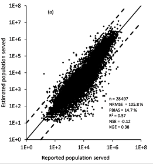

**Figure A1.1.** Figure 4.a in (Macedo et al., 2022a). The performance of the population served estimation approach when applied to WWTPs with known population served/PE. The solid line is the unit line (i.e. no error), and the dashed lines represent an order of magnitude difference between the estimated and known populations. $`n`$ is the total number of WWTPs analyzed, $`\text{NRMSE}`$ is the normalized root mean square error, $`\text{PBIAS}`$ is the percent bias, $`R^{2}`$ is the coefficient of determination, $`\text{NSE}`$ is the Nash-Sutcliffe Efficiency, and $`\text{KGE}`$ is the Kling-Gupta efficiency.

Using Equation A1.18 as the definition of estimated population error, the mean of the error is easily determined by the percent bias, according to,

$`PBIAS\  = \ 100\  \cdot \frac{\Sigma\ (P_{i} - {\widetilde{P}}_{i})}{\Sigma P_{i}}`$ (Eq. A1.22),

$`\bar{e_{p}} = - \frac{PBIAS\  \cdot \ \bar{P}}{100}`$ (Eq. A1.23).

The mean known population served/PE ($`\bar{P}`$) was recalculated for this analysis. The variance of the error is defined by

$`{\sigma^{2}}_{e_{P}} = \frac{\Sigma(e_{i} - \bar{e})^{2}}{N}`$ (Eq. A1.24),

where $`N`$ is the number of WWTPs with known population served/PE. Expansion of the additive quantities in Equation A1.24 yields

$`{\sigma^{2}}_{e_{P}} = \frac{\Sigma{e_{i}}^{2} - 2e_{i}\bar{e} + {\bar{e}}^{2}}{N}`$ (Eq. A1.25).

Separate integration of each term shows that the first term is the square of the root mean square error and the second and third terms combine, yielding,

$`{\sigma^{2}}_{e_{P}} = RMSE^{2} - {\bar{e}}^{2}`$ (Eq. A1.26),

where $`RMSE = \ NRMSE \cdot \bar{P}`$.

A convergence study of the Monte Carlo simulation was performed where multiple Monte Carlo simulations were computed with varying sample sizes: 125, 250, 500, 1000, 2000, 4000, 8000, 16000, 32000, 64000, 128000. Figure A1.2 shows that the Monte Carlo simulation convergences around a sample size of $`O(10^{4})`$. The results of the largest sized Monte Carlo simulation are provided.

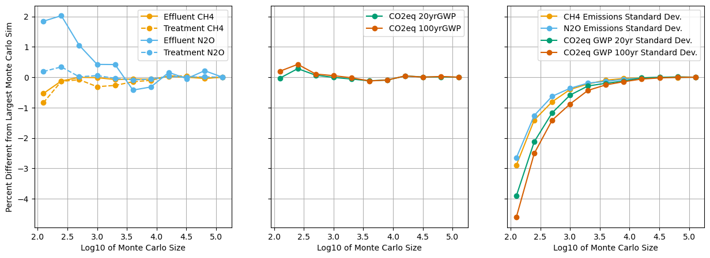

**Figure A1.2** The percent difference of the treatment, effluent, and CO2eq emissions between the largest Monte Carlo simulation and the other Monte Carlo simulations. Convergence occurs around a sample size of $`O(10^{4})`$.

Confidence of reported emissions is determined by the methodology that was used to obtain inputs and how inputs are combined. As mentioned repeatedly, HydroWASTE has both reported and estimated population served values. As reported population served values are obtained from authoritative bodies, they are assigned a high confidence, whereas estimated populations served are given a medium confidence. Linear scaling degrades confidence as population served values are extended before 2022. These confidences reduce by one level for the years 2021 to 2019, then another for years prior to 2018 – i.e. reported population served goes from high to medium to low and estimated population served goes from medium to low to very low. HydroWASTE obtains technology levels from either authoritative sources or by estimation with regional economic development level. Hence, confidence in reported technology levels is considered high, whereas confidence in estimated technology levels is considered medium. A medium confidence is assigned to emissions factors and table quantities found in the IPCC. Finally, as flaring/recovery is not estimated in Equation 2, it is assigned a very low confidence.

As emissions estimates are derived from the combination of several values, the multiplication or addition of two variables is assigned the confidence of the floored average of the numerical equivalents of the confidence levels (1 for very low and 5 for very high). This results in a medium confidence for N2O emissions for all years, and a medium confidence for CH4 emissions for the years 2019 to 2022 while the years prior to 2019 have a split between medium confidence and low confidence for CH4 emissions.

**Appendix 1.f.: Detailed Methodology for the Estimation of Asset-level Industrial Emissions**

Treatment of CH4 emissions were modeled by,

$`Em_{I} = (\ T_{I} \cdot W_{I} \cdot COD_{I} - S) \cdot \text{EF}_{CH4} - R`$, (Eq. A.1.26),

where $`T_{I}`$ is the tonnes of product $`I`$ produced in a given month, $`W_{I}`$ is the wastewater produced by the industrial process, $`\text{CO}D_{I}`$ is the chemical oxygen demand of the wastewater, $`S`$ is the organics removed from the wastewater in the form of sludge, $`\text{EF}_{CH4}`$ is the emission factor, and $`R`$ is methane emissions removed by flaring. By default, $`R = 0`$ for IPCC Tier 1 estimates. Similarly, nitrous oxide emissions were modeled by,

$`Em_{I} = \ T_{I} \cdot W_{I} \cdot N_{I} \cdot \text{EF}_{N2O} \cdot \frac{44}{28}`$, (Eq. A.1.27),

where $`N_{I}`$ is the per capita nitrogen content of wastewater for product $`I`$, $`EF_{N2O}`$ is the nitrous oxide emission factor, and $`\frac{44}{28}`$ is a nitrogen to nitrous oxide mass-balance factor. The emissions from the disposal of effluent wastewater are similar to those for domestic wastewater and are described in the Phase 5 methodology document.

For all assets, it is assumed that aerobic treatment was used, which is IPCC’s Tier 1 default. In addition, it was assumed that advanced treatment was used to process and remove sludge. This is done in order to produce conservative estimates of emissions, as this metadata is not available to the same level as it is for domestic assets. The IPCC values for $`W_{I}`$, $`\text{COD}_{I}`$, and $`N_{I}`$ were used dependent on the industry.

#### Appendix 2: Intelligent Management Strategies for Advanced Wastewater Treatment Systems

During treatment, wastewater is often aerated to provide oxygen to microorganisms that digest organic compounds in the water. Oxygen levels that are too low may inhibit treatment efficiency by hampering the growth and reproduction of microorganisms; on the other hand, over-aerating wastes energy. Intelligent aeration systems optimize the oxygen supply in biochemical pools, lowering direct and indirect GHG emissions by reducing energy consumption and nitrous oxide emissions.

Certain chemicals are sometimes also added to wastewater during treatment to remove nitrogen and phosphorus. The manual adjustment of these chemicals typically leads to overdosing. Automating the dosing process reduces waste and can lead to significantly lowered nitrous oxide emissions.

Intelligent management processes become especially important in the context of industrial wastewater treatment, where highly variable wastewater loads make it more difficult to manually balance oxygen and chemical levels (Huber Technology, n.d.). The composition of industrial wastewater varies widely depending on the industry which generates it (e.g., pulp and paper, steel production, food processing) and may contain toxic compounds, extreme pH, or organic loads higher than those in domestic wastewater. In order to account for higher concentrations of pollutants, as well as other factors such as increased effluent corresponding to production cycles, industrial wastewater treatment often requires more specialized equipment and processes than domestic wastewater treatment.

#### Appendix 3: Grid search method deployed in test region South Africa (SA).

There were 155 total WWTP in SA, out of which 27 were of the particular type of wastewater treatment plants that are of interest, and 20 of them were in the bounds in which the model was running over. A combination of offset, batch\_size, and epochs uniquely identifies a model. Each row is a unique model. The current best model got 80% of the WWTP \[16/20\]. Out of the four missed, two were not clear due to the color and resolution, one due to alignment.

**Table A3.1** Hyperparameter tuning of Inception v3

<table><thead><tr class="header"><th>Offset</th><th>Batch_Size</th><th>Epochs</th><th>Total Positives [Out of 34000]</th><th>
Total Matches

[Out of 20]
</th><th>
True

Positives

[%]
</th><th>
False Positives

[%]
</th><th>
Average Accuracy

[%]
</th></tr></thead><tbody><tr class="odd"><td>F</td><td>32</td><td>80</td><td>129</td><td>12</td><td>60</td><td>0.34</td><td>79.83</td></tr><tr class="even"><td>F</td><td>32</td><td>100</td><td>32</td><td>8</td><td>40</td><td>0.07</td><td>69.96</td></tr><tr class="odd"><td>F</td><td>32</td><td>120</td><td>66</td><td>9</td><td>45</td><td>0.17</td><td>72.42</td></tr><tr class="even"><td>F</td><td>64</td><td>80</td><td>61</td><td>11</td><td>55</td><td>0.15</td><td>77.43</td></tr><tr class="odd"><td>F</td><td>64</td><td>100</td><td>60</td><td>11</td><td>55</td><td>0.14</td><td>77.43</td></tr><tr class="even"><td>P</td><td>32</td><td>80</td><td>135</td><td>16</td><td>80</td><td>0.35</td><td>89.83</td></tr><tr class="odd"><td>P</td><td>32</td><td>100</td><td>50</td><td>12</td><td>60</td><td>0.11</td><td>79.94</td></tr><tr class="even"><td>P</td><td>32</td><td>120</td><td>84</td><td>13</td><td>65</td><td>0.21</td><td>82.40</td></tr><tr class="odd"><td>P</td><td>64</td><td>80</td><td>72</td><td>16</td><td>80</td><td>0.16</td><td>89.92</td></tr><tr class="even"><td>P</td><td>64</td><td>100</td><td>74</td><td>16</td><td>80</td><td>0.17</td><td>89.91</td></tr></tbody></table>

#### Appendix 4: HydroWASTE Dataset Statistics

HydroWASTE assets are filtered to remove WWTPs which are flagged as “Closed” or “Not Operational”. Further filtering occurs prior to emissions estimates to remove plants whose location was not verified by the ML model described in Section 2.2.1 and which were flagged by the HydroWASTE authors as having a low confidence location.

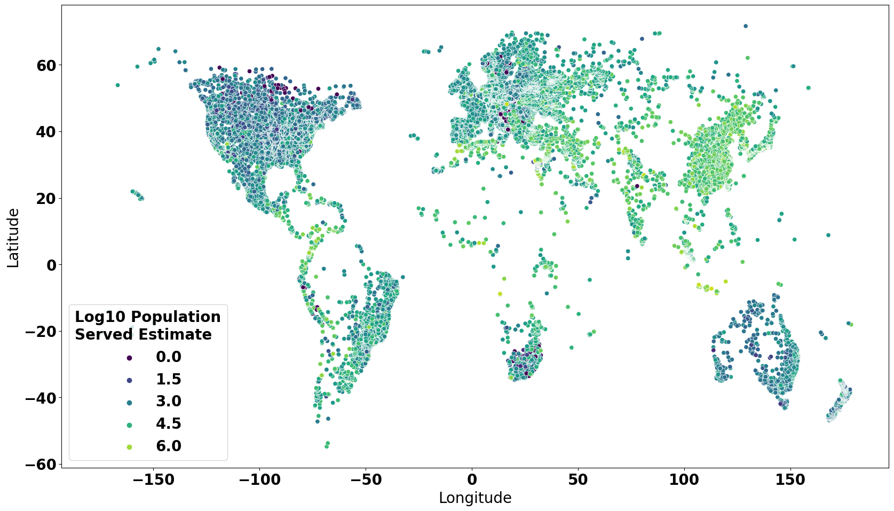

**Figure A4.1.** HydroWASTE global distribution of centralized WWTPs identified as not “Closed” or “Not Operational”.

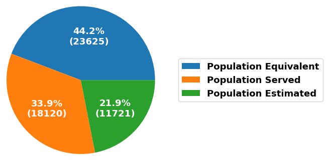

**Figure A4.2.** Proportion of WWTPs based on computed population served.

#### Appendix 5: Country-by-country comparison of E.U. emissions estimates

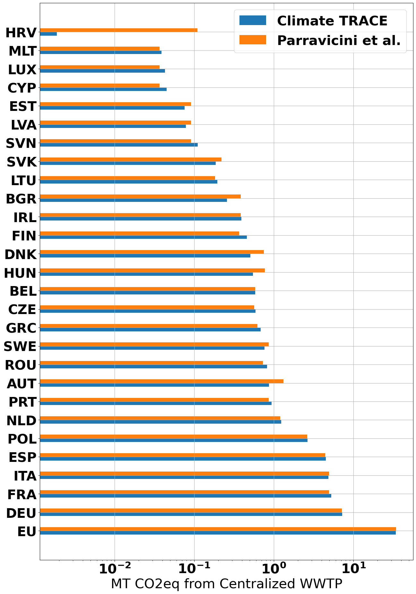

**Figure A5.1.** A comparison of CO2eq between Parravicini *et al.* emissions estimates (CO2e 100- year global warming potential) and Climate TRACE. Countries are labeled with their ISO 3166-1 alpha-3 codes. Overall, Climate TRACE and Parravicini *et al.* align well for most countries.

#### Appendix 6: Hyperparameters used to train the WWTP identification network

**Table A6.1**

| **Hyperparameter**               | **Value**                        |
|----------------------------------|----------------------------------|
| Activation Function              | Sigmoid                          |
| Loss function                    | Sparse categorical cross entropy |
| Learning rate optimizer function | Adam (learning rate=0.0001)      |
| Batch size                       | 64                               |
| Epochs                           | 100                              |

#### Appendix 7. Month seasonality

Wastewater emissions are provided at a monthly scale. Studies on seasonal variation based on temperature (Asadi & McPhedran, 2021; Daelman et al., 2015; Demir & Yapıcıoğlu, 2019; Gruber et al., 2021) generally find a correlation between ambient temperature and methane emissions, as well as a lagging anticorrelation of ambient temperature and nitrous oxide emissions. However, modeling these trends is difficult, as they are often dependent on the presence of specific WWTP technologies. Papers disagree on the level of correlation between ambient temperature and emissions, as well as on emissions per influent volume rate at the same temperature. Also, there is a greater dependence on influent water temperature, which is influenced by many latent factors other than ambient temperature. Hence, for Phase 6, only population trends are used for modeling monthly changes in wastewater emissions.

A cubic spline of WorldPop annual mid-year population data is used to estimate month-to-month populations of each country. Mid-year population data is estimated assuming a geometric growth rate, expressed by,

$`P_{2024} = P_{2023} \cdot \frac{P_{2023}}{P_{2022}}`$. Eq. A7.1

An example of this splining for Puerto Rico is shown in Figure A7.1.

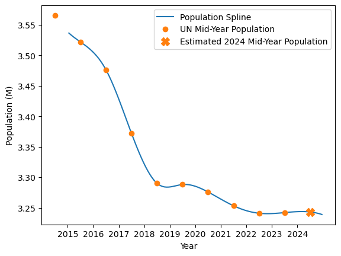

**Figure A7.1** Spline of Puerto Rico’s population from 2015 to mid-year 2024 which is used to model monthly emissions.

#### Appendix 8. Decentralized wastewater asset set formation

Wastewater emissions from decentralized treatment sources (latrines, septic systems, and untreated) was calculated for a subset of countries which served as a proof of concept.

The Holy See was removed from consideration since detailed sanitation data is unavailable. Sanitation data is unavailable for Eritrea since 2017 and for Comoros since 2019. The most recent available data for these countries was forward filled.

**Table A8.1** Countries with the highest percentage of untreated wastewater, where “Coverage” indicates the percentage of the total population (both urban and rural) producing wastewater that is listed as “unimproved” or “open defecation”.

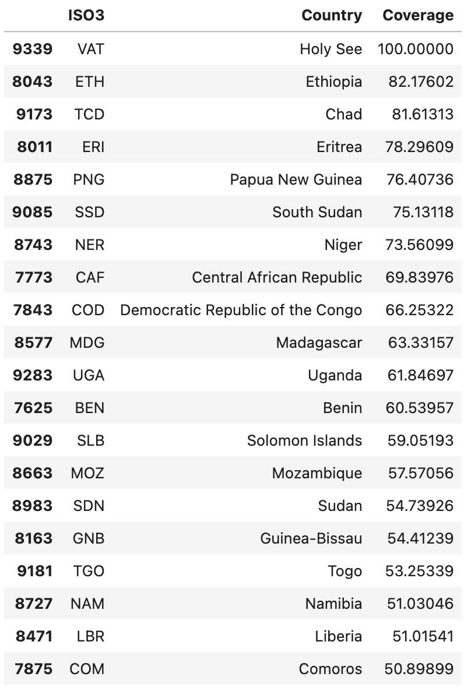

For the purposes of this analysis, each GADM2 region in the set of 20 countries in Table A8.1 (minus the Holy See) is considered an untreated wastewater “asset”. The Democratic Republic of the Congo has two regions (both densely forested) with missing population data: there is no population data for COD.21.10\_1 (Tshumbe) and COD.21.1\_1 (Bena-Dibele) and no 2020 or 2025 population data for COD.21.10\_1 (Tshumbe). Likewise, no WorldPop population is available for the following Philippine GADM2 regions, so emissions for corresponding decentralized “assets” were not calculated: PHL.5.2\_1, PHL.40.10\_1, PHL.40.23\_1, PHL.40.27\_1, and PHL.77.11\_1.

#### Appendix 9. Mapping of Unlisted Countries to Proxy Country in WASH Data

**Table A9.1.** Missing country mapping for proxy data. WASH data for each ISO3 country code below is handled by sourcing missing values from another country’s WASH data or by using a fixed estimate. Proxies of “zero” indicate that the country’s wastewater treatment coverage and population served is estimated as zero for all categories. The “full” proxy is for countries which are estimated as having complete sewer coverage.

| **Country** | **Proxy Country** |
|-------------|-------------------|
| ALA         | FIN               |
| ATA         | zero              |
| ATF         | SXM               |
| BVT         | zero              |
| CCK         | LKA               |
| COK         | ASM               |
| CXR         | LKA               |
| ESH         | MAR               |
| HMD         | zero              |
| IOT         | GBR               |
| NCL         | PYF               |
| NFK         | AUS               |
| NIC         | HND               |
| PCN         | AUS               |
| SGS         | GBR               |
| SJM         | NOR               |
| SPM         | CAN               |
| TKL         | ASM               |
| TWN         | CHN               |
| UMI         | ASM               |
| UNK         | zero              |
| VAT         | full              |
| XKX         | SRB               |

#### References

1.  Asadi, M., & McPhedran, K. (2021). Estimation of greenhouse gas and odour emissions from a cold region municipal biological nutrient removal wastewater treatment plant. *Journal of Environmental Management*, *281*, 111864.

2.  Australian Government Department of Sustainability, Environment, Water, Population, and Communities (DSEWPC). (2011). *National Pollutant Inventory: Emission estimation technique manual for sewage and wastewater treatment*. https://www.dcceew.gov.au/sites/default/files/documents/fsewage.pdf

3.  Bartram, D., Ebie, Y., Farkaš, J., Guéguen, C., Peters, G., Zanzottera, N., Karthik, M., & Masuda, S. (2019). Refinement to the 2006 IPCC Guidelines for National Greenhouse Gas Inventories (E. C. Buendia, K. Tanabe, A. Kranjc, J. Baasansuren, M. Fukuda, S. Ngarize, A. Osako, Y. Pyrozhenko, P. Shermanau, & S. Federici, Eds.) \[Ch. 6\]. Intergovernmental Panel on Climate Change (IPCC).

4.  Bondarenko, M., Priyatikanto, R., Tejedor Garavito, N., Zhang, W., McKeen, T., Cunningham, A., Woods, T., Hilton, J., Cihan, D., Nosatiuk, B., Brinkhoff, T., Tatem, A., & Sorichetta, A. (2025). Constrained estimates of 2015-2030 total number of people per grid square at a resolution of 3 arc (approximately 100m at the equator) R2025A version v1.\[Dataset\]. University of Southampton. https://doi.org/10.5258/SOTON/WP00839

5.  Copenhaver, E. G. (2023, June 1). Planning for Septic Tank Removal: Jekyll Island, Georgia. https://efcnetwork.org/planning-for-septic-tank-removal-jekyll-island-georgia/

6.  Copernicus Data Space Ecosystem. (n.d.). Sentinel-2 \[Dataset\]. Level-2A. Retrieved September 25, 2026, from https://dataspace.copernicus.eu/data-collections/copernicus-sentinel-missions/sentinel-2

7.  Daelman, M. R., Voorthuizen, E. M., Dongen, U. G., Volcke, E. I., & Loosdrecht, M. C. (2015). Seasonal and diurnal variability of N2O emissions from a full-scale municipal wastewater treatment plant. Science of the Total Environment, 536, 1-11. https://pubmed.ncbi.nlm.nih.gov/26188527/

8.  de Foy, B., Schauer, J. J., Lorente, A., & Borsdorff, T. (2023). Investigating high methane emissions from urban areas detected by TROPOMI and their association with untreated wastewater. Environmental Research Letters, 18(4, Art. no. 044004).

9.  de Haas, D., & Andrews, J. (2022). Nitrous oxide emissions from wastewater treatment-Revisiting the IPCC 2019 refinement guidelines. Environmental Challenges, 8, 100557.

10. Demir, Ö., & Yapıcıoğlu, P. (2019). Investigation of GHG emission sources and reducing GHG emissions in a municipal wastewater treatment plant. Greenhouse Gases: Science and Technology, 9(5), 948–964.

11. Duan, H., Zhao, Y., Koch, K., Wells, G. F., Zheng, M., Yuan, Z., & Ye, L. (2021). Insights into Nitrous Oxide Mitigation Strategies in Wastewater Treatment and Challenges for Wider Implementation. Environmental Science & Technology, 55, 7208–7224. https://doi.org/10.1021/acs.est.1c00840

12. European Commission, JRC. (2023). EDGAR (Emissions Database for Global Atmospheric Research) Community GHG Database, a collaboration between the European Commission, Joint Research Centre (JRC), the International Energy Agency (IEA), and comprising IEA-EDGAR CO2, EDGAR CH4, EDGAR N2O, EDGAR F-GASES (Version 8.0) \[Data set\]. https://edgar.jrc.ec.europa.eu/

13. European Environment Agency (EEA). (2023). Urban Waste Water Treatment Directive, Waterbase reported under UWWTD. https://www.eea.europa.eu/en/datahub/datahubitem-view/6244937d-1c2c-47f5-bdf1-33ca01ff1715

14. Food and Agriculture Organization of the United Nations (FAO). (n.d.). FAOSTAT-Food Balances \[Dataset\]. Retrieved July 25, 2023, from https://www.fao.org/faostat/en/\#data/FBS

15. Google. (n.d.). Maps Static API Overview. Google for Developers. Retrieved August 24, 2026, from https://developers.google.com/maps/documentation/maps-static/overview

16. Gruber, W., Känel, L., Vogt, L., Luck, M., Biolley, L., Feller, K., Moosmann, A., Krähenbühl, N., Kipf, M., Loosli, R., & Vogel, M. (2021). Estimation of countrywide N2O emissions from wastewater treatment in Switzerland using long-term monitoring data. Water Research X, 13, 100122.

17. Huber Technology Waste Water Solutions. (n.d.). Intelligent chemicals dosing reduces operating costs for flotation plants.

18. Humanitarian Data Exchange (HDX). (2026). Philippines—Subnational Administrative Boundaries (Version v2.12.14) \[Dataset\]. https://data.humdata.org/dataset/cod-ab-phl

19. HydroWASTE. (2022). HydroWASTE (Version 1) \[Dataset\]. https://www.hydrosheds.org/products/hydrowaste

20. Janssens-Maenhout, G., Crippa, M., Guizzardi, D., Muntean, M., Schaaf, E., Dentener, F., Bergamaschi, P., Pagliari, V., Olivier, J. G., Peters, J. A., & Aardenne, J. A. (2019). EDGAR v4. 3.2 Global Atlas of the three major greenhouse gas emissions for the period 1970–2012. Earth System Science Data, 11(3), 959–1002.

21. Kontur. (2020). Population Density Dataset \[Dataset\]. https://www.kontur.io/datasets/population-dataset/

22. Law, Y., Ye, L., Pan, Y., & Yuan, Z. (2012). Nitrous oxide emissions from wastewater treatment processes (P. R. S. B. Biol, Trans.). Sci, 367, 1265–1277. https://doi.org/10.1098/rstb.2011.0317

23. Liu, Z., Lin, Y., Cao, Y., Hu, H., Wei, Y., Zhang, Z., Lin, S., & Guo, B. (2021). Swin transformer: Hierarchical vision transformer using shifted windows. Proceedings of the IEEE/CVF International Conference on Computer Vision, 10012–10022.

24. Macedo, H. E., Lehner, B., Nicell, J., Grill, G., Li, J., Limtong, A., & Shakya, R. (2022a). Distribution and characteristics of wastewater treatment plants within the global river network. Earth System Science Data, 14(2), 559–577.

25. Macedo, H. E., Lehner, B., Nicell, J., Grill, G., Li, J., Limtong, A., & Shakya, R. (2022b). Supplement of distribution and characteristics of wastewater treatment plants within the global river network. Earth System Science Data, 14(2), 559–577.

26. Manila Water Company, Inc. (n.d.). Water and Wastewater Facilities. Retrieved August 24, 2026, from https://www.manilawater.com/water-and-wastewater-facilities

27. Moore, D. P., Li, N. P., Wendt, L. P., Castañeda, S. R., Falinski, M. M., Zhu, J.-J., Song, C., Ren, Z. J., & Zondlo, M. A. (2023). Underestimation of Sector-Wide Methane Emissions from United States Wastewater Treatment, Environ. Sci. Technol, 57, 10, 4082–4090.

28. Parravicini, V., Nielsen, P. H., Thornberg, D., & Pistocchi, A. (2022). Evaluation of greenhouse gas emissions from the European urban wastewater sector, and options for their reduction. Science of the Total Environment, 838, 156322.

29. Pesaresi, M., Schiavina, M., Politis, P., Freire, S., Krasnodębska, K., Uhl, J. H., Carioli, A., Corbane, C., Dijkstra, L., Florio, P., Friedrich, H. K., Gao, J., Leyk, S., Lu, L., Maffenini, L., Mari-Rivero, I., Melchiorri, M., Syrris, V., Den Hoek, J., & Kemper, T. (2024). Advances on the Global Human Settlement Layer by joint assessment of Earth Observation and population survey data. Int. J. Digit. Earth, 17, 2390454. https://doi.org/10.1080/17538947.2024.2390454

30. Philippine Statistics Authority. (2023a). Majority of Families Have Access to Improved Source of Drinking Water (Results from the 2022 Annual Poverty Indicators Survey) (Nos. 2023–107). https://psa.gov.ph/statistics/income-expenditure/apis/node/1684041624

31. Philippine Statistics Authority. (2023b). Population and Housing (Nos. 2023–57). https://psa.gov.ph/statistics/population-and-housing/node/1684059981

32. Pinellas County. (2026, May 28). Lake Tarpon Septic-to-Sewer Conversion. Pinellas County. https://pinellas.gov/projects/lake-tarpon-septic-to-sewer-conversion-project/

33. Reed, B. (2014). Ventilated improved pit (VIP) latrines. Water, Engineering and Development Centre, School of Civil and Building Engineering, Loughborough University.

34. Sande, F., Nyirenda, T. M., & Chiwatakwenda, A. (2025). Influence of pit latrine design features on methane emissions in informal urban settlements: Evidence from Kauma Township, Malawi. Journal of Water, Sanitation, and Hygiene for Development, 15(12), 1084–1100.

35. Schiavina, M., Freire, S., Carioli, A., & MacManus, K. (2023). GHS-POP R2023A - GHS population grid multitemporal (1975-2030). \[Dataset\]. European Commission, Joint Research Centre (JRC).

36. Shelby County Health Department. (2024). (Permit No. 00701-01TV) City of Memphis, T. E. Maxson Wastewater Treatment Facility Source No. 00701.

37. Song, C., Zhu, J. J., Willis, J. L., Moore, D. P., Zondlo, M. A., & Ren, Z. J. (2023). Methane Emissions from Municipal Wastewater Collection and Treatment Systems. Environmental Science & Technology, 57(6), 2248–2261.

38. The WABAG Group. (n.d.). Wastewater Treatment Plant (WWTP), Ilugin, Philippines. For Pure Water, Think WABAG! Retrieved August 24, 2026, from https://www.wabag.com/project/wastewater-treatment-plant-philippines/

39. Tong, Y., Liao, X., He, Y., Cui, X., Wishart, M., Zhao, F., Liao, Y., Zhao, Y., Lv, X., Xie, J., Liu, Y., Chen, G., & Hou, L. (2024). Mitigating greenhouse gas emissions from municipal wastewater treatment in China. Environmental Science and Ecotechnology, 20, 100341. https://doi.org/10.1016/j.ese.2023.100341

40. Turovskiy, I. S., & Mathai, P. K. (2006). Wastewater sludge processing. John Wiley & Sons.

41. UNESCO (Ed.). (2017). Wastewater: An untapped resource. Unesco.

42. United Nations Children’s Fund (UNICEF) Division of Global Communication and Advocacy. (2022). The UNICEF Game Plan to Reach Safely Managed Sanitation 2022–2030. UNICEF. https://www.unicef.org/media/130831/file/Sanitation%20Game%20Plan%20-%20Full%20Report-EN.pdf

43. United Nations Department of Economic and Social Affairs. (n.d.). Goal 6. Retrieved September 29, 2025, from https://sdgs.un.org/goals/goal6

44. United States Environmental Protection Agency (EPA) Office of Atmospheric Protection. (2022a). Sewersheds \[Overviews and Factsheets\]. https://www.epa.gov/cwns/sewersheds

45. United States Environmental Protection Agency (EPA). (2022b). Compliance Tips for Small Wastewater Treatment Lagoons with Clean Water Act Discharge Permits (No. 305F22002). https://www.epa.gov/system/files/documents/2022-03/lagoon-complianceadvisory.pdf

46. United States Environmental Protection Agency (EPA). (2023). Inventory of U.S Greenhouse Gas Emissions and Sinks: 1990-2021(Nos. 430-R-23–002) \[Dataset\]. https://www.epa.gov/ghgemissions/inventory-us-greenhouse-gas-emissions-and-sinks-1990-2022.

47. United States Environmental Protection Agency (EPA). (n.d.). Non-CO2 Greenhouse Gas Data Tool \[Dataset\]. Retrieved October 5, 2026, from https://cfpub.epa.gov/ghgdata/nonco2/

48. United States Environmental Protection Agency (EPA). (2025). Global Non-CO₂ Greenhouse Gas Emission Projections & Mitigation Potential: 2020-2080 (EPA-430-R-25-002). https://cfpub.epa.gov/ghgdata/nonco2/reports/

49. Vasudeva, V., & Parikh, N. (2025). Optimization and Development of a Ventilation System for Public Toilets based on Toxic Gas Level. 2025 2nd International Conference on Electronic Circuits and Signaling Technologies (ICECST), 1080–1086. https://doi.org/10.1109/ICECST66106.2025.11307423

50. WHO/UNICEF Joint Monitoring Programme (JMP). (n.d.). Water Sanitation and Hygiene (WASH) \[Dataset\]. Retrieved October 5, 2026, from https://washdata.org/data/household\#!/

51. WHO/UNICEF Joint Monitoring Programme (JMP). (2023). Progress on household drinking water, sanitation and hygiene 2000-2022: Special focus on inequalities. WHO and UNICEF. https://washdata.org/reports

52. World Bank Group. (2020, March 19). Wastewater? From Waste to Resource \[Text/HTML\]. World Bank. https://www.worldbank.org/en/topic/water/publication/wastewater-initiative

53. World Bank Group. (2025). World Bank country classifications by income level for 2024-2025. World Bank Blogs. https://blogs.worldbank.org/en/opendata/world-bank-country-classifications-by-income-level-for-2024-2025

54. World Health Organization (WHO). (2018). Progress on wastewater treatment: Piloting the monitoring methodology and initial findings for SDG indicator 6.3.1. https://www.who.int/publications/i/item/9789241514897.

55. Xie, E., Wang, W., Yu, Z., Anandkumar, A., Alvarez, J. M., & Luo, P. (2021). SegFormer: Simple and Efficient Design for Semantic Segmentation with Transformers (arXiv:2105.15203). arXiv. https://doi.org/10.48550/arXiv.2105.15203

[1] For the purposes of this model, a WWTP is defined as a centralized wastewater treatment system used to treat domestic or industrial wastewater. Wastewater treatment ponds or lagoons are another centralized wastewater treatment pathway considered by the model. WWTPs may include any or all treatment processes (primary, secondary, and advanced) that occur onsite between inflow of untreated wastewater and outflow of treated wastewater (i.e., effluent). WWTPs that conduct primary treatment utilize mechanical processes, such as screening, grit removal, and sedimentation, to remove larger solids from the wastewater and to reduce biochemical oxygen demand (BOD). The removal of organic material available for decomposition mitigates the release of methane. Secondary treatment harnesses biological processes to break down contaminants with the help of microorganisms. Advanced wastewater treatment builds upon the biological processes used in secondary treatment to further purify the water through enhanced biological nutrient removal (nitrification and denitrification) or through advanced physical and chemical processes.
