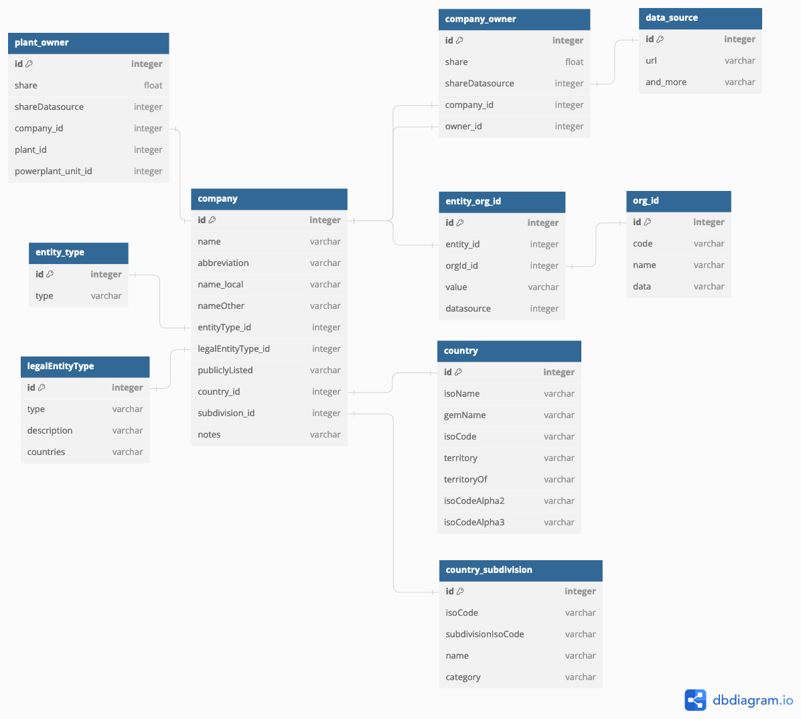
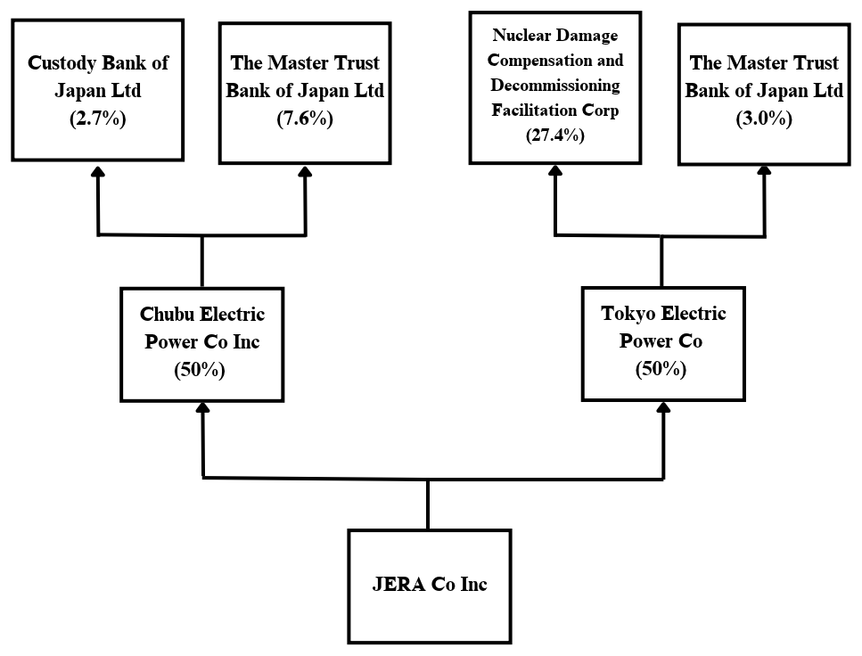
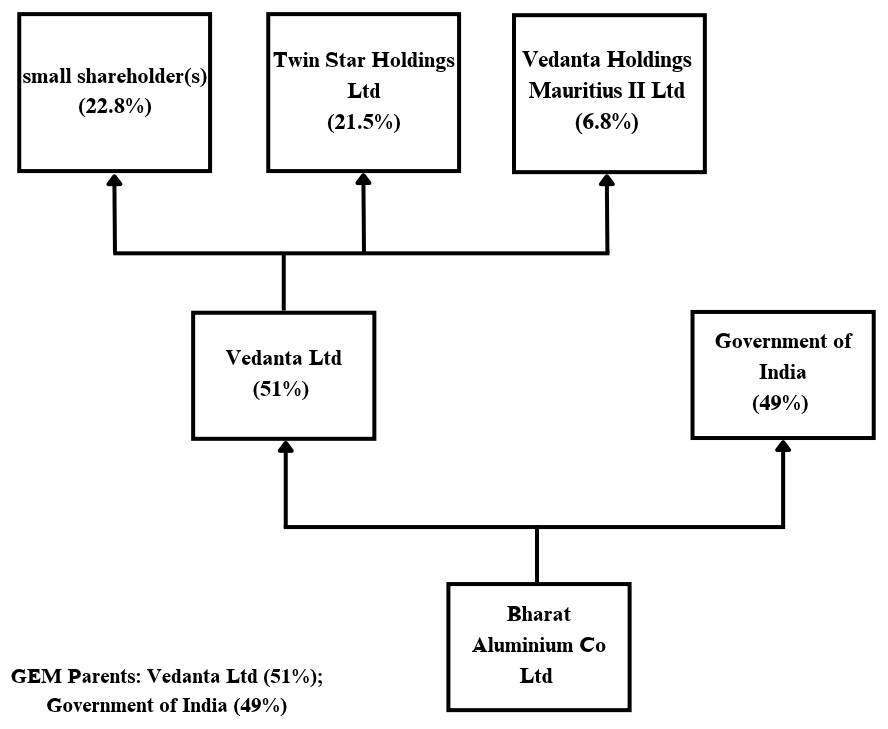

### Climate TRACE Ownership Data: Global Energy Monitor Methodology

**Anna Mowat\*, Gabriel Louis, and Maisie Bird**

*All authors affiliated with Global Energy Monitor and Climate TRACE*

**\*Contact** Ownership Sector Lead: anna.mowat@globalenergymonitor.org

V5.0.0, Nov. 2025

#### 1. Introduction

Asset-level data show where energy and industrial facilities are and what they produce, but decisions about planning, financing, and operating them are made by the companies and governments that own them, often through chains of subsidiaries and joint ventures. Open data on these ownership chains is scarce: commercial providers restrict it under license, and corporate disclosures rarely trace ownership to individual facilities. To fill this gap, Global Energy Monitor (GEM; [https://globalenergymonitor.org/](https://globalenergymonitor.org/)) compiles open ownership data for each asset, supporting Climate TRACE’s goal of identifying the entities responsible for asset-level emissions.

As part of a collaboration with Climate TRACE, GEM has contributed technical and ownership data sets for combustion power plants (i.e., burning coal, gas, oil, and/or bioenergy), steel plants, coal mines, iron ore mines, oil pipelines, natural gas liquids (NGL) pipelines, gas pipelines, and cement and concrete plants. In early 2027 GEM’s ownership team will also start contributing ownership of oil and gas extraction, aluminum, bauxite mining, chemicals, copper mining, petrochemical steam cracking, and pulp and paper. GEM’s technical data includes detailed information on the various assets such as plant capacity, location, and operating status. GEM’s ownership data includes information on the project-level ownership for various projects and the interested party that owns the project-level owner. Section 2 (Methods) describes this data in more detail.

With the exception of aluminum, bauxite mining, chemicals, copper mining, petrochemical steam cracking, and pulp and paper, GEM releases these data sets as stand-alone trackers, which are spreadsheets with project-level data:

-   [Global Coal Plant Tracker](https://globalenergymonitor.org/projects/global-coal-plant-tracker/)

-   The Global Coal Plant Tracker (GCPT) provides information on coal-fired power units around the world generating 30 megawatts and above. The tracker catalogs every operating coal-fired generating unit, every new unit proposed since 2010, and every unit retired since 2000 (GEM, 2025d).

-   [Global Oil and Gas Plant Tracker](https://globalenergymonitor.org/projects/global-oil-gas-plant-tracker/)

-   The Global Oil and Gas Plant Tracker (GOGPT) is a worldwide dataset of oil and gas-fired power plants. It includes units with capacities of 50 megawatts or more (20 megawatts or more in the European Union and the United Kingdom). The tracker catalogs every oil and gas power plant at this capacity threshold of any status, including operating, announced, pre-construction, construction, shelved, canceled, mothballed, or retired (GEM, 2025g).

-   [Global Bioenergy Power Tracker](https://globalenergymonitor.org/projects/global-bioenergy-power-tracker/)

-   The Global Bioenergy Power Tracker (GBPT) is a worldwide dataset of utility-scale bioenergy power facilities. It includes bioenergy units with capacities of 30 megawatts or more. The tracker includes every bioenergy unit at the 30 megawatt capacity threshold for operating, announced, pre-construction, and in construction power station units (GEM, 2025a).

-   [Global Coal Mine Tracker](https://globalenergymonitor.org/projects/global-coal-mine-tracker/)

-   The Global Coal Mine Tracker (GCMT) is a worldwide dataset of coal mines and proposed projects. The tracker provides asset-level details on ownership structure, development stage and status, coal type, production, workforce size, reserves and resources, methane emissions, geolocation, and over 30 other categories (GEM, 2025c).

-   [Global Steel Plant Tracker](https://globalenergymonitor.org/projects/global-steel-plant-tracker/)

-   The Global Steel Plant Tracker (GSPT) provides information on global crude iron and steel production plants and includes every plant currently operating with a capacity of five hundred thousand tons per year or more of crude iron or steel (GEM, 2025i).

-   [Global Oil Infrastructure Tracker](https://globalenergymonitor.org/projects/global-oil-infrastructure-tracker/)

-   The Global Oil Infrastructure Tracker (GOIT) is an information resource on crude oil and natural gas liquids (NGL) transmission pipeline projects and their development. Currently, GOIT attempts to include all global crude oil and NGL transmission pipelines of any status, though availability on this infrastructure varies across countries and regions, and some are researched more completely than others (GEM, 2025h).

-   [Global Gas Infrastructure Tracker](https://globalenergymonitor.org/projects/global-gas-infrastructure-tracker/)

-   The Global Gas Infrastructure Tracker (GGIT) is an information resource on natural gas transmission pipeline projects and liquefied natural gas (LNG) import and export terminals. Currently, GGIT aims to include all LNG terminals regardless of threshold, as well as all global gas transmission pipelines over predetermined size thresholds (GEM, 2025e).

-   [Global Iron Ore Mines Tracker](https://globalenergymonitor.org/projects/global-iron-ore-mines-tracker/)

-   The Global Iron Ore Mines Tracker (GIOMT) provides information on global iron ore mines, and includes all operating, proposed, shelved, retired or mothballed mines since 2023. The GIOMT provides asset-level data on ownership structure, development stage and operating status, annual production since 2022, and design capacity for each mine (GEM, 2025f).

-   [Global Cement and Concrete Tracker](https://globalenergymonitor.org/projects/global-cement-and-concrete-tracker/)

-   The Global Cement and Concrete Tracker (GCCT) provides information on global integrated and grinding plants, including all plants that have been proposed or under construction since 2018 and retired or mothballed since 2021. The GCCT provides asset-level data on location, ownership, operating status, annual clinker and cement capacity, and production methods including relevant green cement technology (GEM, 2025b).

The data GEM contributed on China’s small oil refineries is released by Climate TRACE as part of the [Fossil Fuel Operations sector](https://github.com/climatetracecoalition/emissions-methodology/tree/main/Sector-Methodologies/1-Sectors/fossil-fuel-operations), in the subsector Oil Refining (Climate TRACE, 2025a).

GEM has enhanced, updated, and expanded the ownership data in the trackers above. In revamping this data, we have organized the data following Open Ownership’s Beneficial Ownership Data Standard, or BODS (Open Ownership, 2024). We adopted BODS because it is considered the only widely used standard for organizing data on ownership structures. The data has been enhanced by adding missing ownership data, bringing other ownership data up to date, making the ownership data consistent across the trackers listed above, and adding additional details on entities, as described below.

GEM also preprocesses entity names received from other Climate TRACE coalition members before integrating them into the Global Energy Monitor (GEM) PostgreSQL database and assigning entities unique GEM Entity IDs. This process is described in Section 5.

#### 2. Methods

The terminology used here conforms with BODS whenever relevant. Accordingly, by “entities,” we are referring to companies, governments, government agencies, and other bodies that are involved in ownership.

GEM’s ownership data is stored in a custom PostgreSQL database, which allows for representation of hierarchical relationships between various entities involved in ownership of projects, such as power plants, pipelines, or coal mines. Other sources may refer to our term “projects” as “assets”; we consider the two terms to be equivalent.

Each piece of GEM’s ownership data pertains to one of two types of relationships:

-   Immediate owners of projects: GEM records each entity that directly owns a project (such as a power plant) and the percentage that entity holds in the project’s ownership structure when available.

-   Higher-level ownership: GEM additionally records the entities that own the immediate owners of projects, including the higher-level entities’ percent share when available. We trace ownership structures up to the highest level owner(s) identifiable in open sources. These highest level owners include:

-   Publicly traded companies,

-   The highest privately held entity in any given ownership branch,

-   State bodies or governments, and

-   Actual persons (not a company), who we refer to as “natural person(s)”

Each project’s ownership tree thereby includes immediate, intermediate, and ultimate ownership, as applicable.

As in BODS, the GEM database refers to a lower-level entity as the “subject” and the higher-level entity as the “interested party.”

In addition, the database stores various attributes of the entities, as described below. This additional data helps to provide unambiguous identification of the entities and can also enable certain types of analyses.

#### 2.1. Types of Entities

In the database, each entity is assigned a type, as either a legal entity, state, state body, or arrangement, following the definitions in BODS.

#### 2.1.1. Legal Entity

As defined by BODS, a legal entity is an organization created with a memorandum of incorporation or similar registration documents, and which is registered by a government. There are many types of legal entities, including Corporation, Limited Liability Company, and Company Limited. For GEM’s ownership work, we define “legal entity” in line with BODS terminology.

In addition, in GEM’s database, we differentiate privately owned and publicly traded companies (also known as a publicly held company, publicly listed company, or listed company). This is in line with BODS schema for marking publicly listed companies. Another reason we differentiate is because in some jurisdictions, such as the United States (U.S.), public companies are required to publish audited financial statements (SEC, n.d.-b) and information on beneficial ownership over 5% (SEC, n.d.-a). Identifying public companies is also useful for guiding research, since publicly traded companies tend to disclose ownership information in their annual reports or in filings made with the stock exchange on which they are traded.

#### 2.1.2. State

The entity type “state” refers to national, subnational, and local governments. In BODS terminology, it is a country, nation, or community with legal sovereignty within a territory. In GEM’s dataset, we follow a convention for naming states:

-   National governments: “Government of X.”

-   State/regional governments: “State of X” or “Province of X” (for example), depending on the name of the type of country subdivision.

-   City governments: “City of X” or “Municipality of X.”

-   U.S. Cities: follow the same pattern as well as adding the state where the city is located in parentheses.

-   For example, “City of Chicago (Illinois)” for the city government in Chicago, Illinois, United States.

#### 2.1.3. State Body

In BODS terminology, “state body” refers to a core administrative or legislative body within a state’s apparatus. For example, these could be ministries or government agencies. State bodies are entered in GEM’s dataset as distinct from the state (the government) to make the ownership data as specific as possible.

When labeling state bodies in our dataset, we use the official name of the government agency or ministry as the entity name. In cases where ministry or government agency names are similar to government agency names in other countries, we enter the country name in parentheses at the end of the entity name—for example, “Ministry of Energy (Iraq).”

#### 2.1.4. Arrangement

For other cases of ownership that do not fit into any of the categories above, we have applied a general category “arrangement,” based on advice from Open Ownership’s staff. We apply the category of “arrangement” to entities that meet the following criteria:

-   Joint ventures that are not registered in a government business registry

-   Other entities, such as trusts, universities, and certain general partnerships, that are not registered in a business registry and are found to hold ownership in a project or subject

-   Business groups that are described in online sources as holding ownership of a project or subject but for which a principal registered legal entity (i.e., a parent or holding company) could not be identified in online sources and no other information regarding the ownership of the asset or subject is available

#### 2.2. Sources and Datasets employed

The availability of data on ownership varies widely between countries, and GEM relies on the most authoritative open data that is available at the time of this work. This includes diverse sources, such as state business registries, government data sets, company reports, news articles, stock exchanges, and other sources. On [GEM.wiki](https://www.gem.wiki/Main_Page), GEM publishes data for each project (e.g., power plant) which shows the ownership data as well as the data sources whenever available (GEM, 2025j).

Examples of the government data sets that GEM uses to compile ownership data include Form EIA-860, which is a United States government agency electricity dataset from the U.S. Energy Information Administration (EIA, 2023). Additionally, GEM gathers ownership data from various company reports, such as annual reports and financial statements, which may identify the subsidiaries of a company and/or the projects owned by a company. In some cases, GEM obtained ownership information from news articles from accredited sources (such as Reuters, Bloomberg, and S&P Global), and press releases from company websites.

#### 2.3. Entity Data Structure

For each entity, GEM stores data in the following data fields, as available and as relevant:

-   **Entity Type:** The options follow the definitions in BODS, as described above, with the most common types being:

-   Legal entity

-   State

-   State Body

-   Arrangement

-   **Legal Entity Type:** This field is used only when the “Entity Type” is a “Legal entity.” The entries are standardized in their abbreviated forms; for example, a Limited Liability Company is standardized as “LLC.”

-   **Entity Status:** This field is used if the entity is dissolved or amalgamated.

-   **Publicly Listed:** This indicates whether a company is “listed,” that is, it has stock listed on a public stock exchange. (Such companies are also referred to as publicly traded or publicly held.) This option is available only for the entity type “legal entity.”

-   **Abbreviation**: The abbreviation of the entity name (if any), based on its primary name. This can be an acronym or other shortening of the name.

-   **Name local**: The name of the company in the local language (e.g., for a Chinese company, the name in Chinese).

-   **Name other**: Multiple names can be added, in English and/or other languages. When an entity was previously referred to by another name, we enter former names with “\[former\]” appended at the end. For example, “Anergi International Ltd” has the entry “Applied Energy Services \[former\].”

-   **Registration Jurisdiction—Country & Subdivision.** For legal entities registered with a federal business registry, the country is listed. For legal entities registered with a provincial or state registry only, the subnational division is additionally listed.

-   **Headquarters Jurisdiction—Country & Subdivision.** The location of the headquarters can be listed by country and by subdivision, as available.

-   **Organization Identifiers:** This indicates an ID for an entity and is most commonly available only for legal entities. The ID systems currently in use in GEM’s data set are listed below, with the short identifiers in parentheses as assigned by [org-id.guide](https://org-id.guide/) (Open Data Services Co-operative, n.d.).

-   Global Legal Entity Identifier Index (XI-LEI)

-   Refinitiv PermID (XI-PID)

-   UK Companies House (GB-COH)

-   China’s Unified Social Credit Identifier (CN-USCI)

-   China’s State Administration for Industry and Commerce (CN-SAIC)

-   IDs assigned by the US Energy Information Administration, as published in [Form EIA-860](https://www.eia.gov/electricity/data/eia860/), for entities that own power-generating projects

-   S&P Capital IQ company identifier (SPCIQ)

-   India’s Corporate Identification Number (Ministry of Corporate Affairs) (IN-CIN)

-   Russia’s Uniform State Register of Legal Entities of Russian Federation (RU-INN)

-   Brazil’s National Registry of Legal Entities (Federal Revenue Service) (BR-CNPJ)

Figure 1 shows a subset of tables in GEM’s relational database that pertain to data on entities, with the data fields for each. For more information about the database structure, please contact the methodology authors at GEM.

**Figure 1** Diagram of a subset of tables in GEM’s relational database, containing data on entities.

#### 3. Research Practices

#### 3.1. Assigning owners

When adding new entities to our database, GEM identifies the immediate owner reported for each project in GEM’s trackers, and compares it against GEM’s database of entities to avoid duplicating entities under different names.

To ensure that GEM does not create duplicate entities, GEM relies on the collection of various information including: company name in English, company name in local language, company abbreviation, entity type, legal entity type, publicly listed status, previous company names, location of registration and/or headquarters, and several organization identifiers such as the Legal Entity Identifier (LEI) issued by the Global Legal Entity Identifier Foundation (GLEIF, n.d.), the Refinitiv Permanent Identifier (PermID) (LSEG, n.d.), and national registration numbers. These identifiers and other information about the entities help GEM identify when one entity is being referred to in different ways.

The owners reported in authoritative data sources may not always be the immediate owner of a project. Many projects’ immediate owner is a special purpose vehicle (SPV), a type of company that is often set up to own one particular project (such as a power plant).

When researching an entity’s ownership, GEM draws on the sources described in Section 2.2. Ownership can be harder to establish from public sources in some cases, particularly in jurisdictions with limited open corporate data, for small special purpose vehicles, and for complex structures such as trusts and nominee arrangements.

However, GEM’s focus is on tracing ownership “upward” to the level of ultimate parent entities (as defined below), in order to show how ownership aggregates. GEM does not trace ownership “downward” to identify any lower-level owner that may be below the owner reported for a particular project.

#### 3.2. Ownership trees

Starting from the immediate owners of projects (as reported by our sources), GEM researchers add additional data as available on the higher-level interested parties of these starting subject entities. This terminology follows BODS, in which each relationship between two entities has a lower-level “subject” and a higher-level “interested party.”

In the GEM database, the levels of ownership for an entity are displayed in an ownership tree. The ownership tree of an entity provides a visual representation of the different levels of ownership for a given entity.

An example is shown in Figure 2 in Section 3.3 for the ownership of JERA Co Inc., a Japanese power generation company.

#### 3.3. Parents

To aggregate data at a high level, GEM has created a particular definition for the ultimate parent entities, referred to below as simply the “parent(s).” Within each ownership tree (or tree branch), GEM defines a parent following the rules described below. The first rule selects the lowest-level publicly listed company, while the remaining rules select the highest-level entity of their type. This is deliberate: a publicly listed company is the level at which ownership is disclosed and emissions responsibility is typically reported, and the owners above it are usually dispersed shareholders, such as custody banks and institutional investors, rather than controlling parents (see Figure 2). Where no listed company exists, tracing to the top of the tree identifies the entity with ultimate control. The rules are applied separately to each branch of an ownership tree, so an entity can have more than one parent, each with its own share (see Figure 3).

-   The lowest-level publicly listed company, if any.

-   If there are no publicly listed companies, then the highest-level state-owned enterprise, if any. That is, the parent is not assigned to a state or state body if there is a lower-level legal entity.

-   If there are no listed companies or state-owned enterprises, then the ultimate parent is assigned to the highest-level privately owned company. Natural persons are not assigned as parents, as long as there is available data on lower-level entities. In certain cases, in which the highest-level owners are general investors, such as major banks, then we define the parent as the highest-level energy or heavy industry company in that tree or tree branch.

-   Exception for China: certain entities are designated as central enterprises by the central government. The State-owned Assets Supervision and Administration Commission of the State Council (SASAC) has named 98 companies as central enterprises (SASAC, 2023). The Ministry of Finance has named an additional 27 companies as central enterprises (MOF, 2021). If an ownership tree (or tree branch) reaches one of these central enterprises, that central enterprise is the parent for that branch.

-   If a branch contains no legal entity above the subject, the parent for that branch is the highest-level state or state body, as with the Government of India in Figure 3.

**Figure 2** Ownership Tree of the first two ownership levels above JERA Co Inc, starting from the bottom to the top of the figure. Percentages on the first level are direct stakes in JERA Co Inc. Percentages on the second level are indirect stakes in JERA Co Inc, calculated as each owner’s direct stake in Chubu Electric or Tokyo Electric multiplied by that company’s 50% stake in JERA. Custody Bank of Japan Ltd and The Master Trust Bank of Japan Ltd appear with indirect stakes below 5% because the figure shows each owner’s share of JERA Co Inc, not its direct stake. Their direct stakes in Chubu Electric and Tokyo Electric are above GEM’s 5% threshold (Section 3.3). This figure is pared down since GEM’s full ownership tree for JERA has 5 layers of ownership and 17 unique entities holding direct or indirect ownership. The remaining interested party ownership for Chubu Electric and Tokyo Electric is attributed to small shareholders and natural persons.

In the example ownership tree shown in Figure 2 for JERA Co Inc, the immediate interested parties are Chubu Electric Power Co Inc and Tokyo Electric Power Co, which each hold 50% of JERA Co Inc. The next level of ownership displays the interested parties of these two entities. The Master Trust Bank of Japan Ltd and Custody Bank of Japan Ltd are the interested parties in the subject Chubu Electric Power Co Inc, and thus have indirect ownership of JERA Co Inc. The same can be said for Nuclear Damage Compensation and Decommissioning Facilitation Corp and The Master Trust Bank of Japan Ltd, which are the interested parties of the subject Tokyo Electric Power Co, and thus have indirect ownership of JERA Co Inc. However, Chubu Electric Power Co Inc and Tokyo Electric Power Co are both publicly listed companies, and therefore, following GEM’s definition of parents, each of them is defined as a parent of JERA Co Inc., each owning 50% of JERA Co Inc.

In tracing ownership trees upward from the reported owners, GEM stores data on all entities involved as long as they own at least 5% of a project or a subject entity. We have decided to track ownership of at least 5% to follow the practice of the US Securities and Exchange Commission (SEC), which requires individuals or entities with at least 5% beneficial ownership in a public company to file this through a Schedule 13D form (SEC, n.d.-a). By storing data on ownership of at least 5%, GEM is providing a nearly comprehensive view of ownership, going beyond the entities that have controlling interests in a project or a subject entity. The threshold applies to the direct stake an interested party holds in its subject. An entity’s indirect stake in a lower-level entity or project can therefore fall below 5%, as with Custody Bank of Japan Ltd in Figure 2.

Figure 3 shows an example in which a state is assigned as a parent alongside a publicly listed company.

**Figure 3** Ownership Tree of the first two ownership levels above Bharat Aluminium Co Ltd, starting from the bottom and to the top. Percentages on the first level are direct stakes in Bharat Aluminium Co Ltd. Percentages on the second level are indirect stakes, calculated as each owner’s direct stake in Vedanta Ltd multiplied by Vedanta’s 51% stake, so they sum to 51%. For assigning the parents of Bharat Aluminium Co Ltd, the Government of India is listed as one of the parents, because there isn’t any other legal entity to report as the parent on that branch of the ownership tree. This figure is pared down since GEM’s full ownership tree for Bharat Aluminium Co Ltd has 7 layers of ownership and 9 unique entities holding direct or indirect ownership.

Similarly, if the lowest-level owner in a particular ownership tree is a natural person, then a designation for “natural person(s)” in general is reported, rather than listing names of individual natural persons.

#### 3.4. Mergers and acquisitions

Mergers and acquisitions fall into the two following scenarios:

1.  Acquisition (change in ownership): the entity’s legal status did not change; its name may or may not have changed, but it is still registered as its own legal entity. It is not dissolved or amalgamated.

In the case of a corporate acquisition, we have labeled the company that is the acquirer as the interested party and the acquired company as the subject (following the BODS terminology for relationships between entities).

1.  Amalgamation or merger: the entity has been amalgamated into another entity and is therefore no longer active.

When a company is amalgamated into another, or merges with another and does not survive, its previous legal identity becomes defunct. In either case, GEM labels the non-surviving company’s entity status as “amalgamated” and links its subject companies to the surviving entity. If the surviving entity adopts a new name as a result of the merger, GEM updates its name and records the previous name with “\[former\]” appended.

For example, in the ExxonMobil merger in 1998, Exxon was technically the acquirer, while the Mobil name was retained as a brand name within the combined company. Therefore, Mobil Corp. was amalgamated into Exxon Corp., and Exxon Corp. was renamed as ExxonMobil Corp. (Exxon Mobil Corporation, 1999).

#### 4. GEM Ownership Data provided to Climate TRACE

In total, for 2025, GEM contributed 27,737 unique entities to the Climate TRACE database, an increase from last year's total - 19,588 entities - a \~42% increase. GEM provided immediate owner and parent data for assets in the following sectors:

-   Coal plant sector - 8,309 entities

-   Oil and gas plant sector - 8,810 entities

-   Bioenergy plant sector - 4,149 entities

-   Coal mine sector - 6,653 entities

-   Iron Ore mine sector - 988 entities

-   Steel plant sector - 2,250 entities

-   Oil, Gas, and NGL pipeline sector - 2,314 entities

-   Cement and Concrete sector - 3,189 entities

For a breakdown of ownership by asset count see the [Summary of Asset Count by Operating Status 112025.csv](./SummaryofAssetCountbyOperatingStatus-v5.0.0.csv). Note that some counts may be unit level and some are plant level. Legal Entity Identifiers, PermIDs, and UK Companies House ID are included in the summary sheet for better data interoperability.

Some entities repeat across sectors, so the sum of the individual sectors is greater than the total 27,737 entities.

Refer to each sector’s methodology on the [Climate TRACE GitHub repository](https://github.com/climatetracecoalition/emissions-methodology/tree/main/Sector-Methodologies) to understand how these assets were incorporated into each respective sector (Climate TRACE, 2026).

#### 5. Preprocessing Entity Names for Climate TRACE Data Integration into the Global Energy Monitor Database

This section outlines the standardized process used to preprocess entity names received from other Climate TRACE coalition members before integrating them into the Global Energy Monitor (GEM) PostgreSQL database. The preprocessing ensures consistent and accurate matching of entities across datasets, facilitating reliable data ingestion and analysis.

-   The Global Energy Monitor database maintains a comprehensive set of energy-related entities.

-   Preprocessing is implemented via a Python notebook named \`database\_preprocessing\`, hosted in the \`ClimateTRACE\_ownership\` GitHub repository found in the GEM GitHub.

-   This approach is modular and adaptable for other teams or projects ingesting data into the GEM database.

**Preprocessing Workflow**

#### 5.1. Data Acquisition

-   Receive CSV files containing entity data from WattTime data engineers.

-   These files include a \`location\` column specifying point locations related to the asset the entity owns.

#### 5.2. Location Normalization

-   Extract all unique locations from the \`location\` column.

-   Use the Python \`geopy\` library with the Nominatim geocoding service to resolve each unique location to its corresponding state and country.

-   Append the resolved state and country information back into the dataframe, enriching the location data.

-   Note: Efforts are ongoing to encourage teams to include state or country information directly in parentheses within city names for improved accuracy.

#### 5.3. Immediate Owner Name Standardization

-   Filter for immediate owners whose names start with "City of".

-   Apply targeted transformations to standardize these names for consistency.

-   GEM uses the standardized city name approach of “City of Jacksonville (Florida)” to avoid user confusion.

#### 5.4. Entity Data Retrieval from GEM

-   Query the GEM PostgreSQL database to pull the current list of entities.

-   Create two temporary columns for matching purposes:

-   Temporary full name: Concatenation of the entity's name and legal entity type, cleaned by removing spaces, converting to lowercase, and replacing ampersands (\`&\`) with "and".

-   Temporary name: Similar cleaning applied to the name column alone (without legal entity type).

#### 5.5. Exact Matching

-   Perform two exact merges between the preprocessed immediate owner names from the Climate TRACE data and the GEM entities:

-   Match against the temporary full name.

-   Match against the temporary name.

-   Transfer the GEM entity IDs into the Climate TRACE dataframe for matched rows.

#### 5.6. Fuzzy Matching for Unmatched Entities

-   Identify rows in the Climate TRACE data without matched GEM entity IDs.

-   Apply a fuzzy matching algorithm using “Levenshtein distance” to compare unmatched immediate owner names against GEM entity names.

-   Levenshtein distance is preferred for its effectiveness with short strings (1-2 words).

-   Filter matches with a similarity score ≥ 0.9 (on a 0 to 1 scale).

-   Manually review these high-confidence matches.

-   Use a running dictionary (crosswalk) to map alternate names to the correct GEM entity IDs.

#### 5.7. Handling New Entities

-   Entities that do not match after fuzzy matching are sent to GEM data engineers.

-   GEM engineers add these new entities directly into the GEM PostgreSQL database.

-   This process generates new entity IDs for previously unmatched entities, enabling future matches.

This preprocessing pipeline ensures that entity names from Climate TRACE coalition members are systematically cleaned, normalized, and matched against the Global Energy Monitor database. By combining geolocation enrichment, exact and fuzzy matching, and manual review, the process maintains high data integrity and supports scalable ingestion workflows.

#### 6. References

1.  Climate TRACE. (2025a). *Fossil Fuel Operations sector methodology* \[online\]. Available from: [https://github.com/climatetracecoalition/emissions-methodology/tree/main/Sector-Methodologies/1-Sectors/fossil-fuel-operations](https://github.com/climatetracecoalition/emissions-methodology/tree/main/Sector-Methodologies/1-Sectors/fossil-fuel-operations) \[Accessed 6 November 2026\].

2.  Climate TRACE. (2026). *Sector* *methodologies, 2026* \[online\]. Available from: [https://github.com/climatetracecoalition/emissions-methodology/tree/main](https://github.com/climatetracecoalition/emissions-methodology/tree/main) \[Accessed 6 November 2026\].

3.  EIA (US Energy Information Administration). (2023). *Form EIA-860 detailed data with previous form data (EIA-860A/860B)* \[online\]. Available from: [https://www.eia.gov/electricity/data/eia860/](https://www.eia.gov/electricity/data/eia860/) \[Accessed 6 November 2026\].

4.  Exxon Mobil Corporation. (1999). *Form 8-K, 1 December 1999* \[online\]. Available from: [https://www.sec.gov/Archives/edgar/data/0000034088/000095010399001045/0000950103-99-001045.txt](https://www.sec.gov/Archives/edgar/data/0000034088/000095010399001045/0000950103-99-001045.txt) \[Accessed 6 November 2026\].

5.  GEM (Global Energy Monitor). (2025a). *Global Bioenergy Power Tracker* \[online\]. Available from: [https://globalenergymonitor.org/projects/global-bioenergy-power-tracker/](https://globalenergymonitor.org/projects/global-bioenergy-power-tracker/) \[Accessed 6 November 2026\].

6.  GEM. (2025b). *Global Cement and Concrete Tracker* \[online\]. Available from: [https://globalenergymonitor.org/projects/global-cement-and-concrete-tracker/](https://globalenergymonitor.org/projects/global-cement-and-concrete-tracker/) \[Accessed 6 November 2026\].

7.  GEM. (2025c). *Global Coal Mine Tracker* \[online\]. Available from: [https://globalenergymonitor.org/projects/global-coal-mine-tracker/](https://globalenergymonitor.org/projects/global-coal-mine-tracker/) \[Accessed 6 November 2026\].

8.  GEM. (2025d). *Global Coal Plant Tracker* \[online\]. Available from: [https://globalenergymonitor.org/projects/global-coal-plant-tracker/](https://globalenergymonitor.org/projects/global-coal-plant-tracker/) \[Accessed 6 November 2026\].

9.  GEM. (2025e). *Global Gas Infrastructure Tracker* \[online\]. Available from: [https://globalenergymonitor.org/projects/global-gas-infrastructure-tracker/](https://globalenergymonitor.org/projects/global-gas-infrastructure-tracker/) \[Accessed 6 November 2026\].

10. GEM. (2025f). *Global Iron Ore Mines Tracker* \[online\]. Available from: [https://globalenergymonitor.org/projects/global-iron-ore-mines-tracker/](https://globalenergymonitor.org/projects/global-iron-ore-mines-tracker/) \[Accessed 6 November 2026\].

11. GEM. (2025g). *Global Oil and Gas Plant Tracker* \[online\]. Available from: [https://globalenergymonitor.org/projects/global-oil-gas-plant-tracker/](https://globalenergymonitor.org/projects/global-oil-gas-plant-tracker/) \[Accessed 6 November 2026\].

12. GEM. (2025h). *Global Oil Infrastructure Tracker* \[online\]. Available from: [https://globalenergymonitor.org/projects/global-oil-infrastructure-tracker/](https://globalenergymonitor.org/projects/global-oil-infrastructure-tracker/) \[Accessed 6 November 2026\].

13. GEM. (2025i). *Global Steel Plant Tracker* \[online\]. Available from: [https://globalenergymonitor.org/projects/global-steel-plant-tracker/](https://globalenergymonitor.org/projects/global-steel-plant-tracker/) \[Accessed 6 November 2026\].

14. GEM. (2025j). *GEM.wiki* \[online\]. Available from: [https://www.gem.wiki/Main\_Page](https://www.gem.wiki/Main_Page) \[Accessed 6 November 2026\].

15. GLEIF (Global Legal Entity Identifier Foundation). (n.d.). *Introducing the Legal Entity Identifier (LEI)* \[online\]. Available from: [https://www.gleif.org/en/about-lei/introducing-the-legal-entity-identifier-lei](https://www.gleif.org/en/about-lei/introducing-the-legal-entity-identifier-lei) \[Accessed 6 November 2026\].

16. LSEG (London Stock Exchange Group). (n.d.). *PermID* \[online\]. Available from: [https://permid.org/](https://permid.org/) \[Accessed 6 November 2026\].

17. MOF (China’s Ministry of Finance). (2021). *中央金融企业名录 (Directory of Central Financial Enterprises)* \[online\]. Available from: [http://jrs.mof.gov.cn/gongzuotongzhi/202102/t20210219\_3658752.htm](http://jrs.mof.gov.cn/gongzuotongzhi/202102/t20210219_3658752.htm) \[Accessed 6 November 2026\].

18. Open Data Services Co-operative. (n.d.). *org-id.guide* \[online\]. Available from: [https://org-id.guide/](https://org-id.guide/) \[Accessed 6 November 2026\].

19. Open Ownership. (2024). *Beneficial Ownership Data Standard (v0.4)* \[online\]*.* Available from: [https://standard.openownership.org/en/0.4.0/](https://standard.openownership.org/en/0.4.0/) \[Accessed 6 November 2026\].

20. SASAC (China’s State-owned Assets Supervision and Administration Commission of the State Council). (2023). *央企名录 (Directory of Central Enterprises)* \[online\]. Available from: [http://wap.sasac.gov.cn/n2588045/n27271785/n27271792/c14159097/content.html](http://wap.sasac.gov.cn/n2588045/n27271785/n27271792/c14159097/content.html) \[Accessed 6 November 2026\].

21. SEC (US Securities and Exchange Commission). (n.d.-a). *17 CFR 240.13d-1: Filing of Schedules 13D and 13G* \[online\]. Available from: [https://www.ecfr.gov/current/title-17/section-240.13d-1](https://www.ecfr.gov/current/title-17/section-240.13d-1) \[Accessed 6 November 2026\].

22. SEC. (n.d.-b). *Form 10-K* \[online\]. Investor.gov. Available from: [https://www.investor.gov/introduction-investing/investing-basics/glossary/form-10-k](https://www.investor.gov/introduction-investing/investing-basics/glossary/form-10-k) \[Accessed 6 November 2026\].
