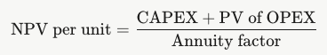
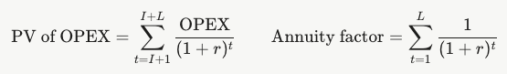
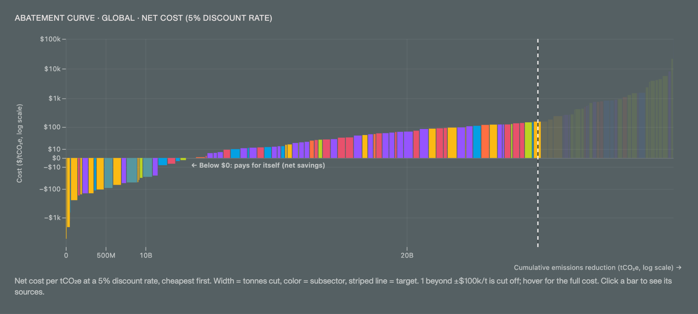

### Emissions-Reducing Solutions Framework

**Krsna Raniga1,2, Lauren Betz1,2, Zoheyr Doctor1,2, Amy Kouch1,2, Christy Lewis1,2, Dan Moore1,2, Amy Piscopo1,2, Anthony Russo1,2, Ishan Saraswat1,2, Ting So1,2, Lekha Sridhar1,2, Peter Thomas1,2, and Gavin McCormick1,2**

*1) WattTime, 2) Climate TRACE*

V5.12.0, Nov. 2026

#### 1 Introduction

The ultimate goal of Climate TRACE is to empower climate action to reach net-zero anthropogenic greenhouse gas emissions. The detailed asset-level emissions estimates synthesized by Climate TRACE thus far have provided a baseline from which to assess impacts of specific emissions-mitigating actions. Here we describe a crucial addition to the Climate TRACE data set: a catalog of emissions-reduction solutions (ERS) and corresponding estimates of emissions reduction potential if these solutions were applied to any asset, in any sector, globally. The ERS framework accounts for both direct effects on activity and emissions factors at the target asset as well as consequential induced effects on other dependent sectors (e.g., electricity generation).

#### 2 Methods

#### 2.1 Framework

Climate TRACE’s ERSs are based on two essential lists: the assets tracked by Climate TRACE and the candidate strategies for emissions reduction (Section 2.2). In our framework, each asset is matched (“crosswalked”) to one or more strategies that could be applied to it. We model the effect of a candidate strategy on an asset’s emissions by considering the strategy’s changes to the asset’s emissions factor, activity, and/or capacity (see Equation 1 in [*Completeness of Bottom-up Emissions Estimates and Associated Metadata*](https://github.com/climatetracecoalition/emissions-methodology/tree/main/Sector-Methodologies/2-Cross-Cutting) (Moore et al., 2025)). Furthermore, we account for the fact that applying a strategy to a target asset may “induce” changes in activity at *other* assets, therefore yielding additional changes in emissions. We catalog the parameters of this “new” reality if the solution were applied, including both the direct and induced emissions changes (holding all else equal), and then propagate these parameters to calculate the resultant global emissions reduction. This yields a list of asset and strategy pairs and their expected emissions reductions per year compared to business as usual. We describe these inputs and steps in the following sections.

#### 2.2 Strategy Completeness

Climate TRACE prioritizes domain-specific, research-backed ERS developed with sector expertise. However, to ensure comprehensive coverage across all assets and sectors, the dataset includes supplementary strategy generation methods that guarantee at least one applicable ERS with non-negligible emissions reductions for every asset. ERS are collated using the following hierarchical approach:

-   **Domain-specific solutions**: ERS compiled by Climate TRACE member teams that provide asset- or sector-specific actions and associated metadata. See individual sector methodologies in the [Climate TRACE GitHub emissions-methodology repository](https://github.com/climatetracecoalition/emissions-methodology/tree/main/Sector-Methodologies/1-Sectors) and [Changelogs](https://github.com/climatetracecoalition/emissions-methodology/tree/main/Changelogs).

-   **Auxiliary domain-specific solutions**: Additional domain-specific ERS compiled by WattTime.

-   **Benchmark-based ERS**: Automatically generated strategies that benchmark assets to the 10th-percentile emissions intensity in each sector, grouped by facility output type. Benchmark-based ERS aims to reduce asset-level emissions by aligning the emissions intensity of a given facility with that of the 10th percentile of facilities within the same sector. The potential reduction for any individual facility can range from 0% to 100%, depending on its current efficiency relative to the sector benchmark. Adoption of this strategy varies by industry, geography, ownership structure, and technology sub-types, as these factors influence the feasibility of implementing retrofits. In some sectors, such as iron and steel, switching from blast furnaces to electric arc furnaces represents a well-established retrofit pathway. In other sectors, identifying clear benchmarks is more challenging due to complex production processes or insufficient comparative data, which can limit the ability to apply this solution broadly.

-   **Unspecified improvements**: Universal 10% reduction (internal definition) in emissions factor applied as a fallback option. Provided as a guide of what is possible from e.g. minor reductions in consumption and/or increases in efficiency. The unspecified improvements aim to reduce emissions by approximately 10% at individual assets through generalized improvements in operational efficiency. While the specific technologies or practices are not defined, the mechanism relies on applying efficiency gains that may already exist at other assets within the same sector. Adoption of this solution is potentially universal across sectors, as the approach can be tailored to the unique conditions of each facility. However, the exact improvements necessary will vary by sector and by facility, and the solution remains "unspecified" because it aggregates diverse efficiency measures rather than prescribing a single intervention.

-   **Improve industrial efficiency by 10%:** Across heavy and light manufacturing, emissions arise from fuel combustion for process heat, from electricity used to drive equipment, and from the input materials consumed in production. Improving the efficiency of industrial processes reduces the need for each of these, and thereby reduces emissions. Typical measures include waste heat recovery, process optimization, upgraded motors and drives, better control systems and higher recycling of process materials. In aluminum production, for example, efficiency measures span the full chain from alumina refining and electrolysis to casting and recycling, and in integrated alumina and aluminum facilities they focus on optimizing energy and material flows across the site (Haraldsson and Johansson, 2018). Such measures typically deliver incremental emissions reductions of around 10–15%; deeper decarbonization requires process transformation (Dardor et al., 2025). For modeling purposes, an average 10% reduction in emissions is assumed, represented as a 10% reduction in each asset’s effective emissions factor. The strategy applies to all activity at the asset. For aluminum, the strategy is applied separately to integrated facilities and to stand-alone alumina refineries.

-   **Do Nothing/Do not reopen:** This approach maintains current operations for assets that are already operating at the most efficient levels with available technology or have been permanently shut down. This strategy does not actively reduce emissions but preserves the assets’ performance that have already been optimized or closed. Adoption of this approach is inherently limited to facilities that meet these criteria, ensuring that no further operational changes are required. The main caveat is that no additional emission reductions are achieved beyond the existing efficiency or closure status of the asset. Where this occurs, induced emissions are not estimated.

Each ERS is ascribed subjective confidence values assessing real-world practicality covering “very low”, “low”, “medium”, “high”, “very high”. Note, while this scheme ensures completeness, it does not guarantee that every asset is paired with at least one domain-specific solution: Some assets are paired only with benchmark-based ERS or unspecified improvement ERS, which are provisional best-available estimates. When multiple strategies are crosswalked to the same asset, each is evaluated independently as a mutually exclusive alternative; the current framework does not compound multiple interventions on a single asset.

#### 2.3 Core Reduction Calculation

For each greenhouse gas - carbon dioxide (CO2), methane (CH4), and nitrous oxide (N2O) - the annual emissions reduction rate (*R*) relative to the baseline emissions, defined as the total emissions from the previous full calendar year, is calculated as:

$`R\  = \ A_{\text{affected}}(\epsilon_{\text{old}} - \lbrack\epsilon_{\text{new}} + \alpha_{1}\text{ME}R_{1} + \ \alpha_{2}\text{ME}R_{2} + \alpha_{3}\text{ME}R_{3}\rbrack)`$ (1)

Below we list the definition of each of these quantities and their corresponding field in the ERS data set in parentheses.

-   $`R`$ (total\_emissions\_reduced\_per\_year): Rate of total emissions reduced per year, against the baseline emissions

-   $`A_{\text{affected}}`$ (max\_activity\_affected): Amount of the asset’s activity affected by the ERS, ranging from 0-100% of the annualized previous full calendar year activity. For example, if the ERS only applies to half of the activity at an asset, this would be 50% of the asset’s baseline activity

-   $`\epsilon_{\text{new}}`$ (\[GAS\]\_emissions*\_*factor\_new\_absolute) Emissions factor (tonnes of gas per unit activity) after the ERS intervention

-   $`\epsilon_{\text{old}}`$: Annualized baseline emissions factor pre-intervention

-   $`\alpha_{i}`$ (induced\_sector\_i\_conversion\_rate): Target sector to induced sector activity conversion factor, for each sector *i* in which emissions are induced by the ERS (e.g., MWh/tonne steel produced if an action in the steel sector induces electricity generation)

-   $`\text{ME}R_{i}`$: Marginal emissions rate for induced sector *i* (tonnes gas per unit induced activity)

Each strategy in our portfolio specifies $`A_{\text{affected}}`$, $`\epsilon_{\text{new}}`$, and $`\alpha_{i}`$, with the other quantities being derived from existing emissions estimates (or CMERs for electricity-generation, see “Power sector-Emissions from Electricity Generation” in the [Climate TRACE GitHub methodology repository](https://github.com/climatetracecoalition/emissions-methodology/tree/main/Sector-Methodologies/1-Sectors/power)). In some cases, $`A_{\text{affected}}`$ and $`\epsilon_{\text{new}}`$ are specified using ratios relative to the baseline activity and $`\epsilon_{\text{old}}`$ respectively, via parameters with the “\_new\_to\_old\_ratio” suffix. These ratios are converted to their absolute values when calculating the reduction potential in Equation 1. $`R`$, as well as other intermediate quantities, are computed for all three of CO2, CH4, and N2O following Equation 1, and the results are used to derive expected reductions for 20-year and 100-year global-warming-potential (GWP) CO2 equivalents, as defined by the IPCC.

#### 2.3.1 Induced emissions

Induced emissions represent the emissions consequences of implementing an ERS to an asset that are not accounted for in changes to the direct emissions of that asset. For example, this would apply to electric vehicles replacing fossil-fuel vehicles, leading to induced emissions from electricity generation.

These induced emissions are calculated by converting the facility's affected activity into induced activity in other sectors, then employing marginal emissions rates to quantify the emissions impact, captured by the $`A_{\text{affected}}\alpha_{i}\text{ME}R_{i}`$ terms of Equation 1.

At present, we account for the asset's influence on up to three induced sectors where the ERS causes emissions changes (typically increases) due to additional energy, transportation, materials, or general process requirements. In principle, we can account for an arbitrary number of induced sectors, but have found thus far that three is sufficient to handle all ERS. Electricity generation is the most common induced sector as many ERS rely on electrification, but self-induced emissions are also common especially for shutdown strategies, where demand is diverted back to the regional network of assets in the sector.

#### 2.3.2 Activity conversion

Activity conversion factors $`\alpha_{i}`$ translate the target asset’s affected activity into induced activity in upstream or downstream sectors. For example, an electrification strategy applied to a steel facility might require 0.00081 MWh of electricity per tonne of steel produced. This conversion factor is multiplied by the facility's affected activity (i.e. the amount of steel produced using electricity) to determine the induced electricity generation activity.

#### 2.3.3 Marginal Emissions Rates (MER)

For electricity generation, we use the combined marginal emissions rate (CMER), taken as the average of the marginal operating emissions rate (MOER) and marginal build emissions rate (MBER). These vary by renewable energy type, and are described in detail in our power sector methodology (Freeman et al., 2025; see “Power sector-Emissions from Electricity Generation” in the [Climate TRACE GitHub methodology repository](https://github.com/climatetracecoalition/emissions-methodology/tree/main/Sector-Methodologies/1-Sectors/power)).

The month-averaged CMER values for the previous full calendar year are applied at the balancing authority (BA) level for induced electricity cases. For cases where the facility of interest does not belong to an existing BA, the country-level average of power plant emissions factors defines the CMER. The global average serves as the final fallback.

For non-electricity induced sectors, MERs are approximated as the average emissions factor at:

-   Country-level where one or more assets of the induced sector exist in the same country

-   Global level where no other assets of the induced sector are available in the same country

-   Default emissions factors derived from the Intergovernmental Panel on Climate Change (IPCC) guidelines where no spatially certain asset-level information is available in Climate TRACE

Future work may improve on this approximation since the MER is not equal to the average emissions factor in general. MERs and induced activity conversion rates are applied against the facility's monthly activity profile, with monthly induced emissions summed to calculate the annual offset against facility-level reductions. When applicable, the MER is calculated based on the asset output type. This is used for cases where activity is shut down at an asset, inducing more demand for the same output as the closed facility.

#### 2.4 ERS Selection per Asset

While there are multiple possible ERS for each asset, we provide a single one at this time. Future upgrades will include more ERS options per asset. To select a single ERS for each asset, we first rely on the initial strategy\_rank for asset-strategy pairs, if it was provided in the initial data compiled for each sub-sector. However, in cases where the reductions are less than 3% (including negative reductions) or an initial strategy\_rank is unavailable, we re-rank the asset-strategy pairs. Our re-ranking proceeds by prioritizing reductions &gt; 3% (an effective threshold), then reductions between 0 and 3%. We exclude any cases where emissions reductions are negative. If further tie breaking is necessary, we follow each of the bullets below to break any ties, in order:

-   Domain-specific strategy &gt; Auxiliary domain-specific strategy &gt; Benchmark strategy &gt; Unspecified efficiency improvement

-   strategy\_id (this is a final deterministic tie breaker)

#### 2.5 ERS for spatially uncertain sources

Not all emissions within a country can be confidently attributed to individual assets. Instead, these spatially uncertain emissions are attributed to GADM regional boundaries and GHS Functional Urban Areas (ghs-fua) city boundaries, described in further detail in our methodology on spatially uncertain emissions (Collins et al., 2025, see methodology in “[Post Processing for Global Emissions and Metadata Completeness](https://github.com/climatetracecoalition/methodology-documents/tree/main/2025/Post%20Processing%20for%20Global%20Emissions%20and%20Metadata%20Completeness)” directory in the Climate TRACE GitHub repository).

Despite the lack of attribution to specific sites or operations, these sources still require quantified reduction pathways to ensure comprehensive coverage of global mitigation potential. The ERS for these spatially uncertain sources are derived using three approaches:

1.  The rank=1 asset-level strategies within each boundary are used to calculate an effective emissions reduction for each greenhouse gas, by taking the mean reduction ratio for all *n* assets in the boundary and applying to the boundary baseline emissions:

$`R_{boundary,\ gas} = E_{\text{boundary}} \cdot (1/n_{\text{assets}}) \cdot \sum_{i}\left( R_{i,\ gas}/E_{i,\ gas} \right)`$ (2)

The mean boundary-level emissions factor ratio is then applied to spatially uncertain emissions by gas. If no localized assets exist in the boundary, the country-level mean is used as a fallback, and if no localized assets exist in the country, the global mean is used as the final fallback.

1.  Auxiliary domain-specific solutions from Climate TRACE member teams for any sectors without asset-level coverage, applied globally with no regional differentiation at this time.

2.  Unspecified efficiency improvements through a universal 10% reduction in emissions factor applied as a fallback option, analogous to the approach for standard assets described in Section 2.2.

No induced emissions are explicitly accounted for in spatially uncertain reductions, but rather are integrated into the effective reduction ratios implicitly.

#### 2.6 Difficulty Score

With a defined strategy for each asset, we next seek to prioritize assets across sectors with ERS that are both easy to implement and yield high emissions reductions. Three qualitative metrics that weigh in the ease or difficulty of ERS implementation are the *effectiveness*, *practicality*, and *cost*. We capture these metrics quantitatively with a simple scoring system, and then combine the scores into a final “difficulty score” that is easily reproducible and comparable across sectors. We define the intermediate scores as:

-   Cost Score: Categorical integer ranging from 1 to 5 assessed through expert judgment and research, representing capital and operational intensity spanning from less costly (1) to more resource-intensive (5)

-   Practicality Score: Categorical integer ranging from 1 to 5 following the guide below, assessed through expert judgment and research:

-   Practical (1): real-world solutions that can be implemented nearly everywhere with ease

-   Reasonable (3): commonly implemented solutions with noted considerations

-   Exploratory (5): solutions with implementation challenges

-   Effectiveness Score: Numerical value spanning \[-2,2\] calculated as the z-score of an asset’s reductions per unit of its baseline activity within that asset’s subsector. In the event of a tie, the total reduction potential of the asset is used to determine the rank, independent of the sector

These scores are then combined into a raw difficulty score, which is simply the average of the practicality and cost scores plus the effectiveness score. The final difficulty score re-normalizes the raw difficulty scores over all assets so that the maximum difficulty is 10 and the minimum is 1.

We note that these metrics do not capture every subtlety of implementing an ERS, but they do provide an initial guide that, when examined alongside the assumptions, can be used to prioritize asset-strategy pairs. Future releases will expand on this framework to continuously improve the decision-making information we provide via Climate TRACE.

#### 2.7 ERS Cost Calculations

In addition to the difficulty score (Section 2.6), cost is another way to prioritize action. For each ERS, we estimate what it would cost to implement, in US dollars (USD), and express it in three ways: a cost per unit of the asset's output (e.g., USD per tonne of steel), a total cost for the asset, and a cost per tonne of CO₂e avoided (the abatement cost). The abatement cost lets users compare strategies across sectors on a common basis: how much it costs to cut one tonne of emissions.

Costs are estimated for each combination of strategy, asset type, and geography. Geography is currently grouped by continent (Africa, Asia, Europe, North America, Oceania, and South America), so assets of the same type on the same continent share the same cost assumptions. The current release covers 215 strategies across 69 subsectors.

These cost estimates draw on currently available data and are subject to uncertainty and data limitations and are intended as a guide for comparing strategies, not as precise figures. We welcome feedback from industry and sector experts whose knowledge can help improve them; please contact the Climate TRACE team ([https://climatetrace.org/contact](https://climatetrace.org/contact)) if you would like to contribute.

#### 2.7.1 Cost inputs

Each cost estimate starts with a set of inputs, based on research from industry, government, and academic sources (Table 1). Costs are given per unit of the asset's output or size, such as USD per tonne of product, per head of cattle, per hectare, or per MWh, so they can be applied to any asset of that type.

Costs are given as a low–high range rather than a single value. The low end typically reflects a simpler or lower-cost way of implementing the ERS, such as reusing existing equipment or a larger facility with economies of scale; the high end reflects a more extensive installation. These are indicated with the suffixes ‘\_low’ and ‘\_high’ in the field column in Table 1 for each input. Each estimate is documented with its data sources (cost\_data\_source), technology assumptions (cost\_assumptions), and a summary of the main cost drivers (cost\_overview). An example is provided in section 2.7.4 on the cost estimate to replace combustion-engine motorcycles with electric models.

**Table 1** List of inputs and their field names, along with their cost descriptions.

| **Input**             | **Field**                                      | **What it means**                                                                                                                           |
|-----------------------|------------------------------------------------|---------------------------------------------------------------------------------------------------------------------------------------------|
| Capital cost          | capex\_low, capex\_high                        | Additional upfront investment required to implement the ERS relative to the baseline, per unit of output or capacity.                       |
| Operating cost change | opex\_low, opex\_high                          | Change in annual operating costs relative to the baseline once the ERS is running. Negative values indicate savings (e.g., lower fuel use). |
| Implementation time   | implementation\_year                           | Years needed to put the ERS in place before emissions reductions begin                                                                      |
| Lifetime              | life\_year                                     | Years the ERS is expected to operate, with routine maintenance, before major replacement                                                    |
| Discount rates        | npv\_discount\_rate\_1, npv\_discount\_rate\_2 | Rates used to value future costs and savings in today's dollars: 5% and 10%                                                                 |
| Cost basis            | unit\_choice                                   | Whether the cost scales with the asset's activity (e.g., tonnes produced) or its capacity (e.g., hectares)                                  |
| Unit scalar           | unit\_scalar                                   | Adjusts for the share of activity or capacity the ERS affects, where subsector modeling requires it. Usually 1                              |

#### 2.7.2 Cost per unit of output

The inputs are combined into a single cost per unit of output using a net present value (NPV) calculation. NPV converts costs and savings that happen in different years into today's USD, so an up-front investment and a stream of future savings can be added together fairly. The result is then spread evenly over the ERS lifetime, giving an equivalent yearly cost per unit of output in Equation 3:

 (3)

Where,

CAPEX is paid up front, at the start of implementation;

OPEX is the yearly change in operating cost, which starts once implementation is complete (after I years) and continues for the ERS lifetime (L years)

Equation 4 describes how PV of OPEX and Annuity factor are estimated where r is the discount rate, I is the implementation time and L is the lifetime, both in years:

 (4)

In plain terms, a longer implementation period pushes savings further into the future and reduces their value today, while a longer lifetime spreads the up-front investment over more years. A positive NPV means the ERS is a net cost; a negative NPV means its operating savings outweigh its investment over its lifetime.

The NPV is calculated twice for each estimate: once with the low CAPEX and OPEX values (npv\_low) and once with the high values (npv\_high). Their midpoint is reported as the central estimate (npv\_avg). All three are calculated at both discount rates, 5% (suffix \_r1) and 10% (suffix \_r2). A higher discount rate gives less weight to future savings, so ERS with large up-front costs and long-term savings look more expensive at 10% than at 5%. This is described further in section 2.7.4 with replacing combustion-engine motorcycles with electric models.

#### 2.7.3 Asset cost and abatement cost

To estimate what an ERS would cost at a specific asset, the per-unit NPV is multiplied by the asset's yearly activity or capacity (depending on unit\_choice) and the unit scalar. This gives the asset's equivalent yearly cost of the ERS in USD:

*Cost\_asset\_avg = npv\_avg x asset activity (or capacity) x unit\_scalar* (5)

Dividing this cost by the emissions the ERS reduces each year gives the abatement cost, in USD per tonne of CO₂e avoided. We report two versions:

-   **Abatement cost (asset)** (cost\_abatement\_asset): the asset cost divided by the emissions reduced at the asset itself.

-   **Net abatement cost** (cost\_abatement\_asset\_net): the asset cost divided by the net emissions reduction, after subtracting any induced emissions in other sectors (Section 2.3.1). For example, an electrification ERS that increases electricity demand has a smaller net reduction, and therefore a higher net abatement cost.

As with the NPV, each value is reported at both the 5% and 10% discount rates. The net abatement cost is the better measure for comparing ERS that shift emissions to other sectors; the two are equal when an ERS induces no emissions elsewhere. See section 2.7.4 with replacing combustion-engine motorcycles with electric models.

**From costs to an emissions reduction plan.** These estimates feed the [Emission Reduction Plan tool](https://climatetrace.org/reduce) on the Climate TRACE website (Figure 1). Users set a target cut, as a share of baseline emissions, and the tool builds an abatement curve: a list of suggested solutions, ordered from easiest to hardest or from cheapest to most expensive. Each bar on the curve is one strategy. Its width is how many tonnes of CO₂e that strategy can cut per year, and its height is the difficulty score (Section 2.6) or the abatement cost (USD per tCO₂e) of a typical tonne of that cut. The widths add up along the horizontal axis, so reading across the curve shows how much total reduction is available at each level of difficulty or cost. A vertical line marks the target cut, and the strategies to its left make up the plan.

The curve is a starting point for prioritizing action. Bars below the \$0 (zero USD) horizontal line (labeled ‘← Below \$0: pays for itself (net savings)’ in Figure 1) in the cost view are strategies expected to save money over their lifetime, which makes them natural first steps. Switching between the difficulty and cost views can change the order, since a low-cost strategy may still be hard to implement in practice. Users can filter by location or sector to build a plan for a specific country, region, or industry. Because each strategy is evaluated on its own (Section 2.2) and costs are regional estimates, the plan should be read as a guide to where the largest and most affordable reductions are likely to be, not as a detailed investment plan.

**Figure 1** An example of the Climate TRACE [Emission Reduction Plan tool](https://climatetrace.org/reduce) showing the potential global abatement curve considering all ERS for all sectors.

#### 2.7.4 Worked example

Taking sections 2.7.1 to 2.7.3, we apply them here with the example of replacing combustion-engine motorcycles with electric models in South America, which roughly pays for itself at a 5% discount rate, but costs about USD 19 per tonne of CO₂e avoided at 10% (Table 2). Costs for this ERS are expressed per kilometer of annual vehicle travel.

**Table 2** Working steps to replace combustion-engine motorcycles with electric models in South America.

| **Step**                                                                                   | **5% discount rate**                                                                                                                  | **10% discount rate**    |
|--------------------------------------------------------------------------------------------|---------------------------------------------------------------------------------------------------------------------------------------|--------------------------|
| Inputs                                                                                     | CAPEX USD 0.08–0.25 per km; OPEX −USD 0.044 to −0.005 per km (fuel and maintenance savings); 2-year implementation; 10-year lifetime. | Same                     |
| NPV per km, low to high (npv\_low, npv\_high)                                              | −USD 0.029 to USD 0.028                                                                                                               | −USD 0.023 to USD 0.037  |
| NPV per km, average (npv\_avg)                                                             | −USD 0.0005 (a small net saving)                                                                                                      | USD 0.0070 (a net cost)  |
| Asset cost (cost\_asset\_avg): NPV × 460 billion km of road travel × unit scalar of 21.74% | −USD 55 million per year                                                                                                              | USD 700 million per year |
| Abatement cost (asset): asset cost ÷ 36.1 million tCO₂e reduced                            | −USD 1.5 per tCO₂e                                                                                                                    | USD 19 per tCO₂e         |
| Net abatement cost: asset cost ÷ 28.3 million tCO₂e net reduction                          | −USD 1.9 per tCO₂e                                                                                                                    | USD 25 per tCO₂e         |

The unit scalar limits the cost to the share of road vehicle travel the ERS applies to. The NPV changes sign between the two discount rates because the up-front cost of electric motorcycles is paid immediately, while the fuel and maintenance savings arrive over the following decade: at 10%, those future savings are worth less today and no longer cover the investment. The net abatement cost is higher than the asset abatement cost because charging the motorcycles increases emissions from electricity generation, reducing the net emissions benefit.

#### 2.7.5 Scope and limitations

-   **Strategies without costs:** Benchmark-based retrofits, unspecified improvements, shutdowns, and Do Nothing/Do not reopen strategies (Section 2.2) do not currently have cost estimates.

-   **Regional averages:** Costs vary by continent, not by country or individual facility. Local labor, energy prices, and site conditions can make real costs higher or lower.

-   **Direct costs only:** Estimates cover the additional capital and operating costs of implementing the ERS over the baseline. They do not include subsidies, carbon prices, or wider economic and social costs and benefits.

-   **One ERS at a time:** As with emissions reductions, each ERS is costed as a stand-alone alternative. Costs are not combined when more than one ERS could apply to the same asset unless ERS strategies are explicitly combined into a separate strategy.

-   **Ranges, not quotes:** The low–high range and the two discount rates are meant to show the likely spread of costs. Estimates should be read as a guide for comparing strategies, not as a quote for a specific project.

#### 3 Conclusion

The Climate TRACE ERS calculation framework is a systematic, modular pathway that both defines strategies and quantifies their expected net emissions reductions. Valid strategies are based on domain expertise and are drawn, as much as is feasible, from evidence-driven, real-world deployments of emissions reducing technologies/practices. Reductions calculated from these strategies account for changes in both emissions at the facility and downstream induced effects while safeguarding against implausible outcomes. Finally, the 100-year GWP aggregation enables comparison across interventions affecting different greenhouse gases in different sectors, accommodating both highly local and accumulated, globally aggregated reductions estimates.

Crucial next steps remain after the initial rollout of TRACE ERS. First, continued engagement with sector experts, technology developers, and downstream users is needed to meaningfully expand and refine the strategy library, including developing compound strategies that combine complementary interventions currently treated as mutually exclusive alternatives. Second, integrating more detailed cost and practicality data will enable stronger prioritization by accounting for additional implementation barriers. Third, validating expected reductions against observed emissions changes from real-world deployments can refine strategy parameters and improve confidence bounds. Altogether, these next steps can transition the framework from a static assessment to a dynamic, user-driven system, enabling consideration of multiple strategies per facility, either in isolation or as realistic hybrid strategies to maximize reduction potential.

#### References

Haraldsson, J. and Johansson, M. T. (2018). Review of measures for improved energy efficiency in production-related processes in the aluminium industry – From electrolysis to recycling. Renewable and Sustainable Energy Reviews, 93, 525–548. https://doi.org/10.1016/j.rser.2018.05.043

Moore, D., Lewis, C., Sridhar, L., Piscopo, A., Betz, L., Raniga, K., Doctor, Z., and McCormick, G. (2026). Data-Informed Disaggregation and Implicit Estimation of Emissions in Other Subsectors. WattTime, USA, Climate TRACE Emissions Inventory. https://climatetrace.org \[Accessed October 2026\]
