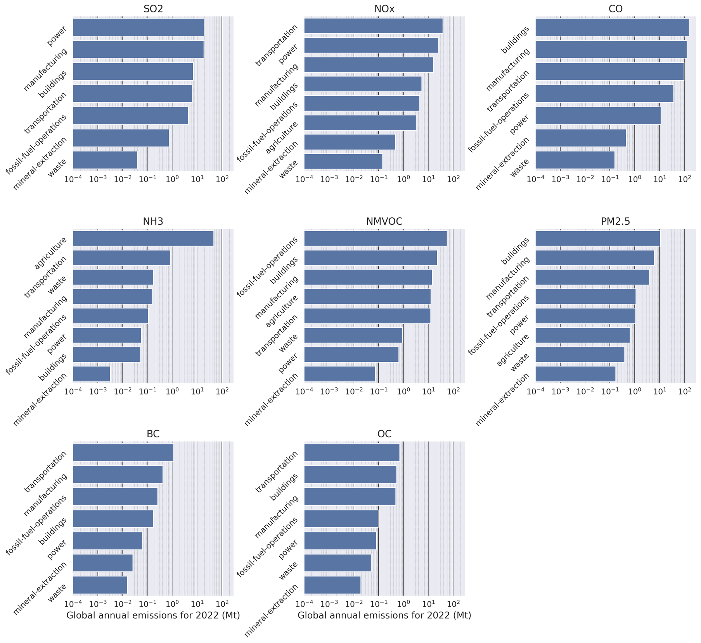
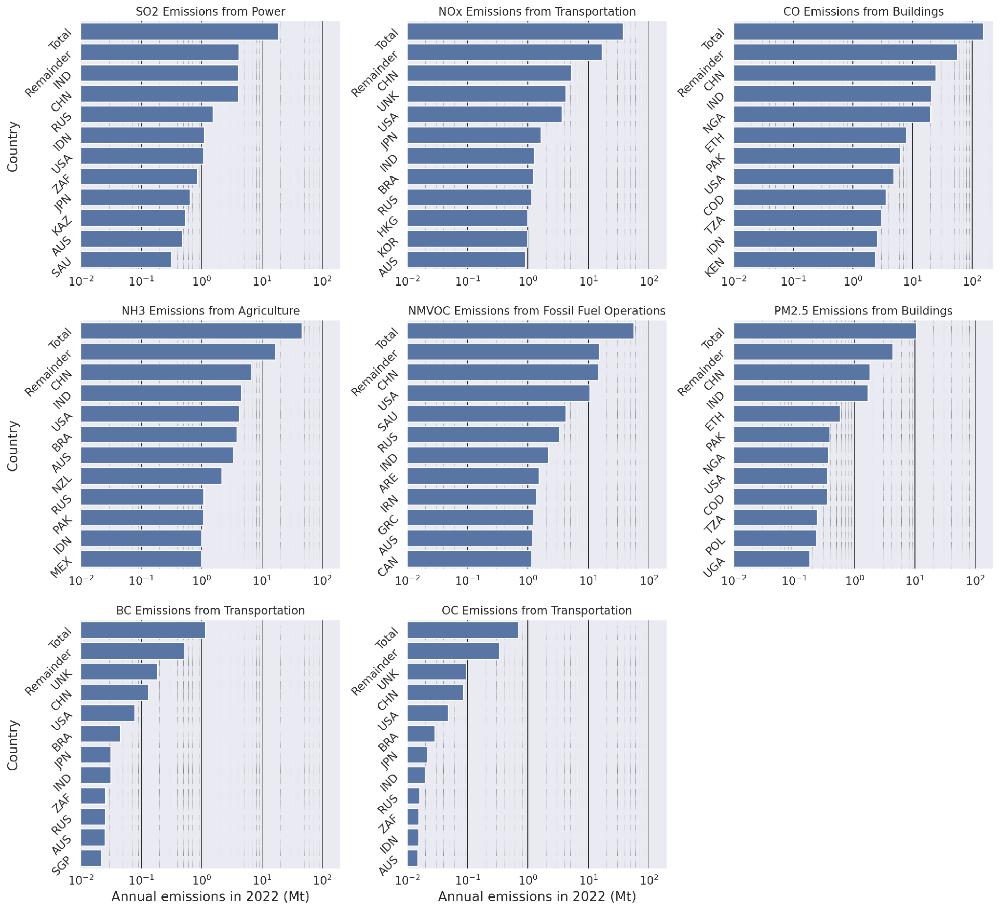
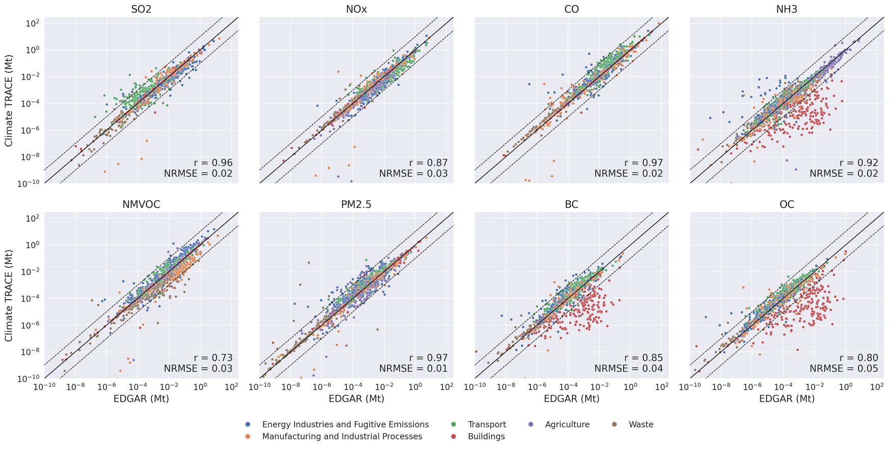
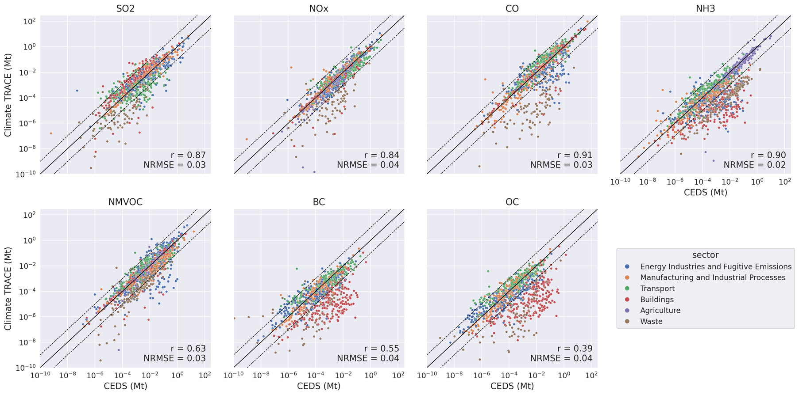
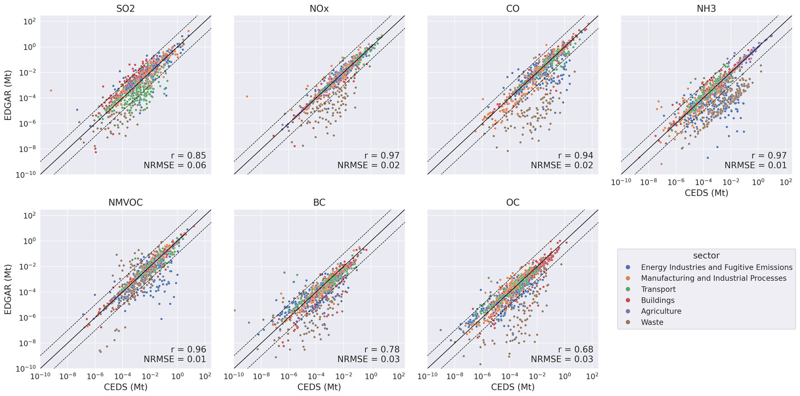

**Non-Greenhouse Gas Emissions Estimates Across Sectors**

***Gary Collins1,3, Luke Mullany1,3, Michael Robinette1,3, Lekha Sridhar2,3, Elizabeth Reilly1,3, and Jeff Maranchi1,3***

1\) The Johns Hopkins University Applied Physics Laboratory (JHU/APL),

2\) WattTime, 3) Climate TRACE

Introduction
============

The World Health Organization (WHO) estimates that globally 6.7 million premature deaths annually are caused by poor air quality, with 4.2 million of those deaths caused by ambient outdoor air pollution \[1\]. Whereas the impacts from releasing greenhouse gases (GHGs) are long term, air pollution can have both long-term and immediate impacts on the health of individuals and communities. Further, anthropogenic sources of air pollutants are also an issue of climate justice as the impacts of air pollution are disproportionately felt by poorer, disadvantaged communities and the Global South.

Currently there are gaps in the knowledge of the sources and magnitude of ambient air pollution, and these gaps are a major impediment to addressing critical health and environmental problems. While there are many datasets that focus on air pollution used by researchers, there is no air pollution dataset that has facility-specific emissions, global coverage, and high recency. These characteristics are necessary for direct accountability of polluters, for policy and decision-makers to regulate pollutants and improve public health more efficiently, and for activists to direct action effectively. This document describes Climate TRACE’s approach for filling this gap by applying its knowledge of and approaches for estimating greenhouse gas sources to air pollution.

To that end, criteria pollutants – sulfur dioxide (SO2), nitrous oxides (NOx), non-methane volatile organic gases (NMVOC), ammonia (NH3), carbon monoxide (CO), particulate matter less than 2.5 micron in diameter (PM2.5) – and speciated PM2.5 components black carbon (BC) and organic carbon (OC) are predicted for all sectors globally. Among these, the gap-filled predictions are arrived at by identifying pollution streams (e.g. combustion and fugitive) on which emissions factors or estimated co-pollutant ratios are applied. These emissions factors and ratios are based on country, sector, fuel, and asset-type, where available, and descriptions of how these are constructed is below.

1.  Data and Methods
    ================

    1.  Overview
        --------

Estimates of non-ghg emissions that take a bottom-up approach (where emissions are estimated by accounting for different consumption, energy-demand, and other activities) often lack facility-level specificity that is required for identifying polluters and holding them accountable. This includes the high-quality Emissions Dataset for Global Atmospheric Research (EDGAR) and the mosaic Community Emissions Data System (CEDS) which use sophisticated and granular approaches to estimating emissions and mitigation controls for country-level emissions estimates but rely on proxies for distributing emissions spatially \[2,3,4\]. The approach described here leverages these emissions inventories in order to provide conversion factors between greenhouse gas emissions and pollution emissions for a given facility.

These co-pollutant conversion factors are used for Climate TRACE sectors in which non-GHG emissions are not otherwise estimated directly and for country-level emissions estimation. The approach assumes a linear relationship between emissions of GHGs and non-GHGs, i.e. for every X tonnes of greenhouse gas emitted, Y tonnes of pollutant are emitted. These ratios are estimated at a country-sector-emissions stream level, and then applied across Climate TRACE assets – essentially utilizing CEDS/EDGAR emissions estimates but rescaled and distributed based on Climate TRACE data. For several asset-level sectors, activity-based emission factors are used in place of ratios where the inventories do not support a meaningful ratio (Section 2.5.2).

Various improvements were made between Phase 7 and Phase 8 of Climate TRACE air pollutants in order to more accurately estimate emissions:

1.  The mapping between Climate TRACE sectors and EDGAR and CEDS sectors was updated to better align with the 2026 Climate TRACE sector crosswalk to EDGAR and CEDS.

2.  Biomass components of the EDGAR and CEDS emissions estimates were removed from the ratio computation for sectors as the fuel emissions from Climate TRACE sectors are mostly fossil-based.

3.  Ratios are now computed and applied for the dominant gas of each sector whereas previously CO2 equivalent was used.

4.  The combustion/process split used in Phase 7 was replaced by a more generalized emissions stream model (e.g. combustion, process, fugitive), and ratios that were undefined or unstable due to no or low GHG emissions in EDGAR and CEDS were replaced with an activity-based approach.

5.  Process emissions shared by pulp and paper, food, beverage and tobacco, and wood products are now disaggregated with Tier 1 emission factors.

    1.  Data
        ----

CEDS and EDGAR air pollution emissions estimates are used for predicting the air pollution emissions for Climate TRACE assets. The EDGAR air pollutant (v8.1, 1970–2022) and GHG (EGDAR\_2026\_GHG) emissions \[5\] and the CEDS v\_2025\_03\_18 release, by country, sector and fuel \[6\], are used. A mapping of the sectors of these inventories (which are IPCC code-based) to Climate TRACE sectors is needed for making this estimate and is shown in Table 5 and Table 6 in Supplementary Materials. In addition, as CEDS and EDGAR only estimate emissions up to 2022, forward filling is used for any date after.

Climate TRACE GHG estimates exclude biomass CO2, which is accounted for in the forestry and land use sectors. To keep the numerator and denominator of each ratio consistent with the Climate TRACE GHG estimate to which the ratio is applied, biomass is excluded from both inventories: EDGAR emissions flagged as biomass are removed, and the CEDS by-fuel tables are used with the biomass fuel category removed before the remaining fuels are summed for each country and sector. Ratios therefore describe fossil-fuel and process emissions only.

Countries are matched according to ISO3 codes. Where a ratio is missing from one inventory for a country, the ratio from the other inventory is used. Ratios that are exactly zero, which arise for small-emitting countries, are treated as missing. Countries in the Climate TRACE country list that remain without a ratio, and any non-finite ratios, are assigned the median ratio across countries for the same sector, species and year.

Emissions Model
---------------

As Climate TRACE estimates emissions at the facility-level, multiple sources of emissions at a given facility are combined to form a single estimate. In Phase 8, the emissions of pollutant *g* from asset *a* are the sum of the emissions of the asset’s emission streams *k*, where $K_{s}$ is the set of streams (such as combustion, fugitive leakage, and dusting) defined for the asset’s sector *s* (Section 2.4):

$Em_{a}^{g} = \text{Em}_{a,k}^{g}$ (Eq. 1)

Each stream is estimated with one of two models (Section 2.5). In the co-pollutant ratio model, a ratio $r$ is applied to the dominant GHG emissions $Em^{a,D_{k}}$ of a given asset or sector to estimate the non-GHG emissions. This operation is expressed with:

$Em_{a,k}^{g} = r_{s,c,k}^{g,D_{k}} \cdot Em^{a,D_{k}}$ (Eq. 2)

In the activity-based model, stream emissions are estimated using a bottom-up approach wherein activities for these emissions are modeled and multiplied by corresponding emission factors:

$Em_{a,k}^{g} = A_{a,k} \cdot EF_{k}^{g}$ (Eq. 3)

This formulation generalizes that of Phase 7, in which the emissions of each were divided into combustion-related and process-related components only. Combustion and process remain as stream types, alongside fugitive, flaring, fugitive-dust, agricultural and waste, and combined streams. The emissions formula of a sector follows from listing its streams and the model used for each (Section 2.6).

Emission Stream Types
---------------------

The total pollutant emissions at a given facility can be composed of multiple different emissions streams. For example, VOC emissions at a coal mining site can arise from a combustion stream (the combustion of diesel in heavy machinery) and from the fugitive release from newly exposed coal. Hence, modeling each stream is necessary for accurately modeling emissions. Each stream is characterized by its source type, the inventory categories from which its ratio is built, and its base gas (Table 1).

**Table 1.** Emission stream types.

| **Stream type**        | **Source**                                                                    | **Inventory categories**       | **Base gas**                                     | **Model**                                                                 |
|------------------------|-------------------------------------------------------------------------------|--------------------------------|--------------------------------------------------|---------------------------------------------------------------------------|
| Combustion             | Fuel combustion for power, heat, transport, buildings and industry            | EDGAR 1.A.x; CEDS 1A\*, GFED   | CO2                                   | Ratio                                                                     |
| Process                | Non-combustion industrial processes                                           | EDGAR 2.x; CEDS 2\*            | CO2                                   | Ratio; activity-based where the inventories report negligible process GHG |
| Fugitive               | Leaks, venting and handling losses in fossil-fuel operations                  | EDGAR 1.B.1, 1.B.2; CEDS 1B\*  | CH4 or CO2                 | Ratio                                                                     |
| Flaring                | Combustion of waste gas in flares                                             | None; EMEP/EEA 1.B.2.c factors | CO2                                   | Ratio derived from emission factors                                       |
| Fugitive dust          | Drilling, blasting, crushing, screening and handling of minerals              | None; EMEP/EEA 2.A.5.a factors | None                                             | Activity-based                                                            |
| Agricultural and waste | Biological and soil processes in agriculture; waste handling and incineration | EDGAR 3.x, 4.x; CEDS 3*, 5*    | CH4, N2O or CO2 | Ratio                                                                     |
| Combined               | More than one source type represented by a single ratio                       | As listed in Table 5           | CO2                                   | Ratio                                                                     |

**Combustion and process.** These follow the IPCC distinction between fuel combustion (1.A) and industrial processes (2) that is used by both inventories and by the Climate TRACE asset data, whose reported combustion and process shares determine the stream amounts of asset-level sectors (Table 6).

**Fugitive.** Leaks, venting and handling losses in fossil-fuel production, transport and refining (1.B). The principal co-pollutant is NMVOC; for coal mining, the fugitive category also carries the dust from coal handling. The base gas is CH4 for coal mining and for oil and gas production and transport, and CO2 for refining and petrochemical steam cracking, whose Climate TRACE data report fugitive emissions as a fraction of CO2.

**Flaring.** EDGAR and CEDS combine venting and flaring within the fugitive categories, so flaring is represented as a separate stream whose ratio is derived from emission factors (Section 2.5.1.2).

**Fugitive dust.** Particulate emissions from drilling, blasting, crushing, screening and handling of minerals (EMEP/EEA 2.A.5.a \[7\]). No GHG accompanies them, so they are estimated only with the activity-based model. The guidebook method excludes fuel combustion in the quarry, which is carried by the combustion stream, so the two streams are additive.

**Agricultural and waste sources.** Biological and soil processes in agriculture (IPCC 3) and waste handling (IPCC 4; CEDS 5), whose ratios are formed against the sector’s dominant GHG: CH4 or N2O, or CO2 for incineration and open burning of waste.

**Combined.** A single ratio spanning more than one source type, used where the inventories or the Climate TRACE data do not support a split: *other-manufacturing* (industrial combustion and all industrial processes), *iron-and-steel*, *other-metals* (non-ferrous combustion and processes), *pulp-and-paper*, *food-beverage-and-tobacco*, and *wood-and-wood-products* (combustion and a Tier 1 disaggregated process share). A combined stream is a documented simplification rather than a physical source type.

1.  Estimation Models
    -----------------

    1.  ### Co-Pollutant Ratio Model

For non-GHGs, emissions factors for a given emissions stream are dependent on asset-level pollution controls, and many sectors have asset-level pollution control data needed for determining these emissions factors. However, for other sectors and many regions globally, pollution control data is difficult to access; hence these emissions factors have to be estimated. To do so, national-level emissions factors are estimated using a fusion of emissions estimates from EDGAR and CEDS. Primarily, co-pollutant ratios are developed such that the dominant GHG estimates of a given sector $Em_{s,c,k}^{D_{k}}$ can be translated to pollution values. For a stream built from inventory data, the ratio for sector *s*, country *c* and stream *k* is,

$r_{s,c,k}^{g,D} = \frac{\text{Em}_{s,c,k}^{g}}{Em_{s,c,k}^{D_{k}}}$ (Eq. 4)

where *E* denotes the inventory emissions of the categories mapped to the stream (Tables 5 and 6), summed where several categories map to one stream. The dominant GHG is CO2 for fuel-combustion and industrial-process sectors, CH4 for biogenic and fugitive sectors, and N2O for nitrogen-cycle soil sectors (Table 2).

Prior to Phase 7, these ratios were estimated purely from either EDGAR or CEDS for a given sector $(s$) and country ($c)$; however, to improve upon national-level estimates a harmonic average is used to mix ratios arising from these datasets – expressed for the combustion fraction with,

$r_{\text{comb}}^{g} \approx r_{s,c,comb}^{g,\ EDGAR/CEDS} = \frac{2}{\left( r_{s,c,comb}^{g,EDGAR} \right)^{- 1} + \left( r_{s,c,comb}^{g,CEDS} \right)^{- 1}}$ (Eq. 5),

with $r_{s,c,comb}^{g,EDGAR}$ and $r_{s,c,comb}^{g,CEDS}$ defined with Equation 4 using EDGAR and CEDS, respectively. A similar expression is used for the process ratio. Section 2.5.1.4 discusses how using this approach reduces bias in the model.

The outcome of this approach, although having uniform emissions factors across all facilities from the same sector and in the same nation, is that the estimated national pollution intensity is preserved and distributed based on facility-level activity and location directly as opposed to spatial proxies. In addition, the use of the dominant greenhouse gas to anchor the co-pollutant ratio results in pollution estimates with higher confidence than if they were estimated with the composite CO2-equivalent as previously. Generally, the GHG emissions from most sectors are dominated by a single gas, and the uncertainty carried by CO2 equivalent is higher than any single gas. Hence, constructing and applying ratios for a single gas instead of a composite of gases yields a lower uncertainty for the resulting pollutant.

Carbon monoxide (CO), ammonia (NH3), non-methane volatile organic compounds (NMVOC), nitrogen oxides (NOx), sulfur dioxide (SO2), particulate matter smaller than 2.5 microns (PM2.5), and speciated components of PM2.5 that are byproducts of combustion – black carbon (BC) and organic carbon (OC) – were estimated in this manner and for all sectors where asset-level emissions were not directly estimated. For some sectors, particulate matter smaller than 10 microns (PM10) was also estimated. These estimates are not publicly available in Phase 8, but may be made available in future updates.

An additional conversion step was needed to produce PM2.5 and PM10 estimates from CEDS as it only provides estimates of the speciated BC and OC pollutants. It is assumed that the mitigation of BC is equally effective for mitigating PM2.5 since BC is a subspecies of PM2.5. Thus, a conversion of CEDS BC emissions to PM2.5 emissions can be made with,

$\text{Em}_{a}^{PM2.5,CEDS} = \rho_{\text{BC}} \cdot Em_{a}^{BC,CEDS}$, (Eq. 6),

where $\rho_{\text{BC}} = \frac{1}{\%\ of\ PM2.5\ that\ is\ BC}$. A conversion from PM2.5 emissions to PM10 emissions is made with a similar expression:

$\text{Em}_{a}^{PM10,CEDS} = \rho_{PM10} \cdot Em_{a}^{PM2.5,CEDS}$ (Eq. 7).

The values of $\rho_{\text{BC}}$ and $\rho_{PM10}$ are computed for most sectors with the EMEP/EEA Air Pollutant Emission Inventory Guidebook \[7\], with the only exception being aviation where EPA SmartWay is used \[8\]. For sectors where these values are unavailable in these resources an estimation is made with EDGAR, defined with

$\rho_{\text{BC}} \approx \frac{Em_{s,c}^{PM2.5,EDGAR}}{Em_{s,c}^{BC,EDGAR}}$

and

$\rho_{PM10} \approx \frac{Em_{s,c}^{PM10,EDGAR}}{Em_{s,c}^{PM2.5,EDGAR}}$.

For iron and steel, single global values are used, ρBC = 14.59 and ρPM10 = 1.459. These are the 2018–2022 medians of the ratios of global EDGAR iron and steel emissions, taken as the EDGAR 1.A.2 and 2.C emissions multiplied by the iron and steel shares of global CEDS BC in 1A2 and 2C, respectively.

After all emissions estimates are produced, gap-filling of zero and NaN emissions ratios is performed by replacing said values with the median of the non-zero/non-NaN values. At the time of this document, EDGAR’s latest year for emissions estimates is 2022, and hence all years thereafter are estimated with the ratio in 2022.

### 2.5.1.1 Disaggregation of EDGAR and CEDS 2.H Emissions

*Pulp-and-paper*, *food-beverage-and-tobacco*, and *wood-and-wood-products* share a single process sector in both inventories (EDGAR 2.H and CEDS 2H), which reports no process GHG, so a process ratio cannot be formed. The three industries also have different co-pollutant profiles. The shared process emissions are therefore disaggregated with the EMEP/EEA Tier 1 emission factors for *pulp-and-paper* \[7\] (CO 5.5, NMVOC 2, PM2.5 0.6 and PM10 0.8 kg per Mg air-dried pulp). *Pulp-and-paper* is taken as the sole process source of CO, NOx, SO2 and BC in 2.H; its NMVOC, PM2.5 and PM10 are obtained by scaling the EDGAR 2.H CO by the Tier 1 ratios to CO. The remaining NMVOC is assigned to food, beverage and tobacco, and the remaining PM to wood products, with residuals bounded below by zero. OC and NH3 are not reported in 2.H and are set to zero. EDGAR 1.A.2 combustion emissions are divided among the three sectors by each sector’s share of CEDS industrial combustion emissions of the same species. The combined ratio for sector *s* is then

$r_{s,c}^{g,CO_{2}} = \frac{w_{s,c}^{g}\, E_{c,1.A.2}^{g} + P_{s,c}^{g}}{w_{s,c}^{CO_{2}}\, E_{c,1.A.2}^{CO_{2}}},\quad\quad w_{s,c}^{g} = \frac{C_{s,c}^{g}}{C_{s^{'},c}^{g}}$ (Eq. 8)

where *E* and *C* denote EDGAR and CEDS emissions and $P_{s,c}^{g}$ is the process emission assigned to sector *s* above.

### 2.5.1.2 Flaring Ratio Derivation

The flaring streams of oil and gas refining and petrochemical steam cracking use a fixed ratio derived from the EMEP/EEA refinery flaring emission factors \[7\]. These are expressed per unit of energy, and converted to a ratio to CO2 with the IPCC default CO2 emission factor for refinery gas \[9\]:

$r_{\text{flare}}^{g,CO_{2}} = \frac{EF_{\text{flare}}^{g}\ \left\lbrack g/GJ \right\rbrack}{57\, 600\ \left\lbrack \text{g C}O_{2}/GJ \right\rbrack}$ (Eq. 9)

SO2 from flaring is computed from the flare-gas sulfur content, for which a default of 236 ppm by mass, based on the U.S. New Source Performance Standards limit for refinery fuel gas, is used \[10\].

### 2.5.1.3 Fire Ratios

Co-pollutant ratios for the fire sectors are derived from the GFED emission factors \[11\], which are given per vegetation class in grams per kilogram of dry matter burned. Because both factors refer to the same mass of dry matter, the ratio of pollutant *g* to CO2 for vegetation class $v$ is

$r_{v}^{g,CO_{2}} = \frac{EF_{v}^{g}}{EF_{v}^{CO_{2}}}$ (Eq. 10)

*Shrubgrass-fires*, *wetland-fires* and *cropland-fires* use the GFED *shrub*, *wetland* and *agricultural* classes, each with a single global ratio. Forest-land-fires use the GFED *tropical*, *temperate* or *boreal forest* class according to the IPCC climate zone $Z\left( x \right)$ of each 0.1° land cell $x$,

$r_{\text{forest}}^{g,CO_{2}}\left( x \right) = r_{v\left( Z\left( x \right) \right)}^{g,CO_{2}}$ (Eq. 11).

Climate zones are assigned with the IPCC decision tree \[12\], as for Climate TRACE reservoir emissions \[13\] but at 0.1° rather than 0.5°. Mean annual temperature, mean annual precipitation and the test for all months below 10 °C are computed from ERA5-Land monthly means \[14\] over the 31 years ending in the target year. Frost days and potential evapotranspiration (PET) are taken from CRU TS 4.09 \[15\], averaged at 0.5° over the same period (ending in 2024, the last CRU year), and assigned to the 0.1° grid with bilinear interpolation; elevation is GMTED2010 \[16\] resampled to 0.1°.

### 2.5.1.4 Harmonic Mean of Ratio Error Analysis for Co-Pollution Ratio Model

The use of a harmonic average reduces the biases caused by either individual dataset. Consider only one emissions co-pollutant ratio which differs from the “true” conversion ratio ($\rho$) with some error $\epsilon$, such that

$r_{1} = \rho\left( 1 + \epsilon_{1} \right)$, (Eq. 12),

for inventory $1$ (e.g. CEDS) and similarly defined for inventory $2$ (e.g. EDGAR). The relative error between the estimated emissions and the true emissions can be shown to be $\epsilon_{i}$, with

$Em_{\text{true}} = \rho \cdot Em^{D}$,

$E{m^{1}}_{\text{estimated}} = r_{1} \cdot Em^{D} = \rho\left( 1 + \epsilon_{1} \right) \cdot Em^{D},$

$\Rightarrow \frac{{E^{1}}_{\text{estimated}} - E_{\text{true}}}{E_{\text{true}}} = \epsilon_{1}$ (Eq. 13).

Hence, for a single inventory, the discrepancy between the inventory and the true co-pollutant ratio is directly proportional to the error of the emissions estimate. Now consider using two emissions ratios that are combined with a harmonic mean such that the emissions estimate is

$\text{Em}_{\text{estimated}}^{\text{harmonic}} = r^{\text{harmonic}} \cdot Em^{D}$, (Eq. 14).

Substituting Equation 12 into Equation 5 and expanding yields,

$r^{\text{harmonic}} = \rho\frac{2\left( 1 + \epsilon_{1} \right)\left( 1 + \epsilon_{2} \right)}{2 + \epsilon_{1} + \epsilon_{2}},$

and hence the relative error of the emissions estimate in Equation 14 is

$\frac{\text{Em}_{\text{estimated}}^{\text{harmonic}} - E_{\text{true}}}{E_{\text{true}}} = \frac{\epsilon_{1} + \epsilon_{2} + 2\epsilon_{1}\epsilon_{2}}{2 + \epsilon_{1} + \epsilon_{2}}$, (Eq. 15).

When the biases of $1$ and $2$ are opposed, these errors largely cancel, and when they are aligned, assuming small errors, ${|\epsilon}_{1}|,|\epsilon_{2}| \ll 1$, the error reduces to

$\frac{\text{Em}_{\text{estimated}}^{\text{harmonic}} - E_{\text{true}}}{E_{\text{true}}} \approx \frac{\epsilon_{1} + \epsilon_{2}}{2}$, (Eq. 16).

Hence using a harmonic mean of two inventories results in biases either canceling out, or the bias of the estimate lying between the biases of the two datasets. Because the magnitude and signs of the individual biases of CEDS and EDGAR are uncertain, the harmonic mean offers a more robust centralized estimate than choosing either inventory alone.

### Activity-Based Emission Factor Model

The co-pollutant ratio model (Equation 2) works well for most sectors, and even with sectors which lack either combustion or process emissions – e.g. the combustion-only textile industry or enteric fermentation, which has neither. However, the process streams of *aluminum* and *chemicals* and the dust stream of non-coal mining and quarrying, required special treatment related to the process component of the emissions due to the asset lacking GHG emissions from process-related activities (e.g. blasting of rock), or because the inventories report negligible process GHG for the sector, which leaves the process ratio undefined. Conveniently, emission factors from \[7\] (Table 7) can be used directly with the activities in these sectors to produce stream-related emissions, resulting in

$Em_{s}^{g} = A_{s}^{g} \cdot EF_{s}^{g}$(Eq. 17)

which is used for the process or dust streams of these sectors. The emission factors are added to the combustion stream because the corresponding guidebook methods exclude fuel combustion.

Application to Climate TRACE Sectors
------------------------------------

Table 2 lists, for each Climate TRACE sector, its streams and the model and ratio source used for each. The emissions formula of each sector, obtained by applying Equations 1–3 to its streams, is given in Table 4.

**Table 2.** Emission streams and estimation models by Climate TRACE sector. R: harmonic average of EDGAR and CEDS (Eq. 5); R-E: EDGAR only (Eq. 4); R-C: CEDS only; R-Dis: disaggregation (Eq. 8); R-EF: ratio derived from emission factors (Eq. 9); EF: activity-based emission factor (Eq. 3; Table 7). *D* is the dominant GHG. Stream amounts for asset-level sectors are defined in Table 6.

| **Climate TRACE sector**                                                                                                                   | **Comb.** | **Process**               | **Fugitive**       | **Flaring** | **Dust** | **Agric./ Waste** | **Combined** | **D**          |
|--------------------------------------------------------------------------------------------------------------------------------------------|-----------|---------------------------|--------------------|-------------|----------|-------------------|--------------|----------------|
| **Country-level sectors**                                                                                                                  |           |                           |                    |             |          |                   |              |                |
| heat-plants, electricity-generation, other-energy-use                                                                                      | R         |                           |                    |             |          |                   |              | CO2 |
| domestic- and international-aviation, domestic- and international-shipping, railways, other-transport                                      | R         |                           |                    |             |          |                   |              | CO2 |
| road-transportation (exhaust and resuspension)                                                                                             | R-E       |                           |                    |             |          |                   |              | CO2 |
| residential-, non-residential- and other-onsite-fuel-usage                                                                                 | R         |                           |                    |             |          |                   |              | CO2 |
| textiles-leather-apparel                                                                                                                   | R         |                           |                    |             |          |                   |              | CO2 |
| mining and quarrying (6 sectors) when no asset data exist                                                                                  | R         |                           |                    |             |          |                   |              | CO2 |
| pulp-and-paper, food-beverage-tobacco, wood-and-wood-products                                                                              |           |                           |                    |             |          |                   | R-Dis        | CO2 |
| other-manufacturing                                                                                                                        |           |                           |                    |             |          |                   | R            | CO2 |
| enteric-fermentation (3 sectors), manure-management (2 sectors), rice-cultivation                                                          |           |                           |                    |             |          | R                 |              | CH4 |
| manure-left-on-pasture-cattle, synthetic-fertilizer-application, manure-applied-to-soils, crop-residues, other-agricultural-soil-emissions |           |                           |                    |             |          | R                 |              | N2O |
| solid-waste-disposal, biological-treatment-of-solid-waste-and-biogenic, domestic- and industrial-wastewater-treatment-and-discharge        |           |                           |                    |             |          | R                 |              | CH4 |
| incineration-and-open-burning-of-waste                                                                                                     |           |                           |                    |             |          | R                 |              | CO2 |
| forest-fires, wetland-fires, shrubgrass-fires                                                                                              | R         |                           |                    |             |          |                   |              | CO2 |
| cropland-fires                                                                                                                             | R         |                           |                    |             |          |                   |              | CH4 |
| **Asset-level sectors**                                                                                                                    |           |                           |                    |             |          |                   |              |                |
| cement, lime, glass                                                                                                                        | R         | R                         |                    |             |          |                   |              | CO2 |
| other-chemicals                                                                                                                            | R         | R                         |                    |             |          |                   |              | CO2 |
| iron-and-steel                                                                                                                             |           |                           |                    |             |          |                   | R-C          | CO2 |
| aluminum                                                                                                                                   | R         | EF (smelting, integrated) |                    |             |          |                   |              | CO2 |
| chemicals                                                                                                                                  | R         | EF                        |                    |             |          |                   |              | CO2 |
| sand-quarrying, rock-quarrying, bauxite-mining, iron-mining, copper-mining, other-mining-quarrying                                         | R         |                           |                    |             | EF       |                   |              | CO2 |
| other-metals                                                                                                                               |           |                           |                    |             |          |                   | R-C          | CO2 |
| oil-and-gas-refining, petrochemical-steam-cracking                                                                                         | R         |                           | R                  | R-EF        |          |                   |              | CO2 |
| oil-and-gas-production, oil-and-gas-transport                                                                                              |           |                           | R (CH4) |             |          |                   |              | CH4 |
| coal-mining                                                                                                                                | R         |                           | R (CH4) |             |          |                   |              | CH4 |
| other-fossil-fuel-operations (CO2 only)                                                                                         | —         | —                         | —                  | —           | —        | —                 | —            | —              |

Uncertainty & Confidence
------------------------

Uncertainty analysis was not performed for this initial development of air quality datasets; however, as the dataset matures, uncertainty of activity for sectors will be incorporated with the uncertainty of emissions factors and mitigation controls. As uncertainty quantification was not performed and country-level mitigation and reduction technology is considered constant across facilities, the confidences of these estimates are considered *Very Low*.

Results
=======

Climate TRACE Phase 8 non-GHG emissions for 2022 are compared with EDGAR and CEDS in Table 3 for aligned sectors and excluding forestry, land use and fire sectors. Biomass combustion is excluded from the inventories, consistent with the ratios (Section 2.2), except in buildings, where the Climate TRACE estimates include biofuel combustion that cannot be separated. The totals are therefore lower than full inventory totals and are not comparable with the Phase 7 totals, which included biomass and fires. Non-GHG emissions for eight sectors (electricity generation, residential and non-residential onsite fuel usage, road transportation, and domestic and international aviation and shipping) are estimated directly by the Climate TRACE sector teams. All other sectors are estimated with the models of Section 2 and are referred to as *ratio-filled* sectors.

**Table 3.** Global emissions for 2022, in Mt, summed over the comparison sectors common to Climate TRACE and each inventory, and the ratio of Climate TRACE to each inventory. Forestry, land use and fires are excluded. Biomass combustion is excluded from the inventories except in buildings. CEDS does not report PM2.5. The 2022 comparison was done since EDGAR air pollution v8.1 only provides data up to this year.

| **Species**      | **Climate TRACE Phase 8** | **EDGAR** | **Climate TRACE / EDGAR** | **CEDS** | **Climate TRACE / CEDS** |
|------------------|---------------------------|-----------|---------------------------|----------|--------------------------|
| SO2   | 53.9                      | 81.6      | 0.66                      | 68.3     | 0.79                     |
| NOx   | 88.1                      | 101.8     | 0.87                      | 103.0    | 0.86                     |
| CO               | 420.6                     | 339.7     | 1.24                      | 398.4    | 1.06                     |
| NH3   | 47.2                      | 53.6      | 0.88                      | 63.3     | 0.75                     |
| NMVOC            | 119.7                     | 119.0     | 1.01                      | 124.6    | 0.96                     |
| PM2.5 | 22.8                      | 27.8      | 0.82                      | N/A      | N/A                      |
| BC               | 1.90                      | 3.36      | 0.57                      | 4.66     | 0.41                     |
| OC               | 1.85                      | 7.79      | 0.24                      | 10.37    | 0.18                     |

Climate TRACE is within 1% of EDGAR for NMVOC, 12% to 34% lower for NH3, NOx, PM2.5 and SO2, and 24% higher for CO. Against CEDS it is 4% to 25% lower for NMVOC, NOx, SO2 and NH3, and 6% higher for CO. BC and OC differ most, at 0.18 to 0.57 of the inventories. For reference, EDGAR and CEDS differ from each other by 15% to 20% for SO2, CO and NH3 and by 25% to 28% for BC and OC. Figure 1 shows Climate TRACE emissions by sector, and Figure 2 the ten largest emitting countries for the largest sector of each species.

Figures 3 to 5 compare the datasets by country and comparison sector. The Pearson correlation coefficient between Climate TRACE and EDGAR is 0.73 to 0.97 across species, and the normalized root-mean-square error (NRMSE; the root-mean-square error divided by the range of the reference inventory) is 0.01 to 0.05. Against CEDS, the correlation is 0.84 to 0.91 for SO2, NOx, CO and NH3, 0.63 for NMVOC, 0.55 for BC and 0.39 for OC. The correlation between EDGAR and CEDS themselves is 0.68 to 0.97. Both statistics are dominated by the largest emitters.

3.1. Assessment by Sector
-------------------------

Table 8 gives the ratio of Climate TRACE to each inventory by comparison sector. Agriculture and the ratio-filled transport sectors (aviation, railroad, and other-transport) agree with both inventories within about 30%, as do buildings for CO, NMVOC, NOx and PM2.5.

Pollution emissions estimates produced by the sectors account for most of the difference from EDGAR for NOx, BC and OC. Road transportation NOx is 7.4 Mt against 25.1 Mt (EDGAR) and 27.3 Mt (CEDS), and CO is 91 Mt against 44 and 72 Mt. Electricity generation SO2 is 0.69 of CEDS.

With biomass excluded, the ratio-filled sectors are 0.64 to 0.97 of EDGAR for SO2, NOx, NH3, PM2.5 and BC, 1.06 for NMVOC, 1.34 for CO and 0.44 for OC. The shortfall for SO2, PM2.5, BC and OC is concentrated in manufacturing and arises from the co-pollutant ratios, not from the GHG emissions. Climate TRACE manufacturing CO2 is 10,323 Mt, against 9,461 Mt (EDGAR) and 8,586 Mt (CEDS), but the effective ratio is 0.46 to 0.74 of the inventory ratios for SO2, CO and PM2.5.

Three subsectors are of particular note. For other metals, smelting SO2 and the fuel-combustion CO2 used as the denominator occur in different countries, so country ratios are undefined or unstable; most countries receive a median ratio about 14 times below the global ratio. For iron and steel, Climate TRACE CO is high: 88.6 Mt, against 44.8 Mt in CEDS categories 1A2a and 2C1 combined, from which the iron and steel ratio is formed. NOx (4.7 against 2.6 Mt) and SO2 (2.5 against 2.0 Mt) are also higher. Because the ratio is taken from CEDS, the difference arises mainly from the GHG emissions: Climate TRACE iron and steel CO2 is 2,785 Mt, against 1,628 Mt in the same CEDS categories. Metal-industry CO is consequently 1.48 and 1.82 times EDGAR and CEDS, respectively. For solvent and product use, about 28 Mt of inventory NMVOC has no associated GHG emissions. Outside manufacturing, NMVOC from oil and gas refining is high, and waste emissions lie between two inventories that differ by one to two orders of magnitude.

Conclusions
===========

Identifying sources of air pollution is the first step towards managing and mitigating it, and improvements made in Phase 8 to the Climate TRACE non-GHG model advance this goal. These include aligning the sector mapping with the 2026 Climate TRACE sector crosswalk; excluding biomass so that ratios match the Climate TRACE GHG estimates; reporting ratios against each sector’s dominant GHG; estimating asset-level sectors from emission streams and activity-based emission factors; and disaggregating the shared pulp, food and wood process emissions. The results of these changes are an overall improvement in Climate TRACE’s global and country-level emissions estimates.

In addition, several noted “remaining” gaps from Phase 7 have been closed, including aligning TRACE facilities with reported point-source data for validation and assimilating top-down constraints from inversion modeling. These results will be discussed in a forthcoming publication. As other improvements are introduced, Climate TRACE will provide an increasingly reliable inventory for decision-makers to mitigate air pollution, healthcare professionals to understand the impacts air pollution has on their patients, and scientists to analyze the impact of emissions on weather and the climate.

Acknowledgements
================

Thank you to Lekha Sridhar, Ting So, Marisa Hughes, Gavin McCormick for their guidance in this work, and the Carnegie Mellon CREATE Lab for pollution dispersion modeling. Thank you to Michael Pekala, Zoheyr Doctor, Dan Moore, and Krsna Raniga for their assistance in quality control.

Supplementary Materials
=======================

**Table 4.** Asset emissions of pollutant *g* by Climate TRACE sector, obtained by applying Equations 1–3 to the streams in Table 2. All ratios *r* are country- and year-specific. *S* denotes a stream amount, *A* asset activity, *p* a reported fraction of asset CO2, and *EF* an emission factor (Table 7).

| **Climate TRACE sectors**                                                                                                                                                                                                                                                                                                                         | **Asset emissions of pollutant g**                                                                                                         | **Dominant GHG D** |
|---------------------------------------------------------------------------------------------------------------------------------------------------------------------------------------------------------------------------------------------------------------------------------------------------------------------------------------------------|--------------------------------------------------------------------------------------------------------------------------------------------|--------------------|
| heat-plants, electricity-generation, other-energy-use, domestic- and international-aviation, domestic- and international-shipping, railways, other-transport, residential-, non-residential- and other-onsite-fuel-usage, textiles-leather-apparel, incineration-and-open-burning-of-waste; mining and quarrying sectors when no asset data exist | $Em_{a}^{g} = r_{s,c}^{g,D_{s}}\text{ E}m_{a}^{D_{s}}$                                                                                     | CO2     |
| enteric-fermentation (3 sectors), manure-management-cattle-operation, manure-management-other, rice-cultivation, solid-waste-disposal, biological-treatment-of-solid-waste-and-biogenic, domestic- and industrial-wastewater-treatment-and-discharge                                                                                              | $Em_{a}^{g} = r_{s,c}^{g,D_{s}}\text{ E}m_{a}^{D_{s}}$                                                                                     | CH4     |
| manure-left-on-pasture-cattle, synthetic-fertilizer-application, manure-applied-to-soils, crop-residues, other-agricultural-soil-emissions                                                                                                                                                                                                        | $Em_{a}^{g} = r_{s,c}^{g,D_{s}}\text{ E}m_{a}^{D_{s}}$                                                                                     | N2O     |
| other-manufacturing                                                                                                                                                                                                                                                                                                                               | $Em_{a}^{g} = r_{comb + proc}^{g,CO_{2}}\text{ E}m_{a}^{CO_{2}}$                                                                           | CO2     |
| pulp-and-paper, food-beverage-tobacco, wood-and-wood-products                                                                                                                                                                                                                                                                                     | $Em_{a}^{g} = r_{s,c}^{g,CO_{2}}\text{ E}m_{a}^{CO_{2}}$                                                                                   | CO2     |
| road-transportation                                                                                                                                                                                                                                                                                                                               | $Em_{a}^{g} = r_{c,k}^{g,D}\text{ E}m_{a}^{D}$                                                                                             | CO2     |
| cement                                                                                                                                                                                                                                                                                                                                            | $r_{\text{comb}}^{g}\,\theta_{a}A_{a} + r_{\text{proc}}^{g}\,\left( Em_{a}^{CO_{2}} - \theta_{a}A_{a} \right)$                             | CO2     |
| lime, glass                                                                                                                                                                                                                                                                                                                                       | $r_{\text{comb}}^{g}\, 0.62\, Em_{a}^{CO_{2}} + r_{\text{proc}}^{g}\, 0.38\, Em_{a}^{CO_{2}}$                                              | CO2     |
| other-chemicals                                                                                                                                                                                                                                                                                                                                   | $r_{\text{comb}}^{g}\, 0.68\, Em_{a}^{CO_{2}} + r_{\text{proc}}^{g}\, 0.32\, Em_{a}^{CO_{2}}$                                              | CO2     |
| iron-and-steel                                                                                                                                                                                                                                                                                                                                    | $r_{\text{steel}}^{g}\text{ E}m_{a}^{CO_{2}}$                                                                                              | CO2     |
| aluminum                                                                                                                                                                                                                                                                                                                                          | $r_{\text{comb}}^{g}\, p_{a}\text{ E}m_{a}^{CO_{2}} + \delta_{a}A_{a}\text{ E}F_{2.C.3}^{g}$                                               | CO2     |
| chemicals                                                                                                                                                                                                                                                                                                                                         | $r_{\text{comb}}^{g}\, 0.68\, Em_{a}^{CO_{2}} + A_{a}\text{ E}F_{\text{type}\left( a \right)}^{g}$                                         | CO2     |
| sand-quarrying, rock-quarrying, bauxite-mining, iron-mining, copper-mining, other-mining-quarrying                                                                                                                                                                                                                                                | $r_{\text{comb}}^{g}\text{ E}m_{a}^{CO_{2}} + A_{a}\text{ E}F_{2.A.5.a}^{g}$                                                               | CO2     |
| other-metals                                                                                                                                                                                                                                                                                                                                      | $r_{\text{nf}}^{g}\text{ E}m_{a}^{CO_{2}}$                                                                                                 | CO2     |
| oil-and-gas-refining, petrochemical-steam-cracking                                                                                                                                                                                                                                                                                                | $\left( r_{\text{comb}}^{g}p_{a}^{c} + r_{\text{fug}}^{g}p_{a}^{f} + r_{\text{flare}}^{g}p_{a}^{\text{fl}} \right)\text{ E}m_{a}^{CO_{2}}$ | CO2     |
| oil-and-gas-production, oil-and-gas-transport                                                                                                                                                                                                                                                                                                     | $r_{\text{fug}}^{g,CH_{4}}\text{ E}m_{a}^{CH_{4}}$                                                                                         | CH4     |
| coal-mining                                                                                                                                                                                                                                                                                                                                       | $r_{\text{comb}}^{g,CO_{2}}\, Q_{a} + r_{\text{fug}}^{g,CH_{4}}\text{ E}m_{a}^{CH_{4}}$                                                    | CH4     |
| other-fossil-fuel-operations                                                                                                                                                                                                                                                                                                                      | CO2 only; no co-pollutants estimated                                                                                            | —                  |

**Table 5.** Mapping of country-level Climate TRACE sectors and combined streams to EDGAR and CEDS sectors. “+” denotes sectors summed before the ratio is formed. The last column gives the CEDS PM synthesis factors (PM2.5/BC; PM10/PM2.5) where specified; elsewhere they are inferred from EDGAR.

| **Climate TRACE sector**                                                                                               | **EDGAR**                                                                                 | **CEDS**                                                                          | **Dominant GHG**                | **PM synthesis** |
|------------------------------------------------------------------------------------------------------------------------|-------------------------------------------------------------------------------------------|-----------------------------------------------------------------------------------|---------------------------------|------------------|
| heat-plants                                                                                                            | 1.A.1.a                                                                                   | 1A1a\_Heat-production                                                             | CO2                  | —                |
| electricity-generation                                                                                                 | 1.A.1.a                                                                                   | 1A1a\_Electricity-autoproducer + 1A1a\_Electricity-public                         | CO2                  | —                |
| other-energy-use                                                                                                       | 1.A.1.a                                                                                   | 1A1a\_Electricity-autoproducer + 1A1a\_Electricity-public + 1A1a\_Heat-production | CO2                  | —                |
| international-aviation                                                                                                 | 1.A.3.a                                                                                   | 1A3ai\_International-aviation                                                     | CO2                  | 7.69; 1.025      |
| domestic-aviation                                                                                                      | 1.A.3.a                                                                                   | 1A3aii\_Domestic-aviation                                                         | CO2                  | 7.69; 1.025      |
| domestic-shipping                                                                                                      | 1.A.3.d                                                                                   | 1A3dii\_Domestic-navigation                                                       | CO2                  | —                |
| international-shipping                                                                                                 | 1.A.3.d                                                                                   | 1A3di\_International-shipping + 1A3di\_Oil\_Tanker\_Loading                       | CO2                  | —                |
| railways                                                                                                               | 1.A.3.c                                                                                   | 1A3c\_Rail                                                                        | CO2                  | —                |
| other-transport                                                                                                        | 1.A.3.e                                                                                   | 1A3eii\_Other-transp                                                              | CO2                  | —                |
| road-transportation                                                                                                    | 1.A.3.b\_noRES (exhaust); 1.A.3.b\_RES (resuspension)                                     | not used                                                                          | CO2, CO2e | —                |
| residential-onsite-fuel-usage                                                                                          | 1.A.4                                                                                     | 1A4b\_Residential                                                                 | CO2                  | —                |
| non-residential-onsite-fuel-usage                                                                                      | 1.A.4                                                                                     | 1A4a\_Commercial-institutional + 1A4c\_Agriculture-forestry-fishing               | CO2                  | —                |
| other-onsite-fuel-usage                                                                                                | 1.A.5                                                                                     | 1A5\_Other-unspecified                                                            | CO2                  | —                |
| textiles-leather-apparel                                                                                               | 1.A.2                                                                                     | 1A2g\_Ind-Comb-textile-leather                                                    | CO2                  | —                |
| pulp-and-paper                                                                                                         | 1.A.2 (combustion); 2.H (process)                                                         | 1A2d\_Ind-Comb-Pulp-paper (combustion share only)                                 | CO2                  | —                |
| food-beverage-tobacco                                                                                                  | 1.A.2 (combustion); 2.H (process)                                                         | 1A2e\_Ind-Comb-Food-tobacco (combustion share only)                               | CO2                  | —                |
| wood-and-wood-products                                                                                                 | 1.A.2 (combustion); 2.H (process)                                                         | 1A2g\_Ind-Comb-wood-products (combustion share only)                              | CO2                  | —                |
| other-manufacturing                                                                                                    | 1.A.2 (combustion); 2.A.1 + 2.A.2 + 2.A.3 + 2.A.4 + 2.B + 2.C + 2.D + 2.G + 2.H (process) | all 1A2 sectors (combustion); all 2 sectors (process)                             | CO2                  | —                |
| sand-quarrying, rock-quarrying, bauxite-mining, iron-mining, copper-mining, other-mining-quarrying (no-asset fallback) | 1.A.2                                                                                     | 1A2g\_Ind-Comb-mining-quarying                                                    | CO2                  | 1.786; 1         |
| enteric-fermentation-cattle-operation, -cattle-pasture, -other                                                         | 3.A.1                                                                                     | 3E\_Enteric-fermentation                                                          | CH4                  | —                |
| manure-management-cattle-operation, manure-management-other                                                            | 3.A.2                                                                                     | 3B\_Manure-management                                                             | CH4                  | —                |
| manure-left-on-pasture-cattle                                                                                          | 3.A.2                                                                                     | 3B\_Manure-management                                                             | N2O                  | —                |
| rice-cultivation                                                                                                       | 3.C.7                                                                                     | 3D\_Rice-Cultivation                                                              | CH4                  | —                |
| synthetic-fertilizer-application, manure-applied-to-soils, crop-residues                                               | 3.C.4                                                                                     | 3D\_Soil-emissions                                                                | N2O                  | —                |
| other-agricultural-soil-emissions                                                                                      | 3.C.2 + 3.C.3                                                                             | 3I\_Agriculture-other                                                             | N2O                  | —                |
| solid-waste-disposal                                                                                                   | 4.A                                                                                       | 5A\_Solid-waste-disposal                                                          | CH4                  | —                |
| biological-treatment-of-solid-waste-and-biogenic                                                                       | 4.B                                                                                       | 5E\_Other-waste-handling                                                          | CH4                  | —                |
| incineration-and-open-burning-of-waste                                                                                 | 4.C                                                                                       | 5C\_Waste-combustion                                                              | CO2                  | 28.57; 1         |
| domestic- and industrial-wastewater-treatment-and-discharge                                                            | 4.D                                                                                       | 5D\_Wastewater-handling                                                           | CH4                  | —                |

**Table 6.** Emission streams of the asset-level Climate TRACE sectors. Field names refer to the Climate TRACE Phase 8 asset schema.

| **Climate TRACE sector**                                                                           | **Stream**                    | **Stream amount**                                          | **EDGAR / CEDS or factor**                                                                                                         | **Dominant gas**  |
|----------------------------------------------------------------------------------------------------|-------------------------------|------------------------------------------------------------|------------------------------------------------------------------------------------------------------------------------------------|-------------------|
| cement                                                                                             | combustion                    | fuel emission factor (other3) × activity                   | 1.A.2 / 1A2f\_Ind-Comb-Non-metalic-minerals                                                                                        | CO2    |
| cement                                                                                             | process                       | remainder of CO2                                | 2.A.1 / 2A1\_Cement-production                                                                                                     | CO2    |
| lime                                                                                               | combustion; process           | 0.62 × CO2; remainder                           | 1.A.2 / 1A2f; 2.A.2 / 2A2\_Lime-production                                                                                         | CO2    |
| glass                                                                                              | combustion; process           | 0.62 × CO2; remainder                           | 1.A.2 / 1A2f; 2.A.3 / 2Ax\_Other-minerals                                                                                          | CO2    |
| iron-and-steel                                                                                     | combined                      | whole                                                      | CEDS only: 1A2a\_Ind-Comb-Iron-steel + 2C1\_Iron-steel-alloy-prod; PM synthesis 14.59; 1.459 (global)                              | CO2    |
| aluminum                                                                                           | combustion                    | fuel-combustion percentage (other7)/100 × CO2   | 1.A.2 / 1A2b\_Ind-Comb-Non-ferrous-metals                                                                                          | CO2    |
| aluminum                                                                                           | process                       | activity (t aluminum), smelting and integrated assets only | EMEP/EEA 2.C.3 (Table 7)                                                                                                           | —                 |
| other-metals                                                                                       | sector                        | whole CO2                                       | CEDS only: 1A2b\_Ind-Comb-Non-ferrous-metals + 2C3\_Aluminum-production + 2C4\_Non-Ferrous-other-metals; PM synthesis 10.54; 1.214 | CO2    |
| chemicals                                                                                          | combustion                    | 0.68 × CO2                                      | 1.A.2 / 1A2c\_Ind-Comb-Chemicals                                                                                                   | CO2    |
| chemicals                                                                                          | process                       | activity (t product) by type: ammonia, soda ash, methanol  | EMEP/EEA 2.B (Table 7)                                                                                                             | —                 |
| other-chemicals                                                                                    | combustion; process           | 0.68 × CO2; remainder                           | 1.A.2 / 1A2c; 2.B / 2B\_Chemical-industry + 2B2\_Chemicals-Nitric-acid + 2B3\_Chemicals-Adipic-acid                                | CO2    |
| petrochemical-steam-cracking                                                                       | combustion; fugitive; flaring | fractions other3; other4; other5 × CO2          | 1.A.2 / 1A2c; 1.B.2 / 1B2\_Fugitive-petr; fixed flaring ratio (Table 7)                                                            | CO2    |
| oil-and-gas-refining                                                                               | combustion; fugitive; flaring | fractions other3; other4; other5 × CO2          | 1.A.1.bc / 1A1bc\_Other-transformation; 1.B.2 / 1B2\_Fugitive-petr; fixed flaring ratio (Table 7)                                  | CO2    |
| oil-and-gas-production                                                                             | fugitive                      | whole CH4                                       | 1.B.2 / 1B2\_Fugitive-petr + 1B2b\_Fugitive-NG-prod                                                                                | CH4    |
| oil-and-gas-transport                                                                              | fugitive                      | whole CH4                                       | 1.B.2 / 1B2\_Fugitive-petr + 1B2b\_Fugitive-NG-distr                                                                               | CH4    |
| coal-mining                                                                                        | combustion                    | reported fuel-combustion CO2 (other10)          | 1.A.2 / 1A2g\_Ind-Comb-mining-quarying                                                                                             | CO2    |
| coal-mining                                                                                        | fugitive                      | whole CH4                                       | 1.B.1 / 1B1\_Fugitive-solid-fuels                                                                                                  | CH4    |
| sand-quarrying, rock-quarrying, bauxite-mining, iron-mining, copper-mining, other-mining-quarrying | combustion; dust              | whole CO2; activity (t mineral)                 | 1.A.2 / 1A2g\_Ind-Comb-mining-quarying (PM synthesis 1.786; 1); EMEP/EEA 2.A.5.a (Table 7)                                         | CO2; — |
| other-fossil-fuel-operations                                                                       | —                             | CO2 only                                        | no co-pollutants                                                                                                                   | —                 |

**Table 7.** Emission factors used in the activity-based model and the flaring ratio, in kg of pollutant per tonne of product (flaring: kg per tonne of CO2). Blank cells are zero or not estimated. Sources: EMEP/EEA Guidebook 2023 \[7\] chapters as listed.

| **Source**                                                   | **Guidebook chapter**       | **NOx** | **CO** | **SO2** | **NMVOC** | **NH3** | **PM2.5** | **PM10** | **BC**   |
|--------------------------------------------------------------|-----------------------------|--------------------|--------|--------------------|-----------|--------------------|----------------------|---------------------|----------|
| Aluminum, primary (smelting, integrated)                     | 2.C.3, Table 3-1            | 1.0                | 120    | 4.5                |           |                    | 0.6                  | 0.7                 | 0.0138   |
| Ammonia                                                      | 2.B, Table 3-7              | 1.0                | 0.006  |                    | 0.09      | 0.05               |                      |                     |          |
| Soda ash                                                     | 2.B.7, Table 3-1            |                    | 9      |                    |           | 0.9                | 0.06                 | 0.08                | 0.00108  |
| Methanol (ammonia proxy)                                     | 2.B, Table 3-7              | 1.0                | 0.006  |                    | 0.09      |                    |                      |                     |          |
| Steel, EAF (also DRI and induction furnace)                  | 2.C.1, Table 3-15           | 0.13               | 1.7    | 0.06               | 0.046     |                    | 0.021                | 0.024               | 0.000076 |
| Steel, BOF                                                   | 2.C.1, Table 3-14           | 0.01               | 3.5    |                    |           |                    | 0.028                | 0.032               | 0.0001   |
| Steel, BF/BOF (sinter 1.2 t and hot metal 0.9 t per t steel) | 2.C.1                       | 0.01               | 3.5    |                    | 0.166     |                    | 0.147                | 0.188               | 0.0008   |
| Quarrying dust                                               | 2.A.5.a, Table 3-1          |                    |        |                    |           |                    | 0.005                | 0.05                |          |
| Refinery flaring (per t CO2)                      | 1.B.2.c, Tables 3-4 and 3-1 | 0.507              | 2.31   | 0.166              | 0.590     |                    | 0.0155               | 0.0155              | 0.00371  |
|                                                              |                             |                    |        |                    |           |                    |                      |                     |          |

**Table 8.** Ratio of Climate TRACE to EDGAR / CEDS global emissions for 2022 by comparison sector. A dash indicates that the sector or species is not reported.

| **Comparison sector**                    | **SO2** | **NOx** | **CO**      | **NH3** | **NMVOC**   | **PM2.5** | **BC**      | **OC**      |
|------------------------------------------|--------------------|--------------------|-------------|--------------------|-------------|----------------------|-------------|-------------|
| Energy industries and fugitive emissions | 0.63 / 0.64        | 1.32 / 1.37        | 1.41 / 0.79 | 2.73 / 0.13        | 2.24 / 1.74 | 1.00 / –             | 0.89 / 0.65 | 1.18 / 0.45 |
| Manufacturing and industrial processes   | 0.57 / 0.82        | 0.90 / 1.23        | 1.25 / 1.59 | 0.43 / 0.24        | 0.36        | 0.70 / –             | 0.67 / 1.06 | 0.35 / 1.45 |
| Transport                                | 1.06 / 0.58        | 0.58 / 0.55        | 1.80 / 1.25 | 1.05 / 1.58        | 1.04 / 0.80 | 0.99 / –             | 0.90 / 0.46 | 1.06 / 0.86 |
| Buildings (biomass included)             | 1.07 / 2.00        | 0.97 / 0.77        | 1.00 / 0.92 | 0.02 / 0.02        | 1.00 / 1.02 | 0.84 / –             | 0.12 / 0.08 | 0.09 / 0.07 |
| Agriculture                              | –                  | 0.78 / 0.83        | –           | 0.94 / 0.91        | 1.28 / 1.31 | 1.15 / –             | –           | –           |
| Waste                                    | 0.44 / 0.16        | 1.61 / 0.06        | 2.21 / 0.01 | 0.97 / 0.02        | 0.25 / 0.33 | 1.60 / –             | 1.15 / 0.05 | 2.08 / 0.03 |
| International bunkers                    | 0.95 / 1.16        | 0.78 / 0.71        | 0.96 / 1.11 | 1.09 / 0.60        | 0.12 / 0.19 | 0.71 / –             | 1.30 / 5.56 | 1.31 / 3.78 |
| All common sectors                       | 0.66 / 0.79        | 0.87 / 0.86        | 1.24 / 1.06 | 0.88 / 0.75        | 1.01 / 0.96 | 0.82 / –             | 0.57 / 0.41 | 0.24 / 0.18 |

**Figure 1:** Non-ghg emissions broken down by sectors excluding forestry and land-use sectors.

Figure 2: Top ten largest emitter sectors, their total emissions, and remaining emissions for the largest sector for each gas.
======================================================================================================================================================================================================

=========================================================================

**Figure 3:** A comparison between Climate TRACE (y-axis) and EDGAR (x-axis) across sectors and gases. The black solid-line is the unit line, with the black dashed-lines displaying one order of magnitude above and below the unit line. All emissions are measured in MT with each dot representing a single country. Normalized root mean squared error (NRMSE) was calculated with the range of the EDGAR emissions as reference. Each dot represents one country and comparison sector. Forestry, land use and fires are excluded, biomass is excluded from EDGAR except in buildings, and international bunkers are not shown.

**Figure 4:** A comparison between Climate TRACE (y-axis) and CEDS (x-axis) across sectors and gases. The black solid-line is the unit line, with the black dashed-lines displaying one order of magnitude above and below the unit line. All emissions are measured in MT with each dot representing a single country. NRMSE was calculated with the range of the CEDS emissions as reference. Each dot represents one country and comparison sector. Forestry, land use and fires are excluded, biomass is excluded from CEDS except in buildings, and international bunkers are not shown. CEDS does not report PM2.5.

**Figure 5:** A comparison between EDGAR (y-axis) and CEDS (x-axis) across sectors and gases. The black solid-line is the unit line, with the black dashed-lines displaying one order of magnitude above and below the unit line. All emissions are measured in MT with each dot representing a single country. NRMSE was calculated with the range of the CEDS emissions as reference. Each dot represents one country and comparison sector.

**Permissions and Use:** All Climate TRACE data is freely available under the Creative Commons Attribution 4.0 International Public License, unless otherwise noted below.

> **Data citation format:** Collins, G., Mullany, L., Robinette, M., Sridhar, L., Reilly, E., Maranchi, J. (2026). *Non-Greenhouse Gas Emissions Estimates Across Sectors.* The Johns Hopkins University Applied Physics Laboratory (JHU/APL), USA, WattTime, USA, Climate TRACE Emissions Inventory. https://climatetrace.org \[Accessed date\]

**Geographic boundaries and names (iso3\_country data attribute):** The depiction and use of boundaries, geographic names and related data shown on maps and included in lists, tables, documents, and databases on Climate TRACE are generated from the Global Administrative Areas (GADM) project (Version 4.1 released on 16 July 2022) along with their corresponding ISO3 codes, and with the following adaptations:

-   HKG (China, Hong Kong Special Administrative Region) and MAC (China, Macao Special Administrative Region) are reported at GADM level 0 (country/national);

-   Kosovo has been assigned the ISO3 code ‘XKX’;

-   XCA (Caspian Sea) has been removed from GADM level 0 and the area assigned to countries based on the extent of their territorial waters;

-   XAD (Akrotiri and Dhekelia), XCL (Clipperton Island), XPI (Paracel Islands) and XSP (Spratly Islands) are not included in the Climate TRACE dataset;

-   ZNC name changed to ‘Turkish Republic of Northern Cyprus’ at GADM level 0;

-   The borders between India, Pakistan and China have been assigned to these countries based on GADM codes Z01 to Z09.

The above usage is not warranted to be error free and does not imply the expression of any opinion whatsoever on the part of Climate TRACE Coalition and its partners concerning the legal status of any country, area or territory or of its authorities, or concerning the delimitation of its borders.

> **Disclaimer:** The emissions provided for this sector are our current best estimates of emissions, and we are committed to continually increasing the accuracy of the models on all levels. Please review our terms of use and the sector-specific methodology documentation before using the data. If you identify an error or would like to participate in our data validation process, please [contact us](mailto:coalition@climatetrace.org).

References 
==========

\[1\] World Health Organization, 2021. *WHO global air quality guidelines: particulate matter (PM2. 5 and PM10), ozone, nitrogen dioxide, sulfur dioxide and carbon monoxide*. World Health Organization.

\[2\] Crippa, M., Guizzardi, D., Muntean, M., Schaaf, E., Dentener, F., van Aardenne, J. A., Monni, S., Doering, U., Olivier, J. G. J., Pagliari, V., and Janssens-Maenhout, G.: Gridded emissions of air pollutants for the period 1970–2012 within EDGAR v4.3.2, Earth Syst. Sci. Data, 10, 1987–2013, [doi:10.5194/essd-10-1987-2018](https://doi.org/10.5194/essd-10-1987-2018), 2018.

\[3\] Hoesly, R.M., Smith, S.J., Feng, L., Klimont, Z., Janssens-Maenhout, G., Pitkanen, T., Seibert, J.J., Vu, L., Andres, R.J., Bolt, R.M. and Bond, T.C., 2018. Historical (1750–2014) anthropogenic emissions of reactive gases and aerosols from the Community Emissions Data System (CEDS). *Geoscientific Model Development*, *11*(1), pp.369-408.

\[4\] Crippa, M., Guizzardi, D., Pagani, F., Schiavina, M., Melchiorri, M., Pisoni, E., Graziosi, F., Muntean, M., Maes, J., Dijkstra, L. and Van Damme, M., 2023. Insights on the spatial distribution of global, national and sub-national GHG emissions in edgarv8. 0. *Earth System Science Data Discussions*, *2023*, pp.1-28.

\[5\] European Commission, Joint Research Centre (EC-JRC). 2024. Emissions Database for Global Atmospheric Research (EDGAR), release EDGAR v8.1 (1970–2022) of August 2024, https://edgar.jrc.ec.europa.eu/dataset\_ap81; and EDGAR Community GHG Database, comprising IEA-EDGAR CO2, EDGAR CH4, EDGAR N2O and EDGAR F-gases, version EDGAR\_2024\_GHG (2024), https://edgar.jrc.ec.europa.eu/dataset\_ghg2024.

\[6\] Hoesly, R., Smith, S.J., Ahsan, H., Prime, N., O’Rourke, P., Crippa, M., Klimont, Z., Guizzardi, D., Feng, L., Harkins, C., McDonald, B. and Wang, S., 2025. CEDS v\_2025\_03\_18 Aggregate Data (v\_2025\_03\_18) \[Data set\]. Zenodo. https://doi.org/10.5281/zenodo.15059443.

\[7\] European Environment Agency. 2023. EMEP/EEA Air Pollution Emission Inventory Guidebook 2023: Technical Guidance to Prepare National Emission Inventories.

\[8\] United States Environmental Protection Agency. 2024. 2024 SmartWay Air Carrier Partner Tool: Technical Documentation. US Version 1.0. EPA-420-B-24-008.

\[9\] Intergovernmental Panel on Climate Change (IPCC). 2006. 2006 IPCC Guidelines for National Greenhouse Gas Inventories, Volume 2: Energy, Chapter 2: Stationary Combustion.

\[10\] U.S. Environmental Protection Agency. Standards of Performance for Petroleum Refineries for Which Construction, Reconstruction, or Modification Commenced After May 14, 2007.

\[11\] van der Werf, G.R., Randerson, J.T., van Wees, D., Chen, Y., Giglio, L., Hall, J., Vernooij, R., Mu, M., Binte Shahid, S., Barsanti, K.C. and Yokelson, R., 2025. Landscape fire emissions from the 5th version of the Global Fire Emissions Database (GFED5). Scientific Data, 12(1), p.1870.

\[12\] Federici, S., 2021. 1st Corrigenda to the 2019 Refinement to the 2006 IPCC Guidelines for National Greenhouse Gas Inventories. Intergovernmental Panel on Climate Change.

\[13\] Hunter, H., Robinette, M., Brown, N., Sridhar, L., Lewis, C., Piatko, C. and Reilly, E., 2025. Forestry and Land Use Change sector – Emissions from Reservoirs. JHU/APL and WattTime, Climate TRACE Emissions Inventory.

\[14\] Muñoz-Sabater, J., Dutra, E., Agustí-Panareda, A., Albergel, C., Arduini, G., Balsamo, G., Boussetta, S., Choulga, M., Harrigan, S., Hersbach, H. and Martens, B., 2021. ERA5-Land: A state-of-the-art global reanalysis dataset for land applications. Earth system science data discussions, 2021, pp.1-50.

\[15\] Harris, I., Osborn, T.J., Jones, P. and Lister, D., 2020. Version 4 of the CRU TS monthly high-resolution gridded multivariate climate dataset. Scientific data, 7(1), p.109.

\[16\] Danielson, J.J. and Gesch, D.B., 2011. Global multi-resolution terrain elevation data 2010 (GMTED2010).
