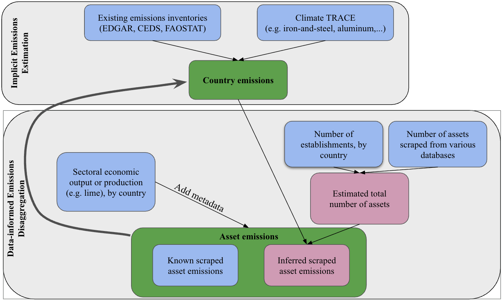
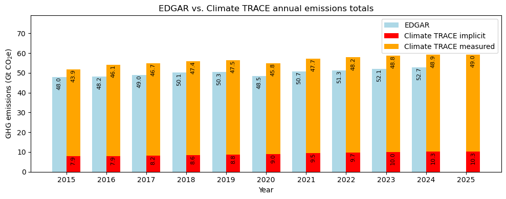
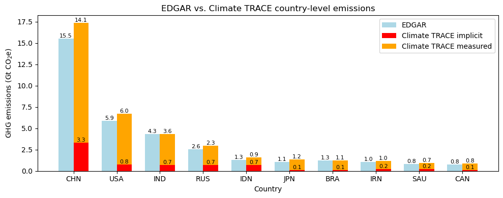

### Data-Informed Disaggregation and Implicit Estimation of Emissions in Other Subsectors

**Dan Moore, Christy Lewis, Lekha Sridhar, Amy Piscopo, Lauren Betz, Krsna Raniga, Zoheyr Doctor, and Gavin McCormick**

*All authors are affiliated with WattTime and Climate TRACE*

#### 1. Introduction

Greenhouse gas (GHG) emissions inventories are crucial tools for setting mitigation targets, measuring progress toward goals and for accountability within the context of national and international commitments. There are several organizations – governments, academia and commercial entities – that are involved in data collection and preparation of inventories.

Of these, one of the most important sources of GHG data are official country inventories. All countries that are parties to the United Nations Framework Convention on Climate Change (UNFCCC) are required to prepare GHG inventories as part of their commitments toward Monitoring, Reporting and Verification (MRV) for which standardized requirements have been developed (UNFCCC, 2022). Annex 1 countries are required to provide annual inventories covering emissions and removals of direct GHGs – carbon dioxide (CO2), methane (CH4), nitrous oxide (N2O), perfluorocarbons (PFCs), hydrofluorocarbons (HFCs), sulfur hexafluoride (SF6) and nitrogen trifluoride (NF3) – from five sectors (energy; industrial processes and product use; agriculture; land use, land-use change and forestry (LULUCF); and waste), and for all years from the base year (or period) to two years before the inventory is due. Non-Annex 1 countries, on the other hand, have less stringent requirements and provide inventories as part of the national reports every 2-4 years and include other information such as mitigation actions, constraints and gaps, including support needed and received. As a result, these reporting requirements create a patchwork of GHG data that has varying levels of completeness, comprehensiveness, and detail.

Apart from official country inventories, several academic and research organizations also produce inventories at varying levels of granularity and recency. These inventories rely on statistics from the International Energy Agency (IEA; IEA 2022), the BP Statistical Review of World Energy (now produced by the Energy Institute; Energy Institute, 2024), the Food and Agriculture Organization’s FAOSTAT database (Food and Agriculture Organisation 2025), and the United Nations Statistical Division datasets (all of which rely on government data sources to some degree; UNSD/UNEP 2024). Examples of these inventories include the Emissions Database for Global Atmospheric Research (EDGAR; Crippa et al. 2021; Crippa et al. 2024; Crippa et al. 2025), PIK-Potsdam PRIMAP (Gütschow et al. 2021), and Global Carbon Project (Friedlingstein et al. 2022).

However, despite the existence of many global emissions inventories, several clear challenges exist for any policymaker seeking to access complete publicly available global greenhouse gas emissions estimates in practice.

The key challenges identified by Climate TRACE to accessing a complete global inventory were:

-   **Geographic completeness:** Many otherwise high quality inventories informally referred to as “global” did not, upon close investigation, actually cover the entire globe. As a general rule, inventories were often relatively complete in wealthier countries, but frequently had significant gaps in the global South. EDGAR, for example, reports emissions for all sectors and countries, but sometimes has a time lag.

-   **Sector completeness:** Nearly every inventory Climate TRACE was able to identify covered only certain sectors, rather than the total emissions for a geography. UNFCCC Annex 1 National Inventory Reports for example, report emissions for all sectors (but are not available in every geography and have a time lag).

-   **Temporal completeness and recency:** Many existing inventories are not published every year. Most are also not published until at least 2 years after the emissions occurred. Some countries’ most recent inventories–particularly the official UNFCCC inventories of non-Annex 1 countries–were as much as 10 years ago. A few exceptions exist, most notably Carbon Monitor which publishes emissions estimates only a week after the time period measured.

In addition, the lack of completeness and standardization of emissions inventories can make data harmonization and cross-validation difficult or, in some cases, impossible.

The goal of Climate TRACE is to address these challenges by providing a globally complete and comprehensive national level GHG inventory that is:

-   Continually updated every year with emission values up to at least the preceding calendar year and the current year’s emissions projected. In 2025, Climate TRACE GHG estimates were updated to include 2015-2025 national level emission estimates;

-   Estimate emissions from all emitting subsectors with as much granularity as possible;

-   Attributes all GHGs down to the emitting source/asset.

Table S3, in the supplemental section, provides a list of Climate TRACE sectors with IPCC equivalent sector coverage. Despite these continuing efforts, due to the nature of some subsectors (too many facilities, lack of existing data sources, lack of any visible satellite-derived signal), some emissions were still being estimated at the country-level only and aggregated at the sectoral level. For example, roughly 6.4% of 2015-2022 GHG emissions, or about 29 billion tonnes of carbon dioxide equivalent (CO2e), were attributed to “*other-manufacturing*” in the 2023 (Version 3.0) release of Climate TRACE data, which are now broken down into more granular sectors. *Other-manufacturing* consisted of emissions from various industry and manufacturing subsectors, including from the production, creation and/or processing of electronics, machinery manufacturing and other sectors estimated at the country-level despite each of these having a unique sectoral code in the United Nations Framework Convention on Climate Change (UNFCCC; UNFCCC, 2024). Furthermore, other existing inventories also combine these subsectors, making it difficult to quantify the climate impact of these individual industries. A deeper understanding of the contribution of each of these individual industries/sectors to GHG emissions will better inform decision making at the global, country and local levels.

In order to have a complete inventory of all GHG sources in every country/ region in the world, Climate TRACE members and contributors use several measurement and estimation techniques:

1.  **Machine Learning + Satellite Measurements**: These models utilize detectable signals in satellite imagery to quantify activities at a facility and then subsequently estimate emissions based on the change in these activities using machine learning algorithms (e.g. steam plumes from power plants or heat from steel plants).

2.  **Statistical Modeling + Satellite Measurements**: These models utilize satellite imagery to identify and characterize emission causing sources, such as the facility type, its size, and use statistical approaches to estimate emissions (e.g. cattle operations and wastewater treatment plants).

3.  **Statistical Modeling + Reported Data**: These models utilize reported data gathered from public or proprietary sources and estimate emissions using statistical models (eg. aviation emissions using the ICAO methodology or oil refining emissions using the PRELIM model).

4.  **Data-informed Emissions Disaggregation**: This method estimates emissions for facilities for which very little information is available (such as their location, capacity, type of manufacturing process, production quantities, etc). It utilizes existing GHG inventories and disaggregates sectoral emissions to all the known facilities in the country, which are obtained from public registries, industrial databases, and supply-chain (e.g. textile manufacturing and food and beverage manufacturing). Where individual facilities report their own emissions to a governmental registry, those reported values are used directly, and only the remaining unattributed portion of the sectoral total is disaggregated across the other known facilities.

5.  **Implicit Estimation**: For all other sectors where facility level emission could not be estimated using any of the above 4 methods, emissions are ‘implicitly’ estimated using existing GHG inventories, subtracting out the subsector(s) that Climate TRACE estimates using methods 1-4.

Estimates from Climate TRACE members and contributors using techniques 1, 2, and 3 make up 81% of global emissions. This document describes techniques 4 and 5, where Climate TRACE uses the Intergovernmental Panel on Climate Change (IPCC) common reporting framework (IPCC 2006) along with other inventories to develop novel techniques to complement other GHG measurement methods in forming a global, comprehensive greenhouse gas inventory.

Here, we outline a process for the **Data-informed Emissions Disaggregation** technique, i.e. estimating both country- and asset-level emissions for several manufacturing subsectors originally encapsulated in *other-manufacturing* in previous Climate TRACE releases. The goal is to slim down and/or identify the unknown manufacturing subsectors lumped into *other-manufacturing*, common amongst GHG inventories. Multiple existing country-level inventories and economic datasets, as well as asset-level information from several data sources, were employed within a data-informed framework to disaggregate emissions to specific locations. This work is part of a larger effort across all Climate TRACE sectors to improve completeness of emissions at the asset and source levels, and also to increase both the granularity and accuracy of these emissions estimates. The following manufacturing subsectors were estimated using this method:

-   *Glass*

-   *Lime*

-   *Textiles, leather, and apparel (at the asset level only)*

-   *Food, beverage, and tobacco*

These subsectors together accounted for approximately 1.5% of global emissions in 2025.

For all other subsectors where Climate TRACE currently does not have a data-informed disaggregation estimation methodology yet due to the lack of facility-level information, emissions were implicitly estimated - technique 5 - using the Emissions Database for Global Atmospheric Research (EDGAR) and Food and Agriculture Organization of the United Nations (FAOSTAT) emissions inventories in order to provide a comprehensive emissions inventory at the country-level. The following sectors and subsectors incorporate EDGAR or FAOSTAT emissions data at the country-level:

-   **Power sector:** *Other energy use*

-   **Transportation sector**: *Railways; Other* *transportation*

-   **Buildings sector:** *Other onsite fuel usage*

-   **Fossil fuel operations sector:** *Other solid fuels; Other fossil fuel operations*

-   **Manufacturing sector:** *Wood and wood products, Other metals, Other chemicals, Other mining and quarrying, Textiles, leather, and apparel (country-level), Other manufacturing*

-   **Agriculture sector:** *Enteric fermentation - Other; Manure management - Other; Other agricultural soil emissions*

-   **Waste sector:** *Biological treatment of solid waste;* *Incineration and open burning of waste*

-   **Fluorinated gases sector:** *Fluorinated gases*

These subsectors together accounted for approximately 17% of global emissions in 2025.

The overall approach, followed by specific methods for quantifying country-level and asset-level emissions are presented in Section 2. Section 3 outlines the results from this analysis, while in Section 4, the implications and future considerations are discussed. Furthermore, starting in November 2025, Climate TRACE is now providing emission reduction solutions (ERSs) to each sector to understand how sector mitigation strategies can be used to reduce emissions. ERS is discussed further in Section 5 below.

#### 2. Materials and Methods

Here, we describe the two approaches, the **Data-informed Emissions Disaggregation** and

**Implicit Estimation,** used to estimate emissions for the other subsectors. Emissions using these methods were estimated at the country- and asset- levels for years 2015 through 2025 at annual temporal resolution. Data were downscaled to monthly resolution using methods described in Raniga et al. (2024).

#### 2.1 Data-informed Emissions Disaggregation

#### 2.1.1 Datasets employed

To identify manufacturing facilities and to generate emissions estimates, various emissions inventories, asset location and emissions data, capacity and production data, and economic data were employed. This includes:

1.  Country-level emissions quantities for each sector were taken directly or derived from the *Emissions Database for Global Atmospheric Research (EDGAR)* (EDGAR, 2025) and *Community Emissions Data System (CEDS)* (Hoesly and Smith, 2024). For the four disaggregated sectors - Glass, Lime, Textiles, leather, and apparel, and Food, beverage, and tobacco - the sector gap-fill equations are applied to the pre-publication ("staging") form of these inventories within the Climate TRACE data pipeline, before any facility-level data has been merged in (see Section 2.1.3.1.5).

2.  Asset location, emissions, and other metadata were obtained from the following databases/locations.

1.  *European Pollutant Release and Transfer Register (EPRTR)* (European Environment Agency, 2023)*;*

2.  *Israel Pollutant Release and Transfer Register (Israel PRTR)* (Israel Environmental Licensing and Risks Prevention Division, 2024)*;*

3.  *US EPA Facility Level Information on Greenhouse gases Tool (FLIGHT)* (US EPA Office of Atmospheric Protection, 2024)*;*

4.  *Canada Greenhouse Gas Reporting Program (Can-GHGRP)* (Government of Canada, Environment and Climate Change Canada, 2024);

5.  *Open-Supply Hub* (2024), a curated registry of global float glass plants, a North American slaughter-facility registry, and other government websites.

6.  Capacity data for lime facilities (including facilities in China) was obtained from LLM research; slaughter capacities (head per year) were obtained from the slaughter-facility registry and converted to carcass tonnage.

7.  Country-level national establishment counts were obtained from the *Industrial Statistics Revision 4* (UNIDO, 2025)*,* which was used as the completeness denominator (the expected number of facilities per country and sector).

8.  Annual lime production data were obtained from the Lime Statistics and Information (USGS, 2025); These production statistics anchor the lime activity estimates.

9.  Sector-specific emissions factors (EFs) and country-level production estimates were obtained from a partnership between ODE ([https://ode.partners/en](https://ode.partners/en)) and Climate TRACE, where LLMs were used to provide detailed breakdowns for emissions factors of different scopes and greenhouse gases. Each EF is compiled at the component level (combustion, process, and electricity) per product; the library used here retains only the Scope 1 (on-site combustion plus process) components (see Section 2.1.3.2.2).

Where multiple vintages of the same registry were available (datasets a through f above), all vintages were combined and de-duplicated so that the full reporting history of each facility (back to 2007 for E-PRTR) is retained.

#### 2.1.2 Model development

In general, the workflow for generating emissions estimates for sectors within *other-manufacturing* starts with the existing EDGAR and CEDS emissions inventories, which provide country-level emissions estimates for each gas, by ‘sector’ (Figure 1). While both of these inventories aim for sectoral completeness, the partitioning of the emissions into sectors varies slightly. This allows us to piece together all emissions estimates from a given sector in a logical manner using a combination of these two inventories, in addition to the UNFCCC emissions database. The specific equations for deriving individual sectors are presented in Section 2.3.1.1.

The country-level total then serves as the starting point for the asset-level estimates. Facilities identified in public registries and industrial databases are placed into evidence tiers according to how much is known about each. Facilities with their own regulator-reported emissions keep those values; the remaining unattributed portion of the national total is disaggregated across the other known facilities in proportion to independent evidence of relative facility size. Finally, per-facility activity, capacity, emissions factors, non-CO2 gases, confidence ratings, and uncertain estimates are derived, and the results are reconciled against the country total.

**Figure 1.** General process of creating country and asset-level emissions, along with associated metadata for each sector. The colors denote the type of information used in each step, with input data in blue, intermediate derived data in pink, and the final output data in green.

#### 2.1.3 Methods

Country-level estimates exist for every sector, but only a subset contains information at the asset level. The method for estimating country-level emissions is described in Section 2.1.3.1, while the method for estimating asset-level emissions is described in Section 2.1.3.2.

#### 2.1.3.1 Deriving country-level emissions

The following sections outline the equations used to quantify country-level emissions for the following sectors: *food, beverage, and tobacco*, *glass*, *lime*, and *textiles, leather, and apparel*. The CEDS or EDGAR sector naming convention is kept for clarity and other Climate TRACE sectors not described in this document but are used to derive the sectors discussed here are denoted with ‘CT’. Country-level emissions from these two inventories are available through 2024 (EDGAR V2025) and 2023 (CEDS), respectively; years beyond the last available inventory year are forward filled from the most recent available year.

#### 2.1.3.1.1 Food, beverage, and tobacco

In both EDGAR and CEDS, direct emissions from food, beverage, tobacco and wood manufacturing were categorized together, while combustion related emissions from food, beverage, and tobacco are reported separately from those from wood and wood products. Therefore we needed some way of estimating direct emissions from the subset of food, beverage, and tobacco manufacturing since Climate TRACE already accounts for wood and wood product manufacturing. The UNFCCC provides estimates of both direct (2.H.2) and indirect (1.A.2.e) emissions from food, beverage, and tobacco manufacturing for Annex I countries. Using these, we calculated a country-specific scaling factor as either the slope between 2.H.2 and 1.A.2.e of all annual available values 1990-2021, where a positive (r &gt; 0) and statistically significant (*p* &lt; 0.1) relationship was calculated based on linear regression, or the median ratio across all years for a given country. A p-value threshold of 0.1 was chosen to retain as many country-specific sector linear relationships as possible, rather than relying on a single global relationship that could misrepresent individual countries’ sectors. We then applied this ratio to the CEDS 1.A.2.e emissions value for each Annex I country to estimate direct emissions from food, beverage and tobacco manufacturing.

As this relationship does not hold for non-Annex I countries, we assumed negligible direct emissions from food, beverage, and tobacco production in non-Annex I countries. Methane (CH4) and nitrous oxide (N2O) direct emissions were imputed by applying CO2-to-N2O and CO2-to-CH4 ratios that were calculated from facilities where both gases were reported.

The equation for estimating country-level food-beverage-tobacco CO2 emissions was then defined as:

> *food-beverage-tobacco = food-and-beverage-direct +*
>
> *CEDS 1A2e\_Ind-Comb-Food-tobacco*
>
> where,
>
> If non-Annex I countries:
>
> *food-and-beverage-direct = 0*
>
> Else:
>
> *food-and-beverage-direct = \[\[UNFCCC 2.H.2 / CEDS 1A2e\_Ind-Comb-Food-tobacco\]\] × CEDS 1A2e\_Ind-Comb-Food-tobacco*
>
> Where, \[\[UNFCCC 2.H.2 / UNFCCC 1.A.2.e\]\] represents either the country-specific slope of the least squares line between the emissions from these two subsectors (where r &gt; 0, p &lt; 0.1), or the median ratio (else).

#### 2.1.3.1.2 Glass

Glass manufacturing consists of both direct (2.A.3) and indirect (1.A.2.f) emissions. However, in CEDS, indirect emissions are aggregated together with indirect emissions from all non-metallic minerals (including cement, lime, and other carbonates). In order to disaggregate these indirect emissions, we estimated the contribution of glass combustion to CEDS 1.A.2.f by assuming that the ratio of direct to indirect emissions for each of these four mineral subsectors (i.e. glass, lime, cement, and other carbonates) were equal. With that assumption we calculated the relative contribution of glass direct emissions (2.A.3) to the sum of direct emissions from each individual subsector (i.e. 2.A.1 + 2.A.2 + 2.A.3 + 2.A.4), and multiplied that by the total indirect emissions (1.A.2.f). Therefore, the equation to estimate total glass manufacturing emissions is:

> *glass = EDGAR 2.A.3 Glass + glass-combustion*
>
> where,
>
> *glass-combustion = (CEDS 1A2f\_Ind-Comb-Non-metalic-minerals) ×*
>
> *EDGAR 2.A.3 Glass / (EDGAR 2.A.1 Cement + EDGAR 2.A.2 Lime + EDGAR 2.A.3 Glass +*
>
> *EDGAR 2.A.4 Other Process Uses of Carbonates)*

#### 2.1.3.1.3 Lime

Similarly to glass manufacturing, lime manufacturing consists of both direct and indirect emissions, the latter of which needs to also be disaggregated for CEDS data. Following the same formulation described above for glass manufacturing, the equation for calculating emissions from lime manufacturing is:

> *lime = EDGAR 2.A.2 Lime + lime-combustion*
>
> where,
>
> *lime-combustion = (CEDS 1A2f\_Ind-Comb-Non-metalic-minerals) × EDGAR 2.A.2 Lime / (EDGAR 2.A.1 Cement + EDGAR 2.A.2 Lime + EDGAR 2.A.3 Glass + EDGAR 2.A.4 Other Process Uses of Carbonates)*

#### 2.1.3.1.4 Textiles, leather, and apparel

Here, CEDS textile and leather combustion-related emissions is set to “*textiles-leather-apparel*” which can contain, including but not limited to, linen, polyester, and silk.

> *textiles-leather-apparel = CEDS 1A2g\_Ind-Comb-textile-leather*

Note, at the country-level, this sector is filled using the “Implicit estimation” technique, but is included here, as its asset-level data are estimated using the “data-informed disaggregation” technique.

#### 2.1.3.2 Asset-level data

Assets were obtained for the following sectors: *other-metals*, *other-chemicals*, *other-manufacturing*, *glass*, *lime*, *food-beverage-tobacco*, and *textiles-leather-apparel*. Emission quantities for each sector were obtained from their respective sources, where available. Due to a lack of production-level information, the metadata for *other-metals*, *other-chemicals*, and *other-manufacturing* were limited to: capacity = activity = 1 facility. Therefore, emission factors describe the emissions of a given gas, per facility. Emissions and emissions factors for assets with no available data were imputed using the default metamodeling methods, described in Moore et al. (2024).

For assets in the remaining sectors, *glass, lime, food-beverage-tobacco,* and *textiles-leather-apparel*, the following sections describe the **Data-informed Emissions Disaggregation** approach. The delivery covers 2015 through the most recent complete year, one row per facility per year.

#### 2.1.3.2.1 Facility assembly

*Registry union and identifiers.* Available versions of each source registry are combined and de-duplicated, first on the publisher's own facility identifier and then on location, so that a facility's full reporting history is retained. Each facility carries one stable identifier across all of its years. Where a facility that Climate TRACE has already published moves to a new identifier in a refreshed registry pull, the previously published identifier is restored, so that the existing public asset is updated rather than duplicated.

*Cross-publisher identity resolution.* The same physical plant can be published by two different organizations (for example, a national emissions registry and a supply-chain database). Candidate duplicates are detected by co-location and by name-token containment (which captures the dominant real pattern, where one publisher qualifies the other's name with a site), with three protections: a single publisher's own distinct identifiers are never merged; names differing only in their digits (e.g. "Unit 1" / "Unit 2") are treated as distinct plants; and a blank name never corroborates a merge.

*Sector audit.* A publisher's sector tag is treated as a claim to be checked, not as ground truth. Several systematic corrections are applied: E-PRTR facilities filed under the ambiguous "production of cement or lime" activity code are resolved against Climate TRACE's own cement facility inventory (a facility within 750 m of a known cement plant is removed from the lime population; the remainder are kept in the population but never contribute reported emissions, because their filings may include cement-process CO2); livestock farms and under-cover crop operations carried under food-manufacturing codes are excluded, as they are covered by other Climate TRACE sectors; supply-chain product strings are routed to products on exact, validated mappings (for example, palm-oil mills are classified as oilseed processing rather than *grain* milling).

*Facility lifetimes.* Each facility carries an operating status per year. Sources observed in only a single year are treated as snapshots, where they are assumed to operate across the whole output window rather than to have “opened” in the observation year. A country’s departure from a reporting regime (for example the United Kingdom leaving the E-PRTR) is not interpreted as facilities closing; those facilities are carried forward under the assumption of continued operation, and this is declared as a caveat. Explicit closure statements in source data override inferred statuses, and a terminal check guarantees that no facility-year believed to be closed ships with a quantity.

*Locations.* Redacted or placeholder coordinates (e.g. registry confidentiality) are withheld. Anything resolvable to the GADM 1 or GADM 2 level are published with their location as the centroid of the associated GADM 1 or GADM 2 boundary.

#### 2.1.3.2.2 Emissions Factors

Emissions factors (EFs) are maintained in a single library, one factor per product (e.g. quicklime vs. hydrated lime; float glass vs. container glass; brewing vs. slaughter; weaving vs. garment assembly), compiled from LLM research and published industry sources at the component level: combustion and process components are summed into a direct (Scope 1) factor. Where no defensible EF exists for a product, none is invented; the global median factor across all products for that sector is employed.

Several physical-plausibility constraints are enforced on the factors and on the quantities they imply:

-   Stoichiometric ceilings. Process CO2 from mineral chemistry is bound by molar mass. For example, calcination of calcium carbonate cannot emit more process CO2 per tonne of quicklime than the chemistry allows. For lime the process component of each facility’s CO2 is pinned at the library's process factor times activity, with the combustion component absorbing the remainder, so that no delivered row implies a process factor above its stoichiometric ceiling.

-   Trust ordering. For glass, lime, and food, the trust order is emissions &gt; activity &gt; emissions factor, meaning reported emissions and independent production statistics are treated as truth, and the emissions factor absorbs any residual inconsistency and is flagged where it departs from the library value. For textiles, where production statistics are weakest (and there is double counting of textile production mass because of the nature of the supply chain), the order is emissions &gt; emissions factor &gt; activity.

-   EF review. Emissions factors failing physical review are replaced with the emissions factor of a similar product.

#### 2.1.3.2.3 Evidence tiers

Every facility-year is placed into an evidence tier that determines how its emissions are estimated and how they are graded for confidence:

-   Tier A: the facility's own CO2, reported to a regulator for that year. Reported values are never modified.

-   Tier Ac: the facility's own reported CO2, carried forward or backward from its nearest reported year. A carried value is accepted only if it does not exceed 25% of the country-sector-year total (a carried filing is a statement about this plant, but not about this year).

-   Tier A′ (Tier a ‘prime’): CO2 inferred from the facility's own reported non-CO2 emissions via national gas ratios, subject to the same 25% envelope gate; an implied CO2 above the gate is rejected rather than flagged, because an inference (unlike a reported value) is not evidence.

-   Tier D+: no facility-reported emissions; the facility's share of the national residual is estimated from at least one facility-specific size signal or a same-product peer benchmark.

-   Tier D0: no distinguishing evidence at all; the facility receives an equal share of what remains, and is graded at the lowest confidence.

For facilities reporting in some years but not others, the previous release's blanket backward/forward filling of all metadata is replaced by the gated Tier Ac carry above, which applies to the facility's own reported CO2 only.

#### 2.1.3.2.4 Allocation of the residual

Per country, sector, and year, the residual is the national total minus the sum of all anchored (Tier A/Ac/A′) facilities:

%7D%20%5Cmathit%7BQ%7D_%7Bi%7D%2C%5C%3B%200%5Cright)#0)

Where, *anchored(c,s,y)* is the set of facilities in country *c* and sector *s* whose year-*y* emissions (Q) of a given gas is established by Tier A, Ac, or A′ (Section 2.1.3.2.3), and *anchored Qᵢ* is that facility's emissions of a gas . The residual is floored at zero; where reported facility values alone meet or exceed the national total, no residual remains to allocate and the exceedance is accepted rather than corrected (Section 2.1.3.2.7).

Nonzero residual emissions are disaggregated across the remaining known facilities in proportion to a per-facility magnitude claim, in tonnes, according to three distinct pathways:

1.  If an asset-level reporting entity with a minimum reporting threshold (e.g. EPRTR) exists for the country/sector, the unallocated asset is assumed to below the reporting threshold, so a rank curve is fit to the anchored assets of the form:

*Q*i(*r*) = *scale* × *r*^(−*β*)

> Where *Q* is the emissions of the *r*th ranked asset. Parameters *scale* and *β* are fitted using ordinary least squares on log *Q* against log *r* using the 10th to 90th percentile assets to prevent the extremes dominating the fit. The non-anchored assets, which are always ranked below the anchored assets, are ranked based on any available metadata: headcount, capacity, etc. Those without any relevant metadata are given the mean of emissions for the remaining ranks.
>
> After all asset emissions have been allocated, if the sum of asset emissions exceeds the country total, the country value is adjusted upward.

1.  If no such reporting entity exists, there is no relevant reporting threshold to apply the first approach. Therefore, we apply a benchmarking approach that considers the same relevant metadata as the first approach that allows us to rank assets. We produce a first-pass estimate of emissions, *Q*’ (*Q* prime), as:

*Q’*i = *b*s,p *× m*i

> Where the peer benchmark, *b*, is the 33rd percentile of anchored facilities' emissions for that sector, *s*, and product, *p*, resolved down a four-rung fallback (same product and country → same sector and country → same product globally → same sector globally; the percentile, rather than a mean, both corrects for the reporting-threshold selection effect and prevents a single anomalous filing from setting the scale), and the size multiplier, *m*, comes from the best available facility-specific signal: publisher-stated capacity where it exists; otherwise worker headcount, compressed with an exponent of 0.6 because headcount is reported for whole sites in ordinal buckets; otherwise 1. Finally, normalization is applied as this pathway does not allow for upward adjustment of country values:
>
> *T* = min(Σ *Q’*i, *R*)
>
> *Q*i = *T* × *Q’*i / Σ *Q’*i

1.  Without any distinguishing metadata, the residual is allocated equally to each asset as default.

Across the four affected sectors, 18% of residual emissions are allocated using the first approach, 79% using the second, and the remaining 3% default to the equal scaling. This is a significant improvement relative to V5.10.0 and earlier, during which the majority of non-anchored emissions were calculated using an equal distribution.

Additional constraints on the allocation:

-   *Censored zeros are upper bounds*. A zero in the E-PRTR means "below the reporting threshold" (100 kt CO2/yr under Regulation (EC) No 166/2006), which is a published upper bound, not a value. Allocated values for such facilities are capped at the threshold after the split, with the excess redistributed to the group's uncapped facilities.

-   *Production ceiling*. A cohort of allocated facilities may not, in aggregate, claim more emissions than the country's production statistics could support (national production times the upper bound of the sector's EF band). Where reported facility level emissions alone already meet or exceed the ceiling, the contradiction suspends the ceiling for that country-sector.

-   *No leveling*. Size evidence orders facilities but is never used to force them toward equality; where no evidence distinguishes facilities, the equal-share floor (Tier D0) is applied.

#### 2.1.3.2.5 Activity, capacity, and capacity factor

Activity is expressed in tonnes of product per year in all four sectors. Where a facility's activity cannot be anchored to a production statistic, it is derived as emissions divided by the EF. For lime, national production statistics from USGS anchor the activity totals.

Capacity is defined as the facility's own peak activity across its delivered time series, unless a publisher-stated capacity exists and is consistent with the allocated activity. Under this definition the capacity factor (activity divided by capacity) equals 1 in the facility's peak year and is below 1 in all other years.

#### 2.1.3.2.6 Non-CO2 gases and non-GHG pollutants

Facility-reported CH4 and N2O are delivered as reported. Where a facility does not report a gas, its value is derived from the facility's CO2 using the country-and-sector gas ratio implied by the national inventory. A gas is derived only where the national inventory reports that gas for the country and sector; where the national inventory carries no CH4 (for example), no facility-level CH4 is emitted rather than a zero.

Reported non-GHG pollutants (NOx, SOx, NH3), available from the European registries, are delivered where reported and never modeled for other facilities, since presenting a registry-only population as globally representative would be misleading.

#### 2.1.3.2.7 Reconciliation to the country total

CO2 is reconciled first. By construction, anchored plus allocated facility CO2 cannot exceed the national total, because the allocation pool is bounded by the residual. Where reported facility values alone exceed the national total, the exceedance is accepted; a country total can genuinely be too small, and reported values are never modified. Conversely, where the facility sum falls short of the national total, the shortfall is real emissions the sector believes occurred but could not attribute to any known facility. CH4 and N2O are then reconciled per gas: reported values are fixed, while derived values may be scaled down where a country's derived gas totals would otherwise exceed its national envelope for that gas.

#### 2.1.3.2.8 Process, combustion, and biogenic CO2

Each delivered CO2 value is split into a process percentage and a combustion percentage. Process CO2 is the non-combustion chemistry term (calcination in lime, carbonate decomposition in glass); for fermentation products (brewing, winemaking), the process share is biogenic fermentation CO2. Slaughter wastewater CH4 is excluded from these sectors, as it is accounted for in Climate TRACE's industrial wastewater sector.

#### 2.1.3.3 Asset confidences

Every value in the delivered asset files carries its own confidence rating, in a companion file that is row-for-row and column-for-column parallel to the asset file. Ratings use a five-point vocabulary (very high, high, medium, low, and very low); very high is deliberately never used, because high is reserved for the strongest evidence present in these sectors; nothing here is measured at the stack.

The rating of each field reflects how that specific value was produced: a facility's reported CO2 for the year is high; a carried-forward or gas-inferred CO2 is medium; an allocated CO2 is low (with size evidence) or very low (equal share). A derived CH4 or N2O is never better than low, because it comes from a national ratio applied to one plant, even on a facility whose CO2 is reported. Activity and the emission-factor columns are never better than low, as quotients of an estimated quantity and a library factor.

#### 2.1.3.4 Asset uncertainties

Uncertainties are reported as one absolute 1-sigma uncertainty per value, in the same units as the value itself (tonnes for emissions, tonnes of product for activity). Uncertainties are derived from the same per-field confidence grades. The relative widths are: 10% for a facility's own verified filing for that year; 30% for the facility's own figure carried from another year or inferred from another gas; 40–50% for values built from reported production or capacity with library factors; 75% for allocated values sized by indirect evidence (a size proxy never checked against the plant's actual output); and 100% for equal-share allocations, whose 1-sigma interval reaches zero. The capacity factor, being bounded on \[0, 1\], carries an absolute rather than relative sigma.

#### 2.2 Implicit Estimation of Other Subsectors

For sectors where there was incomplete or no asset level data, the implicit estimation approach was used, which employed GHG inventories, projected emissions data to fill in missing years in GHG inventories, and developed sector specific equations to output implicit estimation for the sectoral “other” emissions. Sectors estimated using this method are directly equal to their source dataset.

#### 2.2.1 Datasets employed

**Climate TRACE GHG emissions inventory data** (Climate TRACE 2025; [https://climatetrace.org/](https://climatetrace.org/)): Climate TRACE is a global coalition of organizations with each organization focusing on measuring CO2, N2O, and CH4 emissions from particular economic or land cover sectors.

*Temporal coverage:* Climate TRACE country-level data is provided for 2015-2024 with 2025 emissions either partially or fully projected, depending on temporal coverage for individual sectors. The data are typically released with a 3-4 month latency. For example, data released in November are generally provided through June of the same year, with the remaining months projected.

*Sectoral coverage:* In addition to the 81% of global emissions covered by Climate TRACE sectors using techniques 1, 2, and 3, 2% is covered by technique 4.. The remaining 17% of emissions that are not currently estimated using techniques 1 to 4 were measured using the implicit estimation method. By employing all techniques described here, Climate TRACE country-level inventory accounts for 100% of known anthropogenic greenhouse gasses based on IPCC and UNFCCC reporting.

*Geographic coverage:* Emissions estimates for Climate TRACE measured sectors are available for every country in the world. Comprehensive data are not available in some disputed territories due to lack of data availability.

**Food and Agriculture Organization of the United Nations (FAOSTAT**) is a specialized agency of the United Nations that focuses on agriculture and food security. FAO is also tasked with collecting food, agriculture and land use, land-use change and forestry (LULUCF) data from countries around the world regarding their agricultural and forestry activities and emissions.

*Temporal coverage:* FAOSTAT data is available from 1990 - 2023 at the time of data was accessed (February 23, 2026). Data is released on a two year delay. For example, 2019 data was released in 2021.

*Sectoral granularity and coverage*: FAOSTAT data is available only for agriculture and LULUCF sectors.

*Geographic coverage:* FAOSTAT data is global and covers 233 countries and territories (FAOSTAT, 2025).

**The Emissions Database for Global Atmospheric Research (EDGAR)** is an independent database of anthropogenic GHG emissions, providing both national totals and gridmaps. Though the gridmaps are highly granular, we only used the national totals for the purposes of this exercise.

*Temporal coverage:* EDGAR data is available for the years 1970-2024 (EDGAR v2025). The complete data is published on an irregular lag. For example, 2018 data was published in May of 2021 and data for 2019, 2020 and 2021 was published in September of 2022. However, EDGAR released data for 2022 in October 2023 and Climate TRACE was able to use these updated values for implicit estimation. EDGAR’s 2023 release did not include fluorinated gases broken down by gas. In order to be able to estimate CO2 equivalent 20- and 100-year global warming potentials (CO2e 20yr and 100yr GWP), Climate TRACE needed the individual greenhouse gas numbers. For this reason, Climate TRACE utilized EDGAR’s previous release (EDGAR v7.0) which provides individual GHGs and forward filled 2021 data to 2024 for fluorinated gases to generate CO2e 20yr and 100yr GWPs that include all GHGs .

*Sectoral granularity*: EDGAR data covers all IPCC emissions except for LULUCF. However, the sectors are not as granular as the most granular IPCC categories. For example, EDGAR reports emissions for 1.B.1 Solid Fuels but does not break it down into 1.B.1.a Coal Mining, 1.B.1.b Solid Fuel Transformation, 1.B.1.c Other.

*Geographic coverage*: EDGAR data is globally comprehensive.

**The Community Emissions Data System** (CEDS) developed by the Pacific Northwest National Laboratory is an annually updated emissions dataset that estimates anthropogenic emissions for all major emission species (GHGs and non-GHG), providing both country-level and gridded emissions data.

*Temporal coverage:* CEDS data is available for the years 1750-2023 (v\_2025\_03\_18).

*Sectoral granularity*: CEDS data covers all IPCC emissions except for LULUCF and biomass burning.

*Geographic coverage*: CEDS data is globally comprehensive.

#### 2.2.2 Methods

#### 2.2.2.1. Projection approach

Not all GHG inventories have the most recent emissions estimates. EDGAR v2025 currently provides data up through 2024, and FAOSTAT published data up through 2023. In order to utilize the FAOSTAT data for implicit estimation, the data was forward filled up to the final Climate TRACE release month . This method uses the last available estimate as the future projected values. This approach was adopted to ensure all GHG inventories described in section 2.1 match temporally.

#### 2.2.2.2 Implicit Estimation approach - equations

An immediate practical challenge in implicit estimation is that different global emissions inventories do not use one consistent standardized hierarchy of definitions for emitting sectors and subsectors. Thus, Climate TRACE’s first step was to define a crosswalk of all emitting subsectors from all inventories it could find, to enable comparison between Climate TRACE sector lead results and those of existing publicly available global emissions inventories. This crosswalk can be found in Table S1 in the Supplementary section.

With the knowledge of what is covered by Climate TRACE vs. EDGAR and FAOSTAT, we were able to write equations to describe the emissions that are not currently estimated using techniques 1, 2, or 3.

*Example 1: Other Solid Fuels*

Emissions from ‘other solid fuels’ are not currently measured at the asset level by Climate TRACE. WattTime and Global Energy Monitor are measuring coal mine activities’ emissions and TransitionZero is measuring only CO2 emissions from steel manufacturing, but neither of these models include emissions from solid fuel transformation and abandoned coal mines. Within the IPCC framework, coal mining is a subset of 1.B.1 Solid Fuels. EDGAR reports data for 1.B.1 Solid Fuels but does not report at the more granular levels such as 1.B.1.a Coal Mining and Handling. Figures 2 and 3 show the WattTime/Global Energy Monitor and EDGAR coverage, respectively for this sector.

| 1.B.1 Solid Fuels | 1.B.1.a Coal Mining and Handling  | 1.B.1.a.i Underground Mines | 1.B.1.a.i.1 Mining Activities           |
|-------------------|-----------------------------------|-----------------------------|-----------------------------------------|
|                   |                                   |                             | 1.B.1.a.i.2 Post-Mining Activities      |
|                   |                                   |                             | 1.B.1.a.i.3 Abandoned Underground Mines |
|                   |                                   | 1.B.1.a.ii Surface Mines    | 1.B.1.a.ii.1 Mining Activities          |
|                   |                                   |                             | 1.B.1.a.ii.2 Post-Mining Activities     |
|                   | 1.B.1.b Solid Fuel Transformation |                             |                                         |

**Figure 2** WattTime/Global Energy Monitor 1.B.1 Solid Fuels and subsectors coverage. Fully covered (in blue), not covered (in red), and partially covered (in gray).

| 1.B.1 Solid Fuels | 1.B.1.a Coal Mining and Handling  | 1.B.1.a.i Underground Mines | 1.B.1.a.i.1 Mining Activities           |
|-------------------|-----------------------------------|-----------------------------|-----------------------------------------|
|                   |                                   |                             | 1.B.1.a.i.2 Post-Mining Activities      |
|                   |                                   |                             | 1.B.1.a.i.3 Abandoned Underground Mines |
|                   |                                   | 1.B.1.a.ii Surface Mines    | 1.B.1.a.ii.1 Mining Activities          |
|                   |                                   |                             | 1.B.1.a.ii.2 Post-Mining Activities     |
|                   | 1.B.1.b Solid Fuel Transformation |                             |                                         |

**Figure 3** EDGAR 1.B.1 Solid Fuels and subsector coverage. Full covered (in blue), not covered (in red), and partially covered (gray).

Because EDGAR covers all of 1.B.1, subtracting WattTime/Global Energy Monitor’s coal mining values from EDGAR results in an estimate for 1.B.1.b Solid Fuel Transformation.

> *Eq. Climate TRACE Solid Fuel Transformations = EDGAR 1.B.1 Solid Fuels -  
> WattTime/Global Energy Monitor Coal Mining*

The approaches highlighted in the examples were repeated for different sectors to estimate remaining emissions. All implicit estimation equations can be found in Table S2 in the Supplementary section.

*Example 2: Other agricultural soil emissions*

Agricultural soils include N2O and other emissions from soils due to agricultural practices. While Climate TRACE estimates emissions from some agricultural sectors, like the application of synthetic fertilizers, other emissions from soils were estimated by using FAOSTAT and EDGAR data which reports emissions by subsector and were added together into a single subsector:

> *Other-agricultural-soil-emissions = FAOSTAT Manure left on Pasture-non cattle +*
>
> *FAOSTAT Drained organic soils +*
>
> *EDGAR 3.C.2 Liming +*
>
> *EDGAR 3.C.3 Urea application*

*Example 3: Other Manufacturing*

Compared to the v3.0.0 Climate TRACE release in 2023, the Other Manufacturing sector in v5.0.0 contains fewer subsectors, as they were further granularized either through technique 4 or through the introduction of the CEDS inventory (see Section 3.1 below and Table S2). Additionally, the remainder of the combustion (i.e. indirect) emissions from non-metallic minerals (1.A.2.f) described in Sections 2.1.3.1.2 and 2.1.3.1.3 must be accounted for here. This was done using the same formulation above and is denoted in the following equations as ‘*misc-combustion*’. Therefore, the equation for estimating the remaining, or ‘other’, manufacturing emissions is:

> *other-manufacturing = EDGAR 2.D non-energy products +*
>
> *(EDGAR 2.A.X Other minerals - CEDS 2.A.3 Glass) +*
>
> *CEDS 1A2g\_Ind-Comb-Construction +*
>
> *CEDS 1A2g\_Ind-Comb-transpequip +*
>
> *CEDS 1A2g\_Ind-Comb-machinery +*
>
> *CEDS 1A2g\_Ind-Comb-other + misc-combustion*
>
> where,
>
> *misc-combustion = (CEDS 1A2f\_Ind-Comb-Non-metalic-minerals) ×*
>
> *EDGAR 2.A.4 Other Process Uses of Carbonates /*
>
> *(EDGAR 2.A.1 Cement + EDGAR 2.A.2 Lime +*
>
> *EDGAR 2.A.3 Glass +*
>
> *EDGAR 2.A.4 Other Process Uses of Carbonates)*

The Other Manufacturing sector derived here contains the following subsectors: combustion related to construction, transportation equipment, machinery, non-metallic mineral production (excluding glass, lime, and cement), as well as all other combustion (1.A.2.g), and non-energy products (2.D).

#### 3. Results

The results below highlight the disaggregation and implicit estimation approaches outlined above. Unless otherwise noted, all CO2 equivalent (CO2e) estimates are in the 100 year timescale (AR6 global warming potentials). These results are based on the V5.11.0 dataset delivered September 2026.

#### 3.1 Data-informed Emissions Disaggregation

Table 1 summarizes the total global GHG emissions from the disaggregated manufacturing sectors, which were all previously (v3.0.0) combined into the *other-manufacturing* sector. Overall, more than 50% of emissions, or roughly 2 billion tonnes CO2e in 2024, previously categorized as *other-manufacturing* were disaggregated into these subsectors.

For the four rebuilt sectors, the share of each sector's national totals attributed to named facilities in 2025 was 83.2% for *glass*, 81.8% for *textiles-leather-apparel*, 61.5% for *lime*, and 48.8% for *food-beverage-tobacco*; the remaining emissions could not attribute to a specific site, and are therefore reported as spatially uncertain emissions rather than being spread across known facilities. The delivered asset files cover roughly 54,000 facilities across these four sectors.

Finally, the top five highest emitting countries in each sector are presented in Table 3. In every sector other than *other-metals* either China or the USA is the highest emitter, and in five of the nine sectors, these two countries hold the top two spots. In fact, there are only two sectors where either China or the USA falls outside the top five emitting countries (textiles-leather-apparel, USA; glass, China). The remaining high-emitting spots are largely sector-dependent, with Indonesia, for instance landing in the top-five for *other-metals* sectors, and *glass* being largely dominated by European countries, following the USA.

**Table 1.** Global totals of CO2e emissions across the nine manufacturing subsectors, including the percent contribution of each subsector to the total global for all. Note, total % contribution may not equal 100 due to rounding.

| **Sector**               | **2025 Emissions \[Mt CO2e\]** | **% contribution** |
|--------------------------|-------------------------------------------|--------------------|
| food-beverage-tobacco    | 259                                       | 7.0                |
| glass                    | 31                                        | 0.8                |
| lime                     | 528                                       | 14.2               |
| other-chemicals          | 796                                       | 21.4               |
| other-manufacturing      | 1,915                                     | 51.5               |
| other-metals             | 82                                        | 2.2                |
| other-mining-quarrying   | 43                                        | 1.1                |
| textiles-leather-apparel | 50                                        | 1.3                |
| wood-and-wood-products   | 15                                        | 0.4                |
| Total                    | 3,718                                     | 100                |

**Table 2.** Share of 2025 GHG emissions per sector attributed to named facilities.

| **Sector**               | **2025 asset-level emissions \[Mt CO2e\]** | **% of sector total attributed to named facilities** |
|--------------------------|-------------------------------------------------------|------------------------------------------------------|
| food-beverage-tobacco    | 126                                                   | 49                                                   |
| glass                    | 26                                                    | 83                                                   |
| lime                     | 324                                                   | 61                                                   |
| other-chemicals          | 89                                                    | 11                                                   |
| other-manufacturing      | 17                                                    | 1                                                    |
| other-metals             | 38                                                    | 46                                                   |
| textiles-leather-apparel | 41                                                    | 82                                                   |

**Table 3.** Highest five GHG-emitting countries for each manufacturing subsector in 2025.

| ***Country***              | ***2025 Emissions \[Mt CO2e\]*** |                              | ***Country*** | ***2025 Emissions \[Mt CO2e\]*** |
|----------------------------|---------------------------------------------|------------------------------|---------------|---------------------------------------------|
| **other-mining-quarrying** |                                             | **other-chemicals**          |               |                                             |
| China                      | 19.6                                        |                              | China         | 176.1                                       |
| USA                        | 3.4                                         |                              | USA           | 165.7                                       |
| South Africa               | 2.8                                         |                              | Russia        | 45.3                                        |
| India                      | 1.8                                         |                              | Japan         | 43.0                                        |
| Canada                     | 1.6                                         |                              | Iran          | 35.8                                        |
| **other-metals**           |                                             | **wood-and-wood-products**   |               |                                             |
| Indonesia                  | 23.0                                        |                              | USA           | 4.9                                         |
| USA                        | 20.1                                        |                              | China         | 2.3                                         |
| South Africa               | 8.0                                         |                              | Canada        | 1.8                                         |
| Norway                     | 5.4                                         |                              | Russia        | 1.4                                         |
| France                     | 5.0                                         |                              | Germany       | 0.5                                         |
| **food-beverage-tobacco**  |                                             | **textiles-leather-apparel** |               |                                             |
| USA                        | 88.7                                        |                              | China         | 18.9                                        |
| China                      | 50.6                                        |                              | India         | 4.5                                         |
| Germany                    | 8.3                                         |                              | Turkey        | 4.3                                         |
| Japan                      | 7.8                                         |                              | Argentina     | 2.6                                         |
| France                     | 6.5                                         |                              | South Korea   | 2.0                                         |
| **lime**                   |                                             | **glass**                    |               |                                             |
| China                      | 385.0                                       |                              | USA           | 7.5                                         |
| USA                        | 27.4                                        |                              | Great Britain | 3.5                                         |
| India                      | 18.2                                        |                              | Russia        | 3.1                                         |
| Russia                     | 14.0                                        |                              | Italy         | 2.5                                         |
| Brazil                     | 9.1                                         |                              | Germany       | 2.5                                         |

| ***Country***           | ***2025 Emissions \[Mt CO2e\]*** |
|-------------------------|---------------------------------------------|
| **other-manufacturing** |                                             |
| China                   | 632.2                                       |
| India                   | 186.7                                       |
| USA                     | 129.4                                       |
| Iran                    | 114.7                                       |
| Saudi Arabia            | 106.1                                       |

#### 3.2 Implicit Estimation of All Other Subsectors

The goal of the implicit estimation technique is to complement Climate TRACE’s estimates using techniques 1, 2, 3 and 4 with existing estimates. This serves two purposes:

1.  Ensure Climate TRACE’s end product is globally and sectorally comprehensive for ease of use.

2.  Make Climate TRACE and other datasets interoperable enough that they can be compared statistically.

Figure 4 shows EDGAR and Climate TRACE global totals for 2015-2024. Climate TRACE totals are split into implicitly estimated and measured totals. These totals include only positive differences from the implicit method (see Table 6 and associated text). It should be noted that the Climate TRACE’s global estimates are between 3.8 and 6.8 Gigatonnes higher than EDGAR’s for all years. This is due primarily to 1) RMI’s oil and gas estimates which indicate vast undercounting of methane in current oil and gas estimates and 2) inclusion of non-fossil fuel emissions in the Climate TRACE emissions totals. Table 4 provides the EDGAR and Climate TRACE emission differences.

**Figure 4** EDGAR global totals compared to Climate TRACE global totals for years 2015 to 2025. Climate TRACE totals are split into implicitly estimated and all other categories. Blue bars = EDGAR Totals, Red bars = Climate TRACE implicit estimation estimates, and Orange bars = Climate TRACE measured.

**Table 4** Climate TRACE V5.11.0 global totals versus EDGAR 2025 global totals, and the difference between the two by year. Emissions provided in Gigatonnes (GT).

| **Year** | **Global Climate TRACE emissions (GT CO2e)** | **EDGAR CO2e Emissions (GT)** | **Difference (GT CO2e)** |
|----------|---------------------------------------------------------|------------------------------------------|-------------------------------------|
| 2015     | 51.8                                                    | 48.0                                     | 3.8                                 |
| 2016     | 54.1                                                    | 48.2                                     | 5.9                                 |
| 2017     | 54.9                                                    | 49.0                                     | 5.9                                 |
| 2018     | 56.0                                                    | 50.1                                     | 5.9                                 |
| 2019     | 56.3                                                    | 50.3                                     | 6.0                                 |
| 2020     | 54.8                                                    | 48.5                                     | 6.3                                 |
| 2021     | 57.2                                                    | 50.7                                     | 6.5                                 |
| 2022     | 57.8                                                    | 51.3                                     | 6.6                                 |
| 2023     | 58.8                                                    | 52.1                                     | 6.8                                 |
| 2024     | 59.2                                                    | 52.7                                     | 6.4                                 |
| 2025     | 59.3                                                    | N/A                                      | N/A                                 |

Figure 5 shows EDGAR 2025 totals compared to Climate TRACE V5.11.0 totals for the top 10 highest emitting countries for 2024. China is the highest emitter, \~17.4 Gigatonnes, which is \~2.5 times more emissions than the USA (Table 5). Generally, Climate TRACE total estimates (measured and implicit estimate) result in higher emissions relative to EDGAR emissions.

**Figure 5** EDGAR 2025 totals compared to Climate TRACE V5.11.0 totals for the top 10 highest emitting countries for 2024. Blue bars = EDGAR Totals, Red bars = Climate TRACE implicit, and Orange bars = Climate TRACE measured.

**Table 5** EDGAR 2025 totals compared to Climate TRACE V5.11.0 totals for the top 10 most emitting countries in 2024. Emissions provided in Gigatonnes (GT).

<table><thead><tr class="header"><th><strong>Country</strong></th><th><strong>EDGAR Total (GT CO2e)</strong></th><th>
<strong>Climate TRACE Total</strong>

<strong>(GT CO2e)</strong>
</th><th><strong>Climate TRACE percent using techniques 1, 2,3 or 4</strong></th><th><strong>Climate TRACE percent implicitly estimated</strong></th></tr></thead><tbody><tr class="odd"><td>CHN</td><td>15.5</td><td>17.4</td><td>81</td><td>19</td></tr><tr class="even"><td>USA</td><td>5.9</td><td>6.7</td><td>89</td><td>11</td></tr><tr class="odd"><td>IND</td><td>4.3</td><td>4.3</td><td>83</td><td>17</td></tr><tr class="even"><td>RUS</td><td>2.6</td><td>3.0</td><td>77</td><td>23</td></tr><tr class="odd"><td>IDN</td><td>1.3</td><td>1.6</td><td>58</td><td>42</td></tr><tr class="even"><td>JPN</td><td>1.1</td><td>1.3</td><td>91</td><td>9</td></tr><tr class="odd"><td>BRA</td><td>1.3</td><td>1.3</td><td>91</td><td>9</td></tr><tr class="even"><td>IRN</td><td>1.0</td><td>1.2</td><td>83</td><td>17</td></tr><tr class="odd"><td>SAU</td><td>0.8</td><td>0.9</td><td>77</td><td>23</td></tr><tr class="even"><td>CAN</td><td>0.8</td><td>0.9</td><td>87</td><td>13</td></tr></tbody></table>

#### 3.2.1 Verifying results

We went through several systematic audits of the results to ensure that the implicit estimation equations were properly applied using all available relevant data. For instance, due to differences in how inventories specify country names, we ensured that standardized International Organization for Standardization (ISO3) codes were used to match up data points for each implicit calculation.

Results were not reported in cases where inventories define the actual emitting country differently. For example, EDGAR reported data for Serbia and Montenegro as one country. Climate TRACE and FAOSTAT report them separately since they have become separate legal entities since 2006. Therefore, results relying on EDGAR data for such countries were excluded from reported results. Similarly, results for some sectors are not included for countries in the Climate TRACE dataset where EDGAR and/or FAOSTAT do not provide emissions estimates.

#### 3.2.2 Negative results from the implicit estimation approach

In some cases, implicit estimation equations resulted in negative emissions estimates. We identified two main reasons for this:

1.  There is a large disparity between emissions estimates from different inventories for the relevant sectors. This is particularly the case for sectors like ‘other-chemicals’, ‘other-metals’, and ‘other-solid-fuels’, because Climate TRACE’s emissions for subsectors like methanol, ammonia, and aluminum manufacturing are significantly higher than EDGAR/CEDS’ emissions estimates for the overall sector resulting in negative emissions. EDGAR and CEDS rely, in part, on fuel consumption data from the International Energy Agency while Climate TRACE’s approach is facility level focused.

2.  Data from relevant sectors are missing from one of the inventories.

Examining the causes of negative results can identify discrepancies that are relevant to comparing estimates between inventories. Overall, 6.9% of implicit estimation results were negative in the dataset. However, they were distributed across just 6out of the 19 sectors in the analysis. These results are highlighted in Tables 6 and 7. Climate TRACE replaces the negative numbers with 0 in the final inventory.

**Table 6** Sum of negative implicit estimate results by sector (tonnes CO2e) in V5.11.0 release.

<table><thead><tr class="header"><th><strong>Year</strong></th><th><strong>Other Chemicals</strong></th><th><strong>Other Energy Use</strong></th><th><strong>Other Manufacturing</strong></th><th><strong>Other Metals</strong></th><th>
<strong>Other Mining</strong>

<strong>Quarrying</strong>
</th><th><strong>Other Solid Fuels</strong></th></tr></thead><tbody><tr class="odd"><td>2015</td><td>-3,456,104</td><td>-458,021,258</td><td>-477</td><td>-2,237,258,181</td><td>-24,275,115</td><td>-629,760,341</td></tr><tr class="even"><td>2016</td><td>-3,288,209</td><td>-415,374,380</td><td>-475</td><td>-2,259,698,646</td><td>-25,114,046</td><td>-740,193,156</td></tr><tr class="odd"><td>2017</td><td>-3,552,864</td><td>-399,011,936</td><td>-474</td><td>-2,363,900,240</td><td>-23,146,589</td><td>-731,624,942</td></tr><tr class="even"><td>2018</td><td>-2,985,914</td><td>-436,512,163</td><td>-472</td><td>-2,444,458,029</td><td>-22,832,225</td><td>-681,618,833</td></tr><tr class="odd"><td>2019</td><td>-3,803,155</td><td>-394,515,457</td><td>-470</td><td>-2,536,530,085</td><td>-23,348,134</td><td>-661,250,146</td></tr><tr class="even"><td>2020</td><td>-2,190,113</td><td>-394,774,037</td><td>-517</td><td>-2,603,414,525</td><td>-71,068,101</td><td>-678,135,822</td></tr><tr class="odd"><td>2021</td><td>-3,569,225</td><td>-346,017,379</td><td>-579</td><td>-2,660,625,561</td><td>-64,715,586</td><td>-787,429,329</td></tr><tr class="even"><td>2022</td><td>-3,417,698</td><td>-358,009,497</td><td>-579</td><td>-2,586,079,978</td><td>-77,014,180</td><td>-799,406,661</td></tr><tr class="odd"><td>2023</td><td>-3,930,914</td><td>-341,557,454</td><td>-579</td><td>-2,576,388,855</td><td>-79,413,011</td><td>-778,796,429</td></tr></tbody></table>

**Table 7** Number of countries with negative implicit estimate results by sector in V5.11.0 release.

<table><thead><tr class="header"><th><strong>Year</strong></th><th><strong>Other Chemicals</strong></th><th><strong>Other Energy Use</strong></th><th><strong>Other Manufacturing</strong></th><th><strong>Other Metals</strong></th><th>
<strong>Other Mining</strong>

<strong>Quarrying</strong>
</th><th><strong>Other Solid Fuels</strong></th></tr></thead><tbody><tr class="odd"><td>2015</td><td>14</td><td>142</td><td>3</td><td>86</td><td>78</td><td>39</td></tr><tr class="even"><td>2016</td><td>14</td><td>146</td><td>3</td><td>86</td><td>80</td><td>39</td></tr><tr class="odd"><td>2017</td><td>15</td><td>145</td><td>3</td><td>83</td><td>80</td><td>38</td></tr><tr class="even"><td>2018</td><td>14</td><td>141</td><td>3</td><td>83</td><td>77</td><td>37</td></tr><tr class="odd"><td>2019</td><td>14</td><td>143</td><td>3</td><td>84</td><td>75</td><td>37</td></tr><tr class="even"><td>2020</td><td>11</td><td>146</td><td>3</td><td>85</td><td>80</td><td>36</td></tr><tr class="odd"><td>2021</td><td>12</td><td>147</td><td>3</td><td>85</td><td>82</td><td>34</td></tr><tr class="even"><td>2022</td><td>13</td><td>144</td><td>3</td><td>84</td><td>83</td><td>37</td></tr><tr class="odd"><td>2023</td><td>13</td><td>142</td><td>3</td><td>85</td><td>83</td><td>37</td></tr></tbody></table>

#### 4. Implications and future work

The two methods outlined here have many strengths, namely:

1.  **Inventory completeness**: Although Climate TRACE’s long-term goal is to estimate all emissions down to the source/asset, these approaches ensure that no emissions are being excluded from country/ sector totals;

2.  **Estimates for low-information facilities**: Many manufacturing sector facilities– particularly those in countries without extensive publicly available databases– have little to no emissions data available at the facility level. The data informed disaggregation approach utilizes available information to create a first-order emissions estimate. As more data are gathered – such as more granular economic data or additional information about the facilities, these estimates can be iteratively improved.

3.  **Novel inventory crosswalk**. By defining all third party GHG inventory sectors by their IPCC reporting categories, Climate TRACE was able to make comparisons that would have otherwise been difficult. These comparisons also identify countries/ sectors where there are the largest discrepancies among all the inventories;

4.  **Combining multiple estimates increases trust**. Every technique for estimating GHGs, especially at a global level has pros and cons. Some are highly granular and accurate but can be expensive (such as ground-level monitoring from CEMS units) and not comprehensive. This implicit estimation approach created by Climate TRACE for the 2023 launch lays the groundwork for more extensive Bayesian metamodeling that combines many sources of information to improve emissions estimates.

#### 4.1 Limitations of Data-informed Emissions Disaggregation

The purpose of this work was to disaggregate, at multiple levels, existing emissions inventories: first from combined inventory categories into individual manufacturing subsectors (Section 2.1.3.1), and second from national totals down to individual facilities (Section 2.1.3.2). There are limitations to the framework presented:

1.  Most emissions are allocated, not measured. Outside the countries with mandatory facility-level reporting, the large majority of facility values are one country's sectoral total divided across the facilities the project could locate, in proportion to indirect evidence of relative size. The per-value confidence and uncertainty companions exist precisely so that a consumer can distinguish a facility's own regulator-reported figure from an allocated share; allocated values carry relative uncertainties of 75–100%.

2.  Production activity is rarely reported. No facility in the assembled population reports its production in mass units, so nearly all activity values are derived from emissions and an emission factor rather than observed. Lime is the exception, where national production statistics provide an independent anchor. Obtaining more accurate and granular production data at the country level is a primary goal of future iterations.

3.  Facility coverage is incomplete and uneven. Although this dataset contains the greatest number of emitting assets for the subsectors presented here, asset-level information in most countries is still lacking, and the facilities visible in registries are systematically the larger ones. The completeness denominator (national establishment counts) makes this gap measurable per country, and the unattributed remainder of each national total is reported rather than forced onto known facilities.

4.  Upstream publisher data is accepted with flags, not corrected. Reported values are never modified, including a small number of implausible filings (for example, facility-years whose reported emissions exceed their own national sector total, or single-year spikes in a facility's series).

5.  Small-geography artifacts. Where an overseas territory or very small country hosts a single real facility against an island-sized national envelope, one facility can legitimately constitute the entire sector, and ratio-based diagnostics there reflect geography rather than error.

Addressing each of these limitations in future iterations of this dataset will be of primary interest to increasing its completeness and improving its accuracy.

#### 4.2 Limitations of the implicit estimation approach

1.  **Low confidence estimates.** This method makes use of estimates that are not based on direct observations. Climate TRACE’s roadmap will be to downweigh such estimates in future metamodeling and upweight estimates based on direct observations.

2.  **Novel estimates.** In sectors containing one or more implicitly estimated subsectors, any potential errors in the source data potentially affects the sector total, not just the implicitly estimated subsector total. As long as the sum of subsectors measured using techniques 1, 2, and 3 (from the introduction) are less than the sum of the implicitly measured subsectors, then the sector total will match exactly the source data used to implicitly estimate the remaining sectoral “other” emissions (Table 7). For example, the sum of Climate TRACE’s chemicals and manufacturing sector estimates is almost always lower than the sum of the corresponding EDGAR subsectors. The implicitly estimated sector, Other Manufacturing, will always cause the sum of all Climate TRACE manufacturing sectors to equal the sum of EDGAR’s manufacturing sectors. Therefore, this method is useful for detecting underestimates in the original source data. However, if the estimated total is an overestimate, it may not correctly detect it.

3.  **Lack of specificity in implicitly estimated sectors.** This method does not reveal emitting source level results or identify the exact cause of emissions in implicitly estimated sectors.

4.  **Reliability of source datasets.** EDGAR generally publishes estimates on a lag of 1 year. EDGAR has been annually publishing updates in the fall of every year since. However, the EDGAR release schedule is not published to the public. In the absence of up-to-date datasets for implicit estimation, Climate TRACE will need to create projections to fill in missing years using the most recently available data.

> Likewise, the most recent published data from FAOSTAT is currently 2023 at the time of this work. Climate TRACE forward fills this data for the 2023 to 2025 estimates.
>
> Thus, Climate TRACE’s priorities for future implicit estimation are to incorporate as many emissions inventories as possible, produce similar systems of equations to make them interoperable as possible, and produce parsimonious consensus results based on large numbers of independent cross-validations.

#### 5. Emission Reduction Solutions

Identifying ways to reduce emissions is a key goal for Climate TRACE. Here potential emission reduction solutions (ERSs) are provided for each sector estimated in this methodology to understand how mitigation strategies can reduce emissions. *Note: Only rank 1 strategies are provided for assets on the Climate TRACE website and additional strategies will be made available in future releases.*

#### 5.1 biological-treatment-of-solid-waste-and-biogenic - CH4 Flaring

The proposed ERS involves collecting methane produced through anaerobic digestion and flaring it, thereby converting CH₄ into CO₂. Because methane has a higher global warming potential than CO₂, flaring reduces the overall climate impact of waste management. Of the waste diverted for biological treatment, around 40% could be anaerobically digested and captured for flaring. Flaring systems operate at approximately 90% efficiency, which translates to a potential total emissions reduction of roughly 36% from the treated waste stream. This methodology accounts for both the methane emissions reduction and the associated mitigation of greenhouse gas warming potential.

Many countries and landfills already employ methane flaring to limit the warming impact of organic waste decomposition. While the approach is effective, technological and financial constraints may hinder global adoption, particularly in regions lacking infrastructure or funding for anaerobic digestion and flaring systems.

#### 5.2 food-beverage-tobacco - Thermal management and waste heat recovery

Thermal management and waste heat recovery in the food, beverage, and tobacco production sectors target emissions associated with process heat, which constitutes 60–70% of energy-related emissions in many facilities. These emissions arise from heat used in processing food materials, waste treatment, and fermentation, with the most energy-intensive processes including animal slaughter, grain milling, dairy production, fruit and vegetable preservation, and baked goods preparation. The strategy focuses on improving thermal efficiency through better insulation, enhanced waste heat recovery, and the application of pinch technology, which optimizes energy transfer where hot and cold utilities are closely matched.

The mechanism of this approach reduces energy consumption and associated emissions, with potential reductions ranging from 5% to 95% depending on the process, and an average reduction of 30% was assumed for modeling purposes. Adoption is already occurring widely, driven primarily by the incentive to reduce energy costs. Industries that implement these measures benefit both economically and environmentally, as energy savings translate directly into lower greenhouse gas emissions.

#### 5.3 glass - Convert production configuration

In glass manufacturing, the majority of greenhouse gas and gaseous emissions result from melting raw materials in high-temperature furnaces, where fossil fuel combustion and the decomposition of carbonates release CO₂ and other pollutants. These emissions are generated directly within the glass furnace during the fusion of silica, soda ash, and other inputs into molten glass, contributing roughly 0.1% of global CO₂-equivalent emissions. The strategy of converting production configuration focuses on adopting oxyfiring with natural gas boilers and recovering waste heat to improve efficiency and reduce emissions from the manufacturing process.

This ERS strategy achieves approximately an 11.5% emissions reduction compared to processes that rely solely on fossil fuel combustion. The increased efficiency also leads to co-benefits, including reductions in other pollutants such as NOx and SOx. The method has been widely tested and demonstrated with a technology readiness level of 8–9, indicating high maturity and readiness for industrial deployment.

#### 5.4 incineration-and-open-burning-of-waste

The incineration-and-open-burning-of-waste produces GHGs and non-GHGs, contributing to global emissions and impacting local health. Here, two ERS strategies are proposed for this sector.

#### 5.4.1 Divert organic waste from landfills and compost/capture

Open burning of waste is common in regions with limited waste management infrastructure, and waste incineration is both inefficient and a source of pollutants harmful to human health. A solution to reduce these emissions is to sort waste, diverting organic materials to composting or capturing methane, and separating recyclables from landfill streams. By diverting organic waste to composting, waste incineration emissions can be reduced by approximately 85%. Many communities have already implemented composting programs and methane capture initiatives, demonstrating the feasibility of this approach. However, technological and financial constraints may limit global adoption, particularly in regions lacking the necessary infrastructure or resources (Environment America, 2025).

#### 5.4.2 Domestic waste management infrastructure

Open burning of waste is prevalent in regions with inadequate waste management infrastructure, and waste incineration is inefficient while releasing pollutants that harm human health. A practical solution is the adoption of decentralized domestic waste management practices, including neighborhood-level composting and recycling projects, which can significantly reduce emissions from open burning. By implementing collection and processing programs for recycling and composting, waste incineration activity can be effectively eliminated. Many communities already operate such programs, demonstrating feasibility, but financial constraints may limit global adoption (Environment America, 2025).

#### 5.5 lime - Energy from biomass

Lime production generates greenhouse gas and other gaseous emissions primarily during the calcination of limestone, where heating in kilns releases CO2 both from fuel combustion and the chemical decomposition of calcium carbonate, contributing roughly 0.9% of global CO2-equivalent emissions. One effective strategy to reduce these emissions is the use of biomass for energy needs during production, replacing fossil fuel combustion, which is generally more emissions-intensive. By substituting fossil fuels with biomass, overall emissions from lime production can be reduced by approximately 30%. This approach has a high technology readiness level (TRL 8), indicating that fuel conversion to biomass is a mature and implementable method within the industry (Shen et al., 2024).

#### 5.6 manure-management-other - Slurry removal system

Methane and nitrous oxide emissions from manure management practices not included in other sub-sectors account for nearly 0.4% of global CO₂-equivalent emissions. A strategy to reduce these emissions is the implementation of improved slurry removal systems, where slurry is removed from animal housing more frequently. By employing this strategy, methane emissions can decrease by 65–80% and nitrous oxide emissions by 12–30%, with calculations for this methodology assuming reductions at the lower end of these ranges. Technologically, this approach is feasible as it does not require complex new systems, though adoption has so far been tested only in limited settings. The strategy can be integrated into existing manure management operations to reduce greenhouse gas emissions without significant infrastructural changes (Aneja et al., 2023; von Keyserlingk et al., 2023).

#### 5.7 other-agricultural-soil-emissions - Enhanced rock weathering (ERW)

Agricultural soils, excluding fertilization and manure application, release CO₂, CH₄, and N₂O through microbial processes including the decomposition of organic matter and wetting-drying cycles. These emissions contribute approximately 2.2% of global CO₂-equivalent emissions. Enhanced rock weathering (ERW) is a strategy that applies finely ground silicate minerals to soils, where they react with CO₂ in the soil and atmosphere to form stable carbonates. This process lowers soil CO₂ levels and can indirectly improve soil pH and nutrient balance, potentially mitigating conditions favorable to greenhouse gas emissions, though reductions in N₂O are not considered here. Using the emission source curve provided in the literature, ERW is estimated to reduce annual emissions by roughly 35%; when accounting for emissions related to electricity used to produce the minerals, the net reduction is approximately 20% relative to the baseline. While ERW shows potential for substantial impact, it remains a promising but underexplored approach (Beerling et al., 2024).

#### 5.8 other-chemicals - Alternative fuel use and cleaner production

Chemical production of hydrogen, nitric acid, titanium oxide, and other minor chemicals generates greenhouse gas emissions and other pollutants primarily through fuel combustion and process reactions involving oxidation or reforming steps. These processes release CO₂, N₂O, and small amounts of other pollutants directly from reactors, reformers, or kilns used in chemical conversion and purification. Emissions can be mitigated through the use of alternative energy sources such as waste heat recovery and renewable energy, alongside efficiency improvements, as well as cleaner production processes including methane leak reduction and carbon capture. Implementation of alternative energy sources reduces emissions by approximately 15%, while cleaner production processes further reduce emissions by over 15%, resulting in an overall estimated reduction of around 30%. These practices have been widely adopted and have demonstrated improvements in operational efficiency and emissions reductions (RMI, 2025).

#### 5.9 railways - Electrification of railways

Railways are a source of GHG emissions through fossil-fuel usage, accounting for approximately 0.2% of global CO₂-equivalent emissions. Emissions can be reduced by increasing railway electrification, leveraging historical trends of electrification and greater usage of electrified railways for freight. Implementing this strategy could decrease greenhouse gas emissions by roughly 40%, including the emissions associated with electricity generation. Electrification of railways has been widely adopted, particularly for passenger transport, and many countries plan to expand the use of electrified rail for freight as well (Drawdown, 2025).

#### 5.10 fluorinated-gases - Replace HFCs and HCFCs with low GWP alternatives

Replacing hydrofluorocarbons (HFCs) and hydrochlorofluorocarbons (HCFCs) with low-global warming potential (GWP) alternatives targets fluorinated gases, which, although present in relatively small atmospheric concentrations, have extremely high GWPs and long atmospheric lifetimes, making them some of the most potent anthropogenic greenhouse gases. HFCs are predominantly used as refrigerants in residential, commercial, and industrial air conditioning and refrigeration systems, and are also found in foam production, aerosol sprays, fire suppression systems, and as solvents. The proposed solution involves substituting these high-GWP compounds with natural refrigerants or low-GWP synthetic alternatives, which significantly lowers emissions from these systems.

This strategy addresses approximately 90% of HFC usage in residential, commercial, and industrial applications, focusing particularly on the 86% derived from refrigeration, air conditioning, and heat pump systems. Adoption of low-GWP alternatives, such as hydrocarbons, carbon dioxide, hydrofluoroolefins (HFOs), or blended refrigerants like R32 and R454B, can reduce GWP-weighted emissions by 50–90%, with a conservative average reduction of 70% assumed for this analysis. The mechanism relies on either retrofitting existing equipment or replacing systems at the end of their operational life, ensuring that emissions from these high-impact sources are minimized.

Adoption of low-GWP refrigerants is expanding globally, driven by regulations such as the Kigali Amendment and sector-specific emissions reduction targets. Implementation has been effective in commercial and industrial refrigeration, with innovations in recent years accelerating the deployment of these alternatives. Nonetheless, practical adoption requires careful assessment for each application due to variations in thermodynamic and safety properties. Local climate, regional conditions, and system-specific constraints can influence the choice of refrigerant, meaning there is no universal solution applicable to all contexts (European Commission, 2025; UNEP, 2015; EPA, 2025).

#### 5.11 other-mining-quarrying - Electrification of mine equipment

Greenhouse gas emissions from the mineral extraction sector are primarily generated by the combustion of fuels from mobile sources, such as vehicles and machinery, and fixed sources like generators, particularly at sites without access to electricity grids. Emissions can be significantly reduced by replacing diesel-powered mining vehicles and plant machinery with electric equivalents, and connecting sites to local grids to avoid onsite electricity generation. This approach has the potential to fully eliminate direct emissions at some mining sites where entire vehicle fleets can be electrified. Electrification is increasingly adopted across the sector, as documented by numerous mining companies. However, practical constraints—including the size of operations, the number of vehicles, charging capacity, costs, and limitations on vehicle range—may restrict the feasibility of complete adoption (Schmidt et al., 2025).

#### 5.12 textiles-leather-apparel - Energy efficiency + heat pumps

The textile, leather, and apparel manufacturing sector generates significant greenhouse gas emissions primarily from energy-intensive processes such as fiber processing, dyeing, and leather tanning, which rely heavily on fossil fuels for heat production. Heat production constitutes over two-thirds of global industrial energy demand, with only a small portion derived from renewable sources. Emissions can be mitigated by improving energy efficiency and electrifying heat generation through industrial heat pumps, which lower operational energy consumption and reduce GHG emissions. While the adoption of heat pumps entails an initial capital investment, efficiency gains and reduced operational costs make them cost-effective over time. A 50% reduction in emissions has been assumed for this strategy, accounting for any increased emissions from electricity generation. Industrial heat pumps are currently being adopted in Chinese and Indian markets on a limited scale, with broader adoption expected by 2030 (Apparel Impact, 2025; Squarespace, 2025).

#### 5.13 wood-and-wood-products - Energy from biomass

The production of wood and wood products generates greenhouse gas emissions primarily from fuel combustion in mill equipment and rolling stock, accounting for approximately 0.03% of global CO2-equivalent emissions. A practical approach to reducing these emissions is the use of excess forest residuals as biomass to replace fossil fuels in the production process. By utilizing these residuals for heat energy in mills, net emissions can be reduced by up to 66%. Some mills have already implemented the use of forest residues for power or heating, demonstrating feasibility, though wider adoption may be influenced by financial and technological constraints globally (Brandeis, 2024; FPJ, 2024).

#### 5.14 enteric-fermentation-other - Feed additives in ruminant diet

Feed additives in ruminant diets offer a strategy to reduce methane emissions from enteric fermentation in non-cattle livestock, including sheep, goats, and yaks, which together account for approximately 1.2% of global greenhouse gas emissions. These additives are methane-inhibiting, suppressing the bacteria responsible for methane production in the digestive system, and thereby lowering emissions. Using compounds, such as 3-NOP, have shown emissions reductions of around 20% in enteric fermentation methane emissions.

Feed additives adoption has been implemented in various countries, including the EU, the U.S.A., and Brazil, primarily to enhance beef cattle weight gain or milk production, with reductions in methane emissions considered a secondary benefit. Despite this, global uptake remains limited due to regulatory restrictions in some regions, costs associated with implementation, potential impacts on product quality and prices, farmers’ unfamiliarity with the technology, and consumer skepticism.

#### 5.15 cropland-fires - Residue removal without burning

Crop residues are the leftover crop biomass remaining after harvest, such as straw or stover. Rather than burning these residues, the recommended approach is to remove them without combustion, which eliminates emissions associated with burning. This practice avoids the release of carbon dioxide, methane, and nitrous oxide that would otherwise result from the combustion of leftover crop residues.

In many agricultural contexts, crop residues have additional value as animal feed, bedding material, or organic soil amendments. In regions with diversified agricultural economies, established markets for these byproducts create economic incentives for adopting residue removal rather than burning. However, some farmers continue to burn crop residues due to time constraints associated with double cropping, as they need to clear fields quickly to plant the next crop. More mechanized agricultural systems are better equipped to manage residues efficiently, with the capacity to collect and transport them for alternative uses. The effectiveness of this approach therefore depends on the degree of mechanization, market access for residue byproducts, and timing pressures within local cropping systems.

#### Supplementary material

**Table S1** Climate TRACE, CEDS, EDGAR, and FAOSTAT Sector Names.

| **Data Source** | **Original Inventory Sector Name**                                                |
|-----------------|-----------------------------------------------------------------------------------|
| FAOSTAT         | Enteric Fermentation                                                              |
| FAOSTAT         | Manure Management                                                                 |
| FAOSTAT         | Manure applied to Soils                                                           |
| FAOSTAT         | Manure left on Pasture                                                            |
| FAOSTAT         | Synthetic Fertilizers                                                             |
| FAOSTAT         | Rice Cultivation                                                                  |
| FAOSTAT         | Burning - Crop residues                                                           |
| FAOSTAT         | Crop Residues                                                                     |
| FAOSTAT         | On-farm energy use                                                                |
| FAOSTAT         | Savanna fires                                                                     |
| FAOSTAT         | Fires in humid tropical forests                                                   |
| FAOSTAT         | Forest fires                                                                      |
| FAOSTAT         | Fires in organic soils                                                            |
| FAOSTAT         | Drained organic soils                                                             |
| FAOSTAT         | Drained organic soils                                                             |
| FAOSTAT         | Net Forest conversion                                                             |
| FAOSTAT         | Forestland                                                                        |
| EDGAR           | Main Activity Electricity and Heat Production                                     |
| EDGAR           | Petroleum Refining - Manufacture of Solid Fuels and Other Energy Industries       |
| EDGAR           | Manufacturing Industries and Construction                                         |
| EDGAR           | Civil Aviation                                                                    |
| EDGAR           | Road Transportation no resuspension                                               |
| EDGAR           | Railways                                                                          |
| EDGAR           | Water-borne Navigation                                                            |
| EDGAR           | Other Transportation                                                              |
| EDGAR           | Other Sectors                                                                     |
| EDGAR           | Non-Specified                                                                     |
| EDGAR           | Solid Fuels                                                                       |
| EDGAR           | Oil and Natural Gas                                                               |
| EDGAR           | Cement production                                                                 |
| EDGAR           | Lime production                                                                   |
| EDGAR           | Glass Production                                                                  |
| EDGAR           | Other Process Uses of Carbonates                                                  |
| EDGAR           | Chemical Industry                                                                 |
| EDGAR           | Metal Industry                                                                    |
| EDGAR           | Non-Energy Products from Fuels and Solvent Use                                    |
| EDGAR           | Liming                                                                            |
| EDGAR           | Urea application                                                                  |
| EDGAR           | Other                                                                             |
| EDGAR           | Enteric Fermentation                                                              |
| EDGAR           | Manure Management                                                                 |
| EDGAR           | Emissions from biomass burning                                                    |
| EDGAR           | Rice cultivations                                                                 |
| EDGAR           | Solid Waste Disposal                                                              |
| EDGAR           | Biological Treatment of Solid Waste                                               |
| EDGAR           | Incineration and Open Burning of Waste                                            |
| EDGAR           | Wastewater Treatment and Discharge                                                |
| EDGAR           | Other                                                                             |
| EDGAR           | Direct N2O Emissions from managed soils                                           |
| EDGAR           | Indirect N2O Emissions from managed soils                                         |
| EDGAR           | Indirect N2O Emissions from manure management                                     |
| EDGAR           | Indirect N2O emissions from the atmospheric deposition of nitrogen in NOx and NH3 |
| EDGAR           | Other                                                                             |
| CEDS            | 1A1a\_Electricity-autoproducer                                                    |
| CEDS            | 1A1a\_Electricity-public                                                          |
| CEDS            | 1A1a\_Heat-production                                                             |
| CEDS            | 1A1bc\_Other-transformation                                                       |
| CEDS            | , 1A5\_Other-unspecified                                                          |
| CEDS            | 1B1\_Fugitive-solid-fuels                                                         |
| CEDS            | 1B2\_Fugitive-petr                                                                |
| CEDS            | 1B2b\_Fugitive-NG-prod                                                            |
| CEDS            | 1B2d\_Fugitive-other-energy                                                       |
| CEDS            | 1B2b\_Fugitive-NG-distr                                                           |
| CEDS            | 2A1\_Cement-production                                                            |
| CEDS            | 1A2a\_Ind-Comb-Iron-steel                                                         |
| CEDS            | 2C1\_Iron-steel-alloy-prod                                                        |
| CEDS            | 1A2b\_Ind-Comb-Non-ferrous-metals,                                                |
| CEDS            | 2C3\_Aluminum-production                                                          |
| CEDS            | 2C4\_Non-Ferrous-other-metals                                                     |
| CEDS            | 1A2c\_Ind-Comb-Chemicals                                                          |
| CEDS            | 2B\_Chemical-industry                                                             |
| CEDS            | 2B2\_Chemicals-Nitric-acid                                                        |
| CEDS            | 2B3\_Chemicals-Adipic-acid                                                        |
| CEDS            | 1A2d\_Ind-Comb-Pulp-paper                                                         |
| CEDS            | 1A2g\_Ind-Comb-mining-quarying                                                    |
| CEDS            | 1A2e\_Ind-Comb-Food-tobacco                                                       |
| CEDS            | 1A2g\_Ind-Comb-textile-leather                                                    |
| CEDS            | 1A2g\_Ind-Comb-wood-products                                                      |
| CEDS            | 2A2\_Lime-production                                                              |
| CEDS            | 2Ax\_Other-minerals                                                               |
| CEDS            | 1A2f\_Ind-Comb-Non-metalic-minerals                                               |
| CEDS            | 1A2g\_Ind-Comb-Construction                                                       |
| CEDS            | 1A2g\_Ind-Comb-machinery                                                          |
| CEDS            | 1A2g\_Ind-Comb-other                                                              |
| CEDS            | 1A2g\_Ind-Comb-transpequip                                                        |
| CEDS            | 2D\_Chemical-products-manufacture-processing,                                     |
| CEDS            | 2D\_Other-product-use                                                             |
| CEDS            | 2D\_Degreasing-Cleaning,                                                          |
| CEDS            | 2D\_Paint-application,                                                            |
| CEDS            | 2H\_Pulp-and-paper-food-beverage-wood                                             |
| CEDS            | 1A3aii\_Domestic-aviation                                                         |
| CEDS            | 1A3ai\_International-aviation                                                     |
| CEDS            | 1A3dii\_Domestic-navigation                                                       |
| CEDS            | 1A3di\_International-shipping                                                     |
| CEDS            | 1A3di\_Oil\_Tanker\_Loading                                                       |
| CEDS            | 1A3b\_Road                                                                        |
| CEDS            | 1A3c\_Rail                                                                        |
| CEDS            | 1A3eii\_Other-transp                                                              |
| CEDS            | 1A4b\_Residential                                                                 |
| CEDS            | 1A4a\_Commercial-institutional                                                    |
| CEDS            | 1A4c\_Agriculture-forestry-fishing                                                |
| CEDS            | 3E\_Enteric-fermentation                                                          |
| CEDS            | 3B\_Manure-management                                                             |
| CEDS            | 3D\_Rice-Cultivation                                                              |
| CEDS            | 3D\_Soil-emissions                                                                |
| CEDS            | 3I\_Agriculture-other                                                             |
| CEDS            | 7BC\_Indirect-N2O-non-agricultural-N                                              |
| CEDS            | 5A\_Solid-waste-disposal                                                          |
| CEDS            | 5E\_Other-waste-handling                                                          |
| CEDS            | 5C\_Waste-combustion                                                              |
| CEDS            | 5D\_Wastewater-handling                                                           |
| ClimateTRACE    | electricity-generation                                                            |
| ClimateTRACE    | heat-plants                                                                       |
| ClimateTRACE    | other-energy-use                                                                  |
| ClimateTRACE    | domestic-aviation                                                                 |
| ClimateTRACE    | international-aviation                                                            |
| ClimateTRACE    | road-transportation                                                               |
| ClimateTRACE    | railways                                                                          |
| ClimateTRACE    | international-shipping                                                            |
| ClimateTRACE    | domestic-shipping                                                                 |
| ClimateTRACE    | other-transport                                                                   |
| ClimateTRACE    | residential-onsite-fuel-usage                                                     |
| ClimateTRACE    | non-residential-onsite-fuel-usage                                                 |
| ClimateTRACE    | other-onsite-fuel-usage                                                           |
| ClimateTRACE    | coal-mining                                                                       |
| ClimateTRACE    | other-solid-fuels                                                                 |
| ClimateTRACE    | oil-and-gas-production                                                            |
| ClimateTRACE    | oil-and-gas-transport                                                             |
| ClimateTRACE    | oil-and-gas-refining                                                              |
| ClimateTRACE    | cement                                                                            |
| ClimateTRACE    | chemicals                                                                         |
| ClimateTRACE    | petrochemicals-steam-cracking                                                     |
| ClimateTRACE    | other-chemicals                                                                   |
| ClimateTRACE    | iron-and-steel                                                                    |
| ClimateTRACE    | aluminum                                                                          |
| ClimateTRACE    | other-metals                                                                      |
| ClimateTRACE    | pulp-and-paper                                                                    |
| ClimateTRACE    | glass                                                                             |
| ClimateTRACE    | lime                                                                              |
| ClimateTRACE    | food-beverage-tobacco                                                             |
| ClimateTRACE    | wood-and-wood-products                                                            |
| ClimateTRACE    | textiles-leather-apparel                                                          |
| ClimateTRACE    | other-manufacturing                                                               |
| ClimateTRACE    | bauxite-mining                                                                    |
| ClimateTRACE    | copper-mining                                                                     |
| ClimateTRACE    | iron-mining                                                                       |
| ClimateTRACE    | rock-quarrying                                                                    |
| ClimateTRACE    | sand-quarrying                                                                    |
| ClimateTRACE    | other-mining-and-quarrying                                                        |
| ClimateTRACE    | enteric-fermentation-cattle-operation                                             |
| ClimateTRACE    | enteric-fermentation-cattle-pasture                                               |
| ClimateTRACE    | enteric-fermentation-other                                                        |
| ClimateTRACE    | manure-management-cattle-operation                                                |
| ClimateTRACE    | manure-left-on-pasture-cattle                                                     |
| ClimateTRACE    | manure-management-other                                                           |
| ClimateTRACE    | rice-cultivation                                                                  |
| ClimateTRACE    | synthetic-fertilizer-application                                                  |
| ClimateTRACE    | crop-residues                                                                     |
| ClimateTRACE    | manure-applied-to-soils                                                           |
| ClimateTRACE    | cropland-fires                                                                    |
| ClimateTRACE    | other-agricultural-soil-emissions                                                 |
| ClimateTRACE    | solid-waste-disposal                                                              |
| ClimateTRACE    | biological-treatment-of-solid-waste-and-biogenic                                  |
| ClimateTRACE    | incineration-and-open-burning-of-waste                                            |
| ClimateTRACE    | industrial-wastewater-treatment-and-discharge                                     |
| ClimateTRACE    | domestic-wastewater-treatment-and-discharge                                       |
| ClimateTRACE    | fluorinated-gases                                                                 |
| ClimateTRACE    | forest-land-fires                                                                 |
| ClimateTRACE    | forest-land-clearing                                                              |
| ClimateTRACE    | forest-land-degradation                                                           |
| ClimateTRACE    | net-forest-land                                                                   |
| ClimateTRACE    | net-shrubgrass                                                                    |
| ClimateTRACE    | net-wetland                                                                       |
| ClimateTRACE    | shrub grass-fires                                                                 |
| ClimateTRACE    | wetland-fires                                                                     |
| ClimateTRACE    | removals                                                                          |
| ClimateTRACE    | water-reservoirs                                                                  |

**Table S2** The crosswalk table: Climate TRACE sector and related source data

<table><thead><tr class="header"><th><strong>Sector on Climate TRACE site</strong></th><th><strong>Equation to calculate</strong></th><th><strong>Gas</strong></th><th><strong>Filled data source</strong></th></tr></thead><tbody><tr class="odd"><td>Other Energy Use</td><td>
= EDGAR[“Main Activity Electricity and Heat Production”] -

ClimateTrace[“electricity-generation”] - ClimateTrace[“heat-plants”]
</td><td>
CO2

CH4 
N2O
</td><td>EDGAR</td></tr><tr class="even"><td>Railways</td><td>= EDGAR[“Railways”]</td><td>
CO2

CH4 
N2O
</td><td>EDGAR</td></tr><tr class="odd"><td>Other Transport</td><td>= EDGAR[“Other Transportation”]</td><td>
CO2

CH4 
N2O
</td><td>EDGAR</td></tr><tr class="even"><td>Other Onsite Fuel Usage</td><td>= EDGAR[“Non-Specified”]</td><td>
CO2

CH4 
N2O
</td><td>EDGAR</td></tr><tr class="odd"><td>Other Solid Fuels</td><td>
= EDGAR[“Solid Fuels”] -

ClimateTrace[“coal-mining”]
</td><td>
CO2

CH4 
N2O
</td><td>EDGAR</td></tr><tr class="even"><td>Other Fossil Fuel Operations</td><td>
= EDGAR[“Oil and Natural Gas”] +

EDGAR[“Petroleum Refining - Manufacture of Solid Fuels and Other Energy Industries”] -

ClimateTrace[“oil-and-gas-production”] - ClimateTrace[“oil-and-gas-transport”] -

ClimateTrace[“oil-and-gas-refining”]
</td><td>
CO2

CH4 
N2O
</td><td>EDGAR</td></tr><tr class="odd"><td>Other Manufacturing</td><td>
= CEDS[“Construction Combustion”] +

CEDS[“Machinery Combustion”] +

CEDS[“Transportation Equipment Combustion”] +

CEDS[“Other Combustion”] +

CEDS[“Other Minerals”] +

CEDS[“Chemical Products Manufacturing and Processing”] +

CEDS[“Degreasing and Cleaning”] +

CEDS[“Other Product Use”] +

CEDS[“Paint Application”] +

“Misc. Mineral Industry Combustion” (see Section 2.2.2.1) -

EDGAR[“Glass Production”]
</td><td>
CO2

CH4 
N2O
</td><td>
CEDS

EDGAR
</td></tr><tr class="even"><td>Enteric Fermentation Other</td><td>=FAOSTAT[“enteric-fermentation- non cattle”]</td><td>CH4</td><td>FAOSTAT</td></tr><tr class="odd"><td>Manure Management Other</td><td>=FAOSTAT[“manure-management- non cattle”]</td><td>CH4</td><td>FAOSTAT</td></tr><tr class="even"><td>Other Agricultural Soil Emissions</td><td>
=FAOSTAT[“manure-left-on-pasture - noncattle”] +

FAOSTAT[“drained-organic-soils”]+

EDGAR[“Liming”] +

EDGAR[“Urea application”]
</td><td>
CO2

N2O
</td><td>FAOSTAT</td></tr><tr class="odd"><td>Other Agricultural Soil Emissions</td><td>
=FAOSTAT[“crop residues”] + EDGAR[“Liming”] +

EDGAR[“Urea application”]
</td><td>CH4</td><td>FAOSTAT</td></tr><tr class="even"><td>Biological Treatment of Solid Waste and Biogenic</td><td>= EDGAR[“Biological Treatment of Solid Waste”]</td><td>
CO2

CH4 
N2O
</td><td>EDGAR</td></tr><tr class="odd"><td>Incineration and Open Burning of Waste</td><td>= EDGAR[“Incineration and Open Burning of Waste”]</td><td>
CO2

CH4 
N2O
</td><td>EDGAR</td></tr><tr class="even"><td>Fluorinated Gases</td><td>= EDGAR[fluorinated-gases]</td><td>f-gases</td><td>EDGAR</td></tr><tr class="odd"><td>Other Mining and Quarrying</td><td>
= CEDS[“mining &amp; quarrying combustion"] -

ClimateTRACE[“copper-mining”] -

ClimateTRACE[“bauxite-mining”] -

ClimateTRACE[“iron-mining”] -

ClimateTRACE[“rock-quarrying”] -

ClimateTRACE[“sand-quarrying”]
</td><td>
CO2

CH4 
N2O
</td><td>CEDS</td></tr><tr class="even"><td>Other Chemicals</td><td>
= EDGAR[“Chemical Industry”] +

CEDS[“Chemical Industry Combustion”] -

ClimateTRACE[“chemicals”] -

ClimateTRACE[“petrochemicals-steam-

cracking”]
</td><td>
CO2

CH4 
N2O
</td><td>
EDGAR

CEDS
</td></tr><tr class="odd"><td>Wood and Wood Products</td><td>= CEDS[“Wood, wood products combustion”]</td><td>
CO2

CH4 
N2O
</td><td>CEDS</td></tr><tr class="even"><td>Other Metals</td><td>
= EDGAR[“Metal Industry”] +

CEDS[“Non-Ferrous metals combustion”] -

ClimateTRACE[“iron-and-steel”] -

ClimateTRACE[“aluminum”]
</td><td>
CO2

CH4 
N2O
</td><td>
EDGAR

CEDS
</td></tr></tbody></table>

**Table S3** Climate TRACE sectors with IPCC equivalent sector coverage. Sector specific global emission (V5.11.0) contributions to the 2025 global total excluding LULUCF sectors, estimation method (from Introduction), data sources to generate emission estimates are provided.

<table><thead><tr class="header"><th><strong>Sector</strong></th><th><strong>Subsector</strong></th><th><strong>IPCC Category</strong></th><th><strong>% of Global Emissions w/o LULUCF (Based on CT inventory)</strong></th><th><strong>Estimation Method</strong></th><th><strong>Data Source</strong></th></tr></thead><tbody><tr class="odd"><td>power</td><td>electricity-generation</td><td>
1.A.1.a.i Electricity Generation

1.A.1.a.ii Combined Heat and Power Generation
</td><td>23.44</td><td>1</td><td>WattTime, Transition Zero, Global Energy Monitor</td></tr><tr class="even"><td>power</td><td>heat-plants</td><td>1.A.1.a.iii Heat plants</td><td>0.10%</td><td>3</td><td>WattTime</td></tr><tr class="odd"><td>power</td><td>other-energy-use</td><td>1.A.1.a.iv Other</td><td>3.44%</td><td>5</td><td>EDGAR</td></tr><tr class="even"><td>buildings</td><td>residential-onsite-fuel-usage</td><td>1.A.4.b Residential Stationary Combustion</td><td>4.84%</td><td>2</td><td>Duke University</td></tr><tr class="odd"><td>buildings</td><td>non-residential-onsite-fuel-usage</td><td>
1.A.4.a Commercial/institutional Stationary Combustion

1.A.4.c Agriculture/Forestry/Fishing
</td><td>1.24%</td><td>2</td><td>Duke University</td></tr><tr class="even"><td>buildings</td><td>other-onsite-fuel-usage</td><td>1.A.5 Non-Specified</td><td>0.29%</td><td>5</td><td>EDGAR</td></tr><tr class="odd"><td>manufacturing</td><td>petrochemical-steam-cracking</td><td>2.B.8.b Ethylene</td><td>0.51%</td><td>3</td><td>RMI</td></tr><tr class="even"><td>manufacturing</td><td>iron-and-steel</td><td>
1.A.2.a Iron and Steel

2.C.1 Iron and Steel Production
</td><td>4.58%</td><td>1</td><td>Transition Zero</td></tr><tr class="odd"><td>manufacturing</td><td>cement</td><td>
1.A.2.f Non-metallic Minerals

2.A.1 Cement Production
</td><td>4.17%</td><td>1</td><td>Transition Zero</td></tr><tr class="even"><td>manufacturing</td><td>chemicals</td><td>
1.A.2.c Chemicals

2.B.1 Ammonia Production

2.B.7 Soda Ash Production

2.B.8.a Methanol
</td><td>1.07%</td><td>3</td><td>Transition Zero</td></tr><tr class="odd"><td>manufacturing</td><td>aluminum</td><td>
1.A.2.b Non-Ferrous Metals

2.C.3 Aluminum Production
</td><td>0.56%</td><td>3</td><td>Transition Zero</td></tr><tr class="even"><td>manufacturing</td><td>pulp-and-paper</td><td>1.A.2.d Pulp, Paper and Print</td><td>0.03%</td><td>3</td><td>Transition Zero</td></tr><tr class="odd"><td>manufacturing</td><td>glass</td><td>
1.A.2.f Non-metallic Minerals

2.A.3 Glass production
</td><td>0.05%</td><td>4</td><td>WattTime</td></tr><tr class="even"><td>manufacturing</td><td>lime</td><td>
1.A.2.f Non-metallic Minerals

2.A.2 Lime Production
</td><td>0.89%</td><td>4</td><td>WattTime</td></tr><tr class="odd"><td>manufacturing</td><td>food-beverage-tobacco</td><td>
1.A.2.e Food Processing, Beverages and Tobacco

2.H.2 Food and Beverages Industry
</td><td>0.44%</td><td>4</td><td>WattTime</td></tr><tr class="even"><td>manufacturing</td><td>wood-and-wood-products</td><td>1.A.2.g.iv Wood and Wood Products</td><td>0.02%</td><td>5</td><td>WattTime</td></tr><tr class="odd"><td>manufacturing</td><td>textiles-leather-apparel</td><td>1.A.2.g.vi Textile and Leather</td><td>0.08%</td><td>4</td><td>WattTime</td></tr><tr class="even"><td>manufacturing</td><td>other-metals</td><td>
1.A.2.b Non-Ferrous Metals

2.C.2 Ferroalloys Production

2.C.4 Magnesium Production

2.C.5 Lead Production

2.C.6 Zinc Production

2.C.7 Other
</td><td>0.14%</td><td>3,5</td><td>WattTime</td></tr><tr class="odd"><td>manufacturing</td><td>other-chemicals</td><td>
1.A.2.c Chemicals

2.B.2 Nitric Acid Production

2.B.3 Adipic Acid Production

2.B.4 Caprolactam, Glyoxal and Glyoxylic Acid Production

2.B.5 Carbide Production

2.B.6 Titanium Dioxide Production

2.B.8.c Ethylene Dichloride and Vinyl Chloride Monomer

2.B.8.d Ethylene Oxide

2.B.8.e Acrylonitrile

2.B.8.f Carbon Black

2.B.8.g Other
</td><td>1.34%</td><td>3,5</td><td>WattTime</td></tr><tr class="even"><td>manufacturing</td><td>other-manufacturing</td><td>
1.A.2.g.i Manufacturing of Machinery

1.A.2.g.ii Manufacturing of Transport Equipment

1.A.2.g.v Construction

1.A.2.g.vii Off-road Vehicles and Other Machinery

1.A.2.g.viii Other

2.A.4 Other Process Uses of Carbonates

2.D Non-energy Products from Fuels and Solvent Use

2.G Other Product Manufacture and Use
</td><td>3.23%</td><td>3,5</td><td>EDGAR</td></tr><tr class="odd"><td>fossil-fuel-operations</td><td>oil-and-gas-refining</td><td>1.A.1.b Petroleum Refining</td><td>1.67%</td><td>3</td><td>RMI</td></tr><tr class="even"><td>fossil-fuel-operations</td><td>oil-and-gas-production</td><td>
1.A.1.c.ii Oil and Gas Extraction

1.B.2.a.i Exploration

1.B.2.a.ii Production

1.B.2.b.i Exploration

1.B.2.b.ii Production

1.B.2.b.iii Processing

1.B.2.c Venting and Flaring
</td><td>5.72%</td><td>2</td><td>RMI</td></tr><tr class="odd"><td>fossil-fuel-operations</td><td>oil-and-gas-transport</td><td>
1.B.2.a.iii Transport

1.B.2.b.iv Transmission and Storage
</td><td>1.37%</td><td>2</td><td>RMI</td></tr><tr class="even"><td>fossil-fuel-operations</td><td>other-solid-fuels</td><td>1.B.1.b Solid Fuel Transformation</td><td>1.32%</td><td>5</td><td>EDGAR</td></tr><tr class="odd"><td>fossil-fuel-operations</td><td>coal-mining</td><td>1.B.1.a Coal Mining and Handling</td><td>4.01%</td><td>3</td><td>WattTime, Global Energy Monitor</td></tr><tr class="even"><td>mineral-extraction</td><td>copper-mining</td><td>1.A.2.g.iii Mining (Excluding Fuels) and Quarrying</td><td>0.15%</td><td>3</td><td>Hypervine</td></tr><tr class="odd"><td>mineral-extraction</td><td>iron-mining</td><td>1.A.2.g.iii Mining (Excluding Fuels) and Quarrying</td><td>0.11%</td><td>3</td><td>Hypervine</td></tr><tr class="even"><td>mineral-extraction</td><td>bauxite-mining</td><td>1.A.2.g.iii Mining (Excluding Fuels) and Quarrying</td><td>0.01%</td><td>3</td><td>Hypervine</td></tr><tr class="odd"><td>mineral-extraction</td><td>sand-quarrying</td><td>1.A.2.g.iii Mining (Excluding Fuels) and Quarrying</td><td>0.001%</td><td>3</td><td>Hypervine</td></tr><tr class="even"><td>mineral-extraction</td><td>rock-quarrying</td><td>1.A.2.g.iii Mining (Excluding Fuels) and Quarrying</td><td>0.002%</td><td>3</td><td>Hypervine</td></tr><tr class="odd"><td>mineral-extraction</td><td>other-mining-quarrying</td><td>1.A.2.g.iii Mining (Excluding Fuels) and Quarrying</td><td>0.07%</td><td>5</td><td>CEDS</td></tr><tr class="even"><td>transportation</td><td>domestic-aviation</td><td>1.A.3.a Domestic Aviation</td><td>0.54%</td><td>3</td><td>WattTime</td></tr><tr class="odd"><td>transportation</td><td>international-aviation</td><td>International Aviation</td><td>1.01%</td><td>3</td><td>WattTime</td></tr><tr class="even"><td>transportation</td><td>road-transportation</td><td>1.A.3.b Road Transportation</td><td>11.44%</td><td>1</td><td>Johns Hopkins University Applied Physics Laboratory</td></tr><tr class="odd"><td>transportation</td><td>domestic-shipping</td><td>1.A.3.d. Domestic Navigation</td><td>0.93%</td><td>2</td><td>OceanMind, Global Fishing Watch, UCSB emLab</td></tr><tr class="even"><td>transportation</td><td>international-shipping</td><td>International Navigation</td><td>0.96%</td><td>2</td><td>OceanMind, Global Fishing Watch, UCSB emLab</td></tr><tr class="odd"><td>transportation</td><td>non-broadcasting-vessels</td><td>N/a</td><td>0.70%</td><td>1</td><td>Global Fishing Watch, UCSB emLab</td></tr><tr class="even"><td>transportation</td><td>railways</td><td>1.A.3.c Railways</td><td>0.17%</td><td>5</td><td>EDGAR</td></tr><tr class="odd"><td>transportation</td><td>other-transport</td><td>1.A.3.e Other Transportation</td><td>0.32%</td><td>5</td><td>EDGAR</td></tr><tr class="even"><td>agriculture</td><td>rice-cultivation</td><td>3.C Rice Cultivation</td><td>1.32%</td><td>2</td><td>University of Malaysia Terengganu, Carbon Yield</td></tr><tr class="odd"><td>agriculture</td><td>cropland-fires</td><td>3.F Field Burning of Agricultural Residues</td><td>0.08%</td><td>2</td><td>Michigan State University, Carbon Yield</td></tr><tr class="even"><td>agriculture</td><td>enteric-fermentation-cattle-operation</td><td>3.A.1 Cattle</td><td>1.51%</td><td>2</td><td>WattTime, Saint Louis University, Earth Genome</td></tr><tr class="odd"><td>agriculture</td><td>enteric-fermentation-cattle-pasture</td><td>3.A.1 Cattle</td><td>0.99%</td><td>2</td><td>Saint Louis University</td></tr><tr class="even"><td>agriculture</td><td>enteric-fermentation-other</td><td>3.A.2 Sheep, 3.A.3 Swine, 3.A.4 Other</td><td>1.34%</td><td>5</td><td>WattTime analysis of FAOSTAT data</td></tr><tr class="odd"><td>agriculture</td><td>manure-management-cattle-operation</td><td>3.B.1 Cattle</td><td>0.40%</td><td>2</td><td>WattTime, Saint Louis University, Earth Genome</td></tr><tr class="even"><td>agriculture</td><td>manure-left-on-pasture-cattle</td><td>3.D.1.c. Urine and Dung Deposited by Grazing Animals</td><td>0.31%</td><td>2</td><td>Saint Louis University</td></tr><tr class="odd"><td>agriculture</td><td>manure-management-other</td><td>3.B.2 Sheep, 3.B.3 Swine, 3.B.3 Other</td><td>0.92%</td><td>5</td><td>WattTime analysis of FAOSTAT data</td></tr><tr class="even"><td>agriculture</td><td>synthetic-fertilizer-application</td><td>3.D.1.a Inorganic N Fertilizers, 3.D.2 Indirect N₂O Emissions From Managed Soils</td><td>0.93%</td><td>3</td><td>Michigan State University</td></tr><tr class="odd"><td>agriculture</td><td>crop-residues</td><td>3.D.1.d Crop Residues</td><td>0.21%</td><td>5</td><td>FAOSTAT</td></tr><tr class="even"><td>agriculture</td><td>manure-applied-to-soils</td><td>3.D.1.b.i Animal Manure Applied to Soils</td><td>0.25%</td><td>5</td><td>FAOSTAT</td></tr><tr class="odd"><td>agriculture</td><td>other-agricultural-soil-emissions</td><td>
3.D.1.f Cultivation of Organic Soils

3.G Liming

3.H Urea Application
</td><td>1.80%</td><td>5</td><td>FAOSTAT and EDGAR</td></tr><tr class="even"><td>waste</td><td>solid-waste-disposal</td><td>5.A Solid Waste Disposal</td><td>1.83%</td><td>
2 (source)

5 (country)
</td><td>RMI</td></tr><tr class="odd"><td>waste</td><td>biological-treatment-of-solid-waste-&amp;-biogenic</td><td>5.B Biological Treatment of Solid Waste</td><td>0.04%</td><td>5</td><td>EDGAR</td></tr><tr class="even"><td>waste</td><td>incineration-and-open-burning-of-waste</td><td>5.C Incineration and Open Burning of Waste</td><td>0.03%</td><td>5</td><td>EDGAR</td></tr><tr class="odd"><td>waste</td><td>domestic-wastewater-treatment-and-discharge</td><td>5.D.1 Domestic Wastewater Treatment and Discharge</td><td>1.34%</td><td>2</td><td>Johns Hopkins Applied Physics Laboratory</td></tr><tr class="even"><td>waste</td><td>industrial-wastewater-treatment-and-discharge</td><td>5.D.2 Industrial Wastewater Treatment and Discharge</td><td>0.28%</td><td>2</td><td>Johns Hopkins Applied Physics Laboratory</td></tr><tr class="odd"><td>fluorinated-gases</td><td>fluorinated-gases</td><td>
2.B Chemical Industry (HFCs and PFCs)

2.C Metal Industry (HFCs and PFCs)

2.E Electronics Industry (HFCs and PFCs)

2.F Product Uses as Substitutes for Ozone Depleting Substances (HFCs and PFCs)

2.G Other Product Manufacture and Use (HFCs and PFCs)
</td><td>2.93%</td><td>5</td><td>EDGAR</td></tr><tr class="even"><td>forestry-and-land-use</td><td>water-reservoirs</td><td>4.D.1.b Flooded Land Remaining Flooded Land</td><td>0.17%</td><td>2</td><td>Johns Hopkins Applied Physics Laboratory</td></tr><tr class="odd"><td>forestry-and-land-use</td><td>net-forest</td><td>4.A Forest Land</td><td>-1.17%</td><td>1</td><td>CTrees</td></tr><tr class="even"><td>forestry-and-land-use</td><td>net-shrubgrass</td><td>4.C Grassland</td><td>-2.60%</td><td>1</td><td>CTrees</td></tr><tr class="odd"><td>forestry-and-land-use</td><td>net-wetland</td><td>4.D.1.c Other Wetlands Remaining Other Wetlands, 4.D.2. Land Converted to Wetlands</td><td>-0.43%</td><td>1</td><td>CTrees</td></tr></tbody></table>

#### Acknowledgements

The authors thank Dr. Aaron Davitt for his contribution in reviewing this document and Ms Meena Puram for her contributions to the data.

**Permissions and Use:** All Climate TRACE data is freely available under the Creative Commons Attribution 4.0 International Public License, unless otherwise noted below.

> **Data citation format:** Moore, D., Lewis, C., Sridhar, L., Piscopo, A., Betz, L., Raniga, K., Doctor, Z, and McCormick, G. (2026). *Data-Informed Disaggregation and Implicit Estimation of Emissions in Other Subsectors.* WattTime, USA, Climate TRACE Emissions Inventory. https://climatetrace.org \[Accessed date\]

**Geographic boundaries and names (iso3\_country data attribute):** The depiction and use of boundaries, geographic names and related data shown on maps and included in lists, tables, documents, and databases on Climate TRACE are generated from the Global Administrative Areas (GADM) project (Version 4.1 released on 16 July 2022) along with their corresponding ISO3 codes, and with the following adaptations:

-   HKG (China, Hong Kong Special Administrative Region) and MAC (China, Macao Special Administrative Region) are reported at GADM level 0 (country/national);

-   Kosovo has been assigned the ISO3 code ‘XKX’;

-   XCA (Caspian Sea) has been removed from GADM level 0 and the area assigned to countries based on the extent of their territorial waters;

-   XAD (Akrotiri and Dhekelia), XCL (Clipperton Island), XPI (Paracel Islands) and XSP (Spratly Islands) are not included in the Climate TRACE dataset;

-   ZNC name changed to ‘Turkish Republic of Northern Cyprus’ at GADM level 0;

-   The borders between India, Pakistan and China have been assigned to these countries based on GADM codes Z01 to Z09.

-   Two IDs have been created for a region in UKR with missing IDs (at Level 1 and Level 2).

-   UNK added to GADM level 0 to denote 'unknown' countries, which primarily applies to non-broadcasting-vessels whose port berthing locations are not known.

-   TUR name changed to “Türkiye”

-   SWZ name changed to “Eswatini”

-   Missing Con Dao Island added as VNM.7.X\_1 and Kili Island added as MHL.X\_1.

The above usage is not warranted to be error free and does not imply the expression of any opinion whatsoever on the part of Climate TRACE Coalition and its partners concerning the legal status of any country, area or territory or of its authorities, or concerning the delimitation of its borders.

> **Disclaimer:** The emissions provided for this sector are our current best estimates of emissions, and we are committed to continually increasing the accuracy of the models on all levels. Please review our terms of use and the sector-specific methodology documentation before using the data. If you identify an error or would like to participate in our data validation process, please [contact us](mailto:coalition@climatetrace.org).

#### References

1.  2006 IPCC Guidelines for National Greenhouse Gas Inventories: https://www.ipcc-nggip.iges.or.jp/public/2006gl/ \[Accessed 2022-11-03\].

2.  Aneja, V. et al. (2023) ‘Improved slurry management to reduce greenhouse gas emissions in livestock systems’, Agricultural Systems, 212, 103752. Available at: [https://pure.au.dk/ws/files/338610397/1-s2.0-S1537511023000739-main.pdf](https://pure.au.dk/ws/files/338610397/1-s2.0-S1537511023000739-main.pdf) (Accessed: 22 October 2025).

3.  Apparel Impact (2025) Low-Carbon Thermal Roadmap Overview. Available at: [https://apparelimpact.org/wp-content/uploads/2025/03/Deck-Low-Carbon-Thermal-Roadmap-Overview.pdf](https://apparelimpact.org/wp-content/uploads/2025/03/Deck-Low-Carbon-Thermal-Roadmap-Overview.pdf) (Accessed: 22 October 2025).

4.  Beerling, D.J. et al. (2024) ‘Enhanced rock weathering for climate mitigation in agricultural soils’, Nature, Available at: [http://nature.com/articles/s41586-024-08429-2](http://nature.com/articles/s41586-024-08429-2) (Accessed: 22 October 2025).

5.  Brandeis, T. (2024) ‘Use of forest residuals for energy in wood product manufacturing’, USDA Southern Research Station Journal, 2024. Available at: [https://srs.fs.usda.gov/pubs/ja/2024/ja\_2024\_brandeis\_002.pdf](https://srs.fs.usda.gov/pubs/ja/2024/ja_2024_brandeis_002.pdf) (Accessed: 22 October 2025).

6.  Climate TRACE - Tracking Real-time Atmospheric Carbon Emissions (2023), Climate TRACE Emissions Inventory: https://climatetrace.org \[Accessed 2023-10-01\].

7.  CGIAR (n.d.) Feed additives for mitigating methane emissions in ruminants. Available at: [https://cgspace.cgiar.org/server/api/core/bitstreams/bde4d8f0-17c9-4cfc-8e57-37e62403e177/content](https://cgspace.cgiar.org/server/api/core/bitstreams/bde4d8f0-17c9-4cfc-8e57-37e62403e177/content) (Accessed: 22 October 2025).

8.  Crippa, M., Guizzardi, D., Pagani, F., Schiavina, M., Melchiorri, M., Pisoni, E., Graziosi, F., Muntean, M., Maes, J., Dijkstra, L. and Van Damme, M., 2024. Insights into the spatial distribution of global, national, and subnational greenhouse gas emissions in the Emissions Database for Global Atmospheric Research (EDGAR v8. 0). Earth System Science Data, 16(6), pp.2811-2830.

9.  Crippa, M., Guizzardi, D., Pagani, F., Banja, M., Muntean, M. et al., GHG emissions of all world countries - 2025 Report, Publications Office of the European Union, Luxembourg, 2025, doi:10.2760/9816914, JRC143227.

10. Crippa, M., Guizzardi, D., Solazzo, E., Muntean, M., Schaaf, E., Monforti-Ferrario, F., Banja, M., Olivier, J., Grassi, G., Rossi, S. and Vignati, E., 2021. *GHG emissions of all world countries, Publications Office of the European Union* \[online\]

11. Drawdown (2025) Electric trains. Available at: [https://web.archive.org/web/20250819143028/https://drawdown.org/solutions/electric-trains](https://web.archive.org/web/20250819143028/https://drawdown.org/solutions/electric-trains) (Accessed: 22 October 2025).

12. Energy Institute (2024), Statistical Review of World Energy, [https://www.energyinst.org/statistical-review](https://www.energyinst.org/statistical-review) \[Accessed 2024-11-11\].

13. Environment America (2025) Trash in America 2. Available at: [https://environmentamerica.org/center/resources/trash-in-america-2/\#:\~:text=Food%20waste%20and%20yard%20trimmings,23.1%25)%20of%20America's%20trash](https://environmentamerica.org/center/resources/trash-in-america-2/#:~:text=Food%20waste%20and%20yard%20trimmings,23.1%25)%20of%20America's%20trash) (Accessed: 22 October 2025).

14. Environmental Protection Agency (EPA), 2025. Fluorinated gas emissions. \[online\] Available at: [https://www.epa.gov/ghgemissions/fluorinated-gas-emissions](https://www.epa.gov/ghgemissions/fluorinated-gas-emissions) \[Accessed 22 Oct. 2025\].

15. European Commission, 2025. Climate-friendly alternatives to HFCs. \[online\] Available at: [https://climate.ec.europa.eu/eu-action/fluorinated-greenhouse-gases/climate-friendly-alternatives-hfcs\_en](https://climate.ec.europa.eu/eu-action/fluorinated-greenhouse-gases/climate-friendly-alternatives-hfcs_en) \[Accessed 22 Oct. 2025\].

16. European Commission, Joint Research Center (2023) ‘EDGAR (Emissions Database for Global Atmospheric Research) Community GHG Database, a collaboration between the European Commission, Joint Research Centre (JRC), the International Energy Agency (IEA), and comprising IEA-EDGAR CO2, EDGAR CH4, EDGAR N2O, EDGAR F-GASES version 8.0’ Available at: [https://edgar.jrc.ec.europa.eu/report\_2024](https://edgar.jrc.ec.europa.eu/report_2024)

17. European Environment Agency (2023) ‘Industrial Reporting under the Industrial Emissions Directive 2010/75/EU and European Pollutant Release and Transfer Register Regulation (EC) No 166/2006 Ver 10.0’. doi: [https://doi.org/10.2909/29464d2c-4707-4775-805b-5267cb08fe86](https://doi.org/10.2909/29464d2c-4707-4775-805b-5267cb08fe86)

18. Food and Agriculture Organisation (2025). FAOSTAT Database. Available at: [https://www.fao.org/faostat/en/\#home](https://www.fao.org/faostat/en/#home) \[Accessed 2026-02-23\].

19. Food Industry Executive (2024) The food and beverage industry’s big waste heat opportunity. Available at: [https://foodindustryexecutive.com/2024/11/the-food-and-beverage-industrys-big-waste-heat-opportunity/](https://foodindustryexecutive.com/2024/11/the-food-and-beverage-industrys-big-waste-heat-opportunity/) (Accessed: 22 October 2025).

20. FPJ (2024) ‘Energy from biomass in wood manufacturing’, Forest Products Journal, 62(4), pp. 273–285. Available at: [https://fpj.kglmeridian.com/view/journals/fpro/62/4/article-p273.xml\#i0015-7473-62-4-273-t02](https://fpj.kglmeridian.com/view/journals/fpro/62/4/article-p273.xml#i0015-7473-62-4-273-t02) (Accessed: 22 October 2025).

21. Friedlingstein, P., Jones, M.W., O'Sullivan, M., Andrew, R.M., Bakker, D.C., Hauck, J., Le Quéré, C., Peters, G.P., Peters, W., Pongratz, J. and Sitch, S., 2022. Global carbon budget 2021. Earth System Science Data, 14(4), pp.1917-2005.

22. Government of Canada, Environment and Climate Change Canada (2024) ‘Greenhouse Gas Reporting Program (GHRP)’. Available at: [https://open.canada.ca/data/en/dataset/a8ba14b7-7f23-462a-bdbb-83b0ef629823](https://open.canada.ca/data/en/dataset/a8ba14b7-7f23-462a-bdbb-83b0ef629823)

23. Gütschow, J.; Günther, A.; Pflüger, M. 2021. The PRIMAP-hist national historical emissions time series (1750-2019). V2.3.1, [https://www.pik-potsdam.de/paris-reality-check/primap-hist/](https://www.pik-potsdam.de/paris-reality-check/primap-hist/) \[Accessed 2022-11-03\].

24. Hoesly, R. and Smith, S. (2025) ‘CEDS v\_2025\_03\_18 Release Emission Data’. doi: 10.5281/zenodo.15059443

25. International Energy Agency (2022), Data and Statistics, [https://www.iea.org/data-and-statistics](https://www.iea.org/data-and-statistics) \[Accessed 2024-11-11\].

26. Israel Environmental Licensing and Risks Prevention Division (2024) ‘Pollutant Release and Transfer Register’ Available at: [https://www.gov.il/en/pages/full\_data](https://www.gov.il/en/pages/full_data)

27. Moore, D., Doctor, Z, Raniga, K., Lewis, C., Sridhar, L., Thomas, P., Saraswat, I., Collins, G., Nellis, A., Brown, N., Pekala, M., Rokisky, J., Reilly, E., Hughes, M. and McCormick, G. (2024). Completeness of Bottom-up Emissions Estimates and Associated Metadata. WattTime and Johns Hopkins University Applied Physics Laboratory, USA, Climate TRACE Emissions Inventory. https://climatetrace.org (Accessed 15 November, 2024)

28. Open Supply Hub (2025) Available at: [https://opensupplyhub.org/](https://opensupplyhub.org/?sort_by=contributors_desc)

29. Raniga, K., Moore, D., Doctor, Z., Lewis, C., Sridhar, L., Thomas, P., Collins, G., Nellis, A., Brown, N., Pekala, M., Rokisky, J., Reilly, E., Hughes, M. and McCormick, G. (2024). Temporal Disaggregation of Emissions Data for the Climate TRACE Inventory. WattTime and Johns Hopkins University Applied Physics Laboratory, USA, Climate TRACE Emissions Inventory. https://climatetrace.org (Accessed 2 October, 2026).

30. RMI (2025) Chemistry in transition: charting solutions for a low-emissions chemical industry. Available at: [https://rmi.org/chemistry-in-transition-charting-solutions-for-a-low-emissions-chemical-industry/](https://rmi.org/chemistry-in-transition-charting-solutions-for-a-low-emissions-chemical-industry/) (Accessed: 22 October 2025).

31. Salman, M., et al. (2025) Emission reduction opportunities in glass manufacturing through oxyfuel combustion and waste heat recovery. Available at: [https://www.sciencedirect.com/science/article/pii/S009813542500331X](https://www.sciencedirect.com/science/article/pii/S009813542500331X) (Accessed: 22 October 2025).

32. Schmidt, T. et al. (2025) ‘Electrification of mining machinery and vehicles: Potential for decarbonization in mineral extraction’, Journal of Cleaner Production. Available at: [https://www.sciencedirect.com/science/article/pii/S095965262500890X](https://www.sciencedirect.com/science/article/pii/S095965262500890X) (Accessed: 22 October 2025).

33. Shen, L., et al. (2024) ‘Decarbonization pathways for lime manufacturing’, Journal of Cleaner Production, 421, p. 137543. Available at: [https://www.sciencedirect.com/science/article/pii/S2542435124000266\#bib88](https://www.sciencedirect.com/science/article/pii/S2542435124000266#bib88) (Accessed: 22 October 2025).

34. Smith, P., et al., 2021. Composting and methane emissions: mitigation potential through flaring. Science, 374(6568), p.1621. Available at: [https://www.science.org/doi/10.1126/science.abq0385](https://www.science.org/doi/10.1126/science.abq0385) \[Accessed: 22 October 2025\].

35. Sovacool, B., et al. (2021) Opportunities for energy efficiency and waste heat recovery in food processing. Available at: [https://www.sciencedirect.com/science/article/pii/S1364032121001507\#bib100](https://www.sciencedirect.com/science/article/pii/S1364032121001507#bib100) (Accessed: 22 October 2025).

36. Squarespace (2025) Electrification of Heating in the Textile Industry. Available at: [https://static1.squarespace.com/static/5877e86f9de4bb8bce72105c/t/66c5bd3d74729e5b1ff6bf5c/1724235108599/Electrification+of+Heating+in+the+Textile+Industry.2024Rev3.pdf](https://static1.squarespace.com/static/5877e86f9de4bb8bce72105c/t/66c5bd3d74729e5b1ff6bf5c/1724235108599/Electrification+of+Heating+in+the+Textile+Industry.2024Rev3.pdf) (Accessed: 22 October 2025).

37. United Nations Department of Economic and Social Affairs Statistics (UNSD/UNEP) (2024), [https://unstats.un.org/UNSDWebsite/](https://unstats.un.org/UNSDWebsite/) \[Accessed 2024-11-11\].

38. United Nations Environment Programme (UNEP), 2015. Overview of HFC Markets. \[online\] Available at: [https://ozone.unep.org/sites/ozone/files/Meeting\_Documents/HFCs/FS\_2\_Overview\_of\_HFC\_Markets\_Oct\_2015.pdf](https://ozone.unep.org/sites/ozone/files/Meeting_Documents/HFCs/FS_2_Overview_of_HFC_Markets_Oct_2015.pdf) \[Accessed 22 Oct. 2025\].

39. United Nations Framework Convention on Climate Change (UNFCCC). (2022) *Reporting requirements*. Available at: [https://unfccc.int/process-and-meetings/transparency-and-reporting/reporting-and-review-under-the-convention/greenhouse-gas-inventories-annex-i-parties/reporting-requirements](https://unfccc.int/process-and-meetings/transparency-and-reporting/reporting-and-review-under-the-convention/greenhouse-gas-inventories-annex-i-parties/reporting-requirements?utm_source=chatgpt.com) (Accessed 2022-11-03).

40. United Nations Framework Convention on Climate Change (UNFCCC) (2024) ‘Greenhouse Gas Inventory Data Annex I Parties’. Available at: [https://di.unfccc.int/flex\_annex1?\_gl=1\*11pfkwr\*\_ga\*NDU3NDUzMTU0LjE3MjIyNjk0NzU.\*\_ga\_7ZZWT14N79\*MTczMDgxNDI1Ny42LjEuMTczMDgxNDU3Ni4wLjAuMA](https://di.unfccc.int/flex_annex1?_gl=1*11pfkwr*_ga*NDU3NDUzMTU0LjE3MjIyNjk0NzU.*_ga_7ZZWT14N79*MTczMDgxNDI1Ny42LjEuMTczMDgxNDU3Ni4wLjAuMA)

41. United Nations Industrial Development Organization (2025) ‘Industrial Statistics (INDSTAT) Revision 4 Database’. Available at: [https://stat.unido.org/data/table?dataset=indstat&revision=4](https://stat.unido.org/data/table?dataset=indstat&revision=4)

42. United States Environmental Protection Agency (EPA) Office of Atmospheric Protection Greenhouse Gas Reporting Program (GHGRP) (2024) ‘Facility Level Information on Greenhouse Gases Tool (FLIGHT)’. Available at: [www.epa.gov/ghgreporting](http://www.epa.gov/ghgreporting)

43. United States Geological Survey (USGS) (2025) ‘Lime Statistics and Information’ Available at: [https://www.usgs.gov/centers/national-minerals-information-center/lime-statistics-and-information](https://www.usgs.gov/centers/national-minerals-information-center/lime-statistics-and-information)

44. von Keyserlingk, M.A.G. et al. (2023) ‘Manure management and mitigation of greenhouse gases from livestock’, PMC, Available at: [https://pmc.ncbi.nlm.nih.gov/articles/PMC9996816/](https://pmc.ncbi.nlm.nih.gov/articles/PMC9996816/) (Accessed: 22 October 2025).
