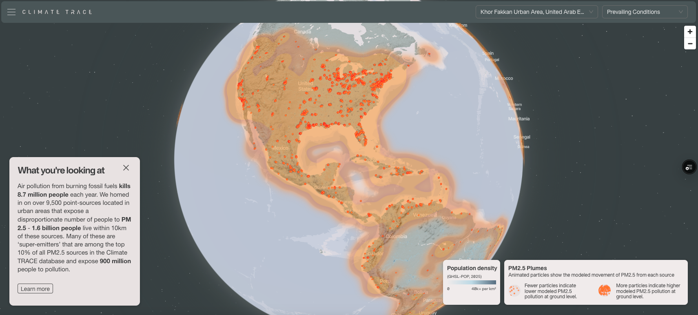
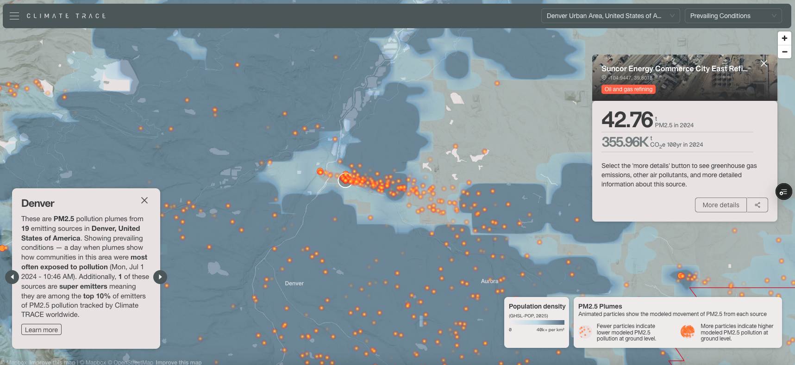
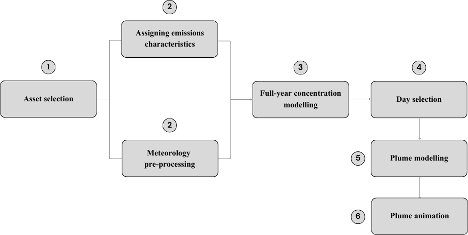

### High resolution visualization of PM2.5 impacts on surrounding population

**Randy Sargent, Amy Gottsegen1, Gabriel O’Donnell, and Ana Hoffman**

*All authors are affiliated with Carnegie Mellon University CREATE Lab*

1 Corresponding author: [agottseg@andrew.cmu.edu](mailto:agottseg@andrew.cmu.edu)

Sept. 2025

*Plume animations are modelled by the Carnegie Mellon University CREATE (Community Robotics Education and Technology Empowerment) Lab. This guide details the modelling process and limitations.*

#### 1. Introduction

Air pollution, in the form of fine particulate matter (PM2.5), contributes to millions of premature deaths globally through its impacts on cardiovascular, respiratory, cerebrovascular, metabolic, and reproductive health systems [1]. Addressing the issue requires understanding where the pollution comes from. Recent emissions inventories are unevenly available, an issue which the Climate TRACE coalition aimed to solve when they expanded their database of greenhouse gases monitoring to include additional pollutants which harm human health [2]. However, creating a compelling demonstration of the connection between emissions inventories and the populations which are impacted by those emissions presents a challenge. Dispersion modelling allows us to combine emissions inventories with meteorological data to reveal the human cost of exposure to PM2.5 pollution.

Plume animations derived from the HYSPLIT model were originally developed by the Carnegie Mellon University CREATE Lab in 2018 for a tool called [PlumePGH](https://plumepgh.org/?date=2025-06-03) – a model and visualization tool that validates citizen science reports of pollution odors by overlaying them with high-resolution animations of emissions from the largest local polluters. The present work leverages Climate TRACE emissions estimates to build on this previous work by generating these plume animations on a global scale.

The Climate TRACE database ([https://climatetrace.org/](https://climatetrace.org/)) contains estimates for the amount of particulate matter released from thousands of emitting sources globally (i.e., power plants, steel plants) and now hosts the plume tool which determines when and where the PM2.5 plumes travels to visualize the potential impact on the surrounding populations ([https://climatetrace.org/air-pollution](https://climatetrace.org/air-pollution); Figure 1). The tool is not meant to be a comprehensive quantification of air pollution, but rather a first-of-its-kind tool to help users connect emissions data with real-life experiences of poor air quality.

**Figure 1** Screenshot from the plume visualization tool, which provides a global coverage (top image) and allows users to zoom into specific regions to identify the PM2.5 emitters (bottom image). The plume tool can be found at [https://climatetrace.org/air-pollution](https://climatetrace.org/air-pollution).

#### 2. Methods and Materials

This section details the modelling process and limitations, with the process steps shown in Figure 2.

**Figure 2** Process and modeling steps to generate the PM2.5 plume model using Climate TRACE emitting sources.

#### 2.1 Asset selection

The Climate TRACE database provided assets (emitting sources) for the plume model. The assets were selected based on the following criteria:

- a. **Sources which emit PM2.5:** Primary PM2.5 is common to most polluting processes (combustion, refining, etc.) and simpler to model due to its low chemical reactivity;
- b. **Sources which are stationary and can be represented as a point emitter:** Sources which cover a large area like crop fires, and mobile sources such as vehicles were excluded from our analysis;
- c. **Shipping as an edge case:** The portions of international and domestic shipping which can be attributed to vessel stays within ports were aggregated into a single point source at the site of each port.

Climate TRACE provides methodologies for each sector used to estimate PM2.5 plumes. For a detailed description how each sector estimates emissions, visit the [Climate TRACE GitHub methodology repository](https://github.com/climatetracecoalition/emissions-methodology/tree/main/Sector-Methodologies).

#### 2.2 Assigning emissions and Methodology processing

Specific assets, emitting sources, were identified for the dispersion modeling and combined with high-resolution meteorology data based on the assets location globally.

#### 2.2.1 Assigning emissions characteristics

The following three criteria was used to assign emission characteristics:

1. **Emissions time period and quantity from Climate TRACE:** Primary PM2.5 emissions were drawn from Climate TRACE’s most recent estimates of 2024 monthly emissions at the time of our analysis;
2. **Continuous model:** Our model shows volume of emission proportional to average emissions as estimated on a monthly basis within the Climate TRACE air emissions inventory. As such, all the PM2.5 variability seen is from changing wind and weather conditions, especially amplification during times of inversion. It is not yet possible to show individual sources changing emissions quantity on a finer timescale, which adds a significant degree of uncertainty to our analysis;
3. **Stack height estimation:** Stack height is an influential parameter in dispersion modelling because meteorological effects can vary greatly at different heights within the atmosphere. We estimate stack heights by linking Climate TRACE sectors (those that fall under electricity generation, heavy manufacturing, shipping, refining, and mining) to corresponding sectors within the EPA’s National Emissions Inventory. An analysis of each sector yielded middle 50% stack heights, which are then used to distribute emissions for individual sources through a vertical pillar. Within the sector of electricity generation, which has far greater variability of stack height, we further stratified stack height estimates by power plant capacity.

#### 2.2.2 Meteorology

To accurately model dispersion, meteorological variables including wind speed and direction, temperature, pressure, humidity, and boundary layer height are required. We reviewed all meteorology models available in the necessary Air Resources Laboratory (ARL) formatting, and selected the finest temporal and spatial resolution available. **For assets within the United States:** The [High-Resolution Rapid Refresh (HRRR) model](https://rapidrefresh.noaa.gov/hrrr/) provides meteorological data at an hourly 3 kilometer resolution for the continental United States [3]. **For all assets outside the United States:** The [Global Forecast System (GFS) model](https://noaa-oar-arl-hysplit-pds.s3.amazonaws.com/index.html#gfs0p25/) provides meteorological data at a 3 hour, quarter degree resolution globally [4].

#### 2.3 Dispersion model

We used the National Oceaning and Atmospheric Administration's Hybrid Single-Particle Lagrangian Integrated Trajectory (HYSPLIT) model to simulate dispersion of emissions from the source into surrounding communities ([https://www.arl.noaa.gov/hysplit/](https://www.arl.noaa.gov/hysplit/)) [5]. Many models for air quality dispersion are available but HYSPLIT was chosen primarily for its particle trajectory output which enables plume animation, and its compatibility with high-resolution meteorology inputs. There are two types of HYSPLIT outputs used in our modelling pipeline:

1. **Concentration maps:** concentration maps are gridded output which integrate the concentration of particles, in µg/m³ of PM2.5, over the length of the individual simulation. We generate 48 hour concentration maps on a 12 arc-second spaced grid with 2˚x 2˚ domain extent for each day of 24 hours of continuous emissions for 2024 for every asset within the Climate TRACE database identified as plume-capable.
2. **Particle trajectories:** particle trajectory outputs track individual particles’ locations in a three dimensional grid over time. We generate two 24 hour simulations for every plume-capable asset representing a typical day of exposure and a day of high population exposure.

#### 2.4 Day selection and Plume modeling

Animations of a real day of pollution’s travel have the greatest interpretability and resonance, but selecting a day for thousands of pollution sources posed several engineering challenges. The following paragraphs describe the challenges that were addressed to generate PM2.5 plumes.

**Daily footprint for each asset:** To select days for animation, a summary of each daily plume’s local impact is required, and monitoring data can only provide limited insights given that our analysis is focused solely on a portion of total PM2.5. Multiple methods of generating these summaries were considered, including simple meteorological analysis and gaussian plume modelling. Ultimately the concentration dump output from HYSPLIT was chosen for its higher degree of accuracy and ability to be combined with other gridded datasets. As described above, a daily footprint was generated for each asset. To optimize computational efficiency, the input meteorology for each simulation was cropped to the approximate domain of the simulation, and the number of particles and time resolution of output data were decreased to the viable minimum.

**Aggregating asset footprints:** For users to see multiple sources of pollution animating simultaneously, we needed a system to select a single day to animate across a grouping of sources. We chose Functional Urban Areas (FUAs) as the geography within which to group sources for day selection, to balance the need to capture localized meteorology patterns with the desire to demonstrate combined facilities’ impact.

**Calculating typical day**: Once daily pollution footprints were aggregated by geography, we compare each daily aggregation to the average aggregation for the year, to select a day with an overall pollution footprint which mostly closely represents the average. The animation for this day thus represents the dispersion patterns one would typically expect in a given geography.

**Calculating worst day**: A second day of plume animation was selected to demonstrate acute exposures to air pollution. To select the day for this animation, the daily footprints for each FUA are multiplied by Global Human Settlement population data to find the day with the estimated maximum person-exposure [6]. Although the absence of comprehensive daily emissions data renders a much higher uncertainty in this calculation, these animations are useful for communicating the influence of meteorological patterns on acute exposures to air pollution.

#### 2.5 Plume animations

The plume animations required scaling to individual assets in addition to optimizing for visualization on the website.

**Scaling animations to asset emissions:** Once particle trajectory outputs were produced for the selected days, the number of trajectories was reduced in proportion with the source’s emissions as estimated in the Climate TRACE database.

**Optimizing outputs for visualization:** Visualizing the outputs from HYSPLIT required huge reductions in file sizes. To accomplish this, we started by subsampling particle trajectories from minutely data every 30 minutes. We then applied the Ramer–Douglas–Peucker algorithm to produce simplified linestrings from each particle path. Parameter tuning was completed to maximize the preservation of overall trajectory shape and particle speed, while minimizing file size. Finally, we encoded these as GeoJSON files, relying on the gzip compression of the webserver to further reduce the size of these files by ~85%-90%.

#### 3. Conclusion

The PM2.5 plume visualizations produced by this effort represent a novel approach to picture the pollution emitted from assets and the daily harm to human health they can potentially cause. This tool can provide additional evidence to support efforts to hold emitters accountable by allowing non-experts and policy makers to quickly see what the polluting source is affecting nearby communities. Work will continue on this tool to refine and develop the modelling process and to reduce limitations related to monitoring PM2.5 exposure to human health.

#### References

1. Global Burden of Disease Collaborative Network (2020) *Global Burden of Disease Study 2019 (GBD 2019) Results*. Seattle, United States: Institute for Health Metrics and Evaluation (IHME).
2. Climate TRACE Coalition (2024) *Non-Greenhouse Gas Emissions Estimates Across Sectors*. Available at: [https://github.com/climatetracecoalition/emissions-methodology/tree/main/Sector-Methodologies/2-Cross-Cutting/non-greenhouse-gases](https://github.com/climatetracecoalition/emissions-methodology/tree/main/Sector-Methodologies/2-Cross-Cutting/non-greenhouse-gases) (Accessed: 22 September 2024).
3. NOAA/NCEP (2024) *High-Resolution Rapid Refresh (HRRR) Model*. Available at: [https://rapidrefresh.noaa.gov/hrrr/](https://rapidrefresh.noaa.gov/hrrr/) (Accessed: 22 September 2024).
4. NOAA/NCEP (2024) *Global Forecast System (GFS) Quarter-Degree Global Model*. Available at: [https://noaa-oar-arl-hysplit-pds.s3.amazonaws.com/index.html#gfs0p25/](https://noaa-oar-arl-hysplit-pds.s3.amazonaws.com/index.html#gfs0p25/) (Accessed: 22 September 2024).
5. NOAA Air Resources Laboratory (2024) *HYSPLIT - Hybrid Single Particle Lagrangian Integrated Trajectory Model*. Available at: [https://www.arl.noaa.gov/hysplit/](https://www.arl.noaa.gov/hysplit/) (Accessed: 22 September 2024).
6. European Commission, Joint Research Centre (2023) *Global Human Settlement Layer (GHSL) - GHS Population Grid*. Available at: [https://human-settlement.emergency.copernicus.eu/ghs_pop.php](https://human-settlement.emergency.copernicus.eu/ghs_pop.php) (Accessed: 22 September 2024).

