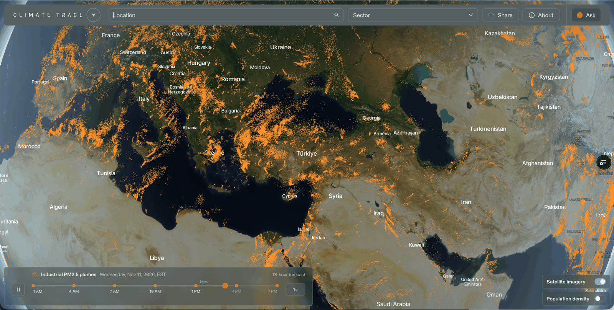
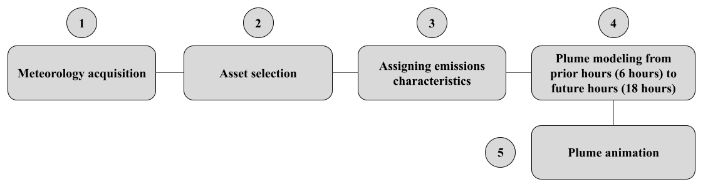

### High resolution visualization of PM2.5 impacts on surrounding population

**Amy Gottsegen, Ana Hoffman, Kate Munkacsy1, Gabriel O’Donnell, and Randy Sargent**

*All authors are affiliated with Carnegie Mellon University CREATE Lab*

1 Corresponding author: [kmunkacs@andrew.cmu.edu](mailto:kmunkacs@andrew.cmu.edu)

V2.0.0, Nov. 2026

*Plume animations are modeled by the Carnegie Mellon University CREATE (Community Robotics Education and Technology Empowerment) Lab. This guide details the modeling process and limitations.*

#### 1. Introduction

Air pollution, in the form of fine particulate matter (PM2.5), contributes to millions of premature deaths globally through its impacts on cardiovascular, respiratory, cerebrovascular, metabolic, and reproductive health systems \[1\]. Addressing the issue requires understanding where the pollution comes from. Recent emissions inventories are unevenly available, an issue which the Climate TRACE coalition aimed to solve when they expanded their database of greenhouse gases monitoring to include additional pollutants which harm human health \[2\]. However, creating a compelling demonstration of the connection between emissions inventories and the populations which are impacted by those emissions presents a challenge. Dispersion modeling allows us to combine emissions inventories with meteorological data to reveal the human cost of exposure to PM2.5 pollution.

Plume animations derived from the HYSPLIT model were originally developed by the Carnegie Mellon University CREATE Lab in 2018 for a tool called [PlumePGH](https://plumepgh.org/?date=2025-06-03)– a model and visualization tool that validates citizen science reports of pollution odors by overlaying them with high-resolution animations of emissions from the largest local polluters. The present work leverages Climate TRACE emissions estimates to build on this previous work by generating these plume animations on a global scale.

The Climate TRACE database ([https://climatetrace.org/](https://climatetrace.org/)) contains estimates for the amount of particulate matter released from thousands of emitting sources globally (e.g., power plants, steel plants) and now hosts the plume tool which determines when and where the PM2.5 plumes travel to visualize the potential impact on the surrounding populations ([https://climatetrace.org/air-pollution](https://climatetrace.org/air-pollution); Figure 1). The tool is not meant to be a comprehensive quantification of air pollution, but rather a first-of-its-kind tool to help users connect emissions data with real-life experiences of poor air quality.

**Figure 1**: Screenshot from the plume visualization tool, which provides a global coverage (top image) and allows users to zoom into specific regions to identify the PM2.5 emitters (bottom image). The plume tool can be found at [https://climatetrace.org/air-pollution](https://climatetrace.org/air-pollution).

#### 2. Methods and Materials

This section details the modeling process and limitations, with the process steps shown in Figure 2.

**Figure 2:** Process and modeling steps to generate the PM2.5 plume model using Climate TRACE emitting sources.

#### 2.1 Asset selection

The Climate TRACE database provided assets (emitting sources) for the plume model. The assets were selected based on the following criteria:

1.  **Sources which emit PM2.5:** Primary PM2.5 is common to most polluting processes (combustion, refining, etc.) and simpler to model due to its low chemical reactivity;

2.  **Sources which are stationary and can be represented as a point emitter:** Sources which cover a large area like crop fires, and mobile sources such as vehicles were excluded from our analysis;

3.  **Shipping as an edge case:** The portions of international and domestic shipping which can be attributed to vessel stays within ports were aggregated into a single point source at the site of each port.

Climate TRACE provides methodologies for each sector used to estimate PM2.5 plumes. For a detailed description on how each sector estimates emissions, visit the [Climate TRACE GitHub methodology repository](https://github.com/climatetracecoalition/emissions-methodology/tree/main/Sector-Methodologies/1-Sectors).

#### 2.2 Assigning emissions and methodology processing

Specific assets, emitting sources, were identified for the dispersion modeling and combined with high-resolution meteorology data based on the asset’s location globally.

#### 2.2.1 Assigning emissions characteristics

The following criteria were used to assign emission characteristics:

1.  **Emissions time periods and quantities from Climate TRACE:** Climate TRACE forecasts primary PM2.5 quantities emitted from each source, across every date and time required for a plume forecast. For an increasing number of sectors, Climate TRACE produces hourly emission estimates. For other sectors, the emissions forecasts are less temporally granular, up to monthly emission estimates. When modeling the plume patterns from these emissions, we assume constant emission across each estimated time period, whether per hour or per month or in-between, except for electricity generation, where monthly emissions are distributed by hour of day and day of week using country-level profiles (CAMS-GLOB-TEMPO). In addition to sources emitting more or less PM2.5 over time, the plume models show great variability in exposure from changing wind and weather conditions, especially amplification during times of inversion.

2.  **Stack height estimation:** Stack height is an influential parameter in dispersion modeling because meteorological effects can vary greatly at different heights within the atmosphere. We estimate stack heights by linking Climate TRACE sectors (those that fall under electricity generation, heavy manufacturing, shipping, refining, and mining) to corresponding sectors within the EPA’s National Emissions Inventory. An analysis of each sector yielded middle 50% stack heights, which are then used to distribute emissions for individual sources through a vertical pillar. Within the sector of electricity generation, which has far greater variability of stack height, we further stratified stack height estimates by power plant capacity.

#### 2.2.2 Meteorology

To accurately model dispersion, meteorological variables including wind speed and direction, temperature, pressure, humidity, and boundary layer height are required. We use NOAA's [Global Forecast System (GFS) model](https://noaa-oar-arl-hysplit-pds.s3.amazonaws.com/index.html#gfs0p25/), which provides meteorological data at a 3 hour, quarter degree resolution globally \[4\].

#### 2.3 Dispersion model

We used the National Oceanic and Atmospheric Administration’s Hybrid Single-Particle Lagrangian Integrated Trajectory (HYSPLIT) model to simulate dispersion of emissions from the source into surrounding communities ([https://www.arl.noaa.gov/hysplit/](https://www.arl.noaa.gov/hysplit/)) \[5\]. Many models for air quality dispersion are available but HYSPLIT was chosen primarily for its particle trajectory output which enables plume animation, and its compatibility with high-resolution meteorology inputs. Using HYSPLIT, we generate forecasts of the dispersion of emissions four times each day, using the latest hourly Climate TRACE air emissions data and meteorological data available for each forecast.

#### 2.4 Plume animations

The plume animations display pollution dispersion in the air near the ground, where pollution has measurable impacts on human health. Standard practice for HYSPLIT dispersion is to sample altitudes 0–50 meters \[6, 7\] or 0–100 meters \[8, 9, 10, 11\] to model ground-level pollution concentration. Our plume visualization adapts this practice to create a smooth transition from lower to higher altitudes. Modeled particulates are drawn at full opacity from the ground up to 36 meters, then fade to complete transparency approaching 90 meters.

A plume that has faded fully from view has risen far enough to no longer cause significant human exposure. Portions of the plume can reappear further downwind when turbulence and mixing bring particulates back down into the zone of human impact.

The plume animations required scaling to individual assets in addition to optimizing for visualization on the website.

**Optimizing outputs for visualization:** The PM2.5 forecast visualization models the particle trajectories of over 386,000 sources over an 18-hour period. The forecast dataset is too large to simply stream from a server to client and render in a web-browser.

Traditional and well understood methods for reducing the size of GIS data include tiling (decomposing the dataset into zoom level dependent grid based tiles) and feature reduction (reducing the amount of data drawn at lower zoom levels). Both of these are nominally used for the plume animations, but additional novel approaches are incorporated for further size savings. These additional approaches, detailed below, rely on representing the path of a particle as a series of points describing the position of the particle in 3D space (xyz) at two different times. The position of that particle along the described path can be determined given a time value that falls between those two times.

*Temporal subsampling of particle paths based on zoom level*

Lower levels of zoom have greater time steps between particles. The distance between points becomes simplified at lower levels of zoom. As the paths simplify the number of points across time steps required to visualize the particle trajectory decrease.

*Time-based fixed buckets of data*

Spatially tiled data is further decomposed based on the fixed timestep appropriate for the current level of zoom. Particle locations are interpolated based on their start and end spatial-temporal locations. So for a given time ***t*** we only need the portion of the path that is represented by the appropriate time steps. This reduces the individual size of the tile being requested for a particular location.

*Custom binary formatting of packaged data*

Tile data is formatted as multi-row binary data where each column has a defined variable bit range. Instead of encoding all values as say 32 bit floats we encode just the amount necessary to capture the full range of values present in the data. Gzip compression is used to optimally size the tiles for delivery.

*Particle path re-construction on the client side*

Tile data is used to construct the paths of individual particles. Each encoded path includes two Gaussian radii indicating the distribution of particles in those ranges. There are encoded values for the horizontal location (x & y) and a value for the vertical value (z). JavaScript code runs in the client browser to take this data that describes the motion of a single path and uses it to construct distinct paths for many particles. This reduces size by allowing us to describe the path of many particles with a single description.

#### 3. Conclusion

The PM2.5 plume visualizations produced by this effort represent a novel approach to picture the pollution emitted from assets and the daily harm to human health they can potentially cause. This tool can provide additional evidence to support efforts to hold emitters accountable by allowing non-experts and policy makers to quickly see how the polluting source is affecting nearby communities. Work will continue on this tool to refine and develop the modeling process and to reduce limitations related to monitoring PM2.5 exposure to human health.

#### References

1.  Global Burden of Disease Collaborative Network (2020) *Global Burden of Disease Study 2019 (GBD 2019) Results*. Seattle, United States: Institute for Health Metrics and Evaluation (IHME).

2.  Climate TRACE Coalition (2024) *Non-Greenhouse Gas Emissions Estimates Across Sectors*. Available at: [https://github.com/climatetracecoalition/emissions-methodology/tree/main/Sector-Methodologies/2-Cross-Cutting/non-greenhouse-gases](https://github.com/climatetracecoalition/emissions-methodology/tree/main/Sector-Methodologies/2-Cross-Cutting/non-greenhouse-gases) (Accessed: 22 September 2024).

3.  NOAA/NCEP (2024) *High-Resolution Rapid Refresh (HRRR) Model*. Available at: [https://rapidrefresh.noaa.gov/hrrr/](https://rapidrefresh.noaa.gov/hrrr/) (Accessed: 22 September 2024).

4.  NOAA/NCEP (2024) *Global Forecast System (GFS) Quarter-Degree Global Model*. Available at: [https://noaa-oar-arl-hysplit-pds.s3.amazonaws.com/index.html\#gfs0p25/](https://noaa-oar-arl-hysplit-pds.s3.amazonaws.com/index.html#gfs0p25/) (Accessed: 22 September 2024).

5.  NOAA Air Resources Laboratory (2024) *HYSPLIT - Hybrid Single Particle Lagrangian Integrated Trajectory Model*. Available at: [https://www.arl.noaa.gov/hysplit/](https://www.arl.noaa.gov/hysplit/) (Accessed: 22 September 2024).

6.  Schade, G.W. and Gregg, M.L. (2022) *Testing HYSPLIT plume dispersion model performance using regional hydrocarbon monitoring data during a gas well blowout*. Atmosphere, 13(3), 486. [https://doi.org/10.3390/atmos13030486](https://doi.org/10.3390/atmos13030486)

7.  Yerramilli, A., Srinivas, C.V., Dasari, H.P., Tuluri, F., White, L.D., Baham, J.M., Young, J.H., Hughes, R., Patrick, C., Hardy, M.G. and Swanier, S.J. (2009) *Simulation of atmospheric dispersion of elevated releases from point sources in Mississippi Gulf Coast with different meteorological data*. International Journal of Environmental Research and Public Health, 6(3), 1055–1074. [https://doi.org/10.3390/ijerph6031055](https://doi.org/10.3390/ijerph6031055)

8.  Li, Y., Tong, D.Q., Ngan, F., Cohen, M.D., Stein, A.F., Kondragunta, S., Zhang, X., Ichoku, C., Hyer, E.J. and Kahn, R.A. (2020) *Ensemble PM2.5 forecasting during the 2018 Camp Fire event using the HYSPLIT transport and dispersion model*. Journal of Geophysical Research: Atmospheres, 125, e2020JD032768. [https://doi.org/10.1029/2020JD032768](https://doi.org/10.1029/2020JD032768)

9.  Yerramilli, A., Dodla, V.B.R., Challa, V.S., Myles, L., Pendergrass, W.R., Vogel, C.A., Dasari, H.P., Tuluri, F., Baham, J.M., Hughes, R.L., Patrick, C., Young, J.H., Swanier, S.J. and Hardy, M.G. (2012) *An integrated WRF/HYSPLIT modeling approach for the assessment of PM2.5 source regions over the Mississippi Gulf Coast region*. Air Quality, Atmosphere & Health, 5(4), 401–412. [https://doi.org/10.1007/s11869-010-0132-1](https://doi.org/10.1007/s11869-010-0132-1)

10. Rolph, G.D., Draxler, R.R., Stein, A.F., Taylor, A., Ruminski, M.G., Kondragunta, S., Zeng, J., Huang, H.-C., Manikin, G., McQueen, J.T. and Davidson, P.M. (2009) *Description and verification of the NOAA Smoke Forecasting System: The 2007 fire season*. Weather and Forecasting, 24(2), 361–378. [https://doi.org/10.1175/2008WAF2222165.1](https://doi.org/10.1175/2008WAF2222165.1)

11. Stein, A.F., Rolph, G.D., Draxler, R.R., Stunder, B. and Ruminski, M. (2009) Verification of the NOAA Smoke Forecasting System: *Model sensitivity to the injection height*. Weather and Forecasting, 24(2), 379–394. [https://doi.org/10.1175/2008WAF2222166.1](https://doi.org/10.1175/2008WAF2222166.1)
