### Disaggregation of Spatially Uncertain Emissions

**Gary Collins1,3, April Nellis1,3, Krsna Raniga2,3, Nicole Brown1,3, Michael Pekala1,3, Zoheyr Doctor2,3, Dan Moore2,3, Elizabeth Reilly1,3, Marisa Hughes1,3, and Gavin McCormick2,3**

*1) The Johns Hopkins University Applied Physics Laboratory, 2) WattTime, 3) Climate TRACE*

#### Introduction

For many bottom-up inventories, emissions are estimated at a regional level then distributed spatially in proportion with some proxy. For example, the Open-source Data Inventory for Anthropogenic CO2 (ODIAC) dataset estimates and distributes fossil fuel emissions in proportion to nightlight intensity as measured by the satellite remote sensing (Oda et al. 2018) and the Emissions Database for Global Atmospheric Research (EDGAR) supplements its bottom-up inventory with sector-specific proxies such as built-up nonresidential surface area (Crippa et al. 2024). A distinguishing characteristic of Climate TRACE data is that it is typically generated in a different order: asset-level locations are identified first then emissions are estimated upon them. This approach produces higher spatial accuracy of emissions estimates and allows for better attribution of responsibility of sources of emissions.

However, despite the efforts of the Climate TRACE coalition, global coverage of emissions at a facility-level is not yet achieved. For some sectors, this is due to the lack of detailed location information (e.g. lime manufacturing locations, a large emitting sector). In other sectors, the specific spatial distribution of emissions is hard to identify (e.g. manure management of free grazing cattle). To fill this gap, Climate TRACE estimates the quantity of “spatially-uncertain emissions” (SUEs) by taking the difference between emissions attributed to confident locations (spatially-*certain* emissions, SCE) and the highest quality country-level emissions estimate available (be it Climate TRACE or other emission inventories). These SUEs require distribution spatially in order to be useful for policy-makers, scientists, and activists alike; and hence specialized spatial proxies are used and the methodology for developing these proxies are described herein.

#### 1.  Data and Methods

1.  Overview

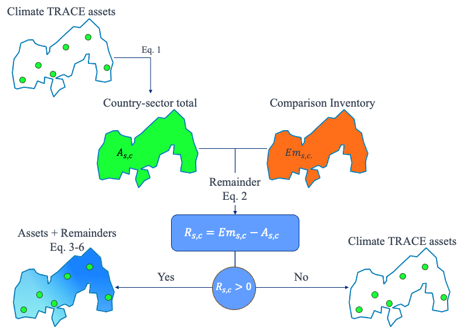

Figure 1. Climate TRACE remainder disaggregation process. This primarily consists of comparing Climate TRACE’s asset total for a given country $`\mathbf{c}`$ and sector $`\mathbf{s}`$ to some comparison inventory (EDGAR, UNFCCC, etc.) and disaggregating that SUE is greater than 0.

Climate TRACE spatial products are a combination of both location-specific spatially-certain data and proxy-distributed country/sector-level spatially-uncertain emissions (Figure 1). To generate these products, SCEs were compiled on some spatial support $`\mathbf{z}`$ (be it gridded data or administrative boundaries like Global Administrative Areas (GADM) (Global Administrative Areas. 2022). Then an asset-level country-sector sum was produced by,

$`A_{s,c} = \Sigma_{z}a_{s,c}(z)`$, Eq. 1,

where “$`a_{s,c}(z)`$” is the sum of the SCEs for sector $`s`$ at location $`z`$. This may differ from the “best” country-level estimate of the emissions, $`Em_{s,c}`$, since some sectors do not have all their emissions accounted for by localized operations for facilities. The “best” country-level emissions estimate may be an output of a separate model, which was the case for wastewater treatment and disposal, or it could be the emissions estimate from another bottom-up inventory like EDGAR. The SUEs remainder, *R,* are then computed by taking the difference between the two, expressed by

$`R_{s,c} = Em_{s,c} - A_{s,c}`$, Eq. 2.

In the following, we cover the details of the method implementation. We discuss the proxies and data used to spatially distribute SUEs in 2.2, and provide more insight into our methods in 2.3. We first cover the single-proxy approach which is applied to a majority of the sectors in the database in 2.3.1. Then, we showcase a novel learned ensemble proxy which leverages high-confidence bottom-up Climate TRACE data in 2.3.2. The benefits of this data-driven method are discussed for rice cultivation, our selected pilot sector.

#### 1.  Data

#### 1.  Proxy Data

We use several proxies from the Global Human Settlement Layer (GHSL), as well as nightlights and population. Specifically, we used the following proxies to facilitate SUE disaggregation:

**Table 1.** Emissions proxy data for SUE disaggregation.

<table><tbody><tr class="odd"><td><strong>Proxy</strong></td><td><strong>Source</strong></td></tr><tr class="even"><td>Agricultural regions (Levels 11 and 12 of the GHS Settlement Model Degrees of Urbanisation)</td><td><blockquote>
<em>Schiavina M., Melchiorri M., Pesaresi M. (2023)</em>: <strong>GHS-SMOD R2023A - GHS settlement layers, application of the Degree of Urbanisation methodology (stage I) to GHS-POP R2023A and GHS-BUILT-S R2023A, multitemporal (1975-2030).</strong> European Commission, Joint Research Centre (JRC) 
PID: <a href="http://data.europa.eu/89h/a0df7a6f-49de-46ea-9bde-563437a6e2ba">http://data.europa.eu/89h/a0df7a6f-49de-46ea-9bde-563437a6e2ba</a>
</blockquote></td></tr><tr class="odd"><td>GHS Distribution of Built-up Surfaces (Non-residential)</td><td><blockquote>
<em>Pesaresi M., Politis P. (2023)</em>: <strong>GHS-BUILT-S R2023A - GHS built-up surface grid, derived from Sentinel2 composite and Landsat, multitemporal (1975-2030)</strong>European Commission, Joint Research Centre (JRC) 
PID: <a href="http://data.europa.eu/89h/9f06f36f-4b11-47ec-abb0-4f8b7b1d72ea">http://data.europa.eu/89h/9f06f36f-4b11-47ec-abb0-4f8b7b1d72ea</a>
</blockquote></td></tr><tr class="even"><td>GHS Distribution of Built-up Volumes</td><td><blockquote>
<em>Pesaresi M., Politis P. (2023)</em>: <strong>GHS-BUILT-V R2023A - GHS built-up volume grids derived from joint assessment of Sentinel2, Landsat, and global DEM data, multitemporal (1975-2030).</strong> European Commission, Joint Research Centre (JRC) 
PID: <a href="http://data.europa.eu/89h/ab2f107a-03cd-47a3-85e5-139d8ec63283">http://data.europa.eu/89h/ab2f107a-03cd-47a3-85e5-139d8ec63283</a>
</blockquote></td></tr><tr class="odd"><td>Night Light Intensity</td><td><blockquote>
Elvidge, C.D, Zhizhin, M., Ghosh T., Hsu FC, Taneja J. <strong>Annual time series of global VIIRS nighttime lights derived from monthly averages:2012 to 2019</strong>. Remote Sensing 2021, 13(5), p.922, <a href="https://doi.org/10.3390/rs13050922">doi:10.3390/rs13050922</a>
</blockquote></td></tr><tr class="even"><td>Population</td><td><blockquote>
<em>Schiavina M., Freire S., Carioli A., MacManus K. (2023)</em>: 
<strong>GHS-POP R2023A - GHS population grid multitemporal (1975-2030).</strong>European Commission, Joint Research Centre (JRC) 
PID: <a href="about:blank">http://data.europa.eu/89h/2ff68a52-5b5b-4a22-8f40-c41da8332cfe</a>.
</blockquote></td></tr></tbody></table>

Table 3 in the supplemental section shows the mapping between Climate TRACE sectors and their associated proxies. These proxies were selected by referencing proxies used by other greenhouse gas databases. Namely, ODIAC uses night light intensity to approximate CO2 emissions (Oda et al. 2016), while EDGAR uses GHSL settlement layers as well as population data and built-up nonresidential surface area and volume for various sectors (Crippa et al. 2024).

#### Climate TRACE Database Data

Section 2.3 discusses the two different approaches to spatial disaggregation using proxies, both of which rely on Climate TRACE asset-level data aggregated to the GADM 2 level as discussed in Eq. 1 and illustrated in Figure 1.

#### 1.  Methods

1.  ### Spatially-Uncertain Emissions

As shown in Table 2 in the supplemental section, in 2022 approximately 15 GT of global CO2 equivalent emissions (computed from CO2, CH4, and N2O) were not accounted for with detailed location information by Climate TRACE, which is approximately 20% of all CO2 equivalent emissions. Figure 2 and Figure 3 display the global distribution of these SUEs. While China has the largest nominal SUEs, many other regions have significant relative SUEs, such as Djibouti and Ireland. Few regions have small relative gaps, like in the United States where reporting standards are very high.

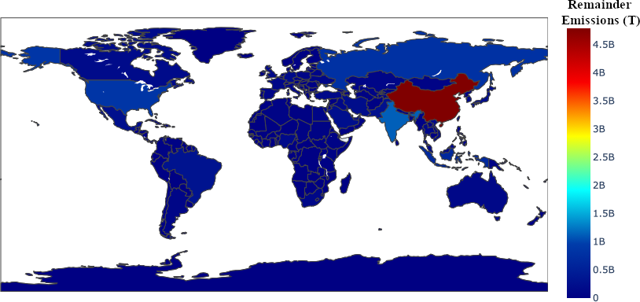

**Figure 2.** Distribution of nominal CO2 equivalent SUE values in 2022.

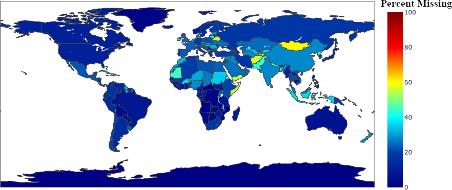

**Figure 3.** Distribution of CO2 equivalent SUE values in 2022 as a percentage of total emissions in each country.

Many of the largest sectors in which these emissions were missing are the “other” sectors, which are composed by taking the difference between larger EDGAR sectors and Climate TRACE subsectors (e.g. subtracting all Climate TRACE industrial sectors from the wider EDGAR IND sector). These unaccounted-for emissions have no corresponding asset information and thus redistributing their emissions requires proxying. Other gaps exist due to there being a difference between country-level bottom-up estimates vs. total asset-level emissions, like cement.

In most inventories, the distribution of country-level emissions can be expressed by,

$`em_{s,c}\left( z \right) = \frac{p_{s,c}\left( z \right)}{\Sigma_{z}p_{s,c}\left( z \right)}{\cdot Em}_{s,c}`$ Eq. 3,

where $`p_{s,c}\left( z \right)`$ is the country-sector proxy value at location $`z`$. Unlike other inventories, Climate TRACE modifies the proxy in Equation 3 to take into account asset-level information for a given sector. As Climate TRACE may have more complete emissions estimates for a given sector in some subregions than others, the modified proxy is developed by removing distributed assets emissions from Equation 1, then renormalizing the output before distributing SUEs, defined by

$`{\widetilde{p}}_{s,c}\left( z \right) = max(em_{s,c}\left( z \right) - a_{s,c}\left( z \right),\ 0)`$ Eq. 4,

where the maximum is taken to prevent negative proxy values. The SUE distribution for Climate TRACE uses these modified proxies with,

$`r_{s,c}\left( z \right) = \ \frac{p_{s,c}\left( z \right)}{\Sigma_{z}p_{s,c}\left( z \right)} \cdot R_{s,c}`$, Eq. 5,

with the total emissions of a location z for country $`c`$ arising from sector $`s`$ defined with,

$`em_{s,c}\left( z \right) = a_{s,c}\left( z \right) + r_{s,c}(z)`$ Eq. 6.

A typical use for the spatial distribution of emissions is producing gridded, latitude-longitude data that is readily usable for climate modeling. However, Climate TRACE produces data also at administrative boundaries. Hence, we use a generic spatial variable $`z`$.

A visual example of modified proxy generation and SUE distribution is shown in Figure 4.

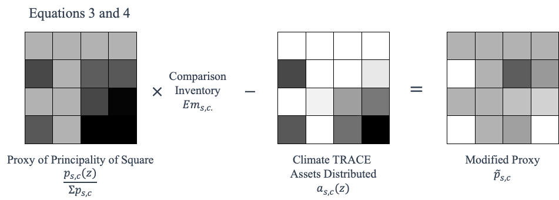

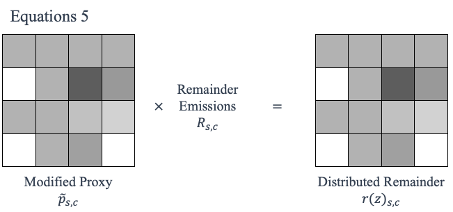

**Figure 4.** A visualization of Equations 3, 4, and 5. Equation 3 and 4 takes a proxy of a region and modifies it by removing mass from Climate TRACE asset locations. This modified proxy is then used to disaggregate the SUE (aka “Remainder”) with Equation 5.

#### Ensemble Proxies

A host of factors affect the spatial distribution of GHG emissions, from proximity of transportation to natural terrain. While it is an established approach to consider sector-dependent proxies, as in Crippa et al. (2024) and Climate TRACE methodology documents (versions Fall 2024), much of the underlying complexity is still lost when relying on a single proxy to estimate the spatial distribution of SUEs. Therefore, we have developed a method for determining the spatial distribution of SUEs using an *ensemble* of proxies. This method was prototyped for the rice-cultivation sector, whereas all other sectors used proxies listed in Table 3 of the supplemental for SUE disaggregation.

Since Climate TRACE has amassed an extensive database of point-source GHG emitters (assets) with both location and emissions data, this information can be used as the basis for data-driven ensemble proxy development. In countries and sectors where a vast majority of GHG emissions data is accounted for by assets in the Climate TRACE database, proxies can be evaluated based on their consistency with this granular data using a variety of metrics. Furthermore, the ability to evaluate proxies against a high-certainty dataset opens the door to training and evaluating ensemble proxies. For this process, we use only data from countries where Climate TRACE assets account for at least 99.99% of total country emissions. These countries include the top five global rice producers (China, India, Bangladesh, Indonesia, and Vietnam), which produce a combined 72% of the world’s rice (Foreign Agriculture Service. 2024).

As an initial case study, we apply a random forest (RF) regressor to the problem of distributing SUEs of methane associated with rice cultivation across GADM 2 regions. The input data for the RF for a given GADM region is a vector of the various proxy values, while the output data is the predicted emissions level. We evaluate the performance of the trained output using the GADM-level methane emissions calculated from Climate TRACE rice cultivation assets, normalized by country. The accuracy of the proxy is assessed using the mean squared error between the ensemble proxy and the Climate TRACE distribution. In order to maximize the transferability of the model to countries with sparse asset-level data, we perform hyperparameter optimization and cross-validation on the random forest regressor. The out-of-sample performance of the regressor is evaluated by training the random forest on a subset of the countries with high completion and validating the trained random forest on the remaining countries with high completion. In addition, the random forest’s performance is evaluated on each country individually, which helps identify and avoid overfitting.

Because this approach performed well on methane emissions due to rice cultivation, we hope to expand the methodology to more sectors in 2025.

#### 1.  Results

1.  **Single Proxy**

Using the proxy methodology discussed in 2.3.1, SUEs from each sector except rice cultivation (the pilot sector for the ensemble proxy) were spatially distributed based on the single proxy in Table 3 corresponding to the given sector.

Roughly one third of the emissions from cement is unaccounted for among Climate TRACE data as shown in Table 2. These emissions are disaggregated using average nightlight intensity. Figure 5 shows the distribution of cement emissions in Mexico, aggregated to GADM Administration Level 1 boundaries.

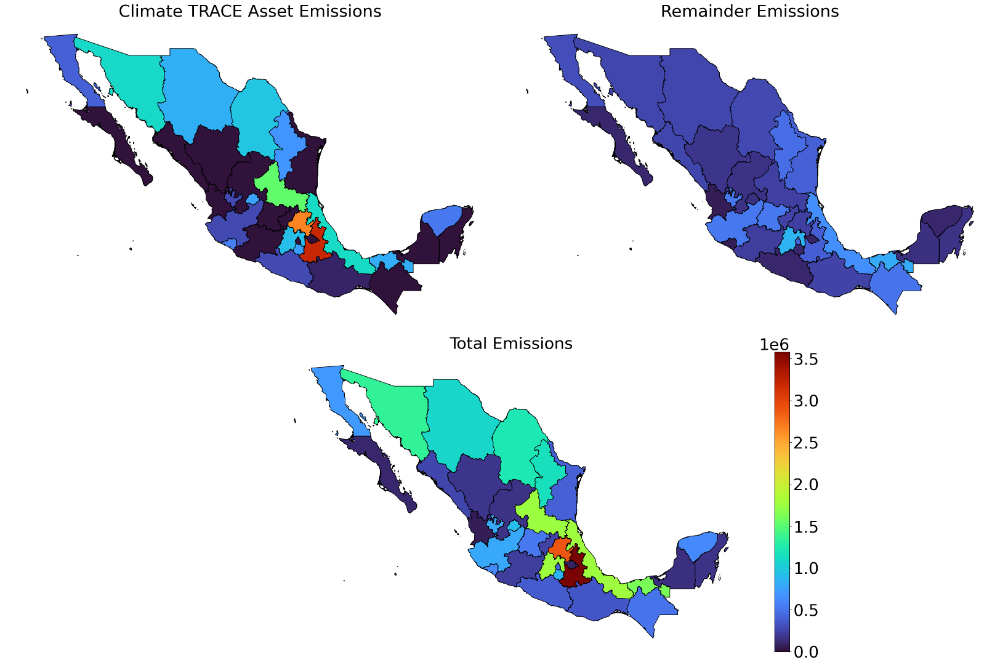

**Figure 5.** SCEs (top left), SUEs (top right), and total emissions (bottom) for Mexico from cement at GADM Administration 1. The SCEs subfigure shows the total emissions from cement accounted for in the Climate TRACE database, the SUEs dataset contains the unaccounted emissions after disaggregation, and the third plot is of the sum of the first two.

1.  **Ensemble Proxy**

We piloted the ensemble proxy approach discussed in 2.3.2 for the rice cultivation sector, which was chosen because Climate TRACE has very good data for some major rice-producing countries like China and India, but poor data for others like Nigeria, which produced over 5.5 million metric tons of rice from 2023-2024 (Foreign Agriculture Service. 2024). In addition, rice cultivation stood out as a sector where industrial signals like night lights and building volume would not be appropriate, but agricultural signals like GHS-SMOD R2023A low-density and very-low-density regions also did not clearly correlate with emissions. The correlation between Climate TRACE emissions data and each proxy is shown in Figure 6, where *built\_up\_nres, built\_up\_volume, population\_count, night\_light\_intensity*, and *agriculture\_proxy* are defined as in Table 1, and emissions\_quantity represents the methane emissions due to rice cultivation. Rice cultivation results mainly in methane emissions, so we focus on methane in the rest of this section.

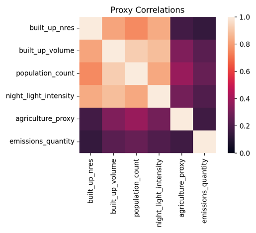

**Figure 6.** Correlation Between Common Proxies and Methane from Rice Cultivation

We further assessed the relationship between the proxies by evaluating the mean squared error between each proxy and the Climate TRACE emissions distribution and comparing that to the results of the RF-produced ensemble proxy. After evaluating the suite of proxies that we assembled for the ensemble, we found that no single proxy uniformly outperformed the other proxies in all countries in the training set. This supports the idea that an ensemble proxy is needed for a more generalizable and accurate proxy, at least when discussing rice cultivation. This is further supported by the resultant RF feature importance analysis shown in Figure 7. Notice that no single proxy contributes overwhelmingly to the RF ensemble model.

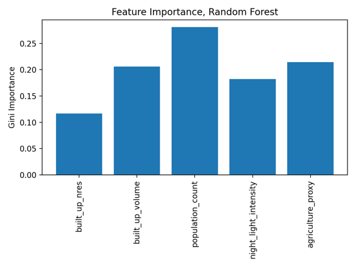

**Figure 7.** Random Forest Feature Importance

Furthermore, the trained RF produced an ensemble proxy that was able to outperform all the considered individual proxies, including the agriculture proxy which showed the most initial promise (since rice is an agricultural product). When compared specifically to the agriculture proxy, the error in the ensemble proxy was lower than the error from the agricultural proxy in 33 out of 34 countries where Climate TRACE has near-complete data. These 33 countries encompass 99.5% of the methane emissions attributed to countries where Climate TRACE has high completeness (&gt;99.9%) in their bottom-up data. The difference in the mean squared errors for the agricultural and ensemble proxies are displayed in Figure 8. Furthermore, the ensemble proxy places a higher percentage of emissions in the correct GADM region. While 74.5% of methane emissions were accurately attributed to the correct GADM region using the agricultural proxy, the ensemble proxy was able to accurately place 85.7% of global methane emissions. This improvement is significant, though of course there is room for more improvement in future iterations of the ensemble.

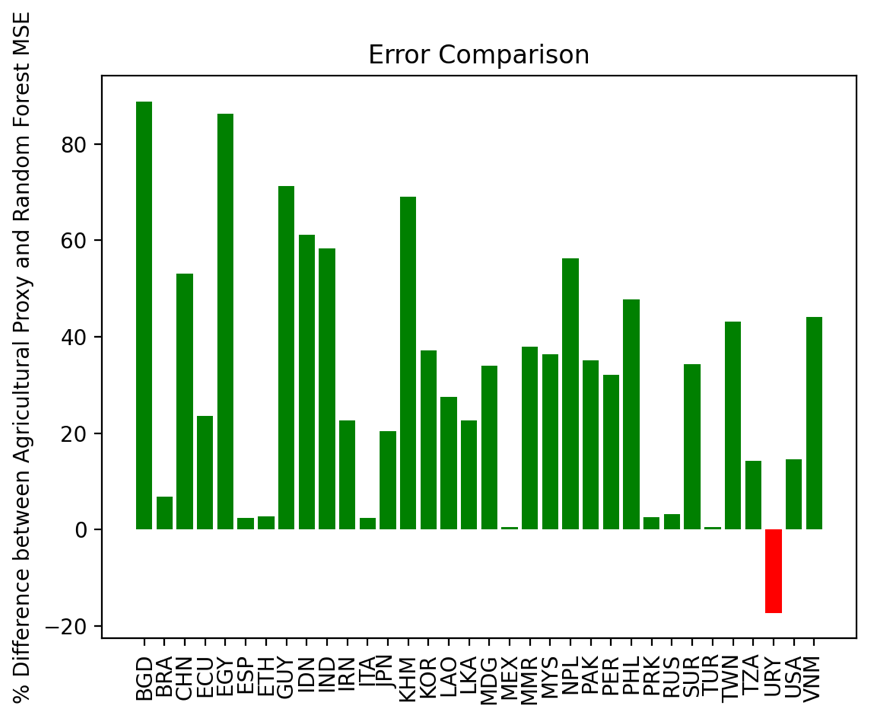

**Figure 8.** Percent Difference in the Error Between RF and Agricultural Proxies

The emissions distribution predicted by the proxy for a portion of Asia is shown in Figure 9 and can be compared to the Climate TRACE emissions data depicted in Figure 10. The random forest proxy is able to allocate emissions to GADM regions where Climate TRACE also records emissions. However, one drawback of all the proxies we studied, including the trained ensemble, was that they were not able to accurately capture outlier emissions, such as the 241,727 tons of methane emissions recorded for Aksu prefecture in the Xinjiang Uygur region of China (GADM CHN.28.1\_1).

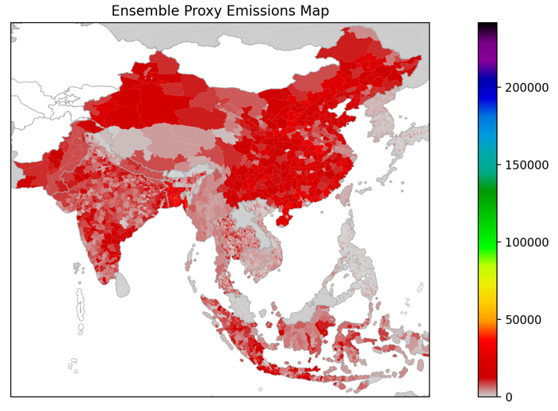

**Figure 9.** Ensemble Proxy Emissions Distribution

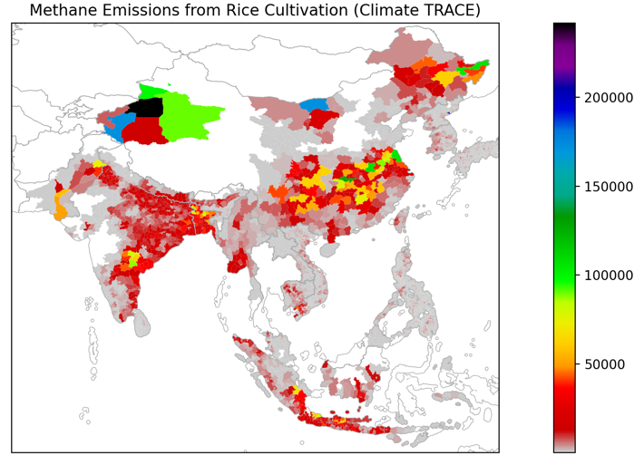

**Figure 10.** Climate TRACE Database Emissions Distribution

#### Conclusions

Spatially distributed products from Climate TRACE use a combination of location-specific asset-level information as well as proxied SUE data on modified supports. The modified proxies take traditional proxies (like nightlights and human population count) and remove mass (GHGs) from regions where asset-level GHG emissions are known.

We take a data-driven, rather than heuristic, approach to the use of proxies for spatial disaggregation of SUEs. This is made possible because the Climate TRACE database contains near-complete bottom-up rice cultivation emissions data for 34 countries which account for 77.6% of estimated global methane emissions due to rice cultivation. With this additional information, we are able to produce new insights regarding the accuracy of current commonly-used proxies and propose an ensemble proxy which combines features of multiple single proxies.

First, we find that of the commonly used emissions proxies, no single proxy has been found to accurately reflect the distribution of methane emissions from rice cultivation. However, an ensemble proxy trained on asset-level data has the potential to provide a more tailored, data-informed approach to spatial distribution proxying. In fact, we find that the inclusion of high accuracy point source emissions data provides a detailed picture of emissions distributions that commonly used proxies are not able to accurately recreate. For example, in a majority of countries analyzed, the true GADM2-level spatial distribution of rice cultivation methane emissions was better approximated by a trained ensemble proxy than by an agricultural proxy which is the current preferred proxy used by entities like EDGAR and the Community Emissions Data System for Historical Emissions (CEDS), as discussed in Crippa et al. 2024 and Hoesly et al. 2018.

While the random forest regressor is flexible and learns well, it does not take the proximity of nearby GADM regions into account. To address this, we have begun development on a more advanced approach to emissions distributions. Emissions and proxies are discretized on a global grid with 1 degree by 1 degree resolution. The distributions can then be analyzed using methods developed for image analysis. Specifically, we train a convolutional neural network (CNN) on the gridded proxies and evaluate it against gridded Climate TRACE emissions data. By maintaining the spatial relationships between regions, training on the CNN should be able to improve the accuracy of the ensemble proxies.

#### Acknowledgements

Thanks to Aaron Davitt, from WattTime for their help in reviewing our methodology, as well as Peter Thomas and Ishan Saraswat for producing GADM-level proxies for our analysis. We thank an APL intern, Carah Katz, for her assistance developing a disaggregation approach for non-point-source assets.

#### Supplementary Materials

**Table 2.** SUEs for 2022 listed by sector in order from largest to smallest SUEs.

<table><tbody><tr class="odd"><td><strong>Sector</strong></td><td>
<strong>Climate TRACE Total</strong>

<strong>Emissions (MT)</strong>
</td><td><strong>SUEs (MT)</strong></td><td><strong>%Missing</strong></td></tr><tr class="even"><td><em>All Sectors</em></td><td><em>77581.62</em></td><td><em>15474.44</em></td><td><em>19.95</em></td></tr><tr class="odd"><td>other-energy-use</td><td>1804.4</td><td>1804.4</td><td>100.00</td></tr><tr class="even"><td>other-manufacturing</td><td>1724.75</td><td>1707.36</td><td>98.99</td></tr><tr class="odd"><td>fluorinated-gases</td><td>1537.12</td><td>1537.12</td><td>100.00</td></tr><tr class="even"><td>other-agricultural-soil-emissions</td><td>1374.87</td><td>1374.87</td><td>100.00</td></tr><tr class="odd"><td>other-chemicals</td><td>1200.05</td><td>1110.63</td><td>92.55</td></tr><tr class="even"><td>enteric-fermentation-cattle-operation</td><td>1014.39</td><td>908.05</td><td>89.52</td></tr><tr class="odd"><td>enteric-fermentation-other</td><td>792.57</td><td>792.57</td><td>100.00</td></tr><tr class="even"><td>cement</td><td>2272.78</td><td>771.88</td><td>33.96</td></tr><tr class="odd"><td>solid-fuel-transformation</td><td>672.71</td><td>672.71</td><td>100.00</td></tr><tr class="even"><td>other-fossil-fuel-operations</td><td>597.66</td><td>597.66</td><td>100.00</td></tr><tr class="odd"><td>iron-and-steel</td><td>3509.9</td><td>597.51</td><td>17.02</td></tr><tr class="even"><td>domestic-wastewater-treatment-and-discharge</td><td>743.41</td><td>593.11</td><td>79.78</td></tr><tr class="odd"><td>solid-waste-disposal</td><td>1337.74</td><td>463.25</td><td>34.63</td></tr><tr class="even"><td>electricity-generation</td><td>13237.93</td><td>318.7</td><td>2.41</td></tr><tr class="odd"><td>manure-management-other</td><td>225.1</td><td>225.1</td><td>100.00</td></tr><tr class="even"><td>other-onsite-fuel-usage</td><td>202.66</td><td>202.66</td><td>100.00</td></tr><tr class="odd"><td>crop-residues</td><td>201.77</td><td>201.77</td><td>100.00</td></tr><tr class="even"><td>manure-applied-to-soils</td><td>167.85</td><td>167.85</td><td>100.00</td></tr><tr class="odd"><td>other-transport</td><td>162.65</td><td>162.65</td><td>100.00</td></tr><tr class="even"><td>industrial-wastewater-treatment-and-discharge</td><td>166.37</td><td>156.46</td><td>94.04</td></tr><tr class="odd"><td>aluminum</td><td>436.39</td><td>135.63</td><td>31.08</td></tr><tr class="even"><td>food-beverage-tobacco</td><td>263.76</td><td>109.42</td><td>41.49</td></tr><tr class="odd"><td>railways</td><td>102.83</td><td>102.83</td><td>100.00</td></tr><tr class="even"><td>heat-plants</td><td>91.36</td><td>91.36</td><td>100.00</td></tr><tr class="odd"><td>international-shipping</td><td>677.67</td><td>87.07</td><td>12.85</td></tr><tr class="even"><td>lime</td><td>505.25</td><td>76.98</td><td>15.24</td></tr><tr class="odd"><td>manure-management-cattle-operation</td><td>96.31</td><td>74.56</td><td>77.42</td></tr><tr class="even"><td>incineration-and-open-burning-of-waste</td><td>66.26</td><td>66.26</td><td>100.00</td></tr><tr class="odd"><td>rice-cultivation</td><td>762.92</td><td>64.71</td><td>8.48</td></tr><tr class="even"><td>pulp-and-paper</td><td>106.6</td><td>63.48</td><td>59.55</td></tr><tr class="odd"><td>iron-mining</td><td>119.38</td><td>50.69</td><td>42.46</td></tr><tr class="even"><td>other-mining-quarrying</td><td>32.6</td><td>32.6</td><td>100.00</td></tr><tr class="odd"><td>oil-and-gas-transport</td><td>2009.54</td><td>26.35</td><td>1.31</td></tr><tr class="even"><td>biological-treatment-of-solid-waste-and-biogenic</td><td>24.63</td><td>24.63</td><td>100.00</td></tr><tr class="odd"><td>other-metals</td><td>58.22</td><td>20.33</td><td>34.92</td></tr><tr class="even"><td>residential-onsite-fuel-usage</td><td>3370.14</td><td>20.2</td><td>0.60</td></tr><tr class="odd"><td>wood-and-wood-products</td><td>15.6</td><td>15.6</td><td>100.00</td></tr><tr class="even"><td>copper-mining</td><td>87.58</td><td>13.36</td><td>15.25</td></tr><tr class="odd"><td>glass</td><td>46.72</td><td>7.78</td><td>16.65</td></tr><tr class="even"><td>textiles-leather-apparel</td><td>52.95</td><td>7.22</td><td>13.63</td></tr><tr class="odd"><td>oil-and-gas-refining</td><td>969.73</td><td>6.17</td><td>0.64</td></tr><tr class="even"><td>bauxite-mining</td><td>12.18</td><td>2.87</td><td>23.61</td></tr><tr class="odd"><td>road-transportation</td><td>6440.17</td><td>1.7</td><td>0.03</td></tr><tr class="even"><td>non-residential-onsite-fuel-usage</td><td>460.63</td><td>1.34</td><td>0.29</td></tr><tr class="odd"><td>rock-quarrying</td><td>1.25</td><td>1.25</td><td>100.00</td></tr><tr class="even"><td>petrochemical-steam-cracking</td><td>284.94</td><td>1.13</td><td>0.40</td></tr><tr class="odd"><td>forest-land-fires</td><td>5650.01</td><td>1.1</td><td>0.02</td></tr><tr class="even"><td>shrubgrass-fires</td><td>3209.72</td><td>0.71</td><td>0.02</td></tr><tr class="odd"><td>sand-quarrying</td><td>0.56</td><td>0.56</td><td>100.00</td></tr><tr class="even"><td>wetland-fires</td><td>43.4</td><td>0.15</td><td>0.35</td></tr><tr class="odd"><td>synthetic-fertilizer-application</td><td>542.05</td><td>0.04</td><td>0.01</td></tr><tr class="even"><td>domestic-shipping</td><td>387.77</td><td>0.02</td><td>0.00</td></tr><tr class="odd"><td>domestic-aviation</td><td>297.43</td><td>0.01</td><td>0.00</td></tr><tr class="even"><td>international-aviation</td><td>414.87</td><td>0.01</td><td>0.00</td></tr><tr class="odd"><td>cropland-fires</td><td>1392.76</td><td>0.01</td><td>0.00</td></tr><tr class="even"><td>manure-left-on-pasture-cattle</td><td>373.85</td><td>0</td><td>0.00</td></tr><tr class="odd"><td>forest-land-clearing</td><td>5295.84</td><td>0</td><td>0.00</td></tr><tr class="even"><td>removals</td><td>125.52</td><td>0</td><td>0.00</td></tr><tr class="odd"><td>coal-mining</td><td>1848.5</td><td>0</td><td>0.00</td></tr><tr class="even"><td>forest-land-degradation</td><td>367.4</td><td>0</td><td>0.00</td></tr><tr class="odd"><td>net-wetland</td><td>163.88</td><td>0</td><td>0.00</td></tr><tr class="even"><td>net-forest-land</td><td>936.91</td><td>0</td><td>0.00</td></tr><tr class="odd"><td>net-shrubgrass</td><td>922.64</td><td>0</td><td>0.00</td></tr><tr class="even"><td>chemicals</td><td>602.05</td><td>0</td><td>0.00</td></tr><tr class="odd"><td>enteric-fermentation-cattle-pasture</td><td>1130.02</td><td>0</td><td>0.00</td></tr><tr class="even"><td>oil-and-gas-production</td><td>3757.5</td><td>0</td><td>0.00</td></tr><tr class="odd"><td>water-reservoirs</td><td>76.65</td><td>0</td><td>0.00</td></tr></tbody></table>

**Table 3** Proxies used for each sector for SUE disaggregation. Night lights refers to the VIIRS night light maps (Elvidge *et al.* 2021), population count is from the GHSL population count for 2020, and the agriculture proxy product is from GHSL (Schiavina *et al.* 2023).

|                                                   |                                                  |                                                      |
|---------------------------------------------------|--------------------------------------------------|------------------------------------------------------|
| **Category**                                      | **Sector Name**                                  | **Proxy**                                            |
| Fossil fuel, Manufacturing, and Transport Sectors | aluminum                                         | Night Light Intensity                                |
|                                                   | bauxite-mining                                   |                                                      |
|                                                   | cement                                           |                                                      |
|                                                   | chemicals                                        |                                                      |
|                                                   | coal-mining                                      |                                                      |
|                                                   | copper-mining                                    |                                                      |
|                                                   | domestic-aviation                                |                                                      |
|                                                   | domestic-shipping                                |                                                      |
|                                                   | electricity-generation                           |                                                      |
|                                                   | food-beverage-tobacco                            |                                                      |
|                                                   | fluorinated-gases                                |                                                      |
|                                                   | glass                                            |                                                      |
|                                                   | heat-plants                                      |                                                      |
|                                                   | international-aviation                           |                                                      |
|                                                   | international-shipping                           |                                                      |
|                                                   | iron-and-steel                                   |                                                      |
|                                                   | iron-mining                                      |                                                      |
|                                                   | lime                                             |                                                      |
|                                                   | non-residential-onsite-fuel-usage                |                                                      |
|                                                   | oil-and-gas-production                           |                                                      |
|                                                   | oil-and-gas-refining                             |                                                      |
|                                                   | oil-and-gas-transport                            |                                                      |
|                                                   | other-chemicals                                  |                                                      |
|                                                   | other-energy-use                                 |                                                      |
|                                                   | other-fossil-fuel-operations                     |                                                      |
|                                                   | other-manufacturing                              |                                                      |
|                                                   | other-metals                                     |                                                      |
|                                                   | other-mining-quarrying                           |                                                      |
|                                                   | other-onsite-fuel-usage                          |                                                      |
|                                                   | other-transport                                  |                                                      |
|                                                   | petrochemical-steam-cracking                     |                                                      |
|                                                   | pulp-and-paper                                   |                                                      |
|                                                   | railways                                         |                                                      |
|                                                   | residential-onsite-fuel-usage                    |                                                      |
|                                                   | road-transportation                              |                                                      |
|                                                   | rock-quarrying                                   |                                                      |
|                                                   | sand-quarrying                                   |                                                      |
|                                                   | solid-fuel-transformation                        |                                                      |
|                                                   | textiles-leather-apparel                         |                                                      |
|                                                   | wood-and-wood-products                           |                                                      |
| Waste Sectors                                     | biological-treatment-of-solid-waste-and-biogenic | Population Count                                     |
|                                                   | incineration-and-open-burning-of-waste           |                                                      |
|                                                   | domestic-wastewater-treatment-and-discharge      |                                                      |
|                                                   | industrial-wastewater-treatment-and-discharge    |                                                      |
|                                                   | solid-waste-disposal                             |                                                      |
| Agriculture Sectors                               | crop-residues                                    | GHSL *Very Low Density Rural +* GHSL *Rural Cluster* |
|                                                   | cropland-fires                                   |                                                      |
|                                                   | enteric-fermentation-cattle-operation            |                                                      |
|                                                   | enteric-fermentation-cattle-pasture              |                                                      |
|                                                   | enteric-fermentation-other                       |                                                      |
|                                                   | forest-land-clearing                             |                                                      |
|                                                   | forest-land-degradation                          |                                                      |
|                                                   | forest-land-fires                                |                                                      |
|                                                   | manure-applied-to-soils                          |                                                      |
|                                                   | manure-left-on-pasture-cattle                    |                                                      |
|                                                   | manure-management-cattle-operation               |                                                      |
|                                                   | manure-management-other                          |                                                      |
|                                                   | net-forest-land                                  |                                                      |
|                                                   | net-shrubgrass                                   |                                                      |
|                                                   | net-wetland                                      |                                                      |
|                                                   | other-agricultural-soil-emissions                |                                                      |
|                                                   | shrubgrass-fires                                 |                                                      |
|                                                   | synthetic-fertilizer-application                 |                                                      |
|                                                   | water-reservoirs                                 |                                                      |
|                                                   | wetland-fires                                    |                                                      |
|                                                   | removals                                         |                                                      |
|                                                   | rice-cultivation                                 | Ensemble Proxy                                       |

**Permissions and Use:** All Climate TRACE data is freely available under the Creative Commons Attribution 4.0 International Public License, unless otherwise noted below.

> **Data citation format:** Collins, G., Nellis, A., Raniga, K., Brown, N., Pekala, M., Doctor, Z., Moore, D., Reilly, E., and Hughes, M. (2025). *Spatial Disaggregation of Spatially Uncertain Emissions.* The Johns Hopkins University Applied Physics Laboratory (JHU/APL) and WattTime, USA, Climate TRACE Emissions Inventory. https://climatetrace.org \[Accessed date\]

**Geographic boundaries and names (iso3\_country data attribute):** The depiction and use of boundaries, geographic names and related data shown on maps and included in lists, tables, documents, and databases on Climate TRACE are generated from the Global Administrative Areas (GADM) project (Version 4.1 released on 16 July 2022) along with their corresponding ISO3 codes, and with the following adaptations:

-   HKG (China, Hong Kong Special Administrative Region) and MAC (China, Macao Special Administrative Region) are reported at GADM level 0 (country/national);

-   Kosovo has been assigned the ISO3 code ‘XKX’;

-   XCA (Caspian Sea) has been removed from GADM level 0 and the area assigned to countries based on the extent of their territorial waters;

-   XAD (Akrotiri and Dhekelia), XCL (Clipperton Island), XPI (Paracel Islands) and XSP (Spratly Islands) are not included in the Climate TRACE dataset;

-   ZNC name changed to ‘Turkish Republic of Northern Cyprus’ at GADM level 0;

-   The borders between India, Pakistan and China have been assigned to these countries based on GADM codes Z01 to Z09.

The above usage is not warranted to be error free and does not imply the expression of any opinion whatsoever on the part of Climate TRACE Coalition and its partners concerning the legal status of any country, area or territory or of its authorities, or concerning the delimitation of its borders.

**Disclaimer:** The emissions provided for this sector are our current best estimates of emissions, and we are committed to continually increasing the accuracy of the models on all levels. Please review our terms of use and the sector-specific methodology documentation before using the data. If you identify an error or would like to participate in our data validation process, please [contact us](mailto:coalition@climatetrace.org).

#### References

1.  Crippa, M., Guizzardi, D., Pagani, F., Schiavina, M., Melchiorri, M., Pisoni, E., Graziosi, F., Muntean, M., Maes, J., Dijkstra, L., Van Damme, M., Clarisse, L., and Coheur, P.: Insights into the spatial distribution of global, national, and subnational greenhouse gas emissions in the Emissions Database for Global Atmospheric Research (EDGAR v8.0), Earth Syst. Sci. Data, 16, 2811–2830, [doi:10.5194/essd-16-2811-2024](https://doi.org/10.5194/essd-16-2811-2024), 2024.

2.  Florczyk, A., C. Corbane, M. Schiavina, M. Pesaresi, L. Maffenini, M. Melchiorri, P. Politis. 2019. “GHS Urban Centre Database 2015, Multitemporal and Multidimensional Attributes, R2019A.” European Commission, Joint Research Centre (JRC). https://data.jrc.ec.europa.eu/dataset/53473144-b88c-44bc-b4a3-4583ed1f547e.

3.  Foreign Agriculture Service. 2024. *2023/2024 Rice Production*. United States Department of Agriculture. [https://fas.usda.gov/data/production/commodity/0422110](https://fas.usda.gov/data/production/commodity/0422110), 2024.

4.  Global Administrative Areas. 2022. “GADM Database of Global Administrative Areas, Version 4.1.” [https://www.gadm.org](https://www.gadm.org).

5.  Hoesly, R. M., Smith, S. J., Feng, L., Klimont, Z., Janssens-Maenhout, G., Pitkanen, T., Seibert, J. J., Vu, L., Andres, R. J., Bolt, R. M., Bond, T. C., Dawidowski, L., Kholod, N., Kurokawa, J.-I., Li, M., Liu, L., Lu, Z., Moura, M. C. P., O’Rourke, P. R., and Zhang, Q.: Historical (1750–2014) anthropogenic emissions of reactive gases and aerosols from the Community Emissions Data System (CEDS), Geosci. Model Dev., 11, 369-408, [https://doi.org/10.5194/gmd-11-369-2018](https://doi.org/10.5194/gmd-11-369-2018), 2018.

6.  Oda, T., Maksyutov, S., and Andres, R. J.: The Open-source Data Inventory for Anthropogenic CO2, version 2016 (ODIAC2016): a global monthly fossil fuel CO2 gridded emissions data product for tracer transport simulations and surface flux inversions, Earth Syst. Sci. Data, [doi:10.5194/essd-10-87-2018](http://www.earth-syst-sci-data.net/10/87/2018), 2018.
