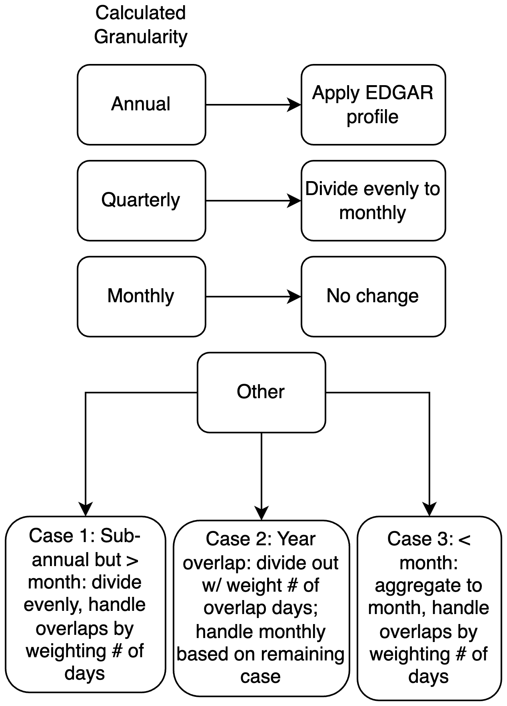
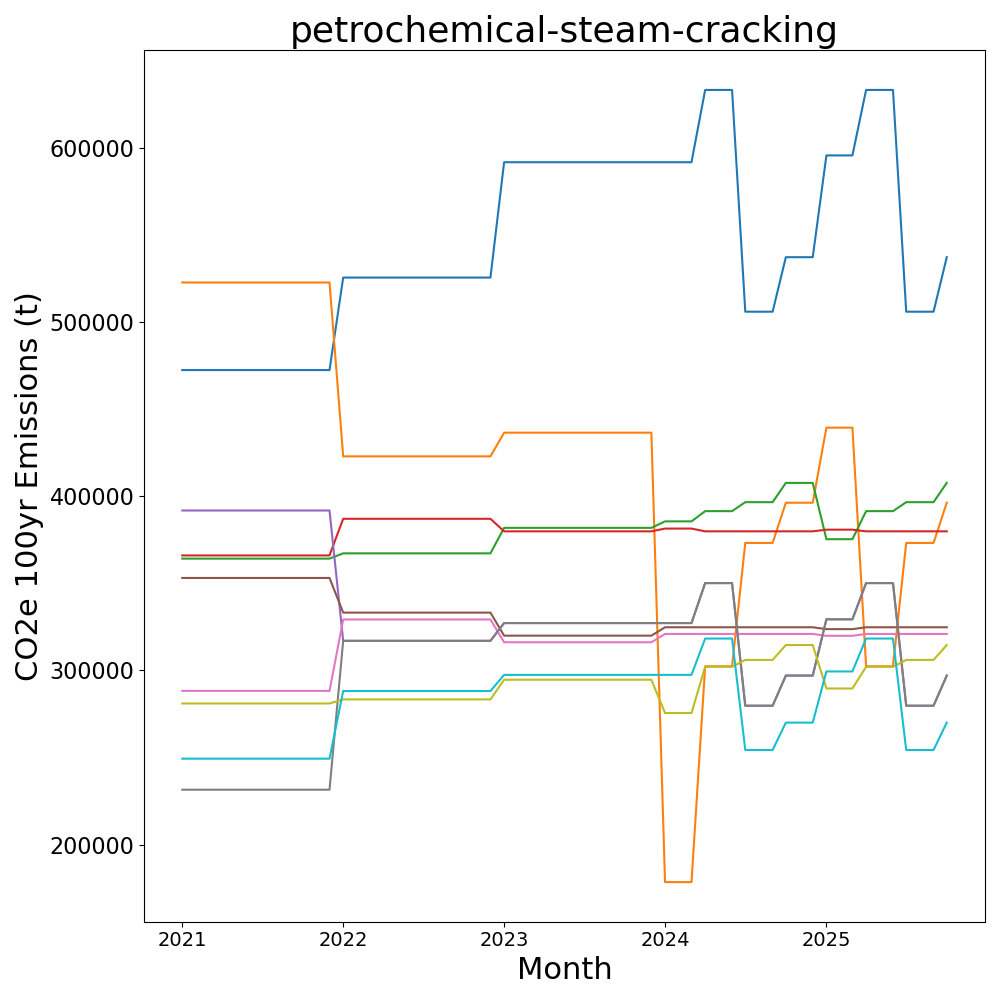
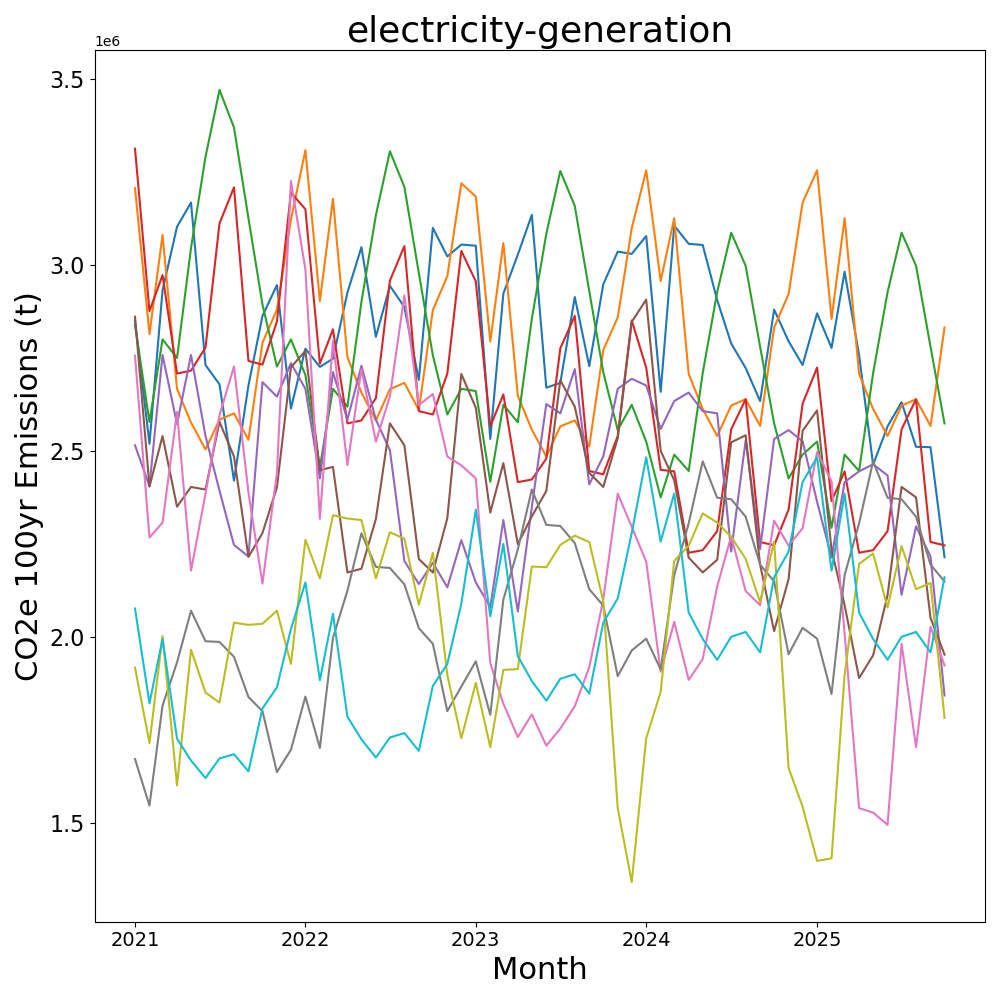
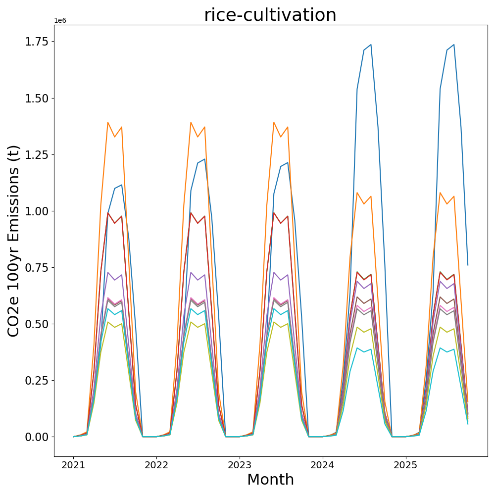
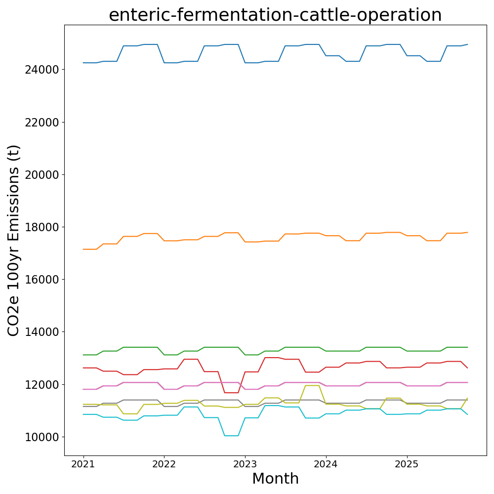
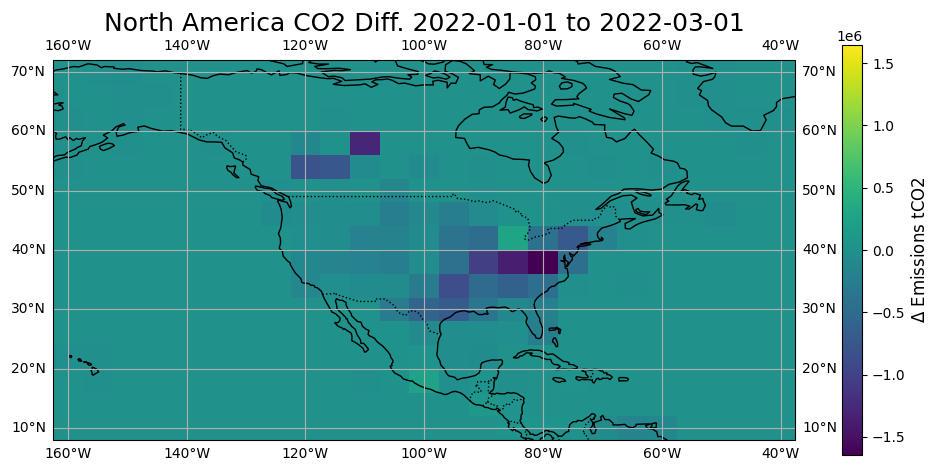
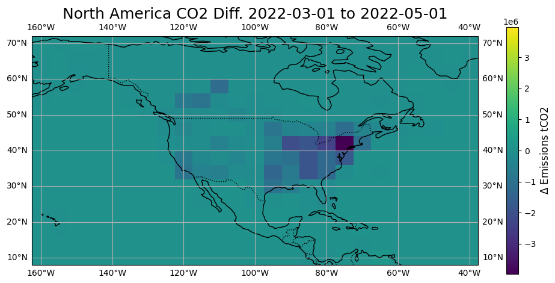
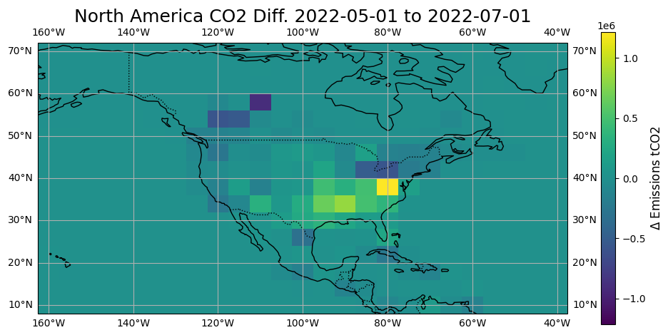
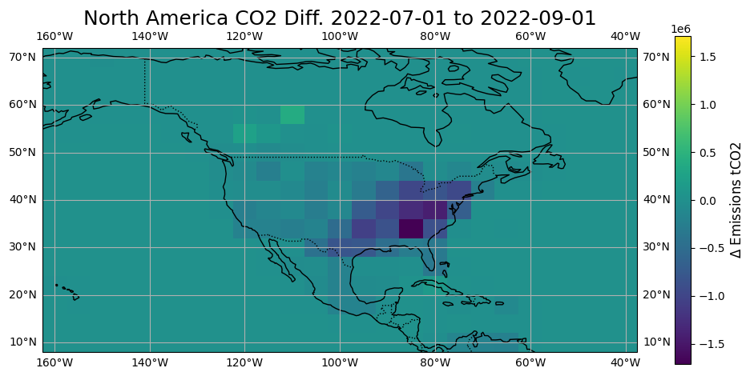
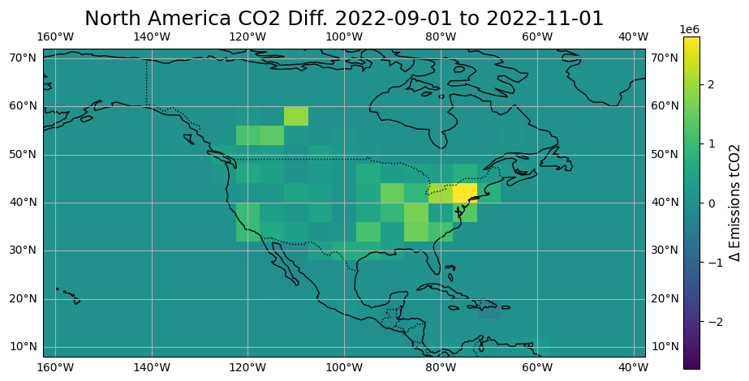

### Temporal Disaggregation of Emissions Data for the Climate TRACE Inventory

**Krsna Raniga1,3, Dan Moore1,3, Zoheyr Doctor1,3, Christy Lewis1,3, Lekha Sridhar1,3, Peter Thomas1,3, Ishan Saraswat1,3, Gary Collins2,3, April Nellis2,3, Nicole Brown2,3, Michael Pekala2,3, Justin Rokisky2,3, Elizabeth Reilly2,3, Marisa Hughes2,3, and Gavin McCormick1,3**

*1) WattTime, 2) Johns Hopkins University Applied Physics Laboratory, 3) Climate TRACE*

#### 1 Introduction

Greenhouse gas (GHG) emissions reporting inventories typically publish estimates at temporal granularities best suited to their specific expected use cases, with distinctions often made between scientific applications and regulatory accounting needs. For example, the Intergovernmental Panel on Climate Change (IPCC) 2006 guidelines establish emissions reporting at the annual level as good-practice, consistent with its policy-driven objectives (IPCC, 2006). On the other hand, atmospheric and climate modeling use cases, supported by sources such as Emissions Database for Global Atmospheric Research (EDGAR), require data at finer timescales to capture sub-annual variability (Janssens-Maenhout et. al., 2019).

Up to its V3.0.0 release in 2023, the Climate TRACE inventory only provided GHG emissions data at an annual level. However, beginning in the V4.0.0 release for 2024, and continuing for subsequent releases, Climate TRACE publishes monthly emissions data for CO2, N2O, CH4, and non-greenhouse-gas (non-GHG) emissions, for all emissions sources and countries for January 2021 through two months prior to the data release month. This is done through a combination of native-monthly data as generated by Climate TRACE sector leads and external scale factors applied to any non-monthly data. This finer temporal resolution ensures completeness and consistency of the inventory for most arbitrary spatio-temporal analyses, while allowing insight into the effects of seasonality, economic fluctuations, and other driving factors of short-term emissions dynamics.

#### 2 Materials and Methods

#### 2.1 Datasets employed

The EDGAR Temporal Profiles (r1) dataset was used to disaggregate annual values to monthly values as shown in Figure 1. These profiles are available by country and by sector as defined in the IPCC 2006 guidelines (Crippa et. al, 2020). If a Climate TRACE sector natively reported their emissions at the monthly level, the data was not further modified.

The EDGAR r1 sectors were mapped to Climate TRACE (hereafter, “TRACE”) sectors manually, where the relationships could generally be many-to-many TRACE-to-EDGAR sectors (see supplementary materials, Section 6 Table 1, for mapping). For a given TRACE sector with such a relationship, its profile was initialized by taking an unweighted average of the constituent r1 sectors. For an r1 sector which mapped to multiple TRACE sectors, the same profile was applied to each TRACE sector without additional manipulation.

#### 2.2 Source Methods

#### 2.2.1 Temporal Granularity Cases

Based on start and end times for an entry for a given emissions source (point or area), its temporal granularity was computed to classify the timestamp as annual, quarterly, monthly, or other - where other signified some arbitrary timestamp which may have crossed month or year boundaries. The decision map for transformation to monthly emissions is shown in Fig. 1

**Fig. 1**: Decision rule for handling different calculated temporal granularities.

For annual-to-monthly disaggregation cases, the TRACE-mapped r1 profiles were applied. Given the relationship between capacity (C), capacity factor (CF), activity (A), emissions factor (EF), and emissions (E) for the TRACE convention as shown below:

$`E\  = \ A*EF`$

$`A\  = \ C*CF`$

and differing relevant quantities by TRACE sector which operate as activity and capacity therein, a case-by-case mapping was needed for which variables were to be disaggregated or, in other words, which sectors’ emissions factors, activities, capacity factors, and/or capacities were relevantly time-dependent to generate a temporally varying emissions quantity. Most sectors followed a convention of time-dependent capacities, constant capacity factors (better described as utilization in this case), time-dependent activities, and constant emissions-factors; necessarily, emissions values were always time-dependent for all gases.

Otherwise, as shown in Fig. 1, quarterly emissions values were divided evenly in each respective quarter, with no additional profiles applied. For timestamps overlapping multiple months, the emissions were attributed to each constituent month weighted by the fraction of overlapping days. Finally, emissions natively reported at monthly level were left unchanged.

#### 2.2.2 Temporal Gap-Filling and Extrapolation

For emissions sources where any duration of time was missing across all entries between its first and last reported timestamps, e.g. if a month was missing an entry while all remaining months between January, 2021 to the final month of the dataset were reported, then the missing entry emissions and any associated metadata values are forward-filled then back-filled. This ensures that the next closest non-null value is used.

Emissions for each release are extrapolated forward to the final month of the dataset, nominally two months prior to the release date, for all sectors. Then each set of months which were not reported for that year or any year prior, emissions and associated metadata values from the equivalent month range of the last full reported year were used. Meaning, if January, February, and March 2022 were missing and January, February, and March 2021 were full, then 2021 values were used to fill in missing months in 2022. Similarly, if data did not extend back to January of 2021, then the analogous process was used to back-extrapolate data back to that minimum required initial timestamp.

#### 2.3 Country Methods

For country-level emissions estimates, the method was analogous to that of Section 2.2, save for two differences:

1.  For monthly-to-annual disaggregation: for each group of country, sector, gas, year, and month where any source emissions existed, such as individual facilities, land areas, or aggregated grid emissions, normalized monthly scale factors were backed out and then applied to the country-level emissions value. Where no sources existed, better described as “country-only” cases, whether as specific countries within a sector or entire sectors, the country-level emissions values were handled identically to the approach in Section 2.2.1.

2.  For missing time periods: TRACE country emissions span 2015 through two months prior to the month the data is released, while monthly source-level emissions span 2021 through two months prior to the month the data is released (though annual-level estimates do remain back to 2015 for some sectors). When this occurred and when the sum of source-level emissions exceeded country-level emissions from 2021 onward, then the average ratio between the two values for each country, gas and sector was calculated and multiplied by the 2015-2020 country emissions values. The purpose of this scale factor was to maintain any observed trends in country-level emissions prior to 2021 while ensuring that no apparent artificial increase manifested in any time series in the transition between 2020 and 2021.

#### 2.4 Confidence and Uncertainty

For more information on adjusting confidence and uncertainty estimates, see *Bottom-up and Implicit Estimation of Emissions in Other Sub-sectors* in the “[Post Processing for Global Emissions and Metadata Completeness](https://github.com/climatetracecoalition/methodology-documents/tree/main/2024/Post%20Processing%20for%20Global%20Emissions%20and%20Metadata%20Completeness)” methodology directory.

All Climate TRACE data submitted by contributors had corresponding categorical confidence values (“very low”, “low”, “medium”, “high”, “very high”), which were downgraded by one level if any temporal disaggregation was undertaken. For any gap-filling and extrapolation cases, confidence values were defaulted to “very low”.

For uncertainty estimates, an operating constraint that the variances of monthly values sum to the annual variance meant that the input variance was scaled by the monthly scale factors for the given sector.

#### 3 Results

#### 3.1 Temporal Disaggregation

Table 1 displays all sectors covered in Climate TRACE by their original granularity pre-intervention, level (source, country, or both), and appropriate intervention. Note that all sectors with any existing sources had a matching temporal granularity at the country-level but country-only sectors were all annual. The majority of TRACE sector data generated this year was annual, followed by month, then quarter. We are continuing to granularize all original sector data to monthly resolution where Table 1 will continue to evolve over subsequent monthly releases, and will be updated on major releases.

**Table 1:** Summary of source-level sectors classified by temporal granularity (pre-disaggregation), level, and intervention in input data, as of V5.0.0. See Fig. 1 for how decision rules are applied.

|                       |                     |                                    |                                                                                                                                                                                                                                                                                                                                                                                                                                                                                                                                               |
|-----------------------|---------------------|------------------------------------|-----------------------------------------------------------------------------------------------------------------------------------------------------------------------------------------------------------------------------------------------------------------------------------------------------------------------------------------------------------------------------------------------------------------------------------------------------------------------------------------------------------------------------------------------|
| **Input Granularity** | **Level**           | **Intervention**                   | **Sectors**                                                                                                                                                                                                                                                                                                                                                                                                                                                                                                                                   |
| **month**             | **Source, country** | **None**                           | aluminum, cement, chemicals, crop-residues, cropland-fires, domestic-aviation, domestic-shipping, domestic-wastewater-treatment-and-discharge, electricity-generation, industrial-wastewater-treatment-and-discharge, international-aviation, international-shipping, iron-and-steel, manure-applied-to-soils, non-residential-onsite-fuel-usage, oil-and-gas-production, oil-and-gas-transport, pulp-and-paper, residential-onsite-fuel-usage, road-transportation, solid-waste-disposal, synthetic-fertilizer-application, water-reservoirs |
| **annual**            | **Source, country** | **Disaggregation w/EDGAR Profile** | bauxite-mining, coal-mining, copper-mining, enteric-fermentation-cattle-pasture, food-beverage-tobacco, forest-land-clearing, forest-land-degradation, forest-land-fires, glass,iron-mining, lime, manure-left-on-pasture-cattle, net-forest-land, net-shrubgrass, net-wetland, oil-and-gas-refining, other-chemicals, other-manufacturing, other-metals, petrochemical-steam-cracking, removals, rice-cultivation, shrubgrass-fires, textiles-leather-apparel, wetland-fires                                                                 |
| **annual**            | **Country-only**    | **Disaggregation w/EDGAR Profile** | biological-treatment-of-solid-waste-and-biogenic, enteric-fermentation-other, fluorinated-gases, heat-plants, incineration-and-open-burning-of-waste, manure-management-other, other-agricultural-soil-emissions, other-energy-use, other-fossil-fuel-operations, other-mining-quarrying, other-onsite-fuel-usage, other-transport, railways, rock-quarrying, sand-quarrying, other-solid-fuels, wood-and-wood-products                                                                                                                       |
| **quarter**           | **Source, country** | **Even division**                  | enteric-fermentation-cattle-operation, forest-land-clearing, forest-land-degradation, forest-land-fires, manure-management-cattle-operation, shrubgrass-fires, wetland-fires                                                                                                                                                                                                                                                                                                                                                                  |

Fig. 2 displays the different temporal variation based on cases present in the data for four example sectors’ top 10 highest emitting sources from January 2021 to December 2024, as of V4.0.0. For ‘electricity-generation’, the monthly estimates were produced natively by WattTime disaggregating annual estimates based on modeled monthly electricity demand (see [*Emissions from Electricity Generation*](https://github.com/climatetracecoalition/methodology-documents/blob/main/2025/Power/Emissions%20from%20Electricity%20Generation-PowerSector-112025.docx.pdf) in the Climate TRACE methodology GitHub repo). In contrast, for ‘petrochemical-steam-cracking’, EDGAR yields a constant profile, so only annual step-changes are evident pre-2024, after which point the data is available at a quarterly cadence. For ‘rice-cultivation’, seasonal behavior with annual periodicity is visible. Finally, the figure for ‘enteric-fermentation-cattle-operation’ illustrates the effect of even disaggregation of quarterly emissions, evident through quarter-wise step changes. Note, individual sector data are continually moving toward monthly granularity, so these graphs depict example cases of temporal disaggregation rather than the current status of any single sector.

**Fig. 2**: Four of the top 10 highest emitting sectors, each representing different temporal profiling from V4.0.0. Top left: petrochemical-steam-cracking, mixed granularity with a constant profile (divided annual emissions values by 12) applied to annual-level data and even division for quarterly data. Top right: electricity-generation, modeled monthly electricity from input data (no disaggregation applied on emissions values). Bottom left: rice-cultivation, non-constant EDGAR profile applied to annual data. Bottom right: enteric-fermentation-cattle-operation, even disaggregation of quarterly (quarter emission values divided by 4).

#### 3.2 Temporal Disaggregation used in Atmospheric Modeling

For atmospheric modeling uses, due to the increased temporal granularity on top of fine-grained spatial and sectoral completeness, Climate TRACE can now better operate as a prior for inversion modeling. Fig. 3 highlights 4x5-degree gridded fossil-fuel CO2 emissions over continental North America visualized as relative changes between sequential two-month increments in 2022. Though at a coarse resolution, one of the most apparent effects captured, having included native-monthly data from TRACE as well as EDGAR profiles where needed, is the relative decrease in emissions moving from winter to spring of 2022, a partial increase over the United States going into the peak of summer, a decrease again moving out of summer, and the similar increase in emissions moving into winter from autumn at the end of the year. Note, the differences are sensitive to the size of time-step in the Fig. 2 exercise, but the winter-to-spring and autumn-to-winter changes as seen below strongly persist nevertheless under different time-steps.

**Fig. 3**: 2-month interval *changes* in gridded CO2 fossil-fuel emissions across 2022, for continental North America. Complete CO2 fossil-fuel budget was generated by summing source emissions within each grid cell and disaggregating country-level spatially uncertain emissions using spatial proxies (see *[Disaggregation of Spatially Uncertain Emissions](https://github.com/climatetracecoalition/methodology-documents/blob/main/2025/Post%20Processing%20for%20Global%20Emissions%20and%20Metadata%20Completeness/Disaggregation%20of%20Spatially%20Uncertain%20Emissions-112025.docx.pdf)* in the Climate TRACE methodology GitHub repo).

#### 4 Discussion

Climate TRACE has adopted a standardized monthly temporal granularity for reporting both GHG and non-GHG emissions, alongside their related quantities including capacities, activities, and their multiplicative factors. This critical shift aligns with continuing changes allowing for fine-grained completeness spatially, sectorally, and across gas species. For policy-driven decision-making, this temporal transformation enables detailed analyses of emissions in a given year to study impacts of total emissions from sources or aggregated regions of interest and allows for shorter-term evaluation of mitigation strategies. Moreover, monthly emissions are a critical step for atmospheric and climate modeling applications, serving to better integrate single-point observational measurements, while bridging the gap to even finer timescale disaggregation (e.g. 3-hourly).

The current methodology employs EDGAR’s sector-wise temporal profiles to handle cases where monthly data is unavailable, either when:

-   The TRACE contributor for a given sector could not themselves generate monthly values, typically due to limitations in input data frequency, or

-   Estimates for a given sector were generated post-hoc to submissions from core contributing teams of the Climate TRACE coalition, based on asset, facility, or source locations and information derived from annual-reporting public databases

This approach ensures that there is always at least a preliminary estimate, or "prior," of monthly emissions for a given year, knowing that the uncertainty of a given estimate will necessarily increase with higher temporal granularity.

The next step begets integrating and/or generating additional temporal proxies for sector-wise and regional monthly profiling, while simultaneously robustly testing the validity of any such given proxy choice current or new. Approaches to handle this include:

1.  Using monthly profiles from other emissions-specific inventories

2.  Using globally comprehensive, spatially sensitive, and monthly-coherent data such as temperature, humidity, population density, etc. as single proxies or components of ensemble proxies

3.  Using high-frequency estimates of ground-based plumes and/or atmospheric observations to generate full new profiles or perturb existing profiles for sector-region pairs of interest

Climate TRACE aims to generate independent, high-resolution emissions estimates that add value to both existing bottom-up and top-down accounting frameworks. The current temporal profiling status is a foundational step toward this goal, enabling broader domain coverage while supporting iterative and consistent improvement in accuracy and reliability.

#### 5 Acknowledgements

The authors acknowledge Dr. Aaron Davitt for his review of this document.

#### 6 Supplementary materials

**Table S1** Map by sector for which metadata variables, between activity, emissions\_factor, capacity, and capacity\_factor have time-dependence as denoted by the “\_is\_temporal” flag for each value; choice of temporal disaggregation depends on units.

|                                                  |                       |                             |                                                              |                                      |                                            |                            |                                            |                                    |
|--------------------------------------------------|-----------------------|-----------------------------|--------------------------------------------------------------|--------------------------------------|--------------------------------------------|----------------------------|--------------------------------------------|------------------------------------|
| **original\_inventory\_sector**                  | **activity\_units**   | **activity\_is\_ temporal** | **emissions\_factor\_ units**                                | **emissions\_factor\_is\_ temporal** | **capacity\_ units**                       | **capacity\_is\_temporal** | **capacity\_ factor\_ units**              | **capacity\_factor\_is\_temporal** |
| aluminum                                         | T of aluminum         | TRUE                        | T of CO2 per T of aluminum (direct only)                     | FALSE                                | T of aluminum                              | TRUE                       | unitless                                   | FALSE                              |
| bauxite-mining                                   | T of bauxite ore      | TRUE                        | T of CO2 per T of bauxite ore                                | FALSE                                | Tonnes                                     | TRUE                       | unitless                                   | FALSE                              |
| biological-treatment-of-solid-waste-and-biogenic | T of waste            | TRUE                        | T of CO2 per T of waste                                      | FALSE                                | population served or population equivalent | FALSE                      | T of waste per person                      | TRUE                               |
| cement                                           | T of cement           | TRUE                        | T of CO2 per T of cement (direct only)                       | FALSE                                | T of cement                                | TRUE                       | unitless                                   | FALSE                              |
| chemicals                                        | T of chemical         | TRUE                        | T of CO2 per T of chemical (direct only)                     | FALSE                                | T of chemical                              | TRUE                       | unitless                                   | FALSE                              |
| coal-mining                                      | T of coal             | TRUE                        | T of CO2 per T of coal extracted                             | FALSE                                | T of coal per year                         | FALSE                      | unitless                                   | TRUE                               |
| copper-mining                                    | T of copper ore       | TRUE                        | T of CO2 per T of copper ore                                 | FALSE                                | Tonnes                                     | TRUE                       | unitless                                   | FALSE                              |
| crop-residues                                    | Tonnes                | TRUE                        | Tonnes of CO2 per Tonnes of Crop residue                     | FALSE                                | area \[ha\]                                | FALSE                      | Tonnes per ha                              | TRUE                               |
| cropland-fires                                   | area \[ha\]           | TRUE                        | T of CO2 per ha burned                                       | FALSE                                | area \[ha\]                                | FALSE                      | unitless                                   | TRUE                               |
| domestic-aviation                                | T of fuel             | TRUE                        | T of CO2 per T of fuel                                       | FALSE                                | flights                                    | TRUE                       | T of fuel per flight                       | FALSE                              |
| domestic-shipping                                | Nautical miles (nmi)  | TRUE                        | T of CO2 per Nautical Miles (nmi)                            | FALSE                                | voyages and stays                          | TRUE                       | Nautical miles (nmi) per voyages and stays | FALSE                              |
| domestic-wastewater-treatment-and-discharge      | population served     | FALSE                       | T of CH4 per pop served                                      | TRUE                                 | population served or population equivalent | FALSE                      | unitless                                   | FALSE                              |
| electricity-generation                           | MWh                   | TRUE                        | T of CO2 per MWh                                             | FALSE                                | MW                                         | FALSE                      | MWh per MW                                 | TRUE                               |
| enteric-fermentation-cattle-operation            | animal head(s)        | FALSE                       | T of CO2 per animal head(s)                                  | TRUE                                 | animal head(s)                             | FALSE                      | unitless                                   | FALSE                              |
| enteric-fermentation-cattle-pasture              | animal head(s)        | FALSE                       | T of CO2 per animal head(s)                                  | TRUE                                 | animal head(s)                             | FALSE                      | unitless                                   | FALSE                              |
| enteric-fermentation-other                       | animal head(s)        | FALSE                       | T of CO2 per animal head(s)                                  | TRUE                                 | animal head(s)                             | FALSE                      | unitless                                   | FALSE                              |
| fluorinated-gases                                | Tonnes                | TRUE                        | T of CO2 per T of F-gas produced                             | FALSE                                | Tonnes                                     | TRUE                       | unitless                                   | FALSE                              |
| food-beverage-tobacco                            | USD                   | TRUE                        | T of CO2 per USD                                             | FALSE                                | USD                                        | TRUE                       | unitless                                   | FALSE                              |
| forest-land-clearing                             | T C in living biomass | TRUE                        | Emission efficiency factor (unitless)                        | FALSE                                | T CO2 / ha                                 | FALSE                      | ha                                         | TRUE                               |
| forest-land-degradation                          | T C in living biomass | TRUE                        | Emission efficiency factor (unitless)                        | FALSE                                | T CO2 / ha                                 | FALSE                      | ha                                         | TRUE                               |
| forest-land-fires                                | T C in living biomass | TRUE                        | Emission efficiency factor (unitless)                        | FALSE                                | T CO2 / ha                                 | FALSE                      | ha                                         | TRUE                               |
| glass                                            | USD                   | TRUE                        | T of CO2 per USD                                             | FALSE                                | USD                                        | TRUE                       | unitless                                   | FALSE                              |
| incineration-and-open-burning-of-waste           | T of solid waste      | TRUE                        | T of CO2 per T of solid waste                                | FALSE                                | T                                          | TRUE                       | unitless                                   | FALSE                              |
| industrial-wastewater-treatment-and-discharge    | Tonnes of Product     | TRUE                        | T of CO2 per T product                                       | FALSE                                | Tonnes of Product                          | TRUE                       | unitless                                   | FALSE                              |
| international-aviation                           | T of fuel             | TRUE                        | To of CO2 per T of fuel                                      | FALSE                                | flights                                    | TRUE                       | T of fuel per flight                       | FALSE                              |
| international-shipping                           | Nautical miles (nmi)  | TRUE                        | T of CO2 per Nautical Miles (nmi)                            | FALSE                                | voyages and stays                          | TRUE                       | Nautical miles (nmi) per voyages and stays | FALSE                              |
| iron-and-steel                                   | T of steel            | TRUE                        | T of CO2 per T of steel (direct only)                        | FALSE                                | T of steel                                 | TRUE                       | unitless                                   | FALSE                              |
| iron-mining                                      | T of iron ore         | TRUE                        | T of CO2 per T of iron ore                                   | FALSE                                | Tonnes                                     | TRUE                       | unitless                                   | FALSE                              |
| lime                                             | T of lime             | TRUE                        | T of CO2 per T of lime                                       | FALSE                                | T of lime                                  | TRUE                       | unitless                                   | FALSE                              |
| manure-applied-to-soils                          | kg of N               | TRUE                        | T of CO2 per kg of N                                         | FALSE                                | area \[ha\]                                | FALSE                      | kg of N per ha                             | TRUE                               |
| manure-left-on-pasture-cattle                    | animal head(s)        | FALSE                       | T of CO2 per animal head(s)                                  | TRUE                                 | animal head(s)                             | FALSE                      | unitless                                   | FALSE                              |
| manure-management-cattle-operation               | animal head(s)        | FALSE                       | T of CO2 per animal head(s)                                  | TRUE                                 | animal head(s)                             | FALSE                      | unitless                                   | FALSE                              |
| manure-management-other                          | animal head(s)        | FALSE                       | T of CO2 per animal head(s)                                  | TRUE                                 | animal head(s)                             | FALSE                      | unitless                                   | FALSE                              |
| net-forest-land                                  | T C in living biomass | TRUE                        | Emission efficiency factor (unitless)                        | FALSE                                | T CO2 / ha                                 | FALSE                      | ha                                         | TRUE                               |
| net-shrubgrass                                   | T C in living biomass | TRUE                        | Emission efficiency factor (unitless)                        | FALSE                                | T CO2 / ha                                 | FALSE                      | ha                                         | TRUE                               |
| net-wetland                                      | T C in living biomass | TRUE                        | Emission efficiency factor (unitless)                        | FALSE                                | T CO2 / ha                                 | FALSE                      | ha                                         | TRUE                               |
| non-broadcasting-vessels                         | Nautical miles (nmi)  | TRUE                        | T of CO2 per Nautical Miles (nmi)                            | FALSE                                | voyages and stays                          | TRUE                       | Nautical miles (nmi) per voyages and stays | FALSE                              |
| non-residential-onsite-fuel-usage                | TBD                   | TRUE                        | T of CO2 per TBD                                             | FALSE                                | TBD                                        | TRUE                       | TBD                                        | FALSE                              |
| oil-and-gas-production                           | High, Medium Low      | FALSE                       | License restricted                                           | FALSE                                |                                            | FALSE                      |                                            | FALSE                              |
| oil-and-gas-refining                             | BBL                   | TRUE                        | T of CO2 per BBL                                             | FALSE                                | BBL per day                                | FALSE                      | days                                       | TRUE                               |
| oil-and-gas-transport                            | High, Medium Low      | FALSE                       | License restricted                                           | FALSE                                |                                            | FALSE                      |                                            | FALSE                              |
| other-agricultural-soil-emissions                | area \[ha\]           | FALSE                       | T of CO2 per ha                                              | TRUE                                 | area \[ha\]                                | FALSE                      | unitless                                   | FALSE                              |
| other-chemicals                                  | Factories             | FALSE                       | T of CO2 per factory                                         | TRUE                                 | Factories                                  | FALSE                      | unitless                                   | FALSE                              |
| other-energy-use                                 | J                     | TRUE                        | T of CO2 per J                                               | FALSE                                | Joules                                     | TRUE                       | unitless                                   | FALSE                              |
| other-fossil-fuel-operations                     | T of fuel             | TRUE                        | T of CO2 per T of fuel                                       | FALSE                                | T of fuel                                  | TRUE                       | unitless                                   | FALSE                              |
| other-manufacturing                              | Factories             | FALSE                       | T of CO2 per factory                                         | TRUE                                 | Factories                                  | FALSE                      | unitless                                   | FALSE                              |
| other-metals                                     | Factories             | FALSE                       | T of CO2 per factory                                         | TRUE                                 | Factories                                  | FALSE                      | unitless                                   | FALSE                              |
| other-onsite-fuel-usage                          | TBD                   | TRUE                        | T of CO2 per TBD                                             | FALSE                                | TBD                                        | TRUE                       | TBD                                        | FALSE                              |
| other-transport                                  | Joules                | TRUE                        | T of CO2 per J                                               | FALSE                                | Joules                                     | TRUE                       | unitless                                   | FALSE                              |
| petrochemical-steam-cracking                     | Tonnes                | TRUE                        | T of CO2 per T of ethylene produced                          | FALSE                                | T of ethylene                              | TRUE                       | unitless                                   | FALSE                              |
| pulp-and-paper                                   | T of pulp & paper     | TRUE                        | T of CO2 per T of Pulp & Paper (direct only)                 | FALSE                                | T of pulp & paper                          | TRUE                       | unitless                                   | FALSE                              |
| railways                                         | Joules                | TRUE                        | T of CO2 per J                                               | FALSE                                | Joules                                     | TRUE                       | unitless                                   | FALSE                              |
| removals                                         | T C in living biomass | TRUE                        | Emission efficiency factor (unitless)                        | FALSE                                | T CO2 / ha                                 | FALSE                      | ha                                         | TRUE                               |
| residential-onsite-fuel-usage                    | TBD                   | TRUE                        | T of CO2 per TBD                                             | FALSE                                | TBD                                        | TRUE                       | TBD                                        | FALSE                              |
| rice-cultivation                                 | area \[ha\]           | TRUE                        | T of CO2 per harvested ha                                    | FALSE                                | area \[ha\]                                | FALSE                      | unitless                                   | TRUE                               |
| road-transportation                              | Vehicle\*km           | TRUE                        | T of CO2 per (Vehicle \* km)                                 | FALSE                                | km                                         | FALSE                      | vehicles in a month                        | TRUE                               |
| rock-quarrying                                   | T of rock             | TRUE                        | T of CO2 per T of rock                                       | FALSE                                | Tonnes                                     | TRUE                       | unitless                                   | FALSE                              |
| sand-quarrying                                   | T of sand             | TRUE                        | T of CO2 per T of sand                                       | FALSE                                | Tonnes                                     | TRUE                       | unitless                                   | FALSE                              |
| shrubgrass-fires                                 | T C in living biomass | TRUE                        | Emission efficiency factor (unitless)                        | FALSE                                | T CO2 / ha                                 | FALSE                      | ha                                         | TRUE                               |
| soil-organic-carbon                              | Tonnes                | TRUE                        | Tonnes of CO2 per total Tonnes of soil organic carbon change | FALSE                                | area \[ha\]                                | FALSE                      | Tonnes per ha                              | TRUE                               |
| solid-fuel-transformation                        | T of fuel             | TRUE                        | T of CO2 per T of fuel                                       | FALSE                                | T of fuel                                  | TRUE                       | unitless                                   | FALSE                              |
| solid-waste-disposal                             | Tonnes of waste       | FALSE                       | T of CO2 per T of waste                                      | TRUE                                 | m2                                         | FALSE                      | Tonnes per m2 of waste                     | FALSE                              |
| steel                                            | T of steel            | TRUE                        | T of CO2 per T of steel (direct only)                        | FALSE                                | T of steel                                 | TRUE                       | unitless                                   | FALSE                              |
| synthetic-fertilizer-application                 | kg of N               | TRUE                        | T of CO2 per kg of N                                         | FALSE                                | area \[ha\]                                | FALSE                      | kg of N per ha                             | TRUE                               |
| textiles-leather-apparel                         | USD                   | TRUE                        | T of CO2 per USD                                             | FALSE                                | USD                                        | TRUE                       | unitless                                   | FALSE                              |
| water-reservoirs                                 | m2                    | FALSE                       | T of CO2 per m2                                              | TRUE                                 | m2                                         | FALSE                      | fraction                                   | FALSE                              |
| wetland-fires                                    | T C in living biomass | TRUE                        | Emission efficiency factor (unitless)                        | FALSE                                | T C / ha                                   | FALSE                      | ha                                         | TRUE                               |

**Table S2** Sector-mapping from Climate TRACE sectors to EDGAR r1 temporal profile sectors based on IPCC 2006 categories.

|                                                                                 |                                  |                                                                                                        |
|---------------------------------------------------------------------------------|----------------------------------|--------------------------------------------------------------------------------------------------------|
| **Activity sector description**                                                 | **IPCC\_2006\_source\_category** | **climate\_trace\_sector**                                                                             |
| Energy industries (gas)                                                         | 1.A.1                            | electricity-generation                                                                                 |
| Energy industries, Pumped storage of electricity                                | 1.A.1                            |                                                                                                        |
| Energy industries (biofuels)                                                    | 1.A.1                            | electricity-generation                                                                                 |
| Energy industries (coal)                                                        | 1.A.1                            | electricity-generation                                                                                 |
| Energy industries, Nuclear in Pumped storage of electricity                     | 1.A.1                            |                                                                                                        |
| Energy industries (oil)                                                         | 1.A.1                            |                                                                                                        |
| Energy industries (other fuels)                                                 | 1.A.1                            | other-energy-use                                                                                       |
| Manufacturing industry, Iron and steel industry                                 | 1.A.2.a                          | iron-and-steel                                                                                         |
| Manufacturing industry, Chemical industry (combustion)                          | 1.A.2.c                          | chemicals, other-chemicals                                                                             |
| Manufacturing industry, Food and tobacco (combustion)                           | 1.A.2.e                          | food-beverage-tobacco                                                                                  |
| Manufacturing industry, Construction (combustion)                               | 1.A.2.k                          | other-manufacturing                                                                                    |
| International aviation                                                          | 1.A.3.a.i                        | international-aviation                                                                                 |
| Domestic aviation                                                               | 1.A.3.a.ii                       | domestic-aviation                                                                                      |
| International shipping                                                          | 1.A.3.d.i                        | domestic-shipping, international-shipping, non-broadcasting-vessels                                    |
| Inland waterways                                                                | 1.A.3.d.ii                       | N/A                                                                                                    |
| Fuel combustion in petroleum refineries                                         | 1.B.2.a.iii.4                    | oil-and-gas-refining                                                                                   |
| Fuel transformation in petroleum refineries                                     | 1.B.2.a.iii.6                    | other-fossil-fuel-operations                                                                           |
| Manufacturing industry, Iron and steel industry                                 | 1A2a                             | iron-and-steel                                                                                         |
| Manufacturing industry, Non-metallic minerals (combustion)                      | 1A2b                             | other-manufacturing                                                                                    |
| Manufacturing industry, Non-ferrous metals (combustion)                         | 1A2b                             | other-metals                                                                                           |
| Manufacturing industry, Paper, pulp and print (combustion)                      | 1A2d                             | pulp-and-paper                                                                                         |
| Manufacturing industry, Non-specified industry (combustion)                     | 1A2f                             | other-manufacturing                                                                                    |
| Manufacturing industry, Textiles (combustion)                                   | 1A2f                             | other-manufacturing                                                                                    |
| Manufacturing industry, Transport equipment (combustion)                        | 1A2f                             | textiles-leather-apparel                                                                               |
| Manufacturing industry, Machinery (combustion)                                  | 1A2f                             | other-manufacturing                                                                                    |
| Manufacturing industry, Mining (combustion)                                     | 1A2f                             | bauxite-mining, copper-mining, iron-mining, rock-quarrying, sand-quarrying, other-mining-quarrying     |
| Manufacturing industry, Wood and wood products (combustion)                     | 1A2f                             | other-manufacturing                                                                                    |
| Road transport                                                                  | 1A3b                             | road-transportation                                                                                    |
| Road transport evaporative emissions                                            | 1A3b v                           | N/A                                                                                                    |
| Rail transport                                                                  | 1A3c                             | railways                                                                                               |
| Other non-road transport                                                        | 1A3e                             | other-transport                                                                                        |
| Pipeline transport                                                              | 1A3e                             | N/A                                                                                                    |
| Small combustion                                                                | 1A4                              | residential-onsite-fuel-usage, non-residential-onsite-fuel-usage, other-onsite-fuel-usage              |
| Production of coal/gas/peat                                                     | 1B                               | N/A                                                                                                    |
| Transformation industry, Chemical heat for electricity production               | 1B                               | N/A                                                                                                    |
| Transformation industry, coal mines                                             | 1B1                              | coal-mining                                                                                            |
| Transformation industry, Fuel transformation coal liquefaction plants           | 1B1                              | other-solid-fuels                                                                                      |
| Transformation industry, Fuel transformation coke ovens                         | 1B1                              | other-solid-fuels                                                                                      |
| Transformation industry, Fuel combustion Peat Briquettes plants                 | 1B1                              | other-solid-fuels                                                                                      |
| Transformation industry, Fuel transformation gasification plants for biogas     | 1B1                              | other-solid-fuels                                                                                      |
| Transformation industry, Peat Briquettes plants                                 | 1B1                              | other-solid-fuels                                                                                      |
| Transformation industry, Fuel transformation charcoal production plants         | 1B1                              | other-solid-fuels                                                                                      |
| Transformation industry, Fuel combustion charcoal production plants             | 1B1                              | other-solid-fuels                                                                                      |
| Transformation industry, Fuel combustion Liquefaction/Regasification plants     | 1B1                              | other-solid-fuels                                                                                      |
| Transformation industry, Fuel combustion gasification plants for biogas         | 1B1                              | other-solid-fuels                                                                                      |
| Transformation industry, Fuel combustion non-specified transformation activity  | 1B1                              | other-solid-fuels                                                                                      |
| Transformation industry, Fuel combustion coke ovens                             | 1B1                              | other-solid-fuels                                                                                      |
| Transformation industry, Fuel combustion coal liquefaction plants               | 1B1                              | other-solid-fuels                                                                                      |
| Transformation industry,Blast furnaces                                          | 1B2                              | N/A                                                                                                    |
| Transformation industry, Transformation in Gas to liquids plants                | 1B2                              | N/A                                                                                                    |
| Transformation industry,Fuel combustion patent fuel plants                      | 1B2                              | N/A                                                                                                    |
| Transformation industry,Fuel combustion oil and gas extraction                  | 1B2                              | oil-and-gas-production, oil-and-gas-transport                                                          |
| Transformation industry, Petrochemical industry                                 | 1B2                              | petrochemical-steam-cracking                                                                           |
| Transformation industry, Fuel combustion blast furnaces                         | 1B2                              | N/A                                                                                                    |
| Transformation industry, Electric boilers                                       | 1B2                              | N/A                                                                                                    |
| Transformation industry, For blended natural gas                                | 1B2                              | N/A                                                                                                    |
| Transformation industry, Fuel transformation in gas works                       | 1B2                              | N/A                                                                                                    |
| Transformation industry, Fuel transformation Liquefaction/Regasification plants | 1B2                              | N/A                                                                                                    |
| Transformation industry, Non specified transformation activity                  | 1B2                              | N/A                                                                                                    |
| Transformation industry, Heat pumps                                             | 1B2                              | N/A                                                                                                    |
| Transformation industry, Gas works                                              | 1B2                              | N/A                                                                                                    |
| Transformation industry, Fuel transformation patent fuel plants                 | 1B2                              | N/A                                                                                                    |
| Transformation industry, Distribution losses in transformation processes        | 1B2                              | N/A                                                                                                    |
| Production of oil                                                               | 1B2                              | oil-and-gas-production, oil-and-gas-transport                                                          |
| Crude steel production                                                          | 2.C.1                            | iron-and-steel                                                                                         |
| Iron and steel production: Pellet production                                    | 2.C.1                            | iron-and-steel                                                                                         |
| Ferro Ally production                                                           | 2.C.2                            | other-metals                                                                                           |
| Food production                                                                 | 2.H.2                            | food-beverage-tobacco                                                                                  |
| Production of non-metallic minerals, Cement production                          | 2A1                              | cement                                                                                                 |
| Production of non-metallic minerals, Lime production                            | 2A2                              | lime                                                                                                   |
| Production of non-metallic minerals, Glass bottles                              | 2A3                              | glass                                                                                                  |
| Production of non-metallic minerals, Glass production                           | 2A3                              | glass                                                                                                  |
| Production of non-metallic minerals, Limestone and Dolomite Use                 | 2A3, 2A4                         | other-manufacturing                                                                                    |
| Production of non-metallic minerals, Soda ash production and use                | 2A3,2A4                          | other-manufacturing                                                                                    |
| Production of non-metallic minerals, Other uses of carbonate                    | 2A4                              | other-manufacturing                                                                                    |
| Production of non-metallic minerals, Other non-metallic minerals                | 2A4                              | other-manufacturing                                                                                    |
| Production of chemicals, Ammonia production                                     | 2B1                              | chemicals                                                                                              |
| Production of chemicals, Nitric acid production                                 | 2B2                              | other-chemicals                                                                                        |
| Production of chemicals, Adipic acid production                                 | 2B3                              | other-chemicals                                                                                        |
| Production of chemicals, Calcium carbide production                             | 2B4                              | other-chemicals                                                                                        |
| Production of chemicals, Sulphuric acid production                              | 2B5                              | other-chemicals                                                                                        |
| Production of chemicals, Bulk chemicals production                              | 2B5                              | other-chemicals                                                                                        |
| Production of chemicals, Specialities production                                | 2B5                              | other-chemicals                                                                                        |
| Production of chemicals, Silicon carbide production                             | 2B5                              | other-chemicals                                                                                        |
| Production of chemicals, Caprolactam production                                 | 2B5                              | other-chemicals                                                                                        |
| Production of chemicals, N-fertilizer production                                | 2B5                              | other-chemicals                                                                                        |
| Production of chemicals, Glyoxylic acid production                              | 2B5                              | other-chemicals                                                                                        |
| Production of chemicals, Glyoxal production                                     | 2B5                              | other-chemicals                                                                                        |
| Production of chemicals, Titanium oxide production                              | 2B6                              | other-chemicals                                                                                        |
| Steel casting                                                                   | 2C1                              | iron-and-steel                                                                                         |
| Pig iron production                                                             | 2C1                              | iron-and-steel                                                                                         |
| Sinter production                                                               | 2C1                              | iron-and-steel                                                                                         |
| Production of non-ferrous metals, Aluminium production                          | 2C3                              | aluminum                                                                                               |
| Production of non-ferrous metals, Magnesium production                          | 2C4                              | other-metals                                                                                           |
| Production of non-ferrous metals, Lead production                               | 2C5                              | other-metals                                                                                           |
| Production of non-ferrous metals, Zinc production                               | 2C6                              | other-metals                                                                                           |
| Production of non-ferrous metals, Copper production                             | 2C7                              | other-metals                                                                                           |
| Production of non-ferrous metals, Gold production                               | 2C7                              | other-metals                                                                                           |
| Production of non-ferrous metals, Mercury production                            | 2C7                              | other-metals                                                                                           |
| Production of non-ferrous metals, Other non-ferrous production                  | 2C7                              | other-metals                                                                                           |
| Production of non-metallic minerals, Brick production                           | 2C7                              | other-metals                                                                                           |
| Non energy use of fuels in industry, transformation industry                    | 2D                               | N/A                                                                                                    |
| Non energy use of fuels in petrochemical industry                               | 2D                               | petrochemical-steam-cracking                                                                           |
| Non energy use of fuels in transport sector                                     | 2D                               | N/A                                                                                                    |
| Other non energy use of fuels                                                   | 2D                               | N/A                                                                                                    |
| Other solvents use                                                              | 2D                               | N/A                                                                                                    |
| Pulp and paper production                                                       | 2D                               | pulp-and-paper                                                                                         |
| Solvents in rubber and plastics industry                                        | 2D                               | other-manufacturing                                                                                    |
| Solvents in vegetative oil extraction                                           | 2D                               | other-manufacturing                                                                                    |
| Solvents in paint                                                               | 2D                               | other-manufacturing                                                                                    |
| Solvents in pesticides                                                          | 2D                               | other-manufacturing                                                                                    |
| Solvents in chemical industry                                                   | 2D                               | other-manufacturing                                                                                    |
| Solvents in dry cleaning                                                        | 2D                               | other-manufacturing                                                                                    |
| Solvents in glues and adhesives                                                 | 2D                               | other-manufacturing                                                                                    |
| Solvents in households products                                                 | 2D                               | other-manufacturing                                                                                    |
| Solvents in industrial degreasing                                               | 2D                               | other-manufacturing                                                                                    |
| Solvents in leather production                                                  | 2D                               | textiles-leather-apparel                                                                               |
| Solvents in graphic arts                                                        | 2D                               | other-manufacturing                                                                                    |
| Production and use of other products                                            | 2G                               | fluorinated-gases                                                                                      |
| Enteric fermentation of ruminants                                               | 3.A.1                            | enteric-fermentation-cattle-operation, enteric-fermentation-cattle-pasture, enteric-fermentation-other |
| Forest Land Remaining Forest Land                                               | 3.B.1.a                          | N/A                                                                                                    |
| Forest to grassland conversion                                                  | 3.B.1.b.ii                       | N/A                                                                                                    |
| Large scale biomass burning                                                     | 3.C.1                            | forest-land-fires, shrubgrass-fires, wetland-fires                                                     |
| Agricultural waste burning                                                      | 3.C.1.b                          | cropland-fires                                                                                         |
| Agricultural soils, Limestone use                                               | 3.C.2                            | other-agricultural-soil-emissions                                                                      |
| Agricultural soils, CO2 from urea fertilization                                 | 3.C.3                            | other-agricultural-soil-emissions                                                                      |
| Agricultural soils, animals                                                     | 3.C.4                            | other-agricultural-soil-emissions                                                                      |
| Agricultural soils, N-fixing crop                                               | 3.C.4                            | other-agricultural-soil-emissions                                                                      |
| Agricultural soils, histosols                                                   | 3.C.4                            | other-agricultural-soil-emissions                                                                      |
| Agricultural soils, crop residues                                               | 3.C.4                            | other-agricultural-soil-emissions                                                                      |
| Agricultural soils, application of nitrogen fertilizers                         | 3.C.4                            | synthetic-fertilizer-application                                                                       |
| Indirect N2O from NOx and NH3                                                   | 3.C.5                            | other-agricultural-soil-emissions                                                                      |
| Indirect N2O emissions                                                          | 3.C.5                            | other-agricultural-soil-emissions                                                                      |
| Manure management                                                               | 3A2                              | manure-left-on-pasture-cattle, manure-management-cattle-operation, manure-management-other             |
| Manure as fertilizer                                                            | 3C4                              | other-agricultural-soil-emissions                                                                      |
| Rice cultivation                                                                | 3C7                              | rice-cultivation                                                                                       |
| Solid waste disposal: composting, landfills, hazardous, other                   | 4A, 4B                           | solid-waste-disposal, biological-treatment-of-solid-waste-and-biogenic                                 |
| Solid waste disposal: incineration                                              | 4C                               | incineration-and-open-burning-of-waste                                                                 |
| Waste Water Treatment                                                           | 4D                               | domestic-wastewater-treatment-and-discharge, industrial-wastewater-treatment-and-discharge             |
| Hydroelectric dam reservoir emissions                                           | 5.B                              | water-reservoirs                                                                                       |
| Fossil fuel fires: gas and oil fires                                            | 5.B                              | N/A                                                                                                    |
| Fossil fuel fires: Coal fires underground                                       | 5.B                              | N/A                                                                                                    |

**Permissions and Use:** All Climate TRACE data is freely available under the Creative Commons Attribution 4.0 International Public License, unless otherwise noted below.

> **Data citation format:** Raniga, K., Moore, D., Doctor, Z, , Lewis, C., Sridhar, L., Thomas, P., Saraswat, I., Collins, G., Nellis, A., Brown, N., Pekala, M., Rokisky, J., Reilly, E., Hughes, M. and McCormick, G. (2025). *Temporal Disaggregation of Emissions Data for the Climate TRACE Inventory.* WattTime and Johns Hopkins University Applied Physics Laboratory, USA, Climate TRACE Emissions Inventory. https://climatetrace.org \[Accessed date\]

**Geographic boundaries and names (iso3\_country data attribute):** The depiction and use of boundaries, geographic names and related data shown on maps and included in lists, tables, documents, and databases on Climate TRACE are generated from the Global Administrative Areas (GADM) project (Version 4.1 released on 16 July 2022) along with their corresponding ISO3 codes, and with the following adaptations:

-   HKG (China, Hong Kong Special Administrative Region) and MAC (China, Macao Special Administrative Region) are reported at GADM level 0 (country/national);

-   Kosovo has been assigned the ISO3 code ‘XKX’;

-   XCA (Caspian Sea) has been removed from GADM level 0 and the area assigned to countries based on the extent of their territorial waters;

-   XAD (Akrotiri and Dhekelia), XCL (Clipperton Island), XPI (Paracel Islands) and XSP (Spratly Islands) are not included in the Climate TRACE dataset;

-   ZNC name changed to ‘Turkish Republic of Northern Cyprus’ at GADM level 0;

-   The borders between India, Pakistan and China have been assigned to these countries based on GADM codes Z01 to Z09.

The above usage is not warranted to be error free and does not imply the expression of any opinion whatsoever on the part of Climate TRACE Coalition and its partners concerning the legal status of any country, area or territory or of its authorities, or concerning the delimitation of its borders.

**Disclaimer:** The emissions provided for this sector are our current best estimates of emissions, and we are committed to continually increasing the accuracy of the models on all levels. Please review our terms of use and the sector-specific methodology documentation before using the data. If you identify an error or would like to participate in our data validation process, please [contact us](mailto:coalition@climatetrace.org).

#### 7 References

1.  Collins, G., et al (2025). *Spatial Disaggregation of Spatially Uncertain Emissions* \[Online\]. Available at: [https://github.com/climatetracecoalition/methodology-documents/tree/main/2024/Post%20Processing%20for%20Global%20Emissions%20and%20Metadata%20Completeness](https://github.com/climatetracecoalition/methodology-documents/tree/main/2024/Post%20Processing%20for%20Global%20Emissions%20and%20Metadata%20Completeness) (Accessed: 15 November 2024)

2.  IPCC (Intergovernmental Panel on Climate Change), 2006. Chapter 1. *2006 IPCC Guidelines for National Greenhouse Gas Inventories,* *Volume 1, General Guidance and Reporting*. Published: IGES, Japan.

3.  Crippa, M., Solazzo, E., Huang, G., Guizzardi, D., Koffi, E., Muntean, M., Schieberle, C., Friedrich, R. and Janssens-Maenhout, G.: High resolution temporal profiles in the Emissions Database for Global Atmospheric Research. Sci Data 7, 121 (2020). doi:10.1038/s41597-020-0462-2.

4.  Freeman, J., Rouzbeh Kargar, A., Couture, H., Jeyaratnam, J., Lewis, J., Alvara, M., Koenig, H., Nakano, T., Davitt, A., Lewis, C., McCormick, G., Christian, C., and Doctor, Z. (2025). *Power sector-* *Emissions* *from* *Electricity Generation.* WattTime, USA Transition Zero, UK, Pixel Scientia Labs, USA and Global Energy Monitor, USA, Climate TRACE Emissions Inventory. https://climatetrace.org (Accessed: 1 November 2025).

5.  Janssens-Maenhout, G., Crippa, M., Guizzardi, D., Muntean, M., Schaaf, E., Dentener, F., Bergamaschi, P., Pagliari, V., Olivier, J. G. J., Peters, J. A. H. W., van Aardenne, J. A., Monni, S., Doering, U., Petrescu, A. M. R., Solazzo, E., and Oreggioni, G. D.: EDGAR v4.3.2 Global Atlas of the three major greenhouse gas emissions for the period 1970–2012, Earth Syst. Sci. Data, 11, 959–1002, https://doi.org/10.5194/essd-11-959-2019, 2019.

6.  Moore, D., Doctor, Z, Raniga, K., Lewis, C., Sridhar, L., Thomas, P., Saraswat, I., Betz, L., Piscopo, A., Collins, G., Nellis, A., Brown, N., Pekala, M., Rokisky, J., Reilly, E., Hughes, M. and McCormick, G. (2025). *Completeness of Bottom-up Emissions Estimates and Associated Metadata.* WattTime and Johns Hopkins University Applied Physics Laboratory, USA, Climate TRACE Emissions Inventory. [https://climatetrace.org](https://climatetrace.org) (Accessed: 1 November 2025).
